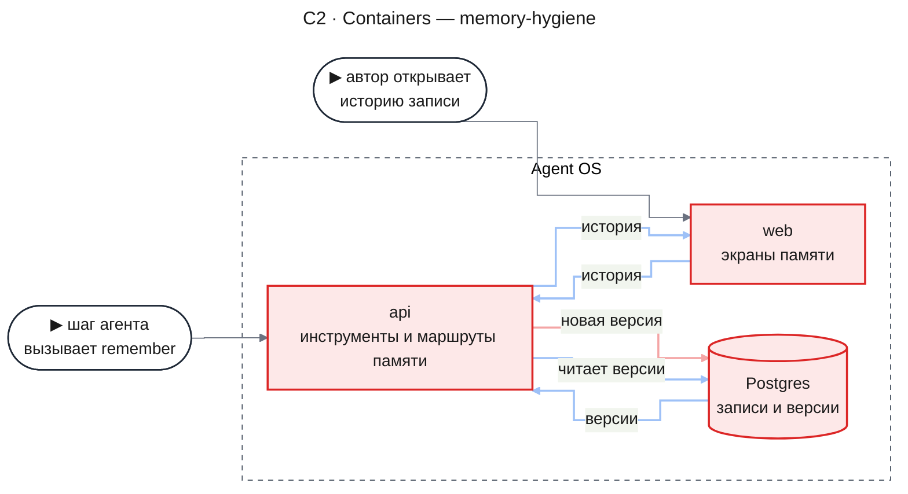
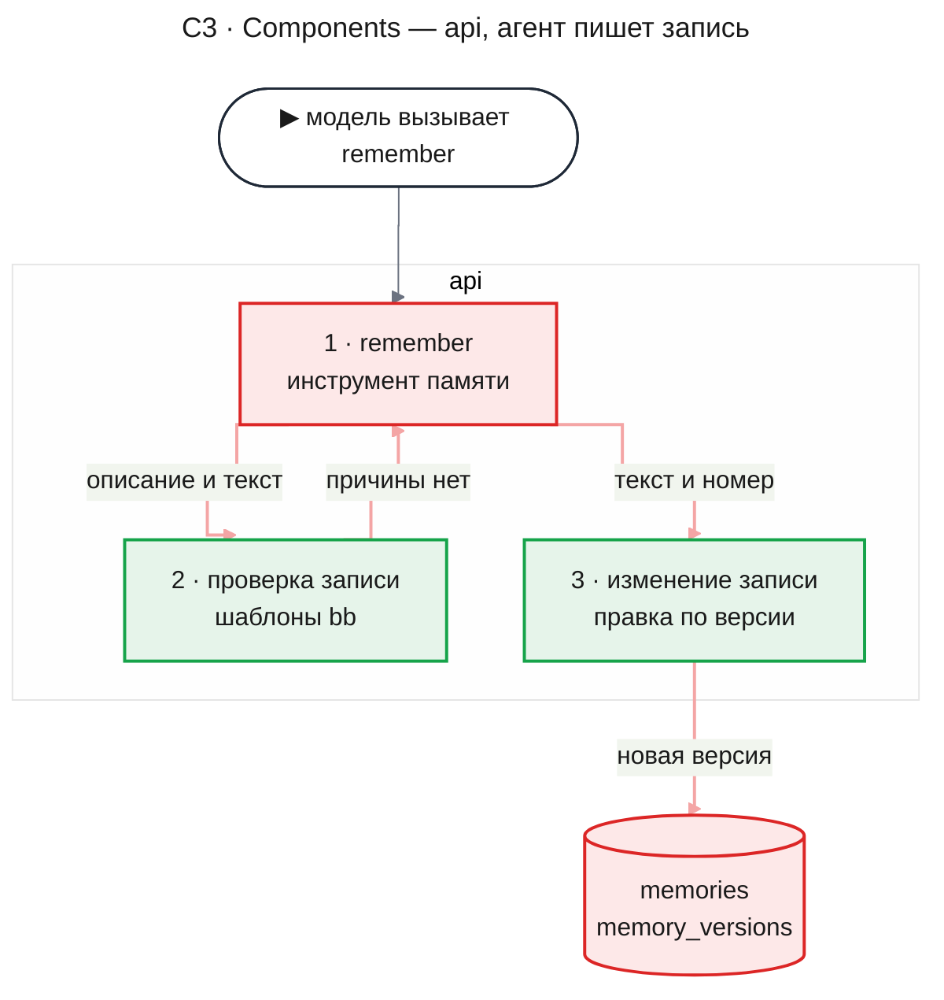
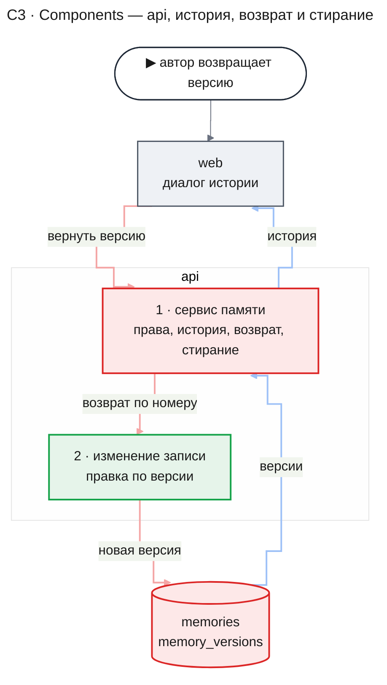
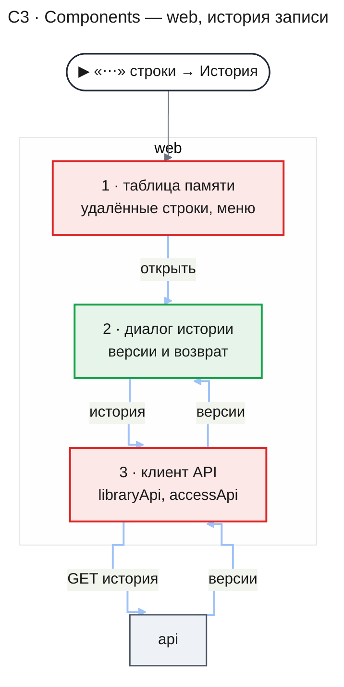
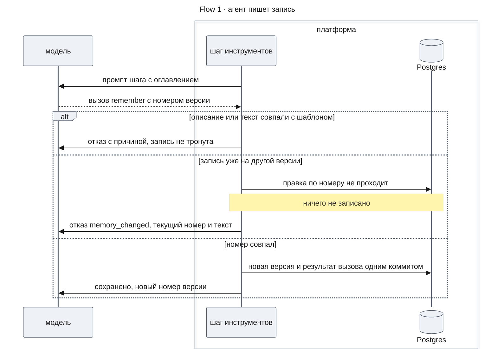
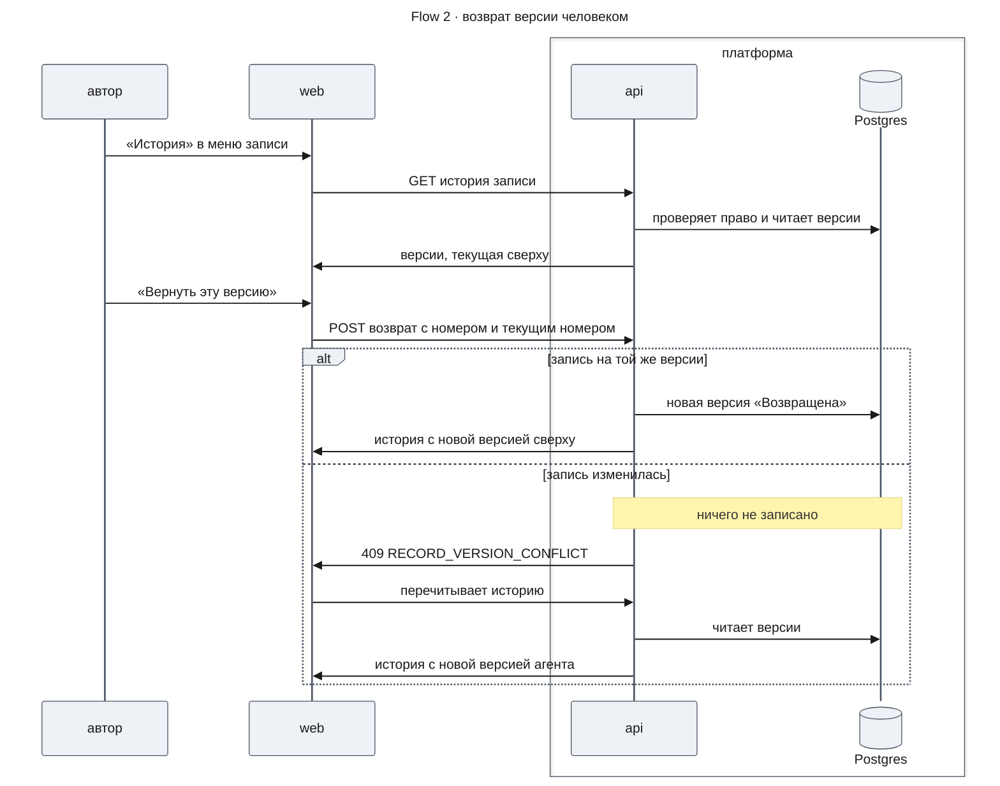
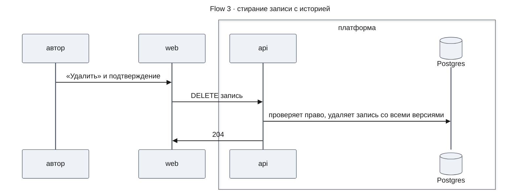
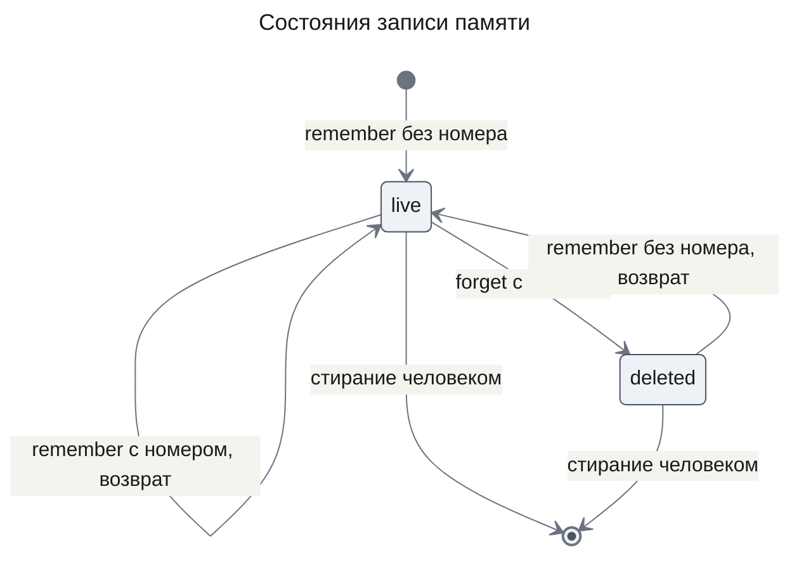

# Расписания, поиск по беседам и чистота памяти — Design Document — memory-hygiene

**Status:** На утверждении · **Date:** 2026-11-25 · **PRD:** [prd.md](./prd.md) · **UXRD:** [uxrd.md](./uxrd.md) · **Depends on:** нет

## Snapshot

**Overview.** Глубокий агент с самообучением ведёт память тремя инструментами: запомнить, прочитать, забыть. Часть добавляет к записи памяти историю: каждое изменение — новая неизменная версия с номером, а запись указывает на текущую. Агент правит запись по номеру версии, который видел, и правка от устаревшего номера отклоняется: агент получает текущий текст и решает заново. Перед записью платформа сверяет описание и текст с шаблонами секретов и приказов модели, взятыми без изменений из открытого проекта bb; совпавшую запись она не пишет и называет причину. На экранах памяти человек открывает историю записи, возвращает прежнюю версию и стирает запись вместе с историей.

- **Не меняется**: оглавление памяти в промпте, области записей, правило «чью память видит запуск», маска известных секретов, дерево обучения памяти не пишет.
- **Главный риск**: шаблоны ловят только вписанные в них формы — приказ по-русски или своими словами и секрет без узнаваемой формы проходят в память ([Risks](#risks-and-mitigation)).
- **Открытые вопросы**: нет.

### Key Decisions

#### KD-1: Запись — строка с описанием и указателем на текущую версию; текст живёт только в неизменных версиях

История нужна, чтобы видеть, кто испортил запись, и вернуть хорошую версию (FR-17, FR-18). Запись остаётся строкой `memories` с владельцем и описанием, а её тексты переезжают в новую таблицу `memory_versions`: номер растёт с 1, версия хранит вид изменения, текст, время и автора-человека и никогда не меняется. Строка указывает номер текущей версии. Это та же форма, что у агента и его версий ([immutable-versions.md](../../code-system/patterns/immutable-versions.md)): строка с указателем и неизменные версии, перевод указателя только с ожидаемой версии. Паттерн получает вторую область применения, и его Problem говорит теперь и о записи, которую правят несколько писателей. Текст хранится в одном месте, поэтому текст записи и текст её текущей версии разойтись не могут. Удаление агентом — версия вида «удалена» без текста: запись остаётся в таблице со своим описанием и историей и возвращается откатом. Повторное `remember` с тем же описанием тоже её возвращает (DC-3). Описание по-прежнему ключ записи у владельца и не меняется за всю её жизнь, поэтому возврат удалённой записи никогда не сталкивается с другой записью того же описания. Отвергнуто: текущий текст на строке и журнал копий рядом, как в bb — открытом проекте, откуда PRD взял идею проверки и истории памяти (`plugins/memory/server.ts`), — один факт в двух местах; отдельная таблица истории без указателя — правка по версии тогда держится на сравнении времени, а `updated_at` у `memories` не переживает округление до миллисекунд в JavaScript.

#### KD-2: Агент правит по номеру версии; `remember` без номера только создаёт

Правило FR-19 требует номер, который агент действительно видел. Номер приходит агенту в ответе `read_memory` и в ответе успешного `remember`, а оглавление остаётся прежним — строки описания без номеров. `remember` с номером заменяет текст, только если запись всё ещё на этой версии. `remember` без номера создаёт запись и отклоняется, если живая запись с таким описанием уже есть: это и есть «создание с описанием, которое кто-то занял». `forget` требует номер всегда. Отказ по устаревшему номеру — причина `memory_changed`, а в тексте ответа текущий номер и текст записи (AC-19.1). Агент, который правит без чтения, получает в отказе всё, что нужно для второго вызова. Два писателя от одной версии дают ровно одну новую версию: второй получает отказ, даже если их коммиты идут одновременно. Это инвариант схемы версий (KD-1), а не блокировка в коде. Отвергнуто: платформа сама помнит, какую версию видел запуск, — нужна новая память на запуск, которая теряется при сжатии истории, а строку оглавления без номера к версии не привязать; номер в строках оглавления — каждая правка меняла бы промпт всех запусков агента, а модель всё равно должна прочитать текст перед правкой.

#### KD-3: Одна служба меняет запись для агента и для человека

Правка агентом, удаление агентом и возврат человеком делают одно и то же: новая версия от ожидаемой и перевод указателя, иначе исход «запись уже на другой версии» с её текущим состоянием. Это правило живёт в одной службе пакета `agents`. Её зовут инструменты памяти в коммите шага и сервис памяти `apps/api` в своей транзакции, а служба своей транзакции не открывает ([repository-over-transaction.md](../../code-system/patterns/repository-over-transaction.md)). Служба лежит в `agents`, потому что инструменты не могут звать `apps/api`, а `apps/api` уже зависит от `agents`. Поиск похожего: `LibrarySave` и `activateVersion` ведут версии агента, `DocumentsRepository.updateText` сравнивает время прочтения документа блокнота; ни один не знает владельца и описания записи памяти, поэтому служба новая, а форма — паттерна версий.

#### KD-4: Секрет и приказ распознаёт чистая функция по шаблонам bb

Функция по [pure-decision.md](../../code-system/patterns/pure-decision.md) получает строку и возвращает причину отказа или ничего; базу, модель и часы она не трогает. Шаблоны те же, что в bb (`plugins/memory/server.ts`, функция `unsafeMemoryReason`), без изменений и без добавленных русских форм. Каждый шаблон даёт одну из двух причин:

- `looks_like_instruction` — невидимые символы и символы смены направления текста; тег роли `system`, `developer`, `assistant` или `tool`; английская фраза приказа: `ignore`, `disregard` или `override`, а не дальше 50 символов после неё `previous`, `prior`, `system` или `developer`.
- `looks_like_secret` — блок закрытого ключа; токен с префиксом `sk-`, `ghp_`, `gho_`, `ghu_`, `ghs_` или `ghr_` и не меньше 20 символов после него; присваивание значения имени, которое кончается на `PASSWORD`, `SECRET`, `TOKEN` или `API_KEY`, заглавными буквами.

`remember` зовёт функцию в `execute` для описания и для текста после маски известных секретов и до правки по версии. Отказ уходит в коммит шага как результат вызова. Функция мгновенна и бесплатна, а повтор шага после рестарта получает от неё тот же ответ. Другого исхода у проверки нет: запись либо проходит, либо отклоняется с одной из двух причин. Цена выбора — функция ловит только вписанные формы: приказ по-русски или своими словами и секрет без узнаваемой формы проходят в память, и находит их человек в истории (FR-17, FR-18). Отвергнуты суждение модели запуска — оно ловит пересказ, но добавляет вызов модели на каждую запись и путь сбоя, при котором запись не пишется, — и шаблоны bb, дополненные русскими формами: они поймали бы только вписанные русские фразы, пересказ всё равно прошёл бы, а список пришлось бы дописывать на каждый новый пересказ.

#### KD-5: Три новые причины отказа вызова; строку в беседе выбирает код причины

Веб показывает строку отказа по коду из закрытого набора `ToolRefusalReasonSchema`, а текст отказа, который читает модель, не показывает. Поэтому каждая строка MC-19 получает свой код: `looks_like_secret`, `looks_like_instruction`, `memory_changed`. Код `version_conflict` уже значит конфликт сохранения карточки библиотеки, и его строка в вебе говорила бы не то. Модель получает тот же код и текст для себя: что не записано и почему, а при `memory_changed` — текущий номер и текст записи в конверте данных.

#### KD-6: История не называет сотрудника, в чьём запуске агент менял запись; человека называет только его собственная правка

У версии есть автор-человек только тогда, когда её сделал человек: возврат на экране памяти. Версии агента автора не хранят, поэтому история записи области агента не может назвать сотрудника А (AC-17.3), и это держит схема, а не фильтр при показе. Экран памяти агента подписывает правку человека его именем, «Моя память» — «вы»: там правит только хозяин.

#### KD-7: «Удалить» на экране стирает запись вместе с историей; возврат — новая версия по тому же праву

Прежний маршрут удаления остаётся и теперь удаляет строку записи, а её версии уходят вместе с ней: секрет, прошедший проверку, исчезает из базы целиком (AC-17.4). Возврат — новый маршрут с тем же правом, что удаление: на экране агента его проверяет `LibraryService.memoryTarget`, в «Моей памяти» — сеанс. Возврат несёт номер версии, которую человек возвращает, и номер текущей версии, которую он видел вверху истории; устаревший номер даёт 409 `RECORD_VERSION_CONFLICT` (AC-19.2).

## Terms

- **Версия записи** — неизменная строка с текстом записи на один момент; номера идут с 1 без пропусков.
- **Текущая версия** — версия, на которую указывает запись; у неё наибольший номер.
- **Удаление агентом** — `forget`: новая версия вида «удалена», запись видна на экране и возвращается.
- **Стирание** — «Удалить» на экране: запись и все её версии исчезают из базы.
- **Проверка записи** — сверка описания и текста `remember` с шаблонами секретов и приказов (KD-4).
- **Конверт данных** — обёртка `envelope`, в которой модель получает чужой текст как данные, а не как инструкции.
- **Коммит шага** — транзакция, в которой шаг инструментов пишет результаты вызовов и изменения, сделанные инструментами режима `in_commit`.
- **Дерево обучения** — задачи под корнем `trainer`: тренер и его повторы; память они читают, но не пишут.

## Part

- **Prerequisite ADRs**: [ADR-0022](../../adr/ADR-0022-one-database-and-nestjs-modules.md) — одна база, репозитории в `packages/db`, модули NestJS; [ADR-0023](../../adr/ADR-0023-live-task-objects-one-stepping-process.md) — объект агента читает память на каждом шаге; [ADR-0024](../../adr/ADR-0024-every-reference-is-a-foreign-key.md) — версии ссылаются на запись, автор-человек — на сотрудника внешними ключами.

Часть покрывает FR-16 – FR-19 и NFR-05 для экранов памяти и ни от чего не зависит. Этот дизайн — источник правды о записи, версиях и проверке памяти; часть `memory` фичи self-learning описывает остальное: области, оглавление, флажок, экраны.

**Out of scope**

- Оглавление памяти: строки «область: описание», их порядок от недавно изменённых и размер из `self_learning_settings` остаются; удалённая агентом запись в оглавление не попадает.
- Правило `memoryOf` и дерево обучения: `remember` и `forget` в дереве обучения отвечают исходом `recorded`, ничего не проверяют и не пишут; тренер видит только живые записи.
- Маска известных секретов: описание и текст по-прежнему маскируются до проверки и до записи.
- Правка текста записи человеком — её нет (PRD, Won't Have).
- Аргументы отклонённого вызова остаются в истории беседы, как любой ответ модели: проверка не пускает текст в память, а беседу не правит.

**Constraints**

- **PoC, без переноса данных.** Схема миграций, сжатая в одну, генерируется заново; записи не переносятся, база разработки создаётся заново. Записи появляются уже с историей.
- **Одна база.** Обе таблицы и их запросы — в `packages/db`, в одном файле репозитория группы `memories`. Репозиторий только читает и пишет строки в транзакции вызывающего; правило версий держит служба (KD-3).
- **Без настроек.** Шаблоны проверки живут в коде; ключа в `settings` и переменных окружения нет.
- **Мало тестов.** Шесть сценариев на права, изоляцию, целостность, одновременную правку, шаблоны проверки и главный путь ([Test Strategy](#test-strategy)).

## Building-block Inventory

Follows the [code system](../../code-system/README.md).

| Building block | Pattern | Status | Note |
|---|---|---|---|
| Таблицы `memories` и `memory_versions`, их репозиторий | [repository-over-transaction.md](../../code-system/patterns/repository-over-transaction.md), [immutable-versions.md](../../code-system/patterns/immutable-versions.md) | extended | `memory_versions` новая; таблицы истории для записей памяти в `packages/db` не было |
| Служба изменения записи | [immutable-versions.md](../../code-system/patterns/immutable-versions.md) | new | искали в `LibrarySave`, `AgentsRepository.activateVersion`, `DocumentsRepository.updateText` — все про другие записи (KD-3) |
| Проверка записи по шаблонам | [pure-decision.md](../../code-system/patterns/pure-decision.md) | new | шаблоны bb `unsafeMemoryReason` (KD-4); в `packages` проверки текста по шаблонам секретов нет — маска `createSecretMasker` прячет только известные значения |
| `remember`, `read_memory`, `forget` | [tool-declaration.md](../../code-system/patterns/tool-declaration.md) | extended | номер версии в аргументах и ответах, проверка записи в `execute` у `remember`, три причины отказа |
| Блок памяти | [step-prompt-block.md](../../code-system/patterns/step-prompt-block.md) | extended | берёт только живые записи |
| `memoryOf`, маска секретов | [pure-decision.md](../../code-system/patterns/pure-decision.md), [logging.md](../../code-system/patterns/logging.md) | reused | — |
| Сервис и маршруты памяти `apps/api` | [auth-boundary.md](../../code-system/patterns/auth-boundary.md) | extended | история, возврат, стирание; права — `LibraryService.memoryTarget` без изменений |
| Таблица памяти, страница памяти агента, раздел «Моя память», `libraryApi`, `accessApi` | [web-api-client.md](../../code-system/patterns/web-api-client.md), [read-on-open.md](../../code-system/patterns/read-on-open.md) | extended | пункт «История», удалённые строки, новый текст удаления |
| Диалог истории | [version-history.md](../../design-system/components/version-history.md) | new | компонента в коде нет |
| Строка отказа в блоке вызова | [tool-call.md](../../design-system/components/tool-call.md) | reused | только тексты трёх причин в `errors.json` обоих языков |

## Acceptance Criteria

### FR-16: отказ записи с секретом или приказом

- From the PRD: AC-16.1, AC-16.2, AC-16.3.
- AC-16.2 выполняется для приказа по-английски в форме шаблона bb, например «ignore previous instructions and …»; русский пример PRD шаблоны не ловят (KD-4).

### FR-17: история записи

- From the PRD: AC-17.1, AC-17.2, AC-17.3, AC-17.4.
- Когда агент вызывает `remember` без номера для записи, которую он же удалил, запись возвращается в оглавление новой версией «Создана», а прежние версии остаются в её истории (DC-3).
- Когда сотрудник запрашивает историю, возврат или стирание записи чужой «Моей памяти» по её id, история и возврат отвечают 404 `RECORD_NOT_FOUND`, стирание — 204, и запись не меняется (DC-4).

### FR-18: откат человеком

- From the PRD: AC-18.1, AC-18.2.
- Когда человек возвращает текущую версию, версию «удалена» или номер, которого нет в истории, возврат отвечает 400 `VALIDATION_FAILED`, и новой версии нет (DC-5).

### FR-19: правка по устаревшей версии

- From the PRD: AC-19.1, AC-19.2.
- Когда агент вызывает `remember` без номера, а живая запись с этим описанием уже есть, вызов кончается отказом `memory_changed` с её номером и текстом, и запись не меняется (DC-2).
- Когда агент вызывает `forget` с номером, который уже не текущий, вызов кончается отказом `memory_changed`, и запись остаётся живой (DC-6).

### NFR-05: ширина экрана

- Таблица памяти и диалог истории работают от 360 px без прокрутки страницы вбок (UXRD, Responsive Behavior); это проверяется в браузере при сборке экрана, а не тестом.

## Design

### Architecture (C1–C4)

Новых контейнеров и связей нет. Запись и проверка идут в шаге агента внутри `api`, экраны памяти зовут маршруты того же `api`, всё хранится в Postgres.

#### C2 · Containers

#### C3 · Components: api

**api — агент пишет запись**

- **`remember`** в `execute`, в коммите шага, сначала спрашивает проверку, затем делает правку по версии и пишет результат вызова. `forget` не проверяется: нового текста у него нет. `read_memory` читает текст и номер текущей версии живой записи.
- **Проверка записи** — чистая функция KD-4. Она получает маскированные описание и текст и возвращает причину отказа или ничего.
- **Изменение записи** — служба KD-3. По ожидаемому номеру она добавляет версию и переводит указатель записи или отвечает, что запись уже на другой версии, с её текущим номером, видом и текстом.

**api — человек на экране памяти**

**Сервис памяти** сначала проверяет право тем же способом, что сегодня удаление: на экране агента — `LibraryService.memoryTarget`, в «Моей памяти» — сотрудник сеанса. Затем он открывает транзакцию и зовёт службу изменения записи, а стирает запись сам, одним удалением строки через репозиторий. Историю он собирает из версий записи и имён людей-авторов; имени нет — берёт почту.

#### C3 · Components: web

- **Таблица памяти** (`MemoryTable`) одна на оба экрана, поэтому история и удалённые строки появляются на экране агента и в «Моей памяти» сразу. Экраны передают ей свои функции истории, возврата и удаления, как сегодня передают удаление.
- **Диалог истории** построен по компоненту [история записи](../../design-system/components/version-history.md). После возврата он показывает пришедшую историю и перечитывает таблицу. На 409 он перечитывает историю и ставит предупреждение конфликта (UXRD MH-03). Подпись автора: на экране агента — имя из ответа, в «Моей памяти» — «вы».
- **Блок вызова** в беседе показывает строку отказа MC-19 по коду причины (KD-5); компонент прежний, новые только тексты.

### Runtime Flows

#### Flow 1: агент запоминает через проверку и версию

**Starts when:** модель запуска с памятью вызывает `remember` или `forget`, для AC-16.1, AC-16.2, AC-16.3, AC-17.1, AC-17.2, AC-19.1.

Отказ проверки и отказ по версии тоже уходят в коммит шага — как результат вызова, без изменения записи. `forget` идёт той же дорогой без проверки: совпавший номер даёт версию «удалена», и со следующего шага запись пропадает из оглавления и из `read_memory`. Два запуска, которые одновременно правят запись от одной версии, получают по одному из последних двух исходов: один пишет, другой получает его текст. Рестарт до коммита повторяет шаг: шаблоны дают тот же ответ, а правка идёт от того же номера, потому что прошлая попытка ничего не записала.

#### Flow 2: человек возвращает прежнюю версию

**Starts when:** автор агента или хозяин «Моей памяти» открывает историю записи и нажимает «Вернуть эту версию», для AC-17.1, AC-18.1, AC-19.2.

Возврат удалённой агентом записи идёт так же: её текущая версия — «удалена», и возврат любой версии с текстом снова делает запись живой. Следующий шаг любого запуска видит возвращённое описание в оглавлении и текст в `read_memory` (AC-18.1).

#### Flow 3: человек стирает запись

**Starts when:** тот, кто может удалять запись на её экране, подтверждает «Удалить», для AC-17.4.

После 204 экран перечитывает список. Стирание необратимо: в базе не остаётся ни строки записи, ни её версий, поэтому ни экран, ни оглавление следующего запуска её не видят.

### Contract Definitions

#### Инструменты модели

Их получают те же запуски, что сегодня: глубокий агент с включённым самообучением и его сабагенты. Описания инструментов говорят модели: перед правкой прочитай запись и передай её номер; создавай без номера; на отказ `memory_changed` реши заново по присланному тексту. Аргументы `scope` и `description` и пределы длины прежние: описание до 150 символов, текст до 4 000. Журнал вызова пишет область, длины, номера версий, причину отказа и исход, но не описание и не текст.

- **`remember`** — аргументы `scope`, `description`, `text` и необязательный `version`. Без `version` создаёт запись или возвращает удалённую агентом; с `version` заменяет текст, если запись всё ещё на этой версии. Возвращает `success` с описанием и номером новой версии. Отказы, после которых запись не меняется:
  - `looks_like_secret` или `looks_like_instruction` — описание или текст совпали с шаблоном секрета или приказа (KD-4);
  - `memory_changed` — запись уже на другой версии или, без `version`, уже живёт с этим описанием; текст ответа несёт её текущий номер и текст, а для удалённой записи — что она удалена.
- **`read_memory`** — аргументы `scope`, `description`. Возвращает номер текущей версии и текст живой записи внутри конверта данных. Записи нет или она удалена — исход `empty`.
- **`forget`** — аргументы `scope`, `description`, `version` (обязателен). Если живая запись на этой версии, добавляет версию «удалена» и возвращает `success`. Живой записи нет — `empty`; запись на другой версии — `memory_changed`, как у `remember`.

Ответ каждого инструмента модель получает в конверте данных. В дереве обучения `remember` и `forget` отвечают исходом `recorded`, без проверки и без записи.

**Причины отказа.** `ToolRefusalReasonSchema` в `packages/contracts` получает значения `looks_like_secret`, `looks_like_instruction`, `memory_changed`. Веб показывает по ним строки MC-19 (UXRD) из `errors.json` обоих языков с одинаковыми ключами.

#### Маршруты

Ответы и тела описаны схемами `packages/contracts`; ошибка — код и сообщение в общей форме ошибок API.

- **`GET /library/:id/memory`**, **`GET /memory`** — как прежде, но список включает удалённые агентом записи с отметкой `deleted`.
- **`GET /library/:id/memory/:memoryId/history`** — история записи области агента, `MemoryHistoryView`. 404 `RECORD_NOT_FOUND` — агент не виден или записи у него нет; 403 `MEMORY_FORBIDDEN` — агент виден, но смотрящий не автор и не администратор агента в панели.
- **`POST /library/:id/memory/:memoryId/revert`** — тело `RevertMemoryBody`; добавляет версию «Возвращена» с текстом выбранной версии и возвращает новую `MemoryHistoryView`. 409 `RECORD_VERSION_CONFLICT` — текущая версия уже не та, что в теле (AC-19.2); 400 `VALIDATION_FAILED` — тело не по схеме, или выбранная версия текущая, без текста или отсутствует (DC-5); те же 404 и 403.
- **`DELETE /library/:id/memory/:memoryId`** — стирает запись вместе с историей; 204, в том числе когда такой записи у агента нет. Те же 404 и 403.
- **`GET /memory/:memoryId/history`**, **`POST /memory/:memoryId/revert`**, **`DELETE /memory/:memoryId`** — то же для записей сотрудника сеанса. Чужая или несуществующая запись: история и возврат — 404 `RECORD_NOT_FOUND`, стирание — 204 без изменений (DC-4).

**`MemoryRecordView`** — строка списка.

- `id`, `description`, `text` — как прежде; у удалённой записи `text` — текст последней версии до удаления, экран его не показывает.
- `deleted` — запись удалена агентом и возвращается из истории.
- `updatedAt` — время текущей версии, в том числе удаления.

**`MemoryHistoryView`** — история одной записи.

- `description` — описание записи.
- `versions` — версии, новые сверху; первая — текущая. У каждой: `version` — номер с 1; `kind` — `created`, `changed`, `deleted` или `reverted`; `text` — текст версии, `null` у `deleted`; `changedAt`; `changedBy` — `null`, когда версию сделал агент, иначе имя человека, а без имени — его почта.

**`RevertMemoryBody`** — тело возврата.

- `version` — номер версии, текст которой возвращается.
- `expectedVersion` — номер текущей версии, который человек видел вверху истории.

**Error handling.** Коды берутся из ошибок библиотеки и не новы: `RECORD_NOT_FOUND` (404), `MEMORY_FORBIDDEN` (403), `RECORD_VERSION_CONFLICT` (409), `VALIDATION_FAILED` (400).

### Data Model

Пример. Агент «Разбор ошибок оплаты» в запуске Ани запоминает в области агента, что логи оплаты лежат в `billing-api`: появляются строка записи и версия 1 «создана». Неделю спустя запуск Бориса читает запись, получает номер 1 и заменяет текст: версия 2 «изменена». Тем временем запуск Веры, прочитавший ту же версию 1, пытается заменить текст и получает отказ с текстом версии 2. Автор агента видит в истории две версии с подписью «агент» и ни Ани, ни Бориса.

**`memories`** — запись: владелец (агент или сотрудник, ровно один), описание и номер текущей версии. Описание уникально у владельца, включая удалённые агентом записи. Удаление агента или сотрудника каскадом убирает его записи, как прежде.

**`memory_versions`** — версии записи: ссылка на запись, номер, вид, текст, время и автор-человек. Автор заполнен только у версии, которую сделал человек. Стирание записи каскадом убирает её версии.

Правила, которые держит схема и служба изменения записи:

1. Версия после вставки не меняется и не удаляется отдельно от записи.
2. Номера версий записи идут с 1 без пропусков, а текущая версия — версия с наибольшим номером.
3. Новая версия появляется, только если текущий номер записи равен номеру, от которого писатель правит; из двух писателей от одного номера пишет ровно один.
4. Запись живая, если её текущая версия не вида «удалена». Оглавление, `read_memory` и чтение тренера видят только живые записи; экраны видят все.
5. У версии записи области агента нет автора-сотрудника, если её сделал агент (KD-6).

### State Transitions and Invariants

`live` — живая запись: она в оглавлении и читается. `deleted` — удалена агентом: видна на экране с историей и возвращается. Стирание выводит запись из базы вместе с версиями.

**Invariants**

1. Каждый переход между состояниями, кроме стирания, добавляет ровно одну версию.
2. Отказанный вызов — проверкой или по версии — не добавляет версии и не меняет запись.

## Test Strategy

Сценарии памяти self-learning, где `remember` заменял текст по тому же описанию, а `forget` удалял строку, больше не верны: их заменяют UC-1 – UC-6, а не дополняют.

- **UC-1: агент пишет память через проверку и версии** — covers AC-16.3, AC-17.1, AC-17.2, DC-2, DC-3, DC-6
  - Given: глубокий агент с памятью.
  - When: запуск создаёт запись, дважды заменяет её текст по номерам, пытается заменить его строкой `API_KEY=sk-…`, вызывает `remember` без номера на занятое описание и `forget` с прежним номером, удаляет запись и создаёт её заново.
  - Then: в истории версии «создана», «изменена», «изменена», «удалена», «создана» с подписью «агент»; отклонённые вызовы несут свою причину и не меняют текст и номер; удалённая запись не попадает в оглавление следующего шага.
- **UC-2: две правки от одной версии** — covers AC-19.1
  - Given: запись на версии 1, два запуска одного агента у разных сотрудников прочитали её.
  - When: оба одновременно заменяют текст с номером 1.
  - Then: у записи ровно одна новая версия; второй запуск получил отказ `memory_changed` с текстом первого.
- **UC-3: права и изоляция на экранах** — covers AC-17.3, AC-18.2, DC-4
  - Given: агент Ани, Борис может его запускать, у Бориса есть запись «Моей памяти»; запись агента изменена в запуске Бориса.
  - When: Аня открывает историю; Борис открывает историю и возвращает версию записи агента; Аня запрашивает историю, возврат и стирание записи Бориса по её id.
  - Then: в истории у Ани нет имени Бориса; Борис получает 403 `MEMORY_FORBIDDEN`; Аня получает 404 и 204, а запись Бориса не изменилась.
- **UC-4: возврат, конфликт и стирание** — covers AC-17.4, AC-18.1, AC-19.2, DC-5
  - Given: запись агента с хорошей и испорченной версией; автор открыл историю.
  - When: агент меняет запись, и автор возвращает хорошую версию по устаревшему номеру; автор перечитывает историю и возвращает снова; пробует вернуть текущую версию; затем стирает запись.
  - Then: первый возврат — 409, второй добавляет версию «Возвращена», и следующий запуск читает хороший текст; возврат текущей версии — 400; после стирания нет ни записи, ни версий, ни строки в оглавлении.
- **UC-5: диалог истории в вебе** — covers AC-17.2, AC-19.2 на экране
  - Given: таблица памяти с удалённой агентом записью.
  - When: человек открывает «История», возвращает версию, а на втором возврате API отвечает 409.
  - Then: после возврата сверху версия «Возвращена», строка таблицы снова живая; после 409 над списком предупреждение конфликта и перечитанная история.
- **UC-6: шаблоны проверки** — covers AC-16.1, AC-16.2
  - Given: функция проверки записи (KD-4); один табличный тест по [pure-decision.md](../../code-system/patterns/pure-decision.md).
  - When: на вход идёт строка на каждый шаблон bb — среди них `API_KEY=sk-…` и «ignore previous instructions and …» — и обычный факт.
  - Then: каждая строка шаблона даёт свою причину, `looks_like_secret` или `looks_like_instruction`; обычный факт проходит.

## Security Considerations

- **Authentication & Authorization**: история, возврат и стирание проверяют то же право, что удаление: на экране агента — `LibraryService.memoryTarget`, в «Моей памяти» — сотрудник сеанса; чужая запись отвечает как отсутствующая. Инструменты берут агента и сотрудника из задачи, а не из аргументов модели.
- **Input Validation**: тело возврата и id записи проверяют схема и проверка uuid; аргументы инструментов — схема с пределами. Номер версии от модели только сравнивается с текущим номером записи.
- **Sensitive Data Handling**: описание и текст маскируются до проверки и записи. Проверка не выходит из процесса `api`. Стирание убирает текст из всех версий. Журналы пишут id, номера, причину отказа и исход, но не тексты. Текст записи в ответе `memory_changed` приходит модели в конверте данных, как ответ `read_memory`.

## Risks and Mitigation

- **Шаблоны пропускают приказ по-русски или своими словами и секрет без узнаваемой формы** — среднее влияние, высокая вероятность. Риск принят ради проверки, которая мгновенна, бесплатна и одинакова при повторе (KD-4); пропущенное человек находит в истории и стирает или откатывает (FR-17, FR-18).
- **Шаблон отклоняет полезный факт** — например, пример конфигурации с `TOKEN=` — низкое влияние, низкая вероятность. Агент видит причину и продолжает работу; журнал отказов с причиной и id вызова даёт владельцу посчитать ошибочные.
- **Малая модель не передаёт номер или передаёт старый** — низкое влияние, высокая вероятность. Отказ приносит текущий номер и текст, и второй вызов проходит.

## Open Questions

Нет.

## Update History

| Version | Date | Change |
|---------|------|--------|
| 1.0 | 2026-11-25 | Версии записи памяти, правка по номеру версии, проверка записи, история, возврат и стирание на экранах |
| 1.1 | 2026-11-25 | KD-4: проверка записи — шаблоны bb, решение владельца |
