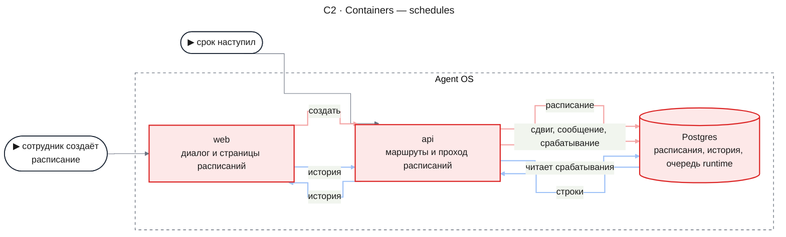
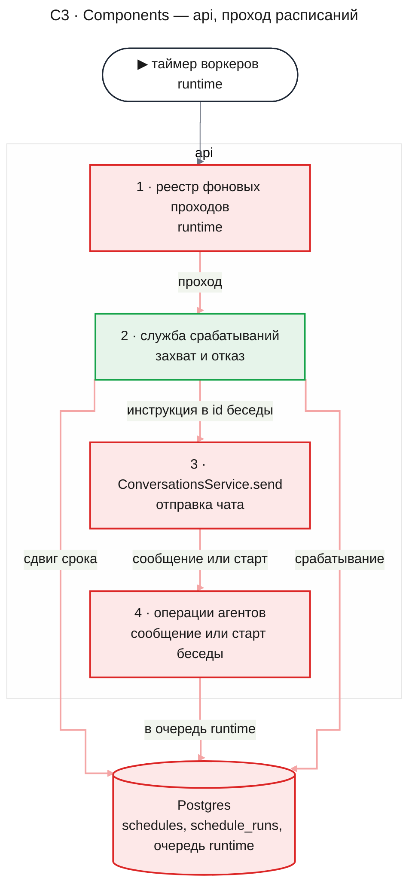
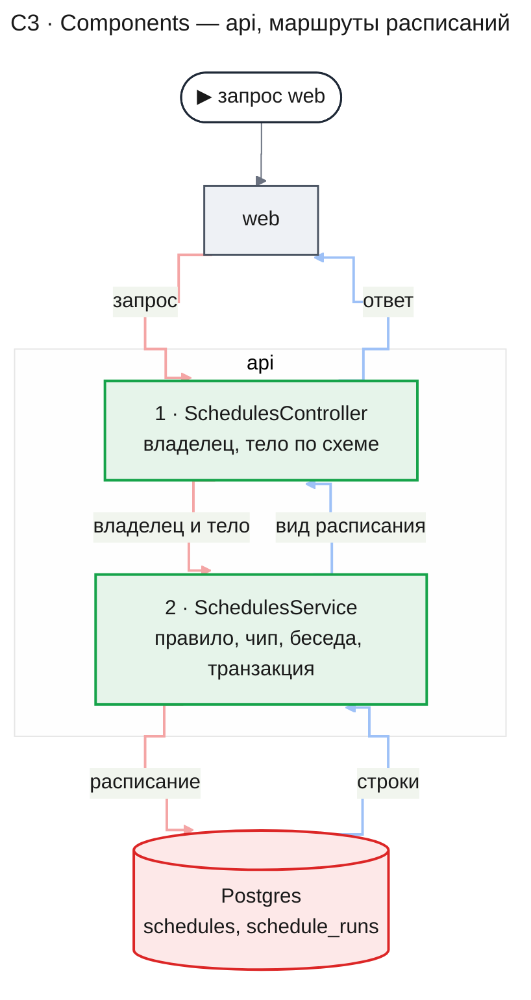
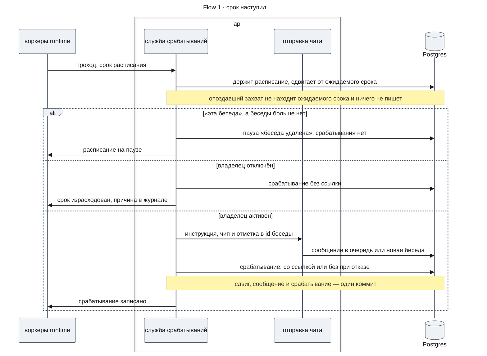
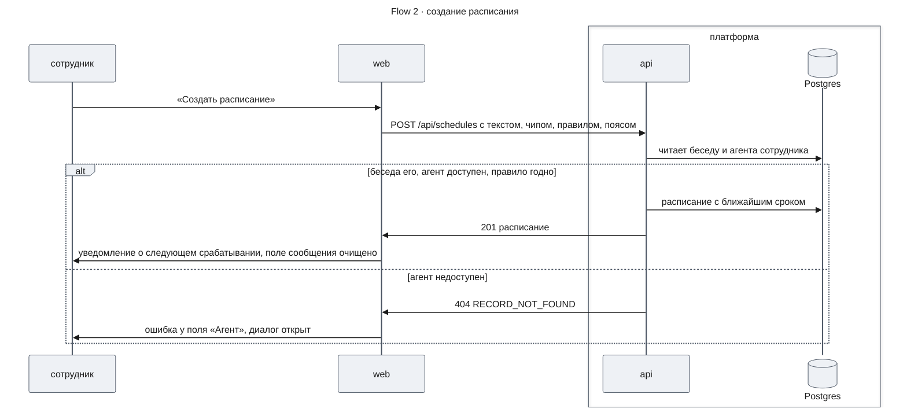
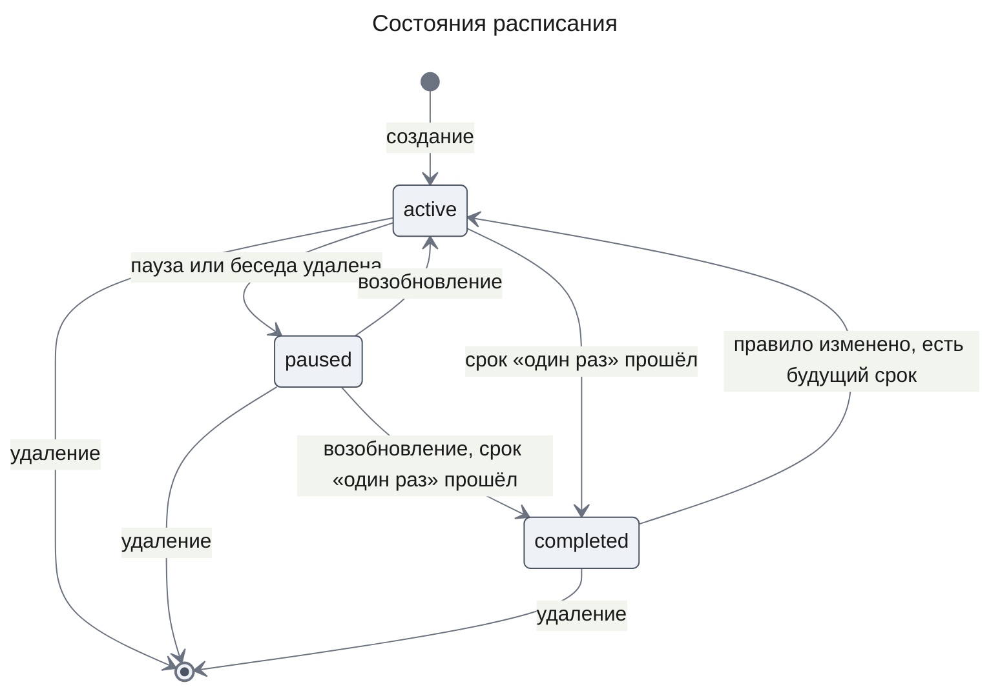

# Расписания, поиск по беседам и чистота памяти — Design Document — schedules

**Status:** На утверждении · **Date:** 2026-11-26 · **PRD:** [prd.md](./prd.md) · **UXRD:** [uxrd.md](./uxrd.md) · **Depends on:** нет

## Snapshot

**Overview.** Сотрудник создаёт расписание из беседы: инструкцию, агента, правило времени и место ответа. Каждые несколько секунд сервер делает проход по расписаниям, у которых наступил срок, и в каждый срок выполняет одно действие: отправляет инструкцию так же, как сотрудник отправляет сообщение в чат, — в беседу расписания или в новый id беседы. Сдвиг расписания на следующий срок, эта отправка и строка истории коммитятся одной транзакцией. Поэтому рестарт до коммита оставляет срок наступившим, и его возьмёт следующий проход, а после коммита сообщение уже в очереди runtime, и дальше беседу ведёт runtime. Расписание не знает, чем кончилась работа агента: это видно в беседе.

- **Не меняется**: runtime, агент и его шаг, подтверждения записей и брифов, квоты, удаление беседы отметкой.
- **Главный риск**: в беседе, где агент ждёт подтверждения, сообщения расписания копятся в очереди ([Risks](#risks-and-mitigation)).
- **Открытые вопросы**: нет.

### Key Decisions

#### KD-1: Срок захватывается одной транзакцией: она держит расписание, сдвигает его от ожидаемого срока и пишет срабатывание

Нужно, чтобы на срок было не больше одного срабатывания и при рестарте, и при двух проходах сразу (FR-03, NFR-04). Первая запись транзакции держит строку расписания и перечитывает её (`hold`), поэтому второй захват того же расписания ждёт конца первого. Затем захват сдвигает расписание на следующий срок, только если оно всё ещё ждёт именно этого срока. Опоздавший захват не находит ожидаемого срока и ничего не пишет.

В той же транзакции идут отправка (KD-2) и строка срабатывания, а второй рубеж держит база: на срок расписания — не больше одной строки, не считая ручных. Рестарт до коммита не оставляет ничего, и следующий проход захватывает тот же срок. После коммита сообщение или задача новой беседы уже в очереди runtime, и выполнить их — работа runtime с его восстановлением (ADR-0023); своего восстановления у расписаний нет. Захват взят из bb (`plugins/automations/src/data.ts`, `claimAutomationScheduledRun`), открытого проекта, откуда PRD взял идею расписаний; SQLite, cron-строки и исполнение через плагин сюда не подходят. Отвергнуто: блокировка расписания на время работы агента, пометка «взято» с таймаутом и двухфазный старт со строкой «начинается», которую доводит следующий проход, — каждый вариант добавляет второй механизм восстановления рядом с runtime.

#### KD-2: Срабатывание — отправка чата в id беседы внутри транзакции захвата

Расписание знает только, когда и что отправить. Его одно действие для обоих мест ответа — `ConversationsService.send`, та же отправка, что у сообщения, набранного руками: в беседу расписания или в новый случайный id. По id без беседы эта отправка сама создаёт беседу (`StartOperations.start`), а в живую беседу кладёт сообщение в очередь с пробуждением (`ControlOperations.send`). Runtime не меняется и о беседах не узнаёт. Отправка не открывает своей транзакции, а `Db.transaction` присоединяется к уже открытой, поэтому сообщение, корень новой беседы и строка срабатывания коммитятся вместе со сдвигом.

Правка нужна в одном месте. `createAgent` в пакете `agents` отдаёт объект нового агента runtime (`LiveTasks.adopt`) сразу после своей транзакции, а внутри чужой транзакции это случилось бы до настоящего коммита. Теперь `createAgent` отдаёт объект, только если сам открыл транзакцию; внутри транзакции вызывающего объект не отдаётся, и первый шаг задачи строит его из базы (`LiveTasks.obtain` → `restore`). Это тот же путь, по которому после рестарта идёт каждая задача (`LiveTasks.warm`), а цена — одно чтение строк агента на первом шаге. Сегодня ни один вызывающий не создаёт агента внутри своей транзакции, поэтому для остальных стартов ничего не меняется.

Отвергнуто: крючок «после коммита» в `Db` — новый механизм ради одного вызывающего; runtime, который создаёт сессию по сообщению без задачи, — движок узнал бы о беседах; отправка после коммита захвата — рестарт между ними терял бы срабатывание, и понадобилось бы своё восстановление.

#### KD-3: Проход расписаний — фоновый проход, зарегистрированный в runtime

Проходу нужны старт и остановка вместе с сервером, выключатель `RUNTIME_WORKERS` и повтор с паузой после сбоя базы. Всё это есть у воркеров runtime, а цикл `WorkerLoop` есть у `RecoverySweeper`. `RuntimeModule` держит реестр фоновых проходов `BackgroundPasses`, устроенный как реестр крючков конца задачи. Модуль расписаний регистрирует в `onModuleInit` имя, период и функцию прохода, а `RuntimeWorkers` запускает для каждого свой `WorkerLoop` и останавливает его вместе с остальными воркерами.

Runtime не знает, что такое расписание. Первый проход идёт сразу при старте, поэтому догон начинается без ожидания. Период — константа кода меньше минуты: он держит NFR-03, и администратору менять его незачем. Отвергнуто: свой провайдер в `apps/api` с `OnApplicationBootstrap` — ему пришлось бы читать выключатель и `WorkerLoop` из внутренностей runtime мимо единственного входа пакета.

#### KD-4: Отказ расходует срок: отправка идёт в точке сохранения, а отключённого владельца служба проверяет сама

Срабатывание, которому чат отказал, не должно оставлять срок наступившим: такое расписание стояло бы первым в списке наступивших сроков и повторяло отказ на каждом проходе. Поэтому отправка идёт в точке сохранения (`Db.savepoint`) внутри захвата. Её ошибка, после которой транзакция может продолжаться, откатывает только то, что успела записать отправка; сдвиг срока и строка срабатывания без ссылки коммитятся, а ошибка целиком уходит в журнал (FR-07, FR-08). Взаимная блокировка, обрыв связи и другие ошибки, после которых транзакция продолжаться не может, откатывают весь захват, и следующий проход повторяет срок.

Отключённого владельца служба проверяет сама (`IdentityDirectory.isActive`) до отправки. В чате его не пускает `SessionGuard`, а отправка в живую беседу владельца не проверяет. Агента из чипа проверяет сама отправка правилом чипа, старт новой беседы проверяет права на модель. Квоту до беседы не проверяет никто: исчерпанная квота заканчивает работу агента сбоем в беседе, как после сообщения руками (AC-07.2). Отвергнуто: решение «запуск или пропуск» с причинами и статусами работы — PRD его исключил (Won't Have); перехват только известных отказов — новая ошибка снова оставила бы срок наступившим.

#### KD-5: Отметка расписания — поле записей `task` и `user_message` в истории беседы

Сообщение от расписания подписано его именем (UXRD SH-07). Записи истории `task` и `user_message` несут поле `schedule` (`ScheduleMark`): id расписания, его имя на момент отправки и признак ручного срабатывания; у сообщения, набранного руками, поле равно `null`. Отметку несут полезная нагрузка `user_message` в очереди и запрос старта корня, а `ConversationsService.send` принимает её и передаёт дальше. Поле обязательное и допускает `null`, поэтому `tsc` находит каждого, кто пишет такие записи: доставку сообщения (`deliver.ts`), первое сообщение тестового запуска (`training-operations.ts`) и запись `task` нового корня (`Sessions`). Модель видит текст сообщения как прежде, отметка ей не показывается. Отвергнуто: отправлять от расписания `agent_message` — оно требует отправителя-задачу, и веб подписал бы его «От агента».

#### KD-6: Новая беседа получает заголовок «{имя} · {день}» при создании; язык дня приходит в теле запроса

Нужный заголовок (UXRD KD-3, MC-12) служба передаёт в `ConversationsService.send`, а та — в `StartOperations.start`, который пишет его в транзакции создания корня. Отправка с отметкой расписания не начинает генерацию заголовка моделью: новой беседе заголовок уже задан, а беседа расписания получила свой с первым сообщением. День форматируется в поясе расписания на языке, который веб передал при создании или изменении расписания, как имя копии записи ([interface-text.md](../../code-system/patterns/interface-text.md), Not For). Язык профиля бывает `null`, а сервер без запроса не знает, какой язык выбрал браузер.

#### KD-7: Сроки считает `Temporal` из Node 26; веб берёт предпросмотр у API

Правило — один из четырёх видов в поясе IANA, а «следующий срок» требует календарной арифметики с переходом на летнее время. Библиотеки дат в репозитории нет. В Node 26 есть встроенный `Temporal`: проверено на `node v26.13.1` (`Temporal.ZonedDateTime`), типы — `lib.esnext.temporal.d.ts` из TypeScript 6, который стоит в репозитории. Правило сроков — чистая функция в `apps/api`. Предпросмотр в диалоге (UXRD SH-02) зовёт маршрут, а не считает сам: правило живёт в одном месте, а `Temporal` есть не во всех браузерах. Время, которого в этот день нет из-за перевода часов, сдвигается на первое существующее после него; повторённое время берётся первым. Отвергнуто: cron-библиотека — PRD задаёт четыре вида правила; ручной расчёт смещения через `Intl` — тот же календарь, переписанный руками.

## Terms

- **Срок** — момент, когда по правилу расписание должно сработать.
- **Срабатывание** — одна отправка инструкции расписания в беседу, в срок или вручную; строка истории расписания.
- **Захват срока** — транзакция, которая сдвигает расписание на следующий срок, отправляет инструкцию и пишет срабатывание (KD-1).
- **Проход расписаний** — периодическая работа сервера: захватывает наступившие сроки.
- **Догон** — одно срабатывание за все сроки, прошедшие, пока сервер не работал.
- **Точка сохранения** — вложенная часть транзакции, которую можно откатить одну, не трогая остальное (KD-4).
- **Отметка расписания** — поле `schedule` записи истории, по которому веб подписывает сообщение (KD-5).
- **Беседа расписания** — беседа, в которой создано расписание; в режиме «эта беседа» срабатывания идут в неё.

## Part

- **Prerequisite ADRs**: [ADR-0022](../../adr/ADR-0022-one-database-and-nestjs-modules.md) — одна база, репозитории в `packages/db`, модули NestJS; [ADR-0023](../../adr/ADR-0023-live-task-objects-one-stepping-process.md) — один процесс шагов, без лизов и `FOR UPDATE`, восстановление задач в runtime; [ADR-0024](../../adr/ADR-0024-every-reference-is-a-foreign-key.md) — ссылки расписаний и срабатываний — внешние ключи.

Часть покрывает FR-01 – FR-04, FR-06 – FR-11 и NFR-03 – NFR-05 для экранов расписаний и ни от чего не зависит.

**Out of scope**

- Runtime: он не создаёт сессий по сообщениям и не знает о расписаниях.
- Агент и его шаг: срабатывание — обычное сообщение, и чип агента остаётся подсказкой модели чата, как в любом сообщении.
- Подтверждения записей и брифов глубокого агента, квота, аудит вызовов инструментов — работают как в чате.
- Удаление беседы остаётся отметкой и о расписаниях не знает; срабатывания удалённой беседы остаются в истории без ссылки.
- Заголовок от модели для беседы, в которую пишет сотрудник, работает как прежде.
- Уведомления вне веба, создание расписания агентом, cron-выражения, лимиты (PRD, Won't Have).

**Constraints**

- **PoC.** Сжатая миграция генерируется заново на месте, база разработки создаётся заново; записи не переносятся.
- **Одна база.** Обе таблицы и их запросы — в `packages/db`, в одном файле репозитория. Репозиторий только читает и пишет строки в транзакции вызывающего, захват держит служба.
- **Без настроек.** PRD не задаёт настроек расписаний; период прохода — константа кода (KD-3).
- **Без новой зависимости.** Даты считает встроенный `Temporal` (KD-7).
- **Рестарт.** Срок даёт не больше одного срабатывания, потому что сдвиг, отправка и строка — один коммит (KD-1, KD-2).
- **Мало тестов.** Только главный путь обоих мест ответа, захват при двух проходах, догон, отказ, изоляция и жизнь расписания ([Test Strategy](#test-strategy)).

## Building-block Inventory

Follows the [code system](../../code-system/README.md).

| Building block | Pattern | Status | Note |
|---|---|---|---|
| Таблицы `schedules` и `schedule_runs`, их репозиторий | [repository-over-transaction.md](../../code-system/patterns/repository-over-transaction.md) | new | наборы значений CHECK — в `packages/contracts` |
| Правило сроков: следующий срок и прошедшие сроки | [pure-decision.md](../../code-system/patterns/pure-decision.md) | new | библиотеки дат и cron в репозитории нет; `Temporal` встроен (KD-7) |
| Служба срабатываний: проход, захват, отправка | [repository-over-transaction.md](../../code-system/patterns/repository-over-transaction.md) | new | захват по форме bb; в коде похожего нет (KD-1, KD-4) |
| `SchedulesService`, `SchedulesController`, модуль `apps/api/src/schedules/` | [auth-boundary.md](../../code-system/patterns/auth-boundary.md) | new | маршруты; владелец из `req.user`, чужое отвечает как отсутствующее |
| Реестр фоновых проходов `BackgroundPasses`, `RuntimeWorkers` | [composition-root.md](../../code-system/patterns/composition-root.md) | extended | `WorkerLoop` переиспользован (KD-3) |
| `ConversationsService.send` | — | extended | отметка и заголовок; внутри транзакции вызывающего (KD-2, KD-6) |
| `createAgent`, `StartOperations.start`, `ControlOperations.send` | — | extended | отметка, заголовок; объект не отдаётся внутри чужой транзакции (KD-2) |
| `HistoryEntrySchema`, полезная нагрузка `user_message` | — | extended | поле `schedule` (KD-5) |
| `IdentityDirectory`, `LibraryService.resolve` с `inRootLaunchSet`, `ViewOperations.root` | — | reused | владелец, правило чипа, живой корень беседы чата |
| Курсор истории | — | reused | `apps/api/src/common/opaque-cursor.ts`, `INVALID_CURSOR` |
| Меню «+» (`ComposerActions`), сайдбар, `ShellRoute` | [shell-route.md](../../code-system/patterns/shell-route.md) | extended | пункт «Запланировать», раздел «Расписания», маршруты `/schedules` и `/schedules/:id` |
| Диалог расписания, страницы «Расписания» и расписания, клиент `schedulesApi` | [read-on-open.md](../../code-system/patterns/read-on-open.md), [web-api-client.md](../../code-system/patterns/web-api-client.md) | new | перечитывание по заметке `tree` — живой поток SSE без нового события |
| Правило расписания | [schedule-rule.md](../../design-system/components/schedule-rule.md) | new | компонента в коде нет |
| Подпись источника сообщения в ленте | — | extended | подпись «По расписанию «{имя}»» по полю `schedule` |

## Acceptance Criteria

DC-n ниже — критерии этого дизайна; элементы UXRD названы с приставкой «UXRD».

### FR-01: создать расписание из беседы

- From the PRD: AC-01.1, AC-01.2, AC-01.3.
- Когда сотрудник создаёт расписание «в эту беседу» без беседы, в беседе, которой у него нет, или в беседе тренера или тестового запуска, создание отвечает 404 `THREAD_NOT_FOUND`, и расписания нет (DC-1).
- Когда правило негодно — время «один раз» в прошлом, ни одного дня, число часов не целое или вне 1–8760, пояс неизвестен, — создание и предпросмотр отвечают 400 `VALIDATION_FAILED`, и расписания нет (DC-2).

### FR-02: список, пауза, удаление

- From the PRD: AC-02.1, AC-02.2, AC-02.3.

### FR-03: не больше одного срабатывания на срок

- From the PRD: AC-03.1, AC-03.2, AC-03.3.

### FR-04: куда идёт результат

- From the PRD: AC-04.1, AC-04.2, AC-04.3.

### FR-06: догон после простоя

- From the PRD: AC-06.1, AC-06.2.

### FR-07: дальше — как в чате

- From the PRD: AC-07.1, AC-07.2, AC-07.3.
- Когда отправка срабатывания отклонена — агент из чипа больше недоступен владельцу или старт новой беседы отклонён, — в истории срабатывание без ссылки, беседы и сообщения нет, а следующий проход этот срок не повторяет: ближайший срок уже следующий (DC-3).

### FR-08: история срабатываний

- From the PRD: AC-08.1, AC-08.2.

### FR-09: беседа расписания удалена

- From the PRD: AC-09.1, AC-09.2.
- Когда расписание стоит на паузе из-за удалённой беседы, «Возобновить» и «Запустить сейчас» отвечают 409 `SCHEDULE_NOT_RUNNABLE`, пока ответ не переключён на новую беседу (DC-4).

### FR-10: изменить расписание

- From the PRD: AC-10.1.

### FR-11: запустить сейчас

- From the PRD: AC-11.1.

### NFR-03, NFR-04, NFR-05

- NFR-03 держит период прохода меньше минуты и первый проход при старте (KD-3); тестом число не проверяется.
- NFR-04 держит один коммит захвата (KD-1); сценарии UC-1 и UC-5 проверяют, что повторный проход после срабатывания второго не даёт.
- NFR-05: страницы расписаний и диалог работают от 360 px без прокрутки вбок (UXRD, Responsive Behavior); это проверяется в браузере при сборке экранов.

## Design

### Architecture (C1–C4)

Новых контейнеров нет. Проход расписаний живёт в процессе `api` рядом с воркерами runtime, расписания и их история — в Postgres, экраны — в `web`.

#### C2 · Containers

Срабатывание ничего не зовёт у провайдера модели или серверов MCP: оно кладёт сообщение или задачу новой беседы в очередь runtime, а дальше беседу ведут прежние воркеры.

#### C3 · Components: api

**api — проход расписаний в срок**

- **Реестр фоновых проходов** — часть `RuntimeModule` (KD-3). `RuntimeWorkers` запускает зарегистрированные проходы вместе с диспетчером и останавливает вместе с ним; при `RUNTIME_WORKERS=off` проходы не идут.
- **Служба срабатываний** берёт наступившие сроки активных расписаний пачкой, от самого раннего, и захватывает каждый отдельно: сбой одного не мешает остальным. Следующий проход идёт сразу, только если пачка полная и хотя бы один захват в ней прошёл. Той же службой идёт «Запустить сейчас». Её зависимости: база и `SchedulesRepository`, `ConversationsService`, `ViewOperations` для проверки беседы расписания, `IdentityDirectory` для проверки владельца, часы и журнал.
- **`ConversationsService.send`** — отправка чата. Она проверяет чип, создаёт беседу по незанятому id или кладёт сообщение в очередь живой беседы и поднимает беседу в списке. С отметкой расписания она передаёт отметку и заголовок и не начинает генерацию заголовка.
- **Операции агентов** кладут отметку в сообщение и в первую запись новой беседы; `createAgent` не отдаёт объект агента runtime внутри чужой транзакции (KD-2).

**api — маршруты расписаний**

`SchedulesService` проверяет агента тем же правилом, что чип сообщения: `LibraryService.resolve` и `inRootLaunchSet`. Беседу он проверяет через `ViewOperations.root` с владельцем: это должен быть живой корень беседы чата, а не тренера или тестового запуска, чей корень сообщение не примет. Ближайший срок он считает правилом сроков в той же транзакции, в которой пишет расписание. «Запустить сейчас» он отдаёт службе срабатываний. Его зависимости: база и `SchedulesRepository`, `AgentsRepository` для имени недоступного агента, `LibraryService`, `ViewOperations`, служба срабатываний, часы и журнал. `ChatModule` о расписаниях не знает: модуль расписаний импортирует его ради `ConversationsService`.

#### C3 · Components: web

- **Меню «+»** держит пункт «Запланировать» после «Создать и проверить агента» (UXRD SH-01). Диалог берёт текст и чип из состояния поля сообщения, а беседу — из текущего адреса: в новом чате без сообщений беседы нет. После создания он очищает поле (UXRD KD-1).
- **Диалог** зовёт предпросмотр срока после паузы ввода и создание или изменение. Язык интерфейса он кладёт в тело (KD-6), пояс браузера берёт из `Intl`.
- **Страницы** — виды `ShellRoute` для списка и одного расписания ([shell-route.md](../../code-system/patterns/shell-route.md)). Список показывает время последнего срабатывания, история — время, пометку «вручную» и ссылку на беседу; статусов работы агента и причин в них нет (FR-08). Пока страница открыта, она перечитывает данные на каждую заметку `tree` из потока `/api/events` своего сотрудника, и новое срабатывание появляется без перезагрузки (UXRD SH-06).
- **Лента беседы** подписывает запись с полем `schedule` текстом UXRD MC-12 и ведёт по имени на страницу расписания.

### Runtime Flows

#### Flow 1: срок наступил

**Starts when:** проход расписаний находит срок активного расписания, для AC-03.1, AC-03.2, AC-03.3, AC-04.1, AC-04.2, AC-04.3, AC-06.1, AC-06.2, AC-07.1, AC-07.2, AC-07.3, AC-08.1, AC-09.1, AC-09.2, DC-3, NFR-04.

Если от ожидаемого срока до текущего момента прошло несколько сроков, срабатывание одно и записано на последний из них, а расписание сдвигается на ближайший будущий срок (FR-06). Расписание «один раз» после своего срока переходит в «выполнено» тем же сдвигом. В режиме «новая беседа» id беседы — новый случайный, и отправка создаёт по нему беседу с заголовком (KD-6); в режиме «эта беседа» сообщение встаёт в очередь беседы, даже если агент там ещё отвечает или ждёт подтверждения. Отказ отправки — недоступный агент из чипа, отклонённый старт, любая другая её ошибка, после которой транзакция продолжается, — откатывает только запись отправки, а срабатывание пишется без ссылки (KD-4). Если беседу удалили между проверкой и отправкой, отправка получает отказ, срабатывание остаётся без ссылки, а паузу ставит следующий срок.

Сообщение в беседе, где агент ждёт подтверждения записи или брифа, ответом на него не становится. Подтверждение — дочерняя задача-вопрос, которой runtime не принимает ни одного сообщения; ответ на неё даёт только `TaskControl.answer` из решения сотрудника. Корень в это время ждёт детей, и сообщение пользователя его не будит (`Inbox`, правило пробуждения). Корень прочтёт сообщение расписания на первом шаге после решения сотрудника вместе с остальной очередью.

«Запустить сейчас» идёт тем же захватом без сдвига срока: строка срабатывания с пометкой «вручную» на момент нажатия. Ручное срабатывание работает в любом состоянии расписания и не меняет ни состояния, ни ближайшего срока. Если беседы расписания «эта беседа» нет, маршрут отвечает 409 `SCHEDULE_NOT_RUNNABLE` и ничего не пишет; на паузу такое расписание ставит его ближайший срок (DC-4).

#### Flow 2: сотрудник создаёт расписание из беседы

**Starts when:** сотрудник нажимает «Создать расписание» в диалоге, для AC-01.1, AC-01.3, DC-1, DC-2.

Негодное правило отвечает 400 до чтения базы, чужая или отсутствующая беседа — 404 `THREAD_NOT_FOUND`; диалог показывает их по UXRD MC-3. Время «один раз» в прошлом проверяет только api: диалог узнаёт об этой ошибке из ответа 400 и показывает её у правила. Изменение идёт тем же путём через `PUT` и пересчитывает ближайший срок от текущего момента по новому правилу (AC-10.1).

### Contract Definitions

#### Маршруты

Все маршруты — под `/api/schedules`, за `SessionGuard`; владелец — сотрудник сеанса. Тела и ответы описаны схемами `packages/contracts`, ошибка — код и сообщение в общей форме ошибок API. Чужое расписание отвечает так же, как отсутствующее: 404 `SCHEDULE_NOT_FOUND`.

- **`GET /api/schedules`** — все расписания сотрудника: сначала активные по ближайшему сроку, затем на паузе, затем выполненные. Возвращает `ScheduleListResponse`. У другого сотрудника список пуст (AC-01.2).
- **`POST /api/schedules`** — создаёт расписание из тела `ScheduleBody` и возвращает 201 `ScheduleView`. 400 `VALIDATION_FAILED` — тело не по схеме или правило негодно (DC-2); 404 `RECORD_NOT_FOUND` — агент из тела не проходит правило чипа (AC-01.3); 404 `THREAD_NOT_FOUND` — беседа из тела не его или не беседа чата (тренер, тестовый запуск); при `target: this_conversation` ещё и когда она удалена или не задана (DC-1).
- **`POST /api/schedules/next-run`** — предпросмотр: по `rule` и `timeZone` возвращает `nextRunAt` — ближайший срок от текущего момента. Негодное правило — 400 `VALIDATION_FAILED`. Ничего не пишет.
- **`GET /api/schedules/:id`** — `ScheduleView`.
- **`PUT /api/schedules/:id`** — меняет расписание телом `ScheduleBody` и возвращает `ScheduleView`. Беседа создания не меняется: `conversationId` тела должен быть её id, даже если она удалена, иначе 400 `VALIDATION_FAILED`. Ответ «в новую беседу» принимается и у расписания с удалённой беседой; так снимается его причина паузы, а возобновляет его `resume` (FR-09). Ближайший срок пересчитывается от текущего момента. Выполненное расписание с будущим сроком по новому правилу снова активно. Остальные ошибки — как у создания.
- **`POST /api/schedules/:id/pause`** — ставит на паузу и возвращает `ScheduleView`; беседы срабатываний не трогает. Пауза выполненного расписания ничего не меняет.
- **`POST /api/schedules/:id/resume`** — возобновляет с ближайшего будущего срока (AC-02.2) и возвращает `ScheduleView`. Расписание «один раз», чей срок прошёл на паузе, становится выполненным. 409 `SCHEDULE_NOT_RUNNABLE` — расписание выполнено или ждёт ответа в удалённую беседу (DC-4).
- **`POST /api/schedules/:id/run`** — срабатывание вне срока в любом состоянии расписания; состояние и ближайший срок не меняются. Возвращает `ScheduleRunView` с пометкой `manual`: со ссылкой на беседу или без неё, если отправка отклонена (AC-11.1, DC-3). 409 `SCHEDULE_NOT_RUNNABLE` — расписание «эта беседа», чьей беседы нет (DC-4).
- **`DELETE /api/schedules/:id`** — удаляет расписание с его историей; беседы срабатываний остаются (AC-02.3). 204.
- **`GET /api/schedules/:id/runs?cursor=`** — страница истории: `ScheduleRunsPage`, новые срабатывания сверху. 400 `INVALID_CURSOR` — курсор не тот, что выдал сервер.

**`ScheduleBody`** — тело создания и изменения.

- `name` — название до 100 символов; пустое или отсутствующее заменяется началом инструкции в одну строку, обрезанным по последней границе слова в пределах 100 символов; одно длинное слово режется по пределу. 100 символов оставляют место дню в заголовке беседы в пределах `THREAD_TITLE_MAX_LENGTH`.
- `instruction` — текст сообщения агенту с теми же правилами, что текст сообщения чата: без крайних пробелов, от 1 до `CHAT_MESSAGE_MAX_LENGTH`.
- `agentId` — id агента библиотеки из чипа; `null` — агент чата.
- `rule` — `ScheduleRule`.
- `timeZone` — имя пояса IANA из браузера.
- `target` — `new_conversation` или `this_conversation`.
- `conversationId` — беседа, в которой создаётся расписание; `null` в новом чате без сообщений.
- `language` — язык интерфейса (`LanguageSchema`) для дня в заголовке новой беседы (KD-6).

**`ScheduleRule`** — вид правила и его параметры; время и дата — местные в поясе расписания.

- `once` — `date` и `time`: один срок; в прошлом при создании или изменении — 400.
- `daily` — `time`.
- `weekdays` — `days`, непустой набор дней ISO от 1 (понедельник) до 7, и `time`.
- `every_hours` — `hours`, целое от 1 до 8760 (год). Сроки идут через `hours` часов от момента создания или последнего изменения правила.

**`ScheduleView`** — расписание для списка и страницы.

- `id`, `name`, `instruction`, `rule`, `timeZone`, `target`, `createdAt`.
- `agent` — `null` для агента чата, иначе чип (`ChipRecord`) и `available` — проходит ли агент правило чипа сейчас (UXRD SH-05, «недоступен»).
- `conversation` — беседа создания: `id`, `title` и `deleted`; `null`, если расписание создано в новом чате. Название удалённой беседы тоже приходит: оно нужно тексту паузы (UXRD MC-8).
- `state` — `active`, `paused` или `completed`.
- `pausedBecause` — `conversation_deleted` или `null`.
- `nextRunAt` — ближайший срок; `null` на паузе и у выполненного.
- `lastRun` — последнее срабатывание (`ScheduleRunView`) или `null`.

**`ScheduleRunView`** — одно срабатывание.

- `id`, `dueAt` — срок, за который расписание сработало; у ручного — момент нажатия.
- `manual` — срабатывание «вручную».
- `conversationId` — беседа, куда расписание написало; `null`, если отправка отклонена или эта беседа удалена (AC-08.2).

**`ScheduleListResponse`** — `schedules`, массив `ScheduleView`. **`ScheduleRunsPage`** — `runs` до 20 строк и `nextCursor` или `null`.

**Error handling.** Свои коды: `SCHEDULE_NOT_FOUND` (404) и `SCHEDULE_NOT_RUNNABLE` (409). Остальные уже есть в API: `VALIDATION_FAILED` (400), `RECORD_NOT_FOUND` (404), `THREAD_NOT_FOUND` (404), `INVALID_CURSOR` (400).

#### Отметка расписания в беседе

- **`ScheduleMark`** — `scheduleId`, `name` — имя расписания на момент отправки, `manual`. Поле `schedule` записей истории `task` и `user_message` в `HistoryEntrySchema` — `ScheduleMark` или `null` (KD-5). Веб читает его в ответах беседы и экрана агента; у удалённого расписания ссылка ведёт на экран UXRD SH-08.

#### Внутри api

Эти операции не пересекают границу части, но на них опирается захват:

- **`ConversationsService.send`** принимает необязательные отметку расписания и заголовок новой беседы. С отметкой она не начинает генерацию заголовка. Внутри транзакции вызывающего каждая её запись присоединяется к этой транзакции. Прежние вызовы без отметки не меняются.
- **`StartOperations.start`** принимает необязательные отметку и заголовок; заголовок записывается в транзакции создания корня (KD-6). **`ControlOperations.send`** кладёт отметку в полезную нагрузку `user_message`; доставка переносит её в запись истории.
- **`createAgent`** отдаёт объект нового агента runtime только после транзакции, которую открыл сам; агент, созданный внутри транзакции вызывающего, получает объект на первом шаге из базы (KD-2).
- **Реестр фоновых проходов** `BackgroundPasses` — регистрация имени, периода и прохода в `onModuleInit`. Проход возвращает, осталась ли работа. Ошибку прохода цикл пишет в журнал и повторяет с паузой, как у `RecoverySweeper`.

### Data Model

Пример. Аня создаёт в беседе «Сбои оплаты» расписание «по будням в 9:00» в новую беседу. В понедельник в 9:00 проход сдвигает расписание на вторник и отправляет инструкцию в новый id X. Отправка создаёт беседу X «Сводка ошибок · 24 нояб.», и в том же коммите пишется срабатывание со ссылкой на X. Сервер стоял со вторника 8:00 до четверга 10:00: первый проход после старта пишет одно срабатывание за четверг 9:00 и сдвигает расписание на пятницу.

**`schedules`** — расписание: владелец, название, инструкция, агент (`null` — агент чата), правило, пояс, язык, место ответа, беседа создания, состояние с причиной паузы, ближайший срок, момент, от которого считаются «каждые N часов», время создания и изменения. Удаление сотрудника удаляет его расписания каскадом. Беседа создания — ключ на корень беседы без каскада: беседа удаляется отметкой, и ключ не срабатывает. Агент — ключ на `agents` с каскадом; агент удаляется отметкой, и такой агент не проходит правило чипа.

**`schedule_runs`** — история срабатываний: расписание (каскад при его удалении), срок, признак ручного срабатывания, беседа и время записи. Беседа — ключ без каскада; `null`, когда отправка отклонена.

Правила, которые держат схема и служба срабатываний:

1. На срок расписания — не больше одной строки, не считая ручных; это держит уникальный индекс, а не чтение перед вставкой.
2. Строка со ссылкой есть тогда и только тогда, когда сообщение или корень её беседы закоммичены с ней в одной транзакции.
3. Строка после вставки не меняется: история только растёт.
4. У расписания на паузе и у выполненного ближайшего срока нет, и проход их не видит.
5. Захваты одного расписания идут по очереди: каждый начинается с записи расписания.

### State Transitions and Invariants

`active` — проход видит ближайший срок. `paused` — сроков нет; пауза из-за удалённой беседы снимается только после того, как ответ переключён на новую беседу. `completed` — у расписания «один раз» больше нет сроков.

**Invariants**

1. Каждый захваченный срок активного расписания даёт одну строку срабатывания. Исключение — срок, на котором расписание «эта беседа» встаёт на паузу из-за удалённой беседы: строки у него нет (AC-09.1). Сроки простоя дают одну строку на всех.
2. Срок, прошедший на паузе, строки не даёт и не догоняется.
3. Пауза, изменение и удаление расписания не трогают беседы срабатываний.

## Test Strategy

Тесты e2e — в `apps/api` с двумя сотрудниками и тестовой базой. Время задаёт подменённый `CLOCK`, проход тест зовёт напрямую, а скриптовая модель отвечает за агента.

- **UC-1: утренняя сводка в новой беседе** — covers AC-01.1, AC-03.1, AC-03.3, AC-04.1, AC-08.1
  - Given: Аня создала расписание «по будням в 9:00» в новую беседу; ответ списка показывает ближайший срок и её пояс.
  - When: часы доходят до срока, и два прохода идут одновременно, затем ещё один.
  - Then: в списке бесед Ани одна новая беседа «{имя} · {день}», первая запись с отметкой расписания, ответ агента; в истории одно срабатывание со ссылкой на неё, ближайший срок — следующий.
- **UC-2: беседа расписания, агент занят или ждёт подтверждения** — covers AC-04.2, AC-04.3, AC-07.3
  - Given: расписание «эта беседа» каждый час; скриптовая модель в первом срабатывании делает меняющий вызов MCP; затем агент отвечает на сообщение Ани.
  - When: наступает срок, затем ещё два срока: пока беседа ждёт подтверждения и пока агент отвечает Ане.
  - Then: три срабатывания со ссылкой на беседу; вызов MCP не отправлен, а сообщения расписания с отметкой стоят в очереди и ответом на подтверждение не становятся; после решения Ани агент читает их и отвечает в той же беседе.
- **UC-3: права и квота в срок** — covers AC-07.1, AC-07.2, DC-3
  - Given: три расписания Ани в новую беседу; у одного агент из чипа.
  - When: администратор отнимает у Ани право на этого агента, и наступает срок; исчерпывает её квоту на модель беседы, и наступает срок второго; отключает Аню, и наступает срок третьего; после каждого срока идёт ещё один проход.
  - Then: без права на агента и у отключённой Ани — срабатывание без ссылки, беседы нет; при исчерпанной квоте — срабатывание со ссылкой на беседу, где агент закончился сбоем «квота исчерпана»; у всех ближайший срок — следующий, повторный проход новых строк не пишет.
- **UC-4: изоляция** — covers AC-01.2, AC-01.3, DC-1
  - Given: расписание Ани; Борис вошёл.
  - When: Борис читает список и расписание Ани, меняет, ставит на паузу, возобновляет, запускает, удаляет его и читает историю; создаёт расписание в беседе Ани; Аня создаёт расписание с агентом, которого нет в её меню «+».
  - Then: список Бориса пуст, остальное — 404, расписание и история Ани не изменились; создание в чужой беседе — 404 `THREAD_NOT_FOUND`; создание с недоступным агентом — 404 `RECORD_NOT_FOUND`.
- **UC-5: догон после простоя** — covers AC-03.2, AC-06.1, AC-06.2, NFR-04
  - Given: расписания «каждый час» и «один раз» в новую беседу, сервер стоял три срока.
  - When: сервер стартует, проход идёт дважды.
  - Then: у «каждый час» одно срабатывание за последний из трёх сроков, ближайший срок в будущем; «один раз» сработало один раз и выполнено.
- **UC-6: жизнь расписания** — covers AC-02.1, AC-02.2, AC-02.3, AC-08.2, AC-09.1, AC-09.2, AC-10.1, AC-11.1, DC-2, DC-4
  - Given: расписания «эта беседа» и «новая беседа», созданные в одной беседе.
  - When: пауза на три срока и возобновление; изменение 9:00 на 10:00 в 8:30; «Запустить сейчас»; удаление беседы расписания и срок; возобновление и ручной запуск «этой беседы»; создание с прошлым временем «один раз»; удаление расписания.
  - Then: на паузе строк нет, следующий срок после возобновления — ближайший будущий; срабатывание в 10:00; ручная строка с `manual`; «эта беседа» на паузе `conversation_deleted` без строки за срок, её возобновление и запуск — 409, её прежние срабатывания без ссылки, «новая беседа» работает; прошлое время — 400; после удаления срабатываний нет, беседы остались.
- **UC-7: диалог из поля сообщения** — covers AC-01.1 в вебе
  - Given: в поле сообщения текст и чип агента.
  - When: сотрудник выбирает «+» → «Запланировать» и создаёт расписание.
  - Then: диалог открылся с этим текстом и агентом, после создания поле пусто, а уведомление называет следующее срабатывание.

Правило сроков проверяется одним табличным тестом чистой функции: четыре вида, неделя, пояс с переводом часов, пропущенные сроки. Сама карточка подтверждения и сбой по квоте — поведение чата, и их проверяют тесты `enterprise-access` и `deep-agents`.

## Security Considerations

- **Authentication & Authorization**: маршруты за `SessionGuard`, владелец из `req.user`, чужое расписание отвечает 404 как отсутствующее. Беседа и агент из тела проверяются от имени владельца теми же правилами, что сообщение чата. Проход действует без запроса: владельца он берёт из строки расписания, проверяет, что тот не отключён (KD-4), и отправляет его именем через отправку чата. Дальше срабатывание — обычная беседа владельца: права на модель, квота и каждый вызов инструмента проверяются и пишутся в аудит прежним путём.
- **Input Validation**: тела — схемы `packages/contracts`; пояс проверяет `Temporal`; id — проверка uuid; курсор — разбор с отказом `INVALID_CURSOR`.
- **Sensitive Data Handling**: инструкция — текст сотрудника и попадает только в его беседы. Журнал прохода пишет на каждый срок id расписания, владельца, срок, признак ручного срабатывания, число пропущенных сроков, id строки и беседы, причину отказа и длительность, а ошибки — целиком. Текст инструкции в журнал не пишется, только длина.

## Risks and Mitigation

- **В беседе, где агент ждёт подтверждения, сообщения расписания копятся** — среднее влияние, средняя вероятность. PRD принимает это (FR-04, Assumptions and Risks): каждый срок добавляет одно сообщение, агент прочтёт их все после решения сотрудника. Ждущая беседа видна в списке бесед, а режим «новая беседа» не копит.
- **Модель чата не стартует агента из чипа** — среднее влияние, низкая вероятность. Это поведение любого сообщения с чипом (Out of scope); подпись и беседа показывают сотруднику, что произошло.
- **Отказ старта пишет запись аудита внутри точки сохранения, и откат её стирает** — низкое влияние. Отказ фонового срабатывания никого не останавливал в интерфейсе, а причина целиком остаётся в журнале прохода (KD-4).
- **Отправка падает одной и той же ошибкой, после которой транзакция не продолжается** — низкое влияние. Срок остаётся наступившим, каждый проход повторяет захват, журнал пишет каждую попытку; захват других расписаний идёт отдельно и не страдает.

## Update History

| Version | Date | Change |
|---------|------|--------|
| 1.0 | 2026-11-25 | Расписания: захват срока, отправка и старт без повторов, проход в runtime, отметка в истории, маршруты и экраны |
| 1.1 | 2026-11-26 | Сверка с кодом: беседа расписания — живой корень чата, возобновление «один раз» после срока, проверка агента перед стартом, отказ модели как `agent_unavailable`, повтор прохода, предел `every_hours`, общий курсор |
| 1.2 | 2026-11-26 | Сверка с кодом: захват перечитывает расписание (`hold`), итоговый статус запусков при удалении беседы, `conversationId` удалённой беседы — `null`, имя по умолчанию по границе слова |
| 1.3 | 2026-11-26 | По PRD 1.2: срабатывание — одна отправка чата в транзакции захвата; убраны решение «запуск или пропуск», статусы, двухфазный старт и крючок удаления беседы; отказ расходует срок; служба срабатываний отделена от маршрутов |
