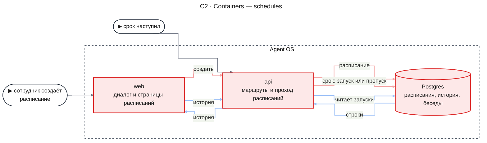
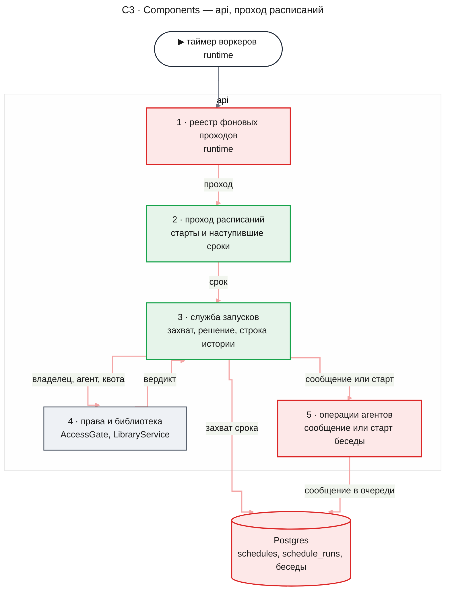
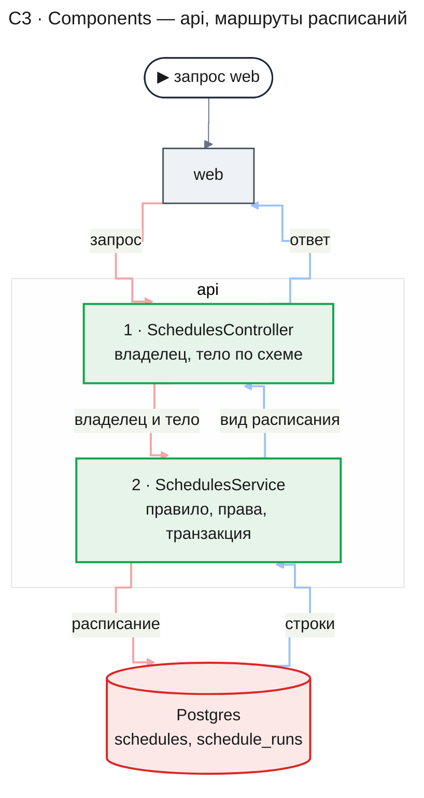
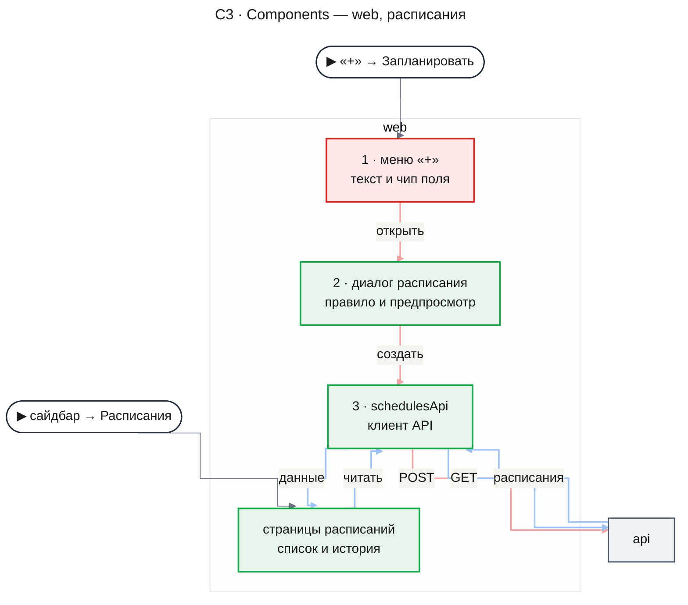
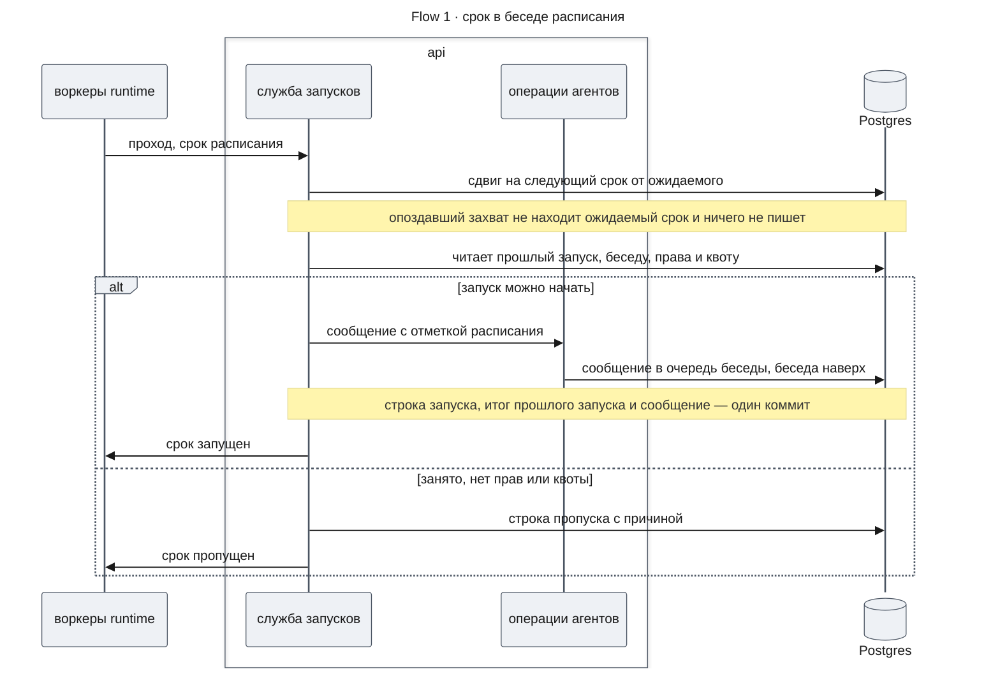
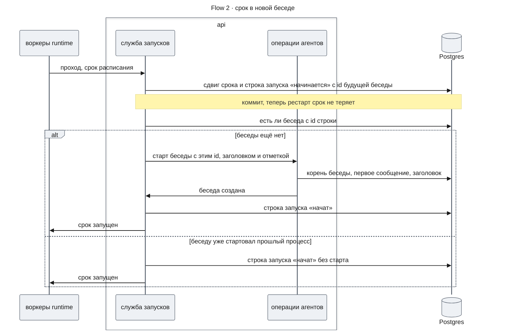
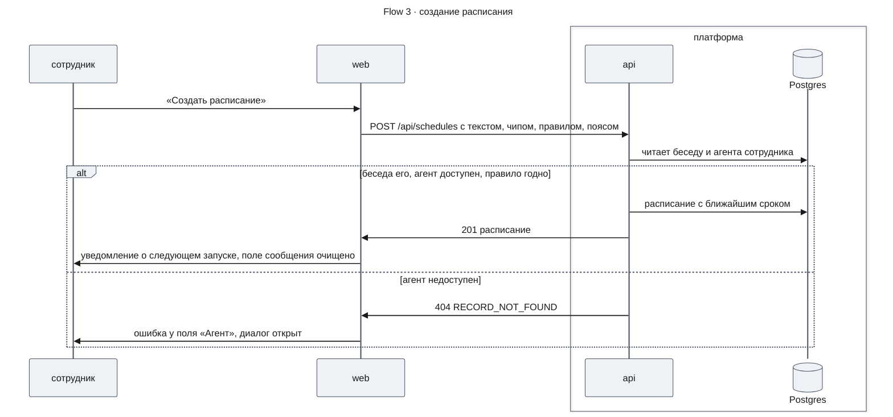
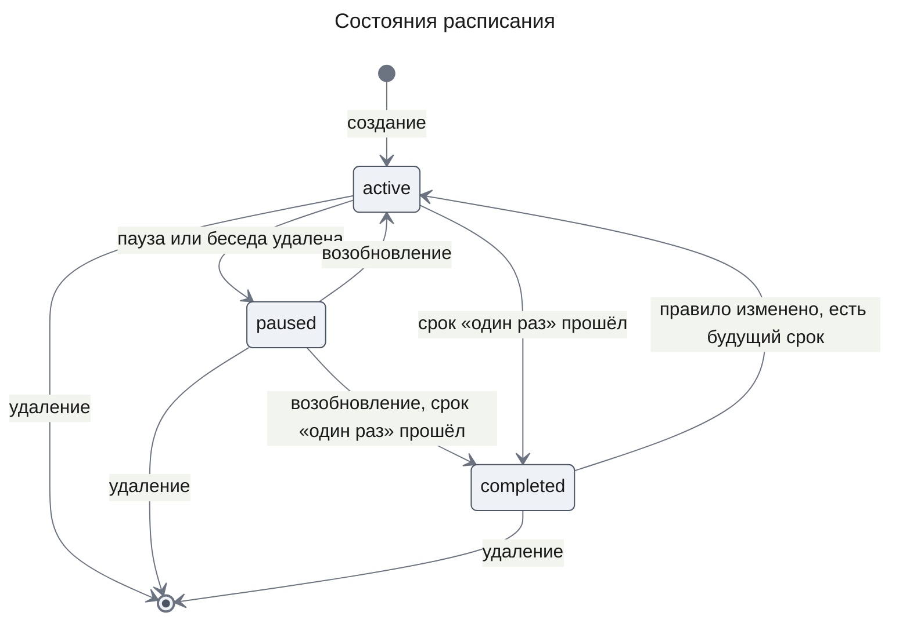

# Расписания, поиск по беседам и чистота памяти — Design Document — schedules

**Status:** На утверждении · **Date:** 2026-11-25 · **PRD:** [prd.md](./prd.md) · **UXRD:** [uxrd.md](./uxrd.md) · **Depends on:** нет

## Snapshot

**Overview.** Сотрудник создаёт расписание из беседы: инструкцию, агента, правило времени и место ответа. Каждые несколько секунд сервер делает проход по расписаниям, у которых наступил срок. Для каждого срока он одной транзакцией сдвигает расписание на следующий срок и пишет строку истории: запуск или пропуск с причиной. Запуск — обычное сообщение сотрудника с отметкой расписания: следующее сообщение в беседе расписания или первое сообщение новой беседы, чей id заранее записан в строке запуска. Поэтому рестарт в любой момент не теряет и не удваивает запуск, а права, квоты, подтверждения и аудит работают как в чате.

- **Не меняется**: агент, его шаг, подтверждения записей и брифов, квота внутри запуска, удаление беседы отметкой.
- **Главный риск**: запуск ждёт подтверждения, на которое никто не ответил, и все следующие сроки пропускаются ([Risks](#risks-and-mitigation)).
- **Открытые вопросы**: нет.

### Key Decisions

#### KD-1: Срок захватывается одной транзакцией: сдвиг расписания от ожидаемого срока и строка истории

Нужно, чтобы на один срок был не больше чем один запуск даже при рестарте и при одновременном ручном запуске (FR-03, NFR-04). Захват — одна транзакция. Её первая запись — сдвиг расписания на следующий срок, но только если оно всё ещё ждёт именно этого срока. Тот, кто опоздал, не находит расписания в ожидаемом состоянии и ничего не делает. В той же транзакции проверки решают «запуск или пропуск» (KD-4) и пишется строка истории. Второй рубеж держит база: на один срок расписания — не больше одной строки истории. Это форма bb — открытого проекта, откуда PRD взял идею расписаний (`plugins/automations/src/data.ts`, `claimAutomationScheduledRun`). Из bb взят только захват: SQLite, cron-строки и исполнение через плагин сюда не подходят. Отвергнуто: блокировка расписания на время запуска и пометка «взято» с таймаутом. Обе требуют ещё одного механизма восстановления, а движок задач уже держит работу через рестарт (ADR-0023).

#### KD-2: Отправка в беседу расписания — в транзакции захвата; новая беседа получает id из строки запуска

Отправить сообщение повторно безопасно нельзя: `Inbox.enqueue` даёт сообщению случайный id и не знает повторов. Поэтому в режиме «эта беседа» сообщение уходит в ту же транзакцию, что захват. `ControlOperations.send` входит в открытую транзакцию сам, и после рестарта есть либо и строка запуска, и сообщение, либо ни того ни другого. Новую беседу так создать нельзя. `StartOperations.start` отдаёт объект агента движку сразу после своей транзакции, а внутри чужой транзакции это случилось бы до её коммита. Поэтому захват пишет строку запуска в состоянии «начинается», и её id — это id будущей беседы. После коммита служба доводит строку: если беседа с этим id уже есть, строка становится «начат» без старта; иначе служба стартует беседу с этим id. Проверка идёт до старта, потому что `StartOperations.start` сначала заново проверяет права, и у отключённого с тех пор владельца повторный старт получил бы отказ, хотя беседа уже есть. Так рестарт между коммитом и стартом или между стартом и отметкой не даёт ни второй беседы, ни ложного пропуска. Два старта с одним id одновременно (ручной запуск и проход) разводит `TASK_EXISTS`: второй значит «уже начат». Каждый проход сначала доводит строки «начинается», оставшиеся от прошлого процесса. Отвергнуто: случайный id беседы и отметка после старта — рестарт между ними даёт либо потерянный, либо двойной запуск; ключ идемпотентности в `Inbox` — новая колонка движка ради одного вызывающего, когда транзакция уже даёт то же.

#### KD-3: Проход расписаний — фоновый проход, зарегистрированный в runtime

Проходу нужны старт и остановка вместе с сервером, выключатель `RUNTIME_WORKERS` и повтор с паузой после сбоя базы. Всё это уже есть у воркеров runtime, а цикл `WorkerLoop` есть у `RecoverySweeper`. `RuntimeModule` получает реестр фоновых проходов, устроенный как реестр крючков конца задачи. Модуль выше регистрирует в `onModuleInit` имя, период и функцию прохода, а `RuntimeWorkers` запускает для каждого свой `WorkerLoop` в `onApplicationBootstrap` и останавливает его в `beforeApplicationShutdown`. Runtime не знает, что такое расписание. Первый проход идёт сразу при старте, поэтому догон начинается без ожидания. Период — константа кода меньше минуты: он держит NFR-03, и администратору менять его незачем. Искали: реестра периодической работы в каталоге и в коде нет. `LiveHub` держит свои таймеры сам, но он не воркер и выключателя не слушает. Отвергнуто: свой провайдер в `apps/api` с `OnApplicationBootstrap` — ему пришлось бы читать выключатель и `WorkerLoop` из внутренностей runtime мимо единственного входа пакета; третий воркер, вписанный в `RuntimeWorkers`, — runtime узнал бы о расписаниях.

#### KD-4: «Запуск или пропуск» и статус запуска решают чистые функции над данными беседы

Решение в срок — первая подходящая причина пропуска по порядку из PRD. Сначала занятость: предыдущий запуск не закончен; в режиме «эта беседа» беседа занята. Затем права: аккаунт отключён, агент недоступен. Последней идёт квота. Решает чистая функция ([pure-decision.md](../../code-system/patterns/pure-decision.md)), а служба запусков только читает для неё данные. Нужна функция потому, что «занято» нигде не хранится. Статус беседы даёт `chatStatus`, а «ждёт подтверждения» ищется по открытым решениям всего дерева (`ViewOperations.confirmations`). Вопрос сабагента о записи висит на сабагенте, и корень тогда показывает просто «работает». Та же пара функций даёт статус запуска в истории (FR-08), так что история и пропуск не расходятся.

Квота проверяется на модель первого вызова запуска. Это модель беседы: для «этой беседы» — модель её корня, для новой — модель, которую получит новая беседа чата. Если у агента из чипа своя модель, её квота проверяется тоже. Проверка нужна явно: старт чата квоту не проверяет, а сообщение в беседу не проверяет ничего, и исчерпанная квота дала бы запуск, который падает на первом вызове (AC-07.2). Если у новой беседы чата модели нет или `AccessGate.model` отказывает по причине, отличной от отключённого аккаунта и квоты, срок пропускается с причиной `agent_unavailable`.

#### KD-5: Отметка расписания — поле записей `task` и `user_message` в истории беседы

Сообщение от расписания подписано его именем (UXRD SH-07), а носителя такой отметки сейчас нет. Записи истории `task` и `user_message` получают поле `schedule` (`ScheduleMark`): id расписания, его имя на момент отправки и признак ручного запуска; у сообщения, набранного руками, поле равно `null`. Отметку несут полезная нагрузка `user_message` в очереди и запрос старта корня. Поле обязательное, допускающее `null`, поэтому `tsc` находит каждого, кто пишет такие записи. Их три: доставка сообщения (`deliver.ts`), первое сообщение тестового запуска (`training-operations.ts`) и запись `task` нового корня (хранилище сессий агентов `Sessions`). Все пишут `null`, кроме пути расписания. Записи истории не переносятся: база разработки создаётся заново. Модель видит текст сообщения как прежде, отметка ей не показывается. Отвергнуто: отправлять от расписания `agent_message` — оно требует отправителя-задачу, и веб подписал бы его «От агента».

#### KD-6: Новая беседа получает заголовок «{имя} · {день}» при создании; язык дня приходит в теле запроса

Запуск идёт мимо `ConversationsService.send`, поэтому заголовок от модели не запускается. Нужный заголовок (UXRD KD-3, MC-12) `StartOperations.start` пишет в той же транзакции, что корень, и повторный старт его не меняет. День форматируется в поясе расписания на языке, который веб передал при создании или изменении расписания, как имя копии записи ([interface-text.md](../../code-system/patterns/interface-text.md), Not For). Язык профиля бывает `null`, а сервер без запроса не знает, какой язык выбрал браузер.

#### KD-7: Сроки считает `Temporal` из Node 26; веб берёт предпросмотр у API

Правило — один из четырёх видов в поясе IANA, а «следующий срок» требует календарной арифметики с переходом на летнее время. Библиотеки дат в репозитории нет. В Node 26 есть встроенный `Temporal`: проверено на `node v26.13.1` (`Temporal.ZonedDateTime`), типы — `lib.esnext.temporal.d.ts` из TypeScript 6, который стоит в репозитории. Правило сроков — чистая функция в `apps/api`. Предпросмотр в диалоге (UXRD SH-02) зовёт маршрут, а не считает сам: правило живёт в одном месте, а `Temporal` есть не во всех браузерах. Время, которого в этот день нет из-за перевода часов, сдвигается на первое существующее после него. Повторённое время берётся первым. Отвергнуто: cron-библиотека — PRD задаёт четыре вида правила, и cron не нужен; ручной расчёт смещения через `Intl` — тот же календарь, переписанный руками.

## Terms

- **Срок** — момент, когда по правилу расписания должен начаться запуск.
- **Захват срока** — транзакция, которая сдвигает расписание на следующий срок и пишет строку истории (KD-1).
- **Проход расписаний** — периодическая работа сервера: доводит незаконченные старты и захватывает наступившие сроки.
- **Строка запуска «начинается»** — строка истории, захваченная для новой беседы, которую ещё не стартовали; её id — id будущей беседы (KD-2).
- **Догон** — один запуск за сроки, прошедшие, пока сервер не работал; остальные из них — пропуски «сервер не работал».
- **Отметка расписания** — поле `schedule` записи истории, по которому веб подписывает сообщение (KD-5).
- **Беседа расписания** — беседа, в которой создано расписание; в режиме «эта беседа» запуски идут в неё.

## Part

- **Prerequisite ADRs**: [ADR-0022](../../adr/ADR-0022-one-database-and-nestjs-modules.md) — одна база, репозитории в `packages/db`, модули NestJS; [ADR-0023](../../adr/ADR-0023-live-task-objects-one-stepping-process.md) — один процесс шагов, без лизов и `FOR UPDATE`; [ADR-0024](../../adr/ADR-0024-every-reference-is-a-foreign-key.md) — ссылки расписаний и запусков — внешние ключи.

Часть покрывает FR-01 – FR-11 и NFR-03 – NFR-05 для экранов расписаний и ни от чего не зависит.

**Out of scope**

- Агент и его шаг: запуск — обычное сообщение, и чип агента остаётся подсказкой модели чата, как в любом сообщении.
- Подтверждения записей и брифов глубокого агента, квота внутри запуска, аудит вызовов инструментов — работают как в чате.
- Удаление беседы остаётся отметкой; запуски по расписанию из удалённой беседы не исчезают из истории.
- Заголовок от модели для беседы, в которую пишет сотрудник, работает как прежде.
- Уведомления вне веба, создание расписания агентом, cron-выражения, лимиты (PRD, Won't Have).

**Constraints**

- **PoC.** Сжатые миграции генерируются заново на месте; записи не переносятся; переключателей и второй версии схем нет.
- **Одна база.** Обе таблицы и их запросы — в `packages/db`, в одном файле репозитория. Репозиторий только читает и пишет строки в транзакции вызывающего, захват держит служба.
- **Без настроек.** PRD не задаёт настроек расписаний; период прохода — константа кода (KD-3). Ключа в `settings` и переменных окружения нет.
- **Без новой зависимости.** Даты считает встроенный `Temporal` (KD-7).
- **Рестарт.** Срок даёт не больше одного запуска, а начатый захват доводится после старта (KD-1, KD-2).
- **Мало тестов.** Семь сценариев: главный путь, занятость и подтверждение, права и квота, изоляция, рестарт и одновременность, жизнь расписания, диалог в вебе ([Test Strategy](#test-strategy)).

## Building-block Inventory

Follows the [code system](../../code-system/README.md).

| Building block | Pattern | Status | Note |
|---|---|---|---|
| Таблицы `schedules` и `schedule_runs`, их репозиторий | [repository-over-transaction.md](../../code-system/patterns/repository-over-transaction.md) | new | таблиц расписаний нет; наборы значений CHECK — в `packages/contracts` |
| Правило сроков: следующий срок и пропущенные сроки | [pure-decision.md](../../code-system/patterns/pure-decision.md) | new | библиотеки дат и cron в репозитории нет; `Temporal` встроен (KD-7) |
| Решение срока и статус запуска | [pure-decision.md](../../code-system/patterns/pure-decision.md) | new | строится на `chatStatus` и открытых решениях дерева (KD-4) |
| `SchedulesService`: маршруты, захват, отправка, старт | [repository-over-transaction.md](../../code-system/patterns/repository-over-transaction.md) | new | захват по форме bb; в коде похожего нет (KD-1, KD-2) |
| `SchedulesController`, модуль `apps/api/src/schedules/` | [auth-boundary.md](../../code-system/patterns/auth-boundary.md) | new | владелец из `req.user`, чужое отвечает как отсутствующее |
| Реестр фоновых проходов, `RuntimeWorkers` | [composition-root.md](../../code-system/patterns/composition-root.md) | extended | `WorkerLoop` переиспользован (KD-3) |
| `StartOperations.start`, `ControlOperations.send` | — | extended | отметка расписания; заголовок при старте; чтение модели новой беседы |
| `Inbox` | — | extended | чтение места последнего сообщения сотрудника в очереди корня |
| `HistoryEntrySchema`, полезная нагрузка `user_message` | — | extended | поле `schedule` (KD-5) |
| `ConversationsService.delete` | — | extended | ставит на паузу расписания «эта беседа» удалённой беседы |
| `chatStatus`, `ViewOperations`, `AccessGate`, `LibraryService.resolve` с `inRootLaunchSet` | [pure-decision.md](../../code-system/patterns/pure-decision.md) | reused | одно правило чипа для сообщения и для расписания |
| Курсор истории запусков | — | reused | общий помощник `apps/api/src/common/opaque-cursor.ts`: непрозрачная позиция с ограниченным временем, `INVALID_CURSOR` |
| Меню «+» (`ComposerActions`), сайдбар, `ShellRoute` | [shell-route.md](../../code-system/patterns/shell-route.md) | extended | пункт «Запланировать», раздел «Расписания», маршруты `/schedules` и `/schedules/:id` |
| Диалог расписания, страницы «Расписания» и расписания, клиент `schedulesApi` | [read-on-open.md](../../code-system/patterns/read-on-open.md), [web-api-client.md](../../code-system/patterns/web-api-client.md) | new | перечитывание по заметке `tree` — живой поток SSE без нового события |
| Правило расписания | [schedule-rule.md](../../design-system/components/schedule-rule.md) | new | компонента в коде нет |
| Подпись источника сообщения в ленте | — | extended | подпись «По расписанию «{имя}»» по полю `schedule` |

## Acceptance Criteria

DC-n ниже — критерии этого дизайна; элементы UXRD названы с приставкой «UXRD».

### FR-01: создать расписание из беседы

- From the PRD: AC-01.1, AC-01.2, AC-01.3.
- Когда сотрудник создаёт расписание «в эту беседу» без беседы, в беседе, которой у него нет, или в беседе тренера или тестового запуска, создание отвечает 404 `THREAD_NOT_FOUND`, и расписания нет (DC-1).
- Когда правило негодно — время «один раз» в прошлом, ни одного дня, число часов не целое или вне 1–8760, пояс неизвестен, — создание и предпросмотр отвечают 400 `VALIDATION_FAILED`, и расписания нет (DC-2).

### FR-02: список, пауза, удаление

- From the PRD: AC-02.1, AC-02.2, AC-02.3.

### FR-03: не больше одного запуска на срок

- From the PRD: AC-03.1, AC-03.2.
- Когда проход и ручной запуск одного расписания идут одновременно, запуск начинается один, а второй видит его незаконченным (DC-3).

### FR-04: куда идёт результат

- From the PRD: AC-04.1, AC-04.2.

### FR-05: запуски не накладываются

- From the PRD: AC-05.1, AC-05.2.

### FR-06: догон после простоя

- From the PRD: AC-06.1, AC-06.2.

### FR-07: права и квота на момент запуска

- From the PRD: AC-07.1, AC-07.2, AC-07.3, AC-07.4.
- Когда владелец отключён к сроку, запуска нет, а в истории пропуск «аккаунт отключён» (DC-4).
- Когда старт новой беседы после захвата отклонён, потому что права изменились между захватом и стартом, беседы нет, а строка запуска становится пропуском с причиной (DC-5).

### FR-08: история запусков

- From the PRD: AC-08.1.

### FR-09: беседа расписания удалена

- From the PRD: AC-09.1, AC-09.2.
- Когда расписание стоит на паузе из-за удалённой беседы, «Возобновить» и «Запустить сейчас» отвечают 409 `SCHEDULE_NOT_RUNNABLE`, пока ответ не переключён на новую беседу (DC-6).

### FR-10: изменить расписание

- From the PRD: AC-10.1.

### FR-11: запустить сейчас

- From the PRD: AC-11.1.

### NFR-03, NFR-04, NFR-05

- NFR-03 держит период прохода меньше минуты и первый проход при старте (KD-3); тестом число не проверяется.
- NFR-04 проверяет сценарий UC-5.
- NFR-05: страницы расписаний и диалог работают от 360 px без прокрутки вбок (UXRD, Responsive Behavior); это проверяется в браузере при сборке экранов.

## Design

### Architecture (C1–C4)

Новых контейнеров нет. Проход расписаний живёт в процессе `api` рядом с воркерами runtime, расписания и их история — в Postgres, экраны — в `web`.

#### C2 · Containers

Запуск ничего не зовёт напрямую у провайдера модели или серверов MCP: он кладёт сообщение в беседу, а дальше беседу ведут прежние воркеры runtime.

#### C3 · Components: api

**api — проход расписаний в срок**

- **Реестр фоновых проходов** — новая часть `RuntimeModule` (KD-3). `RuntimeWorkers` запускает зарегистрированные проходы вместе с диспетчером и останавливает вместе с ним; при `RUNTIME_WORKERS=off` проходы не идут.
- **Проход расписаний** сначала доводит строки «начинается» (KD-2), затем берёт наступившие сроки активных расписаний пачкой, от самого раннего. Каждый срок он захватывает отдельно, и сбой одного не мешает остальным. Следующий проход идёт сразу, только если пачка полная и хотя бы один захват в ней прошёл; пачка, где упали все захваты, ждёт обычного периода.
- **Служба запусков** (`SchedulesService`) открывает транзакцию захвата и читает данные для решения срока (KD-4). По решению она пишет строку пропуска или запуска. В режиме «эта беседа» она там же отправляет сообщение и поднимает беседу в списке (`touchRoot`). В режиме «новая беседа» она стартует беседу после коммита. Той же службой идут маршруты и ручной запуск.
- **Операции агентов** получают отметку расписания: `ControlOperations.send` кладёт её в сообщение, `StartOperations.start` — в первую запись беседы вместе с заголовком. Ещё одно новое чтение даёт модель, с которой начнётся новая беседа чата.

**api — маршруты расписаний**

`SchedulesService` проверяет агента тем же правилом, что чип сообщения: `LibraryService.resolve` и `inRootLaunchSet`. Беседу он проверяет через `ViewOperations.root` с владельцем: это должен быть живой корень беседы чата, а не тренера или тестового запуска, чей корень сообщение запуска не примет. Ближайший срок он считает правилом сроков в той же транзакции, в которой пишет расписание. Статус последнего запуска для списка и статусы в истории он берёт из функции статуса (KD-4). `ConversationsService.delete` после удаления беседы зовёт службу, и расписания «эта беседа» этой беседы встают на паузу с причиной; захват проверяет то же в срок, на случай сбоя между двумя транзакциями.

#### C3 · Components: web

- **Меню «+»** получает пункт «Запланировать» после «Создать и проверить агента» (UXRD SH-01). Диалог берёт текст и чип из состояния поля сообщения, а беседу — из текущего адреса: в новом чате без сообщений беседы нет. После создания он очищает поле (UXRD KD-1).
- **Диалог** зовёт предпросмотр срока после паузы ввода и создание или изменение. Язык интерфейса он кладёт в тело (KD-6), пояс браузера берёт из `Intl`.
- **Страницы** — новые виды `ShellRoute` для списка и одного расписания с одним файлом страницы на раздел, ветка `MainView`, пункт сайдбара после «Библиотеки» и подписи в `ChatHeader` и `DocumentTitle` ([shell-route.md](../../code-system/patterns/shell-route.md)). Пока страница открыта, она перечитывает свои данные на каждую заметку `tree` из потока `/api/events` своего сотрудника (UXRD SH-06). Заметка приходит при любом изменении беседы, а нового события для расписаний нет.
- **Лента беседы** подписывает запись с полем `schedule` текстом UXRD MC-12 и ведёт по имени на страницу расписания. Подпись стоит над первым сообщением новой беседы и над каждым сообщением расписания в беседе расписания.

### Runtime Flows

#### Flow 1: срок наступил — ответ в беседу расписания

**Starts when:** проход расписаний находит срок активного расписания «эта беседа», для AC-03.1, AC-04.2, AC-05.1, AC-05.2, AC-07.1, AC-07.2, AC-07.3, AC-08.1.

Если среди сроков от ожидаемого до текущего момента их несколько, все, кроме последнего, получают в той же транзакции строки пропуска «сервер не работал» (FR-06). Решение и строку запуска или пропуска получает только последний. Расписание «один раз» после своего срока переходит в «выполнено» тем же сдвигом. Если беседы расписания уже нет или её корень не беседа чата, захват ставит расписание на паузу с причиной «беседа удалена» и строки не пишет (AC-09.1). Рестарт до коммита не оставляет ничего, и следующий проход захватывает тот же срок. После коммита есть и строка, и сообщение. Беседа в этот момент свободна, иначе срок был бы пропуском, поэтому сообщение будит её по обычному правилу очереди.

#### Flow 2: срок наступил — новая беседа, рестарт посреди старта

**Starts when:** проход расписаний находит срок активного расписания «новая беседа», для AC-03.2, AC-04.1, AC-06.1, AC-06.2, AC-07.4, NFR-04.

Проверки срока идут в транзакции захвата, как в Flow 1; при пропуске строка сразу пишется пропуском, и старта нет. Процесс, упавший после коммита захвата, оставляет строку «начинается». Её доводит первый проход после старта сервера: он идёт сразу при старте, находит беседу с id строки или стартует её. Перед стартом служба ещё раз проверяет агента по правилу чипа: недоступный агент сразу делает строку пропуском «нет доступа к агенту», старта нет. Если старт отклонён (`START_REFUSED` или отключённый владелец), беседы нет, и строка становится пропуском с причиной: «нет доступа к агенту» или «аккаунт отключён» (DC-5). Любая другая ошибка оставляет строку «начинается». Её повторит следующий проход, а журнал записывает каждую попытку. Ручной запуск идёт тем же захватом без сдвига срока и доводит свою строку сразу в запросе. Проход, который доводит ту же строку одновременно, получит `TASK_EXISTS`, а отметка «начат» пишется только из состояния «начинается».

#### Flow 3: сотрудник создаёт расписание из беседы

**Starts when:** сотрудник нажимает «Создать расписание» в диалоге, для AC-01.1, AC-01.3, DC-1, DC-2.

Негодное правило отвечает 400 до чтения базы, чужая или отсутствующая беседа — 404 `THREAD_NOT_FOUND`; диалог показывает их по UXRD MC-3. Время «один раз» в прошлом проверяет только api: диалог узнаёт об этой ошибке из ответа 400 и показывает её у правила. Изменение идёт тем же путём через `PUT` и пересчитывает ближайший срок от текущего момента по новому правилу (AC-10.1).

### Contract Definitions

#### Маршруты

Все маршруты — под `/api/schedules`, за `SessionGuard`; владелец — сотрудник сеанса. Тела и ответы описаны схемами `packages/contracts`, ошибка — код и сообщение в общей форме ошибок API. Чужое расписание отвечает так же, как отсутствующее: 404 `SCHEDULE_NOT_FOUND`.

- **`GET /api/schedules`** — все расписания сотрудника: сначала активные по ближайшему сроку, затем на паузе, затем выполненные. Возвращает `ScheduleListResponse`. У другого сотрудника список пуст (AC-01.2).
- **`POST /api/schedules`** — создаёт расписание из тела `ScheduleBody` и возвращает 201 `ScheduleView`. 400 `VALIDATION_FAILED` — тело не по схеме или правило негодно (DC-2); 404 `RECORD_NOT_FOUND` — агент из тела не проходит правило чипа (AC-01.3); 404 `THREAD_NOT_FOUND` — беседа из тела не его или не беседа чата (тренер, тестовый запуск); при `target: this_conversation` ещё и когда она удалена или не задана (DC-1).
- **`POST /api/schedules/next-run`** — предпросмотр: по `rule` и `timeZone` возвращает `nextRunAt` — ближайший срок от текущего момента. Негодное правило — 400 `VALIDATION_FAILED`. Ничего не пишет.
- **`GET /api/schedules/:id`** — `ScheduleView`.
- **`PUT /api/schedules/:id`** — меняет расписание телом `ScheduleBody` и возвращает `ScheduleView`. Беседа создания не меняется: `conversationId` тела должен быть её id, даже если она удалена, иначе 400 `VALIDATION_FAILED`. Ответ «в новую беседу» принимается и у расписания с удалённой беседой; так снимается его причина паузы, а возобновляет его `resume` (FR-09). Ближайший срок пересчитывается от текущего момента. Выполненное расписание с будущим сроком по новому правилу снова активно. Остальные ошибки — как у создания.
- **`POST /api/schedules/:id/pause`** — ставит на паузу и возвращает `ScheduleView`; идущий запуск не трогает. Пауза выполненного расписания ничего не меняет.
- **`POST /api/schedules/:id/resume`** — возобновляет с ближайшего будущего срока (AC-02.2) и возвращает `ScheduleView`. Расписание «один раз», чей срок прошёл на паузе, становится выполненным. 409 `SCHEDULE_NOT_RUNNABLE` — расписание выполнено или ждёт ответа в удалённую беседу (DC-6).
- **`POST /api/schedules/:id/run`** — запускает вне очереди по правилам срока, ближайший срок не меняет. Возвращает `ScheduleRunView` с итогом: начат или пропущен с причиной (AC-11.1). 409 `SCHEDULE_NOT_RUNNABLE` — как у возобновления.
- **`DELETE /api/schedules/:id`** — удаляет расписание с его историей; беседы запусков остаются (AC-02.3). 204.
- **`GET /api/schedules/:id/runs?cursor=`** — страница истории: `ScheduleRunsPage`, новые сроки сверху. 400 `INVALID_CURSOR` — курсор не тот, что выдал сервер.

**`ScheduleBody`** — тело создания и изменения.

- `name` — название до 100 символов; пустое или отсутствующее заменяется началом инструкции. 100 символов оставляют место дню в заголовке беседы в пределах `THREAD_TITLE_MAX_LENGTH`.
- `instruction` — текст сообщения агенту с теми же правилами, что текст сообщения чата: без крайних пробелов, от 1 до `CHAT_MESSAGE_MAX_LENGTH`.
- `agentId` — id агента библиотеки из чипа; `null` — агент чата.
- `rule` — `ScheduleRule`.
- `timeZone` — имя пояса IANA из браузера.
- `target` — `new_conversation` или `this_conversation`.
- `conversationId` — беседа, в которой создаётся расписание; `null` в новом чате без сообщений.
- `language` — язык интерфейса (`LanguageSchema`) для дня в заголовке новой беседы (KD-6).

**`ScheduleRule`** — вид правила и его параметры; время и дата — местные в поясе расписания.

- `once` — `date` и `time`: один срок; в прошлом при создании или изменении — 400.
- `daily` — `time`.
- `weekdays` — `days`, непустой набор дней ISO от 1 (понедельник) до 7, и `time`.
- `every_hours` — `hours`, целое от 1 до 8760 (год). Сроки идут через `hours` часов от момента создания или последнего изменения правила.

**`ScheduleView`** — расписание для списка и страницы.

- `id`, `name`, `instruction`, `rule`, `timeZone`, `target`, `createdAt`.
- `agent` — `null` для агента чата, иначе чип (`ChipRecord`) и `available` — проходит ли агент правило чипа сейчас (UXRD SH-05, «недоступен»).
- `conversation` — беседа создания: `id`, `title` и `deleted`; `null`, если расписание создано в новом чате. Название удалённой беседы тоже приходит: оно нужно тексту паузы (UXRD MC-8).
- `state` — `active`, `paused` или `completed`.
- `pausedBecause` — `conversation_deleted` или `null`.
- `nextRunAt` — ближайший срок; `null` на паузе и у выполненного.
- `lastRun` — последняя строка истории (`ScheduleRunView`) или `null`.

**`ScheduleRunView`** — одна строка истории.

- `id`, `dueAt` — срок, на который был назначен запуск; у ручного — момент нажатия.
- `manual` — запуск «вручную».
- `outcome` — `started` или `skipped`.
- `status` — у начатого: `working`, `awaiting_confirmation`, `completed`, `failed` или `stopped`; у пропуска `null`. Строка «начинается» показывается как `working`.
- `skipReason` — у пропуска: `previous_run_unfinished`, `conversation_busy`, `agent_unavailable`, `quota_exhausted`, `owner_disabled` или `server_down`; иначе `null`.
- `conversationId` — беседа начатого запуска; у пропуска «предыдущий запуск не закончен» — беседа того незаконченного запуска (UXRD SH-06); иначе `null`.

**`ScheduleListResponse`** — `schedules`, массив `ScheduleView`. **`ScheduleRunsPage`** — `runs` до 20 строк и `nextCursor` или `null`.

**Error handling.** Новые коды: `SCHEDULE_NOT_FOUND` (404) и `SCHEDULE_NOT_RUNNABLE` (409). Остальные уже есть в API: `VALIDATION_FAILED` (400), `RECORD_NOT_FOUND` (404), `THREAD_NOT_FOUND` (404), `INVALID_CURSOR` (400).

#### Отметка расписания в беседе

- **`ScheduleMark`** — `scheduleId`, `name` — имя расписания на момент отправки, `manual`. Поле `schedule` записей истории `task` и `user_message` в `HistoryEntrySchema` — `ScheduleMark` или `null` (KD-5). Веб читает его в ответах беседы и экрана агента; у удалённого расписания ссылка ведёт на экран UXRD SH-08.
- **`StartOperations.start`** принимает необязательные отметку и заголовок; заголовок записывается в транзакции создания корня (KD-6). Прежние вызовы без них не меняются.
- **`ControlOperations.send`** принимает необязательную отметку и кладёт её в полезную нагрузку `user_message`; доставка переносит её в запись истории.

#### Внутри api

Эти операции не пересекают границу части, но на них опирается захват:

- **Реестр фоновых проходов** `RuntimeModule` — регистрация имени, периода и прохода в `onModuleInit`. Проход возвращает, осталась ли работа. Ошибку прохода цикл пишет в журнал и повторяет с паузой, как у `RecoverySweeper`.
- **Модель новой беседы** — чтение `StartOperations`: модель, с которой начнётся новая беседа чата, по той же цепочке, что старт корня.
- **Последнее сообщение в очереди корня** — чтение `Inbox`: место в очереди последнего сообщения сотрудника корню, доставленного или нет. Из него функция статуса понимает, что после сообщения запуска в беседу уже написали.

### Data Model

Пример. Аня создаёт в беседе «Сбои оплаты» расписание «по будням в 9:00» в новую беседу. В понедельник в 9:00 проход сдвигает расписание на вторник и пишет строку запуска «начинается» с id X. Затем он стартует беседу X «Сводка ошибок · 24 нояб.» и отмечает строку «начат». Сервер стоял со вторника 8:00 до среды 10:00: первый проход после старта пишет вторник пропуском «сервер не работал», а среду — запуском.

**`schedules`** — расписание: владелец, название, инструкция, агент (`null` — агент чата), правило, пояс, язык, место ответа, беседа создания, состояние с причиной паузы, ближайший срок, момент, от которого считаются «каждые N часов», время создания и изменения. Удаление сотрудника удаляет его расписания каскадом. Беседа создания — ключ на корень беседы без каскада: беседа удаляется отметкой, и ключ не срабатывает. Агент — ключ на `agents` с каскадом: агент тоже удаляется отметкой, такой агент не проходит правило чипа, и срок даёт пропуск «нет доступа к агенту».

**`schedule_runs`** — история: расписание (каскад при его удалении), срок, признак ручного запуска, итог (`starting`, `started`, `skipped`), причина пропуска, беседа запуска, беседа незаконченного запуска у пропуска, место сообщения запуска в очереди беседы, итоговый статус и время записи. Ссылки на беседы — ключи без каскада.

Правила, которые держат схема и служба запусков:

1. На один срок расписания — не больше одной строки истории, не считая ручных; это держит уникальный индекс, а не чтение перед вставкой.
2. Строка `started` есть тогда и только тогда, когда в её беседе есть сообщение этого запуска. Для «этой беседы» они пишутся одним коммитом, для новой беседы id беседы равен id строки (KD-2).
3. Строка меняется только из `starting` в `started` или `skipped`, а итоговый статус пишется один раз. Других правок у истории нет.
4. У расписания на паузе и у выполненного ближайшего срока нет, и проход их не видит.
5. Захваты одного расписания идут по очереди: каждый начинается с записи расписания, а данные для решения читает после неё.

**Статус запуска** считает функция KD-4. Если в беседе после сообщения запуска есть ещё сообщение сотрудника или расписания, запуск `completed`. Иначе статус идёт от беседы: открытое решение где-либо в дереве даёт `awaiting_confirmation`, `chatStatus` «работает» — `working`, сбой — `failed`, свободна — `completed`, прервана или удалена — `stopped`. Захват, который начинает следующий запуск, записывает предыдущему итоговый статус, поэтому живым считается только последний запуск расписания. «Предыдущий запуск не закончен» значит, что последний начатый запуск сейчас `working` или `awaiting_confirmation`. «Беседа занята» значит, что беседа расписания работает или ждёт решения, а последний запуск уже закончен.

### State Transitions and Invariants

`active` — проход видит ближайший срок. `paused` — сроков нет; пауза из-за удалённой беседы снимается только после того, как ответ переключён на новую беседу. `completed` — у расписания «один раз» больше нет сроков.

**Invariants**

1. Каждый срок активного расписания кончается ровно одной строкой истории: запуском или пропуском. Исключение — срок, на котором расписание «эта беседа» встаёт на паузу из-за удалённой беседы: строки у него нет (AC-09.1).
2. Срок, прошедший на паузе, строки не даёт и не догоняется.
3. Пауза, изменение и удаление расписания не трогают беседу идущего запуска.

## Test Strategy

Тесты e2e — в `apps/api` с двумя сотрудниками и тестовой базой. Время задаёт подменённый `CLOCK`, проход тест зовёт напрямую, а скриптовая модель отвечает за агента.

- **UC-1: утренняя сводка в новой беседе** — covers AC-01.1, AC-03.1, AC-04.1, AC-08.1
  - Given: Аня создала расписание «по будням в 9:00» в новую беседу; ответ списка показывает ближайший срок и её пояс.
  - When: часы доходят до срока, проход идёт дважды подряд.
  - Then: в списке бесед Ани одна новая беседа «{имя} · {день}», первая запись с отметкой расписания, ответ агента; в истории одна строка, статус `completed` после ответа модели.
- **UC-2: беседа расписания, занятость и подтверждение** — covers AC-04.2, AC-05.1, AC-05.2, AC-07.3, AC-07.4
  - Given: расписание «эта беседа» каждый час; скриптовая модель в первом запуске делает меняющий вызов MCP, во втором — стартует глубокого агента.
  - When: проходят сроки; между ними Аня сама пишет в беседу, пока агент отвечает.
  - Then: сообщения от расписания идут следующими сообщениями беседы с отметкой; запуск с вызовом MCP — `awaiting_confirmation`, вызов не отправлен, следующий срок — пропуск `previous_run_unfinished`; срок во время ответа на сообщение Ани — `conversation_busy`; запуск с брифом — `awaiting_confirmation`.
- **UC-3: права и квота в срок** — covers AC-07.1, AC-07.2, DC-4, DC-5
  - Given: расписание с агентом из чипа.
  - When: перед сроками администратор по очереди отнимает право на агента, исчерпывает квоту на модель беседы и отключает Аню; в последнем случае права меняются между захватом и стартом новой беседы.
  - Then: пропуски `agent_unavailable`, `quota_exhausted`, `owner_disabled` без вызова модели; при отказе старта беседы нет, а строка — пропуск.
- **UC-4: изоляция** — covers AC-01.2, AC-01.3, DC-1
  - Given: расписание Ани; Борис вошёл.
  - When: Борис читает список и расписание Ани, меняет, ставит на паузу, возобновляет, запускает, удаляет его и читает историю; создаёт расписание в беседе Ани; Аня создаёт расписание с агентом, которого нет в её меню «+».
  - Then: список Бориса пуст, остальное — 404, расписание и история Ани не изменились; создание в чужой беседе — 404 `THREAD_NOT_FOUND`; создание с недоступным агентом — 404 `RECORD_NOT_FOUND`.
- **UC-5: рестарт и одновременность** — covers AC-03.2, AC-06.1, AC-06.2, DC-3, NFR-04
  - Given: расписания «каждый час» и «один раз» в новую беседу, сервер стоял три срока.
  - When: (а) сервер стартует; (б) сервер стартует над строкой «начинается», оставленной упавшим процессом, — без беседы и с уже созданной беседой этого id; (в) проход и «Запустить сейчас» одного расписания идут одновременно.
  - Then: (а) две строки `server_down` и один запуск, следующий срок в будущем, «один раз» запущено и `completed`; (б) у срока одна беседа и одна строка `started`; (в) один запуск, второй — пропуск `previous_run_unfinished`.
- **UC-6: жизнь расписания** — covers AC-02.1, AC-02.2, AC-02.3, AC-09.1, AC-09.2, AC-10.1, AC-11.1, DC-2, DC-6
  - Given: расписания «эта беседа» и «новая беседа», созданные в одной беседе.
  - When: пауза на три срока и возобновление; изменение 9:00 на 10:00 в 8:30; «Запустить сейчас»; удаление беседы расписания; возобновление и ручной запуск «этой беседы»; создание с прошлым временем «один раз»; удаление расписания.
  - Then: на паузе строк нет, следующий срок после возобновления — ближайший будущий; запуск в 10:00; ручная строка с `manual`; «эта беседа» на паузе `conversation_deleted`, её возобновление и запуск — 409, «новая беседа» работает; прошлое время — 400; после удаления запусков нет, беседы остались.
- **UC-7: диалог из поля сообщения** — covers AC-01.1 в вебе
  - Given: в поле сообщения текст и чип агента.
  - When: сотрудник выбирает «+» → «Запланировать» и создаёт расписание.
  - Then: диалог открылся с этим текстом и агентом, после создания поле пусто, а уведомление называет следующий запуск.

Правило сроков проверяется одним табличным тестом чистой функции: четыре вида, неделя, пояс с переводом часов, пропущенные сроки. Решение срока и статус запуска тоже чистые функции, и UC-2 – UC-5 покрывают их ветки через API.

## Security Considerations

- **Authentication & Authorization**: маршруты за `SessionGuard`, владелец из `req.user`, чужое расписание отвечает 404 как отсутствующее. Беседа и агент из тела проверяются от имени владельца теми же правилами, что сообщение чата. Проход действует без запроса: владельца он берёт из строки расписания, а права и квоту в срок читает через `AccessGate` (KD-4). Дальше запуск — обычная беседа владельца: каждый вызов инструмента проверяется и пишется в аудит прежним путём.
- **Input Validation**: тела — схемы `packages/contracts`; пояс проверяет `Temporal`; id — проверка uuid; курсор — разбор с отказом `INVALID_CURSOR`.
- **Sensitive Data Handling**: инструкция — текст сотрудника и попадает только в его беседы. Журнал прохода пишет на каждый срок id расписания, владельца, срок, итог, причину, id строки и беседы, число догнанных сроков и длительность, а ошибки — целиком. Текст инструкции в журнал не пишется, только длина.

## Risks and Mitigation

- **Запуск ждёт подтверждения, на которое никто не ответил, и следующие сроки пропускаются** — среднее влияние, высокая вероятность. PRD принимает это (Assumptions and Risks); список расписаний показывает «Ждёт подтверждения», а пропуск ведёт к ждущему запуску (UXRD KD-4).
- **Модель чата не стартует агента из чипа** — среднее влияние, низкая вероятность. Это поведение любого сообщения с чипом (Out of scope); подпись и беседа показывают сотруднику, что произошло.
- **Долгий простой даёт много строк «сервер не работал»** — низкое влияние. Месяц простоя у расписания «каждый час» — около 720 строк в одной транзакции; PRD ограничений не задаёт.
- **Старт новой беседы падает одной и той же ошибкой** — низкое влияние. Строка остаётся «начинается», каждый проход повторяет старт, журнал пишет каждую попытку; ручной запуск такого расписания видит незаконченный запуск.
- **Беседа, в которую сотрудник продолжил писать, показывает запуск «готово»** — низкое влияние. Так правило статуса отличает запуск от собственной переписки сотрудника (Data Model).

## Update History

| Version | Date | Change |
|---------|------|--------|
| 1.0 | 2026-11-25 | Расписания: захват срока, отправка и старт без повторов, проход в runtime, отметка в истории, маршруты и экраны |
| 1.1 | 2026-11-26 | Сверка с кодом: беседа расписания — живой корень чата, возобновление «один раз» после срока, проверка агента перед стартом, отказ модели как `agent_unavailable`, повтор прохода, предел `every_hours`, общий курсор |
