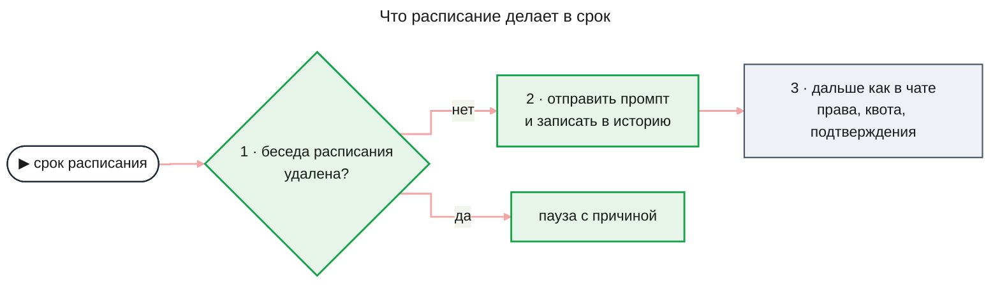
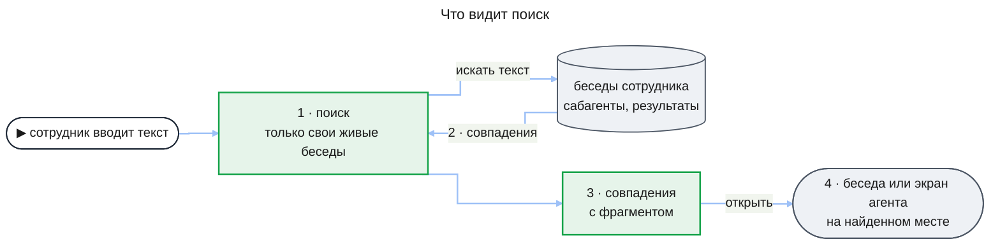
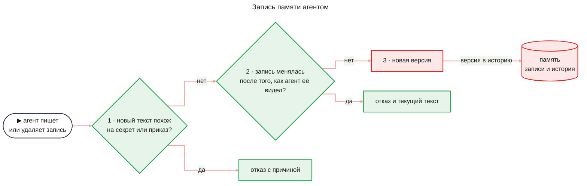

# PRD: Расписания, поиск по беседам и чистота памяти (schedules-search-memory)

| Date | Depth |
|---|---|
| 2026-11-26 | full |

## Snapshot

**Overview.** Сегодня агент работает только тогда, когда сотрудник сам пишет в чат, найти старую беседу можно только листая список, а память агента молча перезаписывается чем угодно. Фича закрывает три пробела, взятые из открытого проекта bb. Сотрудник ставит расписание: в заданное время платформа сама отправляет агенту промпт от его имени в новую беседу или в ту, где расписание создано, а дальше беседа работает так же, как с сообщением, набранным руками. Сотрудник ищет текст по своим беседам — заголовкам, сообщениям, беседам сабагентов и результатам инструментов — и открывает найденное. Память отказывает записи, похожей на секрет или на внедрённую инструкцию, хранит историю каждой записи, даёт человеку откатить запись и не даёт двум запускам молча затереть друг друга.

- **Не входит**: дневной лимит расхода на сотрудника, очистка удалённых бесед, уведомления вне веба, поиск по чужим беседам.
- **Не меняется**: сообщение расписания чат обрабатывает как сообщение владельца: по его текущим правам и квотам, а запись во внешнюю систему и старт глубокого агента ждут его подтверждения.
- **Главный риск**: частое расписание тратит месячную квоту, пока никто не смотрит ([Assumptions and Risks](#assumptions-and-risks)).
- **Открытые вопросы**: нет; решения, принятые по рекомендации, перечислены в [Undetermined Items](#undetermined-items).

## Terms

- **Расписание** — правило, по которому платформа сама отправляет выбранному агенту заданный промпт от имени сотрудника.
- **Срок** — момент, когда по правилу расписания оно должно сработать.
- **Срабатывание** — одна отправка промпта расписания в беседу, в срок или вручную. Что агент делает с этим сообщением дальше, расписание не знает: это видно в беседе.
- **Беседа расписания** — беседа, из которой сотрудник создал расписание.
- **Догон** — одно срабатывание после простоя сервера вместо всех сроков, которые прошли, пока сервер не работал.
- **Квота** — предел расхода сотрудника на одну модель за календарный месяц (`enterprise-access` FR-22).
- **Беседа сабагента** — беседа агента, которого запустил другой агент внутри беседы сотрудника. Сотрудник её не начинал, но она входит в дерево его беседы и открывается своим экраном агента.
- **Результат инструмента** — то, что вернул вызов инструмента: ответ MCP-сервера, найденный документ, вывод кода. Длинный результат хранится целиком при беседе, а модель получает его по ссылке.
- **Запись памяти** — одна строка описания и текст, которые глубокий агент сохраняет для своих будущих запусков (`self-learning` FR-29 – FR-33).
- **Версия записи** — каждое изменение записи даёт новую версию; история записи — все её версии по порядку.
- **Prompt injection (внедрённая инструкция)** — текст, сформулированный как приказ модели, например «ignore previous instructions and …». Попав в память, он попадал бы в промпт каждого следующего запуска.
- **Секрет** — пароль, токен, ключ API и подобные значения, дающие доступ к системе.

## Background

Agent OS — чат, в котором сотрудник пишет агенту, а агент работает и отвечает. Сегодня всё начинается с сообщения сотрудника: планировщика нет, и deep-agents (`docs/features/deep-agents/prd.md`, Won't Have) и self-learning (`docs/features/self-learning/prd.md`, Won't Have) откладывают запуск по времени. Поиска по беседам тоже нет: список в сайдбаре упорядочен по времени, а фильтр по заголовку (`chat-shell` FR-23) отложен.

Память глубокого агента устроена как в Claude Code (`self-learning` FR-29 – FR-33): агент сам пишет и удаляет записи инструментами. Перед записью платформа заменяет маской значения секретов, которые ей уже известны (`self-learning` FR-07). Секрет, которого платформа не знает, и текст-приказ проходят в память как есть. Новая запись с тем же описанием молча заменяет старую, прежний текст не сохраняется, и автор агента может только удалить запись целиком.

Все три идеи взяты у bb — открытого проекта, клон которого лежит рядом с репозиторием. В bb есть автоматизации по расписанию, полнотекстовый поиск по беседам и память с проверкой записи, историей и версиями. Похоже устроены и массовые продукты: в ChatGPT есть [запланированные задачи](https://help.openai.com/en/articles/10291617-scheduled-tasks-in-chatgpt), которые ставятся на паузу, если их беседу удалили, и [поиск по истории](https://help.openai.com/en/articles/10056348-how-do-i-search-my-chat-history-in-chatgpt) по заголовкам и тексту, без удалённых бесед.

Так расписание встраивается в чат: срок заменяет сообщение, которое сотрудник отправил бы сам, а дальше работает тот же агент.

```mermaid
---
title: "Где расписание встраивается в чат"
config:
  theme: base
  look: classic
  themeVariables:
    primaryColor: "#eef1f5"
    primaryBorderColor: "#4b5563"
    primaryTextColor: "#1a1a1a"
    lineColor: "#6b7280"
  flowchart:
    curve: step
  themeCSS: |
    @keyframes lit_sch{0%,11.25%{stroke:#991b1b;stroke-width:6px}12.5%,100%{stroke:#f4a5a5;stroke-width:2px}}
---
flowchart LR
    entry(["▶ сотрудник создаёт<br/>расписание в беседе"])
    sched["1 · расписание<br/>агент, промпт, когда"]
    due["2 · срок наступил<br/>отправить промпт"]
    mode{"3 · куда идёт<br/>результат?"}
    newc["4 · новая беседа"]
    samec["4 · беседа расписания"]
    agent["5 · агент работает<br/>как в чате"]
    seen(["6 · сотрудник видит итог<br/>в беседе"])
    entry e1@--> sched
    sched e2@--> due
    due e3@-->|"сообщение"| mode
    mode e4@-->|"новая беседа"| newc
    mode e5@-->|"эта беседа"| samec
    newc e6@--> agent
    samec e7@--> agent
    agent e8@--> seen
    classDef entry fill:#ffffff,stroke:#1f2937,stroke-width:1.5px,color:#1a1a1a
    classDef changed fill:#fde8e8,stroke:#dc2626,stroke-width:2px,color:#1a1a1a
    classDef new fill:#e6f4ea,stroke:#16a34a,stroke-width:2px,color:#1a1a1a
    classDef unchanged fill:#eef1f5,stroke:#4b5563,stroke-width:1.5px,color:#1a1a1a
    classDef w1 stroke:#f4a5a5,stroke-width:2px,animation:lit_sch 9.6s linear 0s infinite
    classDef w2 stroke:#f4a5a5,stroke-width:2px,animation:lit_sch 9.6s linear 1.2s infinite
    classDef w3 stroke:#f4a5a5,stroke-width:2px,animation:lit_sch 9.6s linear 2.4s infinite
    classDef w4 stroke:#f4a5a5,stroke-width:2px,animation:lit_sch 9.6s linear 3.6s infinite
    classDef w5 stroke:#f4a5a5,stroke-width:2px,animation:lit_sch 9.6s linear 4.8s infinite
    classDef w6 stroke:#f4a5a5,stroke-width:2px,animation:lit_sch 9.6s linear 6s infinite
    classDef w7 stroke:#f4a5a5,stroke-width:2px,animation:lit_sch 9.6s linear 7.2s infinite
    classDef w8 stroke:#f4a5a5,stroke-width:2px,animation:lit_sch 9.6s linear 8.4s infinite
    class entry entry
    class sched,due,mode new
    class newc,samec,seen changed
    class agent unchanged
    class e1 w1
    class e2 w2
    class e3 w3
    class e4 w4
    class e5 w5
    class e6 w6
    class e7 w7
    class e8 w8
```

Новая беседа и беседа расписания — обычные беседы сотрудника; в них видно, что сообщение отправило расписание. Расписание знает только, когда и что отправить. Всё, что после отправки, делает и показывает беседа, как с сообщением, набранным руками: права, квоты, очередь сообщений, подтверждения записей, сбои и аудит.

В срок расписание проверяет одно — есть ли ещё беседа, куда оно пишет:

Вопрос про удалённую беседу касается только расписаний «эта беседа»; расписание «новая беседа» сразу отправляет промпт. Срок, который прошёл, пока сервер стоял, срабатывает один раз после старта — это догон. Расписание на паузе сроков не получает вовсе.

Раз расписание не решает за беседу, сотрудник видит последствия в беседах, а не в истории расписания:

- при исчерпанной квоте срабатывание даёт беседу, где агент закончился сбоем «квота исчерпана», а не строку «пропущено»;
- в режиме «эта беседа», пока прошлый ответ ещё идёт или ждёт подтверждения владельца, следующие сроки ставят сообщения в очередь этой беседы, а не пропускаются;
- если чат отказал бы такому сообщению ещё до беседы — владелец отключён или агент ему больше недоступен, — сообщения нет, срабатывание стоит в истории без ссылки, а причина есть только в логе.

Поиск встраивается в список бесед: сотрудник вводит текст и получает свои беседы с фрагментом, где текст найден. Ищет он по всему дереву своей беседы, а не только по тому, что видно в ленте чата:

Беседы других сотрудников и удалённые беседы поиск не видит совсем, а не прячет при показе.

Проверка памяти встаёт между вызовом инструмента записи и самой записью. Сегодня запись идёт сразу; после фичи у неё два повода для отказа, а каждое изменение оставляет версию в истории:

Человек на экране памяти проходит ту же проверку версии, когда откатывает запись: откат по устаревшей истории отклоняется.

## Users and Use Cases

### Users

- **Сотрудник** — аналитик, SRE или менеджер, который работает с агентами в чате. Ему важно, чтобы повторяющаяся работа делалась без его участия и не дублировалась, чтобы старая беседа находилась по слову и чтобы никто другой не видел его бесед.
- **Автор агента и администратор** — те, кто ведёт память агента на её экране (`self-learning` FR-32). Им важно видеть, кто и когда изменил запись, и вернуть хорошую версию, если запуск её испортил.

### Use Cases

- **UC-1**: Аня (SRE) в беседе о сбоях ставит агенту чата расписание «каждый будний день в 9:00 — сводка ошибок за ночь» с результатом в новой беседе → каждое утро в её списке появляется новая беседа со сводкой, так что день начинается с готового отчёта. Покрывает FR-01, FR-03, FR-04.
- **UC-2**: Менеджер ставит еженедельный статус по проекту с результатом в беседе расписания → все недели лежат в одной беседе, и агент сравнивает с прошлым разом, потому что видит историю. Покрывает FR-04.
- **UC-3**: Аня уходит в отпуск и ставит расписание на паузу, а потом возобновляет → за отпуск срабатываний нет, после возвращения сводки идут снова. Покрывает FR-02.
- **UC-4**: Сервер ночью перезапускали два часа, и срок прошёл, пока он стоял → после старта сводка приходит один раз, а не дважды и не ноль раз. Покрывает FR-03, FR-06.
- **UC-5**: Утренняя сводка в новой беседе дошла до записи в Jira и ждёт подтверждения, а Аня не ответила → на следующее утро расписание всё равно открывает новую беседу; вчерашняя ждёт Аню, а в истории расписания оба срабатывания со ссылками на их беседы. Покрывает FR-07, FR-08.
- **UC-6**: Аня помнит, что месяц назад сабагент нашёл в логах «timeout payment-service», но не помнит беседу → она ищет эти слова, видит беседу с фрагментом и открывает место, где это найдено. Покрывает FR-12, FR-13.
- **UC-7**: Агент в запуске Ани пытается запомнить строку `GITHUB_TOKEN=ghp_…` или фразу «ignore previous instructions and …» → запись отклоняется с причиной, а агент продолжает работу без неё. Покрывает FR-16.
- **UC-8**: Автор агента видит, что запуск какого-то сотрудника испортил полезную запись → он открывает историю записи и возвращает прежнюю версию, и следующий запуск видит её. Покрывает FR-17, FR-18.
- **UC-9**: Два запуска одного агента у разных сотрудников одновременно правят одну запись → вторая правка отклоняется, агент получает текущий текст и решает заново, и ничего не теряется молча. Покрывает FR-19.

## Functional Requirements

### Must Have (MVP)

#### Расписания — часть `schedules`

- **FR-01. Создать расписание из беседы.** Сотрудник создаёт расписание в своей беседе. Он задаёт промпт, агента — так же, как при отправке сообщения в чат: агента чата или агента, которого предлагает меню «+», — правило времени и место результата (FR-04). Правило — один раз в указанные дату и время, каждый день в указанное время, в выбранные дни недели в указанное время или каждые N часов. Время считается в часовом поясе браузера сотрудника на момент создания, и этот пояс виден у расписания.
  - AC-01.1: Given сотрудник создал расписание «по будням в 9:00», when он открывает список расписаний, then видит расписание с ближайшим сроком и своим часовым поясом.
  - AC-01.2: Given сотрудник А создал расписание, when сотрудник Б запрашивает список расписаний, открывает или меняет расписание А по его id, then Б получает пустой список или отказ, а расписание А не меняется.
  - AC-01.3: Given агент недоступен сотруднику в меню «+», when сотрудник создаёт расписание с этим агентом, then расписание не создаётся, и сотрудник видит причину.

- **FR-02. Свои расписания: список, пауза, удаление.** Сотрудник видит все свои расписания: промпт, агента, правило, место результата, состояние, ближайший срок и время последнего срабатывания. Он ставит расписание на паузу, возобновляет и удаляет его. Пауза и удаление не трогают беседы, в которые расписание уже написало: работу агента в них сотрудник останавливает в беседе, как обычно. Сроки, прошедшие во время паузы, не догоняются. Расписание «один раз» после срабатывания переходит в состояние «выполнено» и больше не срабатывает.
  - AC-02.1: Given расписание на паузе, when проходит его срок, then сообщения нет, и в истории расписания нет записи об этом сроке.
  - AC-02.2: Given расписание стояло на паузе три срока, when сотрудник его возобновляет, then следующее срабатывание приходится на ближайший будущий срок, а не происходит сразу.
  - AC-02.3: Given сотрудник удалил расписание, when проходит его прежний срок, then сообщения нет, а беседы прошлых срабатываний остаются в его списке бесед.

- **FR-03. Не больше одного срабатывания на срок.** В каждый срок активного расписания оно срабатывает не больше одного раза — даже если сервер в этот момент перезапускается или платформа одновременно обрабатывает один и тот же срок дважды.
  - AC-03.1: Given наступил срок расписания, when проходит время срабатывания (NFR-03), then в истории расписания ровно одно срабатывание за этот срок, и промпт отправлен один раз.
  - AC-03.2: Given сервер перезапустился сразу после срабатывания, when сервер поднялся, then второго срабатывания того же срока нет.
  - AC-03.3: Given платформа одновременно обрабатывает один и тот же срок дважды, when обе обработки закончились, then срабатывание одно, и промпт отправлен один раз.

- **FR-04. Куда идёт результат.** Место результата — настройка расписания: каждое срабатывание открывает новую беседу сотрудника или пишет в беседу расписания. В обоих случаях в беседе видно, что сообщение отправило расписание и какое. В беседе расписания сообщение встаёт в её очередь так же, как сообщение, отправленное руками, даже если агент там ещё отвечает или ждёт подтверждения.
  - AC-04.1: Given расписание с результатом «новая беседа», when проходит срок, then в списке бесед сотрудника появляется новая беседа с промптом расписания первым сообщением, в ней видно имя расписания, а агент отвечает, как на сообщение, набранное руками.
  - AC-04.2: Given расписание с результатом «эта беседа», when проходит срок, then промпт появляется следующим сообщением беседы расписания с отметкой расписания, а агент отвечает в той же беседе и видит её прежнюю историю.
  - AC-04.3: Given расписание «эта беседа», и агент в этой беседе ещё отвечает, when проходит срок, then в истории расписания есть срабатывание, а сообщение расписания стоит в очереди беседы, как сообщение, отправленное руками.

- **FR-06. Догон после простоя.** Если сервер не работал в один или несколько сроков расписания, после старта оно срабатывает один раз за все прошедшие сроки. Расписание «один раз», срок которого прошёл во время простоя, срабатывает один раз после старта.
  - AC-06.1: Given сервер не работал, пока прошли три срока расписания «каждый час», when сервер стартует, then расписание срабатывает один раз, в истории одна запись за эти три срока, а следующее срабатывание приходится на ближайший будущий срок.
  - AC-06.2: Given сервер не работал в срок расписания «один раз», when сервер стартует, then расписание срабатывает один раз и переходит в «выполнено».

- **FR-07. Дальше — как в чате.** Сообщение расписания чат обрабатывает так же, как сообщение, которое владелец отправил руками в ту же беседу и тому же агенту. Права и квота владельца действуют те, что есть в момент отправки, а не при создании расписания. Запись во внешнюю систему ждёт подтверждения владельца в беседе (бизнес-ограничение 1), старт глубокого агента — подтверждения брифа (`deep-agents` FR-03), а исчерпанная квота заканчивает работу агента сбоем (`enterprise-access` FR-22). Расписание не знает и не хранит, чем кончилась работа агента. Если чат отказал бы такому сообщению ещё до беседы — владелец отключён или агент ему больше недоступен, — сообщения нет, срабатывание остаётся в истории без ссылки, а причина пишется в лог.
  - AC-07.1: Given администратор отключил владельца, when проходит срок, then новой беседы и нового сообщения нет, в истории расписания срабатывание без ссылки, а в логе причина отказа.
  - AC-07.2: Given квота владельца на модель агента исчерпана, when проходит срок, then в истории расписания срабатывание со ссылкой на беседу, а в беседе агент закончился сбоем «квота исчерпана», как после сообщения, отправленного руками.
  - AC-07.3: Given работа агента после срабатывания дошла до меняющего вызова MCP-инструмента или до брифа глубокого агента, when владелец ещё не ответил, then вызов не отправлен, агент не стартовал, беседа показывает подтверждение, а в истории расписания только срабатывание со ссылкой на эту беседу.

- **FR-08. История срабатываний.** У каждого расписания видна история: каждое срабатывание со временем, пометкой «вручную» для запуска вне срока (FR-11) и ссылкой на беседу, куда расписание написало. Если этой беседы больше нет или сообщения не было (FR-07), срабатывание стоит без ссылки. Статусов работы агента и причин в истории нет.
  - AC-08.1: Given расписание сработало в срок и вручную, when сотрудник открывает историю, then видит обе записи со временем, вторая помечена «вручную», а по ссылке открывается беседа, куда расписание написало.
  - AC-08.2: Given сотрудник удалил беседу, куда расписание написало, when он открывает историю, then это срабатывание видно без ссылки.

- **FR-09. Беседа расписания удалена.** Удаление беседы не удаляет расписания, созданные в ней. Расписание «эта беседа», чья беседа удалена, не срабатывает: в ближайший срок оно встаёт на паузу, и сотрудник видит причину. Сотрудник может переключить его на «новая беседа» и возобновить (FR-10). Расписание «новая беседа» работает дальше.
  - AC-09.1: Given расписание «эта беседа», и сотрудник удалил беседу расписания, when проходит срок, then сообщения нет, расписание на паузе с причиной «беседа удалена», и в истории нет записи об этом сроке.
  - AC-09.2: Given расписание «новая беседа», when сотрудник удаляет беседу, из которой его создал, then следующий срок открывает новую беседу, как прежде.

#### Поиск по беседам — часть `conversation-search`

- **FR-12. Поиск по своим беседам.** Сотрудник вводит текст и получает свои беседы, в которых он встречается. Поиск смотрит в заголовки бесед, сообщения сотрудника и агентов, беседы сабагентов и результаты инструментов. Каждое совпадение показывает беседу сотрудника, к которой оно относится, дату, фрагмент текста вокруг найденного и где оно найдено — сообщение, беседа сабагента или результат инструмента. Совпадения идут от новых к старым.
  - AC-12.1: Given в беседе Ани сабагент получил результат инструмента со строкой «timeout payment-service», when Аня ищет «payment-service», then в результатах есть её беседа с этим фрагментом и пометкой, что совпадение в результате инструмента.
  - AC-12.2: Given слово есть только в заголовке беседы, when сотрудник ищет это слово, then беседа есть в результатах.
  - AC-12.3: Given поиск ничего не нашёл, when сотрудник смотрит на результаты, then видит, что совпадений нет.

- **FR-13. Открыть совпадение.** Сотрудник открывает совпадение и попадает туда, где оно найдено: совпадение в сообщении его беседы открывает эту беседу на найденном сообщении; совпадение в беседе сабагента или в её результате инструмента открывает экран этого агента, откуда есть путь в беседу сотрудника.
  - AC-13.1: Given совпадение в сообщении месячной давности, when сотрудник открывает его, then беседа открыта, и найденное сообщение на экране.
  - AC-13.2: Given совпадение в беседе сабагента, when сотрудник открывает его, then открыт экран этого сабагента со ссылкой на беседу сотрудника.

- **FR-14. Только своё и только живое.** Поиск никогда не возвращает содержимое другого сотрудника — ни администратору, ни кому-либо ещё — и не возвращает удалённые беседы вместе с их сабагентами и результатами инструментов.
  - AC-14.1: Given у сотрудников А и Б есть беседы со словом «квартальный», when А ищет «квартальный», then в результатах только беседы А; запрос Б с тем же словом не возвращает ни одной беседы А (бизнес-ограничение 2).
  - AC-14.2: Given сотрудник удалил беседу со словом «квартальный», when он ищет это слово, then удалённой беседы и её сабагентов в результатах нет.

#### Чистота памяти — часть `memory-hygiene`

- **FR-16. Отказ записи с секретом или внедрённой инструкцией.** Платформа отклоняет запись памяти, если в её описании или тексте есть известная форма секрета или приказа модели — те же формы, что проверяет bb. Секрет — это блок закрытого ключа, токен из 20 и больше символов с началом `sk-` или с префиксом токена GitHub вроде `ghp_`, или присваивание значения имени, которое заглавными буквами кончается на `PASSWORD`, `SECRET`, `TOKEN` или `API_KEY`. Приказ — это невидимые символы и символы смены направления текста, тег, похожий на роль в диалоге с моделью (`system`, `developer`, `assistant`, `tool`), или английская фраза, где за `ignore`, `disregard` или `override` вскоре идёт `previous`, `prior`, `system` или `developer`. Других форм проверка не знает: приказ по-русски или перефразированный и секрет незнакомого вида проходят в память ([Assumptions and Risks](#assumptions-and-risks)). Отклонённая запись не меняется, агент получает в ответе инструмента причину отказа и продолжает работу. Правило одинаково для записей области агента и области сотрудника. Маска известных секретов (`self-learning` FR-07) работает по-прежнему; отказ ловит секреты известной формы, значения которых платформа не знает.
  - AC-16.1: Given агент пытается запомнить текст со строкой вида `API_KEY=sk-…`, when вызов выполняется, then записи нет, и ответ инструмента называет причину «похоже на секрет».
  - AC-16.2: Given агент пытается запомнить «ignore previous instructions and …», when вызов выполняется, then записи нет, и ответ инструмента называет причину «похоже на внедрённую инструкцию».
  - AC-16.3: Given агент пытается заменить текст существующей записи таким текстом, when вызов отклонён, then у записи прежний текст и прежняя версия.

- **FR-17. История записи.** Каждое изменение записи сохраняется версией: создание, замена текста, удаление агентом, откат. У версии видны дата, текст и кто изменил — агент или человек по имени. Человек, который может удалять запись на её экране, стирает её вместе со всей историей: так из памяти уходит секрет или личный текст, прошедший проверку. Стёртая запись не возвращается. История видна там же, где запись: на экране памяти агента — тем, кто его видит (`self-learning` FR-32), и на странице «Моя память» — её хозяину (`self-learning` FR-33). История записи области агента не называет сотрудника, в чьём запуске агент её изменил. История удалённой записи остаётся видна, чтобы запись можно было вернуть.
  - AC-17.1: Given агент создал запись, затем дважды заменил её текст, when автор агента открывает историю записи, then видит три версии с датами и текстами, каждая помечена «агент».
  - AC-17.2: Given агент удалил запись, when автор агента открывает экран памяти, then видит удалённую запись с её историей.
  - AC-17.3: Given запись области агента изменена в запуске сотрудника А, when автор агента открывает историю, then имени А в ней нет.
  - AC-17.4: Given в тексте записи оказался секрет, when автор агента стирает запись, then ни запись, ни её версии больше не видны на экране памяти и не попадают в оглавление следующего запуска.

- **FR-18. Откат человеком.** Тот, кто может удалять запись на её экране, возвращает любую прежнюю версию, в том числе запись, которую удалил агент. Откат — новая версия с прежним текстом; история не переписывается.
  - AC-18.1: Given запуск заменил полезный текст записи плохим, when автор агента возвращает прежнюю версию, then следующий запуск видит прежнее описание в оглавлении и прежний текст при чтении, а в истории появилась версия «откат».
  - AC-18.2: Given сотрудник, который может запускать агента, но не его автор, when он пытается откатить запись области агента, then получает отказ (`self-learning` AC-32.1).

- **FR-19. Правка по устаревшей версии отклоняется.** Агент или человек меняет запись, опираясь на версию, которую видел. Если с тех пор запись изменил кто-то другой, изменение отклоняется: агент получает текущий текст записи и решает заново, человек видит текущую версию и историю. Создание записи с описанием, которое кто-то занял после того, как агент видел оглавление, — тоже правка по устаревшей версии.
  - AC-19.1: Given два запуска одного агента видели запись в одной версии, и первый заменил её текст, when второй заменяет текст, then замена отклонена, у записи текст первого, а второй запуск получил этот текст в ответе инструмента.
  - AC-19.2: Given автор открыл историю, а агент после этого изменил запись, when автор откатывает запись, then откат отклонён, и автор видит новую версию агента.

### Should Have

- **FR-10. Изменить расписание.** Сотрудник меняет промпт, агента, правило и место результата. Ближайший срок считается по новому правилу; беседы, в которые расписание уже написало, изменение не трогает.
  - AC-10.1: Given расписание «в 9:00», when сотрудник меняет время на 10:00 в 8:30, then расписание срабатывает в 10:00, а не в 9:00.

- **FR-15. Слова в любой форме.** Поиск находит слово в других формах и без учёта регистра — для русского и английского.
  - AC-15.1: Given в сообщении написано «Отчёты по выручке», when сотрудник ищет «отчёт», then беседа в результатах.

### Could Have

- **FR-11. Запустить сейчас.** Сотрудник запускает расписание вне срока. Такое срабатывание идёт по тем же правилам, что срабатывание в срок (FR-04, FR-07, FR-09), и попадает в историю с пометкой «вручную»; ближайший срок не меняется.
  - AC-11.1: Given активное расписание, when сотрудник нажимает «запустить сейчас», then промпт отправлен в беседу, в истории есть запись «вручную», а ближайший срок прежний.

### Won't Have

- Дневной лимит расхода на сотрудника — не эта фича: расход ограничивают месячные квоты (`enterprise-access` FR-22).
- Очистка удалённых бесед по сроку хранения — не эта фича: удаление беседы остаётся отметкой, как его задаёт `data-model` R7.
- Уведомления по почте, push или в мессенджер о том, что агент закончил работу после срабатывания, — нет: в платформе нет канала уведомлений, а итог виден в списке бесед и в самой беседе.
- Решения расписания за беседу — нет: расписание не пропускает срок из-за занятой беседы, незаконченной прошлой работы, квоты, прав или отключённого владельца и не показывает статус работы агента. Оно только отправляет сообщение, а всё дальше делает и показывает беседа (FR-07).
- Создание расписания агентом по просьбе в чате — позже: сначала форма, которой сотрудник управляет сам.
- Произвольное cron-выражение и ограничение частоты или числа расписаний — нет: четырёх видов правила хватает для повторяющейся работы, а ограничений, о которых не просили, платформа не заводит.
- Скрипты, которые вызывают агентов, с кэшем вызовов (идея bb) — не эта фича: отдельная модель исполнения со своими рисками.
- Набор инструментов агента «искать, читать, запустить» поверх бесед (идея bb) — не эта фича: поиск в этой фиче — для человека.
- Общий обходчик фоновых работ с таблицей сбоев (идея bb) — не эта фича: восстановление задач уже есть в движке.
- Поиск по чужим беседам, в том числе для администратора, — нет: беседы сотрудника видит только он (бизнес-ограничение 2).
- Смысловой поиск по векторам, поиск по документам блокнота и по памяти — нет: поиск ищет по словам в беседах; память по-прежнему без поиска (`self-learning` FR-31).
- Правка текста записи памяти человеком — нет: человек удаляет и откатывает, пишет только агент.

## Non-Functional Requirements

### Производительность

- **NFR-01**: Поиск у сотрудника с 1 000 бесед, вместе с беседами сабагентов и результатами инструментов, отвечает за p95 ≤ 1 с на локальном Postgres.
- **NFR-02**: Сообщение или результат инструмента находится поиском не позже чем через 5 с после того, как появился в беседе.

### Надёжность

- **NFR-03**: Пока сервер работает, расписание срабатывает не позже чем через 60 с после срока.
- **NFR-04**: Рестарт сервера в любой момент между сроком и отправкой промпта не теряет и не удваивает срабатывание (FR-03, FR-06). Проверка — рестарт посреди срабатывания: в истории ровно одно срабатывание за срок.

### Адаптивность

- **NFR-05**: Экраны расписаний, поиска и истории памяти пригодны к работе от 360 px без горизонтальной прокрутки страницы, как чат (`chat-shell` NFR-22).

## Delivery Parts

Три части не зависят друг от друга, поэтому их можно проектировать в любом порядке:

| Part | Covers | Cut along | Depends on | Rationale |
|------|--------|-----------|------------|-----------|
| `schedules` | FR-01 – FR-04, FR-06 – FR-11, NFR-03 – NFR-05 | domain | — | Расписания — своя сущность с фоновым срабатыванием; с чатом встречаются только через отправку сообщения от имени владельца |
| `conversation-search` | FR-12 – FR-15, NFR-01, NFR-02, NFR-05 | domain | — | Поиск только читает беседы и их результаты и ничего не меняет в работе агентов |
| `memory-hygiene` | FR-16 – FR-19, NFR-05 | domain | — | Меняет одну область — запись памяти и её экраны — и не касается бесед и расписаний |

Каждая часть включает свои экраны в вебе.

## Success Criteria

- Расписания работают без присмотра — за первые две недели у каждого срока каждого активного расписания ровно одно срабатывание в истории. Исключения два: сроки простоя закрыты одним догоном, а срок, в который расписание «эта беседа» встало на паузу из-за удалённой беседы (FR-09), записи не даёт. Ни одного потерянного или двойного срока. Читается из истории расписаний и логов.
- Поиск находит нужное — хотя бы в половине поисков сотрудник открывает одно из совпадений. Читается из логов поиска и открытий за первые две недели.
- Отказы памяти не мешают работе — среди отказов записи за первые две недели владелец, просматривая их в логах, считает ошибочными не больше одного из десяти.

## Constraints and Risks

### Constraints

- **PoC.** Кратчайший путь к видимому результату: без обратной совместимости, миграций существующих записей и переключателей (корневой `CLAUDE.md`). Существующие записи памяти получают историю с момента сборки.
- **Настройки — в базе.** Если фиче понадобится настройка, она живёт в базе и панели администратора, а не в переменных окружения или файлах.
- **Права, изоляция, аудит.** Сообщение расписания — обычное сообщение владельца, и работа агента после него идёт от его имени: каждый вызов инструмента проверяется по правам и пишется в аудит (бизнес-ограничения 1 и 3). Каждый эндпоинт расписаний и поиска покрыт e2e-тестом с двумя сотрудниками (бизнес-ограничение 2).
- **Рестарт.** Перезапуск сервера не теряет и не удваивает срабатывания расписаний (требование к производительности в `.claude/skills/project-context/SKILL.md`, NFR-04).

### Assumptions and Risks

Фича опирается на допущение: сотрудник, который поставил расписание, заглядывает в беседы его срабатываний хотя бы раз в день — иначе беседы, ждущие подтверждения, копятся в списке, а в режиме «эта беседа» за ждущим ответом копится очередь сообщений расписания.

| Риск | Влияние | Вероятность | Что делаем |
|------|---------|-------------|------------|
| Частое расписание тратит месячную квоту, пока никто не смотрит | Medium | Medium | Квота владельца действует внутри каждой работы агента, как в чате, и сбой по квоте виден в беседе (FR-07); дневного лимита нет (Won't Have) |
| Работа агента ждёт подтверждения записи или брифа, а сроки идут дальше | Medium | High | «Новая беседа» открывает новую беседу в каждый срок, «эта беседа» ставит сообщения в очередь (FR-04); ждущие беседы видны в списке; уведомлений нет (Won't Have) |
| Срабатывание, которому чат отказал до беседы, видно в истории без ссылки и без причины | Low | Low | Причина пишется в лог (FR-07); так бывает, когда владелец отключён или потерял доступ к агенту |
| Расписание «эта беседа» растит одну беседу без конца, и каждое срабатывание дороже предыдущего | Medium | Medium | Сотрудник выбирает «новая беседа» для независимых отчётов (FR-04) и переключает режим (FR-10) |
| Проверка памяти знает только формы bb: пропускает приказ по-русски или перефразированный и секрет незнакомого вида | Medium | Medium | Маска заменяет значения секретов, которые платформа знает (`self-learning` FR-07); пропущенное человек находит в истории и откатывает или стирает запись вместе с историей (FR-17, FR-18) |
| Поиск показывает результаты инструментов, полученные по праву, которое у сотрудника уже отняли | Low | Medium | Это его собственные беседы, которые он и так видит целиком; поиск не открывает больше, чем экран беседы |
| Часовой пояс браузера при создании не совпадает с тем, что сотрудник имел в виду | Low | Low | Пояс виден у расписания (AC-01.1); личной настройки пояса в платформе нет |

## Undetermined Items

Решения ниже приняты на рекомендованном варианте; сборку ни одно не блокирует, а изменение любого из них — обновление PRD.

- Срабатывание, которому чат отказал ещё до беседы, остаётся в истории без ссылки, а причина есть только в логе (FR-07, FR-08).
- История памяти видна на существующих экранах памяти с откатом; правка по устаревшей версии отклоняется (FR-17 – FR-19).
- Человек стирает запись вместе с историей, и стёртое не возвращается; удаление агентом остаётся версией, которую можно откатить (FR-17).
- Три пограничные идеи bb — скрипты с кэшем вызовов, набор инструментов «искать, читать, запустить», общий обходчик со сбоями — вне фичи (Won't Have).
- Сроки, прошедшие во время паузы, не догоняются (FR-02).
- Часовой пояс берётся из браузера при создании (FR-01).
- Расписание «эта беседа», чья беседа удалена, встаёт на паузу в ближайший срок, а не удаляется (FR-09).
- Совпадения поиска идут от новых к старым (FR-12).

## Update History

| Version | Date | Change |
|---------|------|--------|
| 1.0 | 2026-11-25 | Первая версия |
| 1.1 | 2026-11-25 | Память распознаёт секрет и приказ по шаблонам bb: FR-16 перечисляет формы, примеры и риск приведены к ним |
| 1.2 | 2026-11-26 | Расписание только отправляет промпт в срок, по словам владельца: «Мне кажется шедулери просто должен что то тригерить какойе то действие и все», «Зачем ему статусы знать». Убраны пропуски с причинами и FR-05; FR-07 — дальше как в чате; история — список срабатываний; удалённая беседа ставит расписание «эта беседа» на паузу в срок |
