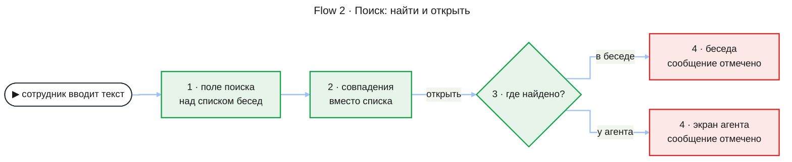
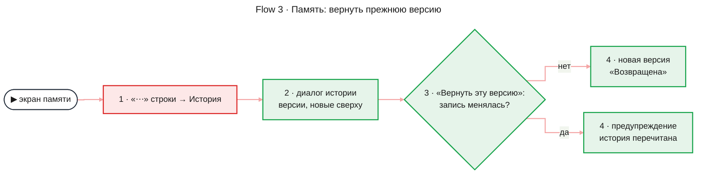

# UXRD: Расписания, поиск по беседам и чистота памяти (schedules-search-memory)

| Дата | PRD |
|---|---|
| 2026-11-25 | [prd.md](./prd.md) |

## Snapshot

**Overview.** Сотрудник ставит расписание прямо из беседы: в меню «+» пункт «Запланировать» открывает диалог с его текстом, агентом, правилом времени и местом ответа. В срок расписание отправляет инструкцию в новую беседу или в свою, как сотрудник отправил бы её сам, а что агент сделал дальше, показывает сама беседа. Все расписания живут на странице «Расписания» в сайдбаре, а у каждого есть своя страница с историей срабатываний: время и ссылка на беседу, куда расписание написало. Сообщение, которое отправило расписание, подписано его именем, как сегодня подписаны сообщения от агентов. Поиск по беседам — поле над списком бесед: совпадения с фрагментом встают на место списка, а открытое совпадение показывает найденное сообщение отмеченным. На экранах памяти у каждой записи появляется история версий с возвратом прежней, удалённые агентом записи остаются видны, а отказ записи памяти виден в беседе как отказ вызова с причиной.

- **Не меняется**: беседа срабатывания — обычная беседа: подтверждения, остановка и квота работают в ней как в чате. Группы по датам и порядок списка бесед остаются, пока поле поиска пусто.
- **Главный UX-риск**: агент в беседе срабатывания ждёт подтверждения, а сотрудник туда не заходит. Расписание об этом не говорит: подтверждение ждёт в самой беседе, как после сообщения руками, а строка истории ведёт в эту беседу (KD-8).

### Key Decisions

| ID | Решение | Почему |
|---|---|---|
| KD-1 | Расписание создаётся из беседы пунктом «Запланировать» в меню «+». Диалог берёт текст из поля сообщения как инструкцию и агента из чипа поля; если чипа нет — «Агент чата». После создания поле сообщения очищается | Сотрудник уже формулирует задачу и выбирает агента в поле сообщения (PRD FR-01) — повторять это в другом месте незачем. Очистка не даёт отправить ту же задачу ещё раз по ошибке |
| KD-2 | Все расписания — на странице «Расписания»: пункт сайдбара после «Библиотеки». У каждого расписания своя страница: настройки, действия и история срабатываний | В сайдбаре уже есть разделы «Агенты» и «Библиотека». Истории нужна своя страница, иначе её некуда поставить |
| KD-3 | Сообщение от расписания подписано «По расписанию «{имя}»» — так же, как сегодня подписаны «От агента «…»». Беседа, которую открыло срабатывание, называется «{имя} · {день}» | Каждое утро сотрудник видит в списке бесед понятный ряд отчётов, а не названия, которые модель придумала заново. Подпись над сообщением ведёт на расписание |
| KD-5 | Поиск — поле над списком бесед в сайдбаре. Пока в поле есть текст, вместо списка стоят совпадения; они остаются, когда сотрудник открывает одно из них, и уходят, когда поле очищено | Поиск ищет беседы, поэтому стоит там же, где беседы. Отдельной страницы нет, и сотрудник открывает совпадения одно за другим, не повторяя запрос |
| KD-6 | Открытое совпадение прокручено в верхнюю треть ленты и статично отмечено; найденный результат инструмента раскрыт | Найденное место видно сразу, без поиска глазами по длинной беседе. Отметка не мигает и не гаснет сама |
| KD-7 | История записи памяти — диалог из меню строки. Возврат версии идёт сразу, без подтверждения. «Удалить» по-прежнему спрашивает подтверждение и теперь стирает запись вместе с историей | Возврат сам становится новой версией и отменяется так же, поэтому подтверждение лишнее. Стирание необратимо, поэтому подтверждение остаётся, а его текст говорит про историю |
| KD-8 | Экраны расписаний не показывают, что агент сделал после срабатывания. История — только время, метка «вручную» и ссылка на беседу; список — время последнего срабатывания. Слово на экранах — «срабатывание» | Расписание только отправляет инструкцию, а ответ, подтверждение и сбой сотрудник уже видит в беседе. Второй статус на странице расписания расходился бы с беседой |

## Design System

Фича следует [дизайн-системе](../../design-system/README.md). Страницы расписаний, сайдбар и диалоги — комфортная плотность ([foundations → Spacing & Density](../../design-system/foundations.md#spacing--density)).

### Component Inventory

| Компонент | Спецификация | Статус | Примечание |
|---|---|---|---|
| Совпадение поиска | [search-result.md](../../design-system/components/search-result.md) | new | Пункт списка бесед несёт только название. Строк с фрагментом и отметки найденного сообщения в коде и в дизайн-системе нет |
| Правило расписания | [schedule-rule.md](../../design-system/components/schedule-rule.md) | new | В интерфейсе нет ни расписаний, ни полей дня недели и интервала; форма настроек не задаёт составное поле с предпросмотром |
| История записи | [version-history.md](../../design-system/components/version-history.md) | new | Версии записей видны только в результате обучения и сравнивают метрики. Списка версий текста с возвратом нет |
| Форма настроек | [settings-form.md](../../design-system/components/settings-form.md), вариант «Форма диалога» | reused | Диалог расписания (SH-02), предупреждение о конфликте (MH-03) |
| Таблица данных | [data-table.md](../../design-system/components/data-table.md) | reused | Список расписаний, история срабатываний, записи памяти |
| Метка состояния | [state-badge.md](../../design-system/components/state-badge.md) | reused | «Активно», «На паузе», «Выполнено» у расписания, «вручную» у срабатывания, «Удалена» и «Текущая» у записи памяти |
| Вызов инструмента | [tool-call.md](../../design-system/components/tool-call.md) | extended | Исход «Отказано» у отклонённой записи памяти; блок, раскрытый на найденном результате |
| Подпись источника сообщения | agent-platform UXRD, MC-10 | extended | Подпись «По расписанию «{имя}»» (SH-07) |
| Меню «+» поля сообщения | create-and-test UXRD, CT-01 | extended | Пункт «Запланировать» (SH-01) |
| Сайдбар и список бесед | chat-shell UXRD, SB-01, SB-04 | extended | Пункт «Расписания» (SH-03), поле поиска (SR-01) |
| Экраны памяти | self-learning UXRD, ME-01 – ME-03 | extended | История, удалённые записи, новый текст удаления (MH-01 – MH-04) |
| Экран «Не найдено» | chat-shell UXRD, Screen 4 | reused | SH-08 |

## User Flows

### Primary User Flow

**Расписание: создать и получить результат.** Implements: UC-1, UC-2, UC-5; AC-01.1, AC-04.1 – AC-04.3, AC-07.2, AC-07.3, AC-08.1

```mermaid
---
title: "Flow 1 · Расписание: создать и получить результат"
config:
  theme: base
  look: classic
  themeVariables:
    primaryColor: "#eef1f5"
    primaryBorderColor: "#4b5563"
    primaryTextColor: "#1a1a1a"
    lineColor: "#6b7280"
  flowchart:
    curve: step
  themeCSS: |
    @keyframes lit_f1{0%,18%{stroke:#991b1b;stroke-width:6px}20%,100%{stroke:#f4a5a5;stroke-width:2px}}
---
flowchart LR
    entry(["▶ сотрудник в беседе"])
    plus["1 · «+» → Запланировать"]
    dlg["2 · диалог расписания"]
    list["3 · Расписания<br/>следующее срабатывание"]
    conv["4 · беседа срабатывания<br/>подпись «По расписанию»"]
    page["5 · страница расписания<br/>история срабатываний"]
    entry e1@--> plus
    plus e2@--> dlg
    dlg e3@-->|"Создать"| list
    list e4@-->|"инструкция отправлена"| conv
    conv e5@-->|"подпись"| page
    classDef entry fill:#ffffff,stroke:#1f2937,stroke-width:1.5px,color:#1a1a1a
    classDef changed fill:#fde8e8,stroke:#dc2626,stroke-width:2px,color:#1a1a1a
    classDef new fill:#e6f4ea,stroke:#16a34a,stroke-width:2px,color:#1a1a1a
    classDef w1 stroke:#f4a5a5,stroke-width:2px,animation:lit_f1 6s linear 0s infinite
    classDef w2 stroke:#f4a5a5,stroke-width:2px,animation:lit_f1 6s linear 1.2s infinite
    classDef w3 stroke:#f4a5a5,stroke-width:2px,animation:lit_f1 6s linear 2.4s infinite
    classDef w4 stroke:#f4a5a5,stroke-width:2px,animation:lit_f1 6s linear 3.6s infinite
    classDef w5 stroke:#f4a5a5,stroke-width:2px,animation:lit_f1 6s linear 4.8s infinite
    class entry entry
    class plus,conv changed
    class dlg,list,page new
    class e1 w1
    class e2 w2
    class e3 w3
    class e4 w4
    class e5 w5
```



После «Создать расписание» диалог закрывается, а уведомление называет следующее срабатывание и даёт «Открыть» — страницу расписания. В срок расписание с ответом «в новую беседу» добавляет беседу в список бесед, а с ответом «в эту беседу» — следующее сообщение в беседу расписания, даже если агент там ещё отвечает. Дальше всё показывает беседа, как после сообщения руками: ответ агента, подтверждение записи, сбой «квота исчерпана». В истории расписания стоит только срабатывание со ссылкой на эту беседу.

**Поиск: найти и открыть.** Implements: UC-6; AC-12.1 – AC-12.3, AC-13.1, AC-13.2, AC-15.1



Экран агента уже ведёт в беседу сотрудника строкой «из беседы «…»» или через родительского агента («запущен агентом «…»»), поэтому новой ссылки для AC-13.2 не нужно. Беседа, открытая по этой ссылке, ничего не отмечает: найденное место — на экране агента. Поиск видит только живые беседы самого сотрудника (AC-14.1, AC-14.2), так что чужое и удалённое в совпадениях не появляется.

**Память: вернуть прежнюю версию.** Implements: UC-8; AC-17.1, AC-17.2, AC-18.1, AC-19.2



История открывается и на экране памяти агента, и в «Моей памяти». Удалённую агентом запись возвращают так же: её верхняя версия — «Удалена», и любая версия ниже возвращается.

### Alternative Flows

- **Изменить расписание** (FR-10, AC-10.1). «Изменить» на странице расписания открывает тот же диалог с сохранёнными значениями. Следующее срабатывание в диалоге и на странице считается по новому правилу.
- **Пауза и возобновление** (UC-3; AC-02.1, AC-02.2). «Пауза» меняется на «Возобновить» на месте. Пока расписание на паузе, история не растёт. После возобновления следующим стоит ближайший будущий срок. Пауза не трогает беседы, куда расписание уже написало: работу агента в них останавливают в беседе.
- **Запустить сейчас** (FR-11, AC-11.1). Кнопка работает в любом состоянии расписания и не меняет ни состояния, ни следующего срабатывания. Срабатывание встаёт в историю с меткой «вручную», а уведомление MC-9 говорит «Инструкция отправлена» и ведёт в беседу. Если чат не принял сообщение, уведомление говорит «Инструкция не отправлена», а строка истории стоит без ссылки.
- **Удалить расписание** (AC-02.3). Подтверждение MC-10, затем страница «Расписания». Беседы, в которые расписание написало, остаются в списке бесед.
- **Беседа расписания удалена** (FR-09; AC-08.2, AC-09.1, AC-09.2). Расписание с ответом «в эту беседу» в ближайший срок встаёт на паузу: в списке оно «На паузе», а на его странице блок MC-8 объясняет причину и ведёт к «Изменить». «Возобновить» недоступна, пока ответ не переключён на новую беседу. До этого «Запустить сейчас» получает отказ MC-9 с действием «Изменить», и в историю ничего не пишется. Прежние срабатывания в удалённую беседу стоят в истории без ссылки. Расписание с ответом «в новую беседу» работает дальше; на его странице у строки «Создано» вместо ссылки — «беседа удалена».
- **Догон после простоя** (UC-4; AC-06.1, AC-06.2). В истории — одно срабатывание за все сроки простоя. Расписание «один раз» после догона переходит в «Выполнено».
- **Агент запоминает** (UC-7, UC-9; AC-16.1 – AC-16.3, AC-19.1). Отклонённая запись видна в беседе блоком вызова «Запомнить» с исходом «Отказано» и причиной MC-19 (MH-05). Агент продолжает работу, а запись в памяти не меняется.
- **Стереть запись** (AC-17.4). «Удалить» в меню строки спрашивает подтверждение MC-18 и убирает запись вместе с историей.

### Error Flows

- **Чужое или удалённое расписание** (AC-01.2). Прямая ссылка ведёт на SH-08. Чужих расписаний в списке нет.
- **Агент стал недоступен** (AC-01.3). При сохранении диалог показывает ошибку MC-3 у поля «Агент» и не закрывается. Если доступ отняли после создания, на странице расписания у агента стоит метка «недоступен».
- **Сообщение не отправлено** (FR-07, AC-07.1). Чат не принял сообщение расписания, например агент стал недоступен. Срабатывание стоит в истории без ссылки; причину экран не называет.
- **Поиск не удался** — ошибка MC-15 с «Повторить» на месте совпадений.
- **Совпадение больше не открыть** — беседу удалили после поиска. Открывается обычный экран «Беседа не найдена» (chat-shell UXRD, Screen 4).
- **Возврат по устаревшей истории** (AC-19.2) — MH-03.
- **Загрузка или действие не удались** — на каждом экране ошибка с «Повторить» (MC-7, MC-11, MC-15, MC-17); отказ действия — уведомление с причиной (MC-3, MC-9, MC-17).

## Screens

### Screen 1: Диалог расписания

```
┌─ Новое расписание ─────────────────────────────────── ✕ ┐  SH-02
│ Название (необязательно)                                │
│ [ Сводка ошибок за ночь                               ] │
│ Инструкция                                              │
│ [ Собери ошибки за ночь по сервисам оплаты и выдели   ] │
│ [ новые.                                              ] │
│ Агент                                                   │
│ [ Агент чата                                        ▾ ] │
│ Когда                                                   │
│ ( Один раз ) ( Каждый день ) (• По дням недели )        │
│ ( Каждые N часов )                                      │
│ [Пн] [Вт] [Ср] [Чт] [Пт]  Сб   Вс       в [ 09:00 ]     │
│ Следующее срабатывание: 26 нояб., 09:00                 │
│ Время по поясу Europe/Moscow (UTC+3)                    │
│ Куда писать ответ                                       │
│ (•) Каждый раз в новую беседу                           │
│ ( ) В эту беседу                                        │
│                     [ Создать расписание ] [ Отмена ]   │
└─────────────────────────────────────────────────────────┘
```

**SH-01. Пункт «Запланировать»** — строка меню «+» после «Создать и проверить агента», с подсказкой MC-1. Пункт есть в любой беседе и в новом чате. Расписание из нового чата без сообщений не связано ни с какой беседой: оно отвечает только в новые беседы, а на его странице у «Создано» стоит один день.

**SH-02. Диалог** — [форма настроек](../../design-system/components/settings-form.md), вариант «Форма диалога», ширина 560 px, поля одной колонкой:

- «Название» необязательно: пустое название заменяет начало инструкции.
- «Инструкция» — многострочное поле. Его предел длины тот же, что у сообщения в чате.
- «Агент» — выпадающий список: первым стоит «Агент чата», за ним те же агенты, что в меню «+», с их значками.
- «Когда» — [правило расписания](../../design-system/components/schedule-rule.md).
- «Куда писать ответ» — радиогруппа. В новом чате без сообщений «В эту беседу» недоступна, и её подсказка объясняет почему (MC-2). При изменении расписания второй пункт называет беседу: «В беседу «{название}»».

Тело диалога прокручивается, а кнопки внизу видны при любой высоте окна. Создание и сохранение закрывают диалог и показывают уведомление MC-5. Уведомление о созданном расписании стоит сверху по центру, чтобы не закрыть кнопку отправки в поле сообщения. «Отмена» и Esc закрывают диалог без изменений и не трогают поле сообщения.

| Состояние | Что показано | AC |
|---|---|---|
| Сохранение идёт | Основная кнопка с вращающимся индикатором; все поля, виды правила, дни и радиокнопки недоступны | — |
| Ошибка поля | Ошибка у поля (MC-3), фокус на первом поле с ошибкой; скринридер читает текст ошибки вместе с полем | AC-01.3 |
| Ошибка формы | Блок ошибки формы над кнопками (MC-3) | — |

### Screen 2: Страница «Расписания»

```
┌────────────────────────────────────────────────────────────────────────────┐
│ Расписания                                                                 │ SH-04
│ Расписание                  Состояние    Следующее        Последнее        │
│                                          срабатывание     срабатывание     │
│ Сводка ошибок за ночь       ✓ Активно    26 нояб., 09:00  25 нояб., 09:00  │
│ По будням в 09:00 · Europe/Moscow · Агент чата                             │
│ Статус проекта              ✓ Активно    29 нояб., 10:00  22 нояб., 10:00  │
│ Пт в 10:00 · Europe/Moscow · Отчёты                                        │
│ Проверка бэкапа             ○ Выполнено  —                20 нояб., 03:00  │
│ Один раз: 20 нояб., 03:00 · Europe/Moscow · Агент чата                     │
└────────────────────────────────────────────────────────────────────────────┘
```

**SH-03. Пункт сайдбара «Расписания»** — после «Библиотеки», со значком часов. Текущий раздел отмечен так же, как «Агенты» и «Библиотека». Счётчика у пункта нет.

**SH-04. Список** — заголовок `h1` MC-7 и [таблица данных](../../design-system/components/data-table.md), вариант «Строка-ссылка»; строка ведёт на страницу расписания. Колонки:

- «Расписание» — название, второй строкой правило, часовой пояс и агент.
- «Состояние» — [метка состояния](../../design-system/components/state-badge.md).
- «Следующее срабатывание» — дата и время или «—».
- «Последнее срабатывание» — дата и время последнего срабатывания, в срок или вручную; «—», пока срабатываний не было. Что было в беседе после него, колонка не показывает (KD-8).

Ниже 768 px шапки нет, и вторая строка записи несёт подписи: «Активно · Следующее срабатывание: 26 нояб., 09:00 · Последнее срабатывание: 25 нояб., 09:00». У расписания без срабатываний — «Последнее срабатывание: —».

Порядок: активные по ближайшему сроку, затем на паузе, затем выполненные. Все времена расписания — правило, следующее срабатывание, история и предпросмотр в диалоге — показаны в его поясе, том, в котором оно создано, и пояс назван рядом с правилом (AC-01.1).

| Состояние | Что показано | AC |
|---|---|---|
| Loading | Скелетон таблицы | — |
| Empty | Пустое состояние MC-7: как создать расписание из беседы | — |
| Error | Ошибка MC-7 и «Повторить» | — |

### Screen 3: Страница расписания

```
┌──────────────────────────────────────────────────────────────────────┐
│ Расписания /                                                         │ SH-05
│ Сводка ошибок за ночь   ✓ Активно                                    │
│ [ Изменить ] [ Пауза ] [ Запустить сейчас ]  ⋯                       │
│ Инструкция              Собери ошибки за ночь по сервисам оплаты…    │
│ Агент                   Агент чата                                   │
│ Когда                   По будням в 09:00 · Europe/Moscow (UTC+3)    │
│ Следующее срабатывание  26 нояб., 09:00                              │
│ Ответ                   Каждый раз в новую беседу                    │
│ Создано                 24 нояб. в беседе «Сбои оплаты»              │
│                                                                      │
│ История срабатываний                                                 │ SH-06
│ Время                                                      Беседа    │
│ 25 нояб., 09:00                                            Открыть   │
│ 24 нояб., 15:12  вручную                                   Открыть   │
│ 24 нояб., 09:00                                            —         │
└──────────────────────────────────────────────────────────────────────┘
```

**SH-05. Шапка и настройки** — ссылка на родителя «Расписания», `h1` с названием и меткой состояния. Ряд кнопок `outline` от 768 px стоит через 8 px после метки, ниже — отдельной строкой под названием: «Изменить», «Пауза» или «Возобновить», «Запустить сейчас»; в меню «⋯» — «Удалить». Ниже — пары «подпись — значение» (MC-8); инструкция показана целиком, с переносами. Беседа ответа и беседа создания — ссылки. Расписание на паузе из-за удалённой беседы показывает над парами блок предупреждения формы настроек с текстом MC-8 и кнопкой «Изменить».

**SH-06. История срабатываний** — `h2` и таблица данных, новые срабатывания сверху, «Показать ещё» после 20 строк (AC-08.1). Колонки:

- «Время» — срок, за который расписание сработало; у срабатывания «Запустить сейчас» — момент нажатия и рядом [метка](../../design-system/components/state-badge.md) «вручную», вариант «Источник».
- «Беседа» — «Открыть» ведёт в беседу, куда расписание написало. Если сообщение не отправлено или эту беседу удалили, в ячейке «—» (AC-08.2).

Статусов работы агента и причин в истории нет (KD-8). Новое срабатывание встаёт сверху, пока страница открыта.

**SH-08. Не найдено** — экран «Не найдено» с текстом MC-13 для ссылки на чужое, удалённое или несуществующее расписание (AC-01.2).

| Состояние | Что показано | AC |
|---|---|---|
| Loading | Скелетоны пар и таблицы | — |
| Истории нет | Пустое состояние таблицы MC-11 со временем первого срабатывания | — |
| На паузе | «Возобновить» вместо «Пауза»; «Следующее срабатывание» — «—» | AC-02.1 |
| На паузе: беседа удалена | Блок предупреждения MC-8, «Возобновить» недоступна | AC-09.1 |
| Агент недоступен | У значения «Агент» — метка «недоступен» | AC-01.3 |
| Выполнено | Нет кнопки «Пауза», «Запустить сейчас» есть; «Следующее срабатывание» — «—» | AC-06.2 |
| Error | Ошибка MC-8 и «Повторить» | — |

### Screen 4: Сообщение от расписания

```
                          ◷ По расписанию «Сводка ошибок за ночь»     SH-07
                       ┌──────────────────────────────────────────┐
                       │ Собери ошибки за ночь по сервисам оплаты │
                       │ и выдели новые.                          │
                       └──────────────────────────────────────────┘
  Агент чата
  За ночь 214 ошибок, новых две: …
```

**SH-07. Подпись** — над сообщением, по краю сообщения, тем же видом, что подписи «От агента «…»» (agent-platform UXRD, MC-10): значок часов и текст MC-12. Имя расписания — ссылка на его страницу; у срабатывания «Запустить сейчас» к подписи добавлено «вручную». Беседа, которую открыло срабатывание, называется по MC-12 (AC-04.1); в беседе расписания подписано каждое сообщение от расписания (AC-04.2).

### Screen 5: Поиск в сайдбаре

```
┌ Agent OS ──────────────────┐
│ [ Новый чат ]              │
│ ✋ Агенты               2   │
│ ▤ Библиотека               │
│ ◷ Расписания               │
│ [⌕ payment-service      ✕] │ SR-01
│ Сбои оплаты        12 нояб.│ SR-02
│ У агента «Разбор логов» ·  │
│ в результате search_logs   │
│ …ответ шлюза: timeout      │
│ payment-service после 30 с…│
│ Квартальный отчёт   3 окт. │
│ В сообщении                │
│ …проверь payment-service…  │
│ [ Показать ещё ]           │
└────────────────────────────┘
```

**SR-01. Поле поиска** — над списком бесед, на всю ширину сайдбара, высота строки списка; слева значок лупы, справа «✕», пока в поле есть текст. Поиск начинается с двух знаков и после паузы ввода. Esc и «✕» очищают поле, и на место совпадений возвращается список бесед с прежней прокруткой. В свёрнутом сайдбаре на полосе есть кнопка с лупой: она разворачивает сайдбар и ставит фокус в поле.

**SR-02. Совпадения** — список [совпадений поиска](../../design-system/components/search-result.md) на месте групп бесед, новые сверху, без групп по датам, «Показать ещё» после 20 совпадений. Совпадения в другой форме слова отмечены так же, как точные (AC-15.1). Если точный поиск ничего не нашёл, поиск один раз повторяется с более свободным сравнением форм слова: так «зимородка» находит «зимородок». Сотрудник видит только найденные совпадения, их вид тот же.

**SR-03. Найденное место** — совпадение в беседе открывает беседу, у сабагента — экран этого агента. Найденное сообщение или раскрытый блок вызова прокручены и отмечены по спецификации совпадения («Цель совпадения»). Совпадение в названии открывает беседу как обычно, с её последнего сообщения.

| Состояние | Что показано | AC |
|---|---|---|
| Меньше двух знаков | Список бесед как прежде | — |
| Первый запрос идёт | Три скелетона совпадений; поле доступно | — |
| Новый запрос при показанных совпадениях | Прежние совпадения стоят на месте и открываются, пока не придут новые; скелетонов нет | — |
| Есть совпадения | Список SR-02 | AC-12.1, AC-12.2 |
| Нет совпадений | Две строки MC-15 по центру области списка | AC-12.3 |
| Error | Ошибка MC-15 и «Повторить» | — |

### Screen 6: История записи памяти

```
│ Запись                                        Изменена       │ MH-01
│ ▸ Ошибки оплаты — в логах billing-api         20 нояб.     ⋯ │
│ ▸ Старый адрес дашборда  ⊖ Удалена            18 нояб.     ⋯ │

┌─ История записи ─────────────────────────────────────── ✕ ┐  MH-02
│ Ошибки оплаты — в логах billing-api                       │
│ Изменена · агент · 20 нояб., 14:32             Текущая    │
│ Логи оплаты лежат в индексе billing-api-*, ошибки шлюза — │
│ с кодом 504.                                              │
│ ───────────────────────────────────────────────────────── │
│ Создана · агент · 12 нояб., 09:10                         │
│ Логи оплаты — в billing-api.                              │
│                                  [ Вернуть эту версию ]   │
│                                              [ Закрыть ]  │
└───────────────────────────────────────────────────────────┘
```

**MH-01. Таблица памяти** — таблица экранов памяти агента и «Моей памяти» (self-learning UXRD, ME-01, ME-02) с двумя изменениями. Первое: в меню «⋯» строки перед «Удалить» стоит «История». Второе: удалённая агентом запись остаётся в таблице — описание `--muted-foreground` и метка «Удалена», дата удаления в колонке «Изменена». Ниже 640 px метка, которой не хватает места рядом, переносится под описание. Раскрытая удалённая строка вместо текста показывает строку MC-16 с кнопкой «История» (AC-17.2).

**MH-02. Диалог истории** — ширина 640 px, заголовок MC-17, под ним описание записи. Внутри — [история записи](../../design-system/components/version-history.md); на экране памяти агента изменения человека подписаны его именем, в «Моей памяти» — «вы» (AC-17.1, AC-17.3). Возврат добавляет версию «Возвращена» сверху и показывает уведомление MC-17; строка таблицы под диалогом обновляется (AC-18.1). Кнопки возврата видит только тот, кто может удалять запись на этом экране. Остальные сюда не попадают: экран памяти для них — «Не найдено» (self-learning UXRD, ME-04; AC-18.2).

**MH-03. Конфликт** — возврат по устаревшей истории не выполняется. Над списком встаёт предупреждение MC-17, история перечитана, новая версия сверху (AC-19.2).

**MH-04. Удаление** — прежний диалог удаления (self-learning UXRD, ME-03) с текстом MC-18: запись уходит вместе со всеми версиями и не возвращается (AC-17.4).

**MH-05. Отказ записи в беседе** — блок [вызова инструмента](../../design-system/components/tool-call.md) «Запомнить» с исходом «Отказано» и строкой причины MC-19 под заголовком; строка видна и в свёрнутом блоке (AC-16.1, AC-16.2, AC-19.1).

| Состояние | Что показано | AC |
|---|---|---|
| Loading, Error истории | Состояния компонента истории, ошибка MC-17 | — |
| Запись удалена агентом | Верхняя версия «Удалена», возврат у версий ниже | AC-17.2 |
| Возврат не удался | Причина MC-17 под версией | — |

## Accessibility

- **Целевой уровень**: WCAG 2.1 AA — уровень продукта из PRD chat-shell, принятый в [foundations](../../design-system/foundations.md); PRD этой фичи своего уровня не задаёт.
- **Порядок фокуса**:
  - SR-01 стоит в порядке табуляции сайдбара после пунктов разделов и перед списком; ↓ из поля переводит фокус на первое совпадение.
  - Открытое совпадение (SR-03) получает фокус, и скринридер читает его текст.
  - После создания расписания фокус возвращается в поле сообщения, после сохранения изменений — на «Изменить». «Пауза» и «Возобновить» сменяют друг друга, и фокус остаётся на кнопке.
  - После удаления расписания фокус на `h1` страницы «Расписания».
  - Диалог истории ставит фокус на заголовок, после возврата и конфликта — на верхнюю версию, после закрытия — на кнопку «⋯» строки.
- **Объявления**:
  - Поиск: «Ищем…», затем «Найдены совпадения» или текст пустого состояния MC-15, через `status`.
  - Уведомления MC-5, MC-9, MC-17 читаются как обычные уведомления.
  - Новая строка в истории срабатываний не объявляется.
  - «Открыть» в истории называет скринридеру время своего срабатывания (MC-11).
- **Заголовки**: `h1` — «Расписания» и название расписания; `h2` — «История срабатываний».

## Responsive Behavior

Все экраны работают от 360 px без прокрутки страницы вбок (NFR-05).

| Экран | < 640 px | < 768 px | ≥ 768 px |
|---|---|---|---|
| SH-02, MH-02 диалоги | Ширина экрана минус 16 px с каждой стороны; тело прокручивается, кнопки внизу видны всегда; сегменты правила стоят по два в ряд, кнопки дней делят ряд поровну, время — следующей строкой | Как ≥ 768 | 560 и 640 px по центру |
| SH-04, SH-06 таблицы | Вариант «Две строки» таблицы данных | Вариант «Две строки» | Колонки |
| SH-05 настройки | Подпись над значением; ряд кнопок переносится целыми кнопками | Подпись слева | Подпись слева |
| SR-01 – SR-03 | В мобильной шторке; открытие совпадения закрывает шторку, повторное открытие показывает тот же запрос и совпадения | Как < 640 | В сайдбаре |

## Content and Microcopy

Тон, даты и время — как в chat-shell UXRD и [foundations → Language & Formats](../../design-system/foundations.md#language--formats). Сотрудник не видит слов «промпт», «cron», «откат», «сабагент» и «срок» в смысле PRD: «инструкция», «вернуть версию», «агент», «срабатывание». Названия, инструкции, имена агентов и инструментов, фрагменты и тексты записей не переводятся. Все тексты идут через каталог переводов; английские пишутся по смыслу под теми же ключами.

| ID | Где | Текст |
|---|---|---|
| MC-1 | Меню «+» (SH-01) | «Запланировать»; подсказка «Агент сам выполнит задачу в заданное время» |
| MC-2 | Диалог (SH-02) | Заголовок «Новое расписание» / «Изменить расписание»; «Название» (необязательно) — «Если оставить пустым, названием станет начало инструкции.»; «Инструкция» — подсказка поля «Что сделать агенту — так же, как написали бы в чат»; «Агент» — «Агент чата»; «Куда писать ответ»: «Каждый раз в новую беседу» — «Отдельная беседа на каждое срабатывание — для независимых отчётов.», «В эту беседу» / «В беседу «{название}»» — «Агент видит прошлые ответы и может сравнить с прошлым разом.»; недоступный пункт — «Станет доступно после первого сообщения в беседе.» или «Беседа удалена.»; «Создать расписание», «Сохранить», «Отмена» |
| MC-3 | Диалог — ошибки | «Напишите, что сделать агенту.»; «Это время уже прошло — выберите будущее.»; «Выберите хотя бы один день.»; «Укажите время в виде ЧЧ:ММ, от 00:00 до 23:59.»; «Укажите целое число часов от 1 до {max}.»; «Агент «{имя}» вам недоступен — выберите другого.»; «Не удалось сохранить: {причина}» |
| MC-4 | Правило (SH-02, SH-05) | Виды «Один раз», «Каждый день», «По дням недели», «Каждые N часов»; «в» перед временем; подписи «Дата», «Время», «Каждые, часов»; подсказка поля времени «ЧЧ:ММ»; «Следующее срабатывание: {дата и время}», при ошибке правила — «Следующее срабатывание: —»; «Время по поясу {пояс} (UTC{смещение})»; строки правила — по спецификации правила расписания |
| MC-5 | Уведомления диалога | «Расписание создано. Следующее срабатывание — {дата и время}.» с действием «Открыть»; «Расписание сохранено» |
| MC-6 | Сайдбар (SH-03) | «Расписания» |
| MC-7 | Список (SH-04) | `h1` «Расписания»; колонки «Расписание», «Состояние», «Следующее срабатывание», «Последнее срабатывание»; без шапки — «Следующее срабатывание: {дата и время}» и «Последнее срабатывание: {дата и время}»; состояния «Активно», «На паузе», «Выполнено»; пусто — «Расписаний пока нет» / «Создайте его в любой беседе: «+» → «Запланировать».»; «Не удалось загрузить расписания» + «Повторить» |
| MC-8 | Страница (SH-05) | «Изменить», «Пауза», «Возобновить», «Запустить сейчас», «Удалить»; подписи «Инструкция», «Агент», «Когда», «Следующее срабатывание», «Ответ», «Создано»; «Каждый раз в новую беседу», «В беседу «{название}»», «{день} в беседе «{название}»», «{день}» без беседы, «беседа удалена»; у агента — «недоступен»; блок паузы — «Беседа «{название}» удалена, поэтому расписание на паузе. Чтобы оно снова работало, выберите ответ в новую беседу и возобновите.»; «Не удалось загрузить расписание» + «Повторить» |
| MC-9 | Страница — уведомления | «Пауза включена»; «Расписание возобновлено. Следующее срабатывание — {дата и время}.»; «Запустить сейчас» — «Инструкция отправлена» с действием «Открыть беседу» или «Инструкция не отправлена»; отказ при удалённой беседе — «Беседа «{название}» удалена — отправлять некуда. Выберите ответ в новую беседу.» с действием «Изменить»; «Не удалось: {причина}» |
| MC-10 | Удаление расписания | «Удалить расписание?» / «Расписание «{название}» больше не будет срабатывать. Беседы, в которые оно написало, останутся в списке.»; «Удалить», «Отмена»; «Расписание удалено» |
| MC-11 | История (SH-06) | `h2` «История срабатываний»; колонки «Время», «Беседа»; «Открыть», для скринридера — «Открыть беседу срабатывания {дата и время}»; «—» без беседы; метка «вручную»; пусто — «Срабатываний пока не было» / «Первое — {дата и время}.»; «Показать ещё»; «Не удалось загрузить историю» + «Повторить» |
| MC-12 | Беседа срабатывания (SH-07) | Подпись «По расписанию «{название}»», у ручного срабатывания — «По расписанию «{название}» · вручную»; название новой беседы «{название} · {день}» |
| MC-13 | Не найдено (SH-08) | «Расписание не найдено» / «Его удалили, или оно принадлежит другому сотруднику.»; «К расписаниям» |
| MC-14 | Поле поиска (SR-01) | Подсказка поля «Поиск по беседам»; «✕» — «Очистить поиск»; кнопка на свёрнутой полосе — «Поиск по беседам» |
| MC-15 | Совпадения (SR-02) | «В сообщении»; «В результате {инструмент}»; «У агента «{имя}»», «· в результате {инструмент}» — имя записи агента, у задачи глубокого агента роль участника команды; список «Совпадения»; «Ищем…»; «Найдены совпадения»; пусто — «Ничего не нашлось» / «Поиск смотрит в названия бесед, сообщения, работу агентов и результаты инструментов.»; «Не удалось найти» + «Повторить»; «Показать ещё» |
| MC-16 | Таблица памяти (MH-01) | Меню «История», «Удалить»; метка «Удалена»; раскрытая удалённая запись — «Агент удалил эту запись. Вернуть её можно из истории.» и кнопка «История» |
| MC-17 | Диалог истории (MH-02, MH-03) | «История записи»; виды «Создана», «Изменена», «Удалена», «Возвращена»; кто — «агент», «вы», имя человека; «Текущая»; «Вернуть эту версию»; «Закрыть»; уведомление «Версия от {дата и время} возвращена»; конфликт — «Запись изменилась, пока была открыта история. Новая версия — сверху; если прежняя всё ещё нужна, верните её ещё раз.»; «Не удалось загрузить историю» + «Повторить»; «Не удалось вернуть: {причина}» |
| MC-18 | Удаление записи (MH-04) | «Удалить запись вместе с историей?» / «{описание}. Запись и все её версии исчезнут, агенты больше их не увидят. Вернуть нельзя.»; «Удалить», «Отмена»; «Запись удалена» |
| MC-19 | Отказ записи (MH-05) | «Похоже на секрет — не записано»; «Похоже на внедрённую инструкцию — не записано»; «Запись уже изменили — агент получил её новый текст» |

## Update History

| Version | Date | Change |
|---------|------|--------|
| 1.0 | 2026-11-25 | Первая версия |
| 1.1 | 2026-11-26 | Поправки после проверки экранов в браузере: диалог расписания, список и страница расписания на узком экране, метка «Удалена», свободный повтор поиска |
| 1.2 | 2026-11-26 | «Последний запуск: —» у расписания без запусков, текст подтверждения удаления расписания |
| 1.3 | 2026-11-26 | Расписание только отправляет инструкцию, по словам владельца: «Мне кажется шедулери просто должен что то тригерить какойе то действие и все», «Зачем ему статусы знать». История — время, «вручную» и ссылка (KD-8 вместо KD-4); убраны пропуски, причины, статусы запусков и уведомление об идущем запуске; «Запустить сейчас» в любом состоянии; слово «срабатывание» на экранах |
