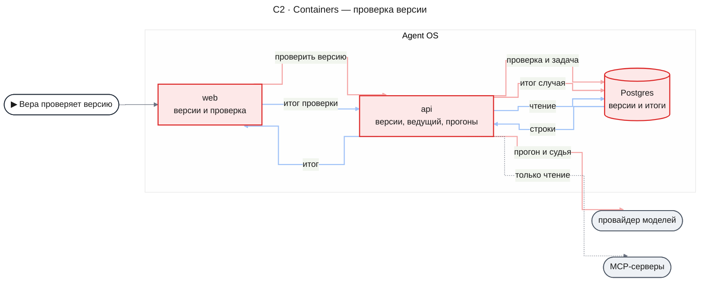
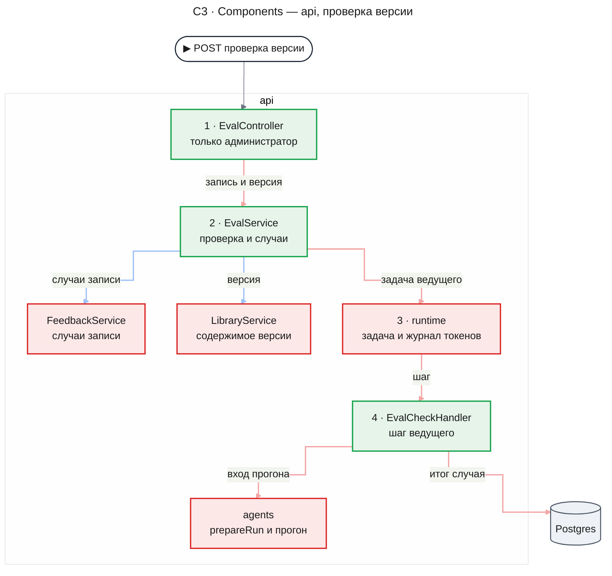
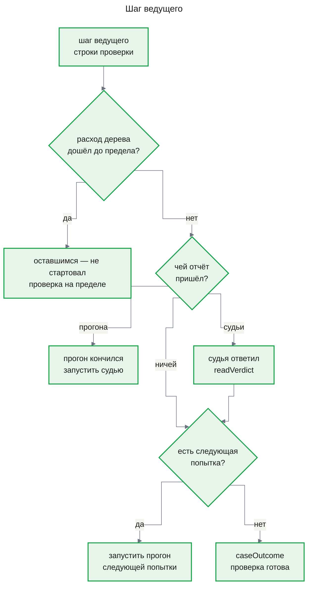
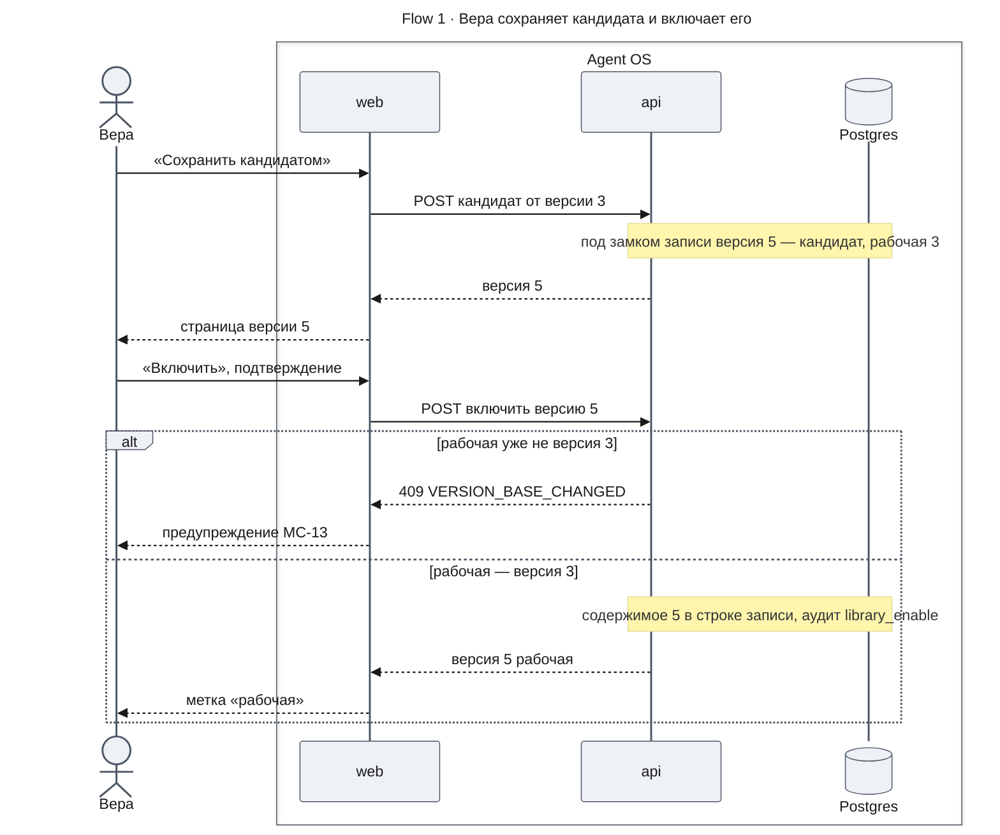
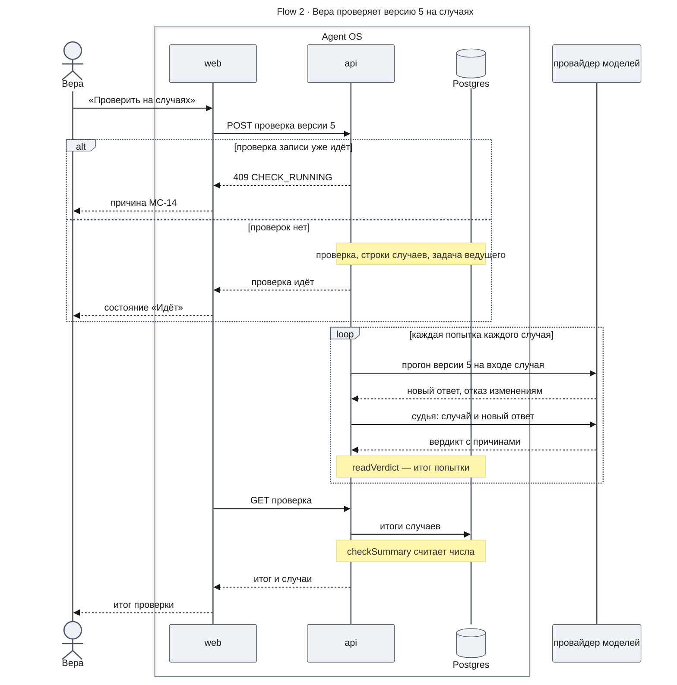
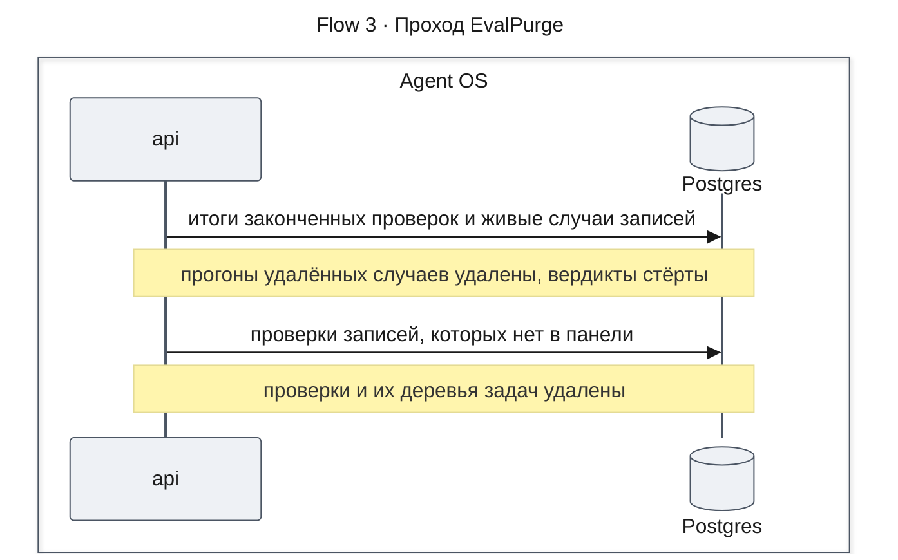
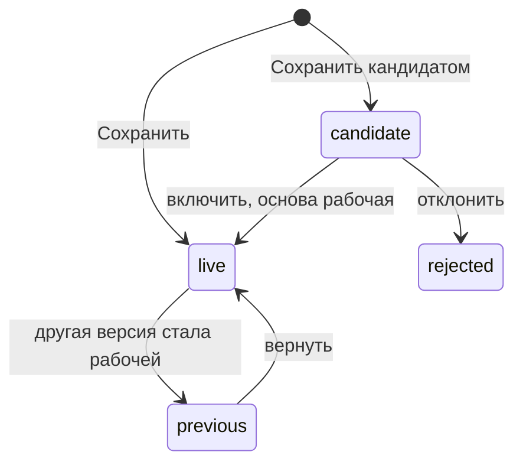

# Улучшение записей по оценкам сотрудников — Design Document — eval

**Status:** На утверждении · **Date:** 2026-11-19 · **PRD:** [prd.md](./prd.md) · **UXRD:** [uxrd.md](./uxrd.md) · **Depends on:** [design-feedback.md](./design-feedback.md#contract-definitions)

## Snapshot

**Overview.** Администратор правит системную запись и сохраняет правку кандидатом — версией, которая не работает ни в одной беседе, пока он её не включит. Каждая сохранённая версия теперь лежит целиком в истории записи: её можно открыть, сравнить с рабочей, включить или вернуть. Проверка версии — фоновая задача-ведущий: она по одному прогоняет случаи записи на этой версии от имени администратора и без беседы, а изменяющим действиям прогон отказывает. После каждого прогона ведущий запускает проверяющего агента, и код превращает его вердикт в итог случая. Перед каждым вызовом модели прогон сверяет расход всей проверки с пределом из настроек, а метку «контрольный» случай получает при оценке и больше не меняет.

- **Не меняется**: «Сохранить» сразу делает версию рабочей; запуски в беседах берут содержимое записи, как сейчас; беседы сотрудников.
- **Главный риск**: прогон главного чата повторяет прежние ходы беседы по копии случая, и агентов прежних ходов в нём нет ([Risks and Mitigation](#risks-and-mitigation)).
- **Открытые вопросы**: один — к дизайну `feedback` ([Open Questions](#open-questions)).

### Key Decisions

#### KD-1: Каждая сохранённая версия системной записи — строка `library_record_versions` с полным содержимым; рабочие версии и кандидаты нумеруются одной последовательностью, а `library_records.version` остаётся номером рабочей

Строка записи по-прежнему держит содержимое рабочей версии, поэтому `resolveStart`, списки и снимки читают её как сейчас. Номер новой версии берётся из нового поля `library_records.last_version` — самого большого выданного номера: «Сохранить» берёт следующий номер и делает его рабочим, кандидат только берёт номер. Так `version` остаётся номером рабочей версии, токеном «никто не сохранил раньше вас» в теле `PUT` и значением закрепления исполнителя, а рабочая версия может быть меньше кандидата (UXRD EV-02). У записей сотрудников истории нет, и `last_version` у них всегда равен `version`.

После возврата рабочая версия может стать меньше закреплённой, поэтому исполнитель workflow теперь считается изменённым, когда закреплённая версия не равна рабочей, а не когда она меньше. Правило меняется в API и в его копии в вебе; `ExecutorSourceState.latestVersion` значит «рабочая версия».

Не взяты: кандидат с номером `version + 1` — следующее «Сохранить» выдало бы тот же номер; своя таблица кандидатов со своими номерами — UXRD нумерует версии и кандидатов вместе; содержимое только в истории — пришлось бы менять каждое чтение записи.

#### KD-2: Проверка — задача нового типа `eval_check`, которую ведёт обработчик `EvalCheckHandler` модуля `eval` в `apps/api`; прогоны и проверяющий агент — её дети типа `agent`, по одному за раз

Проверка длится минуты и должна пережить рестарт ([step-handler.md](../../code-system/patterns/step-handler.md)). Прогону без беседы нужен родитель, которому runtime сообщит конец через `child_finished`: корень без родителя после ответа ждёт и не кончается никогда (`endOfTurn`). Ведущий и есть этот родитель; `apps/api` регистрирует его обработчик в `runtime.handlers`. Шаг ведущего читает таблицы `eval_*`, записывает исход пришедшего ребёнка и в той же транзакции порождает следующего через `effects.spawn`, поэтому потерянный шаг повторяется без второго прогона. Вход ребёнка готовит `agents.sessions.prepareRun` до транзакции, потому что в ней идёт `resolveStart`. Дети идут по одному, чтобы предел останавливал проверку на понятной границе (AC-13.1); форма ведущего — новый паттерн [driver-task.md](../../code-system/patterns/driver-task.md).

Не взяты: признак «корень без беседы» у задачи `agent` — о конце прогона некому было бы сообщить; агент-родитель — ход проверки решала бы модель; цикл в памяти API — рестарт терял бы проверку; случаи параллельно — предел превышался бы на число идущих прогонов.

#### KD-3: Прогон проверки — задача `agent` с полем `check` во входе; поле наследуют все её потомки

Одно поле во входе оставляет прогону шаги, инструменты и сжатие любого агента, а наследование нужно, потому что изменяющий вызов может сделать исполнитель workflow или ребёнок от `start_agent`. Поле меняет четыре вещи:

- Инструмент, которому нужно подтверждение человека (`needsConfirmation`), не выполняется: вызов закрывается отказом с новой причиной `check_run`, а строка вызова хранит инструмент, сервер и аргументы (AC-09.3). Так отказывают изменяющие MCP-инструменты и `run_code` класса `write`. У `draft_record` подтверждения нет, поэтому поле `check` отказывает ему отдельно, той же причиной `check_run`. Исключение — `start_workflow`: его подтверждение — проверка брифа человеком, а в прогоне человека нет; бриф идёт таким, как его написала модель, и виден в шагах прогона.
- Прогон записи `chat` получает `check.asRoot`: инструменты корня беседы, но ответ кончает его отчётом ведущему, как ребёнка.
- Вход прогона `chat` — вопрос хода и префикс: записи корня до `turnSeq` из копии случая, которые шаг модели читает, как часть родителя у ответвления (`readSessionHistory`). Вход агента — его задание, workflow — бриф: первая запись истории участника.
- Сессии прогонов отмечены `agent_sessions.check_run` и не входят в `recordCounts` и `firstRun`.

Не взяты: прогон `chat` только на вопросе — FR-09 требует историю до оценённого сообщения; отказ и `start_workflow` — прогон `chat` не повторил бы ни одного ответа через workflow; ответвление от живой сессии (`forkedFrom`) — беседы может уже не быть.

#### KD-4: Предел расходов действует на всё дерево задач проверки: перед каждым вызовом модели прогон сравнивает `runtime.ledger.spendOfRoot` с `check.capUsd` и при достижении падает с причиной `spend_cap`; ведущий сверяет то же перед каждым ребёнком

Только проверка перед каждым вызовом даёт NFR-05: после предела новый вызов не стартует, а доходят лишь шедшие, в том числе у параллельных исполнителей. Предел копируется во вход при старте проверки, и смена настройки идущую проверку не меняет. Расход считается по корню дерева, поэтому проверка, которую цикл `loop` запустил своим ребёнком, делит предел со всем циклом. Прогон с `spend_cap` даёт случаю «не оценено», остальные случаи — «не стартовал».

Не взяты: обёртка над `AccessGate` — порт спрашивают с сотрудником и моделью, без задачи; остановка дерева ведущим — он просыпается только на конце ребёнка, а внутри прогона workflow вызовы шли бы без проверки.

#### KD-5: Проверяющий агент — встроенная запись `judge` без аудитории; ведущий запускает её так же, как проверяемую версию, а вердикт — JSON-отчёт, который читает чистая функция `readVerdict`

Судья — обычная запись, и администратор правит его промпт, как любой системной записи (PRD, Background). Системную запись без адресатов видит только панель (`inPanel`), поэтому судьи нет в списке чата, а `start_agent` по его номеру получает `record_unavailable` (AC-10.3). Сидер создаёт его с `everyone: false` (`BuiltinRecordInput.everyone`), а аудитория записей набора `ADMIN_ONLY_BUILTIN_KEYS` закреплена; `loop` добавит туда анализатор. Ведущий берёт содержимое судьи уровнем панели и стартует его источником `supplied`, задание собирает `judgeTask`. `readVerdict` принимает JSON-объект с исходом и причинами сам по себе или в одном блоке кода, если исход допустим для вида оценки; всё остальное и сбой судьи дают «не оценено» (AC-10.2). Итог случая считает `caseOutcome`, итог проверки — `checkSummary` ([pure-decision.md](../../code-system/patterns/pure-decision.md)).

Не взяты: `Agents.completeText` — модель зашита, промпта записи нет, вызов обходит предел дерева; инструмент `submit_verdict` — он попал бы в закрытый набор, доступный любой записи; аудитория «администраторы» — такой роли нет, администратор — это право.

#### KD-6: Метка «контрольный» — столбец `holdout` строки случая; её ставит `FeedbackService.rate` по `holdoutPercent`, а случай, который заменяет прежний того же хода, наследует его метку

`rate` — единственное место, где случай рождается ([design-feedback.md](./design-feedback.md#contract-definitions)), поэтому метка есть раньше, чем кто-то прочтёт случай. Замена оценки рождает новый случай того же хода: новая жеребьёвка могла бы сделать контрольным рабочий случай, который анализатор уже прочёл. `rate` удаляет прежний случай хода в своей транзакции и берёт его метку перед удалением. Миграция ставит метки существующим случаям по доле по умолчанию (AC-11.3).

Не взята метка в таблице `eval`: анализатору `loop` пришлось бы сводить два чтения, а метка должна умирать вместе со случаем.

#### KD-7: Хранится последняя проверка каждой версии и последний повтор каждой пары «случай и версия»; у итога удалённого случая остаются только числа, а его прогоны удаляет `EvalPurge` при старте API и раз в час

Прогоны держат содержимое случая — вопрос, префикс, шаги — в таблицах `runtime_*` и `agent_*`, и FR-05 требует удалить их вместе со случаем. `feedback` о потребителях не знает, поэтому `EvalPurge` сам сверяет итоги законченных проверок с `FeedbackService.casesOf`: прогоны удалённого случая уходят из runtime, вердикт — из строки итога, а исход, вид оценки, метка и стоимость остаются. Проверки записи, которой нет в панели (`LibraryService.panelRecordIds`), он удаляет целиком. Таймер — как у `CasePurge` ([design-feedback.md](./design-feedback.md), KD-6). Проверку, корень дерева которой ещё идёт, он не трогает: удаление законченного прогона уменьшило бы расход дерева посреди работы.

Заменённую проверку удаляет сам `EvalService.startCheck`: записав новую проверку версии или новый повтор пары, он удаляет прежнюю законченную проверку — её строки и дерево задач через `runtime.tasks.deleteTree` на задаче ведущего. Идущую заменить нельзя: её отклоняет `CHECK_RUNNING`.

Не взяты: хранить все проверки — деревья задач с беседами сотрудников росли бы без предела; уведомление от `feedback` — его контракт намеренно не знает потребителей.

## Terms

Кандидат, прогон, проверка версии, судья, вердикт, правило и контрольный случай — [PRD, Terms](./prd.md#terms).

- **Ведущий** — задача `eval_check`: проводит одну проверку, по очереди запускает прогоны и судью и пишет итоги.
- **Попытка** — один прогон случая и вердикт о нём; при «повторах прогона» больше единицы их у случая несколько.
- **Итог случая** — `fixed`, `remains`, `kept`, `broken`, `divergent` (попытки разошлись), `unrated` или `not_started`.
- **Основа кандидата** — рабочая версия, от которой его сделали.
- **Префикс истории** — прежние ходы беседы из копии случая, которые прогон `chat` получает как свою историю.
- **Дерево проверки** — ведущий и все задачи под ним.

## Part

- **Part**: `eval`
- **Covers**: FR-07–FR-13, FR-20, FR-21; NFR-01 (маршруты этой части), NFR-03, NFR-04 (вход прогонов и судьи), NFR-05, NFR-07 (разделы панели этой части)
- **Depends on**: [design-feedback.md](./design-feedback.md#contract-definitions), «Для частей `eval` и `loop`»
- **Prerequisite ADRs**: [ADR-0001](../../adr/ADR-0001-durable-runtime-owner.md), [ADR-0004](../../adr/ADR-0004-agent-framework-packages.md), [ADR-0012](../../adr/ADR-0012-closed-api-and-server-issued-employee-id.md), [ADR-0015](../../adr/ADR-0015-access-gate-and-model-catalogue.md), [ADR-0016](../../adr/ADR-0016-library-records-and-visibility.md), [ADR-0017](../../adr/ADR-0017-run-snapshots-from-library.md); тест трёх условий для нового ADR проходят KD-1 и прогоны вне беседы (KD-2, KD-3)
- **Sibling parts**: `feedback` — его операции эта часть потребляет; `loop` (FR-14–FR-18) потребляет [Contract Definitions](#contract-definitions), «Для части `loop`»

**Out of scope**

- Анализатор, цикл, блок «Что нашёл анализ», карточка улучшения и их метки — часть `loop`.
- История версий и проверки записей сотрудников, в том числе открытых ролям (PRD, Won't Have).
- Перенос включённой версии встроенной записи в код: сидер не трогает существующую строку.
- Перезапуск прогона со страницы агента: страница повтора на неё не ведёт.
- Бюджет у каждой задачи из `project-context`: предел есть только у дерева проверки.

**Constraints**

- PoC: тело настроек библиотеки становится полным с пятью полями; миграция переносит в историю текущее содержимое системных записей и ставит метки существующим случаям, как требуют FR-07 и AC-11.3.
- Настройки живут в базе и меняются в панели; интервалы опроса и очистки — постоянные в коде.
- Состояние только в Postgres: шаг ведущего продолжает любой экземпляр API, `EvalPurge` безопасен на нескольких сразу.
- Логирование — через логгер `common` ([logging.md](../../code-system/patterns/logging.md)): шаг ведущего, старт и конец прогона и судьи, итог случая, отказ `check_run` и остановка на пределе пишут номера, исход, стоимость и длительность, но не тексты случая и вердикта.

## Building-block Inventory

Follows the [code system](../../code-system/README.md).

| Building block | Pattern | Status | Note |
|---|---|---|---|
| Модуль `eval`: `EvalService`, `EvalRepository`, `EvalController`, `EvalPurge` | [repository-over-transaction.md](../../code-system/patterns/repository-over-transaction.md), [auth-boundary.md](../../code-system/patterns/auth-boundary.md) | new | Проверок и прогонов вне беседы в `apps/api` и `packages` нет |
| `EvalCheckHandler` | [driver-task.md](../../code-system/patterns/driver-task.md) | new | Единственный тип задачи сейчас — `agent` (KD-2) |
| `readVerdict`, `caseOutcome`, `checkSummary`, `judgeTask` | [pure-decision.md](../../code-system/patterns/pure-decision.md) | new | По образцу `endOfTurn` |
| `LibraryService`, сидер, правило «изменено» в API и вебе, `FeedbackService.rate` | [settings-row.md](../../code-system/patterns/settings-row.md) | extended | История, кандидат, судья, настройки, правило «изменено», метка `holdout` |
| `resolveStart`, `agents.sessions`, шаги агента, `runtime.ledger`, `runtime.tasks` | [run-snapshot.md](../../code-system/patterns/run-snapshot.md) | extended | `supplied`, `prepareRun`, `check`, `spendOfRoot`, удаление поддерева |
| Вкладка «Версии», страницы версии и повтора | [shell-route.md](../../code-system/patterns/shell-route.md), [read-on-open.md](../../code-system/patterns/read-on-open.md) | new | Перечитывание раз в 5 с, пока проверка идёт |
| `VersionDiff`, `CheckSummary`, `AnswerWork` «Повтор», `StateBadge` | — | new, extended | Спецификации [version-diff.md](../../design-system/components/version-diff.md), [check-summary.md](../../design-system/components/check-summary.md), [answer-work.md](../../design-system/components/answer-work.md), [state-badge.md](../../design-system/components/state-badge.md) |
| Редактор записи, страница случая, вкладка «Оценки», форма настроек | [web-api-client.md](../../code-system/patterns/web-api-client.md) | extended | «Сохранить кандидатом», «Повторить на версии…», колонка «Случай», группа EV-08 |

## Acceptance Criteria

### FR-07: История версий

- From the PRD: AC-07.1
- Список версий никогда не пуст: рабочая версия есть в истории и у записи, созданной до этой части (DC-1).

### FR-08: Кандидат

- From the PRD: AC-08.1, AC-08.2, AC-08.3
- Кандидат из редактора, где рабочая версия устарела, получает 409 `RECORD_VERSION_CONFLICT`, как «Сохранить» (DC-2).
- Отклонённую и рабочую версию включить нельзя: 409 `VERSION_NOT_ENABLEABLE` (DC-3).

### FR-09: Прогон случая

- From the PRD: AC-09.1, AC-09.2, AC-09.3, AC-09.4, AC-09.5
- Потомки прогона тоже отказывают изменяющим действиям, а `start_workflow` в прогоне идёт без подтверждения (DC-4).
- Если запись работала в случае несколько раз, прогон повторяет её первый запуск (DC-5).

### FR-10: Вердикт по смыслу

- From the PRD: AC-10.1, AC-10.2, AC-10.3

### FR-11: Контрольные случаи

- From the PRD: AC-11.1, AC-11.2, AC-11.3
- Случай, который заменил прежний случай того же хода, носит его метку (DC-6).

### FR-12: Проверка версии

- From the PRD: AC-12.1, AC-12.2, AC-12.3
- Новая проверка версии заменяет её прежнюю проверку (DC-7).
- После рестарта API проверка продолжается с первой незаконченной попытки, и законченные попытки не повторяются (DC-8).
- Итог случая, удалённого после проверки, остаётся в числах, но без вердикта и прогонов (DC-9).

### FR-13: Предел расходов

- From the PRD: AC-13.1

### FR-20: Вернуть прежнюю версию

- From the PRD: AC-20.1

### FR-21: Повторы прогона

- From the PRD: AC-21.1

## Design

### Architecture (C1–C4)

#### C2 · Containers

Схема показывает путь проверки версии: сначала запись проверки и прогоны, затем чтение итога.

- `web` получает вкладку «Версии», страницы версии и повтора, «Сохранить кандидатом», «Повторить на версии…» и группу настроек EV-08.
- `api` хранит версии, ведёт проверку задачей `eval_check` и запускает прогоны и судью агентами администратора; MCP-серверы прогон зовёт только для чтения.
- `Postgres` получает историю версий, таблицы проверок, метку случая и три поля настроек.

#### C3 · Components: api

- `EvalService` проверяет, что версия есть в истории и у записи нет идущей проверки, берёт случаи из `FeedbackService.casesOf` и одной транзакцией пишет проверку с пределом и числом повторов из настроек, строки случаев и задачу ведущего с номером проверки.
- `EvalCheckHandler` — порт `TaskHandler` типа `eval_check`: версию и судью он берёт из `LibraryService`, копию случая — из `FeedbackService.caseDetail`, вход ребёнка — из `agents.sessions.prepareRun`.
- Версии, кандидат и включение — операции `LibraryService` на маршрутах `admin-library.controller.ts` (Flow 1).

#### Шаг ведущего

Каждый шаг ведущий начинает с чтения своих строк; исход попытки и случая решают чистые функции, шаг только читает и пишет.

- Упавший или остановленный прогон судью не получает: попытка — «не оценено» с причиной сбоя; прогон с `spend_cap` ведёт к остановке на пределе.
- Удалённый случай (`caseDetail` вернул `null`) получает «не оценено» с причиной `case_deleted`.
- Когда кончились все случаи, ведущий пишет потраченное и кончается итогом `complete`. Сообщения, кроме `child_finished`, он пропускает.

#### C3 · Components: web

- `parseShellRoute` разбирает у записи раздела `library` поверх адресов части `feedback` вкладку `…/<id>/versions`, страницу версии `…/<id>/versions/<N>` и страницу повтора `…/<id>/repeats/<repeat>`: вид `record` получает вкладку `versions`, новые виды страницы — `version` и `repeat`.
- Вкладка «Версии» читает версии из `library` и даты проверок из `eval`. Страница версии сравнивает версию с рабочим содержимым, которое страница записи уже прочла.
- Страницы версии и повтора перечитывают данные раз в 5 секунд (`CHECK_POLL_MS`), пока проверка идёт ([read-on-open.md](../../code-system/patterns/read-on-open.md)).

### Runtime Flows

#### Flow 1: Кандидат и его включение

**Starts when:** администратор нажимает «Сохранить кандидатом», затем «Включить», for AC-07.1, AC-08.1, AC-08.2, AC-08.3, AC-20.1, DC-2, DC-3

**Outcome:** новые беседы стартуют по версии 5, идущие доходят на своих снимках; версия 3 стала прежней. «Вернуть эту версию» идёт тем же маршрутом включения без проверки основы и пишет `library_restore`.

**Failure handling:**

- Рабочая версия сменилась после открытия редактора → 409 `RECORD_VERSION_CONFLICT`; редактор показывает свой баннер конфликта.
- Версия отклонена или уже рабочая → 409 `VERSION_NOT_ENABLEABLE`; версии нет или запись не системная → 404 `VERSION_NOT_FOUND`.

#### Flow 2: Проверка версии

**Starts when:** администратор нажимает «Проверить на случаях» или «Повторить на версии…», for AC-09.1–AC-09.5, AC-10.1, AC-10.2, AC-12.1, AC-12.2, AC-12.3, AC-13.1, AC-21.1, DC-4, DC-8

**Outcome:** у каждого случая итог, у проверки — `done` и потраченная сумма; расход записан на администратора (AC-09.4). Повтор со страницы случая — та же проверка с одним случаем: идущая проверка записи ему не мешает, а второй повтор той же пары, пока идёт первый, получает 409 `CHECK_RUNNING`.

**Failure handling:**

- Случаев у записи нет → 409 `NO_CASES`.
- Расход дерева дошёл до предела → вызов модели не стартует, прогон падает с `spend_cap`, случай — «не оценено», остальные — «не стартовал», проверка — `capped` (AC-13.1).
- Изменяющий вызов → отказ `check_run` результатом инструмента, агент продолжает (AC-09.3).
- Инструмента нет у администратора → `sessionTools` его не отдаёт, `droppedTools` называет его у повтора (AC-09.2); запись, которую администратор не может запустить, не стартует и попадает в `notStarted` (AC-09.5).
- Прогон упал или квота администратора кончилась → «не оценено», ведущий идёт дальше; судья упал или его отчёт не читается → «не оценено» (AC-10.2).
- Рестарт API → незакоммиченный шаг ведущего повторяет любой экземпляр (DC-8); сбой самого шага → проверка `failed`, сделанное остаётся в итогах.

#### Flow 3: Содержимое удалённых случаев

**Starts when:** API стартует и дальше раз в час в каждом экземпляре, for DC-9 и AC-05.1 в части итогов проверок

**Outcome:** страница проверки показывает удалённый случай строкой «Случай удалён» без ссылки (UXRD EV-04), маршрут повтора отвечает 404 `REPEAT_NOT_FOUND`.

**Failure handling:** сбой запроса пишет строку лога `error`, и следующий проход повторяет работу; второй экземпляр в то же время ничего не находит.

### Contract Definitions

**Маршруты версий** (модуль `library`, каждый с `@AdminOnly()`: без сеанса 401, без права администратора 403 `ADMIN_REQUIRED`)

- **`GET /api/admin/library/:id/versions`** — история системной записи, новые сверху: список `VersionSummary`. Запись вне панели или сотрудника — 404 `RECORD_NOT_FOUND`.
- **`GET /api/admin/library/:id/versions/:version`** — `VersionSummary` и `definition` — содержимое версии. Ошибка: 404 `VERSION_NOT_FOUND`.
- **`POST /api/admin/library/:id/candidates`** — сохраняет кандидата; тело — `UpdateRecordBody`, как у `PUT …/:id`, а `version` в нём — основа. Возвращает `VersionSummary`. Ошибки: 409 `RECORD_VERSION_CONFLICT`, 400 `VALIDATION_FAILED`.
- **`POST /api/admin/library/:id/versions/:version/enable`** — делает кандидата или прежнюю версию рабочей. Возвращает `VersionSummary`. Ошибки: 409 `VERSION_BASE_CHANGED`, 409 `VERSION_NOT_ENABLEABLE`, 404 `VERSION_NOT_FOUND`.
- **`POST /api/admin/library/:id/versions/:version/reject`** — отклоняет кандидата. Версия не в состоянии кандидата — 409 `VERSION_NOT_ENABLEABLE`.
- Кандидат, включение, возврат и отклонение пишут аудит записей `library_candidate`, `library_enable`, `library_restore` и `library_reject` с администратором, записью и версией (AC-08.3).
- **`PUT /api/admin/library/:id`** дополнительно пишет строку истории новой рабочей версии; **`PUT …/:id/audience`** для `ADMIN_ONLY_BUILTIN_KEYS` (сейчас `judge`) отвечает 409 `RECORD_AUDIENCE_FIXED`.

**Маршруты проверок** (модуль `eval`, каждый с `@AdminOnly()`)

- **`POST /api/admin/eval/checks`** — запускает проверку, тело `StartCheckBody`: `recordId`, `version` и необязательный `caseId` для повтора одного случая. Возвращает `CheckView`. Ошибки: 409 `CHECK_RUNNING`, 409 `NO_CASES`, 404 `VERSION_NOT_FOUND`, 404 `CASE_NOT_FOUND`.
- **`GET /api/admin/eval/records/:recordId/checks`** — `RecordChecks`: последняя проверка каждой версии (`version`, `checkId`, `status`, `startedAt`, `finishedAt`) и идущая проверка версии или `null`.
- **`GET /api/admin/eval/checks/:checkId`** — `CheckView`. Ошибка: 404 `CHECK_NOT_FOUND`.
- **`GET /api/admin/eval/results/:resultId`** — `RepeatView`. Ошибка: 404 `REPEAT_NOT_FOUND`, в том числе для удалённого случая.
- **`GET` и `PUT /api/admin/library/settings`** — `LibrarySettings` получает `holdoutPercent`, `spendCapUsd` и `checkRepeats`; тело `PUT` требует все пять полей, аудит `admin_change` несёт все пять.

**Для части `loop`** (операции внутри `apps/api`)

- **`LibraryService.saveCandidate(recordId, body, savedBy)`** — кандидат по правилам маршрута; `savedBy` — администратор или `analysis`. Возвращает `VersionSummary`.
- **`LibraryService.version(recordId, version)`** — содержимое версии как `ResolvedRecord` уровнем панели или `null`.
- **`LibraryService.enableVersion(recordId, version, by)`** и **`rejectVersion(recordId, version, by)`** — правила и аудит маршрутов.
- **`EvalService.startCheck(request, parent?)`** — `request` — поля `StartCheckBody` и администратор. Без `parent` ведущий — корень своего дерева. С `parent` — транзакцией и `effects` шага задачи `loop` — ведущий становится её ребёнком: конец проверки приходит ей `child_finished`, а предел действует на всё её дерево. Возвращает номер проверки; отказы — как у маршрута.
- **`EvalService.check(checkId)`** — `CheckView` или `null`. Итог каждого случая несёт `holdout`, и итоги контрольных `loop` анализатору не передаёт.

**Что эта часть добавляет к `feedback` и пакетам**

- **`FeedbackService.rate`** ставит `holdout` (KD-6); `CaseRef`, `CaseSummary` и `CaseDetail` получают поле `holdout`.
- **`StartSource` `supplied`** — запись, которую вызывающий уже прочёл (`ResolvedRecord`): `resolveStart` проверяет её модель и строит снимок с её происхождением и версией, не спрашивая библиотеку.
- **`agents.sessions.prepareRun(request)`** — вход: владелец, запись `supplied`, задание, описание, метка записи, необязательный префикс и `check` с `asRoot` и `capUsd`. Возвращает тип `agent` и вход для `effects.spawn` или отказ `resolveStart`.
- **`judgeTask(case, attempt)`** — задание судьи: вид оценки и комментарий, вопрос и ответ хода из случая, прежний отчёт этой записи из копии (у `chat` — ответ хода), новый ответ попытки и исходы, допустимые для вида оценки. Судья стартует через `prepareRun` с тем же `check` (`capUsd` проверки, `asRoot` = `false`), поэтому предел и отказы действуют и на него.
- **`agents.sessions.droppedTools(agentId)`** — серверы и инструменты снимка агента, которые `sessionTools` не отдаёт его владельцу: сервер выключен, нет права или нет аккаунта OAuth.
- **`AgentTaskInputSchema`** получает необязательные `check` и `prefix`; `start_agent`, `start_workflow` и старт исполнителя копируют `check` во вход ребёнка с `asRoot` = `false`.
- **`ToolRefusalReasonSchema`** получает `check_run`, **`AgentFailureReasonSchema`** — `spend_cap`; проверки базы на `agent_tool_calls` и `agent_code_calls` расширяет миграция.
- **`runtime.ledger.spendOfRoot(rootId)`** — сумма стоимости вызовов моделей всех задач дерева.
- **`runtime.tasks.deleteTree(taskId, ownerId)`** принимает и законченную задачу не в корне и удаляет её с потомками; корень удаляется как сейчас, поэтому удаление беседы не меняется.

**`VersionSummary`**

- `version`; `status` — `live`, `candidate`, `rejected` или `previous`; `baseVersion` — основа кандидата или `null`.
- `savedBy` — `id` и `name` администратора или `analysis`; `savedAt`.
- `enabled` — последнее включение: `how` (`save`, `enable`, `restore`), `at`, `by`; `null`, если версия не была рабочей.

**`CheckView`**

- `checkId`, `recordId`, `version`, `caseId` у повтора; `status` — `running`, `done`, `capped` или `failed`.
- `startedBy`, `startedAt`, `finishedAt`, `capUsd`, `repeats`, `spentUsd` — потрачено на сейчас или итог.
- `summary` — итог `checkSummary`: по жалобам и одобрениям, отдельно по рабочим и контрольным, число случаев каждого исхода и всего; вид без случаев отмечен пустым (AC-12.2).
- `results` — `CheckResult` в порядке прогона: `resultId`, `caseId`, `rating`, `holdout`, `caseVersion`, `outcome` (`null`, пока попытки идут), `unratedReason` (`verdict_unreadable`, `judge_failed`, `run_failed`, `spend_cap`, `case_deleted`), `why` — начало причины вердикта, `costUsd`, `caseGone`.

**`RepeatView`**

- `result` — `CheckResult`; `check` — запись, версия и статус проверки; `before` — ответ и участники из `CaseDetail`.
- `attempts` — по каждой попытке: `outcome`, `verdict` — причины словами, `answer`, `agents` — участники прогона в форме `CaseAgent`, `droppedTools`, `notStarted` — записи случая, которые администратор не может запустить, и личные агенты.

**Error handling**

- Новые коды `VERSION_NOT_FOUND`, `VERSION_BASE_CHANGED`, `VERSION_NOT_ENABLEABLE` и `RECORD_AUDIENCE_FIXED` входят в `LibraryErrorCode`, коды проверок — в новый `EvalErrorCode`.

**Runtime settings**

- `holdoutPercent` — по умолчанию `HOLDOUT_PERCENT_DEFAULT` (30), целое от 0 до 100; доля новых случаев с меткой «контрольный».
- `spendCapUsd` — по умолчанию `SPEND_CAP_USD_DEFAULT` (5), больше 0; предел расходов одной проверки.
- `checkRepeats` — по умолчанию `CHECK_REPEATS_DEFAULT` (1), целое не меньше 1; попыток на случай.

### Data Model

- **`library_record_versions`** (модуль `library`) — строка на сохранённую версию системной записи: номер, содержимое, состояние (`candidate`, `rejected`, `released` — была рабочей), основа, кто и когда сохранил, последнее включение. Каскад от записи: удалённая запись уносит историю. Пара «запись и номер» уникальна. Статус `live` — номер равен `library_records.version`, `previous` — `released` и не рабочая.
- **`library_records.last_version`** — самый большой выданный номер. Миграция ставит его равным `version` и пишет строку истории текущей версии каждой системной записи; сидер пишет её для новой встроенной записи.
- **`eval_checks`** (модуль `eval`) — строка на проверку: запись и версия копией без внешнего ключа, случай у повтора, статус, кто запустил, предел и повторы на момент старта, задача ведущего, потраченное после конца. Проверка базы держит не больше одной идущей проверки без случая на запись и не больше одного идущего повтора на пару «случай и версия».
- **`eval_results`** — строка на случай проверки с каскадом от неё: номер случая без внешнего ключа, вид оценки, метка, версия записи в случае, итог, причина «не оценено» и попытки одним jsonb — задачи прогона и судьи, исход, причины вердикта, стоимость.
- **`feedback_cases.holdout`**, три столбца **`library_settings`** с проверками границ и **`agent_sessions.check_run`**.

### State Transitions and Invariants

Схема показывает статусы версии системной записи.

**Invariants**

1. Кандидат не работает ни в одной беседе: строка записи держит содержимое рабочей версии, и только включение кладёт туда другое.
2. Номер выдаётся записи один раз; рабочая версия всегда есть в истории, а содержимое версии в истории не меняется.
3. Включение кандидата проходит, только если его основа — рабочая версия.
4. У записи одновременно идёт не больше одной проверки на всех случаях, а у пары «случай и версия» — не больше одного повтора; повтор одного случая под первое правило не попадает.
5. Прогон проверки и все его потомки не выполняют действий, которым нужно подтверждение человека, кроме `start_workflow`, и не сохраняют черновиков `draft_record`.
6. После того как расход дерева проверки дошёл до предела, ни один вызов модели в нём не стартует.
7. Итоги `unrated`, `divergent` и `not_started` никогда не входят в «исправлено» и «сохранилось».
8. Метка случая не меняется; случай, заменивший прежний того же хода, носит его метку.
9. У итога случая, которого больше нет, нет вердикта и прогонов после ближайшего прохода `EvalPurge` по законченной проверке.

## Test Strategy

### Main Use Cases

- **UC-1: Кандидат, проверка, включение** — covers AC-07.1, AC-08.1, AC-08.3, AC-09.1, AC-10.1, AC-12.1, DC-5, DC-7
  - Given: у `deep-research` рабочая версия 3, 4 рабочие и 2 контрольные жалобы и 3 одобрения; в жалобе Бориса workflow запускали дважды; тестовая модель судьи отвечает «исправлено»
  - When: Вера сохраняет кандидата, проверяет его дважды, Борис начинает беседу, Вера включает кандидата
  - Then: беседа Бориса стартует на версии 3; итог — 9 случаев, рабочие и контрольные отдельно; координатор прогона получил бриф первого запуска Бориса; у версии одна проверка — вторая, а задач первой нет; в истории три версии с содержимым; аудит `library_enable` называет Веру и версию; новая беседа стартует на версии 5

- **UC-2: Правило вердикта и итог** — covers AC-10.2, AC-12.2, AC-21.1, Invariant 7
  - Given: отчёты судьи — объект в блоке кода, исход не для этого вида оценки, текст без объекта, сбой; наборы исходов попыток; набор итогов без одобрений
  - When: их разбирают `readVerdict`, `caseOutcome` и `checkSummary`
  - Then: неверные отчёты — `unrated`; «исправлено, осталось, исправлено» — `divergent`; ни то ни другое не входит в число исправленных; вид «одобрения» отмечен пустым, а не нулём успехов

- **UC-3: Возврат и закрепление** — covers AC-20.1, DC-3
  - Given: рабочая версия 5, исполнитель workflow закреплён на версии 5, есть отклонённый кандидат
  - When: Вера возвращает версию 4 и пытается включить отклонённого
  - Then: новые беседы идут по содержимому версии 4, включение — `restore`; исполнитель помечен изменённым; отклонённый — 409 `VERSION_NOT_ENABLEABLE`

### Error and Edge Use Cases

- **UC-E1: Только администратор, судья не в чате** — covers AC-10.3, NFR-01
  - Given: сотрудник Борис, администратор Вера, встроенный судья
  - When: Борис зовёт маршруты `/api/admin/eval/*` и версий, просит чат запустить судью по имени и номеру; Вера меняет аудиторию судьи
  - Then: Борису — 403 `ADMIN_REQUIRED`; судьи нет в списке чата, старт — `record_unavailable`; смена аудитории — 409 `RECORD_AUDIENCE_FIXED`

- **UC-E2: Прогон не действует в системах и не берёт чужое** — covers AC-09.2, AC-09.3, AC-09.5, NFR-03, NFR-04, DC-4
  - Given: в случае workflow создавал тикет изменяющим инструментом Jira, у Веры нет права на Jira, работал личный агент Бориса с промптом «секретный промпт»
  - When: Вера прогоняет случай
  - Then: вызовов Jira ноль, ни одного с аккаунтом Бориса; исполнитель получил отказ `check_run` с аргументами тикета; прогон `chat`, который зовёт `draft_record`, черновика не создал; Jira — в `droppedTools`, личный агент — в `notStarted`; во входе прогона и судьи нет «секретный промпт»

- **UC-E3: Вторая проверка и конфликт** — covers AC-08.2, AC-12.3, DC-2
  - Given: кандидат от версии 3, проверка записи идёт
  - When: Вера запускает вторую проверку, сохраняет версию 4 рабочей, включает кандидата и сохраняет кандидата из редактора, открытого на версии 3
  - Then: 409 `CHECK_RUNNING`; 409 `VERSION_BASE_CHANGED`, рабочая — 4; 409 `RECORD_VERSION_CONFLICT`

- **UC-E4: Рестарт посреди проверки** — covers DC-8
  - Given: проверка трёх случаев, первый готов, прогон второго идёт
  - When: API перезапускается
  - Then: проверка кончается с тремя итогами, у первого случая одна попытка и одна задача прогона

- **UC-E5: Миграция и метка контрольного** — covers AC-11.1, AC-11.2, AC-11.3, DC-1, DC-6
  - Given: случаи и встроенная запись версии 2, созданные до миграции; доля 30 %, жеребьёвка с заданным зерном
  - When: проходит миграция, создаются 100 случаев, Вера ставит долю 50 %, Борис меняет оценку контрольного случая
  - Then: у старых случаев метки есть, а в истории записи — рабочая версия 2; контрольных среди новых от 20 до 40; метки созданных случаев прежние; новый случай хода контрольный

- **UC-E6: Случай удалён после проверки** — covers DC-9
  - Given: законченная проверка, Борис снимает оценку одного из случаев
  - When: проходит `EvalPurge`
  - Then: итог считает случай в прежнем исходе; у строки `caseGone` и нет вердикта; задач его прогона нет; повтор — 404 `REPEAT_NOT_FOUND`

### Non-Functional Use Cases

- **UC-N1: Предел расходов** — covers AC-13.1, AC-09.4, NFR-05
  - Given: предел 5 $, девять случаев, цена тестовой модели доводит расход до 5 $ во время прогона шестого
  - When: Вера проверяет версию
  - Then: пять итогов, шестой — `unrated` с `spend_cap`, 7–9 — `not_started`; после предела в журнале токенов нет новых вызовов, кроме уже шедших; все строки журнала — на Веру

## Security Considerations

- **Authentication & Authorization**: маршруты версий и проверок закрыты `@AdminOnly()` ([auth-boundary.md](../../code-system/patterns/auth-boundary.md)). Прогоны и судья — задачи администратора: `AccessGate` проверяет его права и квоту перед каждым вызовом, а `sessionTools` отдаёт только его серверы и аккаунты (NFR-03). Изменяющим действиям отказывает поле `check` (KD-3), судья скрыт от сотрудников (KD-5).
- **Input Validation**: тела проверяет `ZodValidationPipe` по схемам `contracts`, номера записи, проверки и итога — UUID. Отчёт судьи — недоверенный текст модели, и `readVerdict` не превращает непрочитанное в успех.
- **Sensitive Data Handling**: прогон и судья получают только копию случая без внутренностей личных агентов (NFR-04); содержимое удалённого случая уходит из прогонов и итогов (KD-7); лог несёт номера и исходы без текстов.

## Risks and Mitigation

- **Прогон `chat` повторяет прежние ходы по копии, а агентов прежних ходов в нём нет** — среднее влияние: `message_agent` к ним получает отказ, скрытые результаты `list_agents` остаются скрытыми. Шаги и вердикт прогона показывают это администратору, решает он.
- **Префикс истории может не дать модели прежний контекст** — допущение: записи копии с их вызовами читаются так же, как часть родителя у ответвления. План проверяет его прогоном случая с вызовами инструментов в прежнем ходе.
- **Проверка `chat` прогоняет все случаи платформы и сама запускает workflow** — расход высокий. Предел дерева останавливает её (KD-4), и итог показывает, на скольких случаях держится каждое число.
- **Оценку прочитанного случая сняли и поставили заново** — низкое влияние: новый случай получает новую метку, а анализатор `loop` читает случаи только во время цикла.

## Open Questions

- Дизайн `feedback` называет `CaseRef` результатом `casesOf`, но не перечисляет его полей. Части `eval` нужны `caseId`, `rating`, `ratedAt`, версия этой записи в случае и `holdout`. Это блокирует `EvalService.startCheck`; поля добавляет владелец [design-feedback.md](./design-feedback.md#contract-definitions).

## Appendix: Fact Disposition

| Fact | Disposition | Handled in |
|------|-------------|------------|
| Одна строка записи, `version` — рабочая версия, токен и закрепление, истории нет (`schema.ts`, `library.repository.ts` `updateRecordContent`; FA1) | transform: история и `last_version` | KD-1 |
| «Изменено» — `latest > pinned` (`record-view.ts`, `executor-item.tsx`; FA2) | transform: не равна рабочей | KD-1 |
| Сидер не трогает правленую строку, `builtin()` ставит `everyone: true` (`builtin-records.seeder.ts`; FA3) | transform: судья с `everyone: false`, строка истории; out-of-scope: перенос в код | KD-5, Data Model |
| Администратору не видна запись без адресата в `resolve` (`library.repository.ts` `visibleTo`; FA3) | transform: старт версии и судьи уровнем панели | KD-5 |
| Нет старта по заданному содержимому и чтения версии (`resolve-start.ts`; FA4) | transform: `supplied`, `LibraryService.version` | Contract Definitions |
| `restartSource` перезапускает с живой записи (`agent-sessions.ts`; FA4) | out-of-scope: перезапуск прогона | Part |
| Нет посева истории, `forkedFrom` — живая сессия (`sessions.repository.ts`; FA4) | transform: префикс во входе | KD-3 |
| Корень всегда `wait`, корневые инструменты по `parentId` (`turn-rules.ts`, `tool-registry.ts`; FA5) | transform: ведущий-родитель, `asRoot` | KD-2, KD-3 |
| Ожидания человека — через `needsConfirmation`, причины отказа закрыты с проверкой базы (`tool-step.ts`, `contracts/agents.ts`; FA6) | transform: `check_run` с миграцией | KD-3 |
| Права, аккаунты и расход владельца, выпавшие инструменты молча (`sessionTools`; FA7) | transform: `droppedTools`, `notStarted` | Contract Definitions |
| Предела на дерево нет, шлюз знает только сотрудника и модель (`token-ledger.ts`, `model-client.ts`; FA8) | transform: `spendOfRoot`, `spend_cap` | KD-4 |
| Структурного ответа нет, `completeText` с зашитой моделью (`model-client.ts`; FA9) | transform: судья-агент с JSON-отчётом | KD-5 |
| Рестарт переживает только тип задачи с обработчиком, таблицы итогов нет (`create-agents.ts`; FA10) | transform: `eval_check`, `eval_*`, одна идущая проверка | KD-2, Data Model |
| Настройки — одна строка с полным телом (`library-settings.ts`; FA11) | transform: три поля | Contract Definitions |
| Адрес панели — один сегмент, сохранение только рабочей версией (`shell-route.ts`, `record-editor.tsx`; FA12) | transform: адреса версии и повтора, кандидат | C3 · web |
| Удаление системной записи физическое, аудит на каждое сохранение (`library.service.ts`; FA13) | transform: каскад истории, `EvalPurge`, новые виды аудита | KD-7, Contract Definitions |
| Прогоны попадают в сессии администратора (`recordCounts`; FA13) | transform: `check_run` вне счётчиков | KD-3 |
| Замена оценки — новый случай, жеребьёвка не задана (FA13) | transform: наследование метки | KD-6 |
| Бюджет каждой задачи в `project-context`, в коде его нет (conformance) | transform: предел дерева проверки; out-of-scope: бюджет каждой задачи | KD-4, Part |
| Нет паттерна задачи, которая ведёт N прогонов (conformance) | transform: [driver-task.md](../../code-system/patterns/driver-task.md) | KD-2 |

Дизайн сохраняет строку настроек с аудитом, снимок только во входе задачи, единственную регистрацию `agent` рядом с новым типом, чистые функции по образцу `decideSave` и `endOfTurn`, адреса оболочки и клиент API веба (conformance matches), `RunOrigin.version` и `record_version` как номер версии запуска (FA2), создание ребёнка без беседы (FA4), доставку `child_finished` любому родителю (FA5) и остановку и удаление дерева задач (FA8).

## Update History

| Version | Date | Change |
|---------|------|--------|
| 1.0 | 2026-11-19 | Первая версия |
