# Улучшение записей по оценкам сотрудников — Design Document — feedback

**Status:** На утверждении · **Date:** 2026-11-19 · **PRD:** [prd.md](./prd.md) · **UXRD:** [uxrd.md](./uxrd.md) · **Depends on:** ничего — первая часть

## Snapshot

**Overview.** Сотрудник ставит лайк или дизлайк ответу главного чата, и в эту же секунду сервер копирует ответ со всей работой над ним в случай — строку новой таблицы, которая не ссылается ни на беседу, ни на агентов. Ответ здесь — один ход беседы: от вопроса сотрудника до его следующего вопроса. Копия берёт вопрос, историю главного чата до конца хода и историю каждого агента, которого ход запустил или разбудил, с версией записи, причиной сбоя и стоимостью; от личного агента сотрудника остаются только итог и отчёт. Администратор читает случаи в панели по записи и версии. Случай удаляется, когда сотрудник снимает или меняет оценку, когда проходит срок хранения из настроек библиотеки, или вместе с учётной записью сотрудника; удаление беседы его не трогает.

- **Не меняется**: беседа, её агенты и удаление беседы; страница агента; права и журнал токенов.
- **Главный риск**: копия длинного хода с большими результатами инструментов весит мегабайты, а снимается под замком строки беседы ([Risks and Mitigation](#risks-and-mitigation)).
- **Открытые вопросы**: нет.

### Key Decisions

#### KD-1: Случаи хранит новый модуль `feedback` в `apps/api` в таблицах `feedback_cases` и `feedback_case_records`; оценку принимает модуль чата и под замком строки беседы передаёт свою транзакцию в `FeedbackService.rate`

Случай читают администраторы в панели, а позже части `eval` и `loop`, поэтому у него свой модуль рядом с `library` и `identity`, а не место в модуле чата: чат удаляет свои строки вместе с беседой, а случай должен её пережить. Случай не ссылается внешним ключом ни на беседу, ни на `runtime_*`, ни на `agent_*`, ни на `library_records`: номер беседы, номера агентов, записи и их версии он хранит как скопированные значения, как журнал токенов хранит номер задачи. Внешний ключ с каскадом у случая один — на оценившего сотрудника в `identity_users`, как у таблиц библиотеки ([ADR-0012](../../adr/ADR-0012-closed-api-and-server-issued-employee-id.md)): удалённая учётная запись уносит свои оценки.

Порядок с удалением беседы держит тот же замок, что уже упорядочивает первое сообщение и удаление (`ConversationsService.delete`). Маршрут оценки стоит в контроллере бесед, `ConversationsService` блокирует строку беседы и зовёт `FeedbackService.rate` со своей транзакцией. Пока копия снимается, удаление ждёт; удаление, которое началось раньше, оставляет оценке ответ «беседа не найдена». Так транзакция переходит из модуля чата в `FeedbackService`, как уже переходит в `LibraryService.saveOwn`, и правило README обобщается до «модуль чата передаёт транзакцию под замком своей строки» ([README кода](../../code-system/README.md), Module Boundaries).

Варианты, которые не взяты:

- **Таблицы случая в модуле чата.** Модуль чата владеет беседой и удаляет её строки, а случаи должны жить независимо и читаться панелью и будущими частями без чата.
- **Копия без замка беседы.** Удаление, которое пришло посреди копии, оставило бы случай с половиной агентов.
- **Случай сохраняет имя оценившего и переживает его учётную запись.** Учётная запись уносит данные сотрудника, как его записи библиотеки. Маршрута удаления учётной записи сейчас нет, поэтому каскад срабатывает только при удалении строки из базы.

#### KD-2: Оценивают ход беседы; ключ оценки — номер беседы и `seq` записи, с которой ход начался; ответ хода — его последний `model_answer` с текстом на момент оценки

Корень беседы живёт всю беседу, и за один ход он может написать несколько ответов: «запускаю deep-research», а когда отчёт придёт — итог. Поэтому оценивается не сообщение, а ход: всё, что корень записал от вопроса (`task` или `user_message`) до следующего вопроса. Ключ — номер беседы и `seq` вопроса (`turnSeq`), и у хода не больше одной оценки. Ответ хода — его последний `model_answer` с непустым текстом в момент оценки. Если позже в тот же ход придёт новый ответ, оценка остаётся на ходе, а случай — копией на момент оценки; кнопки в вебе переходят на новый последний ответ и показывают ту же оценку.

Законченность ответа сервер проверяет одним правилом: последний ход беседы нельзя оценить, пока чат в статусе `working` (`chatStatus`), и ответ — 409 `ANSWER_IN_PROGRESS`. Ход без ответа с текстом и `seq`, который не начинает ход, — 404 `TURN_NOT_FOUND`. Дочерние агенты, которые ещё работают, оценке не мешают: они попадают в копию в своём текущем статусе.

Варианты, которые не взяты:

- **Оценка каждого `model_answer`.** У одного вопроса стало бы несколько оценок и несколько случаев, а PRD требует одну оценку на ответ (FR-01).
- **Запрет оценки, пока работает любой агент хода.** Ход с агентом, который застрял на подтверждении, нельзя было бы оценить никогда; веб для этого должен был бы считать статусы дерева.

#### KD-3: Участники ответа — корень, агенты, которых ход назвал, и те их потомки, что работали в окне хода

Агенты, которых назвал ход, — это запущенные в нём через `start_agent` или `start_workflow`, получившие сообщение `message_agent` и приславшие отчёт `child_report`. Их потомок — участник, только если у него есть запись истории в окне хода. Окно кончается следующим вопросом или моментом оценки.

Дерево беседы общее для всех ходов, поэтому брать всё дерево или целые ветки нельзя: запись, которая работала в первом ходе, получила бы жалобу на третий (FR-04). Связь хода с агентом уже лежит в истории корня: отчёт и сообщение несут номер агента, а запуск хранит номер ребёнка в столбце `agent_tool_calls.child_task_id`. Операция `agents.sessions.history` этот столбец пока не отдаёт, поэтому вызов инструмента в её ответе получает поле `childAgentId`. Остальное делает чистая функция `turnAgents` по истории корня, списку агентов дерева и времени записей их историй ([«Как выбираются участники»](#как-выбираются-участники)).

У каждого участника копия берёт историю до конца окна: до следующего вопроса, если оценён прежний ход, или до момента оценки. Граница ставится по времени записи у каждого агента отдельно, потому что агенты пишут дальше, пока копия идёт, а операции `agents` читают своим подключением. Ребёнок, которого ход разбудил сообщением, попадает в копию со всей своей историей до конца окна, включая работу в прежних ходах: его задание лежит в начале истории, и без него шаги не читаются.

Варианты, которые не взяты:

- **Всё дерево беседы.** Записи прежних ходов получали бы чужие жалобы.
- **Дети, созданные по времени в окне хода.** Время создания совпадает с началом шага с точностью до транзакции, и разбуженный ребёнок прежнего хода выпал бы.
- **Новая операция `agents` «участники хода».** Правило хода — забота случая, а не пакета агентов; пакету достаточно отдать номер ребёнка, который он уже хранит.

#### KD-4: Копия собирается из существующих операций — `agents.sessions.list`, `history` и `snapshot` корня — и одного нового чтения журнала токенов `runtime.ledger.spendOfTasks`; шаги хранятся записями истории в форме `HistoryEntrySchema`, весь ход — один jsonb

Модуль `feedback` не читает таблицы `runtime_*` и `agent_*` (README кода, Module Boundaries), поэтому всё, кроме стоимости, он берёт операциями, которые уже кормят беседу и страницу агента. Происхождение агента — запись, вид, версия, имя, автор, исполнитель — даёт `AgentView.origin`; у корня оно `null`, и его даёт снимок корня: запись `chat` и версия, на которой беседа идёт с первого сообщения. Стоимости ни одна операция не отдаёт, поэтому журнал токенов получает чтение: суммы вызовов моделей по номерам задач одного владельца за окно времени.

Шаги — записи истории ровно в той форме, в которой их показывает страница агента: ответы модели с вызовами, результаты инструментов с текстом, который видела модель, сообщения, отчёты детей, события со сбоями, сводки сжатия. Не копируются полные значения прямых вызовов MCP для скриптов (`agent_tool_results`) и внутренние вызовы скриптов (`agent_code_calls`): модель их не видела, а вызов `run_code` со скриптом и выводом уже есть в истории. Весь ход лежит одним jsonb в строке случая: экран случая и будущие части читают его целиком.

Варианты, которые не взяты:

- **Новая операция `agents` «копия хода».** Повторила бы `list` и `history`, а правило хода утащила бы в пакет.
- **Строка на каждого агента в своей таблице.** Ни один читатель не читает агента без случая.
- **Копировать и значения скриптов, и внутренние вызовы.** Объём растёт кратно, а администратор, анализатор и судья судят по тому, что видела модель.

#### KD-5: Личный ли агент, решается в момент оценки условием панели библиотеки; ветка личного агента сворачивается в одну строку с итогом, стоимостью и отчётом, а имя его записи не попадает в копию

У агента сотрудника в происхождении есть автор, но нет признака «открыт ролям» (`RunOrigin`). Признак знает библиотека: запись сотрудника, которая проходит условие панели (есть роль-адресат, нет запрета), — ролевая, остальные — личные. Новая операция `LibraryService.panelRecordIds` отвечает, какие из названных записей проходят это условие. Её спрашивают при оценке, до записи копии, поэтому шаги и определение личного агента не попадают в базу случаев вообще (NFR-04). Запись, удалённая к моменту оценки или закрытая запретом, условия не проходит и считается личной.

От личного агента копия хранит участника без имени, описания и записи: статус, причину сбоя, стоимость всей его ветки и текст его последнего отчёта из истории родителя. Его потомки в копию не входят: что делал личный агент, видит только сотрудник.

Имя личной записи платформа пишет ещё в двух местах истории, и копия убирает его из всех скопированных записей, а не только из хода. Метка записи (chip) в вопросе и сообщениях убирается, если её запись не проходит условие панели. Результат `list_agents` перечисляет агентов дерева с именами и описаниями; если среди них есть личный агент, текст результата заменяется строкой о том, что результат скрыт. Поэтому `panelRecordIds` спрашивают о записях всех агентов дерева и всех меток в копии. Тексты, которые написали сам сотрудник и модель главного чата, остаются как есть, даже если называют агента.

Варианты, которые не взяты:

- **Решать при чтении в панели.** Шаги личного агента лежали бы в базе случаев, и одна ошибка чтения отдала бы их администратору.
- **Считать личной любую запись с автором.** Ролевые записи остались бы без жалоб (FR-04).

#### KD-6: Срок хранения — поле `caseRetentionDays` в строке `library_settings`; очистка — один запрос, который каждый экземпляр API выполняет при старте и раз в час своим таймером

Форма настроек библиотеки уже одна на все группы (UXRD FB-05), и части `eval` и `loop` добавят в ту же строку свои поля, поэтому срок хранения встаёт туда, по образцу [settings-row.md](../../code-system/patterns/settings-row.md). Тело сохранения становится полным: `UpdateLibrarySettingsBodySchema` требует оба поля, и «было» и «стало» в аудите несут оба. Единственный вызывающий — форма настроек в вебе, которую эта часть и меняет.

Срок считается при каждом чтении от текущей настройки, поэтому укороченный срок сразу действует и на старые случаи. Очистка удаляет случаи старше срока одним запросом. Провайдер `CasePurge` в модуле `feedback` запускает его при старте приложения и дальше раз в час. Запрос идемпотентен, поэтому несколько экземпляров API выполняют его без согласования: второй просто ничего не находит. Случай удаляется не позже чем через час после того, как ему исполнился срок, и это укладывается в сутки AC-05.2 и NFR-06.

Варианты, которые не взяты:

- **Своя таблица настроек случаев.** Одна форма сохраняла бы две строки, а аудит и проверка одной строки повторились бы.
- **`@nestjs/schedule` или cron.** Новая зависимость ради одного таймера.
- **Долгая задача `runtime`, которая будит себя.** Таймер `runtime` закрыт, а задача без владельца-сотрудника не вписывается в дерево задач.
- **Фильтр срока при чтении без удаления.** Случай остался бы в базе, а FR-05 требует удалить его целиком.

#### KD-7: Веб рисует оценку своим компонентом `AnswerRating` в action bar ответа; оценки беседы и срок хранения приходят в `ConversationView.feedback`, а место для кнопок на последнем ответе каждого хода ставит `to-feed`

Кнопки assistant-ui (`ActionBarPrimitive.FeedbackPositive` и `FeedbackNegative`) отправляют оценку сразу и без комментария, а `FeedbackAdapter` не умеет ждать ответа сервера. Окна оценки с комментарием и строкой о передаче на них не построить (UXRD KD-1), поэтому скрытые кнопки примитива удаляются, а `AnswerRating` по [answer-rating.md](../../design-system/components/answer-rating.md) зовёт API сам. Чистая функция `to-feed` знает ходы ленты: она отмечает последний ответ с текстом в каждом ходе, только в ленте беседы и не у хода, который кончился блоком ошибки ответа (chat-shell UXRD, TH-08). Страница агента, где лента та же, кнопок не получает.

Оценки всех ходов и текущий срок хранения приходят вместе с беседой, поэтому выбранная кнопка видна после перезагрузки, а окно всегда знает срок. Состояние «Срок неизвестен» из спецификации компонента в беседе не наступает: без ответа API нет и ленты. Оба правила меняют UXRD RT-01: кнопки стоят у последнего ответа с текстом каждого хода и переходят на новый последний ответ хода, а строки «Срок хранения не загрузился» нет. Правку UXRD и спецификации компонента вносит их владелец.

Варианты, которые не взяты:

- **`FeedbackAdapter` assistant-ui.** Отправляет до окна и не возвращает ошибку сервера.
- **Свой маршрут оценок и свой маршрут срока.** Ещё два чтения при открытии беседы ради нескольких строк, которые беседа и так читает.

## Terms

- **Ход** — часть истории корня беседы от вопроса сотрудника (`task` первого сообщения или `user_message`) до следующего вопроса. `turnSeq` — `seq` этого вопроса.
- **Ответ хода** — последний `model_answer` хода с непустым текстом на момент оценки.
- **Окно хода** — время от вопроса до следующего вопроса или до оценки, если следующего вопроса нет.
- **Участник** — агент, который работал над ответом: корень беседы и агенты, которых выбрала `turnAgents`.
- **Случай**, **оценка**, **жалоба**, **одобрение** — PRD, Terms.
- **Личный агент** — участник, запущенный с записи сотрудника, которая в момент оценки не проходит условие панели.
- **Условие панели** — условие библиотеки, по которому панель видит системные записи и записи сотрудников с ролью-адресатом и без запрета ([design-library.md](../custom-agents/design-library.md), KD-2).

## Part

- **Part**: `feedback`
- **Covers**: FR-01, FR-02, FR-03, FR-04, FR-05, FR-06, FR-19; NFR-01, NFR-04 (в части случая), NFR-06, NFR-07 (оценка в чате и разделы панели этой части)
- **Depends on**: нет — первая часть
- **Prerequisite ADRs**: [ADR-0001](../../adr/ADR-0001-durable-runtime-owner.md) (состояние в Postgres, журнал токенов в `runtime`), [ADR-0003](../../adr/ADR-0003-drizzle-data-layer.md) (схема `app`, миграции drizzle), [ADR-0004](../../adr/ADR-0004-agent-framework-packages.md) (правила пакетов), [ADR-0012](../../adr/ADR-0012-closed-api-and-server-issued-employee-id.md) (сеанс, `@AdminOnly()`, внешний ключ на `identity_users` у таблиц приложения), [ADR-0016](../../adr/ADR-0016-library-records-and-visibility.md) (записи и условие панели), [ADR-0017](../../adr/ADR-0017-run-snapshots-from-library.md) (снимок и происхождение запуска)
- **Sibling parts**: `eval` (FR-07–FR-13, FR-20, FR-21) и `loop` (FR-14–FR-18) читают случаи через операции из [Contract Definitions](#contract-definitions), «Для частей `eval` и `loop`»

**Out of scope**

- Метка «для анализа» или «контрольный» у случая, история версий, прогоны, судья и итоги проверок — части `eval` и `loop`. Колонка «Случай» во вкладке «Оценки» и метки улучшения в списке появляются с ними.
- Содержимое прежних версий записи: случай хранит номер версии, а не её текст.
- Беседа, её агенты, удаление беседы и страница агента работают как сейчас; на странице агента кнопок оценки нет.
- Сотрудник не видит случаев ни своих, ни чужих: у него есть только своя оценка в беседе.

**Constraints**

- PoC без обратной совместимости: тело настроек библиотеки меняется сразу, а существующие беседы получают пустой список оценок.
- Настройка срока хранения живёт в базе и меняется в панели; переменных окружения нет. Час между проходами очистки — постоянная в коде, а не настройка: администратору она ничего не решает.
- Состояние только в Postgres: оценку и очистку может выполнить любой экземпляр API, очистка безопасна на нескольких сразу (KD-6).
- Логирование идёт через логгер `common` ([logging.md](../../code-system/patterns/logging.md)): оценка, снятие, чтения панели и проход очистки пишут строку с номерами, итогом и длительностью; комментарий и тексты беседы в лог не попадают.

## Building-block Inventory

Follows the [code system](../../code-system/README.md).

| Building block | Pattern | Status | Note |
|---|---|---|---|
| Модуль `feedback`: `FeedbackService`, `FeedbackRepository`, `FeedbackController`, `CasePurge` | [repository-over-transaction.md](../../code-system/patterns/repository-over-transaction.md), [auth-boundary.md](../../code-system/patterns/auth-boundary.md) | new | Искали оценки, случаи и копии ответа в `apps/api`, `packages`, `apps/web`: нашлись только скрытые кнопки assistant-ui (KD-7) |
| `turnOf`, `turnAgents`, `buildCase` | [pure-decision.md](../../code-system/patterns/pure-decision.md) | new | Правила хода, участников и личного агента — табличные тесты без базы |
| `ConversationsService`, `ThreadsController` | — | extended | Маршруты оценки, замок беседы, `feedback` в виде беседы (KD-1) |
| `agents.sessions.history` | — | extended | Поле `childAgentId` у вызова инструмента (KD-3) |
| `runtime.ledger` | — | extended | Чтение `spendOfTasks` (KD-4) |
| `LibraryService`, `LibrarySettingsService` | [settings-row.md](../../code-system/patterns/settings-row.md) | extended | `panelRecordIds`; поле `caseRetentionDays` (KD-5, KD-6) |
| `AnswerRating` | — | new | Компонент [answer-rating.md](../../design-system/components/answer-rating.md); заменяет кнопки примитива (KD-7) |
| `AnswerWork` | — | new | Компонент [answer-work.md](../../design-system/components/answer-work.md), вариант «Случай»; вариант «Повтор» добавит `eval` |
| `to-feed`, лента беседы | — | extended | Место для оценки на последнем ответе хода; оценки беседы в состоянии ленты |
| Вкладки записи, вкладка «Оценки», страница случая | [shell-route.md](../../code-system/patterns/shell-route.md), [read-on-open.md](../../code-system/patterns/read-on-open.md) | new | Адреса `/admin/library/<id>/feedback` и `/admin/library/<id>/cases/<case>` |
| Клиенты `lib/threads`, `lib/admin` | [web-api-client.md](../../code-system/patterns/web-api-client.md) | extended | Оценка и снятие; числа, оценки записи, случай |
| Список «Агенты и workflow», форма «Настройки» | [read-on-open.md](../../code-system/patterns/read-on-open.md) | extended | Колонка «Жалобы»; группа «Оценки ответов» |

## Acceptance Criteria

### FR-01: Оценка ответа

- From the PRD: AC-01.1, AC-01.2
- Кнопки оценки стоят на последнем ответе с текстом каждого хода в ленте беседы и нигде больше; после перезагрузки выбранная оценка остаётся выбранной (DC-1).
- Оценка последнего хода, пока чат в статусе `working`, получает 409 `ANSWER_IN_PROGRESS`, и случая нет (DC-2).
- Оценка хода в чужой беседе получает 404 `THREAD_NOT_FOUND`, как оценка несуществующей (DC-3).

### FR-02: Сотрудник знает, куда уходит оценка

- From the PRD: AC-02.1
- Окно оценки называет срок из `ConversationView.feedback.caseRetentionDays`, прочитанный вместе с беседой; окно выбранной оценки называет дату `deletesAt` (DC-4).

### FR-03: Случай переживает беседу

- From the PRD: AC-03.1, AC-03.2
- Записи истории, которые агенты написали после конца окна хода, в случай не попадают (DC-5).
- Агенты, которые работали только в других ходах беседы, в случае не значатся (DC-6).

### FR-04: Под какими записями лежит жалоба

- From the PRD: AC-04.1, AC-04.2
- Запись сотрудника, которая в момент оценки не проходит условие панели, считается личной, даже если позже её откроют ролям (DC-7).

### FR-05: Срок хранения

- From the PRD: AC-05.1, AC-05.2
- Проход очистки идёт при старте API и раз в час, поэтому случай пропадает не позже чем через час после срока (DC-8).

### FR-06: Жалобы и одобрения в панели

- From the PRD: AC-06.1, AC-06.2

### FR-19: Снять оценку

- From the PRD: AC-19.1
- Снятие оценки, которой нет, отвечает 204 и ничего не меняет (DC-9).

## Design

### Architecture (C1–C4)

#### C2 · Containers

Схема показывает два входа: сотрудник пишет случай, администратор его читает.

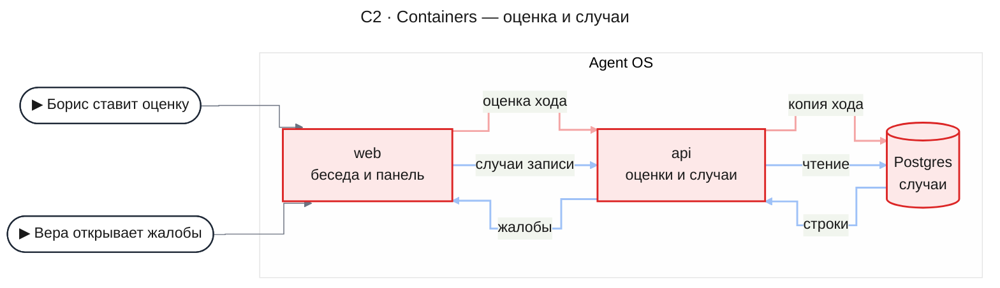

- `web` получает кнопки оценки под ответом, вкладку «Оценки» и страницу случая у записи в панели, колонку «Жалобы» и группу настроек.
- `api` принимает оценку, снимает копию хода, отдаёт случаи администратору и раз в час удаляет просроченные.
- `Postgres` получает две таблицы модуля `feedback` и поле срока хранения в `library_settings`.

#### C3 · Components: api

**api — оценка ответа**

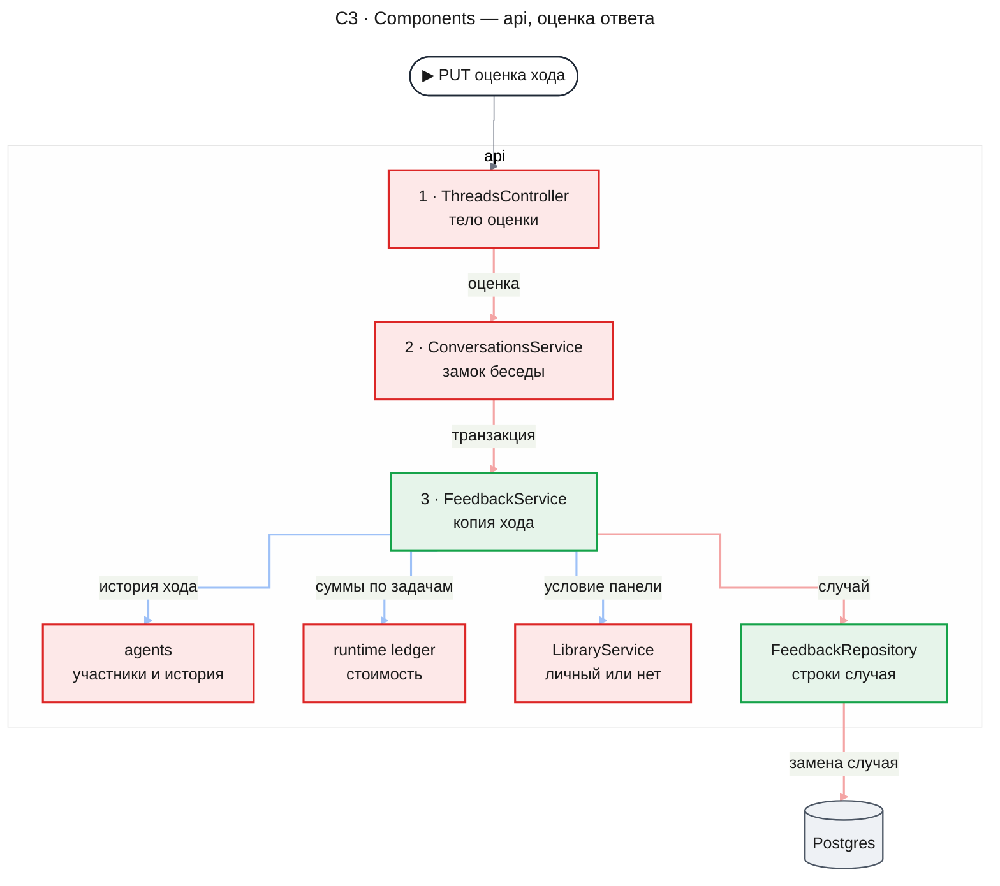

- `ConversationsService` находит беседу владельца, блокирует её строку, считает статус чата по корню и передаёт в `FeedbackService` транзакцию, номер корня и признак «чат работает».
- `FeedbackService` собирает копию чистыми функциями `turnOf`, `turnAgents` и `buildCase` над тем, что прочитал, и в той же транзакции удаляет прежний случай хода и пишет новый. Снятие оценки идёт тем же путём без чтений: замок, удаление случая хода.

**api — чтение случаев в панели**

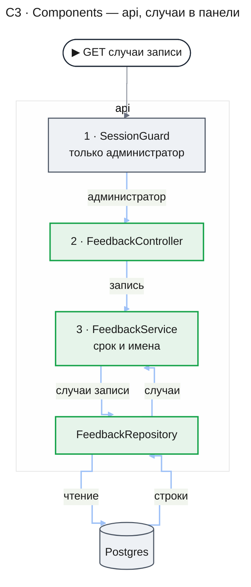

- `FeedbackRepository` берёт имя оценившего соединением с `identity_users`, как библиотека берёт имя автора.
- `FeedbackService` добавляет к случаю дату удаления по текущему сроку и, на странице случая, у каждой записи признак «есть в панели» из `LibraryService.panelRecordIds`: удалённая запись показывается без ссылки (компонент `AnswerWork`, состояние «Запись недоступна»).
- `CasePurge` — отдельный вход того же модуля: при старте и раз в час он зовёт удаление просроченных случаев в `FeedbackRepository` (Flow 4).

#### C3 · Components: web

**web — оценка в беседе**

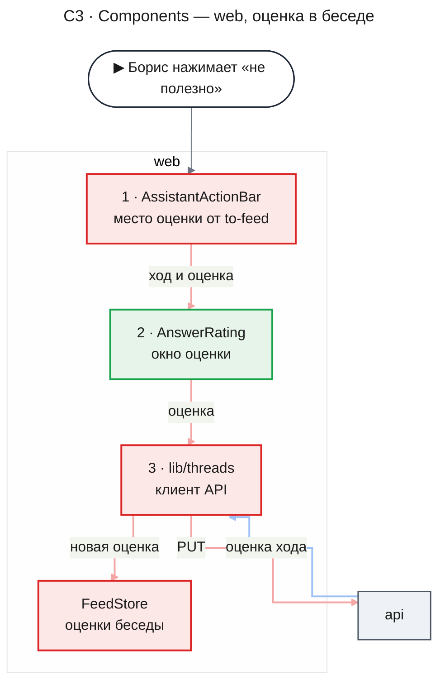

- `to-feed` кладёт в метаданные последнего ответа с текстом каждого хода `turnSeq` и текущую оценку хода из `ConversationView.feedback.ratings`; `AssistantActionBar` рисует `AnswerRating` только у сообщения с такими метаданными.
- `FeedStore` хранит оценки беседы вместе с её видом. Успешная отправка кладёт в него оценку из ответа API, успешное снятие убирает её, поэтому кнопка меняется без перечитывания беседы.

**web — случаи в панели**

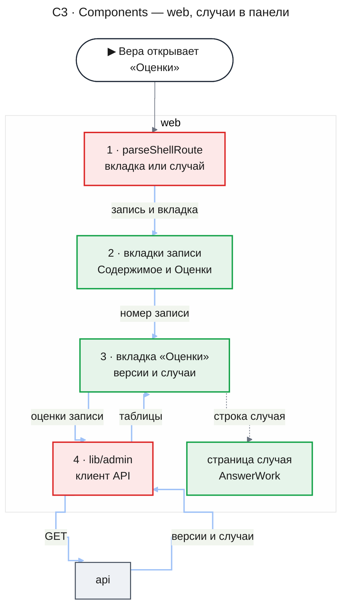

- `parseShellRoute` разбирает у записи раздела `library` ещё два адреса: `…/<id>/feedback` и `…/<id>/cases/<case>`. Вид страницы панели `record` получает вкладку `feedback`, а страница случая — свой вид `case` с номером записи и случая. Остальные разделы панели разбираются как сейчас.
- Вкладки записи стоят над страницами системной записи и записи сотрудника; число у «Оценки» и колонка «Жалобы» в списке берутся из одного чтения чисел по записям и версиям, которое веб сопоставляет с рабочей версией записи из её строки списка.
- Вкладка «Оценки», страница случая и список читают свои данные при открытии ([read-on-open.md](../../code-system/patterns/read-on-open.md)); поле срока хранения встаёт в форму настроек библиотеки отдельной группой со своим правилом проверки.

### Как выбираются участники

Чистая функция `turnAgents` получает записи хода корня и список агентов дерева (`AgentView` с `parentId`) и возвращает участников. Схема показывает, откуда берётся каждый.

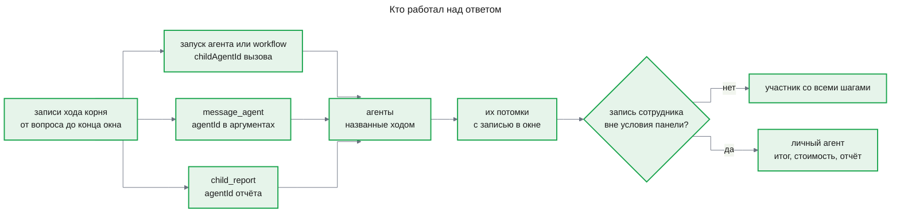

`message_agent` может назвать и внука: тогда участник — он, а его предки, которые в окне не работали, в случай не входят, и `parentId` участника указывает на ближайшего предка среди участников. Корень — участник всегда. Ветка под личным агентом целиком сворачивается в его строку, и её записи под случаем не значатся (KD-5).

### Runtime Flows

#### Flow 1: Оценка ответа

**Starts when:** сотрудник нажимает «Отправить» в окне оценки, for AC-01.1, AC-01.2, AC-02.1, DC-2, DC-3

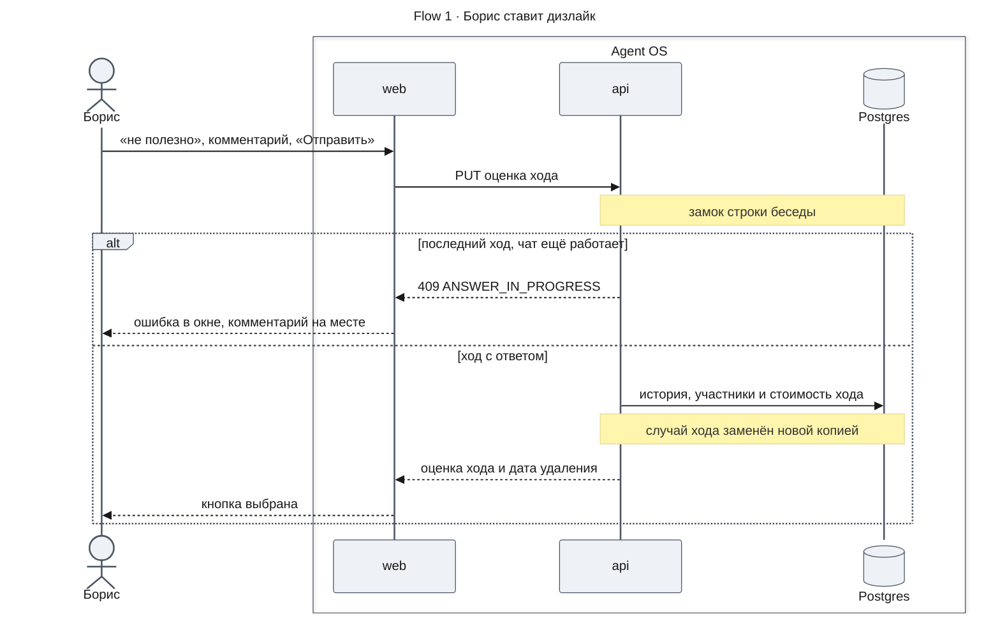

**Outcome:** у хода одна оценка и один случай; строки `feedback_case_records` называют каждую не личную запись участников с её версией, поэтому случай виден и под `deep-research`, и под `chat`. Беседа и агенты не изменились.

**Failure handling:**

- Беседы нет, она чужая или удалена раньше оценки → 404 `THREAD_NOT_FOUND`; окно показывает ошибку MC-2.
- `turnSeq` не начинает ход или в ходе нет ответа с текстом → 404 `TURN_NOT_FOUND`.
- Тело не проходит схему (вид оценки, длина комментария) → 400 `VALIDATION_FAILED`.
- Удаление беседы пришло во время копии → оно ждёт замка и после коммита оценки удаляет беседу; случай остаётся.
- Сбой чтения или записи посреди копии → транзакция откатывается целиком: прежний случай хода на месте, ответ 500.

#### Flow 2: Снятие оценки

**Starts when:** сотрудник нажимает «Снять оценку», for AC-19.1, DC-9

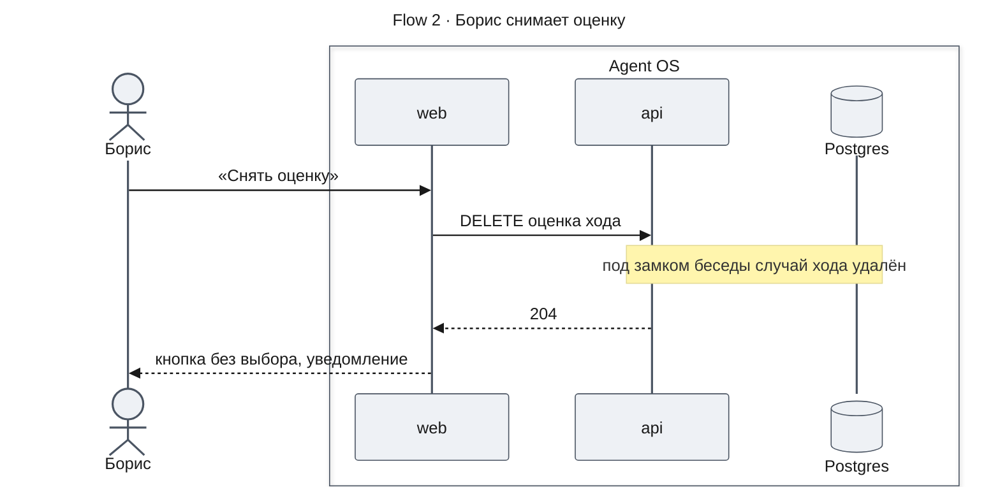

**Outcome:** случая хода нет нигде, в том числе в числах панели.

**Failure handling:**

- Беседы нет или она чужая → 404 `THREAD_NOT_FOUND`; окно показывает ошибку MC-3, кнопка остаётся выбранной.
- Оценки у хода нет → 204, ничего не меняется.

#### Flow 3: Администратор читает жалобы

**Starts when:** администратор открывает вкладку «Оценки» записи или случай, for AC-06.1, AC-06.2, AC-03.1, AC-03.2, AC-04.1, AC-04.2

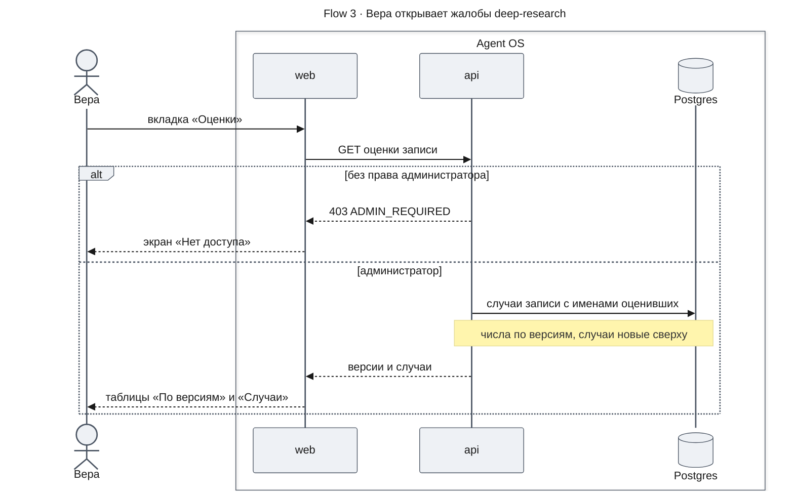

**Outcome:** ничего не меняется; доступ без права администратора пишет событие `access_denied`, как любой маршрут `@AdminOnly()`. Страница случая читается так же одним `GET` случая.

**Failure handling:**

- Случай удалён по сроку, снят или заменён, номер неверный → 404 `CASE_NOT_FOUND`; веб показывает экран AD-15 с MC-8.
- Сбой чтения → 500; вкладка показывает MC-7 с «Повторить».

#### Flow 4: Очистка по сроку

**Starts when:** API стартует и дальше раз в час в каждом экземпляре, for AC-05.1, AC-05.2, DC-8

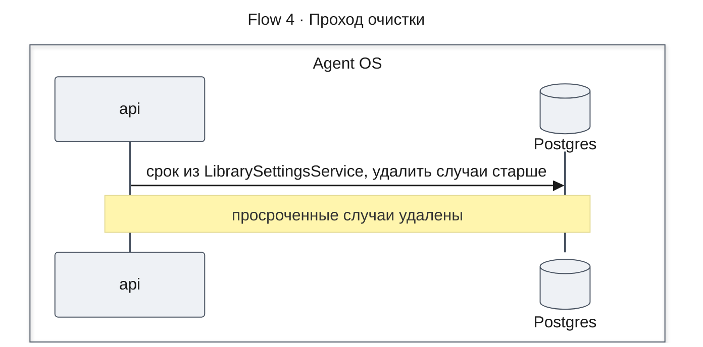

**Outcome:** случаев старше текущего срока в базе нет. Таймер не держит процесс: остановка приложения его снимает.

**Failure handling:**

- Сбой запроса → строка лога `error` с ошибкой; следующий проход через час повторит удаление.
- Два экземпляра удаляют одновременно → второй не находит строк; ошибки нет.

### Contract Definitions

**Маршруты сотрудника** (модуль чата, владелец из `req.user.id`)

- **`PUT /api/threads/:threadId/turns/:turnSeq/rating`** — ставит или заменяет оценку хода, тело `RateAnswerBody`. Возвращает `TurnRating`. Ошибки: 404 `THREAD_NOT_FOUND`, 404 `TURN_NOT_FOUND`, 409 `ANSWER_IN_PROGRESS`, 400 `VALIDATION_FAILED`.
- **`DELETE /api/threads/:threadId/turns/:turnSeq/rating`** — снимает оценку хода и удаляет случай. Возвращает 204, в том числе когда оценки нет. Ошибка: 404 `THREAD_NOT_FOUND`.
- **`GET /api/threads/:threadId/history`** — `ConversationView` получает поле `feedback`: `caseRetentionDays` и `ratings`, все оценки беседы как `TurnRating`, на каждой странице истории. Беседа без корня отвечает пустым списком. `AgentPageView` меняется только полем `childAgentId` у вызовов инструментов; веб его не читает.

**Операции `FeedbackService` для модуля чата**

- **`rate(tx, …)`** — вход: транзакция под замком беседы, владелец, номер беседы и корня, `turnSeq`, тело оценки и признак «чат работает». Снимает копию, заменяет случай хода и возвращает `TurnRating`. Отказы — `TURN_NOT_FOUND` и `ANSWER_IN_PROGRESS`.
- **`unrate(tx, threadId, turnSeq)`** — удаляет случай хода, если он есть; ничего не возвращает.
- **`ratingsOf(threadId)`** — оценки беседы как список `TurnRating` и текущий срок хранения для `ConversationView.feedback`.

**Маршруты панели** (модуль `feedback`, каждый с `@AdminOnly()`: без сеанса 401, без права администратора 403 `ADMIN_REQUIRED`)

- **`GET /api/admin/feedback/counts`** — числа оценок по записям и версиям для колонки «Жалобы» и вкладки. Возвращает список `FeedbackCount`.
- **`GET /api/admin/feedback/records/:recordId`** — оценки одной записи. Возвращает `RecordFeedback`. Номер, у которого случаев нет, в том числе не UUID, отвечает пустыми списками: страницу записи веб показывает только после того, как библиотека её нашла.
- **`GET /api/admin/feedback/cases/:caseId`** — один случай целиком. Возвращает `CaseDetail`. Ошибка: 404 `CASE_NOT_FOUND`.

**Настройки библиотеки**

- **`GET` и `PUT /api/admin/library/settings`** — `LibrarySettings` получает поле `caseRetentionDays`; тело `PUT` требует и `defaultMaxTurns`, и `caseRetentionDays`. Аудит `admin_change` на `library_settings` несёт оба поля в «было» и «стало».

**Для частей `eval` и `loop`** (операции `FeedbackService`, внутри `apps/api`)

- **`casesOf(recordId)`** — ссылки на все хранимые случаи, под которыми значится запись, новые сверху. Возвращает список `CaseRef`.
- **`caseDetail(caseId)`** — случай целиком, как `CaseDetail` без `inPanel` у записей. Возвращает `null` для удалённого случая.
- **`rate`** — единственное место, где случай рождается; часть `eval` ставит метку «для анализа» или «контрольный» здесь.
- Случай удаляется физически: снятием, заменой, очисткой по сроку и вместе с учётной записью оценившего. Строки потребителя, которые ссылаются на случай, переживают его удаление по выбору потребителя; `feedback` о них не знает.

**Операции других модулей и пакетов, которые эта часть добавляет**

- **`agents.sessions.history`** — у вызова инструмента в `model_answer` появляется `childAgentId`: номер агента, которого вызов запустил, или `null`. Поле получает и `AnswerToolCallSchema` в `contracts`, потому что вид беседы копирует вызовы целиком; веб его не читает.
- **`runtime.ledger.spendOfTasks`** — вход: владелец, номера задач и окно времени. Возвращает сумму стоимости вызовов моделей по каждой задаче этого владельца за окно; задача без вызовов отсутствует в ответе.
- **`LibraryService.panelRecordIds(recordIds)`** — те из названных записей, которые сейчас проходят условие панели. Содержимого не отдаёт.

**`RateAnswerBody`**

- `rating` — `like` или `dislike`.
- `comment` — необязательный; пробелы по краям обрезаются, пустой становится `null`; не длиннее `FEEDBACK_COMMENT_MAX_LENGTH` (2000) символов.

**`TurnRating`**

- `turnSeq` — ход, к которому относится оценка.
- `rating`, `comment` — как в теле.
- `ratedAt` — время оценки.
- `deletesAt` — `ratedAt` плюс текущий срок хранения: дата, до которой администраторы видят ответ.

**`FeedbackCount`**

- `recordId`, `version` — запись и версия, на которой она работала.
- `complaints`, `approvals` — число дизлайков и лайков.

**`RecordFeedback`**

- `versions` — версии записи с оценками, новые сверху: `version`, `complaints`, `approvals`.
- `cases` — `CaseSummary` всех версий, новые сверху; веб фильтрует по версии сам.

**`CaseSummary`**

- `caseId`, `rating`, `comment`, `ratedAt`.
- `rater` — `id` и `name` оценившего.
- `version` — версия этой записи в случае.

**`CaseDetail`**

- `caseId`, `rating`, `comment`, `rater`, `ratedAt`, `deletesAt`.
- `turnSeq` — `seq` вопроса в истории корня.
- `question` — текст вопроса и его метка записи или `null`.
- `answer` — текст ответа хода.
- `costUsd` — стоимость всех участников за окно хода.
- `records` — каждая не личная запись участников: `recordId`, `kind`, `name`, `version`, `builtinKey`, `inPanel` — есть ли запись в панели сейчас.
- `agents` — участники `CaseAgent` в порядке запуска; дерево строится по `parentId`.

**`CaseAgent`**

- `agentId`, `parentId`, `status`, `failureReason`, `createdAt`, `finishedAt`, `costUsd` — стоимость его вызовов за окно хода.
- `personal` — личный агент. Тогда `origin`, `description` и `model` — `null`, `entries` пусты, `costUsd` — стоимость всей его ветки, а `report` — текст его последнего отчёта или `null`.
- `origin` — `RunOrigin` записи, с которой агент стартовал; у корня — запись `chat` из его снимка.
- `entries` — записи истории в форме `HistoryEntrySchema` до конца окна хода. У корня — с начала беседы: записи до `turnSeq` — вход хода, с `turnSeq` — его шаги.

**Error handling**

- `TURN_NOT_FOUND` — 404 в `ThreadsErrorCode`: `turnSeq` не начинает ход корня, или в ходе нет ответа с текстом.
- `ANSWER_IN_PROGRESS` — 409 в `ThreadsErrorCode`: оценивают последний ход, а чат в статусе `working`.
- `CASE_NOT_FOUND` — 404 новых кодов `FeedbackErrorCode`: случая нет, в том числе удалённого и с неверным номером.

**Runtime settings**

- `caseRetentionDays` — по умолчанию `CASE_RETENTION_DAYS_DEFAULT` (30), целое не меньше 1; сколько дней живёт случай. Миграция ставит 30 в существующую строку.

### Data Model

Модуль `feedback` владеет двумя таблицами с префиксом `feedback_`.

- **`feedback_cases`** — строка на оценённый ход: оценивший (внешний ключ на `identity_users` с каскадом), номер беседы и `turnSeq` (без внешнего ключа), вид оценки, комментарий, время оценки, вопрос, ответ, общая стоимость и копия хода одним jsonb — участники с их записями истории. Пара «беседа и ход» уникальна. Вид оценки держит проверка базы по значениям `RatingSchema`.
- **`feedback_case_records`** — строка на каждую не личную запись участников случая с её версией: номер записи (без внешнего ключа), вид, имя, версия, ключ встроенной записи. Ссылается на случай с каскадом. Пара «запись и версия» у случая одна, даже если её запускали несколько участников, поэтому случай считается в числах версии один раз. По этой таблице панель находит случаи записи и считает оценки по версиям.
- **`library_settings`** получает столбец `case_retention_days` с проверкой «не меньше 1».

### State Transitions and Invariants

Схема показывает оценку одного хода.

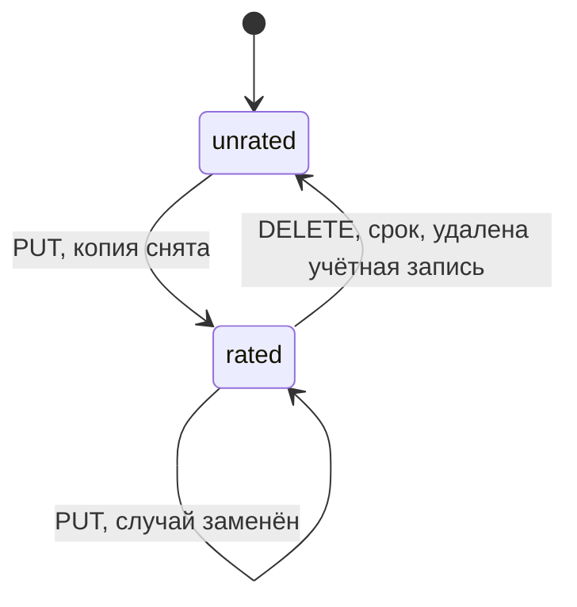

**Invariants**

1. У хода беседы не больше одной оценки и одного случая.
2. Копия случая после записи не меняется: новая оценка того же хода — это новый случай.
3. В случае нет определения, описания и шагов личного агента и его потомков, а в полях, которые пишет платформа, — имени его записи; тексты сотрудника и модели главного чата остаются как написаны (KD-5).
4. Удаление беседы, агентов и записей библиотеки не удаляет и не меняет случай; удаляют его только снятие и замена оценки, очистка по сроку и удаление учётной записи оценившего.
5. Случай старше текущего срока хранения удаляет первый проход очистки после истечения срока.

## Test Strategy

### Main Use Cases

- **UC-1: Жалоба доходит до двух записей и переживает беседу** — covers AC-01.1, AC-03.1, AC-04.1, AC-06.1
  - Given: Борис спросил чат, чат запустил `deep-research` версии 3, ответ готов; у записи уже есть одна жалоба и одно одобрение на версии 3
  - When: Борис ставит дизлайк с комментарием «искал в логах не того сервиса» и удаляет беседу
  - Then: Вера видит у `deep-research` версии 3 два дизлайка и один лайк; случай Бориса с комментарием есть и среди оценок `chat`; в случае вопрос, шаги корня, координатора и исполнителей и стоимость больше нуля

- **UC-2: Замена оценки** — covers AC-01.2
  - Given: Борис поставил ответу лайк
  - When: он ставит тому же ходу дизлайк
  - Then: у хода одна оценка — дизлайк; у записи один случай этого хода, с номером, отличным от прежнего

- **UC-3: Снятие оценки** — covers AC-19.1, DC-9
  - Given: у хода дизлайк Бориса
  - When: Борис снимает оценку, потом снимает её ещё раз
  - Then: Вера не находит случая ни в списке, ни по номеру (404 `CASE_NOT_FOUND`); второе снятие отвечает 204

- **UC-4: Окно называет срок** — covers AC-02.1, DC-1, DC-4
  - Given: срок хранения 30 дней, беседа с двумя ходами, в первом ходе два ответа с текстом
  - When: Борис открывает беседу и нажимает «не полезно» под последним ответом первого хода
  - Then: кнопки есть только у последнего ответа каждого хода; окно говорит, что ответ уйдёт администраторам и будет храниться 30 дней; после отправки и перезагрузки кнопка выбрана

- **UC-5: Участники и границы хода** — covers AC-03.2, DC-5, DC-6
  - Given: в первом ходе корень запустил агента A, а A — агента B; во втором ходе корень запустил workflow W, исполнитель которого упёрся в предел ходов, и написал A сообщение `message_agent`; B во втором ходе не работал
  - When: собирается копия второго хода
  - Then: участники — корень, A, координатор W и его исполнители; B в случае не значится, и его записи под случаем нет; у исполнителя причина сбоя `turn_limit`; записей корня после следующего вопроса и записей агентов после конца окна в копии нет

### Error and Edge Use Cases

- **UC-E1: Случаи видит только администратор** — covers AC-06.2, DC-3, NFR-01
  - Given: сотрудники Борис и Аня без права администратора и администратор Вера; у Бориса оценённая беседа
  - When: Борис и Аня зовут каждый маршрут `/api/admin/feedback/*`, Аня ставит и снимает оценку в беседе Бориса и читает её историю
  - Then: маршруты панели отвечают обоим 403 `ADMIN_REQUIRED`; оценка и снятие Ани — 404 `THREAD_NOT_FOUND`; Вера получает случай; ни один ответ сотруднику не содержит текста случая

- **UC-E2: Личный агент свёрнут** — covers AC-04.2, DC-7, NFR-04
  - Given: Борис отметил в первом ходе свой личный агент меткой, во втором главный чат запустил этот агент с промптом записи «секретный промпт» и вызвал `list_agents`, агент вернул отчёт «В Jira нет открытых тикетов»
  - When: Борис ставит дизлайк второму ходу, Вера открывает случай
  - Then: у участника `personal` истинно, есть статус и отчёт; промпта и шагов личного агента нет ни в ответе API, ни в строке случая в базе; имени его записи нет ни в метках, ни в результате `list_agents`; запись не значится под случаем

- **UC-E3: Ответ ещё пишется** — covers DC-2
  - Given: корень работает над последним ходом
  - When: Борис ставит оценку этому ходу
  - Then: 409 `ANSWER_IN_PROGRESS`, случая нет; оценка прежнего хода в то же время проходит

- **UC-E4: Оценка и удаление беседы одновременно** — covers AC-03.1, Invariant 4
  - Given: беседа с законченным ответом
  - When: оценка и удаление беседы приходят одновременно
  - Then: либо случай есть и в нём все участники хода, а беседа удалена, либо оценка получила 404 `THREAD_NOT_FOUND` и случая нет; случая с частью участников нет

### Non-Functional Use Cases

- **UC-N1: Очистка по сроку** — covers AC-05.1, AC-05.2, DC-8, NFR-06
  - Given: случаи возрастом 31 и 5 дней при сроке 30 дней
  - When: Вера сокращает срок до 7 дней, и проходит проход очистки
  - Then: случая 31 дня нет ни в списке, ни по номеру, ни его записей в числах; случай 5 дней на месте; повторный проход ничего не удаляет и не падает

## Security Considerations

- **Authentication & Authorization**: маршруты панели закрыты `@AdminOnly()`, а маршруты оценки ищут беседу вместе с владельцем из `req.user.id`, поэтому чужая беседа отвечает как несуществующая ([auth-boundary.md](../../code-system/patterns/auth-boundary.md)). Сотрудник видит только свои оценки — через вид своей беседы (NFR-01, UC-E1).
- **Input Validation**: тело оценки проверяет `ZodValidationPipe` по `RateAnswerBodySchema`, `turnSeq` — целое неотрицательное, `caseRetentionDays` — целое не меньше 1. Номера случая и записи, которые не UUID, до базы не доходят.
- **Sensitive Data Handling**: случай хранит беседу сотрудника, и это решение PRD: сотрудник предупреждён до оценки (FR-02). Учётных данных в истории агентов нет, поэтому их нет и в случае. Внутренности личного агента в базу не попадают (KD-5). Лог оценки несёт номера сотрудника, беседы, хода, случая, число участников и размер копии, но не комментарий и не тексты беседы.

## Risks and Mitigation

- **Копия длинного хода весит мегабайты и снимается под замком беседы** — среднее влияние, вероятность низкая при десятках оценок в месяц. Отправки в ту же беседу ждут конца копии; другие беседы не задеты. Лог оценки пишет размер копии и длительность, и если они станут мешать, крупные результаты инструментов выносятся из копии без смены контракта `CaseDetail`.
- **Ребёнок, разбуженный ходом, несёт в копию и свою работу в прежних ходах** — низкое влияние. Это его вход, и администратор видит, где начинается окно; стоимость считается только за окно хода (KD-3).
- **Запись сотрудника открыли ролям после оценки** — низкое влияние. Прежние случаи держат её свёрнутой: решение принято при оценке, и это безопасная сторона (DC-7).
- **Списки панели без страниц** — низкое влияние при сроке 30 дней и десятках оценок. Если оценок станут тысячи, маршрут записи получит курсор, как список бесед.

## Appendix: Fact Disposition

| Fact | Disposition | Handled in |
|------|-------------|------------|
| Корень живёт всю беседу, ход — от вопроса до вопроса, в ходе несколько ответов (`packages/agents/src/step/turn-rules.ts`, `deliver.ts`; FA1) | transform: оценивается ход по `turnSeq` | KD-2 |
| Статус чата `working` различает работу и ожидание сообщений (`apps/api/src/chat/chat-status.ts`; FA1) | transform: правило законченности ответа | KD-2 |
| Action bar показал бы кнопки на каждом ответе; `FeedbackPositive` и `FeedbackNegative` без окна (`apps/web/src/components/assistant-ui/elements/thread.aui.tsx`; FA1, FA6) | remove: кнопки примитива; место оценки ставит `to-feed` | KD-7 |
| `child_task_id` не отдаётся ни одной операцией (`packages/agents/src/operations/agent-sessions.ts`; FA2) | transform: `childAgentId` в `history` | KD-3 |
| Дети прежних ходов работают и просыпаются позже (FA2) | transform: `message_agent` и `child_report` называют участника | KD-3 |
| Версия корня из снимка зафиксирована первым сообщением (`agent-sessions.ts` `snapshot`; FA3) | preserve: это версия, на которой ответ готовился | KD-4 |
| В `RunOrigin` нет признака «открыта ролям» (`packages/contracts/src/chat.ts`; FA3) | transform: `panelRecordIds` при оценке | KD-5 |
| Записи удаляются без внешнего ключа на них (FA3) | preserve: случай копирует происхождение | KD-1 |
| Стоимость и вызовы скриптов не отдаёт ни одна операция (`agent-view.ts`, `schema.ts`; FA4) | transform: `spendOfTasks`; out-of-scope: `agent_code_calls`, `agent_tool_results` | KD-4 |
| Копия не одна транзакция с чтениями `agents` (FA4) | transform: граница окна у каждого агента | KD-3 |
| Удаление беседы под замком строки каскадом удаляет дерево (`conversations.service.ts` `delete`; FA5) | preserve: тот же замок упорядочивает оценку | KD-1, Flow 1 |
| Лента одна для беседы и страницы агента; выбор оценки нигде не хранится (`apps/web/src/lib/feed/use-feed-runtime.ts`, `to-feed.ts`; FA6) | transform: `ConversationView.feedback`, место только в ленте беседы | KD-7 |
| Удалённый сотрудник: поведение не задано (FA7) | transform: каскад с учётной записи | KD-1 |
| Настройки библиотеки — одно поле в теле, аудите и форме (`packages/contracts/src/library.ts`, `library-settings.ts`, `library-settings-form.tsx`; FA8) | transform: второе поле, полное тело | KD-6 |
| Периодического исполнителя нет (`apps/api/src/runtime/runtime.module.ts`; FA9) | transform: `CasePurge` с таймером в каждом экземпляре | KD-6 |
| В Module Boundaries нет владельца таблиц оценок (conformance) | transform: строка `feedback` в README | KD-1 |
| `parseAdminPage` берёт один сегмент после раздела (`apps/web/src/lib/shell-route.ts`; conformance) | transform: адреса вкладки и случая у записи | C3 · web |
| Журнал токенов отдаёт только запись и суммы за месяц (`packages/runtime/src/create-runtime.ts`; conformance) | transform: `spendOfTasks` | KD-4 |
| Одна строка настроек с аудитом `admin_change` повторяется (`identity_settings`, `library_settings`; conformance) | transform: паттерн [settings-row.md](../../code-system/patterns/settings-row.md) | KD-6 |

Дизайн сохраняет границу аутентификации и `@AdminOnly()` с аудитом отказа (FA7), разделение модулей порта и маршрутов, репозиторий над транзакцией, клиент API веба, чтение при открытии и логирование через `logger.child` (conformance matches), схемы zod и карты кодов ошибок, регистрацию модулей в `app.module.ts` и вкладки на `ui/tabs` (FA10), сводки сжатия и выведенные записи остановки в истории (FA4), а строки без внешнего ключа на удаляемый объект (`runtime_model_calls`, `chat_conversations.rootId`, `chat_drafts.recordId`) повторяются случаем без отдельного паттерна.

## Update History

| Version | Date | Change |
|---------|------|--------|
| 1.0 | 2026-11-19 | Первая версия |
