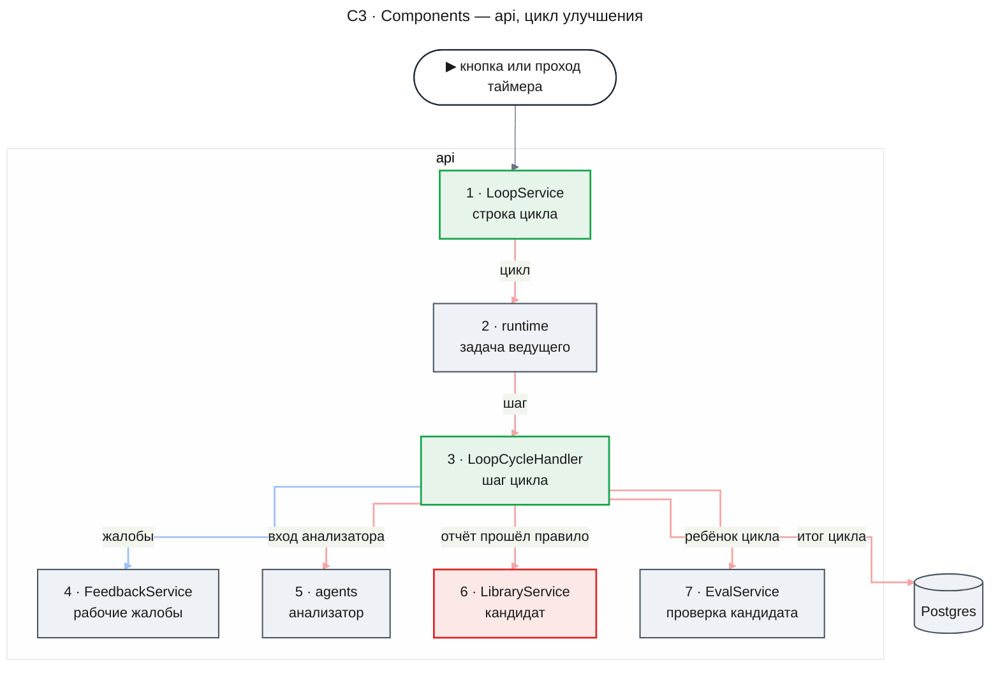
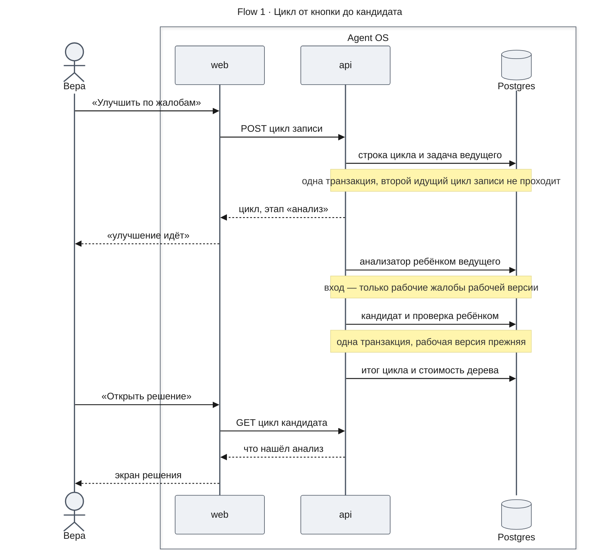
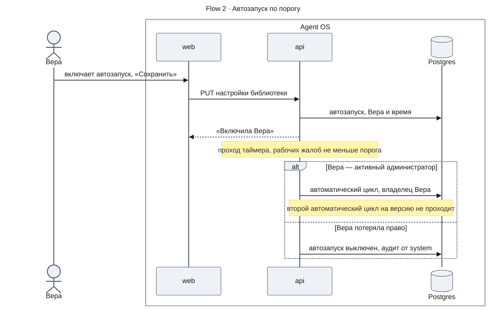
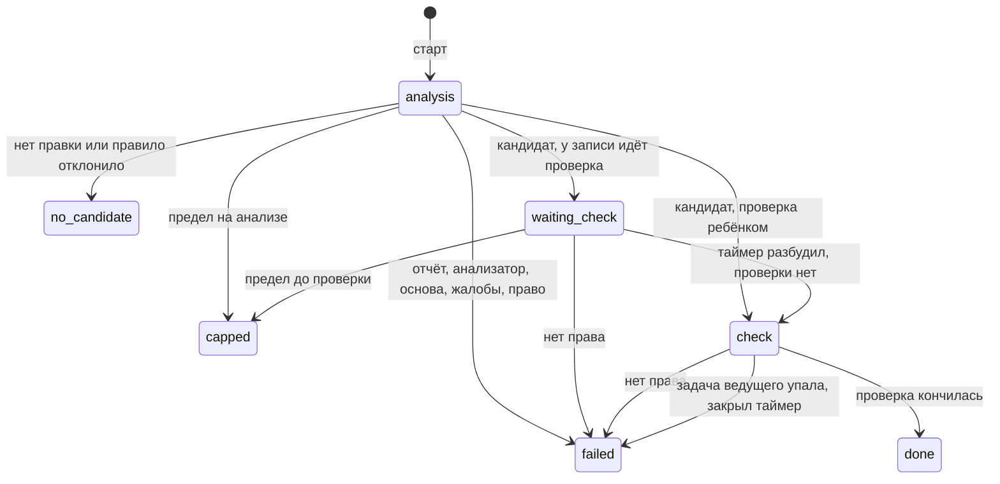

# Улучшение записей по оценкам сотрудников — Design Document — loop

**Status:** На утверждении · **Date:** 2026-11-19 · **PRD:** [prd.md](./prd.md) · **UXRD:** [uxrd.md](./uxrd.md) · **Depends on:** [design-eval.md](./design-eval.md#contract-definitions), [design-feedback.md](./design-feedback.md#contract-definitions)

## Snapshot

**Overview.** Цикл улучшения — фоновая задача, которая ведёт одну запись от жалоб до кандидата с проверкой. Администратор нажимает кнопку на вкладке «Оценки», или цикл стартует сам, когда рабочих жалоб на рабочую версию набирается до порога. Код отбирает рабочие жалобы этой версии, обрезает их до размера, который помещается в модель, и отдаёт встроенному агенту-анализатору; контрольные случаи до анализатора не доходят. Анализатор отвечает JSON-отчётом: причина каждой жалобы и новые тексты и пределы записи. Код проверяет, что отчёт меняет только тексты и пределы, сохраняет кандидата и запускает его проверку частью `eval`, а включает кандидата только администратор.

- **Не меняется**: беседы сотрудников; сохранение, проверка и включение версий части `eval`; рабочая версия до решения администратора.
- **Главный риск**: анализатор видит обрезанную часть жалоб и шагов и предлагает правку по неполной картине ([Risks and Mitigation](#risks-and-mitigation)).
- **Открытые вопросы**: нет; правки контрактов `eval` и `library`, без которых часть не строится, — в [Требуемые правки upstream](#требуемые-правки-upstream).

### Key Decisions

#### KD-1: Цикл — задача-ведущий `loop_cycle` нового модуля `loop` в `apps/api`; анализатор и проверка — её дети, а строка цикла и задача создаются одной транзакцией

Цикл длится минуты и переживает рестарт, поэтому он строится по [driver-task.md](../../code-system/patterns/driver-task.md), как проверка `eval`. Обработчик `LoopCycleHandler` запускает анализатора ребёнком через `agents.sessions.prepareRun` и `effects.spawn`, а проверку кандидата — через `EvalService.startCheck(request, parent)`. Весь цикл — одно дерево задач его владельца, поэтому предел расходов действует на весь цикл (FR-13). Анализатор стартует с полем `check` (`capUsd` цикла, `asRoot` = `false`): оно сверяет предел перед каждым вызовом модели и отказывает изменяющим действиям ([design-eval.md](./design-eval.md), KD-3, KD-4).

Строку цикла и задачу ведущего `LoopService` пишет одной транзакцией. Сегодня `TaskControl.create` открывает свою транзакцию, поэтому `runtime.tasks.create` должен принять транзакцию вызывающего — того же требует старт проверки в `eval` (правка upstream 1).

Не взяты: `Agents.completeText` — модель зашита, промпта записи нет, вызов идёт мимо предела дерева; строка, затем задача и уборка строк без задачи — лишнее состояние и проход, а правка runtime нужна `eval` всё равно; агент-родитель — ход цикла и правило о контрольных держала бы модель, а не код (FR-16).

#### KD-2: Анализатор — встроенная запись `analyzer` без аудитории; вход собирает код из рабочих жалоб с пределами по числу и длине, а ответ — JSON-отчёт только с изменёнными текстами и пределами

Анализатор устроен как судья ([design-eval.md](./design-eval.md), KD-5): сидер создаёт его с `everyone: false`, без серверов, инструментов и агентов, на модели по умолчанию; ключ `analyzer` входит в `ADMIN_ONLY_BUILTIN_KEYS`. Ведущий стартует его рабочее содержимое источником `supplied` — содержимым, которое ведущий уже прочёл, без чтения библиотеки. Администратор правит его промпт, как у любой системной записи.

Вход строят чистые функции ([pure-decision.md](../../code-system/patterns/pure-decision.md)). `selectComplaints` — единственное место отбора: из `FeedbackService.casesOf` она берёт дизлайки без метки `holdout`, у которых версия записи — рабочая, новые сверху, не больше `ANALYZER_MAX_CASES`. `analyzerTask` собирает задание: тексты и пределы рабочей версии и по каждому случаю комментарий, вопрос, ответ, участников и шаги. Результат инструмента режется до `ANALYZER_ENTRY_MAX_CHARS`, случай — до `ANALYZER_CASE_MAX_CHARS`. Всё задание не длиннее `ANALYZER_INPUT_MAX_CHARS`: тексты записи идут целиком, а случаи — сколько поместится в остаток, новые первыми. Итогов проверок анализатор не получает: он работает до проверки (FR-16).

Допущение: задание в `ANALYZER_INPUT_MAX_CHARS` вместе с промптом анализатора и запасом на ответ помещается в окно модели по умолчанию уже на первом вызове, когда сжатие истории ещё не работает. План проверяет его прогоном самого длинного workflow с самыми длинными случаями. Если вызов всё же упадёт, цикл кончается сбоем `analyzer_failed`.

Отчёт — JSON-объект сам по себе или в одном блоке кода, как вердикт судьи: по каждой жалобе запись с ошибкой и причина, записи с ошибкой без кандидата, только изменённые поля, объяснение и жалобы, которые правка должна исправить. Такой отчёт помещается в предел вывода модели. `readAnalysis` ставит «другое» причине вне списка (FR-14). `buildCandidate` накладывает изменения на рабочую версию. Менять можно у агента `prompt` и `maxTurns`, у workflow — `coordinator.rules`, `coordinator.maxTurns` и у исполнителя, найденного по имени, `role`, `prompt`, `maxTurns`, `maxRuns`. Имя, описание, модель, серверы, агенты, инструменты, источник, набор и имена исполнителей и `finalExecutor` остаются как в рабочей версии. Любое другое поле, неизвестный исполнитель или выход за схему `UpdateRecordBody` отклоняют кандидата целиком (AC-15.2).

Не взяты: инструмент `propose_candidate` — он попал бы в закрытый набор, доступный любой записи; определение целиком в ответе — у workflow до десяти исполнителей по 20 000 знаков, ответ обрезался бы; все жалобы без пределов — первый вызов падает, если вход больше окна.

#### KD-3: Кандидата сохраняет шаг ведущего в своей транзакции от имени владельца цикла; основа — версия на старте цикла, а если рабочая сменилась, кандидата нет

Шаг, прочитавший отчёт, одной транзакцией сохраняет кандидата (`LibraryService.saveCandidate`, `savedBy` = `analysis`) и пишет анализ в строку цикла, поэтому потерянный шаг не даёт второго кандидата. Права при сохранении и аудит `library_candidate` — владельца цикла. Если за время анализа рабочей стала другая версия, `saveCandidate` отвечает `RECORD_VERSION_CONFLICT`, и цикл кончается сбоем `base_changed` (DC-2).

Не взяты: старая основа — такого кандидата нельзя включить (AC-08.2); перенос на новую рабочую — анализ читал жалобы на другое содержимое; своя транзакция до шага — потерянный шаг сохранил бы второго кандидата.

#### KD-4: Автозапуск, ожидание чужой проверки и уборку ведёт таймер `LoopTicker` модуля `loop` — при старте API и раз в минуту

Периодического исполнителя в платформе нет, а таймер модуля — тот же приём, что у `CasePurge` и `EvalPurge`. Проход делает четыре идемпотентные вещи:

- **Автозапуск.** Если автозапуск включён, проход считает рабочие жалобы рабочей версии каждой системной записи. Если их не меньше порога и автоматического цикла на эту версию не было, он стартует цикл от имени включившего автозапуск. «Не меньше» догоняет пропущенный проход, а уникальный ключ автоматических циклов на пару «запись и версия» не даёт двух циклов на двух экземплярах API (AC-17.1).
- **Ожидание проверки.** Если при старте проверки кандидата у записи идёт другая проверка, ведущий ждёт. Проход будит его сообщением `loop_wake` через `runtime.inbox.enqueue`, когда проверки у записи больше нет (FR-17).
- **Закрытие упавших.** Если шаг ведущего бросил исключение или вышел за время, runtime кончает задачу сам и модулю не сообщает. Проход находит цикл `running`, чья задача ведущего закончена (`runtime.tasks.get`), и ставит ему `failed` с причиной runtime — `handler_error` или `step_timeout` — и стоимостью дерева. Иначе строка держала бы ключ идущего цикла записи вечно.
- **Уборка.** У законченного цикла проход удаляет поддерево анализатора `runtime.tasks.deleteTree`: в нём лежат тексты случаев (NFR-06). Стоимость цикла к этому времени уже в его строке.

Ручной цикл в «один раз на версию» не входит (DC-5): кнопку нажал человек, а автоматический цикл позже прочтёт больше жалоб.

Не взяты: вызов из модуля чата после коммита оценки — чат зависел бы от `loop`, а сбой между коммитом и вызовом терял бы запуск; обратный вызов в `FeedbackService.rate` — задачи стартовали бы под замком беседы, а `feedback` намеренно не знает потребителей; сигнал от ведущего проверки — `eval` знал бы о `loop`.

#### KD-5: Автоматический цикл ведёт администратор, включивший автозапуск; право проверяется там, где используется, а потеря права выключает автозапуск системной записью

У потери права нет события: право снимают пять записей модуля `identity`, блокировка ставит статус `disabled`. Поэтому право спрашивает каждый пользователь права через новую `IdentityDirectory.isAdmin` — активный сотрудник с личной отметкой или ролью администратора.

- Строка настроек хранит, кто и когда включил автозапуск и выключен ли он из-за потери права. `PUT` ставит включившего, только когда автозапуск включается: кто сохранит форму позже, автозапуск не перехватит.
- `LibrarySettingsService.get` находит включённый автозапуск, чей администратор потерял право, и выключает его системной записью с аудитом `admin_change` от `SYSTEM_ACTOR`. Таймер читает настройки той же операцией, поэтому цикл без права не стартует, а форма сразу показывает MC-10 (AC-17.4).
- Каждый шаг ведущего начинает с права владельца; без права цикл кончается сбоем `owner_not_admin` (DC-6).

Не взяты: вызовы из пяти записей `identity` — `identity` знал бы о настройках библиотеки, а шестая такая запись выпала бы молча; «выключен» только вычислять — вернув Вере право, автозапуск молча пошёл бы снова; поле `updatedBy` — его пишет любой, кто сохранил форму.

## Terms

Цикл, анализатор, рабочий и контрольный случай, кандидат, проверка версии — [PRD, Terms](./prd.md#terms); ведущий проверки и дерево — [design-eval.md](./design-eval.md#terms).

- **Ведущий цикла** — задача `loop_cycle`: запускает анализатора и проверку и пишет итог цикла.
- **Рабочая жалоба версии** — дизлайк без метки «контрольный», у которого версия записи в случае равна рабочей.
- **Отчёт анализатора** — JSON-объект, которым анализатор кончает работу.
- **Проход** — один запуск таймера `LoopTicker`.

## Part

- **Part**: `loop`
- **Covers**: FR-14–FR-18; NFR-01 (маршруты этой части), NFR-02, NFR-04 и NFR-06 (вход анализатора), NFR-05 (стадия анализа), NFR-07 (разделы панели этой части)
- **Depends on**: [design-eval.md](./design-eval.md#contract-definitions), «Для части `loop`»; [design-feedback.md](./design-feedback.md#contract-definitions), «Для частей `eval` и `loop`»
- **Prerequisite ADRs**: [ADR-0001](../../adr/ADR-0001-durable-runtime-owner.md), [ADR-0004](../../adr/ADR-0004-agent-framework-packages.md), [ADR-0012](../../adr/ADR-0012-closed-api-and-server-issued-employee-id.md), [ADR-0016](../../adr/ADR-0016-library-records-and-visibility.md), [ADR-0017](../../adr/ADR-0017-run-snapshots-from-library.md), [ADR-0015](../../adr/ADR-0015-access-gate-and-model-catalogue.md), [ADR-0018](../../adr/ADR-0018-library-record-version-history.md), [ADR-0019](../../adr/ADR-0019-check-runs-outside-conversation.md). Нового ADR нет: агент, который предлагает правку записи за решением человека, держится на уже принятых кандидате и проверке; модуль `loop` с его таблицей удаляется без переноса данных и ничего не требует от будущих фич, поэтому не выполнены условия «дорого отменить» и «связывает за пределами фичи»
- **Sibling parts**: `feedback` и `eval` — их операции эта часть потребляет

**Out of scope**

- Цикл для записей сотрудников, в том числе открытых ролям (PRD Won't Have). Главный чат `chat` — встроенный агент, и цикл для него идёт по тем же правилам.
- Страница версии, итог проверки, повтор, включение и отклонение — часть `eval`; эта часть добавляет на страницу только блок «Что нашёл анализ».
- Шаги анализатора в панели: их нет в UXRD, а поддерево анализатора удаляется после цикла.

**Constraints**

- PoC: тело настроек библиотеки становится полным с семью полями; переноса старых данных нет.
- Настройки — в базе и в панели; интервал таймера и пределы входа анализатора — постоянные в коде ([settings-row.md](../../code-system/patterns/settings-row.md), Not For).
- Состояние только в Postgres: шаг ведущего продолжает любой экземпляр API, таймер безопасен на нескольких сразу.
- Лог — через логгер `common` ([logging.md](../../code-system/patterns/logging.md)): старт цикла, шаги ведущего, отбор жалоб, исход отчёта, кандидат, ожидание, выключение автозапуска и проход таймера пишут номера цикла, записи, версии, задач и владельца, число случаев, исход, стоимость и длительность, но не тексты случаев и отчёта.

## Building-block Inventory

Follows the [code system](../../code-system/README.md). Поиск шёл по каталогу паттернов, модулям `eval`, `feedback`, `library`, `identity` и пакетам `agents` и `runtime`: цикла, анализа и автозапуска там нет.

| Building block | Pattern | Status | Note |
|---|---|---|---|
| Модуль `loop`: `LoopService`, `LoopRepository`, `LoopController` | [repository-over-transaction.md](../../code-system/patterns/repository-over-transaction.md), [auth-boundary.md](../../code-system/patterns/auth-boundary.md), [port-module-split.md](../../code-system/patterns/port-module-split.md) | new | Таблица `loop_cycles` |
| `LoopCycleHandler` | [driver-task.md](../../code-system/patterns/driver-task.md) | new | Второй ведущий (KD-1) |
| `LoopTicker` | таймер модуля, как `CasePurge` | new | KD-4 |
| `selectComplaints`, `analyzerTask`, `readAnalysis`, `buildCandidate` | [pure-decision.md](../../code-system/patterns/pure-decision.md) | new | По образцу `readVerdict` и `decideSave` |
| Запись `analyzer`, `ADMIN_ONLY_BUILTIN_KEYS` | сидер библиотеки | extended | Как `judge` |
| `LibrarySettingsService` и строка настроек | [settings-row.md](../../code-system/patterns/settings-row.md) | extended | Порог, автозапуск, системное выключение (KD-5) |
| `IdentityDirectory` | [auth-boundary.md](../../code-system/patterns/auth-boundary.md) | extended | `isAdmin` по условию сеанса |
| Карточка улучшения, блок анализа, метки списка, группа настроек | [read-on-open.md](../../code-system/patterns/read-on-open.md), [web-api-client.md](../../code-system/patterns/web-api-client.md) | new, extended | Клиент `lib/loop`; [state-badge.md](../../design-system/components/state-badge.md), [data-table.md](../../design-system/components/data-table.md), [settings-form.md](../../design-system/components/settings-form.md) |

## Acceptance Criteria

### FR-14: Анализатор называет причину

- From the PRD: AC-14.1, AC-14.2

### FR-15: Предложение

- From the PRD: AC-15.1, AC-15.2, AC-15.3
- Когда рабочая версия сменилась после старта цикла, кандидата нет, а цикл кончается сбоем «рабочая версия сменилась» (DC-2).

### FR-16: Контрольные закрыты кодом

- From the PRD: AC-16.1
- Анализатор получает не больше `ANALYZER_MAX_CASES` самых новых рабочих жалоб рабочей версии, каждая обрезана до предела длины (DC-1).

### FR-17: Запуск цикла

- From the PRD: AC-17.1, AC-17.2, AC-17.3, AC-17.4
- Когда кандидат сохранён, а у записи идёт другая проверка, цикл показывает этап «ждёт конца идущей проверки» и запускает проверку кандидата не позже следующего прохода после её конца (DC-3).
- Когда API перезапускается посреди цикла, цикл кончается с одним запуском анализатора и одним кандидатом (DC-4).
- Ручной цикл не мешает автоматическому на той же версии, а второй автоматический на версию не стартует (DC-5).
- Когда владелец цикла теряет право администратора, следующий шаг кончает цикл сбоем «нет права администратора» (DC-6).

### FR-18: Экран решения

- From the PRD: AC-18.1, AC-18.2
- Метка «ждёт решения» стоит у записи, пока у неё есть кандидат — от анализа или от администратора (UXRD FB-01) (DC-7).

## Design

### Architecture (C1–C4)

Контейнеры не меняются: `web` зовёт `api`, `api` пишет в Postgres. Новое — модуль `loop` внутри `api`.

#### C3 · Components: api

- `LoopService` — общий старт для `LoopController` и `LoopTicker`: проверяет, что запись — системная запись в панели и что у рабочей версии есть рабочие жалобы, и одной транзакцией пишет строку цикла с пределом из настроек и задачу ведущего (KD-1).
- `LoopCycleHandler` — порт `TaskHandler` типа `loop_cycle`. Шаг начинает с права владельца (KD-5) и строки цикла и делает то, что велит этап ([State Transitions](#state-transitions-and-invariants)).
- `LibraryService` красный: эта часть добавляет запись `analyzer` в сидер. `LibrarySettingsService` и `IdentityDirectory` зовут таймер и проверка права (KD-5).

#### C3 · Components: web

- Список раздела и шапка записи читают `GET /api/admin/loop/states` и ставят после имени метки «улучшение идёт» и «ждёт решения» ([state-badge.md](../../design-system/components/state-badge.md)).
- Карточка LP-01 стоит над таблицами вкладки «Оценки» (`…/<id>/feedback`) и читает `LoopRecordView`. Блок LP-04 стоит на странице версии `…/versions/<N>`, когда `VersionSummary.savedBy` — `analysis`; комментарии жалоб он берёт из `RecordFeedback` записи, удалённый случай — строка без ссылки.
- Карточка и блок перечитывают данные раз в 5 секунд (`CHECK_POLL_MS`), пока цикл идёт ([read-on-open.md](../../code-system/patterns/read-on-open.md)). Группа LP-05 встаёт в `library-settings-form.tsx`.

### Runtime Flows

#### Flow 1: Вера запускает цикл

**Starts when:** администратор нажимает «Улучшить по жалобам», for AC-14.1, AC-15.1, AC-16.1, AC-17.2, AC-18.1, DC-1, DC-2, DC-3

**Outcome:** цикл `done` с номерами кандидата и проверки и стоимостью; в истории кандидат с `savedBy` = `analysis` и основой — версией старта; аудит `loop_start` и `library_candidate` называют Веру. Рабочая версия прежняя, пока Вера не включит кандидата (AC-18.1).

**Failure handling:**

- Идёт цикл записи → 409 `CYCLE_RUNNING`; рабочих жалоб нет → 409 `NO_COMPLAINTS`; ничего не записано.
- Отчёт не читается → `failed`, `analysis_unreadable`. Изменений для этой записи нет → `no_candidate`, `not_in_content`; изменение вне текстов и пределов → `no_candidate`, `out_of_bounds`; анализ виден в обоих.
- Рабочая версия сменилась → `failed`, `base_changed` (DC-2).
- У записи идёт проверка → кандидат сохранён, этап `waiting_check`, ведущий ждёт `loop_wake` (DC-3). Проверка, стартовавшая между чтением и коммитом, валит коммит: runtime трижды повторяет коммит, оставляет шаг до конца аренды, и восстановление запускает шаг заново — тот видит идущую проверку и ждёт.
- Анализатор упал с `spend_cap` или предел достигнут до старта проверки → `capped`, сохранённый кандидат остаётся. Проверка, остановленная пределом, оставляет цикл `done` с итогом «Частично».
- Анализатор упал иначе → `failed`, `analyzer_failed`. Исключение в шаге или выход за время → задача `failed`, а ближайший проход таймера ставит циклу `failed` с `handler_error` или `step_timeout` (KD-4); карточка показывает сбой MC-16.

#### Flow 2: Автозапуск и потеря права

**Starts when:** проход `LoopTicker`, for AC-17.1, AC-17.3, AC-17.4, DC-5

**Outcome:** автоматический цикл идёт по Flow 1 с правами и расходом Веры (AC-17.2); строка помечена `auto`, аудит `loop_start` пишет `SYSTEM_ACTOR` и Веру владельцем. После потери права настройки отдают `autoStart` = `false` и `autoStartLost` = `true` с именем Веры, и форма показывает MC-10.

**Failure handling:**

- Автозапуск выключен → проход циклов не стартует (AC-17.3).
- Два экземпляра стартуют цикл одной версии → второй не проходит уникальный ключ и ничего не создаёт.
- Идёт ручной цикл → автоматический ждёт следующего прохода после его конца.
- Сбой прохода → строка лога `error`; следующий проход повторяет работу.

### Contract Definitions

**Маршруты** (модуль `loop`, каждый с `@AdminOnly()`: без сеанса 401, без права 403 `ADMIN_REQUIRED`)

- **`POST /api/admin/loop/records/:recordId/cycles`** — запускает цикл от имени администратора. Возвращает `CycleView`. Ошибки: 404 `RECORD_NOT_FOUND` — нет системной записи в панели; 409 `CYCLE_RUNNING`; 409 `NO_COMPLAINTS`.
- **`GET /api/admin/loop/records/:recordId`** — `LoopRecordView` для карточки. Ошибка: 404 `RECORD_NOT_FOUND`.
- **`GET /api/admin/loop/records/:recordId/versions/:version`** — `CycleView` цикла, сохранившего этого кандидата. Ошибка: 404 `CYCLE_NOT_FOUND`.
- **`GET /api/admin/loop/states`** — `LoopRecordState` по записям: `recordId`, `improving` — идёт цикл, `awaitingDecision` — есть кандидат (DC-7).
- **`GET` и `PUT /api/admin/library/settings`** — тело `PUT` получает `complaintThreshold` и `autoStart` и требует все семь полей; ответ — ещё `autoStartBy` (`id`, `name`, `at` или `null`) и `autoStartLost`. Аудит `admin_change` несёт все поля.

**Операции внутри `apps/api`**

- **`LoopService.start(recordId, ownerId, trigger)`** — `trigger` — `manual` или `auto`; отказы — как у маршрута, у автоматического повтор версии — тихий пропуск.
- **`IdentityDirectory.isAdmin(userId)`** — активен ли сотрудник и есть ли у него право администратора, личное или от роли.
- **`LibrarySettingsService.get()`** — выключает автозапуск, если включивший потерял право (KD-5).
- Аудит `loop_start` — запись, версия, владелец, способ запуска.

**`CycleView`**

- `cycleId`, `recordId`, `version` — рабочая версия на старте и основа кандидата; `trigger`; `owner` — `id` и `name`; `startedAt`, `finishedAt`.
- `status` — `running`, `done`, `no_candidate`, `capped`, `failed`; `stage` у идущего — `analysis`, `waiting_check`, `check`.
- `reason` — у `no_candidate`: `not_in_content`, `out_of_bounds`; у `failed`: `analysis_unreadable`, `analyzer_failed`, `base_changed`, `owner_not_admin`, `no_complaints`, `handler_error`, `step_timeout`; иначе `null`.
- `candidateVersion` или `null`; `check` — `checkId`, `status` и пройдено из всех по `EvalService.check`, или `null`; `capUsd`; `spentUsd` — расход дерева на конце цикла, до конца `null`.
- `analysis` или `null`: `complaints` — по каждой прочитанной жалобе `caseId`, запись с ошибкой (`recordId` и `name`; `null`, если названа запись не из случая) и `cause`; `otherRecords` — записи с ошибкой без кандидата; `explanation`; `fixes` — номера жалоб, которые правка должна исправить.
- `cause` — `wrong_source`, `stopped_early`, `misread_question`, `turn_limit`, `tool_or_model_error`, `other`.

**`LoopRecordView`**

- `liveVersion`, `workingComplaints` — число рабочих жалоб рабочей версии; `complaintThreshold`, `autoStart`, `spendCapUsd` — для строк MC-16; `cycle` — последний цикл записи или `null`.

**Error handling**

- Коды `RECORD_NOT_FOUND`, `CYCLE_RUNNING`, `NO_COMPLAINTS`, `CYCLE_NOT_FOUND` — новый `LoopErrorCode`.

**Runtime settings**

- `complaintThreshold` — по умолчанию `COMPLAINT_THRESHOLD_DEFAULT` (3), целое не меньше 1.
- `autoStart` — по умолчанию выключен.
- Постоянные в коде: `LOOP_TICK_MS` 60 000; `ANALYZER_MAX_CASES` 8; `ANALYZER_INPUT_MAX_CHARS` 300 000; `ANALYZER_CASE_MAX_CHARS` 30 000; `ANALYZER_ENTRY_MAX_CHARS` 2 000.

### Data Model

- **`loop_cycles`** (модуль `loop`) — строка на цикл: запись и версия копией без внешнего ключа, способ запуска, владелец, статус, этап, причина, предел, задачи ведущего и анализатора, номера прочитанных случаев, анализ одним jsonb, кандидат, проверка, стоимость и время. Ключи базы держат не больше одного идущего цикла на запись и одного автоматического цикла на пару «запись и версия». Текстов случаев строка не хранит: комментарии веб берёт у `feedback`.
- **`library_settings`** получает порог с проверкой «не меньше 1», признак автозапуска, кто и когда его включил и признак «выключен из-за потери права».

### State Transitions and Invariants

Схема показывает статусы и этапы цикла.

**Invariants**

1. Анализатор не получает контрольных случаев и итогов проверок: его вход строится только из случаев, которые отобрала `selectComplaints`.
2. Кандидат цикла отличается от рабочей версии только текстами и пределами.
3. У записи идёт не больше одного цикла, и на версию стартует не больше одного автоматического цикла.
4. Цикл не меняет рабочую версию; у цикла не больше одного кандидата и одной проверки.
5. Автоматический цикл не стартует от имени сотрудника без права администратора.

## Test Strategy

### Main Use Cases

- **UC-1: Цикл от кнопки до решения** — covers AC-14.1, AC-15.1, AC-16.1, AC-17.2, AC-18.1, AC-18.2, DC-1, DC-7, NFR-02
  - Given: у `deep-research` рабочая версия 3, десять рабочих жалоб версии 3 с жалобой Бориса, две контрольные со словом «секретнаяконтрольная», жалоба на версию 2; тестовая модель анализатора отвечает отчётом с `wrong_source` у жалобы Бориса и новыми правилами координатора
  - When: Вера запускает цикл, и он доходит до конца
  - Then: вход анализатора — восемь самых новых рабочих жалоб версии 3, ни фрагмента контрольных и жалобы версии 2; в истории кандидат с `savedBy` = `analysis` и основой 3, отличаются только правила координатора; его проверка прошла по всем случаям; цикл `done` со стоимостью, у жалобы Бориса — `deep-research` и `wrong_source`; `states` даёт «ждёт решения»; новая беседа Бориса идёт на версии 3; расход записан на Веру

### Error and Edge Use Cases

- **UC-E1: Правила отчёта и кандидата** — covers AC-14.2, AC-15.2, AC-15.3
  - Given: отчёты — причина вне списка; все причины `tool_or_model_error` без изменений; смена модели, серверов, имени исполнителя; `maxTurns` 201; ошибка названа только в `general-purpose`; текст без объекта
  - When: их разбирают `readAnalysis` и `buildCandidate`
  - Then: причина вне списка — `other`; сбои инструмента без изменений — `not_in_content`; модель, серверы, имя и 201 — `out_of_bounds`; ошибка только в другой записи — `not_in_content` с ней в `otherRecords`; текст без объекта не читается

- **UC-E2: Автозапуск один раз на версию** — covers AC-17.1, AC-17.3, DC-5
  - Given: порог 3, на версии 3 прошёл ручной цикл, пришла третья рабочая жалоба
  - When: проход при выключенном автозапуске; Вера включает автозапуск, и идут два прохода сразу; приходит четвёртая жалоба, ещё проход
  - Then: при выключенном циклов нет; после включения ровно один автоматический цикл версии 3 с владельцем Верой; после четвёртой второго нет

- **UC-E3: Вера теряет право** — covers AC-17.4, DC-6
  - Given: автозапуск включила Вера, её автоматический цикл ждёт идущей проверки
  - When: Веру лишают права, другой администратор открывает настройки, идущая проверка кончается, идёт проход
  - Then: автозапуск выключен, `autoStartLost` с именем Веры, аудит `admin_change` от `SYSTEM_ACTOR`; новых циклов нет, разбуженный цикл — `failed` с `owner_not_admin`

- **UC-E4: Сменилась основа, идёт чужая проверка** — covers DC-2, DC-3
  - Given: цикл анализирует версию 3; в другой записи цикл анализирует, пока идёт проверка Веры
  - When: Вера сохраняет версию 4 первой записи рабочей; во второй анализ кончается раньше проверки
  - Then: первый цикл `failed` с `base_changed`, кандидата нет; второй ждёт на `waiting_check`, а после конца проверки Веры следующий проход запускает проверку кандидата

- **UC-E5: Рестарт и упавший шаг** — covers DC-4
  - Given: анализатор одного цикла работает; шаг ведущего другого цикла бросает исключение
  - When: API перезапускается, затем идёт проход
  - Then: первый цикл `done` с одной задачей анализатора, одним кандидатом и одной проверкой; второй — `failed` с `handler_error`, его поддерева анализатора нет, и новый цикл этой записи стартует

- **UC-E6: Только администратор** — covers NFR-01
  - Given: сотрудник Борис
  - When: он зовёт маршруты `/api/admin/loop/*`
  - Then: каждому — 403 `ADMIN_REQUIRED`

### Non-Functional Use Cases

- **UC-N1: Предел на анализе** — covers NFR-05
  - Given: предел меньше стоимости одного вызова модели анализатора
  - When: Вера запускает цикл
  - Then: цикл `capped` без кандидата; после предела в журнале токенов нет новых вызовов, кроме шедшего

- **UC-N2: Тексты случаев уходят из анализатора** — covers NFR-04, NFR-06
  - Given: законченный цикл; в прочитанном случае работал личный агент Бориса с промптом «секретный промпт»
  - When: идёт проход
  - Then: во входе анализатора не было «секретный промпт»; задач анализатора нет, стоимость цикла осталась

## Security Considerations

- **Authentication & Authorization**: маршруты закрыты `@AdminOnly()` ([auth-boundary.md](../../code-system/patterns/auth-boundary.md)). У фоновой задачи нет `req.user`: владелец — из строки цикла, и каждый шаг спрашивает `IdentityDirectory.isAdmin` (KD-5). Анализатор и проверка — задачи владельца: `AccessGate` проверяет его права и квоту перед каждым вызовом модели, поле `check` отказывает изменяющим действиям, анализатор скрыт от сотрудников.
- **Input Validation**: номера в маршрутах проверяет `ZodValidationPipe`, тело настроек — схема `contracts`. Отчёт анализатора — недоверенный текст модели: `readAnalysis` и `buildCandidate` пропускают только тексты и пределы, а кандидат проходит схему `UpdateRecordBody` и правила сохранения.
- **Sensitive Data Handling**: вход анализатора — копии случаев без контрольных (NFR-02) и без внутренностей личных агентов (NFR-04); поддерево анализатора удаляется после цикла (KD-4); лог несёт номера и суммы без текстов.

## Risks and Mitigation

- **Анализатор видит обрезанную картину** — среднее влияние: правка опирается на часть доказательств. Проверка кандидата идёт на всех случаях записи, и решает администратор. Пределы входа — допущение, что вход меньше окна модели; план сверяет их прогоном самого длинного случая.
- **Отчёт обрезан пределом вывода** — низкое влияние: если анализатор переписывает много длинных промптов, отчёт не читается, и цикл кончается сбоем с причиной. Промпт анализатора просит менять только нужные поля.
- **Предел копируется дважды** — низкое влияние: анализатор берёт предел цикла, проверка — настройку на своём старте ([design-eval.md](./design-eval.md), KD-4); смена настройки посреди цикла меняет только предел проверки.

## Требуемые правки upstream

Без этих правок часть не строится; дизайн `loop` написан так, как будто они сделаны.

1. **`design-eval.md` — задача ведущего в транзакции вызывающего.** В «Что эта часть добавляет к `feedback` и пакетам» добавить `runtime.tasks.create(request, tx?)`: с транзакцией строка задачи и её событие `task.created` пишутся в ней, повторы — забота вызывающего. `EvalService.startCheck` без `parent` создаёт задачу ведущего этой операцией. Сегодня `TaskControl.create` открывает свою транзакцию, и обещание «одной транзакцией» в C3 · Components: api не выполняется. Паттерн [driver-task.md](../../code-system/patterns/driver-task.md) уже описывает старт так.
2. **`design-eval.md`, «Для части `loop`» — `LibraryService.saveCandidate`** принимает транзакцию вызывающего и администратора, от имени которого сохраняет. Для `savedBy` = `analysis` это владелец цикла: права и выбор системы считаются для него, как у маршрута, а аудит `library_candidate` называет его и `analysis`.
3. **`design-eval.md`, «Для части `loop`» — `LibraryService.systemVersions()`**: системные записи панели — `recordId`, `kind`, `name`, `builtinKey`, рабочая версия и признак «есть кандидат». По ней цикл находит запись и её рабочую версию, а `analyzer` — по ключу, как ведущий проверки находит `judge`; метка «ждёт решения» узнаёт кандидатов.
4. **`design-eval.md`, «Для части `loop`» — `EvalService.runningCheck(recordId)`**: номер идущей проверки записи без случая или `null`, как в `RecordChecks`. Без неё ведущий узнаёт об идущей проверке только из `CHECK_RUNNING` внутри своей транзакции, и отказ откатывает кандидата.

## Appendix: Fact Disposition

| Fact | Disposition | Handled in |
|------|-------------|------------|
| Нет структурного ответа, отчёт-строка; `completeText` с моделью по умолчанию (`deliver.ts`, `model-client.ts`; FA1) | transform: JSON-отчёт, анализатор в дереве | KD-1, KD-2 |
| Вход без предела, сжатие после вызова, вывод до 16 000 токенов (`config.ts`, `compaction-step.ts`; FA2) | transform: пределы входа, только изменённые поля | KD-2 |
| Тексты и пределы записи, `decideSave` смотрит только добавленное (`library.ts`, `save-rules.ts`; FA3) | transform: `buildCandidate` и схема | KD-2 |
| `save` требует автора, выбор и основу (`library.service.ts`; FA4) | transform: от владельца в транзакции шага; смена основы — без кандидата | KD-3, правка 2 |
| Право администратора только в SQL сеанса, у потери нет события (`session.store.ts`, `users.service.ts`; FA5) | transform: `isAdmin`, проверка в точке использования | KD-5 |
| Нет таймера в runtime, `CHECK_RUNNING` никого не будит (`task-control.ts`, `handler.registry.ts`; FA6) | transform: `LoopTicker` и `loop_wake`; дети по одному, на сбое живых детей нет | KD-4 |
| Расход на владельца, `spendOfRoot` нужно дерево (`schema.ts`; FA7) | transform: стоимость на конце, уборка после | KD-4 |
| Оценка под замком беседы, нет счёта рабочих жалоб версии (`conversations.repository.ts`; FA8) | transform: проход, «не меньше», ключ на версию | KD-4 |
| `updatedBy` любого сохранившего, аудит — открытые строки (`schema.ts`, `audit-log.ts`; FA9) | transform: поля включившего, запись от `SYSTEM_ACTOR`, вид `loop_start` | KD-5 |
| Метка после имени, вкладка «Оценки», страница версии (`library-section.tsx`, `shell-route.ts`; FA10) | transform: `states`, карточка, блок; «ждёт решения» — любой кандидат | C3 · web, DC-7 |
| Нет строки `loop` в README, Used In знает только `eval` (conformance a) | transform: строка и Used In | Building-block Inventory |
| Нет «кто включил» и системной записи в `settings-row.md` (conformance b) | transform: оба приёма в паттерне | KD-5 |
| Строка работы и задача-корень «одной транзакцией» невозможны (`task-control.ts`; conformance c) | transform: `runtime.tasks.create` с транзакцией | KD-1, правка 1 |

Дизайн сохраняет ведущего, строку настроек с аудитом, чистые функции, шаг задачи, репозиторий над транзакцией, границу аутентификации и разделение модуля порта (conformance matches), поле `check` и `prepareRun` части `eval`, `casesOf`, `caseDetail` и копию случая без личных агентов части `feedback`.

## Update History

| Version | Date | Change |
|---------|------|--------|
| 1.0 | 2026-11-19 | Первая версия |
