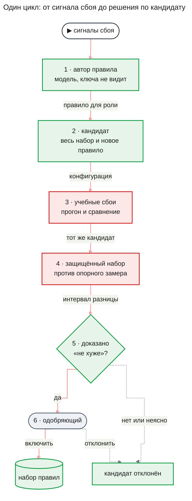
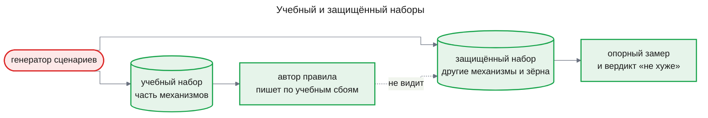
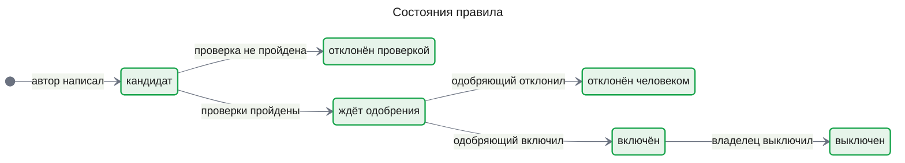
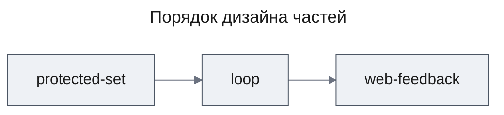

# PRD: Цикл правил самокоррекции (self-correction)

| Status | Date | Depth | UXRD | Designs |
|---|---|---|---|---|
| Draft, ждёт утверждения владельца | 2026-11-09 | full | нужен для части `web-feedback`, пишется после утверждения PRD | — |

## Snapshot

**Overview.** Промпты ролей расследования сейчас правит только разработчик, вручную, а самопроверка из фичи `agent-quality` лишь меряет, стало ли лучше. Эта фича замыкает круг. После замеченного сбоя модель пишет короткое правило-подсказку для одной роли. Программа самопроверки прогоняет сценарии с правилом, и правило остаётся, только если не стало хуже на защищённом наборе сценариев, которого автор правила никогда не видит. Каждое правило включает человек, а выключить его можно в любой момент без выпуска кода; сигнал сбоя может дать и сотрудник, отметив ответ ресерча как неверный. Цикл пишет правила для агентов версии v3 из фичи `agent-runtime` и хранит их записями в памяти определения агента.

- **Для сотрудника**: ответы со временем точнее; отклонённую беседу система читает только с его согласия, и в текст правила её содержимое не попадает.
- **Не входит**: включение правил без человека; правка целых промптов; правка таблицы групп уверенности; правила для одного сотрудника или отдела.
- **Части**: `protected-set` → `loop` → `web-feedback`.
- **Где живут правила**: записи в памяти определения агента, хранилище которой даёт `agent-runtime`; пока хранилище не выпущено, правила лежат в своей таблице и потом переносятся в него.
- **Условие входа не выполнено**: базовую линию снимают прогоны v3 после выпуска `agent-runtime`, а сценариев 24 на трёх механизмах причины ([условие входа](#условие-входа)).
- **Главный риск**: прирост на моделях класса Haiku может оказаться неотличим от шума, и цикл будет тратить деньги без пользы (гипотеза H-01).
- **Открытые вопросы**: есть, главный — нужен ли прирост на учебных сбоях — [Undetermined Items](#undetermined-items).

## Terms

Пример везде один: сотрудник спрашивает в чате «почему вчера вечером росли ошибки оплаты?». Термины расследования и самопроверки — роль, controller, проверяющий, судья, ключ ответа, сценарий, калибровка, группа уверенности, транскрипт, повторный прогон, сигнал сбоя — объяснены в [PRD `agent-quality`](../agent-quality/prd.md#terms); ниже — только новые и те, без которых этот документ не читается.

**Правила и цикл**

- **Роль** — здесь адресат правила: определение агента версии v3 ([`agent-runtime`](../agent-runtime/prd.md#terms)).
- **Промпт роли** — постоянная инструкция, которую роль получает в каждом вызове модели. У controller она одна, у проверяющего — своя.
- **Правило-подсказка (правило)** — короткая инструкция для одной роли, которую дописывают к её промпту. Пример: «прежде чем назвать причину, посмотри записи соседнего сервиса за те же минуты».
- **Набор правил** — все включённые правила. Расследование получает их при запуске, каждая роль — свои.
- **Память определения агента** — записи определения агента, которые живут между расследованиями. Хранилище, его области и права доступа даёт `agent-runtime` (FR-22 там); правила этой фичи — записи этой памяти.
- **Автор правила** — отдельный вызов модели. Он читает сигналы сбоя и транскрипты ролей и пишет правило для одной роли.
- **Кандидат** — правило, которое написал автор, но которое ещё не включено.
- **Цикл** — один проход от сигналов сбоя до решения по кандидату: отклонён проверкой, отклонён человеком или включён.
- **Одобряющий** — человек, который включает и выключает правила. Это владелец развёртывания; в прототипе он же разработчик.
- **Конфигурация** — модели и промпты ролей, источники и параметры процесса расследования. **Поставляемая** — та, на которой идут расследования сотрудников.

**Наборы сценариев и мерка**

- **Механизм причины** — способ, которым генератор закладывает в учебные логи причину сбоя. Пример: «таймаут понижен» — после релиза сервис ждёт провайдера оплаты меньше, а сам провайдер не стал медленнее.
- **Учебный набор** — сценарии, на сбоях которых цикл пишет и проверяет правила.
- **Защищённый набор** — сценарии, которых автор правила не видит. Цикл на них только меряет, не стало ли хуже.
- **Отпечаток набора** — короткий код, вычисленный из состава набора. Любая правка набора меняет отпечаток.
- **Опорный замер** — прогон поставляемой конфигурации с включёнными правилами на защищённом наборе. От него цикл отсчитывает «не хуже».
- **Интервал разницы** — диапазон, в котором почти наверняка лежит настоящая разница двух конфигураций по одной метрике. Модель отвечает каждый раз по-разному, поэтому самопроверка считает не одно число, а интервал.
- **Допустимая потеря** — на сколько метрика может стать хуже, чтобы кандидат всё ещё считался «не хуже». Владелец записывает её до прогона.
- **«Не хуже»** — весь интервал разницы лежит выше минус допустимой потери. Исход «неясно» — это не «не хуже»: он значит, что данных не хватило, чтобы это доказать.
- **Базовая линия самопроверки** — замер качества и цены поставляемой конфигурации v3 прогонами самопроверки `agent-quality` после выпуска `agent-runtime`. Базовая линия — условие входа, а не часть этой фичи.

**Сотрудник**

- **Отметка «ответ неверен»** — знак, которым сотрудник отклоняет ответ ресерча в своей беседе.
- **Согласие на разбор** — явное разрешение сотрудника, чтобы цикл прочитал отклонённую беседу: вопрос, ответ и ход расследования.

## Background

### Как это работает сейчас

Сотрудник задаёт вопрос в чате, в фоне идёт расследование, и в беседу приходит ответ ресерча. Расследование ведут несколько ролей, у каждой свой промпт, и промпты зашиты в поставляемую конфигурацию. Чтобы изменить промпт, разработчик правит код и выпускает новую версию.

Фича `agent-quality` дала разработчику программу самопроверки. Программа создаёт сценарии с заложенным ответом, прогоняет на них расследование, сравнивает две конфигурации с вердиктом «лучше», «хуже» или «неясно», повторяет сохранённые расследования и показывает сигналы сбоя. Но решать, что именно поменять в промпте, и писать новый текст по-прежнему приходится человеку: самопроверка только меряет.

Сотрудник сегодня не может сказать системе, что ответ неверен. Плохой ответ на настоящей задаче видит только он сам.

### Почему сейчас

Работа [Self-Healing Harness](https://arxiv.org/abs/2609.24130) предлагает цикл, в котором агент после сбоя сам пишет себе правило, а правило проверяют повторным прогоном. Разбор работы — в [заметке](../../side_reserch/self_correction_study.md). Работа показала малый прирост за заметную цену и нашла, что набор правил с ростом начинает вредить ([числа](#подход-и-почему-мы-в-него-верим)). Поэтому фичу начинаем не раньше, чем есть внешняя мерка, отдельная от судьи, — ключ ответа от генератора сценариев — и базовая линия.

### Условие входа

Дизайн фичи начинается, когда выполнены три условия из заметки:

1. Программа самопроверки `agent-quality` построена. Выполнено.
2. Есть базовая линия самопроверки для поставляемой конфигурации v3. **Не выполнено:** базовую линию снимают прогоны v3 после выпуска `agent-runtime`.
3. Сценариев хватает, чтобы выделить защищённый набор. **Не выполнено:** в наборе 24 сценария на трёх механизмах причины и сценарии «ответа нет», по 6 на каждый вид. Разделить такой набор по механизмам нельзя, не оставив учебный набор почти пустым; новые механизмы добавляет часть `protected-set`.

Базовая линия — предусловие дизайна, а не требование этой фичи. PRD пишется сейчас, чтобы требования были готовы к моменту, когда условие выполнится.

## Что меняется и куда встраивается

На схеме — путь от вопроса сотрудника до правила, которое меняет следующие расследования. Серым — что есть и не меняется, красным — что меняется, зелёным — что новое.

```mermaid
---
title: "Где встраивается цикл правил"
config:
  theme: base
  look: classic
  themeVariables:
    primaryColor: "#eef1f5"
    primaryBorderColor: "#4b5563"
    primaryTextColor: "#1a1a1a"
    lineColor: "#6b7280"
  flowchart:
    curve: step
  themeCSS: |
    @keyframes lit_where{0%,11.25%{stroke:#991b1b;stroke-width:6px}12.5%,100%{stroke:#f4a5a5;stroke-width:2px}}
    @keyframes litr_where{0%,11.25%{stroke:#1d4ed8;stroke-width:6px}12.5%,100%{stroke:#9ec1f7;stroke-width:2px}}
---
flowchart LR
    emp(["▶ сотрудник<br/>вопрос в чате"])
    inv["1 · расследование<br/>роли и их промпты"]
    ans["2 · ответ ресерча"]
    mark["3 · отметка<br/>«ответ неверен»"]
    sig[("отклонённые ответы")]
    sc["самопроверка<br/>сценарии и прогоны"]
    loop["4 · цикл правил"]
    human(["5 · одобряющий"])
    rules[("набор правил")]
    emp --> inv
    inv e1@-->|"ответ"| ans
    ans e2@-->|"сотрудник отклоняет"| mark
    mark e3@-->|"с согласием"| sig
    sig e4@-->|"материал"| loop
    sc e5@-->|"сбои сценариев"| loop
    loop e6@-->|"кандидат"| human
    human e7@-->|"включить"| rules
    rules e8@-->|"дописать к промпту"| inv
    classDef entry fill:#ffffff,stroke:#1f2937,stroke-width:1.5px,color:#1a1a1a
    classDef changed fill:#fde8e8,stroke:#dc2626,stroke-width:2px,color:#1a1a1a
    classDef new fill:#e6f4ea,stroke:#16a34a,stroke-width:2px,color:#1a1a1a
    classDef unchanged fill:#eef1f5,stroke:#4b5563,stroke-width:1.5px,color:#1a1a1a
    classDef w1 stroke:#f4a5a5,stroke-width:2px,animation:lit_where 9.6s linear 0s infinite
    classDef w2 stroke:#f4a5a5,stroke-width:2px,animation:lit_where 9.6s linear 1.2s infinite
    classDef w3 stroke:#f4a5a5,stroke-width:2px,animation:lit_where 9.6s linear 2.4s infinite
    classDef r4 stroke:#9ec1f7,stroke-width:2px,animation:litr_where 9.6s linear 3.6s infinite
    classDef r5 stroke:#9ec1f7,stroke-width:2px,animation:litr_where 9.6s linear 4.8s infinite
    classDef w6 stroke:#f4a5a5,stroke-width:2px,animation:lit_where 9.6s linear 6s infinite
    classDef w7 stroke:#f4a5a5,stroke-width:2px,animation:lit_where 9.6s linear 7.2s infinite
    classDef r8 stroke:#9ec1f7,stroke-width:2px,animation:litr_where 9.6s linear 8.4s infinite
    class emp entry
    class ans,human unchanged
    class inv,sc changed
    class mark,sig,loop,rules new
    class e1 w1
    class e2 w2
    class e3 w3
    class e4 r4
    class e5 r5
    class e6 w6
    class e7 w7
    class e8 r8
```

Изменений три.

- **Набор правил.** Правила — записи в памяти определения агента, хранилище которой даёт `agent-runtime`. При запуске каждое расследование дописывает к промпту роли её включённые правила. Правило включается и выключается без выпуска кода. Само расследование идёт как раньше.
- **Цикл правил.** Цикл берёт сигналы сбоя, просит модель написать правило и проверяет его командами самопроверки как шагами: прогон, повтор, калибровка, сравнение. Самопроверка меняется в одном месте: сравнение учится выносить вердикт «не хуже». Пока цикл — программа разработчика, как и сама самопроверка (вопрос U-5).
- **Отметка «ответ неверен».** Сотрудник отклоняет ответ ресерча и решает, разрешить ли разбор беседы. Отклонённые ответы с согласием становятся вторым источником сигналов сбоя, рядом со сбоями сценариев.

## Как работает цикл

### Один цикл: от сбоя до решения

1. **Сигналы сбоя.** Цикл берёт сценарии учебного набора, которые не прошли проверку по ключу, сигналы сбоя самопроверки и отклонённые ответы сотрудников с согласием на разбор.
2. **Автор правила.** Модель читает эти сигналы и транскрипты ролей и пишет одно правило для одной роли. Ключа ответа, параметров сценария и транскриптов судьи она не видит, а о защищённом наборе не знает ничего, даже исходов прежних кандидатов.
3. **Кандидат.** Цикл собирает конфигурацию-кандидат: поставляемая конфигурация, все включённые правила и новое. Отличие от поставляемой — только текст промпта одной роли.
4. **Учебные сбои.** Кандидат прогоняется на тех сбоях, из-за которых написан, с повторами. Сценарии сравниваются по ключу, повторы отклонённых расследований — по сигналам сбоя: ключа у настоящей беседы нет.
5. **Защищённый набор.** Кандидат прогоняется на защищённом наборе и сравнивается с опорным замером. Если правило написано для проверяющего, перед этим калибровка строит для кандидата новую таблицу групп уверенности.
6. **Решение.** Кандидат идёт к одобряющему, только если «не хуже» доказано по каждой метрике. Исходы «хуже» и «неясно» одинаково отклоняют кандидата.
7. **Одобрение.** Одобряющий видит правило, его происхождение, вердикты и цену цикла и включает или отклоняет кандидата. Сам цикл не включает ничего.

### Почему правилу трудно подстроиться под проверку

Главная опасность цикла — правило, которое помогает не расследованию, а самой проверке. От неё защищают четыре вещи.

- **Ключ, а не судья.** Вердикт по сценарию выносит алгоритм по ключу и идентификаторам записей; судья только читает текст ответа там, где без этого нельзя. Модель и промпт судьи на время цикла не меняются, а согласие судьи с ключом меряется и на защищённом наборе.
- **Автор не видит ключа.** Автор получает только сигналы сбоя и транскрипты ролей. Правило, написанное «под ответ одного сценария», ему написать не из чего.
- **Защищённый набор делится по механизму.** В защищённом наборе есть механизмы причины, которых нет в учебном. Правило, подогнанное под один механизм, не поможет на чужом, а навредить там может — это и проверяет защищённый набор.
- **«Неясно» — отказ.** Малый набор различает только крупные эффекты. Если бы «неясно» считалось за «не хуже», цикл принимал бы правила тем легче, чем меньше данных.

Как делятся сценарии, показывает схема.

Зерно — число, от которого генератор строит случайные детали сценария: моменты, отвлекающие записи. Сценарии одного механизма с разными зёрнами похожи, поэтому разделения только по зёрнам мало.

### Жизнь правила

Выключенное правило не включается обратно в обход цикла. Чтобы вернуть его, цикл проверяет его заново как кандидата: за это время набор и конфигурация могли измениться. История каждого правила хранится: кто и когда включил и выключил, с какими вердиктами.

## Что увидит сотрудник в диалоге

Под ответом ресерча в своей беседе сотрудник может отметить, что ответ неверен. На обычном ответе чат-агента такой отметки нет: цикл учится только на расследованиях. Отмечая ответ, сотрудник отдельно решает, разрешить ли разбор беседы, и до решения видит, что разбор значит:

- вопрос, ответ и ход расследования прочитают модель цикла и разработчик;
- по ним может появиться правило, которое действует в расследованиях всех сотрудников;
- содержимого беседы в правиле не будет;
- копии беседы для разбора живут не дольше самой беседы.

Отметку и согласие можно отозвать. Больше в диалоге ничего не меняется: ответы идут по включённым правилам, но сами правила сотрудник не видит. Как выглядит отметка и где она стоит, решает UXRD.

## Подход и почему мы в него верим

У каждой опоры стоит её тип: **измерено**, **вендор**, **наш вывод**. То, что для нас не измерено, записано гипотезой в [Assumptions](#assumptions).

### Что измерила работа, на которой стоит фича

[Self-Healing Harness](https://arxiv.org/abs/2609.24130) прочитана целиком по оригиналу; все числа — **измерено**.

- **Прирост мал.** Из 16 пар «модель × набор задач» прирост отличим от шума только в двух. Для claude-haiku-4.5 — ни в одной из четырёх.
- **Цена высока.** Расходы на модели выросли в 1,72 раза, время — в 1,7–7 раза.
- **Набор правил вредит с ростом.** В одной конфигурации эффект падал с ростом набора с 13 до 70 правил и в конце стал отрицательным, хотя каждое правило по отдельности прошло проверку.
- **Вклад проверки правил не выделен.** Сравнение с вариантом без проверки авторы спроектировали, но не запускали.
- **Пользу мерили не судьёй.** Помогает ли изменение, авторы проверяли отдельными проверками, а не тем судьёй, что вёл систему.

### Что из этого следует для нас

- **Мерка — ключ, а не судья.** Без проверки, отдельной от судьи, цикл учится угождать собственному судье. У нас такая проверка есть: ключ ответа от генератора — **наш вывод**.
- **«Неясно» — отказ, а не допуск.** Сравнивать конфигурации нужно парно, с повторами, и малый набор различает только крупные эффекты — **вендор, методика**, [Anthropic, A statistical approach to model evals](https://www.anthropic.com/research/statistical-approach-to-model-evals). При малом приросте, как в работе, большинство исходов будут «неясно», и только строгий вердикт «не хуже» не пропустит вредное правило — **наш вывод**.
- **Проверяется весь набор, а не правило.** Правила, прошедшие проверку поодиночке, вместе вредили. Поэтому кандидат всегда идёт вместе со всеми включёнными правилами, у набора есть предел, а после смены конфигурации набор проверяется заново — **наш вывод**.
- **Каждое правило включает человек.** Правило меняет расследования всех сотрудников, а сравнение даёт только вердикт по сценариям. Человек видит то, чего сравнение не видит: смысл правила и его происхождение — **наш вывод**.

**Что не измерено для нас.** Даёт ли цикл на наших ролях прирост, отличимый от шума, — гипотеза H-01. Похожи ли придуманные сценарии на настоящие сбои — риск, унаследованный от `agent-quality`. Отклонённые ответы — сбои на настоящих вопросах сотрудников, но пока единственный источник логов — учебный fixture, сходство сценариев с настоящими сбоями они не проверяют.

## Users and Use Cases

### Users

- **Сотрудник** — задаёт вопросы в чате и читает ответы ресерча. Ему важно, чтобы ответы становились точнее, а его беседа не стала материалом без его согласия и не попала в правило для всех.
- **Разработчик** — запускает цикл, разбирает, почему кандидат отклонён, и готовит наборы сценариев.
- **Одобряющий (владелец развёртывания)** — включает и выключает правила, записывает допустимую потерю, бюджет цикла и предел набора. Ему важно видеть, что правило делает, откуда оно и сколько стоило.

### Use Cases

- **UC-1**: Разработчик запускает цикл по сбоям учебного набора → получает кандидата на одобрение или отказ с причиной и цену цикла, так что промпт меняется по числам, а не по ощущению. Covers FR-04–FR-13, FR-18.
- **UC-2**: Одобряющий читает кандидата с вердиктами и итогом проверки на содержимое бесед и включает его → правило действует со следующего расследования без выпуска кода. Covers FR-14, FR-15.
- **UC-3**: Одобряющий выключает правило, которое оказалось вредным → следующие расследования идут без него. Covers FR-15.
- **UC-4**: Сотрудник отмечает ответ ресерча как неверный и разрешает разбор → беседа становится материалом цикла, и система узнаёт о сбое на настоящем вопросе сотрудника. Covers FR-19, FR-20, FR-04.
- **UC-5**: Сотрудник отзывает отметку или согласие либо удаляет беседу → копии беседы исчезают из материала цикла, а правила остаются без её содержимого. Covers FR-19, FR-20, FR-21.
- **UC-6**: Разработчик меняет поставляемую конфигурацию, например модель в роли или источники → набор правил проверяется заново на новой конфигурации, прежде чем цикл примет новое правило. Covers FR-17.
- **UC-7**: Разработчик готовит защищённый набор и опорный замер → цикл может стартовать, а на изменённом или пересекающемся наборе отказывается работать. Covers FR-01, FR-02, FR-03.

## Functional Requirements

### Must Have (MVP)

**Защищённый набор**

- **FR-01. Наборы разделены по механизму причины.** Генератор сценариев получает новые механизмы причины, и сценарии делятся на учебный и защищённый наборы. В защищённом наборе есть механизмы, которых нет в учебном, сценарии механизмов учебного набора с другими зёрнами и сценарии «ответа нет». Ключ каждого нового механизма генератор выводит из его данных, как и раньше; ручного ключа нет.
  - AC-01.1: Given наборы подготовлены, When разработчик смотрит их состав, Then в защищённом наборе есть хотя бы один механизм причины, которого нет в учебном, и сценарии «ответа нет», а ни один сценарий — механизм с зерном — не входит в оба набора.
  - AC-01.2: Given в генератор добавлен механизм, When генератор строит его сценарий, Then у сценария есть ключ, выведенный из сгенерированных записей.
- **FR-02. Защищённый набор закреплён отпечатком.** Отпечаток защищённого набора записан вместе с опорным замером. Цикл не работает на наборе, который изменился или пересекается с учебным. Сменить защищённый набор может только владелец, и смена требует нового опорного замера.
  - AC-02.1: Given состав защищённого набора изменился после записи отпечатка, When разработчик запускает цикл, Then цикл отказывается с причиной и не запускает ни одного расследования.
  - AC-02.2: Given учебный и защищённый наборы пересекаются, When разработчик запускает цикл, Then цикл отказывается и называет общие сценарии.
  - AC-02.3: Given владелец записал новый защищённый набор, When разработчик запускает цикл, Then прежний опорный замер не принимается и цикл требует нового.
- **FR-03. Опорный замер и проверка на шум.** Опорный замер — прогон поставляемой конфигурации с включёнными правилами на защищённом наборе, с повторами. Перед первым циклом та же конфигурация прогоняется второй раз и сравнивается с опорным замером: если сравнение не даёт «не хуже», набор слишком мал для выбранной допустимой потери. Что включение или выключение правила делает с опорным замером — открытый вопрос U-7.
  - AC-03.1: Given для поставляемой конфигурации и защищённого набора нет опорного замера, When разработчик запускает цикл, Then цикл отказывается с причиной «нет опорного замера».
  - AC-03.2: Given опорный замер и повторный прогон той же конфигурации, When они сравниваются, Then исход «не хуже» разрешает циклы, а исход «неясно» показывает разработчику, что набор мал для допустимой потери, и циклы не запускаются.

**Цикл**

- **FR-04. Сигналы сбоя — вход цикла.** Цикл принимает сигналы сбоя трёх видов: сценарий учебного набора, не прошедший проверку по ключу; сигналы сбоя самопроверки на прогонах и повторах учебного набора ([agent-quality](../agent-quality/prd.md), FR-07); отметку «ответ неверен». Содержимое отклонённой беседы цикл читает только при согласии на разбор. Отклонённое расследование на учебных логах цикл может повторить, на настоящих источниках оно остаётся только материалом автора правила.
  - AC-04.1: Given цикл запущен, When разработчик открывает его отчёт, Then видит каждый взятый сигнал с его видом и расследованием.
  - AC-04.2: Given отметка «ответ неверен» без согласия на разбор, When цикл собирает материал, Then отметка учтена только в счёте отклонённых ответов, и ни одного транскрипта этого расследования нет во входе автора правила.
  - AC-04.3: Given цикл сделал копию отклонённой беседы — в транскрипте автора правила или проверки на содержимое бесед, When беседа удалена или старше срока хранения транскриптов ([agent-quality](../agent-quality/prd.md), FR-01), Then копия удалена.
- **FR-05. Автор правила не видит ключа и защищённого набора.** Автор получает только сигналы сбоя и транскрипты ролей. Ключ ответа, параметры сценария, в том числе механизм, и транскрипты судьи к нему не попадают. О защищённом наборе он не получает ничего: ни сценариев, ни транскриптов, ни вердиктов, ни исходов прежних кандидатов.
  - AC-05.1: Given цикл, When разработчик проверяет состав входа автора правила, Then в нём нет ни ключа, ни параметров сценария, ни одного транскрипта судьи; проверяется по видам и идентификаторам переданных данных.
  - AC-05.2: Given прежние кандидаты прогонялись на защищённом наборе, When автор пишет новое правило, Then в его входе нет ни одного расследования, сценария или вердикта защищённого набора.
- **FR-06. Правило — для одной роли и только текст.** Автор отвечает формой: роль, текст правила и сбои, на которые правило отвечает. Роль должна быть ролью расследования, иначе кандидат отклоняется. Правило меняет только текст промпта своей роли: модели, бюджет и параметры процесса оно не меняет.
  - AC-06.1: Given автор назвал роль, которой нет в расследовании, или ответил не по форме, When цикл проверяет ответ, Then кандидат отклонён с причиной до первого прогона.
  - AC-06.2: Given правило для одной роли, When идёт расследование с ним, Then транскрипты остальных ролей показывают те же промпты, что без правила, а модели и параметры конфигурации те же.
- **FR-07. Кандидат проверяется вместе со всем набором.** Каждый прогон цикла идёт на конфигурации с полным набором включённых правил и новым правилом.
  - AC-07.1: Given включены три правила и есть кандидат, When цикл прогоняет кандидата, Then все расследования цикла идут со всеми четырьмя правилами, и отчёт цикла их перечисляет.
- **FR-08. Прогон на учебных сбоях.** Кандидат прогоняется на сбоях, из-за которых написан, с повторами и сравнивается с той же конфигурацией без него.
  - AC-08.1: Given кандидат, When цикл прогоняет его на учебных сбоях, Then отчёт показывает сравнение: по ключу для сценариев и по сигналам сбоя для повторов отклонённых расследований.
  - AC-08.2: Нужен ли кандидату вердикт «лучше» на учебных сбоях, чтобы попасть к одобряющему, — открытый вопрос U-1.
- **FR-09. «Не хуже» на защищённом наборе — только доказанное.** Кандидат сравнивается с опорным замером по метрикам сравнения самопроверки ([agent-quality](../agent-quality/prd.md), AC-05.1) и по доле установленных выводов, противоречащих ключу. «Не хуже» засчитывается, только если по каждой метрике весь интервал разницы лежит выше минус допустимой потери. Допустимые потери записаны до первого расследования цикла.
  - AC-09.1: Given по какой-то метрике интервал разницы доходит до минус допустимой потери или ниже, When цикл выносит решение, Then кандидат отклонён с причиной «не доказано, что не хуже» — и при исходе «неясно», и при исходе «хуже».
  - AC-09.2: Given допустимые потери изменились после старта цикла, When цикл выносит решение, Then кандидат не идёт к одобряющему.
- **FR-10. Судья заморожен на время цикла.** Модель и промпт судьи в прогонах кандидата те же, что в опорном замере. Согласие судьи с ключом меряется и на прогонах защищённого набора.
  - AC-10.1: Given модель или промпт судьи отличаются от опорного замера, When разработчик запускает цикл, Then цикл отказывается до первого расследования.
  - AC-10.2: Given согласие судьи на защищённом наборе ниже наименьшего допустимого ([agent-quality](../agent-quality/prd.md), U-6), When цикл выносит решение, Then кандидат отклонён.
- **FR-11. Правило для проверяющего — только с новой калибровкой.** Таблица групп уверенности — измерение, и цикл её не правит. Правило для проверяющего меняет его промпт, поэтому калибровка строит новую таблицу для конфигурации-кандидата до прогона защищённого набора.
  - AC-11.1: Given кандидат для проверяющего, When цикл его проверяет, Then калибровка идёт до прогона защищённого набора, и защищённый набор меряется с новой таблицей.
  - AC-11.2: Given любой цикл, When разработчик смотрит таблицу групп кандидата, Then её построила калибровка; иначе таблица в цикле не меняется.
  - AC-11.3: Given правило для проверяющего включено или выключено, When запускается расследование, Then оно берёт таблицу, построенную для промпта проверяющего с этим набором правил.
- **FR-12. В правиле нет содержимого бесед.** Если материал кандидата включает отклонённые беседы, отдельный вызов модели закрытым ответом оценивает, есть ли в тексте правила содержимое этих бесед: имена, числа, идентификаторы, цитаты. Решает алгоритм по этому ответу; код текст правила не разбирает. Проверку меряют на проверочных правилах с заложенным содержимым, как меряют судью.
  - AC-12.1: Given проверка ответила «содержит» или ответила не по форме, When цикл выносит решение, Then кандидат отклонён и к одобряющему не идёт.
  - AC-12.2: Given кандидат идёт к одобряющему, When тот его включает, Then одобряющий отдельно подтверждает, что в правиле нет содержимого бесед; без подтверждения правило не включается.
  - AC-12.3: Given цикл, When проверка прогнана на проверочных правилах, Then доля пропущенного заложенного содержимого показана одобряющему вместе с кандидатом.
- **FR-13. Бюджет цикла.** У каждого цикла есть явный бюджет (бизнес-ограничение 4 проекта). Цена цикла видна в его отчёте.
  - AC-13.1: Given бюджет меньше, чем нужно циклу, When бюджет исчерпан, Then новых вызовов модели нет, цикл завершается с причиной «бюджет исчерпан», кандидат к одобряющему не идёт.
  - AC-13.2: Чем задан предел — токенами, числом кандидатов или обоими — и его значение — открытый вопрос U-3.
- **FR-14. Одобрение человеком.** Кандидат, прошедший проверки, ждёт одобряющего. Сравнение даёт только вердикт; включает правило человек.
  - AC-14.1: Given кандидат прошёл все проверки, When одобряющий его открывает, Then видит роль, текст правила, сигналы, из которых оно написано, вердикты по каждому набору и метрике, цену цикла и итог проверки на содержимое бесед, и включает кандидата или отклоняет с причиной.
  - AC-14.2: Given кандидат не одобрен, When идут расследования, Then кандидат не влияет ни на одно из них, какими бы ни были его вердикты.
  - AC-14.3: Given кандидат отклонён проверкой, When одобряющий пытается его включить, Then включить нельзя.
- **FR-15. Включение и выключение без выпуска кода.** Одобренное правило начинает действовать без выпуска кода, а владелец выключает любое правило в любой момент. Каждое расследование помнит, с какими правилами шло.
  - AC-15.1: Given правило включено, When запускается следующее расследование, Then роль получает правило в промпте, а уже идущие расследования продолжают со своей конфигурацией.
  - AC-15.2: Given правило выключено, When запускается следующее расследование, Then правила в промпте нет.
  - AC-15.3: Given расследование прошло с набором правил, When разработчик повторяет его с замороженной конфигурацией, Then повтор идёт с тем же набором правил.
  - AC-15.4: Given правило включали и выключали, When разработчик открывает его историю, Then видит, кто и когда это делал и с какими вердиктами.
- **FR-16. Предел набора правил на роль.** У каждой роли есть предел числа включённых правил. Значение предела владелец задаёт данными.
  - AC-16.1: Given у роли включено столько правил, сколько позволяет предел, When автор пишет правило для этой роли, Then цикл не проверяет кандидата и называет предел.
- **FR-17. Перепроверка набора после смены конфигурации.** Смена поставляемой конфигурации — модели или промпта роли, источников, параметров процесса — обесценивает опорный замер. Цикл не принимает новых правил, пока набор правил не проверен заново на новой конфигурации. Перепроверку можно запустить и по запросу владельца. Включение и выключение правила сменой конфигурации здесь не считается: его действие на опорный замер решает U-7.
  - AC-17.1: Given поставляемая конфигурация изменилась после опорного замера, When разработчик запускает цикл, Then цикл отказывается до новой перепроверки.
  - AC-17.2: Given перепроверка, When она сравнивает новую конфигурацию с набором правил и без него на защищённом наборе, Then исход показан владельцу по ролям; при исходе «хуже» или «неясно» владелец решает, какие правила выключить, а система сама ничего не выключает. Новый опорный замер записывается после решения владельца.
  - AC-17.3: Given перепроверка, When у включённого правила ещё хранятся беседы, из которых оно написано, Then проверка на содержимое бесед (FR-12) повторяется для этого правила, и её итог показан владельцу.
- **FR-18. Цикл одной командой.** Команды самопроверки становятся шагами цикла. Разработчик запускает цикл один раз и между шагами ничего не запускает вручную.
  - AC-18.1: Given учебный набор, защищённый набор и опорный замер готовы, When разработчик запускает цикл, Then цикл доходит либо до кандидата, ждущего одобрения, либо до отказа с причиной без ручного запуска команд самопроверки. Какие команды остаются для отладки — открытый вопрос U-4.

**Отметка сотрудника**

- **FR-19. Отметка «ответ неверен».** Сотрудник отмечает ответ ресерча в своей беседе как неверный и может отметку отозвать. Отметка есть только у ответов ресерча.
  - AC-19.1: Given ответ ресерча в беседе сотрудника, When он отмечает ответ как неверный, Then отметка сохраняется и видна ему после повторного открытия беседы.
  - AC-19.2: Given отметка стоит, When сотрудник её отзывает, Then отметки нет, сигнал больше не попадает в новые циклы, а копии беседы для разбора удалены.
- **FR-20. Согласие на разбор беседы.** Отмечая ответ, сотрудник явно решает, разрешить ли разбор. Без явного решения согласия нет. Перед решением он видит, кто прочитает беседу, что правило будет действовать для всех сотрудников без содержимого беседы и сколько живут копии.
  - AC-20.1: Given сотрудник отметил ответ и не дал согласия явно, When цикл собирает материал, Then согласия нет.
  - AC-20.2: Given согласие дано, When сотрудник его отзывает, Then копии беседы для разбора удалены, а отметка остаётся только в счёте отклонённых ответов.
  - AC-20.3: Given сотрудник решает о согласии, When он ещё не выбрал, Then он уже видит, кто прочитает беседу, на кого будет действовать правило, что содержимого беседы в правиле не будет и сколько живут копии.
- **FR-21. Отметка и согласие живут не дольше беседы.** Отметка, согласие и копии беседы удаляются вместе с беседой и не живут дольше срока хранения транскриптов. Правило, написанное по беседе, остаётся, но о происхождении помнит только вид сигнала.
  - AC-21.1: Given беседа с отметкой удалена, When разработчик открывает правило, написанное по ней, Then в происхождении правила стоит «сигнал удалён», а отметки, согласия и копий нет.
  - AC-21.2: Given истёк срок хранения транскриптов ([agent-quality](../agent-quality/prd.md), FR-01), When цикл собирает материал, Then отметки, согласия и копий этой беседы нет.

### Should Have

- **FR-22. Чистка набора правил.** Набор правил чистится: правило, без которого набор не хуже, выключается. Как именно — открытый вопрос U-2.
  - AC-22.1: Способ чистки и кто её запускает — открытый вопрос U-2.
- **FR-23. Причина отклонения своими словами.** Отмечая ответ, сотрудник может коротко написать, что не так. Текст живёт по правилам FR-21 и попадает к автору правила только при согласии на разбор.
  - AC-23.1: Given сотрудник отметил ответ, написал причину и не дал согласия, When цикл собирает материал, Then текста причины во входе автора нет.

### Could Have

- **FR-24. Цикл меняет параметры процесса.** Кроме правил, цикл предлагает параметры: бюджет, глубину расследования, когда проверять утверждения. Кандидат проверяется так же, как правило.
  - AC-24.1: Given кандидат-параметр, When цикл его проверяет, Then он проходит те же шаги и то же одобрение, что правило.
- **FR-25. Вариант цикла без проверки правил.** Разработчик запускает цикл, где правило принимается без прогонов, и сравнивает итог с обычным циклом на защищённом наборе. Так меряется вклад самой проверки, который работа не выделила.
  - AC-25.1: Given вариант без проверки и обычный цикл на одних сигналах, When оба набора правил прогнаны на защищённом наборе, Then отчёт сравнения показывает разницу между ними.

### Won't Have

- **Включение правила без человека** — не эта фича: правило действует для всех сотрудников, а сравнение даёт только вердикт по сценариям.
- **Правка целых промптов ролей** — не эта фича: такую правку цикл не может проверить по частям, а риск сломать роль целиком слишком велик.
- **Правка таблицы групп уверенности** — не эта фича: таблица — измерение, её строит только калибровка (FR-11).
- **Чтение бесед сотрудников без отметки и согласия** — не эта фича: например, поиск бесед с низкой оценкой судьи по всем сотрудникам нарушил бы приватность.
- **Отметка «полезный ответ»** — не в этом выпуске: цикл учится только на сбоях, и такая отметка хранила бы данные без потребителя.
- **Правила для одного сотрудника или отдела** — не эта фича: набор правил один на всё развёртывание.
- **Хранилище памяти определения агента** — не эта фича: хранилище, его области и права доступа даёт [`agent-runtime`](../agent-runtime/prd.md) (FR-22 там). Эта фича кладёт в него правила и ведёт их жизнь — автор, проверка, одобрение, чистка.

## Non-Functional Requirements

### Security

- **NFR-01**: отметку, согласие и причину отклонения через API видит и меняет только автор беседы. Проверяется e2e-тестом с двумя пользователями: 0 случаев доступа к чужой отметке (бизнес-ограничение 2 проекта).
- **NFR-02**: содержимое отклонённых бесед уходит только к провайдерам моделей, которыми уже пользуется расследование. Проверяется по транскриптам автора правила и проверки на содержимое бесед.

## Delivery Parts

| Part | Covers | Cut along | Depends on | Rationale |
|------|--------|-----------|------------|-----------|
| `protected-set` | FR-01, FR-02, FR-03 | domain | — | Наборы сценариев и опорный замер — данные самопроверки, которые цикл только читает. |
| `loop` | FR-04–FR-18, FR-22, FR-25 | domain | `protected-set` | Цикл, набор правил и одобрение — одна область со своими данными. |
| `web-feedback` | FR-19, FR-20, FR-21, FR-23 | frontend | `loop` | Отметка в чате с её сохранением и согласием; вид сигнала берёт из контракта сигналов цикла. |

- Deferred: FR-24 — до решения U-1 и первых циклов с правилами: без них неизвестно, окупает ли цикл даже правила.

`web-feedback` включает и экран, и сохранение отметки с согласием: без экрана отметке неоткуда взяться, а без сохранения экрану нечего показать. Главная забота её дизайна — экран и согласие, поэтому часть режется по слою `frontend`. Контракт сигнала — что цикл читает из отметки, согласия и причины и как удаляются копии — задаёт дизайн `loop`. `web-feedback` сохраняет отметку и согласие по этому контракту, поэтому зависит от `loop`, а её критерии AC-20.1, AC-21.2 и AC-23.1 проверяются на нём. Для этой части нужен UXRD, он пишется после утверждения PRD. У `protected-set` и `loop` экрана нет, им UXRD не нужен.

### Part Dependency Diagram

## Success Criteria

- **Включённые правила помогают по ключу** — у каждого включённого правила, написанного по сбоям сценариев, вердикт на его учебных сбоях — «лучше», а на защищённом наборе — «не хуже». Читается в отчёте цикла при каждом одобрении.
- **Набор в целом помогает** — поставляемая конфигурация с набором правил против той же конфигурации без него на защищённом наборе: «лучше» хотя бы по одной метрике и ни одной «хуже». Читается в отчёте перепроверки (FR-17), которую владелец запускает через месяц после выпуска `loop`.
- **Цена цикла в пределе** — цена каждого цикла не выше предела U-3, а рост стоимости решённого сценария с набором правил не выше порога стоимости `agent-quality` (U-6 там). Читается в отчёте цикла и в отчёте перепроверки.
- **Ни одного правила с содержимым бесед** — 0 включённых правил, у которых проверка на содержимое бесед или одобряющий нашли содержимое беседы. Мерится по истории правил: итог проверки и подтверждение одобряющего у каждого правила (FR-12), и повтор проверки при каждой перепроверке (AC-17.3). Читается в истории правил.

## Constraints and Risks

### Constraints

- **Модель оценивает, алгоритм решает.** Что требует понимания текста — написать правило, назвать причину в ответе, найти в правиле содержимое беседы, — делает вызов модели с ответом-формой. Алгоритм решает по полям формы, идентификаторам, ключу и порогам. Текст правила код не разбирает: ни поиском подстроки, ни списками слов.
- **Человек включает каждое правило.** Цикл только предлагает и проверяет.
- **В этом выпуске цикл меняет только правила-подсказки.** Параметры — Could Have, целые промпты — Won't Have.
- **Правила — записи в памяти определения агента** (хранилище `agent-runtime`, FR-22 там) и включаются без выпуска кода. Это решение владельца. Пока хранилище не выпущено, фича может держать правила в своей таблице базы; когда оно выйдет, правила переносятся в него вместе с историей.
- **Правило — отдельная сущность** с ролью, текстом, происхождением и статусом одобрения, которую можно включать и выключать.
- **Бюджет.** У цикла явный бюджет, как у каждой задачи и расследования (бизнес-ограничение 4 проекта).
- **Программа на общей базе.** Пока цикл — программа разработчика, на него действует правило самопроверки: она работает на базе, где в это время не работают исполнители сервера ([design-self-check.md](../agent-quality/design-self-check.md), KD-3). Изменить это может решение U-5.
- **Условие входа.** Дизайн начинается только после [условия входа](#условие-входа).

### Затронутые утверждённые решения

После утверждения этого PRD в этих документах понадобятся отметки; здесь они не правятся.

- `agent-quality/design-self-check.md`, «Как сравниваются два запуска» — сравнение получает вердикт «не хуже» с допустимой потерей (FR-09). Сегодня исход «неясно» объединяет «разницы нет» и «данных мало».
- `agent-quality/prd.md`, AC-05.1 — к метрикам сравнения цикл добавляет долю установленных выводов, противоречащих ключу, как метрику защищённого набора (FR-09).
- `deep-research/uxrd.md`, ответ ресерча — у ответа появляется отметка «ответ неверен» (FR-19); вид задаёт UXRD этой фичи.
- `agent-runtime/prd.md`, FR-16 — таблица групп должна выбираться при запуске расследования по отпечатку проверяющего агента с его набором правил, а не только при старте сервера (FR-11, AC-11.3).
- `docs/adr/ADR-0005-process-config-data-only.md` — к промптам ролей из конфигурации процесса при сборке дописываются включённые правила из памяти определения агента, то есть у текста промпта появляется второй источник (FR-15).
- `agent-runtime/prd.md`, FR-22 — правила этой фичи — записи памяти определения агента, а не отдельная таблица; своя таблица живёт только до выпуска этого хранилища.
- Бизнес-ограничение 6 проекта — промпты ролей меняются не только вручную: правило-подсказку проверяет цикл и включает одобряющий.

### Assumptions

- **H-01. Прирост на Haiku отличим от шума.**
  - Предполагаем: на наших ролях, где работают модели класса Haiku, правило, принятое циклом, даёт на учебных сбоях вердикт «лучше» по ключу, а набор правил в целом — «лучше» на защищённом наборе.
  - Опровергнет: после первых циклов все вердикты кандидатов на учебных сбоях — «неясно», а сравнение набора с конфигурацией без него (FR-17) — «неясно» или «хуже». Тогда цикл остаётся инструментом разбора сбоев, и владелец решает, продолжать ли.
  - Измерим: вердикты в отчётах циклов и перепроверки.
  - Неясно, если: проверка на шум (AC-03.2) показывает, что набор мал для допустимой потери.
- **H-02. Правило переносится на механизм, которого цикл не видел.**
  - Предполагаем: правило, написанное по сбоям одних механизмов, не вредит на других.
  - Опровергнет: на механизмах защищённого набора, которых нет в учебном, кандидаты получают «хуже» заметно чаще, чем на сценариях тех же механизмов с другими зёрнами.
  - Измерим: вердикты защищённого набора отдельно по двум группам сценариев.
  - Неясно, если: сценариев в одной из групп слишком мало для вердикта.
- **H-03. Проверка находит содержимое бесед.**
  - Предполагаем: вызов модели закрытым ответом находит в тексте правила имена, числа и идентификаторы из беседы.
  - Опровергнет: на проверочных правилах с заложенным содержимым проверка пропускает заметную долю (AC-12.3).
  - Измерим: доля пропусков в отчёте цикла.
  - Неясно, если: проверочных правил слишком мало.
- **H-04. Набор не начинает вредить до предела.**
  - Предполагаем: в пределах предела на роль (FR-16) набор правил на защищённом наборе не хуже конфигурации без него.
  - Опровергнет: с ростом набора перепроверка даёт «хуже», как в работе при росте с 13 до 70 правил.
  - Измерим: исходы перепроверок по мере роста набора.
  - Неясно, если: перепроверок пока мало.

### Risks

| Risk | Impact | Probability | Mitigation |
|------|--------|-------------|------------|
| Цикл учится угождать судье | High | Medium | Вердикт по ключу и идентификаторам, судья заморожен, его согласие меряется на защищённом наборе (FR-09, FR-10) |
| Ключ сценария просачивается в правило | High | Low | Автор не видит ключа, параметров и судьи (FR-05); защищённый набор делится по механизму (FR-01) |
| Шум принят за безопасность | High | High | «Неясно» отклоняет кандидата; проверка на шум до первого цикла (FR-03, FR-09) |
| Правила проходят поодиночке, но вредят вместе | High | Medium | Кандидат с полным набором, предел на роль, перепроверка, чистка (FR-07, FR-16, FR-17, FR-22) |
| Защищённый набор изнашивается: за много циклов проходят правила, случайно удачные именно на нём | Medium | Medium | Автор не видит исходов (FR-05); владелец время от времени меняет набор с новым опорным замером (FR-02) |
| Правило переживает беседу и действует для всех | High | Medium | Согласие, проверка моделью и человеком, срок жизни копий (FR-12, FR-20, FR-21) |
| Цикл дорог: в работе расходы выросли в 1,72 раза | Medium | High | Бюджет цикла (FR-13); рост цены — в успехе фичи |
| Придуманные сценарии не похожи на настоящие сбои | High | Medium | Отклонённые ответы сотрудников как второй сигнал (FR-04, FR-19); действует только после подключения настоящих источников |
| Смена конфигурации — источники из `source-planning`, правка определений агентов — обесценивает правила | Medium | High | Перепроверка набора до новых правил (FR-17) |
| Хранилище памяти определения из `agent-runtime` ещё не выпущено, когда цикл готов | Medium | Medium | Правила временно лежат в своей таблице и переносятся в хранилище с историей (Constraints) |
| Прирост на Haiku неотличим от шума | High | High | Гипотеза H-01; цикл может остаться инструментом разбора |

## Undetermined Items

- **U-1. Нужен ли прирост на учебных сбоях.** Достаточно ли кандидату «не хуже» на защищённом наборе или нужен ещё вердикт «лучше» на учебных сбоях. Без требования «лучше» набор может расти правилами без пользы, и цена расследования растёт; с ним при малом приросте почти все кандидаты отклоняются. Блокирует AC-08.2 и дизайн `loop`. Решает владелец.
- **U-2. Как чистится набор правил.** Варианты: только предел на роль; перепроверка всего набора с выключением правил, без которых не хуже; ручная чистка владельцем. Сюда же — значение предела на роль. Блокирует FR-16 и FR-22 и дизайн `loop`. Решает владелец.
- **U-3. Предел цены цикла.** Чем задан предел — токенами, числом кандидатов за цикл или обоими — и его значение. Блокирует AC-13.2 и критерий успеха о цене. Решает владелец.
- **U-4. Какие команды самопроверки остаются для отладки.** Команды `run`, `compare`, `replay`, `show`, `calibrate` становятся шагами цикла; какие из них разработчик по-прежнему запускает отдельно в терминале. Блокирует объём дизайна `loop`. Решают владелец и разработчик.
- **U-5. Где работает цикл.** Остаётся ли цикл программой разработчика, которой нужна база без работающих исполнителей сервера, или идёт в фоне сервера. Фон потребует разделить очередь задач runtime между сценариями и сотрудниками ([ADR-0001](../../adr/ADR-0001-durable-runtime-owner.md)). Блокирует дизайн `loop`. Решает владелец.
- **U-6. Допустимые потери и состав защищённого набора.** На сколько каждая метрика защищённого набора может стать хуже, сколько механизмов и сценариев в нём нужно. Владелец записывает значения до первого цикла, увидев разброс проверки на шум (AC-03.2). Блокирует вердикт FR-09 и дизайн `protected-set`. Решает владелец.
- **U-7. Опорный замер после включения правила.** Включённое правило меняет поставляемую конфигурацию с правилами. Варианты: опорный замер не меняется, и каждый кандидат сравнивается со старым набором; замер повторяется после каждого включения, и потери могут копиться от правила к правилу; замер повторяется, но общая потеря от первого замера ограничена. Блокирует FR-03, FR-09 и дизайн `loop`. Решает владелец.
- **U-8. Граница с `agent-runtime`.** Решено владельцем 2026-11-08: `agent-runtime` даёт хранилище памяти определения агента с областями и правами доступа, а эта фича кладёт в него правила и ведёт их жизнь. Цикл пишет правила для агентов v3.

## Update History

| Version | Date | Change |
|---------|------|--------|
| 1.0 | 2026-11-08 | Первая версия |
| 1.1 | 2026-11-08 | Граница с `agent-runtime` решена (U-8): правила — записи памяти определения агента, своя таблица только до выпуска хранилища; цикл пишет правила для агентов v3, контракт правила не различает роль и агента; базовая линия — из прогонов v3 |
| 1.2 | 2026-11-09 | Версия процесса одна: роль процесса v2 больше не адресат правила, упоминания v2 убраны из терминов, условия входа, Constraints, затронутых решений и U-8 |
