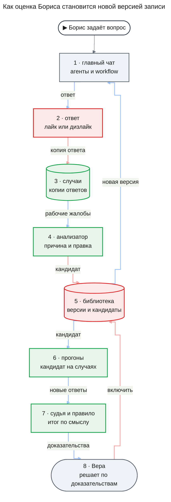
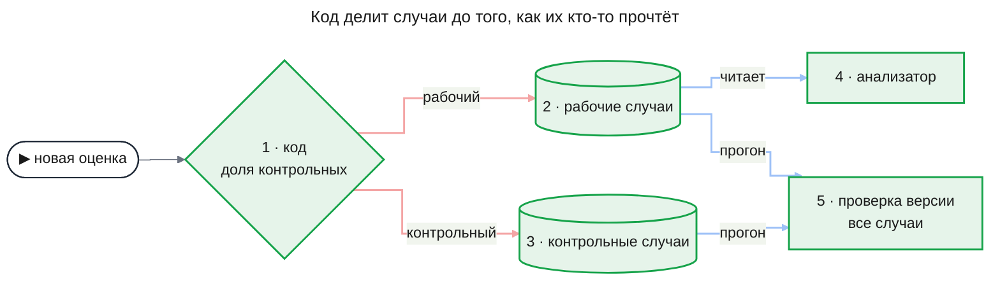
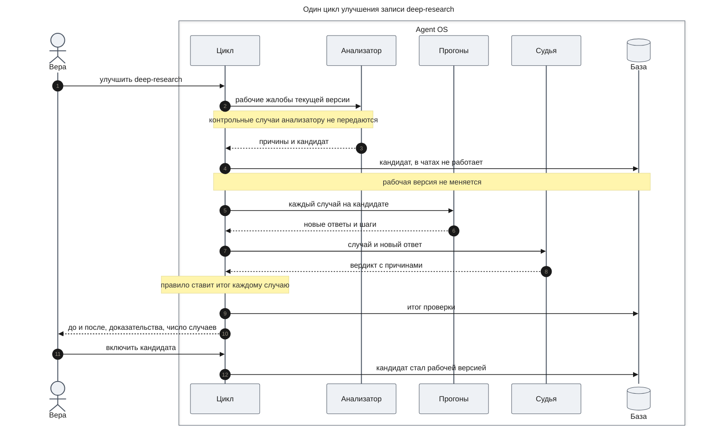
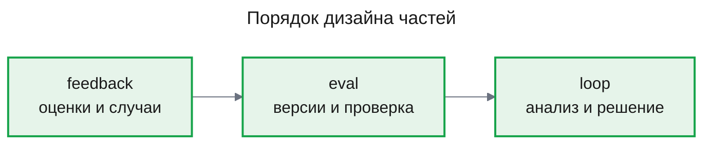

# PRD: Улучшение записей по оценкам сотрудников (self-correction)

| Статус | Дата | Глубина | UXRD | Дизайны |
|---|---|---|---|---|
| Черновик | 2026-11-19 | full | будет после утверждения PRD | — |

## Snapshot

**Overview.** Сегодня сотрудник не может оценить ответ чата, а вместе с беседой пропадает и всё, что агенты делали над ответом. Администратор правит промпт встроенного агента и проверяет правку руками, задавая вопросы в чате. Фича превращает оценки сотрудников в проверенные улучшения записей. Оценка сохраняет копию ответа со всей работой над ним, агент-анализатор предлагает новую версию записи, платформа проверяет её на прошлых случаях, а включает версию всегда администратор, увидев доказательства. Принцип фичи: модель оценивает, алгоритм решает.

- **Для**: сотрудники, которые оценивают ответы; администраторы, которые ведут системные записи.
- **Не входит**: личные записи, включение версии без человека, улучшение чего-либо кроме содержимого записи.
- **Части**: `feedback` → `eval` → `loop`.
- **Главный риск**: на первых неделях случаев мало, и судья, которого никто не проверял, может назвать версию лучше, чем она есть ([Risks](#risks)).
- **Открытые вопросы**: один, про ролевые записи — [Undetermined Items](#undetermined-items).

## Terms

Пример везде один: SRE Борис спрашивает в чате «почему вчера падали оплаты?». Ответ готовит workflow `deep-research`, Борис ставит дизлайк с комментарием «искал в логах не того сервиса». Жалобу разбирает администратор Вера. Термины библиотеки — запись, версия, встроенная, системная, ролевая и личная запись, бриф — объяснены в [PRD `custom-agents`](../custom-agents/prd.md#terms).

- **Оценка** — лайк или дизлайк, который сотрудник ставит ответу чата, с необязательным комментарием.
- **Случай** — копия одного ответа чата, которую платформа сохраняет в момент оценки. В копии есть вопрос, все записи, которые работали над ответом, с их версиями, все шаги этих агентов, причины сбоев и стоимость. Случай живёт отдельно от беседы.
- **Жалоба** — случай с дизлайком. **Одобрение** — случай с лайком.
- **Рабочий случай** — случай, который анализатор может читать. **Контрольный случай** — случай, который анализатор не видит никогда; на нём платформа только проверяет, не обманула ли себя.
- **Кандидат** — сохранённая версия записи, которая ещё не работает ни в одной беседе. Администратор включает кандидата, и тот становится рабочей версией.
- **Прогон** — запуск записи на входе случая без беседы: запись получает ровно то, что получила тогда.
- **Проверка версии** — прогоны всех случаев записи на одной её версии и итог по ним.
- **Судья** — агент, который читает случай и новый ответ и говорит словами с причинами, осталась ли жалоба. **Вердикт** — его ответ.
- **Правило** — код, который превращает вердикт в итог случая и считает итог проверки. Модель оценивает, а правило решает.
- **Анализатор** — агент, который читает рабочие жалобы, называет причину каждой и пишет кандидата.
- **Цикл** — один проход от жалоб до решения администратора: анализ, кандидат, проверка, решение.

## Background

Сегодня сотрудник не может оценить ответ: кнопки лайка и дизлайка есть в коде чата, но скрыты. Беседа и все шаги её агентов удаляются вместе: если Борис удалит беседу, от плохого ответа не останется следа. У записи библиотеки есть только номер версии: прежнее содержимое не открыть, оно осталось лишь в копиях запусков (`custom-agents` FR-08). Администратор правит встроенного агента в панели (`custom-agents` FR-12) и узнаёт, стало ли лучше, только задавая вопросы в чате руками.

Схема показывает путь ответа и где в него встраивается фича. Чат, агенты и workflow работают как сейчас; новое начинается с оценки.

Шаги 2–3 дают часть `feedback`: оценка и случай, который переживает удаление беседы. Шаги 6–7 дают часть `eval`: версии, прогоны и судья; уже с ними Вера проверяет на случаях свою ручную правку. Шаги 4 и 8 дают часть `loop`: анализатор и решение администратора. Анализатор, судья и прогон устроены как обычные агенты библиотеки, поэтому Вера правит промпты анализатора и судьи так же, как любую системную запись.

### Модель оценивает, алгоритм решает

Ответы нельзя сравнить по тексту: источники живые, и вчерашние логи сегодня дают другие числа. Поэтому судья отвечает на смысловой вопрос — осталась ли жалоба Бориса в новом ответе. Что из этого следует, решает правило в коде: оно ставит итог случаю и считает итог проверки. Ошибка судьи не превращается в успех: непонятный вердикт идёт в итог «не оценено». Администратор видит не отметку «прошло», а сами ответы, причины вердиктов и число случаев, на которых держится итог.

### Почему анализатор не видит часть случаев

Если анализатор пишет правку и судит о ней на одних и тех же случаях, он подгоняет запись под эти случаи. Поэтому код при создании каждого случая отправляет часть случаев в контрольные, и эта метка больше не меняется. Анализатор получает только рабочие случаи; проверка версии идёт на всех.

## Users and Use Cases

### Users

- **Сотрудник** — аналитик, SRE, инженер или менеджер, который работает в чате. Ему важно, чтобы жалоба на плохой ответ дошла до тех, кто может исправить агента, и чтобы он знал, кто увидит его беседу.
- **Администратор** — ведёт системные записи, в том числе встроенные. Ему важно видеть, на что жалуются, и включать правку, только когда есть доказательства, что она помогает и ничего не ломает.

### Use Cases

- **UC-1**: Сотрудник ставит дизлайк и пишет, что не так → жалоба сохраняется, даже если он потом удалит беседу, и он заранее знает, кто её увидит и сколько она хранится, так что жалоба не теряется.
- **UC-2**: Сотрудник ставит лайк → хороший ответ становится образцом, который новые версии записи не должны сломать.
- **UC-3**: Администратор смотрит жалобы на запись по версиям → видит комментарии и всю работу над ответом, так что понимает, что именно пошло не так.
- **UC-4**: Администратор сохраняет правку системной записи кандидатом и проверяет её на случаях → видит итог по каждому случаю до включения, так что не проверяет правку руками в чате.
- **UC-5**: Администратор запускает цикл, или цикл стартует сам по числу жалоб → анализатор называет причины, пишет кандидата, и кандидат проходит проверку, так что администратор получает готовое предложение с доказательствами.
- **UC-6**: Администратор сравнивает версии до и после и решает → включает кандидата или отклоняет, так что ни одна правка не доходит до сотрудников без человека.
- **UC-7**: Администратор возвращает прежнюю версию → новые беседы снова идут по ней, так что неудачное включение исправляется одним действием.

### Цикл от жалобы Бориса до решения Веры

Диаграмма показывает UC-5 и UC-6. Цикл стартует кнопкой Веры или по порогу жалоб.

Цикл кончается одним из трёх исходов: анализатор не нашёл причины в содержимом записи, Вера отклонила кандидата или включила его. Если расходы цикла дошли до предела, новые прогоны не стартуют, а Вера видит итог по тем случаям, которые успели пройти (FR-13).

### Что видят сотрудник и администратор

- Борис видит у ответа лайк и дизлайк. До того как оценка сохранится, он видит, что ответ и вся работа над ним уйдут администраторам и сколько дней они хранятся (FR-02). Других изменений в чате нет: цикл идёт в фоне и его беседу не трогает.
- Вера видит в панели жалобы и одобрения по каждой записи и версии (FR-06), историю версий с кандидатами (FR-07), итоги проверок (FR-12) и экран решения по циклу (FR-18).

## Functional Requirements

Требования сгруппированы по частям поставки ([Delivery Parts](#delivery-parts)). Значения по умолчанию задаёт таблица [настроек](#настройки).

### Must Have (MVP)

#### Оценки и случаи — часть `feedback`

- **FR-01. Оценка ответа.** Сотрудник ставит лайк или дизлайк каждому законченному ответу главного чата и может добавить комментарий. У ответа одна оценка от сотрудника: новая оценка заменяет прежнюю вместе с её случаем.
  - AC-01.1: Given Борис получил ответ `deep-research`, when он ставит дизлайк с комментарием «искал в логах не того сервиса», then Вера видит жалобу с этим комментарием.
  - AC-01.2: Given Борис поставил ответу лайк, when он ставит тому же ответу дизлайк, then у ответа одна оценка — дизлайк, и случай у ответа один.

- **FR-02. Сотрудник знает, куда уходит оценка.** До того как оценка сохранится, сотрудник видит, что ответ и вся работа над ним уходят администраторам и хранятся столько дней, сколько задаёт настройка «срок хранения случаев». Отдельного согласия и переключателя нет: оценка и есть согласие.
  - AC-02.1: Given срок хранения — 30 дней, when Борис ставит любую оценку, then до сохранения он видит, что ответ увидят администраторы и что он хранится 30 дней.

- **FR-03. Случай переживает беседу.** В момент оценки платформа копирует ответ: вопрос и входные данные, все записи, которые работали над ответом, с номерами и версиями, все шаги главного чата и запущенных им агентов и workflow, причины сбоев и стоимость. Копия фиксирует ответ на момент оценки: сообщения, которые пришли в беседу позже, в неё не попадают. От личного агента сотрудника случай хранит только то, что он работал, и отчёт, который тот вернул; его определение и шаги в случай не копируются, поэтому их не получают ни администратор, ни анализатор, ни судья, ни прогоны. Удаление беседы случай не удаляет.
  - AC-03.1: Given Борис поставил дизлайк, when он удаляет беседу, then Вера по-прежнему видит случай с вопросом, шагами всех агентов и стоимостью ответа.
  - AC-03.2: Given агент ответа упёрся в предел ходов, when Вера открывает случай, then видит эту причину сбоя у агента.

- **FR-04. Под какими записями лежит жалоба.** Случай виден под каждой встроенной, системной и ролевой записью, которая работала над ответом, с версией, на которой она работала. Личные записи сотрудника под случаем не значатся: администратор видит только, что работал личный агент сотрудника, и отчёт, который тот вернул, но не его промпт и не его шаги.
  - AC-04.1: Given ответ готовили главный чат и `deep-research`, when Вера открывает жалобы на `deep-research`, then видит жалобу Бориса; она же есть среди жалоб на главный чат.
  - AC-04.2: Given над ответом работал личный агент Бориса, when Вера открывает случай, then видит, что работал личный агент, и его отчёт, но не видит его имени, промпта и шагов.

- **FR-05. Срок хранения.** Случай удаляется целиком, когда ему исполняется срок из настройки «срок хранения случаев». Укороченный срок действует и на старые случаи. Итоги проверок, которые ссылались на удалённый случай, сохраняют свои числа, но без его содержимого.
  - AC-05.1: Given случаю 31 день, а срок — 30 дней, when проходят ещё сутки, then случая нет нигде, в том числе в итогах проверок.
  - AC-05.2: Given Вера сократила срок с 30 до 7 дней, then в течение суток случаи старше 7 дней удалены.

- **FR-06. Жалобы и одобрения в панели.** Администратор видит по каждой записи и каждой её версии число жалоб и одобрений и список случаев: оценку, комментарий, кто и когда оценил и всю работу над ответом. Сотрудник не видит ни чужих случаев, ни своих в панели.
  - AC-06.1: Given у `deep-research` версии 3 две жалобы и одно одобрение, when Вера открывает запись, then видит у версии 3 два дизлайка и один лайк и может открыть каждый случай.
  - AC-06.2: Given сотрудник без права администратора, when он запрашивает случаи, в том числе в обход интерфейса, then отказ.

#### Версии и проверка — часть `eval`

- **FR-07. История версий.** Каждая сохранённая версия системной записи, в том числе встроенной, хранится целиком. Администратор открывает любую версию и видит, чем она отличается от рабочей.
  - AC-07.1: Given Вера сохранила `general-purpose` три раза, when она открывает историю, then видит три версии, содержимое каждой и отличие от рабочей.

- **FR-08. Кандидат.** Администратор сохраняет правку системной записи кандидатом. Сохранение правки сразу рабочей версией остаётся (`custom-agents` FR-24); кандидат — второй способ сохранить. У записи может быть несколько кандидатов сразу, например кандидат администратора и кандидат анализатора. Кандидат не работает ни в одной беседе, пока администратор его не включит; тогда он становится рабочей версией, и новые беседы идут по нему (`custom-agents` FR-13). Если рабочая версия изменилась после того, как кандидата создали, включение отклоняется как конфликт (`custom-agents` FR-08). Отклонённый кандидат остаётся в истории с отметкой «отклонён». Включение и отклонение записываются в аудит записей (`custom-agents` FR-10).
  - AC-08.1: Given Вера сохранила кандидата `deep-research`, when Борис начинает новую беседу, then ответ готовит рабочая версия, а не кандидат.
  - AC-08.2: Given кандидат создан от версии 3, а рабочей уже стала версия 4, when Вера включает кандидата, then отказ с причиной, и рабочей остаётся версия 4.
  - AC-08.3: Given Вера включила кандидата, then в аудите есть запись, кто и когда включил какую версию.

- **FR-09. Прогон случая.** Администратор прогоняет случай на выбранной версии записи — рабочей, прежней или кандидате — без беседы. Запись получает тот вход, который получила тогда: workflow — тот же бриф, агент — то же задание, главный чат — историю беседы до оценённого сообщения. Прогон идёт с правами, подключёнными аккаунтами и расходом администратора, который его запустил. Инструменты, которых у администратора нет, выпадают, и прогон показывает их списком. Записи, которые администратор не может запустить, в том числе личные агенты сотрудника, в прогоне не стартуют, и прогон показывает их тем же списком. Изменяющие действия в прогоне не выполняются: агент получает отказ, а прогон показывает, что агент пытался сделать.
  - AC-09.1: Given жалоба Бориса на `deep-research`, when Вера прогоняет её на кандидате, then workflow получает бриф Бориса, а Вера видит новый ответ и все шаги.
  - AC-09.2: Given Борис работал с Jira, а у Веры права на Jira нет, when она прогоняет случай, then ни одного вызова Jira нет — ни с её аккаунтом, ни с аккаунтом Бориса, — и прогон показывает, что Jira выпал.
  - AC-09.3: Given агент в прогоне просит создать тикет, then тикет не создан, а прогон показывает попытку.
  - AC-09.4: Given прогон закончился, then его стоимость записана в журнал токенов на Веру.
  - AC-09.5: Given над ответом работал личный агент Бориса, when Вера прогоняет случай, then личный агент не стартует, а прогон показывает, что он выпал.

- **FR-10. Вердикт по смыслу.** После прогона судья читает случай и новый ответ. Для жалобы он отвечает, осталась ли она в новом ответе; для одобрения — потерял ли новый ответ то, за что его одобрили. Судья не сравнивает тексты, потому что источники живые. Вердикт содержит ответ и причины словами. Правило в коде ставит случаю итог: жалоба — «исправлено» или «осталось», одобрение — «сохранилось» или «сломалось», а любой случай может получить «не оценено». Вердикт, который правило не может прочитать, и сбой судьи дают «не оценено» и никогда не считаются успехом. Судья — встроенная запись, которую видят только администраторы; в чатах сотрудников её нет.
  - AC-10.1: Given новый ответ ищет в логах нужного сервиса, when судья читает жалобу Бориса, then вердикт говорит, что жалоба не осталась, с причиной, а итог случая — «исправлено».
  - AC-10.2: Given судья вернул вердикт, который правило не может прочитать, then итог случая — «не оценено», и в число исправленных он не входит.
  - AC-10.3: Given Борис спрашивает чат о судье по имени, then чат его не запускает.

- **FR-11. Контрольные случаи.** Код при создании каждого случая отправляет его в контрольные с долей из настройки «доля контрольных случаев» или оставляет рабочим. Эта метка не меняется никогда, в том числе после смены настройки. Случаи, созданные до выпуска части `eval`, получают метку по той же доле при её выпуске. Администратор видит метку у каждого случая.
  - AC-11.1: Given доля — 30 %, when создано 100 случаев, then контрольных среди них от 20 до 40.
  - AC-11.3: Given случаи созданы до выпуска части `eval`, when часть выпущена, then каждый из них получил метку по той же доле, и дальше она не меняется.
  - AC-11.2: Given Вера поменяла долю на 50 %, then метки уже созданных случаев не изменились.

- **FR-12. Проверка версии.** Администратор проверяет версию записи: платформа прогоняет на ней все случаи этой записи за срок хранения — жалобы и одобрения со всех версий. Итог показывает, сколько жалоб исправлено и осталось, сколько одобрений сохранилось и сломалось и сколько случаев не оценено, отдельно по рабочим и контрольным, и на скольких случаях держится каждое число. Если случаев какого-то вида нет, итог так и говорит, а не показывает пустой успех. У одной записи одновременно идёт одна проверка.
  - AC-12.1: Given у записи 4 рабочие жалобы, 2 контрольные и 3 одобрения, when Вера проверяет кандидата, then видит итог по 9 случаям, рабочие и контрольные отдельно.
  - AC-12.2: Given у записи нет ни одного одобрения, when Вера проверяет кандидата, then итог прямо говорит, что проверки на одобрениях не было.
  - AC-12.3: Given проверка записи идёт, when Вера запускает вторую, then отказ с причиной.

- **FR-13. Предел расходов.** Проверка и цикл останавливаются, когда их расходы доходят до настройки «предел расходов цикла». Новые прогоны и вызовы моделей после этого не стартуют; вызов, который уже шёл, доходит до конца. Случай, который не успел получить вердикт, получает «не оценено». Итог показывает пройденные случаи, непройденные и сколько потрачено.
  - AC-13.1: Given предел — 5 $, when расходы проверки дошли до 5 $ во время прогона шестого из девяти случаев, then пять случаев пройдены, шестой не оценён, прогоны 7–9 не стартуют, и итог показывает всё это.

#### Анализ и решение — часть `loop`

- **FR-14. Анализатор называет причину.** Анализатор читает рабочие жалобы на текущую рабочую версию записи — шаги всех агентов и комментарий сотрудника. Для каждой он называет запись, в которой ошибка, и причину из закрытого списка: неверный источник или инструмент, остановился раньше времени, неверно понял вопрос, упёрся в предел ходов, ошибка инструмента или модели, другое. Причину вне списка правило не принимает, и такая жалоба получает причину «другое». Если причина не в содержимом записи — например, у сотрудника не было права на нужный источник, — анализатор кандидата не пишет и говорит почему. Анализатор — встроенная запись, которую видят только администраторы.
  - AC-14.1: Given жалоба Бориса, when анализатор её читает, then называет `deep-research` и причину «неверный источник или инструмент».
  - AC-14.2: Given все жалобы — сбои инструмента, when цикл идёт, then кандидата нет, а Вера видит, что причина не в записи.

- **FR-15. Предложение.** Анализатор пишет кандидата (FR-08), который меняет только тексты записи — промпт, правила координатора, строки исполнителей — и её пределы. Инструменты и модель он не меняет. К кандидату анализатор прикладывает, что поменял и какие жалобы это должно исправить. Кандидат пишется только для записи, на которой запущен цикл; ошибку в другой записи анализатор только называет, и администратор видит её на экране решения. Включить кандидата анализатор не может.
  - AC-15.1: Given анализатор написал кандидата, then рабочая версия не изменилась, а Вера видит правку и жалобы, к которым она относится.
  - AC-15.3: Given цикл идёт на `deep-research`, а анализатор нашёл ошибку в `general-purpose`, then кандидат `general-purpose` не создан, а Вера видит, что анализатор назвал эту запись.
  - AC-15.2: Given анализатор пишет кандидата с другой моделью или другим набором серверов, then правило его отклоняет, и кандидата нет.

- **FR-16. Контрольные закрыты кодом.** Анализатор никогда не получает контрольные случаи и итоги прогонов на них. Это обеспечивает код, а не просьба в промпте.
  - AC-16.1: Given у версии 3 рабочие жалобы и 2 контрольные, when цикл стартует, then анализатор получает ровно рабочие жалобы, и ни одного слова из контрольных.

- **FR-17. Запуск цикла.** Цикл стартует двумя путями. Администратор нажимает кнопку у системной записи, и цикл идёт с его правами и его расходом. Или цикл стартует сам один раз на версию записи, когда рабочих жалоб на эту версию набирается столько, сколько задаёт «порог жалоб», а настройка «автозапуск цикла» включена. Автоматический цикл идёт с правами и расходом администратора, который включил автозапуск, и панель показывает, кто это. Если этого администратора заблокировали или он потерял право администратора, автозапуск выключается, и панель это показывает. После кандидата проверка (FR-12) стартует сама; если проверка записи уже идёт, проверка кандидата ждёт её конца. У одной записи одновременно идёт один цикл.
  - AC-17.1: Given порог — 3, автозапуск включён, when на версию 3 приходит третья рабочая жалоба, then цикл стартует; when приходит четвёртая, then второго цикла на версию 3 нет.
  - AC-17.2: Given автозапуск включила Вера, when цикл стартует сам, then прогоны идут с правами Веры, а расход записан на неё.
  - AC-17.3: Given автозапуск выключен, when жалоб больше порога, then цикл не стартует, пока администратор не нажмёт кнопку.
  - AC-17.4: Given автозапуск включила Вера, when Веру лишают права администратора, then автозапуск выключен, циклы сами не стартуют, а панель показывает, почему.

- **FR-18. Экран решения.** Администратор видит запись до и после: отличие кандидата от рабочей версии, причины анализатора и его объяснение правки, итог проверки с числом случаев за каждым числом, по каждому случаю — старый и новый ответ с шагами и причины вердикта, контрольные отдельно, и стоимость цикла. У записи в панели видно, что кандидат ждёт решения. Администратор включает или отклоняет кандидата; без его решения версия не меняется, какой бы ни была проверка.
  - AC-18.1: Given проверка дала «исправлено» по всем случаям, when Вера не открывала экран, then рабочая версия прежняя.
  - AC-18.2: Given Вера открывает экран, then видит у каждого числа итога, на скольких случаях оно держится, и может открыть старый и новый ответ любого случая.

### Should Have

- **FR-19. Снять оценку** — часть `feedback`. Сотрудник снимает свою оценку, и её случай удаляется целиком.
  - AC-19.1: Given Борис снял дизлайк, then Вера жалобы больше не видит.

- **FR-20. Вернуть прежнюю версию** — часть `eval`. Администратор делает прежнюю версию системной записи рабочей одним действием. Это новое включение: оно попадает в историю и аудит, как включение кандидата.
  - AC-20.1: Given рабочая версия 5, when Вера возвращает версию 4, then новые беседы идут по содержимому версии 4, а история показывает возврат.

### Could Have

- **FR-21. Повторы прогона** — часть `eval`. Каждый случай в проверке прогоняется столько раз, сколько задаёт настройка «повторы прогона». Если повторы дали разные итоги, итог случая показывает расхождение.
  - AC-21.1: Given повторов 3, а итоги случая — «исправлено», «осталось», «исправлено», then Вера видит у случая расхождение и все три ответа.

### Won't Have

- Личные записи — их содержимое видит только владелец, включая администраторов (`custom-agents` NFR-01).
- Включение версии без человека — правило и судья дают доказательства, а решает администратор.
- Улучшение чего-либо, кроме содержимого записи: прав, источников, кода платформы, MCP-серверов — анализатор только называет такую причину (FR-14).
- Прогон от имени сотрудника, с его правами и аккаунтами, — прогон идёт как администратор (FR-09).
- Выполнение изменяющих действий в прогоне — прогон не должен создавать тикеты и письма повторно (FR-09).
- Смена инструментов и модели анализатором — это меняет права и стоимость; администратор правит их сам в своём кандидате (FR-08).
- Оценка анализатора и судьи сотрудниками — они не работают в чатах (FR-10, FR-14).
- Перенос включённой версии встроенной записи в код платформы — версия живёт в базе ([Risks](#risks)).
- Сравнение ответов по тексту — источники живые, судья сравнивает по смыслу (FR-10).
- Отдельное согласие сотрудника на передачу беседы — его предупреждают при оценке (FR-02).

### Настройки

Все настройки хранятся в базе и меняются администратором в панели. Таблица — единственное место, где записаны их значения по умолчанию.

| Настройка | По умолчанию | Что решает | Часть |
|---|---|---|---|
| Срок хранения случаев | 30 дней | Сколько живёт случай (FR-02, FR-05) | `feedback` |
| Доля контрольных случаев | 30 % | Какая часть новых случаев закрыта от анализатора (FR-11) | `eval` |
| Предел расходов цикла | 5 $ | Сколько может стоить одна проверка или цикл (FR-13) | `eval` |
| Повторы прогона | 1 | Сколько раз прогоняется случай в проверке (FR-21) | `eval` |
| Порог жалоб | 3 | Сколько рабочих жалоб на версию запускают цикл (FR-17) | `loop` |
| Автозапуск цикла | выключен | Стартует ли цикл сам по порогу (FR-17) | `loop` |

## Non-Functional Requirements

### Security

- **NFR-01**: Случаи видят только администраторы. Каждая точка доступа к случаям покрыта e2e-тестом с двумя сотрудниками и администратором — ноль случаев доступа сотрудника к случаям.
- **NFR-02**: Анализатор не видит контрольных случаев (FR-16). Тест проверяет весь вход анализатора в цикле с рабочими и контрольными случаями — ноль фрагментов контрольных.
- **NFR-03**: Прогон не действует от имени сотрудника и не меняет внешние системы. Тест прогоняет случай с изменяющим действием и инструментом, на который у администратора нет права, — ноль изменяющих вызовов и ноль вызовов с аккаунтом сотрудника.
- **NFR-04**: Внутренности личных записей не попадают ни к администратору, ни во вход анализатора, судьи и прогонов (FR-03, FR-04). Тест создаёт случай с личным агентом — ноль фрагментов его промпта и шагов в случае и во входе анализатора и судьи.

### Cost

- **NFR-05**: После того как расходы проверки или цикла дошли до предела, ни один новый вызов модели не стартует; превышение — не больше вызовов, которые уже шли. Проверка — тест с пределом меньше стоимости одного прогона: ни одного вызова сверх лимита (бизнес-ограничение 4 в `.claude/skills/project-context/SKILL.md`).

### Retention

- **NFR-06**: Случай, которому исполнился срок хранения, недоступен нигде не позже чем через сутки. Проверка — тест с истёкшим случаем.

### Accessibility and responsiveness

- **NFR-07**: Оценка в чате соответствует уровню `chat-shell` NFR-18 и пригодна к работе от ширины `chat-shell` NFR-22; разделы панели — на уровне остальной панели (`enterprise-access` NFR-05).

## Delivery Parts

| Часть | Покрывает | Срез | Зависит от | Почему отдельно |
|------|--------|-----------|------------|-----------|
| `feedback` | FR-01–FR-06, FR-19 | domain | — | Оценки и случаи: копия ответа, которая переживает беседу, срок хранения с очисткой и список жалоб в панели. Уже сама по себе даёт администратору жалобы, которые сегодня теряются. Свой кусок UI — оценка в чате и список жалоб. |
| `eval` | FR-07–FR-13, FR-20, FR-21 | domain | `feedback` | Версии и проверка: история версий с кандидатом, прогон случая без беседы, вердикт по смыслу, контрольные случаи и предел расходов. Уже сама по себе даёт администратору проверку ручной правки на случаях. Свой кусок UI — история версий и итог проверки. |
| `loop` | FR-14–FR-18 | domain | `eval` | Анализ и решение: анализатор, предложение, запуск кнопкой и по порогу, экран решения. Свой кусок UI — кнопка цикла и экран решения. |

### Part Dependency Diagram

Стрелка ведёт от части к той, что строится на её утверждённом дизайне.

## Success Criteria

- Оценки доходят до администраторов. Цель: за две недели после выпуска хотя бы 10 оценок от хотя бы трёх сотрудников; читается в списке жалоб панели.
- Правки проходят проверку, а не ручной чат. Цель: за месяц после выпуска хотя бы половина новых версий системных записей включена из кандидата после проверки; читается в истории версий.
- Цикл даёт включённые версии. Цель: за месяц после выпуска хотя бы одна версия системной записи включена после цикла; читается в истории версий.
- Включённая версия снижает жалобы. Цель: на версии, включённой после цикла, доля дизлайков среди оценок ниже, чем на прежней, при хотя бы 10 оценках на каждой; читается в списке жалоб по версиям через месяц после включения.

## Constraints and Risks

### Constraints

- Фича строится на `custom-agents`: записи библиотеки, версии и встроенные записи (`custom-agents` FR-08, FR-12, FR-13).
- Настройки хранятся в базе и меняются в панели администратора; файлов конфигурации и переменных окружения для них нет.
- Проект — PoC: обратной совместимости и переноса записей нет.
- Решение о включении версии всегда принимает человек.
- Бизнес-ограничения 1, 3 и 4 из `.claude/skills/project-context/SKILL.md` — права на инструменты, аудит, бюджет — распространяются на прогоны, анализатор и судью. Ограничение 2, изоляцию данных, фича нарушает намеренно: оценённый ответ со всей работой над ним видят администраторы (FR-03, FR-06), а сотрудник предупреждён до оценки (FR-02). Другим сотрудникам случай не виден (NFR-01).

### Assumptions

- Судья на модели класса Haiku отличает, осталась ли жалоба, по смыслу. Проверяется тем, что Вера читает причины вердиктов в первых пяти циклах и отмечает случаи, где не согласна.
- Оценок десятки в месяц, а не тысячи, поэтому порог жалоб и предел расходов по умолчанию имеют смысл. Проверяется по списку жалоб через месяц после выпуска.
- Права администратора покрывают инструменты большинства случаев, поэтому прогон близок к исходной работе. Проверяется по спискам выпавших инструментов в первых проверках (FR-09).

### Risks

| Риск | Влияние | Вероятность | Что делаем |
|------|--------|-------------|------------|
| Прогон не повторяет исходную работу: источники живые, модель отвечает каждый раз по-разному, и «лучше» на нескольких случаях может быть шумом | Высокое | Высокое | Судья сравнивает по смыслу, а не по тексту (FR-10); итог показывает, на скольких случаях держится каждое число (FR-12); повторы прогона показывают расхождение (FR-21); решает человек (FR-18). |
| Холодный старт: в первые недели одобрений и контрольных случаев мало или нет, и проверка ничего не говорит о регрессиях | Среднее | Высокое | Итог прямо говорит, каких случаев нет (AC-12.2), и экран решения показывает число случаев (FR-18). |
| Платные прогоны съедают деньги | Среднее | Среднее | Предел расходов цикла (FR-13, NFR-05); автозапуск выключен по умолчанию; стоимость цикла видна на экране решения (FR-18). |
| Права администратора отличаются от прав сотрудника, и прогон идёт с другими инструментами | Среднее | Среднее | Выпавшие инструменты показаны у прогона (FR-09); прогон никогда не берёт права и аккаунты сотрудника (NFR-03). |
| Администратор читает беседу сотрудника | Среднее | Высокое | Сотрудник предупреждён до оценки (FR-02), случаи видят только администраторы (NFR-01), личные записи скрыты (FR-04), случаи удаляются по сроку (FR-05), оценку можно снять (FR-19). |
| На новой установке встроенные записи снова берутся из кода, и включённые версии теряются | Среднее | Низкое | Принято для PoC: включённая версия живёт в базе, а разработчик переносит её в код вручную, читая историю версий (FR-07). |
| Судью никто не проверял, и он ошибается уверенно | Высокое | Среднее | Администратор видит ответы и причины вердиктов, а не отметку «прошло» (FR-18); непонятный вердикт — «не оценено» (FR-10); решение всегда за человеком. |
| Анализатор подгоняет запись под случаи, которые читал | Среднее | Среднее | Контрольные случаи закрыты кодом (FR-11, FR-16) и видны в итоге отдельно (FR-12). |

## Undetermined Items

- Входят ли ролевые записи в цикл. Сейчас жалобы на ролевую запись видны администратору (FR-04, FR-06), а история версий, кандидат и цикл есть только у системных записей: администратор не правит чужую запись (`custom-agents` FR-09), а автору нельзя показать беседы других сотрудников. Рекомендация — так и оставить. Блокирует объём частей `eval` и `loop` для ролевых записей; решает владелец.

### Вопросы для технической фазы

Эти решения принимает дизайн указанной части; на требования они не влияют.

- Как хранится случай и копия работы над ответом, чтобы пережить удаление беседы — `feedback`.
- Как и когда запускается очистка по сроку хранения: периодического исполнителя задач в платформе нет — `feedback`.
- Как хранятся версии и кандидат, какой номер получает кандидат и как его закрепляет запуск — `eval`.
- Как запись стартует на кандидате без беседы и как восстанавливается её вход: бриф, задание, история до сообщения — `eval`.
- Как прогон отказывает изменяющим действиям и записывает попытку — `eval`.
- В каком виде судья возвращает вердикт и как правило его читает — `eval`.
- Как код отбирает вход анализатора без контрольных случаев — `loop`.
- Как срабатывает автозапуск по порогу без периодического исполнителя — `loop`.

## Update History

| Версия | Дата | Изменение |
|---------|------|--------|
| 1.0 | 2026-11-19 | Первая версия |
