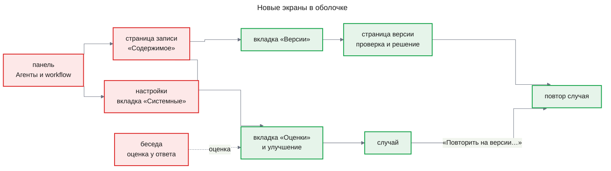
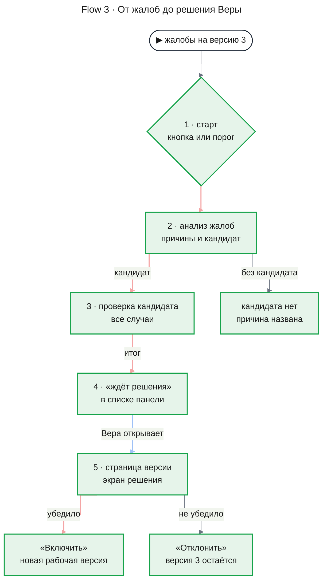

# UXRD: Улучшение записей по оценкам сотрудников (self-correction)

| Статус | Дата | PRD | Дизайны |
|---|---|---|---|
| Черновик | 2026-11-19 | [prd.md](./prd.md) | — |

## Snapshot

**Overview.** Под каждым ответом чата у сотрудника появляются кнопки «полезно» и «не полезно». Нажатие открывает маленькое окно: в нём можно написать, что не так, и видно, что ответ со всей работой над ним уйдёт администраторам и сколько дней будет храниться. Администратор открывает агента или workflow в панели и на вкладке «Оценки» читает жалобы по версиям, а открыв жалобу, видит вопрос, ответ и шаги всех агентов. На вкладке «Версии» он сохраняет правку кандидатом, проверяет её на прошлых случаях и получает итог числами, у каждого из которых видно, на скольких случаях оно держится. Улучшение по жалобам пишет кандидата само, а включает версию всегда администратор — на той же странице версии.

- **Не меняется**: беседа сотрудника, кроме кнопок оценки, — улучшение идёт в фоне. Редактор работает как раньше: «Сохранить» по-прежнему сразу делает версию рабочей.
- **Главный UX-риск**: администратор примет число на двух-трёх случаях или уверенный вердикт за доказательство. Защищают «{n} из {m}» у каждого числа, своя строка «не оценено» и ответы «было» и «стало» с причинами вердикта у каждого случая (KD-4).
- **Открытые вопросы**: нет.

### Key Decisions

| ID | Решение | Почему |
|---|---|---|
| KD-1 | Оценка — две кнопки в action bar ответа рядом с «Копировать». Любое нажатие открывает окно оценки: необязательный комментарий и строка о том, кто увидит ответ и сколько дней он хранится. Сохраняет только «Отправить». Нажатие на выбранную кнопку открывает окно с «Снять оценку». Решение меняет chat-shell UXRD, D-13: в action bar ответа теперь «Копировать» и оценка | Сотрудник видит, куда уходит ответ, до сохранения — и у лайка, и у дизлайка (FR-02). Одно окно на всё: оценить, заменить, снять |
| KD-2 | Всё об одном агенте или workflow — на его странице в панели, на вкладках со своими адресами: «Содержимое», «Оценки», «Версии». Случай, версия и повтор открываются страницами внутри записи | Администратор разбирает жалобы по записи и версии (FR-06, FR-07). Список, ссылки и уведомления ведут в одно место |
| KD-3 | Экран решения — это страница версии-кандидата. Свою правку (часть `eval`) и кандидата от анализа жалоб (часть `loop`) администратор проверяет и включает на одном экране: отличие от рабочей версии, итог проверки, ответы по случаям, «Включить» и «Отклонить». У кандидата от анализа сверху добавляется блок «Что нашёл анализ» | Экран учат один раз; часть `eval` уже даёт его целиком, а `loop` добавляет только блок анализа |
| KD-4 | Итог проверки — числа «{n} из {m}» по каждому исходу, случаи для анализа и контрольные в разных колонках. «Не оценено» — своя строка, вид без случаев назван словами. Общей отметки «прошло» и цвета итога нет. Контрольные случаи в списке под итогом свёрнуты в группу | Модель оценивает, решает человек: администратор видит основание каждого числа и не принимает шум за успех (FR-12, PRD Risks) |
| KD-5 | Включение и возврат версии спрашивают подтверждение: они меняют то, что получат все сотрудники. «Отклонить», проверка и улучшение диалога не спрашивают: права и предел расходов названы строкой у кнопки до нажатия | Подтверждение стоит там, где изменение доходит до людей. Деньги и права человек видит заранее, без лишнего шага |
| KD-6 | Слова интерфейса: «улучшение по жалобам» вместо цикла, «повтор» вместо прогона, «анализ жалоб» и «проверяющий агент» вместо анализатора и судьи, «для анализа» вместо «рабочий случай» — чтобы метка случая не читалась как статус версии «рабочая». «Случай», «кандидат», «контрольный» и «вердикт» остаются: их видит только администратор, и у каждого есть подсказка | Администратор читает панель словами задачи, а не устройством системы |

## Terms

Термины продукта — в PRD, раздел Terms; здесь — слова интерфейса.

- **Окно оценки** — окно у кнопки оценки: комментарий, строка о том, кто увидит ответ, «Отправить».
- **Страница записи в панели** — `/admin/library/<id>` с вкладками «Содержимое», «Оценки» и «Версии».
- **Страница версии** — одна версия агента или workflow: статус, отличие от рабочей версии, проверка на случаях. У кандидата это и экран решения.
- **Повтор** — так интерфейс называет прогон: тот же вход случая заново, на выбранной версии, с вердиктом.
- **Улучшение по жалобам** — так интерфейс называет цикл.
- **Анализ жалоб** и **проверяющий агент** — анализатор и судья в интерфейсе.

## Design System

Фича следует [дизайн-системе](../../design-system/README.md). Беседа — комфортная плотность, панель — компактная ([foundations → Spacing & Density](../../design-system/foundations.md#spacing--density)). Вопрос, ответ и комментарий в панели набраны Body в ширине прозы (chat-shell UXRD, D-01): их читают, а не сверяют по колонкам.

### Component Inventory

Перед решением «new» поиск шёл по `docs/design-system/components/`, `apps/web/src/components/` (`admin`, `library`, `agents`, `assistant-ui`, `ui`) и по экранам страницы агента (agent-platform UXRD, AV-01 — AV-06).

| Компонент | Спецификация | Статус | Примечание |
|---|---|---|---|
| Оценка ответа | [answer-rating.md](../../design-system/components/answer-rating.md) | new | В action bar есть только «Копировать»; кнопки оценки в коде скрыты и сохраняют без окна. Карточка решения — запрос в ленте, а не окно у кнопки |
| Работа над ответом | [answer-work.md](../../design-system/components/answer-work.md) | new | Страница агента показывает ленту одного агента, дерево агентов — запуски без шагов; дерева всех агентов одного ответа со стоимостью нет |
| Отличие версий | [version-diff.md](../../design-system/components/version-diff.md) | new | Определение записи показывает одну версию, а метка «изменено» не говорит, что именно изменилось |
| Итог проверки | [check-summary.md](../../design-system/components/check-summary.md) | new | Таблица данных сравнивает записи, а не числа исходов с основанием |
| Метка состояния | [state-badge.md](../../design-system/components/state-badge.md) | extended | Исходы случая, статусы версии, «идёт», «для анализа» и «контрольный» |
| Редактор записи | [record-editor.md](../../design-system/components/record-editor.md) | extended | «Сохранить кандидатом» в варианте «Системная» (EV-01) |
| Таблица данных, форма настроек | [data-table.md](../../design-system/components/data-table.md), [settings-form.md](../../design-system/components/settings-form.md) | reused | Списки панели; настройки библиотеки |
| Вызов инструмента, статус агента, подпись записи | [tool-call.md](../../design-system/components/tool-call.md), [agent-status.md](../../design-system/components/agent-status.md), [record-label.md](../../design-system/components/record-label.md) | reused | Внутри работы над ответом |
| Определение записи | [definition-view.md](../../design-system/components/definition-view.md) | reused | «Показать версию целиком» (EV-03) |
| Action bar ответа | chat-shell UXRD, TH-10 | extended | Кнопки оценки (RT-01; KD-1) |
| Раздел «Агенты и workflow» | custom-agents UXRD, AL-01 — AL-03 | extended | Колонка «Жалобы», метки улучшения, вкладки записи (FB-01, FB-02) |
| Экран «Запись не найдена» | enterprise-access UXRD, AD-15 | reused | Случай, версия или повтор не найдены |
| Окно, диалог, вкладки, меню, список, переключатель, скелетон, уведомления | shadcn `popover`, `alert-dialog`, `tabs`, `dropdown-menu`, `select`, `switch`, `skeleton`; chat-shell UXRD, TST-01 | reused | `popover` добавляется из shadcn без изменений; раскрытие — как «Дополнительно» в редакторе записи |

### Где новые экраны в оболочке

Сотрудник получает только кнопки у ответа. Всё остальное живёт на странице записи в панели.



## User Flows

Каждый экран ниже помечен частью поставки: `feedback`, `eval` или `loop` (PRD, Delivery Parts). Пример тот же, что в PRD: Борис ставит дизлайк ответу `deep-research`, Вера разбирает.

### Primary User Flow

**Flow 1. Жалоба доходит до администратора** · `feedback`. Implements: UC-1, UC-2, UC-3; AC-01.1, AC-02.1, AC-03.1, AC-04.1, AC-06.1, AC-19.1

Борис нажимает «не полезно» под ответом. Открывается окно оценки: он пишет «искал в логах не того сервиса» и видит строку о том, что ответ уйдёт администраторам на 30 дней (RT-02). «Отправить» сохраняет оценку, кнопка остаётся выбранной. Вера видит в панели число жалоб у `deep-research` (FB-01), на вкладке «Оценки» находит жалобу у версии и открывает случай со всей работой над ответом (FB-03, FB-04). Тот же случай есть и среди жалоб на `chat`.

```mermaid
---
title: "Flow 1 · Жалоба Бориса доходит до Веры"
config:
  theme: base
  look: classic
  themeVariables:
    primaryColor: "#eef1f5"
    primaryBorderColor: "#4b5563"
    primaryTextColor: "#1a1a1a"
    lineColor: "#6b7280"
  flowchart:
    curve: step
  themeCSS: |
    @keyframes lit_sf1{0%,18%{stroke:#991b1b;stroke-width:6px}20%,100%{stroke:#f4a5a5;stroke-width:2px}}
    @keyframes litr_sf1{0%,18%{stroke:#1d4ed8;stroke-width:6px}20%,100%{stroke:#9ec1f7;stroke-width:2px}}
---
flowchart LR
    entry(["▶ Борис получил ответ"])
    rate["1 · «не полезно»<br/>под ответом"]
    win["2 · окно оценки<br/>комментарий и срок"]
    sent["3 · кнопка выбрана<br/>случай сохранён"]
    list["4 · панель Веры<br/>колонка «Жалобы»"]
    tab["5 · вкладка «Оценки»<br/>по версиям"]
    kase["6 · случай<br/>работа над ответом"]
    cancel["«Отмена»<br/>ничего не сохранено"]
    undo["«Снять оценку»<br/>случай удалён"]
    entry --> rate
    rate e1@--> win
    win e2@-->|"«Отправить»"| sent
    sent e3@-->|"видит Вера"| list
    list e4@--> tab
    tab e5@--> kase
    win -->|"«Отмена»"| cancel
    sent -->|"нажал снова"| undo
    classDef entry fill:#ffffff,stroke:#1f2937,stroke-width:1.5px,color:#1a1a1a
    classDef changed fill:#fde8e8,stroke:#dc2626,stroke-width:2px,color:#1a1a1a
    classDef new fill:#e6f4ea,stroke:#16a34a,stroke-width:2px,color:#1a1a1a
    classDef w1 stroke:#f4a5a5,stroke-width:2px,animation:lit_sf1 6s linear 0s infinite
    classDef w2 stroke:#f4a5a5,stroke-width:2px,animation:lit_sf1 6s linear 1.2s infinite
    classDef r1 stroke:#9ec1f7,stroke-width:2px,animation:litr_sf1 6s linear 2.4s infinite
    classDef r2 stroke:#9ec1f7,stroke-width:2px,animation:litr_sf1 6s linear 3.6s infinite
    classDef r3 stroke:#9ec1f7,stroke-width:2px,animation:litr_sf1 6s linear 4.8s infinite
    class entry entry
    class rate,list changed
    class win,sent,tab,kase,cancel,undo new
    class e1 w1
    class e2 w2
    class e3 r1
    class e4 r2
    class e5 r3
```



Лайк идёт тем же путём, только окно спрашивает, что было полезно (UC-2). Другая кнопка у того же ответа снова открывает окно: «Отправить» заменяет прежнюю оценку и её случай (AC-01.2). Нажатие на выбранную кнопку открывает окно с «Снять оценку»: случай удаляется, и Вера его больше не видит (AC-19.1, RT-03).

### Alternative Flows

**Flow 2. Своя правка: кандидат, проверка, включение** · `eval`. Implements: UC-4, UC-6, UC-7; AC-07.1, AC-08.1, AC-09.1, AC-10.1, AC-12.1, AC-18.2, AC-20.1

Вера правит `deep-research` на вкладке «Содержимое» и нажимает «Сохранить кандидатом» (EV-01). Открывается страница новой версии: отличие от рабочей и строка о том, что проверка пойдёт с её правами и до какого предела расходов (EV-03). «Проверить на случаях» повторяет все случаи записи; итог встаёт на ту же страницу, под ним — список случаев (EV-04). Строка случая открывает повтор: было и стало, вердикт с причинами (EV-05). Если доказательства убеждают, Вера нажимает «Включить» и подтверждает (KD-5).

```mermaid
---
title: "Flow 2 · Вера проверяет свою правку"
config:
  theme: base
  look: classic
  themeVariables:
    primaryColor: "#eef1f5"
    primaryBorderColor: "#4b5563"
    primaryTextColor: "#1a1a1a"
    lineColor: "#6b7280"
  flowchart:
    curve: step
  themeCSS: |
    @keyframes lit_sf2{0%,22.5%{stroke:#991b1b;stroke-width:6px}25%,100%{stroke:#f4a5a5;stroke-width:2px}}
    @keyframes litr_sf2{0%,22.5%{stroke:#1d4ed8;stroke-width:6px}25%,100%{stroke:#9ec1f7;stroke-width:2px}}
---
flowchart LR
    entry(["▶ Вера правит deep-research"])
    edit["1 · редактор<br/>«Сохранить кандидатом»"]
    ver["2 · страница версии<br/>отличие от рабочей"]
    chk["3 · проверка<br/>итог числами"]
    rep["4 · повтор случая<br/>было и стало"]
    on["5 · «Включить»<br/>новая рабочая версия"]
    hist["вкладка «Версии»<br/>«Вернуть эту версию»"]
    entry --> edit
    edit e1@-->|"кандидат"| ver
    ver e2@-->|"«Проверить на случаях»"| chk
    chk e3@-->|"строка случая"| rep
    rep e4@-->|"к версии"| on
    on -.->|"стало хуже"| hist
    classDef entry fill:#ffffff,stroke:#1f2937,stroke-width:1.5px,color:#1a1a1a
    classDef changed fill:#fde8e8,stroke:#dc2626,stroke-width:2px,color:#1a1a1a
    classDef new fill:#e6f4ea,stroke:#16a34a,stroke-width:2px,color:#1a1a1a
    classDef w1 stroke:#f4a5a5,stroke-width:2px,animation:lit_sf2 4.8s linear 0s infinite
    classDef w2 stroke:#f4a5a5,stroke-width:2px,animation:lit_sf2 4.8s linear 1.2s infinite
    classDef r1 stroke:#9ec1f7,stroke-width:2px,animation:litr_sf2 4.8s linear 2.4s infinite
    classDef w3 stroke:#f4a5a5,stroke-width:2px,animation:lit_sf2 4.8s linear 3.6s infinite
    class entry entry
    class edit changed
    class ver,chk,rep,on,hist new
    class e1 w1
    class e2 w2
    class e3 r1
    class e4 w3
```



Пока кандидат не включён, новые беседы идут по рабочей версии; уведомление после сохранения так и говорит (AC-08.1). Неудачное включение исправляет «Вернуть эту версию» на странице прежней версии (EV-07). Отдельный случай можно повторить на любой версии прямо со страницы случая (EV-06).

**Flow 3. Улучшение по жалобам** · `loop`. Implements: UC-5, UC-6; AC-14.1, AC-15.1, AC-15.3, AC-17.1, AC-17.2, AC-17.3, AC-18.1, AC-18.2

Вера нажимает «Улучшить по жалобам» на вкладке «Оценки», или улучшение стартует само, когда жалоб набирается до порога (LP-01). Пока оно идёт, карточка улучшения показывает этап, а запись в списке — метку «улучшение идёт». Анализ жалоб называет причины и пишет кандидата, кандидат сразу проходит проверку. Запись в списке получает метку «ждёт решения», а карточка — «Открыть решение». Экран решения — страница версии-кандидата с блоком «Что нашёл анализ» (KD-3, LP-04).



Без решения Веры рабочая версия не меняется, какой бы ни была проверка (AC-18.1). Если причина не в содержимом записи, карточка улучшения называет её, и кандидата нет (AC-14.2).

### Error Flows

- **Оценка не отправилась** (AC-01.1). Окно остаётся открытым с ошибкой MC-2 над кнопками, комментарий на месте, «Отправить» повторяет.
- **Оценка не снялась** (AC-19.1). Ошибка MC-3 в окне; кнопка остаётся выбранной.
- **Случай не найден** (AC-05.1). Случай удалён по сроку или сотрудник снял оценку: ссылка открывает экран AD-15 с MC-8. В итогах проверок строка такого случая остаётся без ссылки (EV-04).
- **Включить нельзя** (AC-08.2). Рабочая версия сменилась после создания кандидата: «Включить» недоступна с причиной MC-13. Попытка в обход интерфейса — ошибка с той же причиной, рабочая версия прежняя.
- **Вторая проверка** (AC-12.3). Пока проверка записи идёт, «Проверить на случаях» недоступна с причиной MC-14 и ссылкой на идущую; попытка в обход — ошибка с той же причиной.
- **Предел расходов** (AC-13.1). Проверка останавливается, итог показывает пройденные, не оценённые и не стартовавшие случаи и сумму (EV-04). Улучшение, остановленное на анализе, — состояние карточки LP-02.
- **Вердикт не прочитан** (AC-10.2). Случай получает «не оценено» с причиной MC-14 и в число исправленных не входит.
- **Анализ не дал кандидата** (AC-14.2, AC-15.2, AC-15.3). Карточка улучшения называет причину словами MC-16 и показывает, что нашёл анализ.
- **Автозапуск выключился** (AC-17.4). Администратор, включивший автозапуск, потерял право — настройки показывают предупреждение MC-10 вместо строки «Включил».
- **Сотрудник открывает панель** (AC-06.2). Экран «Нет доступа» (enterprise-access UXRD, AD-02); случаев он не видит нигде.

Критерии без видимой поверхности: AC-08.3 (аудит записей), AC-09.4 (журнал токенов), AC-10.3, AC-11.1, AC-11.3, AC-16.1.

## Screens

### Screen 1: Оценка ответа в беседе · `feedback`

`▵` и `▿` — иконки `ThumbsUp` и `ThumbsDown`, `▲` и `▼` — те же иконки у выбранной оценки.

```
│ Вчера с 14:02 до 14:40 оплаты падали из-за таймаутов к          │
│ payments-gateway …                                               │
│ [⧉] [▵] [▿]                                                      │ RT-01
│          ┌ Что не так с ответом? ─────────────────────────┐      │ RT-02
│          │ Комментарий (необязательно)                    │      │
│          │ ┌────────────────────────────────────────────┐ │      │
│          │ │ искал в логах не того сервиса              │ │      │
│          │ └────────────────────────────────────────────┘ │      │
│          │ ⓘ Ответ и вся работа над ним уйдут             │      │
│          │   администраторам и будут храниться 30 дней.   │      │
│          │                       [ Отмена ] [ Отправить ] │      │
│          └────────────────────────────────────────────────┘      │
```

Выбранная оценка:

```
│ [⧉] [▵] [▼]                                                      │
│          ┌ Вы отметили ответ как неполезный ──────────────┐      │ RT-03
│          │ «искал в логах не того сервиса»                │      │
│          │ Администраторы видят ответ до 18 дек.          │      │
│          │                   [ Закрыть ] [ Снять оценку ] │      │
│          └────────────────────────────────────────────────┘      │
```

**RT-01. Кнопки оценки** — [оценка ответа](../../design-system/components/answer-rating.md) в action bar ответа (chat-shell UXRD, TH-10) после «Копировать»; правило видимости action bar прежнее. Кнопки есть у каждого ответа чата, генерация которого закончилась, кроме ответа с блоком ошибки (chat-shell UXRD, TH-08): оценивать там нечего. Сбой агента внутри ответа, например предел ходов, оценке не мешает. На странице агента (`/agents/<id>`) и у сообщений сотрудника кнопок нет. После перезагрузки выбранная оценка остаётся выбранной.

**RT-02. Окно оценки** — заголовок и подсказка поля по виду оценки (MC-2); строка о передаче называет срок хранения из настроек (AC-02.1). Если у ответа уже есть другая оценка, над кнопками стоит строка MC-2 о замене (AC-01.2). «Отправить» закрывает окно, кнопка становится выбранной, объявление MC-4.

**RT-03. Снять оценку** — окно выбранной кнопки: комментарий как написан или «Без комментария» и дата, до которой ответ хранится. «Снять оценку» удаляет случай без второго вопроса; кнопка теряет выбор, уведомление MC-3 (AC-19.1).

| Состояние | Что показано | AC |
|---|---|---|
| Ответ генерируется | Action bar скрыт, как сейчас | — |
| Отправляем, снимаем | «Отправить» или «Снять оценку» с индикатором, поле недоступно | — |
| Ошибка | Строка ошибки MC-2 или MC-3 в окне, введённое на месте | — |
| Срок хранения не загрузился | Вместо строки о передаче — MC-2 и «Повторить»; «Отправить» недоступна, пока срок не известен | AC-02.1 |

### Screen 2: Панель — список и страница записи · `feedback`, `eval`, `loop`

```
│ ◧  Агенты и workflow                                         [ + Создать ▾ ] │ AL-01
│  [ Системные ]  Открытые ролям  Запреты                                     │
│  Агент или workflow                       Вид       Видят           Жалобы Версия│ FB-01
│  chat  встроенная                         агент     все, у кого…        1     3│
│  deep-research  встроенная  ✋ ждёт решения workflow  ◎ SRE               4     3│
│  general-purpose  встроенная ⟳ улучшение идёт агент все сотрудники      2     4│
│  Анализ жалоб  встроенная                 агент     только администр…   —     1│
│
│ ◧ Агенты и workflow / deep-research  встроенная  ✋ ждёт решения   [Кто видит] ⋯ │ FB-02
│  Содержимое   [ Оценки · 4 ]   Версии                                         │
```

**FB-01. Колонка «Жалобы» и метки** (custom-agents UXRD, AL-01). В таблицах «Системные» и «Открытые ролям» — колонка «Жалобы»: число жалоб на рабочую версию, без жалоб — «—» (FR-06). Метки после имени — [метка состояния](../../design-system/components/state-badge.md): «улучшение идёт» и «ждёт решения», если у записи есть кандидат (`loop`, FR-18). Анализ жалоб и проверяющий агент стоят в «Системных» со «встроенная» и аудиторией MC-5; в библиотеке сотрудников их нет (FR-10, FR-14).

**FB-02. Вкладки страницы записи** (KD-2) — shadcn `tabs` под шапкой записи (AL-02, AL-03), у каждой вкладки свой адрес:

| Вкладка | Адрес | Что на ней | Часть |
|---|---|---|---|
| Содержимое | `/admin/library/<id>` | Редактор AL-02 или просмотр AL-03, как сейчас | — |
| Оценки · {N} | `…/<id>/feedback` | FB-03; число — жалобы на рабочую версию | `feedback` |
| Версии | `…/<id>/versions` | EV-02; только у агентов и workflow от компании | `eval` |

У агента сотрудника, открытого ролям, вкладок две: «Содержимое» и «Оценки». Версий и улучшения у него нет. Метки FB-01 повторяются в шапке записи. Уход с «Содержимого» с несохранёнными изменениями спрашивает подтверждение, как уход из редактора (custom-agents UXRD, MC-11).

### Screen 3: Вкладка «Оценки» · `feedback`, карточка улучшения · `loop`

```
│  Содержимое   [ Оценки · 4 ]   Версии                                    │
│ ┌ Улучшение по жалобам ─────────────────────────────────────────────────┐ │ LP-01
│ │ 4 жалобы на рабочую версию 3.                  [ Улучшить по жалобам ] │ │
│ │ Анализ прочтёт жалобы для анализа и напишет кандидата, кандидат сразу │ │
│ │ пройдёт проверку. С вашими правами, расход до 5 $ на вас.             │ │
│ │ Автозапуск включён: при 3 жалобах на версию улучшение начнётся само.  │ │
│ └───────────────────────────────────────────────────────────────────────┘ │
│ По версиям                                                                │ FB-03
│  Версия              Жалобы   Одобрения                                   │
│  3  ✓ рабочая             4           2                                   │
│  2                        1           3                                   │
│ Случаи  [ Все версии ▾ ]                                                  │
│  Оценка       Комментарий                    Сотрудник     Когда   Версия Случай│
│  ▿ жалоба     искал в логах не того сервиса  Борис Ким     14:20       3 для анализа│
│  ▵ одобрение  без комментария                Аня Смирнова  18 нояб.    3 контрольный│
```

**FB-03. Оценки** — две [таблицы данных](../../design-system/components/data-table.md) (AC-06.1):

- **«По версиям»** — версии с оценками, новые сверху: номер, у рабочей — метка «рабочая», числа жалоб и одобрений. Строка выбирает версию в списке случаев ниже.
- **«Случаи»** — строки-ссылки на страницу случая, новые сверху. Список «Все версии» или одна версия. Колонки: оценка (иконка и слово), комментарий одной строкой или «без комментария», сотрудник, когда, версия. С частью `eval` добавляется колонка «Случай» — метка «для анализа» или «контрольный» (FR-11). Жалоба Бориса стоит и здесь, и на вкладке «Оценки» записи `chat`, каждая со своей версией (AC-04.1).

| Состояние | Что показано | AC |
|---|---|---|
| Loading | Скелетоны обеих таблиц | — |
| Оценок нет | MC-7 вместо обеих таблиц | — |
| У выбранной версии нет оценок | Строка MC-7 в таблице «Случаи» | — |
| Ошибка | MC-7 и «Повторить», как в каркасе панели (enterprise-access UXRD, AD-01) | — |

**LP-01. Карточка улучшения** (`loop`) — блок `--card` с рамкой над таблицами, только у агентов и workflow от компании. «Улучшить по жалобам» (`outline` `sm`) запускает улучшение сразу; строка под ней заранее говорит, с чьими правами и до какого предела оно пойдёт (KD-5, AC-17.2). При включённом автозапуске — строка MC-16 о пороге.

**LP-02. Состояния карточки:**

| Состояние | Что показано | AC |
|---|---|---|
| Можно начать | Число жалоб для анализа на рабочую версию, кнопка, строка о правах и расходе | AC-17.3 |
| Нет жалоб для анализа | Кнопка недоступна с причиной MC-16 | — |
| Идёт | Метка «улучшение идёт» и этап: анализ жалоб; проверка кандидата {k} из {N}; ждёт конца идущей проверки. Строка, кто запустил: администратор или «запущено само» с порогом и правами того, кто включил автозапуск | AC-17.1, AC-17.2 |
| Кандидат готов | «Версия {N} ждёт решения» и «Открыть решение» — страница версии LP-04 | AC-15.1 |
| Без кандидата | Причина MC-16 и таблица «Что нашёл анализ», как в LP-04 | AC-14.2, AC-15.2, AC-15.3 |
| Остановлено на пределе | Предупреждение MC-16; если кандидат уже есть — «Открыть решение» с неполной проверкой | AC-13.1 |
| Сбой | MC-16 и «Улучшить снова» | — |

После включения или отклонения кандидата карточка возвращается в «Можно начать».

### Screen 4: Случай (`/admin/library/<id>/cases/<case>`) · `feedback`, повтор · `eval`

```
│ ◧ … / deep-research / Жалоба                           [ Повторить на версии ▾ ]│ FB-04
│ ▿ Жалоба · Борис Ким · 18 нояб., 14:20 · версия 3 · для анализа              │
│   Удалится 18 дек.                                                           │
│ Комментарий                                                                  │
│ «искал в логах не того сервиса»                                              │
│ Вопрос                                                                       │
│ почему вчера падали оплаты?                                                  │
│ Ответ                                                                        │
│ Вчера с 14:02 до 14:40 оплаты падали из-за таймаутов к payments-gateway …    │
│ ▸ Показать целиком                                                           │
│ Работа над ответом · 4 агента · 0,42 $                                       │
│ ⌬ chat · версия 3                                    ✓ Завершён      0,05 $  │
│   ⑂ deep-research · версия 3          ✕ Сбой: упёрся в предел ходов  0,30 $  │
│     ▸ Шаги · 14                                                              │
│     ⌬ Сбор логов · версия 4                          ✓ Завершён      0,04 $  │
│   ⌬ Личный агент сотрудника                          ✓ Завершён      0,03 $  │
│     Отчёт: «В Jira нет открытых тикетов по оплатам за вчера»                 │
```

**FB-04. Случай** — шапка с путём «Агенты и workflow / {запись} / Жалоба» или «Одобрение»; путь ведёт на вкладку «Оценки» той записи, из которой открыт случай. Под шапкой — оценка, сотрудник, время, версия записи на момент ответа, с частью `eval` — метка «для анализа» или «контрольный» с подсказкой MC-8 (FR-11), и дата удаления по сроку (FR-05).

- **Комментарий, вопрос, ответ** — Body в ширине прозы. Ответ свёрнут до шести строк с «Показать целиком», как длинный текст [определения записи](../../design-system/components/definition-view.md).
- **Работа над ответом** — [answer-work](../../design-system/components/answer-work.md), вариант «Случай»: все записи, которые работали над ответом, с версиями, шагами, причинами сбоев и стоимостью (AC-03.1, AC-03.2). Имя записи ведёт на её страницу в панели. Личный агент сотрудника — строка без имени с его отчётом (AC-04.2).
- **EV-06. «Повторить на версии…»** (`eval`) — меню версий этой записи: рабочая, кандидаты и прежние, у каждой — метка статуса. Выбор запускает повтор и открывает его страницу EV-05 (AC-09.1). Над меню — строка MC-15 о правах и о том, что изменения в системах не выполняются. У агента сотрудника, открытого ролям, кнопки нет.

| Состояние | Что показано | AC |
|---|---|---|
| Loading | Скелетон шапки, текста и строк работы | — |
| Не найден | Экран AD-15 с MC-8 и «К оценкам» | AC-05.1 |
| Ошибка | MC-8 и «Повторить» | — |

### Screen 5: Настройки библиотеки · `feedback`, `eval`, `loop`

```
│ Настройки                                                                │ FB-05
│ Новые агенты и workflow                                                  │
│   Лимит ходов для новой записи  [ 30 ]                                   │
│ Оценки ответов                                                           │
│   Срок хранения случаев  [ 7 ] дней                                      │
│   Сотрудник видит этот срок, когда ставит оценку.                        │
│   ⚠ Случаи старше 7 дней удалятся в течение суток.                       │
│ Проверка на случаях                                                      │ EV-08
│   Доля контрольных  [ 30 ] %        Предел расходов  [ 5 ] $             │
│   Повторов каждого случая  [ 1 ]                                         │
│ Улучшение по жалобам                                                     │ LP-05
│   Порог жалоб  [ 3 ]                                                     │
│   [●] Автозапуск                                                         │
│   Включила Вера Орлова · 19 нояб. Улучшения идут с её правами и расходом.│
│ [ Сохранить ]                                                            │
```

**FB-05. Форма «Настройки»** — существующая форма библиотеки во вкладке «Системные» ([форма настроек](../../design-system/components/settings-form.md), «Форма страницы»), теперь с группами. Одна кнопка «Сохранить» на все группы; группа появляется с частью, которая её вводит. Значения по умолчанию задаёт PRD, раздел «Настройки»; тексты — MC-10.

- **Оценки ответов** (`feedback`) — «Срок хранения случаев» в днях. Если новое значение меньше сохранённого, у поля стоит предупреждение MC-10 о том, что старые случаи удалятся в течение суток (AC-05.2). Сохранению оно не мешает.
- **EV-08. Проверка на случаях** (`eval`) — «Доля контрольных», «Предел расходов», «Повторов каждого случая». Подсказка доли говорит, что метки уже созданных случаев не меняются (AC-11.2).
- **LP-05. Улучшение по жалобам** (`loop`) — «Порог жалоб» и переключатель «Автозапуск», который сохраняется вместе с формой. Под включённым — кто включил и что улучшения идут с его правами и расходом (AC-17.2). Если этот администратор потерял право, переключатель выключен, а на месте строки стоит предупреждение MC-10 с его именем (AC-17.4).

Ошибки полей и сервера — как в форме настроек; тексты MC-10.

### Screen 6: Вкладка «Версии» и «Сохранить кандидатом» · `eval`

```
│  Содержимое   Оценки · 4   [ Версии ]                                    │
│  Версия                      Сохранил         Когда            Проверка   │ EV-02
│  5  ✋ кандидат               анализ жалоб     19 нояб., 14:20  19 нояб.   │
│     от версии 3                                                           │
│  4  ⊖ отклонён               Вера Орлова      19 нояб., 11:02  —          │
│     от версии 3                                                           │
│  3  ✓ рабочая                Вера Орлова      12 нояб., 10:15  ⟳ идёт     │
│  2                           Вера Орлова      5 нояб., 16:40   —          │
```

Панель сохранения на «Содержимом» у агента или workflow от компании:

```
│ ● Есть несохранённые изменения  [Отменить изменения] [Сохранить кандидатом] [Сохранить]│ EV-01
```

**EV-01. «Сохранить кандидатом»** — вторая кнопка панели сохранения [редактора записи](../../design-system/components/record-editor.md), вариант «Системная» (FR-08). Новая запись её не получает: у неё ещё нет рабочей версии. После сохранения открывается страница новой версии EV-03, а уведомление MC-11 говорит, что в чатах работает прежняя версия (AC-08.1). «Сохранить» работает как раньше и делает версию рабочей сразу.

**EV-02. Версии** — [таблица данных](../../design-system/components/data-table.md), строки-ссылки на страницу версии, новые сверху (AC-07.1). Колонки: номер с меткой статуса («рабочая», «кандидат», «отклонён»; у прежней — без метки), второй строкой — «от версии {N}» у кандидата или «возвращена {дата} · {кто}» после возврата; кто сохранил (у кандидата от анализа — «анализ жалоб»); когда; дата последней проверки, «идёт» или «—». Список не бывает пустым: у записи всегда есть рабочая версия.

| Состояние | Что показано | AC |
|---|---|---|
| Loading, ошибка | Как в каркасе панели | — |

### Screen 7: Страница версии и экран решения (`/admin/library/<id>/versions/<N>`) · `eval`, блок анализа · `loop`

Кандидат от анализа жалоб после проверки — экран решения:

```
│ ◧ … / deep-research / Версия 5                       [ Отклонить ] [ Включить ]│ EV-03
│ ✋ кандидат · от версии 3 · анализ жалоб · 19 нояб., 14:20                     │
│ ┌ Что нашёл анализ · улучшение стоило 1,84 $ ─────────────────────────────┐  │ LP-04
│ │ Жалоба                           Где ошибка        Причина              │  │
│ │ искал в логах не того сервиса    deep-research     неверный источник…   │  │
│ │ ответ оборвался на середине      deep-research     упёрся в предел ходов│  │
│ │ не нашёл тикет INC-412           general-purpose   неверно понял вопрос │  │
│ │ ⓘ Причина в «general-purpose» — кандидата для него нет.                 │  │
│ │ Что поменял: правила координатора — брать сервис из вопроса;            │  │
│ │ максимум шагов координатора 30 → 40. Должно исправить: 2 жалобы.        │  │
│ └─────────────────────────────────────────────────────────────────────────┘  │
│ Отличие от рабочей версии 3                        [ Показать версию целиком ]│
│  Без изменений: Описание, Команда, Кто пишет ответ                           │
│  Как работает команда                                                        │
│   − Сначала позови «Сбор логов» по gateway.                                  │
│   + Сначала позови «Сбор логов» по сервису из вопроса.                       │
│  Максимум шагов координатора   30 → 40                                       │
│ Проверка на случаях · 19 нояб., 14:31 · 3,10 $ из 5 $      [ Проверить снова ]│ EV-04
│                            Для анализа   Контрольные                         │
│  Жалобы     ✓ исправлено   3 из 4        1 из 2                              │
│             ✕ осталось     1 из 4        1 из 2                              │
│             ? не оценено   0 из 4        0 из 2                              │
│  Одобрения  ✓ сохранилось  2 из 2        нет случаев                         │
│             ✕ сломалось    0 из 2        нет случаев                         │
│             ? не оценено   0 из 2        нет случаев                         │
│  Для анализа · 6                                                             │
│   Случай                       Итог           Почему                  Стоимость│
│   ▿ искал в логах не того…     ✓ исправлено   ищет в логах payments…   0,31 $ │
│   ▵ без комментария            ✓ сохранилось  нашёл тот же тикет…      0,22 $ │
│  ▸ Контрольные · 2                                                           │
```

**EV-03. Страница версии.** Шапка — «Версия {N}», под ней метка статуса, от какой версии сделан кандидат, кто и когда сохранил. Действия зависят от статуса:

| Статус | Действия в шапке | Отличие показано от |
|---|---|---|
| Рабочая | — | — («Это рабочая версия») |
| Кандидат | «Отклонить» (`outline`), «Включить» | рабочей версии |
| Прежняя | «Вернуть эту версию» (`outline`) | рабочей версии: что изменит возврат |
| Отклонён | — | рабочей версии |

- **Отличие** — [отличие версий](../../design-system/components/version-diff.md) от рабочей версии (AC-07.1). «Показать версию целиком» меняет его на [определение записи](../../design-system/components/definition-view.md), вариант «На странице», и обратно.
- **Основная кнопка одна** (foundations, акцент): пока у версии нет проверки, основная — «Проверить на случаях», а «Включить» — `outline`; после проверки основной становится «Включить».
- **Включить** — `alert-dialog` MC-13 (KD-5). После подтверждения версия получает «рабочая», уведомление MC-13; прежняя рабочая становится прежней. Новые беседы идут по новой версии (`custom-agents` FR-13).
- **Конфликт** (AC-08.2). Если рабочая версия сменилась после создания кандидата, «Включить» недоступна (`aria-disabled`) и над отличием стоит предупреждение MC-13 с обеими версиями.
- **Отклонить** — без диалога: метка «отклонён», уведомление MC-13; версия остаётся в истории.

**EV-07. Вернуть эту версию** (FR-20) — `alert-dialog` MC-13 с номером версии. После подтверждения версия снова «рабочая», в «Версиях» у неё строка «возвращена {дата} · {кто}», уведомление MC-13 (AC-20.1).

**EV-04. Проверка на случаях** — секция под отличием. До первой проверки в ней строка MC-14 о числе случаев, правах и пределе расходов и кнопка «Проверить на случаях». Итог — [итог проверки](../../design-system/components/check-summary.md) (KD-4; AC-12.1, AC-12.2). Под ним — случаи двумя таблицами данных: «Для анализа · {N}» раскрыта, «Контрольные · {N}» свёрнута раскрытием, как «Дополнительно» в редакторе записи. Колонки: случай (иконка оценки и комментарий), итог — метка исхода, «почему» — начало причины вердикта, стоимость. Строка ведёт на повтор EV-05 (AC-18.2). Случай, которого больше нет — удалён по сроку или сотрудник снял оценку (FR-05, FR-19), — строка MC-14 без ссылки; числа итога его учитывают. Показан итог последней проверки версии; «Проверить снова» запускает новую.

| Состояние | Что показано | AC |
|---|---|---|
| Проверки не было | Строка MC-14 и «Проверить на случаях» | — |
| Случаев нет | Кнопка недоступна с причиной MC-14 | — |
| Идёт | Итог проверки, состояние «Идёт»: сколько случаев пройдено и сколько потрачено; строки таблиц получают итоги по мере вердиктов, у ждущих — «ждёт» | — |
| Идёт другая проверка записи | Кнопка недоступна с причиной MC-14 и ссылкой на ту версию | AC-12.3 |
| Остановлена на пределе | Итог проверки, состояние «Частично»; не стартовавшие случаи — строки с «не стартовал» | AC-13.1 |
| Не оценено | Метка «не оценено», в «почему» — причина MC-14 | AC-10.2 |
| Готово | Итог и таблицы | AC-12.1, AC-12.2 |

**LP-04. Блок «Что нашёл анализ»** (`loop`) — только у кандидата от анализа жалоб, над отличием. Таблица данных: жалоба (комментарий), где ошибка ([подпись записи](../../design-system/components/record-label.md), вариант «Строка»), причина — слово из закрытого списка MC-17 (AC-14.1). Строка ведёт на случай. Под таблицей — запись, в которой анализ нашёл ошибку, но кандидата для неё нет (MC-17, AC-15.3); объяснение правки и сколько жалоб она должна исправить (AC-15.1); стоимость улучшения в заголовке блока. Неполная проверка из-за предела — состояние «Частично» итога проверки.

Экран без решения ничего не меняет: рабочая версия прежняя, пока Вера не нажала «Включить» (AC-18.1).

| Состояние | Что показано | AC |
|---|---|---|
| Loading | Скелетон шапки, отличия и итога | — |
| Не найдена | Экран AD-15 с MC-13 и «К версиям» | — |

### Screen 8: Повтор случая (`/admin/library/<id>/repeats/<repeat>`) · `eval`

Десктоп ≥ 1280 px — «было» и «стало» в две колонки:

```
│ ◧ … / deep-research / Версия 5 / Повтор                                         │ EV-05
│ Повтор жалобы на версии 5 · 19 нояб., 14:24 · 0,31 $              ✓ исправлено   │
│ ▿ Борис Ким: «искал в логах не того сервиса» · для анализа     Открыть случай → │
│ Вердикт                                                                         │
│ Жалоба не осталась: новый ответ ищет ошибки в логах payments-gateway, о котором │
│ спрашивал сотрудник, и называет время начала сбоя.                              │
│ ⊖ Без права у вас: Jira — вызовов не было                                       │
│ ⊖ Не стартовал: личный агент сотрудника                                         │
│ ┌ Было · версия 3 ─────────────────────┐ ┌ Стало · версия 5 ──────────────────┐ │
│ │ Ответ                                │ │ Ответ                              │ │
│ │ Вчера с 14:02 до 14:40 …             │ │ Вчера с 14:02 оплаты падали …      │ │
│ │ Работа над ответом · 0,42 $          │ │ Работа над ответом · 0,31 $        │ │
│ │ ⌬ chat · версия 3   ✓ Завершён       │ │ ⑂ deep-research · версия 5 ✓       │ │
│ │ …                                    │ │  ⊘ Создать заметку · incidents     │ │
│ │                                      │ │    В повторе изменения не выполн…  │ │
│ └──────────────────────────────────────┘ └────────────────────────────────────┘ │
```

**EV-05. Повтор** — шапка: на какой версии, когда, стоимость и метка итога случая. Под ней ссылка на случай и блок «Вердикт» — ответ проверяющего агента словами, Body (AC-10.1). Выпавшие системы и записи, которые администратор не может запустить, — строки MC-9 до колонок (AC-09.2, AC-09.5).

- **Было** — ответ и работа над ответом из случая; **стало** — новый ответ и [работа над ответом](../../design-system/components/answer-work.md), вариант «Повтор» (AC-09.1). Повтор начинается с записи, на версии которой он идёт; вход — как в FR-09.
- **Изменяющие действия** — блок вызова с исходом «Отказано» и причиной MC-9: видно, что агент пытался сделать (AC-09.3).
- **Повторы** (FR-21). При «Повторов каждого случая» больше одного у «стало» — вкладки «Повтор 1 · {итог}», «Повтор 2 · {итог}»; при разных итогах метка итога — «расхождение», а вердикт перечисляет итоги повторов (AC-21.1).

| Состояние | Что показано | AC |
|---|---|---|
| Идёт | В «стало» работа над ответом растёт вживую; вердикт — «Ждём вердикт» с вращающейся иконкой | — |
| Ждёт вердикт | Ответ готов, вердикта ещё нет | — |
| Не оценено | Метка «не оценено», в блоке «Вердикт» — причина MC-14 | AC-10.2 |
| Повтор не удался | Работа над ответом со сбоем, итог «не оценено» | — |
| Не найден | Экран AD-15 с MC-15 | — |

## Accessibility

- **Целевой уровень**: WCAG 2.1 AA — PRD NFR-07: оценка в чате — на уровне chat-shell PRD NFR-18 и с 360 px (NFR-22), панель — как остальная панель (enterprise-access PRD NFR-05). Роли, имена и клавиатура компонентов — в их спецификациях.
- **Заголовки**: `h1` — имя записи на её вкладках, «Жалоба» или «Одобрение» на случае, «Версия {N}», «Повтор жалобы на версии {N}» или «Повтор одобрения на версии {N}». Заголовок вкладки браузера — MC-6.

| Событие | Куда фокус |
|---|---|
| Нажатие кнопки оценки | Поле комментария у «не полезно», «Отправить» у «полезно»; в окне выбранной оценки — «Закрыть» |
| «Отправить», «Отмена», Esc, «Снять оценку» | Кнопка оценки, которая открыла окно |
| Вкладка записи, случай, версия, повтор | `h1` |
| «Сохранить кандидатом» | `h1` страницы новой версии |
| «Проверить на случаях», «Улучшить по жалобам» | Строка состояния проверки или карточки, которая встаёт на место кнопки |
| «Повторить на версии…» | `h1` страницы повтора |
| «Включить», «Вернуть эту версию» после подтверждения | Метка статуса версии; отмена диалога — кнопка, которая его открыла |
| «Отклонить» | Метка статуса версии |
| Ошибка формы, ошибка в окне оценки | Блок ошибки |

**Объявления** — вежливые (`polite`), тексты MC-4 (беседа) и MC-18 (панель): оценка отправлена, оценка снята, кандидат сохранён, проверка закончена, повтор закончен, версия включена, улучшение запущено, кандидат готов. Ход проверки по случаям не объявляется. Ошибки — `alert`.

## Responsive Behavior

| Брейкпоинт | Ширина | Экран | Что меняется |
|---|---|---|---|
| Mobile | < 480 px | Окно оценки | Ширина экрана минус 32 px; кнопки окна во всю ширину столбцом |
| Mobile | < 768 px | Страница записи | Вкладки прокручиваются в своей строке; кнопки шапки версии уходят в меню «⋯», «Улучшить по жалобам» остаётся в карточке |
| Mobile | < 768 px | Панель сохранения | «Кандидатом» вместо «Сохранить кандидатом», «Отменить правки» вместо «Отменить изменения» |
| Tablet | < 1280 px | Повтор | «Было» и «Стало» — вкладки (shadcn `tabs`), выбрана «Стало» |
| Desktop | ≥ 1280 px | Повтор | Две колонки, каждая со своей прокруткой работы над ответом |
| Все | — | Таблицы панели, итог проверки | Как в таблице данных: узкая область прокручивает таблицу внутри блока |

На 360 px нет горизонтальной прокрутки страницы; цели касания при грубом указателе — 44 px, кроме кнопок action bar (chat-shell UXRD, TH-10).

## Content and Microcopy

Тон и знаки — как в chat-shell UXRD, Content and Microcopy. Сотрудник видит «администраторы» и «ответ», а не «случай». Деньги — «0,42 $», числа — табличные цифры. `{дней}` склоняется: «1 день», «2 дня», «5 дней»; так же `{жалоб}` и `{случаев}`. Имена агентов, систем и тексты сотрудников и анализа не переводятся. `{вид}` — «агент» или «workflow».

| ID | Где | Текст | Примечание |
|---|---|---|---|
| MC-1 | Кнопки оценки (RT-01) | «Полезный ответ», «Неполезный ответ»; у выбранной — описание «Вы отметили: полезный ответ», «Вы отметили: неполезный ответ» | Подсказка и доступное имя |
| MC-2 | Окно оценки (RT-02) | Заголовок «Что не так с ответом?» / «Что было полезно?»; «Комментарий (необязательно)»; плейсхолдер «Например: искал в логах не того сервиса» / «Например: сразу нашёл нужный тикет»; «Ответ и вся работа над ним уйдут администраторам и будут храниться {N} {дней}.»; замена — «Прежняя оценка заменится этой.»; «Отмена», «Отправить», «Отправляем…»; «Не удалось отправить: {причина}», «Не удалось отправить: нет связи с сервером»; «Не удалось узнать срок хранения» + «Повторить» | — |
| MC-3 | Снять оценку (RT-03) | «Вы отметили ответ как неполезный» / «… как полезный»; «Без комментария»; «Администраторы видят ответ до {дата}.»; «Закрыть», «Снять оценку», «Снимаем…»; уведомление «Оценка снята — администраторы больше не видят ответ»; «Не удалось снять оценку: {причина}» | — |
| MC-4 | Беседа — объявления | «Оценка отправлена»; «Оценка снята» | — |
| MC-5 | Список раздела (FB-01) | Колонка «Жалобы»; метки «улучшение идёт», «ждёт решения»; аудитория «только администраторы» | — |
| MC-6 | Вкладки записи (FB-02) | «Содержимое», «Оценки · {N}», «Версии»; вкладка браузера «{имя} — {вкладка} — Панель — Agent OS»; случай — «Жалоба — {имя} — Панель — Agent OS», версия — «Версия {N} — {имя} — Панель — Agent OS» | — |
| MC-7 | Оценки (FB-03) | «По версиям», «Версия», «Жалобы», «Одобрения», «рабочая»; «Случаи», «Все версии», «Версия {N}»; «Оценка», «Комментарий», «Сотрудник», «Когда», «Случай»; «жалоба», «одобрение», «без комментария»; «Оценок пока нет» / «Когда сотрудники оценят ответы, над которыми работал {вид}, они появятся здесь.»; «У версии {N} оценок нет»; «Не удалось загрузить оценки» + «Повторить» | — |
| MC-8 | Случай (FB-04) | «Жалоба», «Одобрение»; «{сотрудник} · {когда} · версия {N}»; «Удалится {дата}»; «для анализа», «контрольный»; подсказка «Контрольный случай: анализ жалоб его не видит — на нём проверка показывает, не подогнана ли правка»; «Случай для анализа: анализ жалоб его читает»; «Комментарий», «Вопрос», «Ответ», «Показать целиком», «Свернуть»; «Случай не найден» / «Его удалили по сроку хранения, сотрудник снял оценку, или ссылка неверна.» / «К оценкам»; «Не удалось загрузить случай» + «Повторить» | — |
| MC-9 | Работа над ответом | «Работа над ответом · {N} {агентов} · {сумма}»; «Шаги · {N}», «Шагов нет», «Отчёт»; «Личный агент сотрудника», подсказка «Что внутри, видит только сотрудник»; повтор: «Без права у вас: {системы} — вызовов не было»; «Не стартовал: {имя} — вы не можете его запустить», для личного — «Не стартовал: личный агент сотрудника»; причина отказа изменения «В повторе изменения в системах не выполняются — показано, что агент пытался сделать» | Причины сбоев агентов — agent-platform UXRD, MC-14 |
| MC-10 | Настройки (FB-05, EV-08, LP-05) | «Настройки»; группы «Новые агенты и workflow», «Оценки ответов», «Проверка на случаях», «Улучшение по жалобам»; «Срок хранения случаев», «дней», «Сотрудник видит этот срок, когда ставит оценку.», предупреждение «Случаи старше {N} {дней} удалятся в течение суток»; «Доля контрольных», «%», «Столько новых случаев анализ жалоб не увидит. Метки уже созданных случаев не меняются.»; «Предел расходов», «$», «Проверка или улучшение останавливается, когда расход доходит до этой суммы.»; «Повторов каждого случая», «Больше повторов — видно, где ответ нестабилен; расход растёт во столько же раз.»; «Порог жалоб», «Столько жалоб для анализа на рабочую версию запускают улучшение, если включён автозапуск.»; «Автозапуск»; «Включил {кто} · {дата}. Улучшения идут с его правами и расходом.» / «Включила …» по имени; «Автозапуск выключен: {кто} больше не может его вести — нет права администратора или учётная запись заблокирована. Включите снова, чтобы улучшения шли с вашими правами.»; ошибки «Нужно целое число от 1», «Нужно число от 0 до 100», «Нужно число больше 0»; «Сохранить», «Настройки сохранены»; «Не удалось сохранить: {причина}» | Поле «Лимит ходов для новой записи» — как сейчас |
| MC-11 | «Сохранить кандидатом» (EV-01) | «Сохранить кандидатом», на телефоне «Кандидатом»; уведомление «Кандидат сохранён: версия {N}. В чатах по-прежнему версия {M}.» | Ошибки — custom-agents UXRD, MC-8, MC-10 |
| MC-12 | Версии (EV-02) | «Версия», «Сохранил», «Когда», «Проверка»; «рабочая», «кандидат», «отклонён»; «от версии {N}»; «возвращена {дата} · {кто}»; «анализ жалоб»; «идёт»; «Не удалось загрузить версии» + «Повторить» | — |
| MC-13 | Страница версии (EV-03, EV-07) | «Версия {N}»; «{статус} · от версии {N} · {кто} · {когда}»; «Это рабочая версия»; «Отличие от рабочей версии {N}», «Показать версию целиком», «Показать отличия»; отличие версий — «Без изменений: {поля}», «ещё {N} строк без изменений», «Совпадает с версией {N}», скрытые «убрано:», «добавлено:»; «Включить», «Отклонить», «Вернуть эту версию»; конфликт — «Кандидат сделан от версии {N}, а рабочая уже версия {M} — включить его нельзя. Внесите правку заново в редакторе.»; диалог «Включить версию {N}?» / «Новые беседы пойдут по версии {N}. Беседы, которые уже идут, доработают на прежней.» / «Включить», «Отмена»; диалог «Вернуть версию {N}?» / тот же текст / «Вернуть», «Отмена»; «Версия {N} включена», «Версия {N} снова рабочая», «Кандидат отклонён»; «Не удалось включить: рабочая версия уже {M}»; «Не удалось {действие}: {причина}»; «Версия не найдена» + «К версиям» | — |
| MC-14 | Проверка (EV-04) | «Проверка на случаях»; «Проверить на случаях», «Проверить снова»; «Проверка повторит {N} {случаев} этой записи на версии {V} — с вашими правами, расход до {предел} на вас. Изменения в системах не выполняются.»; «Случаев нет — проверять не на чем»; «Проверка этой записи уже идёт — на версии {V}» + «Открыть»; итог проверки — шапка «Проверка на случаях · {когда} · {потрачено} из {предел}», колонки «Для анализа», «Контрольные», группы «Жалобы», «Одобрения», исходы «исправлено», «осталось», «сохранилось», «сломалось», «расхождение», «не оценено», «не стартовал», ячейка «{n} из {m}», «нет случаев», «Одобрений нет — проверки на одобрениях не было», «Жалоб нет — проверки на жалобах не было», ход «Пройдено {k} из {N} · {потрачено}», предупреждение «Остановлена на пределе {предел}: прошли {k} из {N}, не стартовали {r}», подпись таблицы «Итог проверки»; списки «Для анализа · {N}», «Контрольные · {N}»; «Случай», «Итог», «Почему», «Стоимость»; «ждёт»; «Случай удалён» с подсказкой «Удалён по сроку хранения или сотрудник снял оценку»; причины «не оценено»: «Вердикт не удалось прочитать», «Проверяющий агент не ответил», «Не дошла очередь: расход дошёл до предела», «Повтор не удался: {причина}» | — |
| MC-15 | Повтор (EV-05, EV-06) | «Повторить на версии…»; пункты «Версия {N} · рабочая», «Версия {N} · кандидат», «Версия {N}»; «Повтор пойдёт с вашими правами и на ваш расход. Изменения в системах не выполняются.»; «Повтор жалобы на версии {N}», «Повтор одобрения на версии {N}»; «{когда} · {сумма}»; «Открыть случай»; «Вердикт», «Ждём вердикт»; «Было · версия {N}», «Стало · версия {N}»; «Повтор {i} · {итог}»; «Итоги повторов: {итог} — {k}, {итог} — {m}»; «Повтор не найден» + «К версии» | — |
| MC-16 | Карточка улучшения (LP-01, LP-02) | «Улучшение по жалобам»; «{N} {жалоб} на рабочую версию {V}.»; «Улучшить по жалобам»; «Анализ прочтёт жалобы для анализа и напишет кандидата, кандидат сразу пройдёт проверку. С вашими правами, расход до {предел} на вас.»; «Автозапуск включён: при {порог} {жалобах} на версию улучшение начнётся само.»; «Нет жалоб для анализа на версию {V}»; «Улучшение уже идёт»; этапы «Анализ жалоб…», «Проверка кандидата: {k} из {N}», «Ждёт конца идущей проверки»; «Запустил {кто} · {когда}», «Запущено само: {N} {жалоб} на версию {V} · с правами {кто}»; «Версия {N} ждёт решения» + «Открыть решение»; «Причина не в содержимом {вида} — кандидата нет.»; «Анализ предложил сменить модель или системы — это делает только администратор в своём кандидате. Кандидата нет.»; «Остановлено на пределе расходов {предел}: {этап}»; «Улучшение не удалось: {причина}» + «Улучшить снова» | — |
| MC-17 | Что нашёл анализ (LP-02, LP-04) | «Что нашёл анализ · улучшение стоило {сумма}»; «Жалоба», «Где ошибка», «Причина»; причины — «неверный источник или инструмент», «остановился раньше времени», «неверно понял вопрос», «упёрся в предел ходов», «ошибка инструмента или модели», «другое»; «Причина в «{имя}» — кандидата для него нет: улучшение пишет кандидата только для «{имя}».»; «Что поменял: {объяснение}»; «Должно исправить: {N} {жалоб}» | Закрытый список — PRD FR-14 |
| MC-18 | Панель — объявления | «Кандидат сохранён: версия {N}»; «Проверка закончена»; «Повтор закончен»; «Версия {N} включена»; «Улучшение запущено»; «Кандидат готов — ждёт решения» | Только пока администратор на этой странице |

## Undetermined Items

Нет: UX-вопросов не осталось.

## Update History

| Версия | Дата | Изменение |
|---------|------|--------|
| 1.0 | 2026-11-19 | Первая версия |
