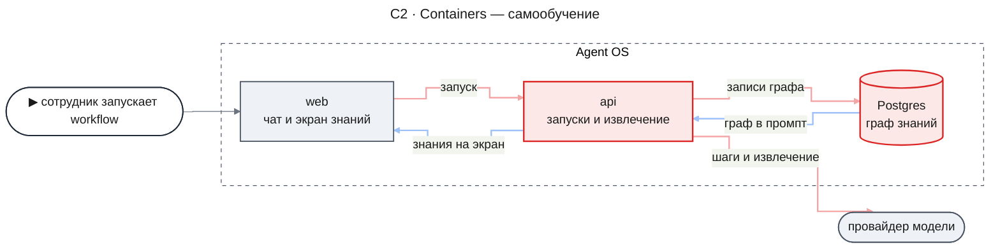
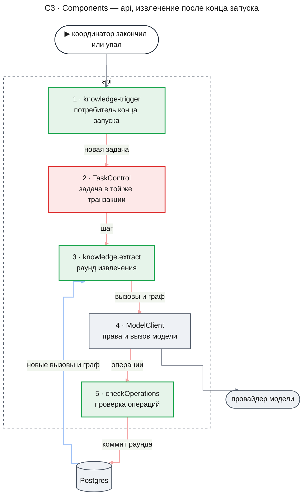
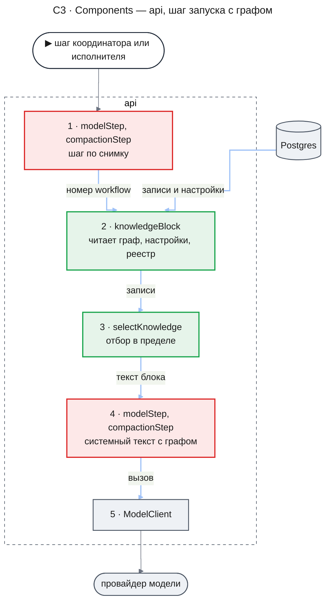
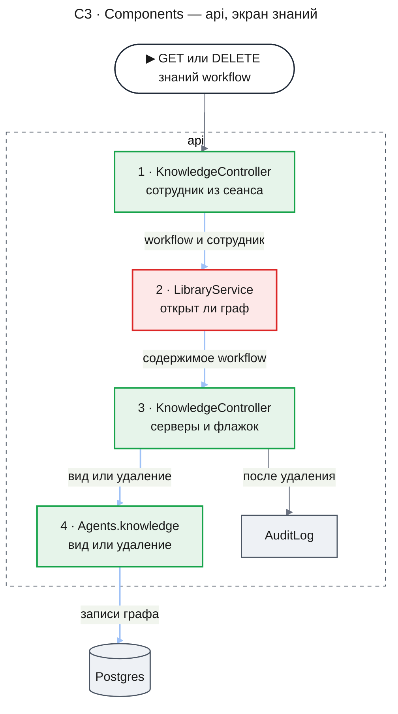
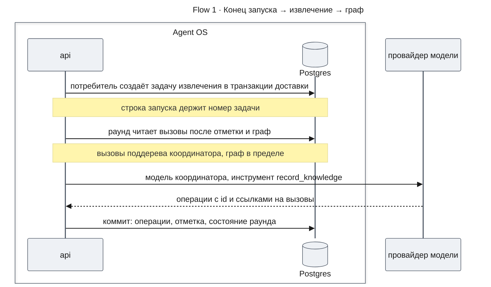
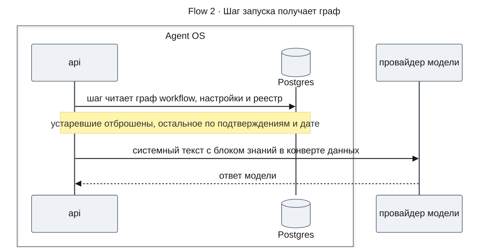
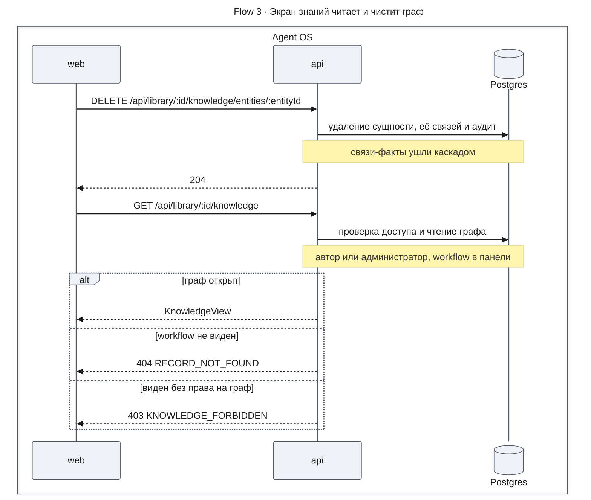
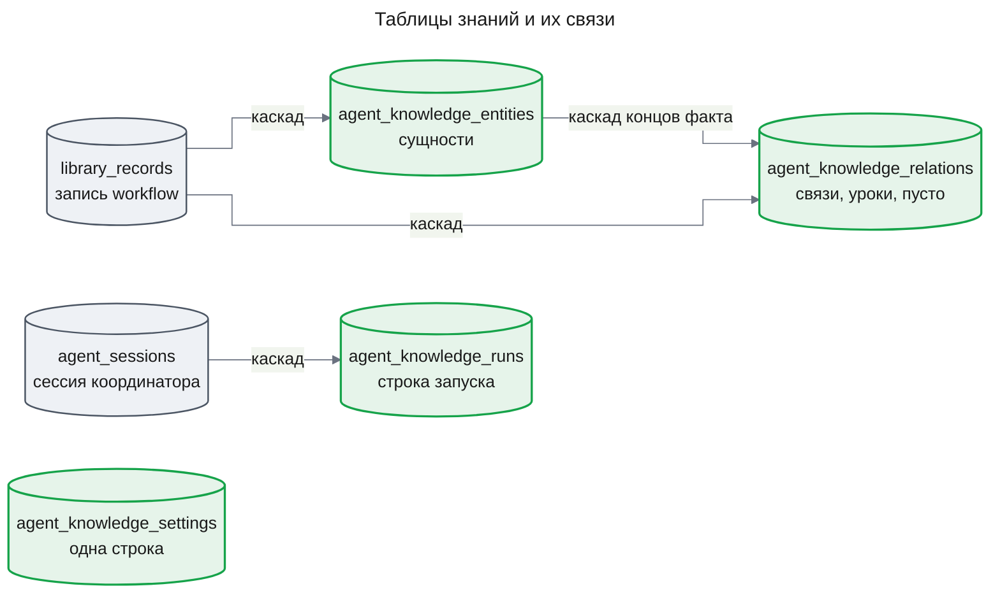
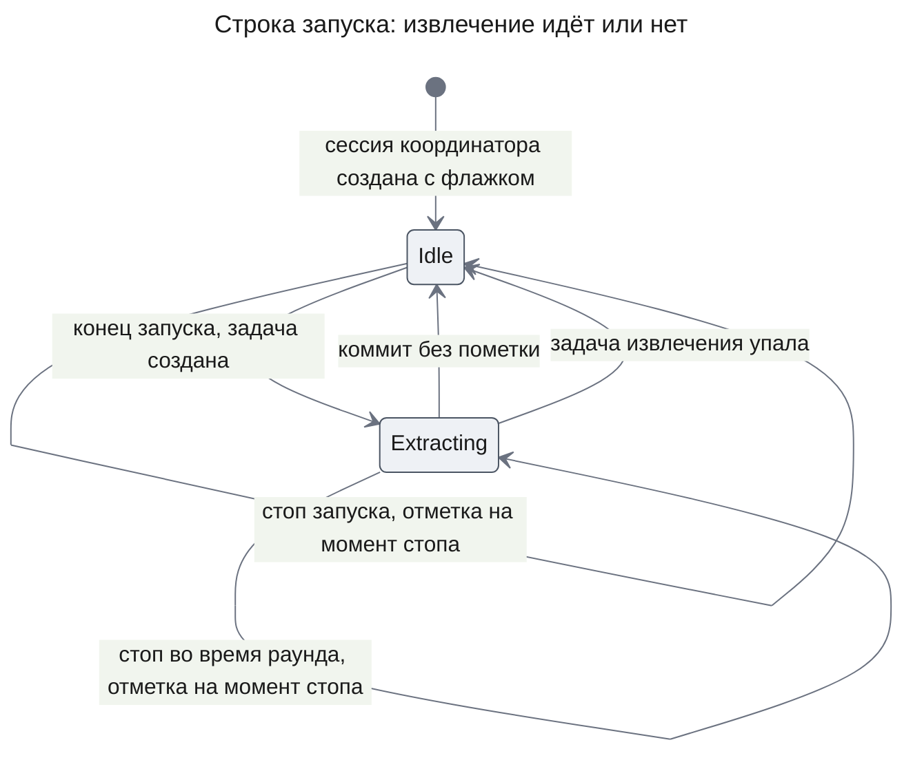

# Самообучение workflow — Design Document — core

**Status:** На утверждении · **Date:** 2026-11-19 · **PRD:** [prd.md](./prd.md) · **UXRD:** [uxrd.md](./uxrd.md) · **Depends on:** ничего — первая часть

## Snapshot

**Overview.** Сегодня каждый запуск workflow начинает с нуля. Эта часть даёт workflow флажок «Самообучение» и граф знаний в Postgres. Когда запуск с флажком заканчивается или падает, платформа ставит отдельную задачу извлечения: модель координатора читает вызовы инструментов этого запуска и действующий граф и возвращает операции — добавить, подтвердить, пометить устаревшим. Код проверяет каждую операцию, вычищает известные секреты и применяет её по id. Каждый шаг координатора и исполнителей читает граф заново и получает его в системном тексте как данные, не больше предела из настроек. Экран знаний (часть `web`) читает и чистит граф через API этой части.

- **Не меняется**: права на инструменты и модели и их проверка перед каждым вызовом; снимок запуска и правило «правка записи не трогает идущий запуск»; сам запуск — извлечение не меняет его состояние и не задерживает ответ.
- **Главный риск**: неверное или подброшенное знание закрепляется и уходит в запуски всех сотрудников; защита — граф в конверте данных, подтверждение только ссылкой на вызов этого запуска, удаление автором ([Risks](#risks-and-mitigation)).
- **Открытые вопросы**: нет.

### Key Decisions

#### KD-1: Знания принадлежат пакету `agents`: граф, строки запусков и настройки — его таблицы `agent_knowledge_*`; `apps/api` открывает их маршрутами через операции `Agents.knowledge`

Всё, что делает граф, живёт в `agents`: вызовы инструментов запуска (таблицы `agent_tool_calls` и `agent_code_calls`), вызов модели (`ModelClient`), шаг агента, который кладёт граф в промпт, и реестр MCP, по которому урок узнаёт, жив ли его инструмент. Когда граф лежит там же, шаг читает его как свою таблицу, а извлечение пишет его в транзакции своего шага — без порта и без транзакции через границу модулей. `apps/api` делает то, что умеет только он: проверяет по библиотеке, кому открыт граф workflow, пишет аудит и держит маршруты. Так уже устроен реестр MCP ([ADR-0014](../../adr/ADR-0014-mcp-registry-owned-by-agents.md)): таблицы в `agents`, маршруты и аудит в `apps/api`.

Сущности и связи ссылаются на `library_records` внешним ключом с каскадом. Это сознательное отступление от правила [ADR-0012](../../adr/ADR-0012-closed-api-and-server-issued-employee-id.md) и [ADR-0015](../../adr/ADR-0015-access-gate-and-model-catalogue.md): таблица пакета обычно не ссылается ключом на таблицу приложения. Здесь граф живёт ровно столько, сколько запись (AC-02.3), а запись удаляют три пути: удаление своей записи, удаление системной и каскад от удалённого сотрудника. Ключ ловит все три в базе. Без ключа `LibraryService` должен был бы звать `Agents`, а модуль порта `LibraryModule` не может импортировать `AgentsModule` ([port-module-split.md](../../code-system/patterns/port-module-split.md)); каскад от сотрудника оставил бы граф сиротой. Код `agents` по-прежнему не читает и не пишет таблицы `library_*`: строки графа уносит сама база.

Не взяты: граф без внешнего ключа с удалением по вызову из библиотеки — круговой импорт модулей и сироты после удаления сотрудника; модуль знаний в `apps/api` за портом — извлечение писало бы граф через порт в чужой транзакции, а шаг читал бы его через второй порт; отдельный пакет — новая граница ради одной фичи.

#### KD-2: Флажок — поле `selfLearning` в `WorkflowContent` со значением по умолчанию `false`; снимок исполнителя получает поле `learning`; запуск, который учится, получает строку в `agent_knowledge_runs` при создании сессии координатора

Поле с умолчанием читается из всех старых записей и старых снимков без миграции данных, а правит его тот, кто правит workflow, через существующие маршруты библиотеки. Координатор видит флажок в своём снимке — там весь `WorkflowContent`. Исполнитель получает только своего исполнителя, поэтому `executorSnapshot` кладёт в его снимок поле `learning`: `null`, когда workflow не учится, иначе — список серверов всей команды; по нему шаг исполнителя решает, какой урок устарел (KD-5). Поле стоит рядом с `origin`, а не в `RunOrigin`: `RunOrigin` хранится столбцами `agent_sessions` и входит в контракт веба. Строку запуска пишет `sessions.ensureSession` — единственное место, где создаётся сессия, — в той же транзакции, когда снимок координатора несёт включённый флажок. Так запуск берёт флажок при старте и держит его до конца (AC-01.2). Копия workflow копирует и флажок, но граф привязан к номеру записи, поэтому у копии он пуст (AC-02.3).

Не взяты: поле в `RunOrigin` — правка контракта веба ради внутреннего признака; столбец в `agent_sessions` — признак всё равно нужен в снимке исполнителя для перезапуска, а строка запуска нужна для отметки «извлечено до» (KD-3).

#### KD-3: Конец запуска ставит задачу извлечения в транзакции доставки события; одна задача на запуск за раз, повторный конец даёт ещё один раунд, а отметка «извлечено до» отсекает уже извлечённое

Потребитель событий `agents.knowledge-trigger` получает `task.completed` и `task.failed`. Если задача — координатор со строкой запуска, он в транзакции доставки создаёт корневую задачу типа `knowledge.extract` с владельцем-запускающим. Доставка фиксирует записи потребителя ровно один раз, поэтому задача на один конец появляется ровно одна. Для этого `runtime.tasks.create` получает необязательную транзакцию: с ней задача и её `task.created` пишутся в транзакции вызывающего; без неё всё как сегодня, поэтому нынешние вызовы (`agent-sessions.ts`) не меняются.

Строка запуска держит номер задачи извлечения, пока та работает. Если запуск снова закончился, пока извлечение идёт (сотрудник продолжил координатора, AC-03.3), потребитель только ставит в строке пометку «нужен ещё раунд». Коммит раунда видит пометку и продолжает ту же задачу следующим шагом, а без пометки снимает номер и завершает задачу. Раунд берёт вызовы, закончившиеся после отметки «извлечено до» и не позже момента своего чтения, и после успеха сдвигает отметку на этот момент. Так два извлечения одного запуска не идут параллельно и не видят одни и те же вызовы. `task.stopped` координатора извлечения не ставит. Потребитель записывает в строку запуска состояние «пропущено: остановлен» для экрана и сдвигает отметку «извлечено до» на момент стопа (отметка идёт только вперёд). Поэтому вызовы остановленного отрезка не извлекаются и тогда, когда сотрудник потом продолжит запуск и тот завершится (AC-03.2). Если стоп пришёл, пока раунд шёл, раунд коммитит свои операции и пишет свой итог, потому что он позже; отметку он не отодвигает назад.

Не взяты: опрос ждущих строк отдельным циклом — новый фоновый воркер в `agents` и дубли задач при падении между созданием и отметкой; ребёнок координатора через `effects.spawn` — задача попала бы в дерево беседы, и стоп или сбой координатора останавливал бы её; отметка на каждом вызове — запись в таблицу аудита вызовов ради точности, которой хватает и времени (риск — в [Risks](#risks-and-mitigation)).

#### KD-4: Извлечение — один вызов `ModelClient.call` на модели координатора с единственным инструментом `record_knowledge`; аргументы вызова — список операций, код проверяет каждую и применяет в коммите шага

Модель координатора записана в его сессии (`agent_sessions.model`), поэтому смена модели в workflow после старта извлечение не трогает (AC-08.3). `ModelClient.call` уже проверяет права через `AccessGate`, пишет строку журнала токенов на владельца задачи — запускающего — и отдаёт отказ с причиной (`not_started`); отказ становится состоянием «пропущено» с этой причиной (AC-08.2). Операции приходят аргументами вызова инструмента: провайдер отдаёт их разобранным JSON, а схему проверяет код. Структурного ответа и разбора JSON из текста в коде нет, а вызов инструмента уже разбирается. Если инструмент не вызван или аргументы не прошли схему, раунд делает ещё одну попытку с текстом ошибки; вторая неудача — состояние «сбой: `invalid_answer`». Так бюджет раунда — не больше двух вызовов модели (бизнес-ограничение 4).

Модель решает, что нового узнал запуск, и сама находит существующую запись по id; код похожие строки не сливает. Каждая добавляющая и подтверждающая операция ссылается на вызов этого запуска — по его номеру во входе; без такой ссылки операция отклоняется, поэтому повтор прочитанного в графе подтверждением не становится (AC-16.2). Код отклоняет и операции с неизвестным id, повторы и неверные по форме; отклонённые пишутся в лог, остальные применяются (AC-04.2). Точный повтор существующей записи — для сущности то же имя, для связи тот же вид, концы и текст после приведения регистра и пробелов — превращается в подтверждение этой записи. `checkOperations` сверяет операции с графом, прочитанным заново в коммите раунда, поэтому одновременные извлечения видят записи друг друга. Правила — в [«Как применяются операции»](#как-применяются-операции).

Не взяты: JSON в тексте ответа — разбор и проверка, которых в коде нет, а модели класса Haiku чаще ломают свободный JSON; слияние по похожести имён в коде — PRD запрещает (Constraints).

#### KD-5: Граф — две таблицы: сущности и связи; урок и «искал — не нашёл» — связи инструмента с видом вопроса; у записи короткий числовой id, число подтверждений, последний подтвердивший запуск и пометка «устарела»; «инструмента больше нет» вычисляется при чтении

Сущность — всегда факт: имя и описание. Связь-факт соединяет две сущности одного графа и удаляется вместе с любой из них (AC-09.2). Урок называет сервер и инструмент, вид вопроса, подсказку и исход; «искал — не нашёл» — сервер, инструмент и вид вопроса. Их концы — инструмент и вопрос, а не сущности, поэтому удаление сущности их не трогает, а экран показывает их строкой «инструмент · вопрос» (UXRD KN-01). Отдельная таблица связей нужна: без неё нельзя присоединить новый факт к узнанной сущности (AC-04.1) и удалить сущность вместе со связями (AC-09.2).

id — число из последовательности таблицы: в промпте извлечения граф идёт с id, и `e12` стоит в несколько раз дешевле uuid. Урок, чей инструмент пропал из реестра или из серверов исполнителей, устаревшим не помечается в базе: устаревшим его делает отбор при каждом чтении (KD-6). Реестр замечает только отсутствие сервера или инструмента; смена схемы инструмента вне этой части. Вернулся инструмент — урок снова действует.

Не взяты: одна таблица записей со ссылками на себя — те же поля, но правило «у факта два конца, у урока ни одного» ушло бы в CHECK, а PRD закрепляет две таблицы; хранимая пометка «инструмента нет» — её пришлось бы снимать при возврате инструмента и обновлять при каждой правке реестра.

#### KD-6: Что идёт в промпт, решает одна чистая функция `selectKnowledge`; шаг ставит её текст в системный текст после промпта определения, в конверте данных, и в шаге модели, и в шаге сжатия

`selectKnowledge` получает записи графа, настройки и признак «жив ли инструмент» и отдаёт каждой записи состояние: в промпте, не поместилась, устарела или урок при выключенных уроках. Порядок: больше подтверждений — раньше, среди равных — новее, затем по id. Записи идут, пока следующая помещается в предел; эта и все после неё — «не поместилась». Размер записи — байты UTF-8 её строки, делённые на 4 (`BYTES_PER_TOKEN`, уже в `model-client.ts`). Ту же функцию зовут шаг запуска, извлечение (AC-04: «в том же пределе и порядке») и экран, поэтому пометки на экране совпадают с тем, что получают шаги новых запусков; идущий запуск после смены команды судит по своему снимку.

Блок знаний — постоянное правило вне конверта («это подсказка, где искать; каждое утверждение ответа подтверждай вызовом в этом запуске; не называй знание источником») и строки графа внутри `envelope`, где `DATA_PREAMBLE` уже велит считать данные не инструкцией (AC-07.3). Текст строится детерминированно, поэтому тот же граф даёт тот же текст байт в байт и кэш провайдера работает как сегодня. Изменение графа посреди запуска — извлечение другого запуска, удаление, смена настроек или реестра — меняет системный текст. Тогда следующий шаг каждого идущего запуска этого workflow один раз заново пишет кэш системного текста и истории. Шаг сжатия получает тот же системный текст: иначе вызов сжатия не попал бы в кэш шага модели.

Не взяты: граф последним сообщением после истории — история остаётся в кэше, но до предела в 8 000 токенов идёт без кэша на каждом шаге; отдельный блок системного текста со своей меткой кэша — правка `mastra-turn.ts`, а история после изменившегося блока всё равно теряет кэш.

#### KD-7: Граф открыт автору и администратору по одному маршруту `/api/library/:id/knowledge`; удаление пишет аудит без текста записи; настройки — одна строка `agent_knowledge_settings` с маршрутами панели

Правило доступа: автор записи или администратор, если workflow виден в панели — системный или открытый хотя бы одной роли и не закрытый (условие `inPanel` библиотеки). Оба экрана UXRD (библиотека и панель) зовут один маршрут, поэтому правило живёт в одном месте — новой операции `LibraryService.knowledgeTarget`. Ответы — по [auth-boundary.md](../../code-system/patterns/auth-boundary.md): невидимый workflow отвечает 404 `RECORD_NOT_FOUND`, видимый, но без права на граф — 403 `KNOWLEDGE_FORBIDDEN`. Аудит удаления хранит номер workflow, вид и id записи, но не её текст: удаляют как раз секреты и личные данные (UC-5 PRD), и копия текста в аудите сохранила бы их.

Настройки — предел и выключатель уроков — лежат в одной строке по образцу `library_settings` и `identity_settings` ([settings-row.md](../../code-system/patterns/settings-row.md)). Строка принадлежит `agents`, который читает её на каждом шаге. Операция записи возвращает «было» и «стало», и `apps/api` пишет по ним `admin_change`, как для реестра MCP.

Не взяты: отдельный маршрут панели `/api/admin/library/:id/knowledge` — то же правило в двух местах; настройки в `apps/api` за портом — второй порт ради двух значений, которые читает только `agents`.

## Terms

- **Запуск** — одна сессия координатора workflow и все исполнители под ней. Сессия координатора — сессия с `origin.kind = 'workflow'` и `origin.executor = null`.
- **Строка запуска** — строка `agent_knowledge_runs`: запуск учится, отметка «извлечено до», задача извлечения в работе, пометка «нужен ещё раунд» и состояние последнего раунда.
- **Раунд извлечения** — один шаг задачи `knowledge.extract`: чтение новых вызовов, вызов модели, коммит.
- **Отметка «извлечено до»** — момент, до которого вызовы запуска уже прошли успешный раунд.
- **Ссылка на вызов** — номер вызова инструмента во входе извлечения (`c3`), которым операция доказывает, что знание пришло из инструмента этого запуска.
- **Отбор** — функция `selectKnowledge`: какие записи и в каком порядке идут в промпт.
- **Конверт данных** — `envelope` из `provider-messages.ts`: текст внутри помечен как данные, его разделители экранированы.

## Part

- **Part**: `core`
- **Covers**: FR-01, FR-02, FR-03, FR-04, FR-05, FR-06, FR-07, FR-08, FR-09, FR-15, FR-16, FR-17
- **Depends on**: none — first part
- **Prerequisite ADRs**: [ADR-0001](../../adr/ADR-0001-durable-runtime-owner.md), [ADR-0003](../../adr/ADR-0003-drizzle-data-layer.md), [ADR-0004](../../adr/ADR-0004-agent-framework-packages.md), [ADR-0014](../../adr/ADR-0014-mcp-registry-owned-by-agents.md), [ADR-0015](../../adr/ADR-0015-access-gate-and-model-catalogue.md), [ADR-0016](../../adr/ADR-0016-library-records-and-visibility.md), [ADR-0017](../../adr/ADR-0017-run-snapshots-from-library.md)
- **Sibling parts**: `web` (FR-10 – FR-13) строит флажок, экран знаний, настройки и строку в карточке задания над [контрактом](#contract-definitions) этой части

**Out of scope**

- Экраны, тексты и порядок строк на экране — часть `web` и UXRD; эта часть отдаёт данные в порядке промпта.
- Очистка графа целиком (FR-14) — отложена в PRD.
- Смена схемы инструмента без смены имени: реестр её не различает, урок о таком инструменте остаётся действующим.
- Личные данные: платформа их не распознаёт; модель получает указание их не записывать, а неверное удаляет автор (FR-05).
- Права на инструменты, вызовы MCP, ход шагов, сжатие истории и подтверждение изменяющих вызовов остаются как в [design-agents.md](../agent-platform/design-agents.md).

**Constraints**

- PoC без обратной совместимости: новые поля имеют значения по умолчанию только для того, чтобы старые записи и снимки читались; миграции данных нет.
- Настройки — в базе и в панели; новых переменных окружения нет. Пределы входа извлечения — константы кода ([Contract Definitions](#contract-definitions)).
- Шаг агента не держит транзакцию через вызов модели: граф, настройки и реестр читаются до вызова, запись — только в коммите извлечения ([step-handler.md](../../code-system/patterns/step-handler.md)).
- Логирование — через обёртку `common` с идентификаторами на каждом шаге ([Логирование](#логирование)); секреты не логируются.
- Тестов мало, только на критичное ([Test Strategy](#test-strategy)).

## Building-block Inventory

Follows the [code system](../../code-system/README.md). Поиск перед «new»: `packages/agents/src`, `packages/runtime/src`, `apps/api/src`, `docs/code-system/`. Хранилища знаний, извлечения после конца задачи, создания задачи из потребителя событий и структурного ответа модели нет.

| Building block | Pattern | Status | Note |
|---|---|---|---|
| Таблицы `agent_knowledge_entities`, `agent_knowledge_relations`, `agent_knowledge_runs` и их репозиторий | [repository-over-transaction.md](../../code-system/patterns/repository-over-transaction.md) | new | KD-1, KD-5 |
| Строка `agent_knowledge_settings` | [settings-row.md](../../code-system/patterns/settings-row.md) | new | новый файл паттерна: третье использование (KD-7) |
| Потребитель `agents.knowledge-trigger` | [transactional-outbox.md](../../code-system/patterns/transactional-outbox.md) | new | создаёт задачу в транзакции доставки (KD-3) |
| `runtime.tasks.create` | [transactional-outbox.md](../../code-system/patterns/transactional-outbox.md) | extended | необязательная транзакция вызывающего (KD-3) |
| Обработчик задачи `knowledge.extract` | [step-handler.md](../../code-system/patterns/step-handler.md) | new | раунд извлечения (KD-4) |
| `selectKnowledge`, `checkOperations` | [pure-decision.md](../../code-system/patterns/pure-decision.md) | new | отбор (KD-6) и проверка операций (KD-4) |
| `modelStep`, `compactionStep` | [run-snapshot.md](../../code-system/patterns/run-snapshot.md) | extended | блок знаний — живые данные рядом со снимком (KD-6) |
| `WorkflowContentSchema`, `executorSnapshot`, `sessions.ensureSession` | [run-snapshot.md](../../code-system/patterns/run-snapshot.md) | extended | флажок, `learning`, строка запуска (KD-2) |
| `ModelClient.call`, `AccessGate`, журнал токенов, `envelope` | — | reused | без изменений (KD-4, KD-6) |
| `Agents.knowledge`, опция `secrets` у `createAgents` | [composition-root.md](../../code-system/patterns/composition-root.md) | extended | операции графа и настроек; список секретов от `apps/api` |
| `createSecretMasker` | [logging.md](../../code-system/patterns/logging.md) | reused | чистка текста операций (FR-05) |
| `KnowledgeController` в модуле маршрутов `KnowledgeApiModule` | [port-module-split.md](../../code-system/patterns/port-module-split.md), [auth-boundary.md](../../code-system/patterns/auth-boundary.md) | new | импортирует `LibraryModule` и `AgentsModule` (KD-7) |
| `LibraryService.knowledgeTarget` | [auth-boundary.md](../../code-system/patterns/auth-boundary.md) | extended | правило доступа к графу (KD-7) |
| `AuditLog` | — | reused | `knowledge_delete`, `admin_change` |

## Acceptance Criteria

### FR-01: Флажок самообучения у workflow

- From the PRD: AC-01.1, AC-01.2
- Новый и любой ранее сохранённый workflow читается с выключенным флажком, пока его не включат (DC-1).

### FR-02: Один граф на workflow

- From the PRD: AC-02.1, AC-02.2, AC-02.3
- Каждая сущность и связь помнит запуск, который её добавил, и дату; API их не отдаёт, кроме даты (DC-2).

### FR-03: Извлечение после запуска

- From the PRD: AC-03.1, AC-03.2, AC-03.3, AC-03.4
- После остановки запуска граф не меняется, а последнее состояние графа — «пропущено: `stopped`»; вызовы остановленного отрезка не извлекаются и после продолжения запуска (DC-3).
- Если запуск закончился снова, пока его извлечение идёт, после этого извлечения идёт ещё один раунд того же запуска, а не второе извлечение параллельно (DC-4).
- Раунд без новых вызовов модель не зовёт и записывает «готово» с нулями (DC-5).

### FR-04: Модель решает, что нового узнал запуск

- From the PRD: AC-04.1, AC-04.2, AC-04.3, AC-04.4
- Операция с неизвестным id или ссылкой на вызов, повтор id в одном ответе и операция неверной формы отклоняются и пишутся в лог; остальные операции ответа применяются (DC-6).
- Два ответа подряд без годных операций завершают раунд состоянием «сбой: `invalid_answer`», граф не меняется, вызовов модели в раунде не больше двух (DC-7).
- Если workflow удалён до коммита раунда, раунд ничего не пишет в граф и задача завершается без повтора (DC-8).

### FR-05: Секреты не попадают в граф

- From the PRD: AC-05.1

### FR-06: Предел размера

- From the PRD: AC-06.1, AC-06.2
- Одинаковые граф, настройки и реестр дают одинаковый текст блока знаний байт в байт (DC-9).

### FR-07: Знание в запуске — подсказка

- From the PRD: AC-07.1, AC-07.2, AC-07.3

### FR-08: Модель извлечения и расход

- From the PRD: AC-08.1, AC-08.2, AC-08.3

### FR-09: Доступ к графу

- From the PRD: AC-09.1, AC-09.2, AC-09.3
- Невидимый сотруднику workflow отвечает 404 `RECORD_NOT_FOUND`, видимый без права на граф — 403 `KNOWLEDGE_FORBIDDEN`; удаление уже удалённой записи отвечает 204 (DC-10).

### FR-15: Виды записей

- From the PRD: AC-15.1, AC-15.2, AC-15.3
- Урок принимается, только если ссылается на вызов того же инструмента в этом запуске; «искал — не нашёл» — только на вызов того же инструмента с пустым результатом (DC-11).

### FR-16: Подтверждения

- From the PRD: AC-16.1, AC-16.2

### FR-17: Устаревшие уроки

- From the PRD: AC-17.1
- Когда инструмент возвращается в реестр или к исполнителям, урок о нём снова идёт в промпт (DC-12).

## Design

### Architecture (C1–C4)

#### C2 · Containers

Самообучение живёт в процессе `api` и в Postgres. Веб — часть `web` — только читает и чистит граф через API.

- `api` ставит граф в системный текст каждого шага запуска, который учится, после конца такого запуска извлекает знание и отдаёт граф и настройки маршрутами.
- Postgres хранит новые таблицы `agent_knowledge_*` и поле `selfLearning` внутри содержимого записи workflow.

#### C3 · Components: api

**api — извлечение после конца запуска.** Конец координатора приходит событием, извлечение идёт отдельной задачей.

- `knowledge-trigger` (`agents.knowledge-trigger`) решает по строке запуска: создать задачу, поставить пометку «нужен ещё раунд», на `task.stopped` записать «остановлен» и сдвинуть отметку, а на `task.failed` задачи извлечения снять её номер, записать `interrupted` и при пометке поставить новую задачу.
- `knowledge.extract` читает вызовы поддерева координатора после отметки, отбирает граф той же функцией, что и шаг, зовёт модель и в коммите применяет операции, двигает отметку и пишет состояние.
- `checkOperations` — чистая функция: по графу, входу и ответу модели она решает, какие операции применить, какие стали подтверждениями и какие отклонены с причиной.

**api — шаг запуска с графом.** Шаг модели и шаг сжатия зовут одну функцию блока знаний.

- `knowledgeBlock` работает только у запуска, который учится: у координатора — по `selfLearning` его снимка, у исполнителя — по `learning`. У остальных сессий шаг не делает ни одного лишнего чтения.
- Живой ли инструмент урока, блок решает по реестру и по серверам команды из снимка: у координатора — по серверам исполнителей в его `WorkflowContent`, у исполнителя — по `learning.servers`. Сервер `*` означает любой сервер реестра.

**api — экран знаний.** Маршрут сначала спрашивает библиотеку, открыт ли граф, затем зовёт `Agents.knowledge`.

- `KnowledgeController` живёт в модуле маршрутов `KnowledgeApiModule`, который импортирует `LibraryModule` и `AgentsModule` ([port-module-split.md](../../code-system/patterns/port-module-split.md)). Серверы исполнителей и флажок последней версии он берёт у библиотеки и передаёт в `Agents.knowledge.view` входом: так экран считает устаревшие уроки по текущей команде workflow.

#### Как применяются операции

`checkOperations` проходит операции ответа по порядку и для каждой решает одно из трёх: применить, превратить в подтверждение или отклонить с причиной. Решение по одной операции не отменяет остальные.

- **Форма.** Операция — одна из четырёх (`add_entity`, `add_relation`, `confirm`, `mark_outdated`) со своими полями и длинами ([Contract Definitions](#contract-definitions)). Тексты проходят `createSecretMasker` до проверки длин и до сравнения на повтор.
- **id и ссылки.** id записи (`e12`, `r7`) существует в графе этого workflow; `ref` новой сущности объявлен раньше в том же ответе; ссылка на вызов (`c3`) есть во входе раунда. Ответ длиннее 50 операций теряет лишние с причиной `too_many`.
- **Ссылка подходит.** Факт и подтверждение факта ссылаются на вызов с исходом `success`. Урок и его подтверждение — на вызов того же сервера и инструмента. «Искал — не нашёл» и его подтверждение — на вызов того же инструмента с исходом `empty` (DC-11). `mark_outdated` ссылки не требует: модель помечает и повторы, найденные в графе.
- **Повтор в ответе.** Второе подтверждение или вторая пометка одного id в одном ответе отклоняются.
- **Точный повтор.** Сущность с тем же именем или связь того же вида с теми же концами и текстом после приведения регистра и пробелов — уже в графе. Такая операция становится подтверждением найденной записи, если её ссылка подходит.
- **Подтверждение** прибавляет единицу к числу подтверждений, ставит дату раунда, запоминает запуск и снимает пометку «устарела». Если последним эту запись уже подтверждал этот же запуск, число не растёт.

### Runtime Flows

#### Flow 1: Конец запуска → извлечение → граф

**Starts when:** координатор запуска, который учится, заканчивается (`task.completed`) или падает (`task.failed`), for AC-01.1, AC-03.1, AC-03.3, AC-03.4, AC-04.1, AC-04.2, AC-04.4, AC-05.1, AC-08.1, AC-08.2, AC-08.3, AC-15.1, AC-15.2, AC-16.1, AC-16.2, NFR-01, NFR-02

**Outcome:** граф пополнен проверенными операциями без секретов; строка запуска держит новую отметку «извлечено до» и состояние «готово» с числами добавленных, подтверждённых и помеченных; запуск остался в своём конечном состоянии; расход записан на запускающего.

**Failure handling:**

- Отказ прав на модель (`owner_disabled`, `quota_exhausted`, `model_not_connected`, `model_not_allowed`, `no_models_allowed`) → вызова модели нет, коммит пишет «пропущено» с причиной, отметка не двигается, граф не меняется.
- Ошибка провайдера после повторов `ModelClient` → «сбой: `model_error`», отметка не двигается (AC-03.4).
- Ответ без годного вызова `record_knowledge` → вторая попытка с текстом ошибки; снова плохо → «сбой: `invalid_answer`» (DC-7).
- Отдельные операции не прошли `checkOperations` → они в логе с причиной, остальные применены (AC-04.2).
- Workflow удалён до коммита → записи графа идут в точке сохранения внутри коммита; нарушение внешнего ключа на удалённую запись отменяет только их, задача завершается, в логе — `record_deleted` (DC-8).
- Рестарт посреди раунда → шаг повторяется с начала: модель зовётся снова, её первая строка журнала токенов остаётся, а коммит атомарен, поэтому ни одна операция не применяется дважды (NFR-02).
- Runtime не довёл задачу до конца (шаг потерян больше допустимого) → `task.failed` задачи извлечения; потребитель снимает номер задачи со строки запуска, пишет «сбой: `interrupted`» и, если стояла пометка «нужен ещё раунд», ставит новую задачу.
- Запуск закончился снова, пока раунд шёл → потребитель ставит пометку, коммит раунда видит её и продолжает задачу следующим шагом (DC-4).
- Сотрудник остановил запуск, пока раунд шёл → потребитель пишет «остановлен» и сдвигает отметку на момент стопа; коммит раунда применяет свои операции, пишет свой итог поверх и отметку назад не двигает (DC-3).

#### Flow 2: Шаг запуска получает граф

**Starts when:** начинается шаг модели или шаг сжатия координатора или исполнителя запуска, который учится, for AC-01.2, AC-04.3, AC-06.1, AC-06.2, AC-07.1, AC-07.3, AC-09.2, AC-15.3, AC-17.1

**Outcome:** модель получает граф таким, каким он был в момент шага, не больше предела; ничего не записано.

**Failure handling:**

- Граф пуст или все записи устарели → блок знаний не добавляется, системный текст тот же, что у workflow без самообучения.
- Чтение графа не удалось → шаг падает тем же путём, что и при сбое чтения истории; запуск без знаний не продолжается молча.

#### Flow 3: Экран знаний читает и чистит граф

**Starts when:** часть `web` открывает экран знаний или удаляет запись, for AC-09.1, AC-09.2, AC-09.3, AC-06.1

**Outcome:** удаление видно следующему шагу любого запуска этого workflow (AC-09.2); вид отдаёт все записи в порядке промпта с состоянием каждой.

**Failure handling:**

- Запись уже удалена → 204, аудит не пишется (DC-10).
- Удаление совпало с коммитом извлечения → они идут по очереди (Invariant 5): операция извлечения на удалённую запись отклоняется.

### Contract Definitions

#### Для части `web`

- **`GET /api/library/:id/knowledge`** — граф workflow для экрана знаний. Возвращает `KnowledgeView`. 404 `RECORD_NOT_FOUND`, когда записи нет, она не видна сотруднику ни в библиотеке, ни в панели, или это агент; 403 `KNOWLEDGE_FORBIDDEN`, когда workflow виден, но сотрудник не автор и не администратор при workflow в панели.
- **`DELETE /api/library/:id/knowledge/entities/:entityId`** — удаляет сущность и все связи-факты с ней. 204, в том числе когда сущности уже нет. Те же 404 и 403. Аудит `knowledge_delete` — только когда что-то удалено.
- **`DELETE /api/library/:id/knowledge/relations/:relationId`** — удаляет связь, урок или «искал — не нашёл». Ответы и аудит — как у сущности.
- **`GET /api/admin/knowledge/settings`** — под `@AdminOnly()`. Возвращает `KnowledgeSettings`.
- **`PUT /api/admin/knowledge/settings`** — под `@AdminOnly()`, тело `limitTokens` и `lessonsEnabled`. Возвращает `KnowledgeSettings`. 400 `VALIDATION_FAILED`, когда значение вне границ; ничего не меняется. Аудит `admin_change` по объекту `knowledge_settings`.
- **Маршруты библиотеки** — без новых маршрутов: `WorkflowContent` несёт `selfLearning` в телах создания и правки и в ответах (FR-10). Карточка задания (FR-13) берёт флажок из записи по номеру workflow, который уже есть в брифе `start_workflow`.

**`KnowledgeView`**

- `selfLearning` — флажок последней версии workflow.
- `lessonsEnabled` — идут ли уроки в промпт (настройка).
- `limitTokens` — предел; `usedTokens` — сколько занимают записи в состоянии `in_prompt`, той же оценкой, что и шаг.
- `items` — все записи графа в порядке промпта: сначала действующие по числу подтверждений и дате, затем устаревшие в том же порядке. Число записей в каждом состоянии веб считает по этому списку.
- `lastExtraction` — последний раунд любого запуска этого workflow или `null`, если раундов не было.

**`KnowledgeItem`** — форма различается по `type` и `kind`.

- `type` — `entity` или `relation`; `id` — целое больше нуля, уникальное внутри своего `type`.
- `kind` — `fact`, `lesson` или `searched_nothing`; у сущности всегда `fact`.
- Сущность: `name`, `description`.
- Связь-факт: `from` и `to` — `id` и `name` сущностей, `label` — что их связывает.
- Урок: `server`, `tool`, `question` (вид вопроса), `hint`, `outcome`.
- «Искал — не нашёл»: `server`, `tool`, `question`.
- `confirmations` — целое от 1; `date` — день последнего подтверждения или добавления, ISO.
- `status` — `in_prompt`, `left_out` (не поместилась в предел), `outdated` (помечена моделью или её инструмента больше нет у workflow) или `lessons_off` (урок при выключенных уроках). Запуск и сотрудник, от которых пришла запись, не отдаются (AC-11.4).

**`LastExtraction`**

- `at` — когда раунд закончился, ISO; `model` — модель извлечения.
- `status` — `done`, `skipped` или `failed`.
- `added`, `confirmed`, `outdated` — числа операций при `done`; все нули — нового не нашлось.
- `reason` — при `skipped`: `stopped`, `owner_disabled`, `quota_exhausted`, `model_not_connected`, `model_not_allowed`, `no_models_allowed`; при `failed`: `model_error`, `invalid_answer`, `interrupted`; при `done` — `null`. Для `no_models_allowed`, `invalid_answer` и `interrupted` в UXRD (MC-3) пока нет текста.

**`KnowledgeSettings`**

- `limitTokens` — целое от 1 000 до 32 000, по умолчанию 8 000.
- `lessonsEnabled` — по умолчанию `true`.
- `updatedAt` — ISO или `null`, пока стоят умолчания.

**Error handling**

- `RECORD_NOT_FOUND` — 404, как во всей библиотеке.
- `KNOWLEDGE_FORBIDDEN` — 403, новый код в наборе кодов библиотеки в `contracts`. Веб показывает на него тот же экран «Не найдено» (UXRD KN-03).

#### Внутри платформы

- **`WorkflowContent.selfLearning`** — логическое поле, по умолчанию `false` (KD-2).
- **Снимок исполнителя, поле `learning`** — `null` или `servers`: серверы всех исполнителей команды из снимка координатора, по умолчанию `null`. Перезапуск исполнителя берёт его из своего снимка.
- **`runtime.tasks.create(request, tx?)`** — с транзакцией пишет задачу и `task.created` в ней и не повторяет транзакцию сам; без неё работает как сегодня.
- **Задача `knowledge.extract`** — корневая, владелец — запускающий; вход: `runId` (номер задачи координатора) и `rootId` (корень беседы). Шаг всегда завершает задачу сам и пишет итог в строку запуска; `fail` он не возвращает.
- **`Agents.knowledge`** — `view({ recordId, selfLearning, servers })` возвращает `KnowledgeView`; `deleteEntity({ recordId, entityId })` возвращает, удалено ли и сколько связей ушло; `deleteRelation({ recordId, relationId })` — удалено ли; `settings()` и `updateSettings({ actorId, limitTokens, lessonsEnabled })`, которая возвращает «было» и «стало».
- **`LibraryService.knowledgeTarget(actor, recordId)`** — для открытого графа возвращает флажок и серверы исполнителей последней версии; иначе бросает `RECORD_NOT_FOUND` или `KNOWLEDGE_FORBIDDEN` по правилу KD-7.
- **`createAgents`, опция `secrets`** — значения секретов, которые `apps/api` собирает для своего логгера (`collectSecrets` в `app-logger.ts` становится экспортом). Список заменяет вход нынешнего `maskSecrets` из `secretValuesOf(config)`, поэтому одна маскировка служит и `run_code`, и извлечению.
- **Инструмент модели `record_knowledge`** — один аргумент `operations`, до 50 элементов:
  - `add_entity` — `ref` (метка для ссылок в этом ответе), `name`, `description`, `evidence`;
  - `add_relation` — `kind`; для факта `from` и `to` (id `e…` или `ref`) и `label`; для урока `server`, `tool`, `question`, `hint`, `outcome`; для «искал — не нашёл» `server`, `tool`, `question`; `evidence`;
  - `confirm` — `id` (`e…` или `r…`) и `evidence`;
  - `mark_outdated` — `id`;
  - `evidence` — непустой список номеров вызовов входа (`c…`).
  - Длины: `name`, `label`, `question`, `outcome` — до 200 знаков, `description` и `hint` — до 500.

**Вход извлечения** (константы кода в `agents`)

- Вызовы — поддерево координатора (`descendantsOf` по `listTree`), а не соседние запуски беседы; только вызовы MCP (`server` задан) с исходами `success`, `empty`, `tool_error`. Отказанные, отклонённые, прерванные и прочие исходы не берутся.
- Результат вызова — `result_text`, обрезанный до `EXTRACTION_RESULT_BYTES` = 2 000 байт; аргументы — до `EXTRACTION_ARGS_BYTES` = 500 байт.
- Весь вход — до `EXTRACTION_INPUT_BYTES` = 48 000 байт. Вызовы идут по времени конца; после предела следующие вызовы дают только инструмент, аргументы и исход, без результата.
- Вызовы внутри `run_code` (`agent_code_calls`) дают инструмент, аргументы и исход без результата: результат этих вызовов не хранится. Знание из скрипта модель извлечения не видит — это ограничение части.
- Вход — данные в конверте; граф — тем же отбором, что у шага, со строками `e…`/`r…`.

**Runtime settings**

- `agent_knowledge_settings.limit_tokens` — по умолчанию 8 000, границы 1 000 – 32 000; предел блока знаний в шаге и в извлечении.
- `agent_knowledge_settings.lessons_enabled` — по умолчанию `true`; при `false` уроки не идут ни в шаг, ни в извлечение и не входят в предел.

### Data Model

Четыре новые таблицы пакета `agents`. Граф workflow — сущности и связи с номером записи workflow; строки запусков и настройки служат извлечению и промпту.

- **Сущности** — номер workflow, имя, описание, число подтверждений, дата добавления и дата последнего подтверждения, запуск-источник, последний подтвердивший запуск, пометка «устарела». Удаление workflow уносит их.
- **Связи** — те же общие поля и вид. Связь-факт держит две сущности того же workflow и `label`; удаление любой из сущностей уносит её. Урок и «искал — не нашёл» держат сервер, инструмент и вид вопроса, урок — ещё подсказку и исход.
- **Строки запусков** — номер задачи координатора (удаление беседы уносит строку вместе с сессией), номер workflow без внешнего ключа, серверы команды (по ним отбор в раунде решает, жив ли инструмент урока), отметка «извлечено до», номер задачи извлечения в работе, пометка «нужен ещё раунд» и итог последнего раунда: состояние, причина, числа, время. `lastExtraction` экрана — итог с самым поздним временем среди строк запусков этого workflow.
- **Настройки** — одна строка, её создаёт миграция ([settings-row.md](../../code-system/patterns/settings-row.md)).
- Запуск-источник и последний подтвердивший запуск хранятся для разбора и для правила подтверждений, но наружу не отдаются (DC-2).

### State Transitions and Invariants

Строка запуска переходит между двумя состояниями: извлечение не идёт и идёт.

**Invariants**

1. У запуска не больше одной задачи извлечения в работе, и пишет в граф только она.
2. Раунд применяет операции, только если весь его коммит прошёл. Отметка «извлечено до» идёт только вперёд: её двигает успешный коммит раунда или стоп запуска.
3. Вызов попадает в успешный раунд не больше одного раза.
4. Число подтверждений записи не меньше 1; подтверждение без ссылки на вызов этого запуска не засчитывается.
5. Записи в граф одного workflow — коммиты извлечения и удаления — идут по очереди, а не вперемешку.
6. Связь-факт соединяет сущности того же workflow и не живёт без них.
7. Граф существует, пока существует запись workflow; выключенный флажок его не трогает.
8. Строка настроек одна, её значения в границах.

### Логирование

Всё — через логгер `common`, дочерним логгером с идентификаторами.

- **Потребитель**: `runId`, `rootId`, `recordId`, `ownerId`, тип события, решение (задача создана с её номером, пометка «нужен ещё раунд», состояние `stopped`, сброс после падения задачи), `durationMs`.
- **Раунд**: `taskId`, `runId`, `recordId`, `ownerId`, `model`; число вызовов и байт входа, сколько обрезано; число записей графа и токенов блока; `modelCallId` и номер попытки; операции после чистки секретов, отклонённые — с причиной; итог раунда, сдвиг отметки, `durationMs`; ошибка — целиком в поле `error`. Результаты инструментов в лог не идут — только их размеры.
- **Шаг запуска**: `taskId`, `recordId`, записей в промпте и не поместилось, токенов блока.
- **Маршруты**: сотрудник, `recordId`, действие, итог (`ok`, 404, 403), id удалённой записи без её текста, `durationMs`; смена настроек — «было» и «стало».

## Test Strategy

Тестами обязательно становятся: доступ к API графа (UC-8), отсутствие извлечения после стопа (UC-E1), один раунд на конец и только новые вызовы у продолженного запуска (UC-4), два одновременных извлечения (UC-E6), отказ операций с неизвестными id (UC-6), расход на запускающего (UC-1), удалённый во время извлечения workflow (UC-E5). Отбор и проверка операций — по одному табличному тесту на функцию, без повторения их случаев выше.

### Main Use Cases

- **UC-1: Запуск учится и следующий запуск получает знание** — covers AC-01.1, AC-03.1, AC-07.3, AC-08.1, AC-08.3, AC-15.1, AC-15.2, NFR-01
  - Given: workflow с самообучением, координатор на модели A, исполнитель с сервером `logs`; после старта автор меняет модель координатора на B.
  - When: исполнитель вызывает `logs.search` (успех по `billing-api`, пусто по `payment-gateway`), запуск завершается (строкой таблицы — и падает), модель извлечения отвечает уроком, фактом и «искал — не нашёл».
  - Then: задача извлечения создана после события конца; вызов модели шёл на A; строка журнала токенов несёт владельца-запускающего, и месячный расход его вырос; в графе урок с `logs.search` и «искал — не нашёл» с `logs.search`; следующий запуск получает их внутри конверта данных у координатора и у исполнителя.

- **UC-2: Флажок выключен посреди запуска** — covers AC-01.2, AC-02.2, DC-1
  - Given: workflow, сохранённый до появления флажка, читается с `selfLearning = false`; автор включает флажок, запуск начат, в графе есть записи.
  - When: автор выключает флажок, запуск заканчивается, затем стартует новый запуск, затем автор включает флажок снова.
  - Then: первый запуск пополнил граф; новый запуск не получил блок знаний и строки запуска не получил; после включения граф тот же.

- **UC-3: Граф и жизнь записи workflow** — covers AC-02.1, AC-02.3
  - Given: у workflow есть граф.
  - When: автор сохраняет новую версию; сотрудник копирует workflow; автор удаляет оригинал.
  - Then: запуск новой версии получает тот же граф; граф копии пуст; после удаления записей графа оригинала нет.

- **UC-4: Продолженный запуск** — covers AC-03.3, DC-4, DC-5
  - Given: запуск завершился, его раунд прошёл, в нём было три вызова.
  - When: сотрудник продолжает координатора, тот делает два вызова и завершается; в строке таблицы второй конец приходит, пока первый раунд ещё идёт.
  - Then: второй раунд получает только два новых вызова; задач извлечения у запуска в работе никогда не две; конец без новых вызовов даёт «готово» с нулями без вызова модели.

- **UC-5: Отбор в пределе** — covers AC-04.3, AC-06.1, AC-06.2, AC-15.3, AC-17.1, DC-9, DC-12
  - Given: граф с записями разного числа подтверждений и дат, устаревшая связь, урок о инструменте, которого нет в реестре; предел и выключатель уроков меняются по строкам таблицы.
  - When: `selectKnowledge` строит блок.
  - Then: устаревшие и урок без инструмента — `outdated` и не в тексте; уходят сначала наименее подтверждённые, среди равных — старые; меньший предел режет в том же порядке; при выключенных уроках уроки — `lessons_off`; вернувшийся инструмент возвращает урок; одинаковый вход даёт одинаковый текст.

- **UC-6: Проверка операций** — covers AC-04.1, AC-04.2, AC-05.1, AC-16.1, AC-16.2, DC-6, DC-11
  - Given: граф с сущностью `billing-api` и уроком о `logs.search` с одним подтверждением; вход с вызовами `logs.search`; среди секретов — значение ключа.
  - When: `checkOperations` получает по строке таблицы: связь к `e…` сущности `billing-api`; `add_entity` с именем ` Billing-API `; подтверждение урока со ссылкой на вызов `logs.search` и без такого вызова; операцию с неизвестным id; два подтверждения одного id; факт с секретом в описании.
  - Then: связь присоединена к существующей сущности, вторая сущность не появилась; повтор имени стал подтверждением; урок получил второе подтверждение и дату раунда только при ссылке на вызов `logs.search`; неизвестный id и повтор отклонены, остальное применено; на месте секрета — `[redacted]`.

- **UC-7: Граф читается на каждом шаге** — covers AC-07.1, AC-09.2
  - Given: запуск идёт, в графе сущность со связью.
  - When: автор удаляет сущность через API, начинается следующий шаг запуска.
  - Then: блок знаний шага не содержит ни сущности, ни её связи.

- **UC-8: Доступ к графу** — covers AC-09.1, AC-09.3, DC-2, DC-10
  - Given: ролевой workflow автора Ани; Борис в роли; администратор; личный workflow Бориса, не открытый ролям.
  - When: каждый запрашивает граф и удаляет запись; администратор меняет настройки, Борис пробует то же.
  - Then: Аня и администратор видят граф ролевого workflow, у записей есть дата, но нет запуска и сотрудника; Борис получает 403 `KNOWLEDGE_FORBIDDEN` без единой записи; администратор на личном workflow Бориса — 404 `RECORD_NOT_FOUND`; повторное удаление — 204 и одна запись аудита; настройки сохраняются у администратора, Борис получает 403 `ADMIN_REQUIRED`.

### Error and Edge Use Cases

- **UC-E1: Стоп запуска** — covers AC-03.2, DC-3
  - Given: запуск с самообучением идёт и уже сделал вызовы.
  - When: сотрудник его останавливает; в строке таблицы — потом продолжает, и запуск завершается без новых вызовов.
  - Then: после стопа задачи извлечения нет, граф не изменился, `lastExtraction` — `skipped`, `stopped`; после завершения раунд не получает вызовов остановленного отрезка.

- **UC-E2: Ошибка модели извлечения** — covers AC-03.4
  - Given: запуск завершился.
  - When: провайдер отвечает ошибкой на вызов извлечения.
  - Then: граф не изменился; запуск завершён, ответ в беседе; `lastExtraction` — `failed`, `model_error`.

- **UC-E3: Квота исчерпана** — covers AC-08.2
  - Given: квота запускающего на модель координатора исчерпана к концу запуска.
  - When: идёт раунд.
  - Then: вызова модели нет; граф не изменился; `lastExtraction` — `skipped`, `quota_exhausted`.

- **UC-E4: Дважды негодный ответ** — covers DC-7
  - Given: модель дважды отвечает текстом без `record_knowledge`.
  - When: идёт раунд.
  - Then: вызовов модели два; граф не изменился; `failed`, `invalid_answer`.

- **UC-E5: Workflow удалён во время извлечения** — covers DC-8
  - Given: раунд ждёт ответа модели.
  - When: автор удаляет workflow, модель отвечает.
  - Then: в графе ничего нет, ошибки внешнего ключа наружу не вышли, задача извлечения завершена, доставка не ушла в `needs_attention`.

- **UC-E6: Два извлечения одновременно** — covers AC-04.4
  - Given: два запуска одного workflow закончились одновременно, их ответы добавляют разные записи и одну одинаковую сущность.
  - When: оба коммита идут параллельно.
  - Then: в графе записи обоих, одинаковая сущность — одна, с двумя подтверждениями.

### Non-Functional Use Cases

- **UC-N1: Рестарт посреди извлечения** — covers NFR-02
  - Given: раунд получил ответ модели.
  - When: процесс падает до коммита, шаг повторяется.
  - Then: в графе нет повторов записей этого запуска; в журнале токенов две строки на этот раунд.

AC-07.2 (ответ не называет граф источником) — поведение модели, автоматический тест его не проверяет. UC-1 проверяет, что правило стоит в блоке знаний; сам ответ проверяет владелец по критериям успеха PRD.

## Security Considerations

- **Authentication & Authorization**: маршруты под общей проверкой сеанса; граф — по правилу KD-7 в `LibraryService.knowledgeTarget`, настройки — `@AdminOnly()`. Пакет получает только номер workflow и строку сотрудника, сеанса не знает. Знание из запуска одного сотрудника доходит до запусков других — принятое PRD исключение из бизнес-ограничений 1 и 2; сами вызовы инструментов по-прежнему идут по правам запускающего.
- **Input Validation**: результаты инструментов идут в извлечение в конверте данных; ответ модели — аргументы инструмента, которые проходят схему и `checkOperations`; граф идёт в шаг в конверте с экранированными разделителями (AC-07.3). Текст, похожий на приказ, может попасть в граф как данные; его удаляет автор (риск PRD).
- **Sensitive Data Handling**: перед записью тексты операций проходят `createSecretMasker` со списком секретов логгера `apps/api`. Он не ловит токены MCP-серверов и аккаунтов сотрудников из базы, секреты короче 8 знаков и личные данные. Аудит удаления не хранит текст записи; лог раунда не хранит результаты инструментов.

## Risks and Mitigation

- **Неверное или подброшенное знание закрепляется** — сильно, вероятно. Граф — подсказка в конверте с правилом проверки; подтверждение требует ссылки на вызов этого запуска; модель помечает устаревшее; автор удаляет.
- **Ссылка на вызов доказывает только, что вызов был, а не что он вернул то же** — средне, вероятно. Код проверяет инструмент и исход вызова, а «то же самое» решает модель; эффект виден по критериям успеха PRD.
- **Вызов, закончившийся до чтения раунда, но закоммиченный после него, пропускается** — слабо, редко: так бывает, только если исполнитель ещё работает после конца координатора. Знание теряется, но не удваивается.
- **Смена графа посреди запуска сбрасывает кэш промпта идущих запусков** — средне, редко: один раз на изменение (KD-6).
- **Секреты из базы и личные данные попадают в общий граф** — сильно, средне. Маскировка известных секретов, указание модели, удаление автором; аудит и лог не копируют текст.
- **Стоимость извлечения на дорогой модели координатора** — средне. Вход ограничен константами, не больше двух вызовов модели на раунд, расход виден у запускающего.

## Appendix: Fact Disposition

| Fact | Disposition | Handled in |
|------|-------------|------------|
| Содержимое workflow разбирается схемой без защиты, она же во входе старых задач; посев не обновляет; копия копирует содержимое (`packages/contracts/src/library.ts`, F1) | transform: поле с умолчанием; встроенные записи остаются без флажка; копия копирует флажок, граф пуст | KD-2 |
| Снимок исполнителя несёт одного исполнителя, `RunOrigin` — столбцы сессии и контракт веба (`packages/agents/src/start/snapshot.ts`, `executorSnapshot` в `snapshot-definition.ts`, F2) | transform: поле `learning` в снимке исполнителя, `RunOrigin` не меняется | KD-2 |
| Промпт уходит модели из шага модели и шага сжатия, одним системным блоком с меткой кэша; есть `envelope` (`packages/agents/src/step/model-step.ts`, F3) | transform: блок знаний в обоих шагах в конверте, последствия для кэша | KD-6 |
| Конечные события, повторные концы у продолженного запуска, стоп детей при сбое координатора (`packages/runtime/src/step-commit.ts`, F4) | transform: потребитель на completed и failed, пометка «нужен ещё раунд», stopped — только состояние | KD-3 |
| Задача создаётся только своей транзакцией, без ключа повтора (`packages/runtime/src/task-control.ts`, F5) | transform: необязательная транзакция вызывающего | KD-3 |
| Вызовы инструментов, обрезанный результат, вызовы `run_code` без результата, нет чтения по дереву (`packages/db/src/schema.ts` `agentToolCalls`, F6) | transform: вход из поддерева координатора с фильтром исходов и пределами; ограничение `run_code` названо | Contract «Вход извлечения» |
| `ModelClient.call`, журнал токенов по владельцу, отказы `AccessGate`; структурного ответа нет (`packages/agents/src/model/model-client.ts`, F7) | transform: вызов с одним инструментом, одна повторная попытка | KD-4 |
| Строка настроек библиотеки — образец; `agents-settings.ts` читает окружение (`apps/api/src/library/library-settings.ts`, F8) | transform: строка настроек в `agents`, новый файл паттерна | KD-7 |
| Правило видимости, 404 и 403, условие панели, каскад удаления записи (`apps/api/src/library/record-view.ts`, F9) | transform: правило доступа к графу, внешний ключ с каскадом, удалённая во время раунда запись | KD-7, DC-8 |
| Маскировка секретов логгера, список собирает `apps/api` (`packages/common/src/logger.ts`, F10) | transform: опция `secrets` у `createAgents`; непокрытое названо | Security |
| Нет очереди по ключу, шаги идут параллельно (`packages/runtime/src/dispatcher.ts`, F11) | transform: записи графа одного workflow по очереди, применение в коммите | Invariant 5 |
| Отказанные вызовы остаются в таблице вызовов (`packages/agents/src/tools/tool-runner.ts`, F12) | out-of-scope: отфильтрованы по исходу на входе | Contract «Вход извлечения» |
| Инструмент — пара «сервер, инструмент», реестр знает только наличие (`packages/db/src/schema.ts` `agentMcpServers`, F13) | transform: урок устарел, когда пары нет; смена схемы вне части | KD-5 |

## Update History

| Version | Date | Change |
|---------|------|--------|
| 1.0 | 2026-11-19 | Initial version |
