# Самообучение глубокого агента — Design Document — core

**Status:** Approved · **Date:** 2026-11-22 · **PRD:** [prd.md](./prd.md) · **UXRD:** [uxrd.md](./uxrd.md) · **Depends on:** [`core` фичи `model-providers`](../model-providers/design-core.md)

## Snapshot

**Overview.** Эта часть даёт глубокому агенту ([deep-agents, KD-1](../deep-agents/design-agent-types.md#kd-1-глубокий-агент--отдельный-вид-записи-deep_agent-в-контрактах-базе-снимке-запуска-и-вебе)) флажок «Самообучение» и граф знаний в Postgres. Когда запуск глубокого агента с флажком заканчивается или падает, платформа ставит отдельную задачу извлечения. Модель глубокого агента читает вызовы MCP этого запуска — его собственные и его сабагентов — и действующий граф и возвращает операции: добавить, подтвердить, пометить устаревшим. Код проверяет каждую операцию, вычищает известные секреты и применяет её по id. Каждый шаг глубокого агента и его сабагентов читает граф заново и получает его в системном тексте как данные, не больше предела: до половины — записи, ближайшие по смыслу к вопросу сессии, остальное — самые подтверждённые. Смысл сравнивается по векторам: записи получают их после извлечения, вопрос — один раз на сессию. Экран знаний (часть `web`) читает и чистит граф через API этой части.

- **Что эта часть не трогает**: права на инструменты и модели и их проверку перед каждым вызовом; снимок запуска и правило «правка записи не трогает идущий запуск»; сам запуск — извлечение не меняет его состояние и не задерживает ответ, а без векторов отбор идёт в общем порядке, и запуск из-за эмбеддингов не падает.
- **Главный риск**: неверное или подброшенное знание закрепляется и уходит в запуски всех сотрудников; защита — граф в конверте данных, подтверждение только ссылкой на вызов этого запуска, удаление автором ([Risks](#risks-and-mitigation)).
- **Открытые вопросы**: нет.

### Key Decisions

#### KD-1: Знания принадлежат пакету `agents`: граф, строки запусков и настройки — его таблицы `agent_knowledge_*`; `apps/api` открывает их маршрутами через операции `Agents.knowledge`

Всё, что нужно графу, живёт в `agents`: вызовы инструментов запуска (журнал сессий `agent_messages` и таблица `agent_code_calls`), вызов модели (`ModelClient`), шаг агента, который кладёт граф в промпт, и реестр MCP, по которому урок узнаёт, жив ли его инструмент. Когда граф лежит там же, шаг читает его как свою таблицу, а извлечение пишет его в транзакции своего шага — без порта и без транзакции через границу модулей. `apps/api` делает то, что умеет только он: проверяет по библиотеке, кому открыт граф, пишет аудит и держит маршруты. Так же устроен реестр MCP ([ADR-0014](../../adr/ADR-0014-mcp-registry-owned-by-agents.md)): таблицы в `agents`, маршруты и аудит в `apps/api`.

Сущности и связи ссылаются на `library_records` внешним ключом с каскадом. Это сознательное исключение из правила [ADR-0012](../../adr/ADR-0012-closed-api-and-server-issued-employee-id.md) и [ADR-0015](../../adr/ADR-0015-access-gate-and-model-catalogue.md): таблица пакета обычно не ссылается ключом на таблицу приложения. Граф живёт ровно столько, сколько запись (AC-02.3), а запись удаляют три пути: удаление своей записи, удаление системной и каскад от удалённого сотрудника. Ключ ловит все три в базе. Без ключа `LibraryService` должен был бы звать `Agents`, а модуль порта `LibraryModule` не может импортировать `AgentsModule` ([port-module-split.md](../../code-system/patterns/port-module-split.md)); каскад от сотрудника оставил бы граф сиротой. Код `agents` не читает и не пишет таблицы `library_*`: строки графа уносит сама база.

#### KD-2: Флажок — поле `selfLearning` содержимого глубокого агента, по умолчанию `false`; снимок сабагента получает поле `learning`; запуск, который учится, получает строку в `agent_knowledge_runs` при создании сессии глубокого агента

Флажок лежит в `DeepAgentContentSchema`. Меняют его только люди: переключатель на карточке глубокого агента сохраняет запись маршрутом `PUT` целиком, а инструменты записей чата его не задают (Invariant 9, [deep-agents](../deep-agents/design-agent-types.md#kd-3-пять-инструментов-записей-живут-в-модуле-library-и-проверяют-запись-до-карточки-шагом-подтверждения-review)). Глубокий агент видит флажок в своём снимке — там всё его содержимое. Сабагент получает только себя, поэтому `subagentSnapshot` кладёт в его снимок поле `learning`: `null`, когда глубокий агент не учится, иначе — серверы уроков. Это серверы самого глубокого агента и всех его сабагентов: глубокий агент вызывает инструменты и сам. По ним шаг сабагента решает, какой урок устарел (KD-5). Поле стоит рядом с `origin`, а не в `RunOrigin`: `RunOrigin` хранится столбцами `agent_sessions` и входит в контракт веба.

Сессию создаёт одно место — `BaseAgent.startSession`: оно зовёт `sessions.ensureSession` и, если строка создана этим вызовом, в той же транзакции `sessionStarted` объекта агента. `DeepAgent.sessionStarted` пишет строку запуска, когда `learningRunOf` находит в снимке глубокого агента включённый флажок. Так запуск берёт флажок при старте и держит его до конца (AC-01.2). Копия записи копирует и флажок, но граф привязан к номеру записи, поэтому у копии он пуст (AC-02.3).

#### KD-3: Конец запуска ставит задачу извлечения в транзакции доставки события; одна задача на запуск за раз, повторный конец даёт ещё один раунд, а отметка «извлечено до» отсекает уже извлечённое

Потребитель событий `agents.knowledge-trigger` получает `task.completed`, `task.failed` и `task.stopped`. Если задача — глубокий агент со строкой запуска и запуск завершился или упал, потребитель в транзакции доставки создаёт корневую задачу типа `knowledge.extract` с владельцем-запускающим. Доставка фиксирует записи потребителя ровно один раз, поэтому на один конец появляется ровно одна задача. Для этого `runtime.tasks.create` принимает необязательную транзакцию: с ней задача и её `task.created` пишутся в транзакции вызывающего.

Строка запуска держит номер задачи извлечения, пока та работает. Если запуск снова закончился, пока извлечение идёт (сотрудник продолжил глубокого агента, AC-03.3), потребитель только ставит в строке пометку «нужен ещё раунд». Коммит раунда видит пометку и продолжает ту же задачу следующим шагом, а без пометки снимает номер и завершает задачу. Раунд берёт вызовы, закончившиеся после отметки «извлечено до» и не позже момента своего чтения, и после успеха сдвигает отметку на этот момент. Так два извлечения одного запуска не идут параллельно и не видят одни и те же вызовы.

`task.stopped` глубокого агента извлечения не ставит. Потребитель записывает в строку запуска состояние «пропущено: остановлен» для экрана и сдвигает отметку «извлечено до» на момент стопа (отметка идёт только вперёд). Поэтому вызовы остановленного отрезка не извлекаются и тогда, когда сотрудник потом продолжит запуск и тот завершится (AC-03.2). Если стоп пришёл, пока раунд шёл, раунд коммитит свои операции и пишет свой итог, потому что он позже; отметку он назад не двигает.

#### KD-4: Извлечение — вызов `ModelClient.call` на модели глубокого агента с единственным инструментом `record_knowledge`; аргументы вызова — список операций, код проверяет каждую и применяет в коммите шага; похожие сущности модель видит в одном дополнительном вызове

Модель глубокого агента записана в его сессии (`agent_sessions.model`), поэтому смена модели в записи после старта извлечение не трогает (AC-08.3). `ModelClient.call` проверяет права через `AccessGate`, пишет строку журнала токенов на владельца задачи — запускающего — и отдаёт отказ с причиной (`not_started`); отказ становится состоянием «пропущено» с этой причиной (AC-08.2). Ошибка провайдера любого вида — `model_error` с причиной `provider_*` или `model_error` ([`model-providers`](../model-providers/design-core.md#внутри-платформы)) — становится «сбой: `model_error`», точная причина идёт в лог (DC-13). Операции приходят аргументами вызова инструмента: провайдер отдаёт их разобранным JSON, а схему проверяет код. Если инструмент не вызван или аргументы не прошли схему, раунд делает ещё одну попытку с текстом ошибки; вторая неудача — состояние «сбой: `invalid_answer`».

Когда в годном ответе есть новые сущности, код считает векторы их текстов (имя и описание после маскировки) с `inputType` `document` на запускающего и ищет в хранилище векторов с фильтром вида `entity` сущности того же графа с близостью не ниже `SIMILAR_ENTITY_MIN_SCORE`, не больше `SIMILAR_ENTITY_LIMIT` на новую сущность (FR-20). Только если кандидаты нашлись, раунд делает ещё один вызов с инструментом `choose_entities`: модель видит новые сущности и их кандидатов по id и для каждой выбирает существующую или оставляет новую. Выбранный id заменяет `ref` во всех операциях ответа, а `add_entity` становится подтверждением выбранной сущности с той же ссылкой на вызов; сам код ничего не сливает. Недоступные эмбеддинги или негодный ответ на этот вызов оставляют операции как есть. Так вызовов модели в раунде не больше трёх (бизнес-ограничение 4). Векторы новых сущностей из этого поиска в хранилище не идут: id появляются только в коммите, поэтому проход векторов (KD-8) считает эти короткие тексты ещё раз.

Модель решает, что нового узнал запуск, и сама находит существующую запись по id; код похожие строки не сливает. Каждая добавляющая и подтверждающая операция ссылается на вызов этого запуска — по его номеру во входе; без такой ссылки операция отклоняется, поэтому повтор прочитанного в графе подтверждением не становится (AC-16.2). Код отклоняет и операции с неизвестным id, повторы и неверные по форме; отклонённые пишутся в лог, остальные применяются (AC-04.2). Точный повтор существующей записи — для сущности то же имя, для связи тот же вид, концы и текст после приведения регистра и пробелов — превращается в подтверждение этой записи. `checkOperations` сверяет операции с графом, прочитанным заново в коммите раунда, поэтому одновременные извлечения видят записи друг друга. Правила — в [«Как применяются операции»](#как-применяются-операции).

#### KD-5: Граф — две таблицы: сущности и связи; урок и «искал — не нашёл» — связи инструмента с видом вопроса; у записи короткий числовой id, число подтверждений, последний подтвердивший запуск и пометка «устарела»; «инструмента больше нет» вычисляется при чтении

Сущность — всегда факт: имя и описание. Связь-факт соединяет две сущности одного графа и удаляется вместе с любой из них (AC-09.2). Урок называет сервер и инструмент, вид вопроса, подсказку и исход; «искал — не нашёл» — сервер, инструмент и вид вопроса. Их концы — инструмент и вопрос, а не сущности, поэтому удаление сущности их не трогает, а экран показывает их строкой «инструмент · вопрос» (UXRD KN-01). Отдельная таблица связей нужна: без неё нельзя присоединить новый факт к узнанной сущности (AC-04.1) и удалить сущность вместе со связями (AC-09.2).

id — число из последовательности таблицы: в промпте извлечения граф идёт с id, и `e12` стоит в несколько раз дешевле uuid. Урок, чей инструмент пропал из реестра или с серверов глубокого агента и его сабагентов, устаревшим в базе не помечается: устаревшим его делает отбор при каждом чтении (KD-6). Хранимую пометку пришлось бы снимать при возврате инструмента и обновлять при каждой правке реестра. Реестр замечает только отсутствие сервера или инструмента; смена схемы инструмента вне этой части. Вернулся инструмент — урок снова действует.

#### KD-6: Что идёт в промпт, решает одна чистая функция `selectKnowledge` в два прохода: до половины предела — ближайшие к вектору вопроса, остаток — в общем порядке; вектор вопроса считается один раз на вопрос и хранится, а шаги его только читают

`selectKnowledge` получает записи графа, настройки, признак «жив ли инструмент» и близость записей к вопросу — пары «ключ записи, близость», которые `query` хранилища векторов (KD-8) отдаёт с `limit`, равным числу записей графа. Устаревшие записи и уроки при выключенных уроках в отбор не идут. Половина — `limitTokens`, умноженный на `KNOWLEDGE_BY_MEANING_SHARE` и округлённый вниз (FR-06). Первый проход берёт записи по убыванию близости, среди равных — по id, пока следующая помещается в половину. Второй проход заполняет остаток предела в общем порядке и останавливается на первой записи, которая не поместилась; запись без вектора текущей модели идёт только в него (AC-06.3). Без пар близости первый проход пуст, и весь предел заполняется в общем порядке. Размер записи — байты UTF-8 её строки, делённые на 4 (`BYTES_PER_TOKEN` в `token-estimate.ts`).

Ту же функцию зовут шаг запуска, извлечение и экран. Извлечение передаёт её без пар близости, потому что модель извлечения видит граф в общем порядке (FR-04), а нужные сущности находит через похожие (KD-4). Экран получает от неё размещение каждой записи по правилу из [`KnowledgeItem`](#для-части-web); идущий запуск после смены команды судит по своему снимку.

Вектор вопроса считает шаг агента (`BaseAgent.step`, `embedQuestion`) до выбора шага: на первом шаге сессии — по её `task`, а на шаге, который доставляет глубокому агенту новое `user_message`, — по тексту последнего такого сообщения. Вызов идёт с `inputType` `query`, на запускающего и с номером задачи сессии, а строку `agent_knowledge_questions` обработчик пишет охраняемой записью, как `ensureSession`. Строка пишется и при отказе эмбеддингов, с пустым вектором, поэтому на один вопрос приходится один вызов. Вектор на каждом шаге стоил бы вызова на шаг, а два вызова не дают побайтно одинаковых векторов. Шаг модели, шаг сжатия и экран службу эмбеддингов не зовут, а читают строку: отбор внутри сессии зависит только от графа и хранимых векторов.

Блок знаний собирает `knowledgeBlock` и ставит первым из блоков шага после промпта определения (`withStepBlocks`, [step-prompt-block.md](../../code-system/patterns/step-prompt-block.md)). Блок — постоянное правило вне конверта («это подсказка, где искать; каждое утверждение ответа подтверждай вызовом в этом запуске; не называй знание источником») и строки графа внутри `envelope`, где `DATA_PREAMBLE` велит считать данные не инструкцией (AC-07.3). Строки идут в общем порядке, а не по близости, поэтому тот же набор записей даёт тот же текст байт в байт, и кэш провайдера работает. Изменение графа посреди запуска — извлечение другого запуска, новые векторы, удаление, смена настроек или реестра — меняет системный текст, и следующий шаг каждого идущего запуска этого глубокого агента один раз заново пишет кэш системного текста и истории. Шаг сжатия получает тот же системный текст: иначе вызов сжатия не попал бы в кэш шага модели.

Цена отбора по смыслу: один вызов эмбеддингов на старт каждой сессии и на каждое сообщение сотрудника глубокому агенту; если новое сообщение изменило набор записей, следующий шаг глубокого агента один раз заново пишет кэш системного текста и истории.

#### KD-7: Граф открыт автору и администратору по одному маршруту `/api/library/:id/knowledge`; удаление пишет аудит без текста записи; настройки — одна строка `agent_knowledge_settings` с маршрутами панели

Правило доступа: автор записи или администратор, если глубокий агент виден в панели — системный или открытый хотя бы одной роли и не закрытый (условие панели библиотеки). Оба экрана UXRD (библиотека и панель) зовут один маршрут, поэтому правило живёт в одном месте — операции `LibraryService.knowledgeTarget`. Ответы — по [auth-boundary.md](../../code-system/patterns/auth-boundary.md): невидимая запись и обычный агент отвечают 404 `RECORD_NOT_FOUND`, видимый глубокий агент без права на граф — 403 `KNOWLEDGE_FORBIDDEN`. Аудит удаления хранит номер записи, вид и id записи графа, но не её текст: удаляют как раз секреты и личные данные (UC-5 PRD), и копия текста в аудите сохранила бы их.

Настройки — предел и выключатель уроков — лежат в одной строке по образцу `library_settings` и `identity_settings` ([settings-row.md](../../code-system/patterns/settings-row.md)). Строка принадлежит `agents`, который читает её на каждом шаге. Операция записи возвращает «было» и «стало», и `apps/api` пишет по ним `admin_change`, как для реестра MCP.

#### KD-8: Векторы записей живут за портом `KnowledgeVectorStore`, первое хранилище — pgvector в Postgres платформы; каждый вектор несёт id своей модели, а считает их задача `knowledge.embed`, одна на глубокого агента

Порт в `packages/agents` рядом с кодом знаний работает с коллекцией — графом одного глубокого агента — четырьмя операциями: `upsert`, `delete`, `query` и `list` ([Contract Definitions](#внутри-платформы)). Граф — источник правды: порт не делит транзакцию с таблицами графа, найденные ключи код соединяет с графом, ключ без записи отбрасывает, а лишние векторы удаляет следующий проход. Фильтры запроса — простые поля: модель и, по желанию, вид ключа (`entity` или `relation`), поэтому поиск похожих сущностей не тратит места на связи; SQL порт наружу не отдаёт. Так другое хранилище, например Qdrant, встаёт на место первого без правки фичи (FR-19). Без `list` проход не узнал бы, каким записям не хватает вектора текущей модели и какие векторы остались от удалённых записей.

Хранилище pgvector — таблица `agent_knowledge_vectors`: коллекция, ключ записи (`e12`, `r7`), id модели и вектор без фиксированной длины, один на ключ. Поиск — точный косинусный по строкам одной коллекции и одной модели, без индекса приближённого поиска (PRD, Won't Have). Коллекция ссылается на `library_records` внешним ключом с каскадом по той же причине, что и граф (KD-1). Колонка без длины объявляется своим `customType`, потому что встроенный `vector` в drizzle-orm требует длину. Вектор не в столбце таблиц графа: иначе граф зависел бы от расширения, а замена хранилища меняла бы его таблицы.

Миграция ставит расширение `vector` и создаёт таблицу; образ Postgres в `infra/docker-compose.yml` и в CI — `pgvector/pgvector:pg16-trixie`. База без расширения не проходит миграцию, и `api` не стартует: пропущенная миграция записалась бы в журнал применённой, и после установки расширения таблица так и не появилась бы. Поэтому расширение — требование к базе, которое владелец проверяет до сборки (PRD, Risks).

Векторы записей считает не коммит раунда, а задача `knowledge.embed`: вызов провайдера держал бы транзакцию ([step-handler.md](../../code-system/patterns/step-handler.md)). Задачу ставит потребитель `agents.knowledge-trigger`, когда задача извлечения завершилась, и удаление записи — в своей транзакции. Строка `agent_knowledge_embedding` держит проход глубокого агента в работе, а новый запрос, пока проход идёт, лишь ставит пометку «нужен ещё проход», как строка запуска в KD-3; без строки два прохода считали бы одни векторы дважды. Шаг прохода сверяет `list` коллекции с графом, считает до `EMBEDDING_BATCH_SIZE` записей без вектора текущей модели (`Agents.embeddings.model()`) с `inputType` `document`, пишет их `upsert`, удаляет ключи без записи графа и продолжает задачу, пока такие записи есть. Задача принадлежит платформе, а на кого писать расход, решает каждый вызов `embed`. Записи пачки, у которых вектора не было, идут одним вызовом на запускающего, чьё извлечение поставило проход, а если проход ставили только удаления — на платформу. Записи с вектором старой модели идут отдельным вызовом с `ownerId` `null`, поэтому пересчёт после смены модели не пишется на сотрудников (FR-08).

Смену модели проход замечает по id модели у векторов, поэтому пересчёт начинается со следующего конца запуска этого глубокого агента или удаления записи; до тех пор записи без вектора новой модели идут во второй проход отбора (AC-18.4). Текст записи для вектора: у сущности — имя и описание, у факта — начало, связь и конец, у урока — инструмент, вид вопроса и подсказка, у «искал — не нашёл» — инструмент и вид вопроса, всё после маскировки. Повтор шага после рестарта заново находит то, чего не хватает, и тратит не больше одной пачки.

## Terms

- **Запуск** — одна сессия глубокого агента и все его сабагенты под ней. Сессия глубокого агента — сессия с `origin.kind = 'deep_agent'` и `origin.subagent = null`.
- **Строка запуска** — строка `agent_knowledge_runs`: запуск учится, серверы уроков, отметка «извлечено до», задача извлечения в работе, пометка «нужен ещё раунд» и итог последнего раунда.
- **Раунд извлечения** — один шаг задачи `knowledge.extract`: чтение новых вызовов, вызов модели, коммит.
- **Отметка «извлечено до»** — момент, до которого вызовы запуска уже прошли успешный раунд.
- **Ссылка на вызов** — номер вызова инструмента во входе извлечения (`c3`), которым операция доказывает, что знание пришло из инструмента этого запуска.
- **Отбор** — функция `selectKnowledge`: какие записи и в каком порядке идут в промпт.
- **Общий порядок** — больше подтверждений раньше, среди равных — новее, затем по id.
- **Вопрос сессии** — `task` сессии, а у глубокого агента после нового сообщения сотрудника — текст этого сообщения.
- **Вектор** — числовой отпечаток смысла текста от службы эмбеддингов `Agents.embeddings`; близость двух векторов — косинус между ними.
- **Проход векторов** — шаг задачи `knowledge.embed`: векторы записям, у которых нет вектора текущей модели.
- **Конверт данных** — `envelope` из `provider-messages.ts`: текст внутри помечен как данные, его разделители экранированы.

## Part

- **Part**: `core`
- **Covers**: FR-01, FR-02, FR-03, FR-04, FR-05, FR-06, FR-07, FR-08, FR-09, FR-15, FR-16, FR-17, FR-18, FR-19, FR-20
- **Depends on**: `core` фичи `model-providers` — служба эмбеддингов, причины сбоя провайдера и память секретов процесса по [её контракту](../model-providers/design-core.md#внутри-платформы)
- **Prerequisite ADRs**: [ADR-0001](../../adr/ADR-0001-durable-runtime-owner.md), [ADR-0003](../../adr/ADR-0003-drizzle-data-layer.md), [ADR-0004](../../adr/ADR-0004-agent-framework-packages.md), [ADR-0014](../../adr/ADR-0014-mcp-registry-owned-by-agents.md), [ADR-0015](../../adr/ADR-0015-access-gate-and-model-catalogue.md), [ADR-0016](../../adr/ADR-0016-library-records-and-visibility.md), [ADR-0017](../../adr/ADR-0017-run-snapshots-from-library.md), [ADR-0018](../../adr/ADR-0018-model-id-provider-prefix.md), [ADR-0019](../../adr/ADR-0019-model-provider-registry-in-agents.md), [ADR-0021](../../adr/ADR-0021-deep-agent-record-kind.md)
- **Sibling parts**: `web` (FR-10 – FR-13) строит переключатель, экран знаний, настройки и строку в карточке брифа над [контрактом](#contract-definitions) этой части

**Out of scope**

- Экраны, тексты и порядок строк на экране — часть `web` и UXRD; эта часть отдаёт записи в общем порядке.
- Вид записи `deep_agent`, его сабагенты, запуск через бриф и инструменты записей чата — [deep-agents](../deep-agents/design-agent-types.md).
- Очистка графа целиком (FR-14) — отложена в PRD.
- Смена схемы инструмента без смены имени: реестр её не различает, урок о таком инструменте остаётся действующим.
- Личные данные: платформа их не распознаёт; модель получает указание их не записывать, а неверное удаляет автор (FR-05).
- Права на инструменты, вызовы MCP, ход шагов, сжатие истории и подтверждение изменяющих вызовов остаются как в [design-agents.md](../agent-platform/design-agents.md).

**Constraints**

- PoC: миграции меняют только схему, миграций данных нет.
- Настройки — в базе и в панели; переменных окружения у части нет. Пределы входа извлечения — константы кода ([Contract Definitions](#contract-definitions)).
- Шаг агента не держит транзакцию через вызов модели или эмбеддингов: граф, настройки, реестр и векторы читаются до вызова, запись графа — только в коммите извлечения и удаления ([step-handler.md](../../code-system/patterns/step-handler.md)).
- Логирование — через обёртку `common` с идентификаторами на каждом шаге ([Логирование](#логирование)); секреты не логируются.
- Тестов мало, только на критичное ([Test Strategy](#test-strategy)).

## Building-block Inventory

Follows the [code system](../../code-system/README.md). Поиск перед «new»: `packages/agents/src`, `packages/runtime/src`, `apps/api/src`, `docs/code-system/`. Хранилища знаний и векторов, извлечения после конца задачи, создания задачи из потребителя событий и структурного ответа модели в коде не было; векторы считает только служба `model-providers`.

| Building block | Pattern | Status | Note |
|---|---|---|---|
| Таблицы `agent_knowledge_entities`, `agent_knowledge_relations`, `agent_knowledge_runs`, `agent_knowledge_questions`, `agent_knowledge_embedding` и их репозиторий | [repository-over-transaction.md](../../code-system/patterns/repository-over-transaction.md) | new | KD-1, KD-5, KD-6, KD-8 |
| Порт `KnowledgeVectorStore` и хранилище pgvector (`agent_knowledge_vectors`) | — | new | порт с одним хранилищем (KD-8) |
| Строка `agent_knowledge_settings` | [settings-row.md](../../code-system/patterns/settings-row.md) | new | KD-7 |
| Потребитель `agents.knowledge-trigger` | [transactional-outbox.md](../../code-system/patterns/transactional-outbox.md) | new | ставит извлечение и проход векторов в транзакции доставки (KD-3, KD-8) |
| `runtime.tasks.create` | [transactional-outbox.md](../../code-system/patterns/transactional-outbox.md) | extended | необязательная транзакция вызывающего (KD-3) |
| Обработчики задач `knowledge.extract` и `knowledge.embed` | [step-handler.md](../../code-system/patterns/step-handler.md) | new | раунд извлечения (KD-4) и проход векторов (KD-8) |
| Шаг агента (`BaseAgent.step`) | [step-handler.md](../../code-system/patterns/step-handler.md) | extended | вектор вопроса сессии охраняемой записью (KD-6) |
| `selectKnowledge`, `checkOperations` | [pure-decision.md](../../code-system/patterns/pure-decision.md) | new | отбор (KD-6) и проверка операций (KD-4) |
| `knowledgeBlock` в `modelStep` и `compactionStep` | [step-prompt-block.md](../../code-system/patterns/step-prompt-block.md) | new | блок знаний — живые данные рядом со снимком (KD-6) |
| `DeepAgentContentSchema`, `subagentSnapshot`, `learningRunOf`, `sessions.ensureSession` | [run-snapshot.md](../../code-system/patterns/run-snapshot.md) | extended | флажок, `learning`, строка запуска (KD-2) |
| `ModelClient.call`, `Agents.embeddings`, `AccessGate`, журнал токенов, `envelope`, `createSecretMasker`, `rememberSecret` | — | reused | по контракту `model-providers` (KD-4, KD-6, KD-8, FR-05) |
| `Agents.knowledge` | [composition-root.md](../../code-system/patterns/composition-root.md) | extended | операции графа и настроек |
| `createAppLogger` | [logging.md](../../code-system/patterns/logging.md) | extended | кладёт свой список в память секретов процесса, и маска извлечения скрывает его (FR-05) |
| `KnowledgeController` и `AdminKnowledgeSettingsController` в модуле маршрутов `KnowledgeApiModule` | [port-module-split.md](../../code-system/patterns/port-module-split.md), [auth-boundary.md](../../code-system/patterns/auth-boundary.md) | new | импортирует `LibraryModule` и `AgentsModule` (KD-7) |
| `LibraryService.knowledgeTarget` | [auth-boundary.md](../../code-system/patterns/auth-boundary.md) | extended | правило доступа к графу (KD-7) |
| `AuditLog` | — | reused | `knowledge_delete`, `admin_change` |

## Acceptance Criteria

### FR-01: Флажок самообучения у глубокого агента

- From the PRD: AC-01.1, AC-01.2
- Глубокий агент, у которого флажок не задан, читается с выключенным флажком (DC-1).

### FR-02: Один граф на глубокого агента

- From the PRD: AC-02.1, AC-02.2, AC-02.3
- Каждая сущность и связь помнит запуск, который её добавил, и дату; API их не отдаёт, кроме даты (DC-2).

### FR-03: Извлечение после запуска

- From the PRD: AC-03.1, AC-03.2, AC-03.3, AC-03.4
- После остановки запуска граф не меняется, а последнее состояние графа — «пропущено: `stopped`»; вызовы остановленного отрезка не извлекаются и после продолжения запуска (DC-3).
- Если запуск закончился снова, пока его извлечение идёт, после этого извлечения идёт ещё один раунд того же запуска, а не второе извлечение параллельно (DC-4).
- Раунд без новых вызовов модель не зовёт и записывает «готово» с нулями (DC-5).

### FR-04: Модель решает, что нового узнал запуск

- From the PRD: AC-04.1, AC-04.2, AC-04.3, AC-04.4
- Операция с неизвестным id или ссылкой на вызов, повтор id в одном ответе и операция неверной формы отклоняются и пишутся в лог; остальные операции ответа применяются (DC-6).
- Два ответа подряд без годных операций завершают раунд состоянием «сбой: `invalid_answer`», граф не меняется, вызовов модели в раунде два (DC-7).
- Если запись глубокого агента удалена до коммита раунда, раунд ничего не пишет в граф и задача завершается без повтора (DC-8).

### FR-05: Секреты не попадают в граф

- From the PRD: AC-05.1

### FR-06: Предел размера

- From the PRD: AC-06.1, AC-06.2, AC-06.3
- Одинаковые граф, настройки, реестр, вектор вопроса и векторы записей дают одинаковый текст блока знаний байт в байт (DC-9).

### FR-07: Знание в запуске — подсказка

- From the PRD: AC-07.1, AC-07.2, AC-07.3

### FR-08: Модель извлечения и расход

- From the PRD: AC-08.1, AC-08.2, AC-08.3
- Ошибка провайдера любого вида у вызова извлечения даёт «сбой: `model_error`», а точная причина остаётся в логе (DC-13).

### FR-09: Доступ к графу

- From the PRD: AC-09.1, AC-09.2, AC-09.3
- Невидимая сотруднику запись отвечает 404 `RECORD_NOT_FOUND`, видимая без права на граф — 403 `KNOWLEDGE_FORBIDDEN`; удаление уже удалённой записи графа отвечает 204 (DC-10).

### FR-15: Виды записей

- From the PRD: AC-15.1, AC-15.2, AC-15.3
- Урок принимается, только если ссылается на вызов того же инструмента в этом запуске; «искал — не нашёл» — только на вызов того же инструмента с пустым результатом (DC-11).

### FR-16: Подтверждения

- From the PRD: AC-16.1, AC-16.2

### FR-17: Устаревшие уроки

- From the PRD: AC-17.1
- Когда инструмент возвращается в реестр или на серверы глубокого агента и его сабагентов, урок о нём снова идёт в промпт (DC-12).

### FR-18: Векторы записей и вопроса

- From the PRD: AC-18.1, AC-18.2, AC-18.3, AC-18.4
- Вектор вопроса считается один раз при старте сессии и один раз на каждое новое сообщение сотрудника глубокому агенту, а не на каждом шаге; его расход и расход прохода за записи, у которых вектора не было, пишутся на запускающего (DC-14, KD-8).

### FR-19: Заменяемое хранилище векторов

- From the PRD: AC-19.1
- После удаления записи графа и следующего прохода векторов в хранилище нет вектора с её ключом; после удаления глубокого агента его коллекция пуста (DC-16).

### FR-20: Похожие сущности при извлечении

- From the PRD: AC-20.1
- Вызов модели с кандидатами идёт, только когда кандидаты нашлись; вызовов модели в раунде не больше трёх (DC-17).

## Design

### Architecture (C1–C4)

#### C2 · Containers

Самообучение живёт в процессе `api` и в Postgres. Веб — часть `web` — только читает и чистит граф через API.

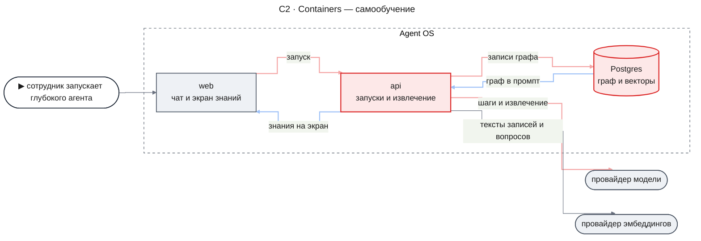

- `api` ставит граф в системный текст каждого шага запуска, который учится, после конца такого запуска извлекает знание, считает векторы записям и вопросам через службу эмбеддингов `model-providers` и отдаёт граф и настройки маршрутами.
- Postgres хранит таблицы `agent_knowledge_*`, векторы в таблице расширения pgvector и поле `selfLearning` внутри содержимого записи глубокого агента.

#### C3 · Components: api

**api — извлечение после конца запуска.** Конец глубокого агента приходит событием, извлечение идёт отдельной задачей.

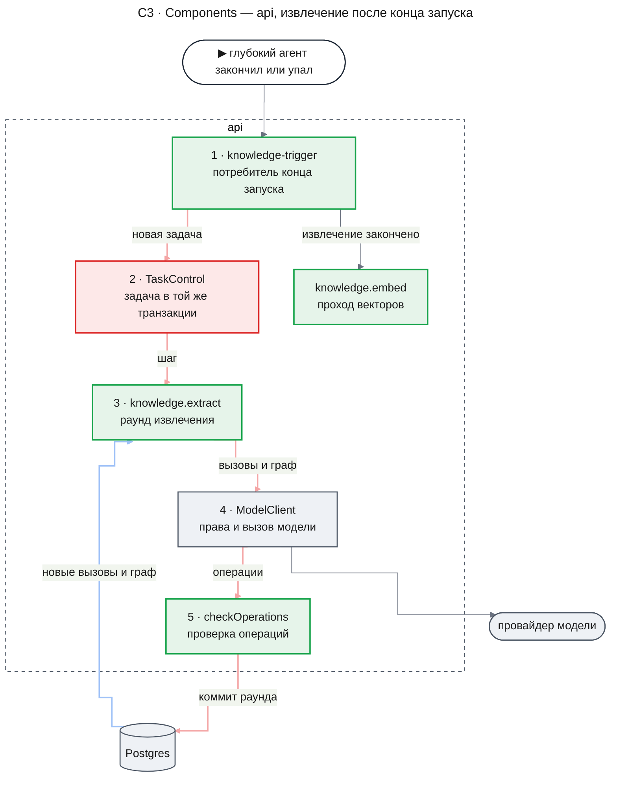

- `knowledge-trigger` (`agents.knowledge-trigger`) решает по строке запуска чистой функцией `triggerDecision`: создать задачу, поставить пометку «нужен ещё раунд», на `task.stopped` глубокого агента записать «остановлен» и сдвинуть отметку, а когда задача извлечения упала или остановлена — снять её номер, записать `interrupted` и при пометке поставить новую задачу. На `task.completed` задачи извлечения он по строке векторов ставит проход векторов или пометку «нужен ещё проход» (KD-8).
- `knowledge.extract` читает вызовы поддерева глубокого агента после отметки, отбирает граф той же функцией, что и шаг, зовёт модель, при новых сущностях ищет похожие (KD-4) и в коммите применяет операции, двигает отметку и пишет итог.
- `checkOperations` — чистая функция: по графу, входу и ответу модели она решает, какие операции применить, какие стали подтверждениями и какие отклонены с причиной.

**api — шаг запуска с графом.** Обработчик шага держит вектор вопроса, шаг модели и шаг сжатия зовут одну функцию блока знаний.

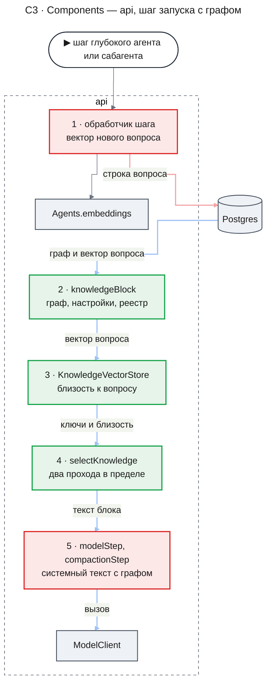

- `knowledgeBlock` работает только у запуска, который учится (`sessionLearningOf`): у глубокого агента — по `selfLearning` его снимка, у сабагента — по `learning`. У остальных сессий ни обработчик, ни шаг не делают ни одного лишнего чтения и вызова.
- Обработчик зовёт `Agents.embeddings` только на новый вопрос (KD-6); `knowledgeBlock` спрашивает хранилище, только когда у строки вопроса есть вектор.
- Живой ли инструмент урока, блок решает по реестру (`registryToolAlive`) и по серверам уроков из снимка: у глубокого агента — по своим серверам и серверам сабагентов, у сабагента — по `learning.servers`. Сервер `*` означает любой сервер реестра.

**api — экран знаний.** Маршрут сначала спрашивает библиотеку, открыт ли граф, затем зовёт `Agents.knowledge`.

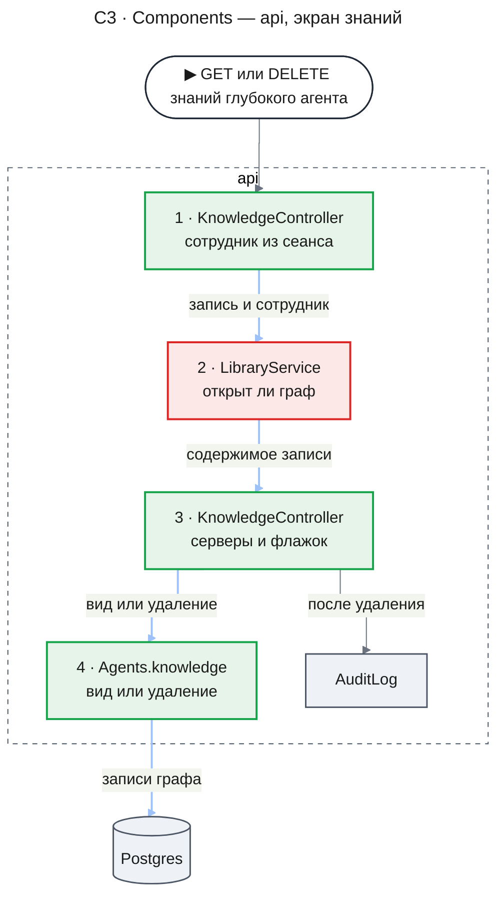

- `KnowledgeController` живёт в модуле маршрутов `KnowledgeApiModule`, который импортирует `LibraryModule` и `AgentsModule` ([port-module-split.md](../../code-system/patterns/port-module-split.md)). Серверы уроков и флажок последней версии он берёт у библиотеки и передаёт в `Agents.knowledge.view` входом: так экран считает устаревшие уроки по текущей команде глубокого агента. Состояние отбора по смыслу `view` берёт у `Agents.embeddings.model()`, из `list` хранилища и строки векторов, без вызова провайдера.

#### Как применяются операции

`checkOperations` проходит операции ответа по порядку и для каждой решает одно из трёх: применить, превратить в подтверждение или отклонить с причиной. Решение по одной операции не отменяет остальные.

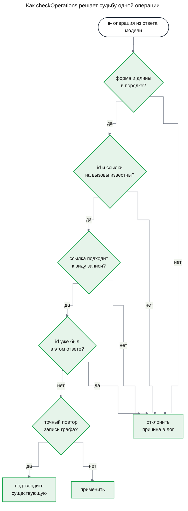

- **Форма.** Операция — одна из четырёх (`add_entity`, `add_relation`, `confirm`, `mark_outdated`) со своими полями и длинами ([Contract Definitions](#contract-definitions)). Тексты проходят `createSecretMasker` до проверки длин и до сравнения на повтор. Выбор модели среди похожих сущностей применяется до проверки: выбранный id стоит на месте `ref`, а `add_entity` уже стала `confirm` (KD-4).
- **id и ссылки.** id записи (`e12`, `r7`) существует в графе этого глубокого агента; `ref` новой сущности объявлен раньше в том же ответе; ссылка на вызов (`c3`) есть во входе раунда. Ответ длиннее `KNOWLEDGE_OPERATIONS_MAX` (50) операций теряет лишние с причиной `too_many`.
- **Ссылка подходит.** Факт и подтверждение факта ссылаются на вызов с исходом `success`. Урок и его подтверждение — на вызов того же сервера и инструмента. «Искал — не нашёл» и его подтверждение — на вызов того же инструмента с исходом `empty` (DC-11). `mark_outdated` ссылки не требует: модель помечает и повторы, найденные в графе.
- **Повтор в ответе.** Второе подтверждение или вторая пометка одного id в одном ответе отклоняются.
- **Точный повтор.** Сущность с тем же именем или связь того же вида с теми же концами и текстом после приведения регистра и пробелов — уже в графе. Такая операция становится подтверждением найденной записи, если её ссылка подходит.
- **Подтверждение** прибавляет единицу к числу подтверждений, ставит дату раунда, запоминает запуск и снимает пометку «устарела». Если последним эту запись уже подтверждал этот же запуск, число не растёт.

### Runtime Flows

#### Flow 1: Конец запуска → извлечение → граф

**Starts when:** глубокий агент запуска, который учится, заканчивается (`task.completed`) или падает (`task.failed`), for AC-01.1, AC-03.1, AC-03.3, AC-03.4, AC-04.1, AC-04.2, AC-04.4, AC-05.1, AC-08.1, AC-08.2, AC-08.3, AC-15.1, AC-15.2, AC-16.1, AC-16.2, AC-20.1, NFR-01, NFR-02

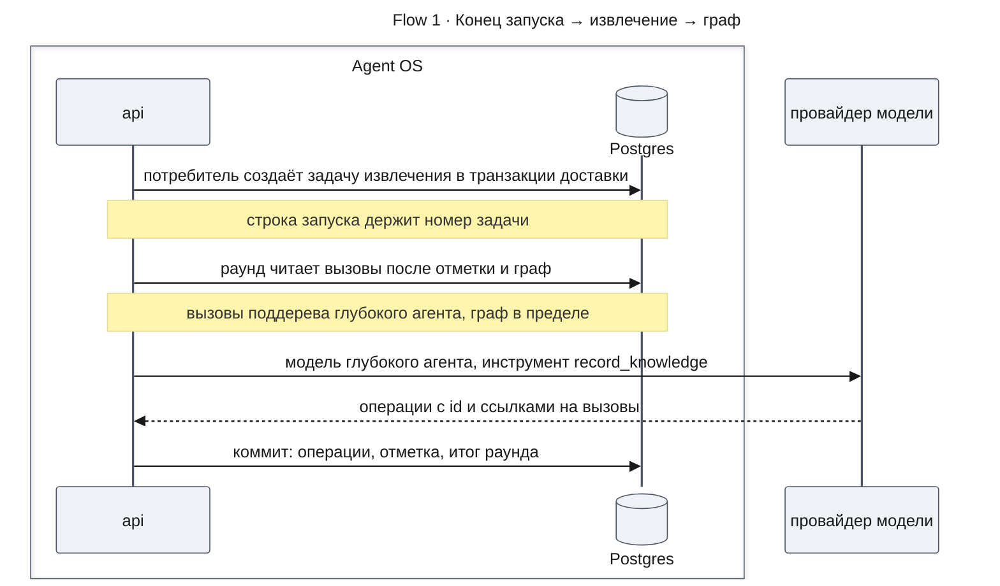

Похожие сущности (KD-4) — ещё один вызов эмбеддингов, поиск в хранилище и, если кандидаты нашлись, ещё один вызов модели между ответом модели и коммитом.

**Outcome:** граф пополнен проверенными операциями без секретов; строка запуска держит новую отметку «извлечено до» и итог «готово» с числами добавленных, подтверждённых и помеченных; запуск остался в своём конечном состоянии; расход модели и эмбеддингов похожих сущностей записан на запускающего. Когда задача извлечения завершается, потребитель ставит проход векторов ([Flow 4](#flow-4-проход-векторов-после-извлечения)).

**Failure handling:**

- Отказ прав на модель (`owner_disabled`, `quota_exhausted`, `model_not_connected`, `model_not_allowed`, `no_models_allowed`) → вызова модели нет, коммит пишет «пропущено» с причиной, отметка не двигается, граф не меняется.
- Ошибка провайдера после повторов `ModelClient`, в том числе `provider_*` → «сбой: `model_error`», точная причина в логе, отметка не двигается (AC-03.4, DC-13).
- Ответ без годного вызова `record_knowledge` → вторая попытка с текстом ошибки; снова плохо → «сбой: `invalid_answer`» (DC-7).
- Эмбеддинги новых сущностей недоступны, кандидатов нет или ответ на `choose_entities` негоден → вызова с кандидатами нет или его ответ отброшен, операции применяются как есть, причина в логе (DC-17).
- Отдельные операции не прошли `checkOperations` → они в логе с причиной, остальные применены (AC-04.2).
- Запись глубокого агента удалена до коммита → записи графа идут в точке сохранения внутри коммита; нарушение внешнего ключа отменяет только их, задача завершается, в логе — `record_deleted` (DC-8).
- Рестарт посреди раунда → шаг повторяется с начала: модель зовётся снова, её первая строка журнала токенов остаётся, а коммит атомарен, поэтому ни одна операция не применяется дважды (NFR-02).
- Задача извлечения упала (runtime не довёл её до конца) или остановлена → потребитель снимает её номер со строки запуска, пишет «сбой: `interrupted`» и, если стояла пометка «нужен ещё раунд», ставит новую задачу.
- Запуск закончился снова, пока раунд шёл → потребитель ставит пометку, коммит раунда видит её и продолжает задачу следующим шагом (DC-4).
- Сотрудник остановил запуск, пока раунд шёл → потребитель пишет «остановлен» и сдвигает отметку на момент стопа; коммит раунда применяет свои операции, пишет свой итог поверх и отметку назад не двигает (DC-3).

#### Flow 2: Шаг запуска получает граф, отобранный под вопрос

**Starts when:** начинается шаг модели или шаг сжатия глубокого агента или сабагента запуска, который учится, for AC-01.2, AC-04.3, AC-06.1, AC-06.2, AC-06.3, AC-07.1, AC-07.3, AC-09.2, AC-15.3, AC-17.1, AC-18.1, AC-18.2, AC-18.3, AC-19.1

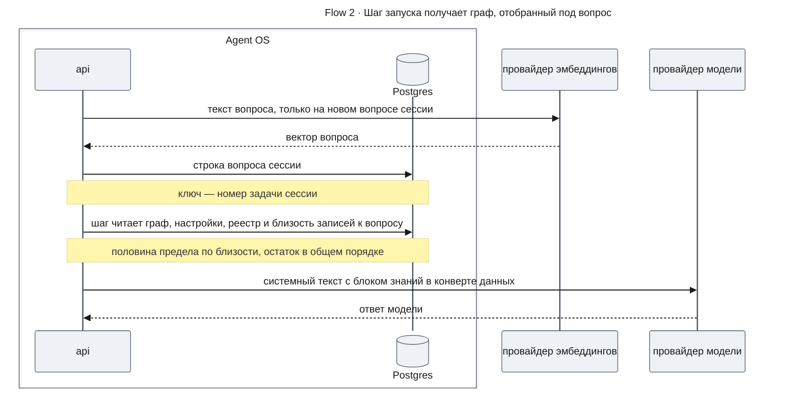

**Outcome:** модель получает граф таким, каким он был в момент шага, не больше предела и отобранный под вопрос сессии; на новом вопросе записана строка вопроса, граф не изменён.

**Failure handling:**

- Эмбеддинги отказали или модель эмбеддингов не выбрана → строка вопроса с пустым вектором, весь предел в общем порядке, запуск идёт дальше (AC-18.3).
- `query` хранилища упал → весь предел в общем порядке, сбой в логе предупреждением.
- Рестарт после вызова эмбеддингов, но до записи строки → вектор считается ещё раз, в журнале одна лишняя строка.
- Граф пуст или все записи устарели → блок знаний не добавляется, системный текст тот же, что у глубокого агента без самообучения.
- Чтение графа не удалось → шаг падает тем же путём, что и при сбое чтения истории; запуск без знаний не продолжается молча.

#### Flow 3: Экран знаний читает и чистит граф

**Starts when:** часть `web` открывает экран знаний или удаляет запись, for AC-09.1, AC-09.2, AC-09.3, AC-06.1

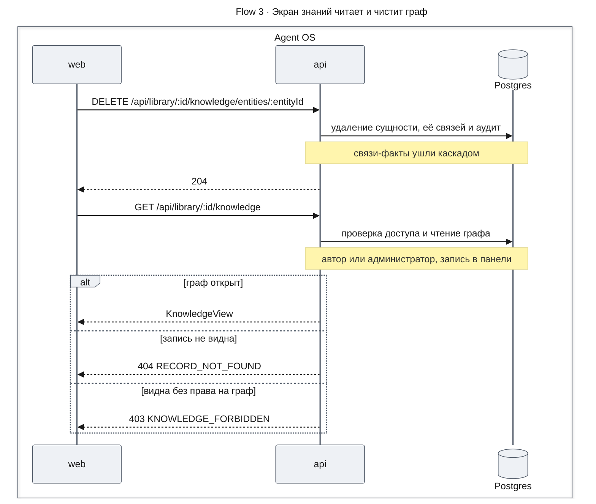

**Outcome:** удаление видно следующему шагу любого запуска этого глубокого агента (AC-09.2), а его транзакция ставит проход векторов, который удалит вектор записи; вид отдаёт все записи в общем порядке с состоянием и размещением каждой и состояние отбора по смыслу.

**Failure handling:**

- Запись графа уже удалена → 204, аудит не пишется (DC-10).
- Удаление совпало с коммитом извлечения → они идут по очереди (Invariant 5): операция извлечения на удалённую запись отклоняется.

#### Flow 4: Проход векторов после извлечения

**Starts when:** задача извлечения завершилась (`task.completed`) или автор удалил запись графа, for AC-08.1, AC-18.4, AC-19.1

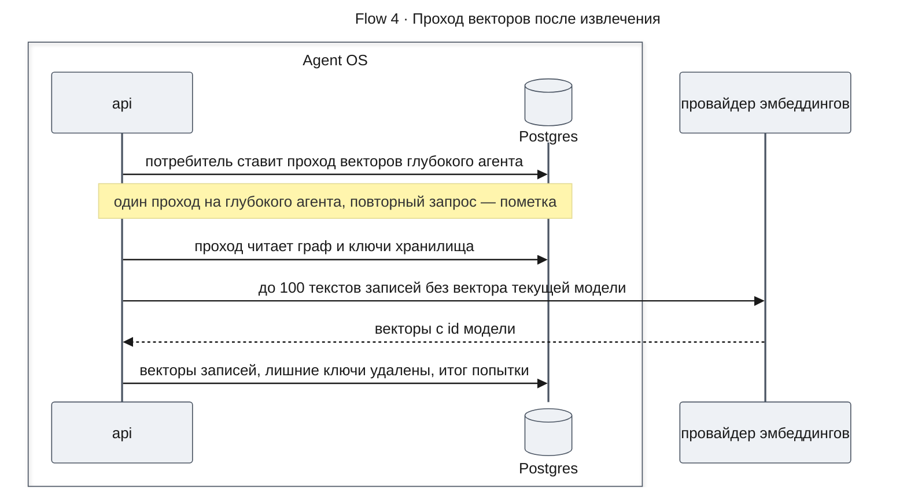

**Outcome:** у каждой записи графа есть вектор текущей модели, векторов удалённых записей нет; строка векторов держит итог последней попытки; расход — по правилу KD-8.

**Failure handling:**

- Модель эмбеддингов не выбрана → вызова нет, итог записан, задача завершается.
- Провайдер отказал (`provider_*`, `provider_error`, `dimension_mismatch`) → итог с причиной, задача завершается, записи ждут следующего прохода, а вид знаний показывает `provider_failed`.
- `owner_disabled` → то же, но состояние отбора не меняется: это отказ одного сотрудника, причина только в логе.
- Рестарт посреди шага → шаг повторяется и считает только то, чего по-прежнему не хватает.
- Новый запрос прохода, пока он идёт → пометка «нужен ещё проход»; последний шаг видит её и продолжает задачу.

### Contract Definitions

#### Для части `web`

- **Схемы** — формы ниже лежат zod-схемами в модуле `knowledge.ts` пакета `packages/contracts`: `KnowledgeViewSchema` (ответ `GET` графа), `KnowledgeSettingsSchema` (ответ маршрутов настроек) и `UpdateKnowledgeSettingsBodySchema` (тело `PUT`). Там же константы предела `KNOWLEDGE_LIMIT_TOKENS_MIN` = 1 000, `KNOWLEDGE_LIMIT_TOKENS_MAX` = 32 000 и `KNOWLEDGE_LIMIT_TOKENS_DEFAULT` = 8 000; умолчание столбца `limit_tokens` берётся из `KNOWLEDGE_LIMIT_TOKENS_DEFAULT`, как `RECORD_MAX_TURNS_DEFAULT` у `library_settings`.
- **`GET /api/library/:id/knowledge`** — граф глубокого агента для экрана знаний. Возвращает `KnowledgeView`. 404 `RECORD_NOT_FOUND`, когда записи нет, она не видна сотруднику ни в библиотеке, ни в панели, или это обычный агент; 403 `KNOWLEDGE_FORBIDDEN`, когда глубокий агент виден, но сотрудник не автор и не администратор при записи в панели.
- **`DELETE /api/library/:id/knowledge/entities/:entityId`** — удаляет сущность и все связи-факты с ней. 204, в том числе когда сущности уже нет. Те же 404 и 403. Аудит `knowledge_delete` — только когда что-то удалено.
- **`DELETE /api/library/:id/knowledge/relations/:relationId`** — удаляет связь, урок или «искал — не нашёл». Ответы и аудит — как у сущности.
- **`GET /api/admin/knowledge/settings`** — под `@AdminOnly()`. Возвращает `KnowledgeSettings`.
- **`PUT /api/admin/knowledge/settings`** — под `@AdminOnly()`, тело `limitTokens` и `lessonsEnabled`. Возвращает `KnowledgeSettings`. 400 `VALIDATION_FAILED`, когда значение вне границ; ничего не меняется. Аудит `admin_change` по объекту `knowledge_settings`.
- **Маршруты библиотеки** — своих маршрутов у флажка нет: `DeepAgentContent` несёт `selfLearning` в телах создания и правки и в ответах (FR-10). Строка в карточке брифа `start_deep_agent` (FR-13) берёт флажок из записи по номеру глубокого агента из брифа.

**`KnowledgeView`**

- `selfLearning` — флажок последней версии глубокого агента.
- `lessonsEnabled` — идут ли уроки в промпт (настройка).
- `selection` — состояние отбора по смыслу, `KnowledgeSelection`.
- `counts` — числа для строк состояния экрана (UXRD MC-3): `active` (M) — записи с `state` `active`; `always` (N) — записи с `placement` `always`, а когда помещаются все, — все `active`; `beyond` (K) — `active` минус `always`; `outdated` (O) — записи с `state` `outdated`, при выключенных уроках — без уроков: они не входят в счётчики (UXRD); `percent` (P) — размер всех `active` в процентах от предела, целое, больше 100, когда знаний больше предела. Размер — той же оценкой, что и шаг.
- `items` — все записи графа в общем порядке, записи `outdated` — в конце в том же порядке; `lessons_off` стоят среди `active` (UXRD KD-1).
- `lastExtraction` — последний раунд любого запуска этого глубокого агента или `null`, если раундов не было.

**`KnowledgeSelection`** — первое подходящее состояние сверху вниз:

- `off`, `reason` `model_not_selected`, `model` `null` — `Agents.embeddings.model()` отвечает `model_not_configured`.
- `off`, `reason` `provider_failed`, `model` — id модели — последняя попытка эмбеддингов этого глубокого агента вернула `provider_missing`, `provider_disabled`, `provider_key_missing`, `provider_key_rejected`, `provider_unavailable`, `provider_error` или `dimension_mismatch`. Точная причина — в строке векторов и в логе. `owner_disabled` в попытку не засчитывается: это отказ одного сотрудника.
- `preparing`, `pending` — число записей `active` без вектора текущей модели.
- `on`.

**`KnowledgeItem`** — форма различается по `type` и `kind`.

- `type` — `entity` или `relation`; `id` — целое больше нуля, уникальное внутри своего `type`.
- `kind` — `fact`, `lesson` или `searched_nothing`; у сущности всегда `fact`.
- Сущность: `name`, `description`.
- Связь-факт: `from` и `to` — `id` и `name` сущностей, `label` — что их связывает.
- Урок: `server`, `tool`, `question` (вид вопроса), `hint`, `outcome`.
- «Искал — не нашёл»: `server`, `tool`, `question`.
- `confirmations` — целое от 1; `date` — время коммита раунда, который добавил запись или последним её подтвердил: полная отметка времени ISO 8601, как `createdAt` в остальных контрактах; день из неё веб берёт сам.
- `state` — `active`, `outdated` (помечена моделью или её инструмента больше нет у глубокого агента и его сабагентов) или `lessons_off` (урок при выключенных уроках). Устаревание — свойство записи, поэтому устаревший урок — `outdated` и при выключенных уроках, и после их включения.
- `placement` — доходит ли запись до запусков: `always`, `by_topic`, `does_not_fit` или `null`. `null` стоит у записей не в `active`, а у всех записей — когда `selfLearning` выключен или все `active` помещаются в предел. Иначе записи `active` идут в общем порядке, и `always` получает их начало, которое помещается в часть предела для общего порядка, до первой не поместившейся записи, как во втором проходе отбора. При `selection` `on` или `preparing` эта часть — `limitTokens` минус половина из KD-6, поэтому такая запись доходит до запуска при любом вопросе: первый проход берёт не больше половины. При `off` эта часть — весь предел. Остальные записи `active` — `by_topic` при `on` или `preparing` и `does_not_fit` при `off`.
- Запуск и сотрудник, от которых пришла запись, не отдаются (AC-11.4).

**`LastExtraction`**

- `at` — когда раунд закончился, ISO; `model` — модель извлечения.
- `status` — `done`, `skipped` или `failed`.
- `added`, `confirmed`, `outdated` — числа операций при `done`; все нули — нового не нашлось.
- `reason` — при `skipped`: `stopped`, `owner_disabled`, `quota_exhausted`, `model_not_connected`, `model_not_allowed`, `no_models_allowed`; при `failed`: `model_error` (в том числе все `provider_*` от `ModelClient`), `invalid_answer`, `interrupted`; при `done` — `null`.

**`KnowledgeSettings`**

- `limitTokens` — целое от `KNOWLEDGE_LIMIT_TOKENS_MIN` до `KNOWLEDGE_LIMIT_TOKENS_MAX`, по умолчанию `KNOWLEDGE_LIMIT_TOKENS_DEFAULT`.
- `lessonsEnabled` — по умолчанию `true`.
- `updatedAt` — ISO или `null`, пока стоят умолчания.

**Error handling**

- `RECORD_NOT_FOUND` — 404, как во всей библиотеке.
- `KNOWLEDGE_FORBIDDEN` — 403, член `LibraryErrorCode` в `packages/contracts/src/library.ts`. Веб показывает на него тот же экран «Не найдено» (UXRD KN-03).

#### Внутри платформы

- **`DeepAgentContent.selfLearning`** — логическое поле, по умолчанию `false` (KD-2). Модель его не задаёт: аргументы `create_record` и `edit_record` его не содержат, созданная запись получает `false`, а правка берёт флажок из сохранённой версии ([deep-agents, Contract Definitions](../deep-agents/design-agent-types.md#contract-definitions)).
- **Снимок сабагента, поле `learning`** — `null` или `servers`: серверы самого глубокого агента и всех его сабагентов из снимка глубокого агента. Перезапуск сабагента берёт его из своего снимка.
- **`runtime.tasks.create(request, tx?)`** — с транзакцией пишет задачу и `task.created` в ней и не повторяет транзакцию сам; без неё работает в своей транзакции.
- **Задача `knowledge.extract`** — корневая, владелец — запускающий; вход: `runId` (номер задачи глубокого агента) и `rootId` (корень беседы). Шаг всегда завершает задачу сам и пишет итог в строку запуска; `fail` он не возвращает.
- **`Agents.knowledge`** — `view({ recordId, selfLearning, servers })` возвращает `KnowledgeView`; `deleteEntity({ recordId, entityId })` возвращает, удалено ли и сколько связей ушло; `deleteRelation({ recordId, relationId })` — удалено ли; `settings()` и `updateSettings({ actorId, limitTokens, lessonsEnabled })`, которая возвращает «было» и «стало».
- **`LibraryService.knowledgeTarget(actor, recordId)`** — для открытого графа возвращает флажок и серверы уроков последней версии (глубокого агента и всех сабагентов); иначе бросает `RECORD_NOT_FOUND` или `KNOWLEDGE_FORBIDDEN` по правилу KD-7.
- **Маскировка секретов** — `createSecretMasker` из `@agent-os/common` читает память секретов процесса (`rememberSecret` там же, [`model-providers`](../model-providers/design-core.md#внутри-платформы)). `createAppLogger` кладёт туда же значения своего списка (`collectSecrets`), поэтому маска извлечения скрывает то же, что логгер `apps/api` (FR-05); своей опции секретов у `createAgents` нет.
- **`KnowledgeVectorStore`** — порт хранилища векторов; коллекция — номер записи глубокого агента, ключ — `e…` или `r…`:
  - `upsert(collection, items)` — каждый элемент: ключ, вид ключа (`entity` или `relation`), id модели и вектор; заменяет вектор ключа.
  - `delete(collection, keys)` — удаляет векторы ключей; неизвестный ключ — не ошибка.
  - `query(collection, vector, model, limit, kind?)` — до `limit` пар «ключ, близость» среди векторов этой модели, а с `kind` — только ключей этого вида, по убыванию близости; близость — косинус. Отбор передаёт `limit`, равный числу записей графа, поиск похожих сущностей — `SIMILAR_ENTITY_LIMIT` и `kind` `entity`.
  - `list(collection)` — все ключи коллекции с id модели.
  - Сбой базы — исключение; отбор при нём идёт в общем порядке, а похожие сущности пропускаются.
- **Строка вопроса** `agent_knowledge_questions` — пишет только обработчик шага агента, читает только `knowledgeBlock` (KD-6).
- **Задача `knowledge.embed`** — корневая, владелец — всегда `PLATFORM_OWNER_ID`: `runtime_tasks.owner_id` — текст без внешнего ключа, а `TaskControl.create` и проверки владельца лишь сравнивают строки. Владелец задачи расход не задаёт: `ownerId` каждого вызова `embed` — по правилу KD-8. Вход — `recordId`. Шаг берёт до `EMBEDDING_BATCH_SIZE` = 100 записей — столько служба эмбеддингов шлёт одним запросом — и завершает задачу сам, `fail` не возвращает.
- **Константы отбора и похожих сущностей** в `agents`: `KNOWLEDGE_BY_MEANING_SHARE` = 1/2; `SIMILAR_ENTITY_MIN_SCORE` = 0.8 — порог близости, его подбирают по первым извлечениям; `SIMILAR_ENTITY_LIMIT` = 3.
- **Инструмент модели `choose_entities`** — один аргумент `choices`: для каждой новой сущности ответа её `ref` и `id` выбранного кандидата или `null` — оставить новую. `id` не из кандидатов этой сущности отклоняется и оставляет её новой.
- **Инструмент модели `record_knowledge`** — один аргумент `operations`, до 50 элементов:
  - `add_entity` — `ref` (метка для ссылок в этом ответе), `name`, `description`, `evidence`;
  - `add_relation` — `kind`; для факта `from` и `to` (id `e…` или `ref`) и `label`; для урока `server`, `tool`, `question`, `hint`, `outcome`; для «искал — не нашёл» `server`, `tool`, `question`; `evidence`;
  - `confirm` — `id` (`e…` или `r…`) и `evidence`;
  - `mark_outdated` — `id`;
  - `evidence` — непустой список номеров вызовов входа (`c…`).
  - Длины: `name`, `label`, `question`, `outcome` — до 200 знаков, `description` и `hint` — до 500.

**Вход извлечения** (константы кода в `agents`)

- Вызовы — поддерево глубокого агента в его дереве и у его владельца (`descendantsOf` по `listTree`): сам глубокий агент и его сабагенты, но не соседние запуски беседы. Только вызовы MCP (`server` задан) с исходами `success`, `empty`, `tool_error`; отказанные, отклонённые, прерванные и прочие исходы не берутся.
- Прямые вызовы — записи `tool_result` журнала сессии (`agent_messages`): текст результата обрезается до `EXTRACTION_RESULT_BYTES` = 2 000 байт, аргументы — до `EXTRACTION_ARGS_BYTES` = 500 байт.
- Весь вход — до `EXTRACTION_INPUT_BYTES` = 48 000 байт. Вызовы идут по времени конца; после предела следующие вызовы дают только инструмент, аргументы и исход, без результата.
- Вызовы внутри `run_code` (`agent_code_calls`, только последняя попытка скрипта) дают инструмент, аргументы и исход без результата: результат этих вызовов не хранится. Знание из скрипта модель извлечения не видит — это ограничение части.
- Вход — данные в конверте; граф — тем же отбором, что у шага, но без близости к вопросу, то есть в общем порядке во весь предел, со строками `e…`/`r…`.

**Runtime settings**

- `agent_knowledge_settings.limit_tokens` — умолчание и границы — константы `KNOWLEDGE_LIMIT_TOKENS_*` выше; предел блока знаний в шаге и в извлечении.
- `agent_knowledge_settings.lessons_enabled` — по умолчанию `true`; при `false` уроки не идут ни в шаг, ни в извлечение и не входят в предел.

### Data Model

Семь таблиц пакета `agents`. Граф глубокого агента — сущности и связи с номером его записи; строки запусков и настройки служат извлечению и промпту; векторы, вопросы сессий и строка векторов служат отбору по смыслу.

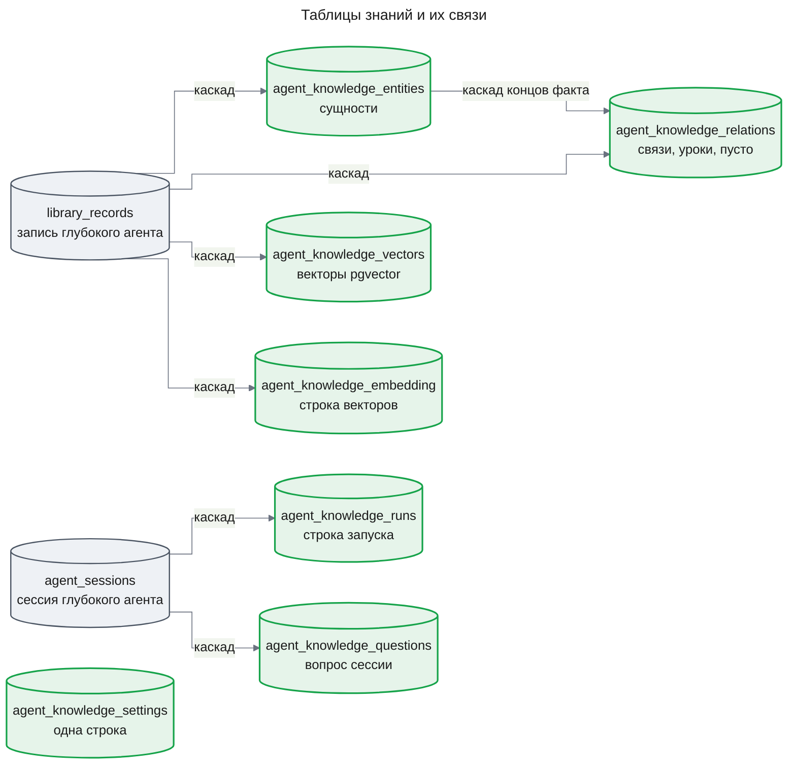

- **Сущности** — номер записи глубокого агента, имя, описание, число подтверждений, дата добавления и дата последнего подтверждения, запуск-источник, последний подтвердивший запуск, пометка «устарела». Удаление записи уносит их.
- **Связи** — те же общие поля и вид. Связь-факт держит две сущности того же графа и `label`; удаление любой из сущностей уносит её. Урок и «искал — не нашёл» держат сервер, инструмент и вид вопроса, урок — ещё подсказку и исход.
- **Строки запусков** — номер задачи глубокого агента (удаление беседы уносит строку вместе с сессией), номер записи без внешнего ключа, серверы уроков (по ним отбор в раунде решает, жив ли инструмент урока), отметка «извлечено до», номер задачи извлечения в работе и последней завершившей раунд, пометка «нужен ещё раунд» и итог последнего раунда: состояние, причина, числа, модель, время. `lastExtraction` экрана — итог с самым поздним временем среди строк запусков этого глубокого агента.
- **Настройки** — одна строка, её создаёт миграция ([settings-row.md](../../code-system/patterns/settings-row.md)).
- **Векторы** — таблица хранилища pgvector: коллекция (номер записи), ключ записи графа, id модели и вектор без фиксированной длины, один на ключ, с видом ключа для фильтра (KD-8).
- **Вопросы сессий** — номер задачи сессии, откуда вопрос (`task` или id сообщения сотрудника), id модели и вектор массивом чисел или пусто, если эмбеддинги отказали. Массив, а не тип `vector`: строку читают по ключу, а не ищут, поэтому таблица не зависит от расширения. Удаление беседы уносит строку вместе с сессией.
- **Строка векторов** — номер записи глубокого агента, проход в работе, пометка «нужен ещё проход», плательщик записей без вектора и итог последней попытки эмбеддингов этого глубокого агента, прохода или вопроса сессии: причина или пусто, id модели, время. Плательщик — запускающий последнего извлечения, которое поставило проход, или пусто, если проход ставили только удаления (KD-8). Итог вопроса сессии пишется, только когда он отличается от записанного.
- Запуск-источник и последний подтвердивший запуск хранятся для разбора и для правила подтверждений, но наружу не отдаются (DC-2).

### State Transitions and Invariants

Строка запуска переходит между двумя состояниями: извлечение не идёт и идёт.

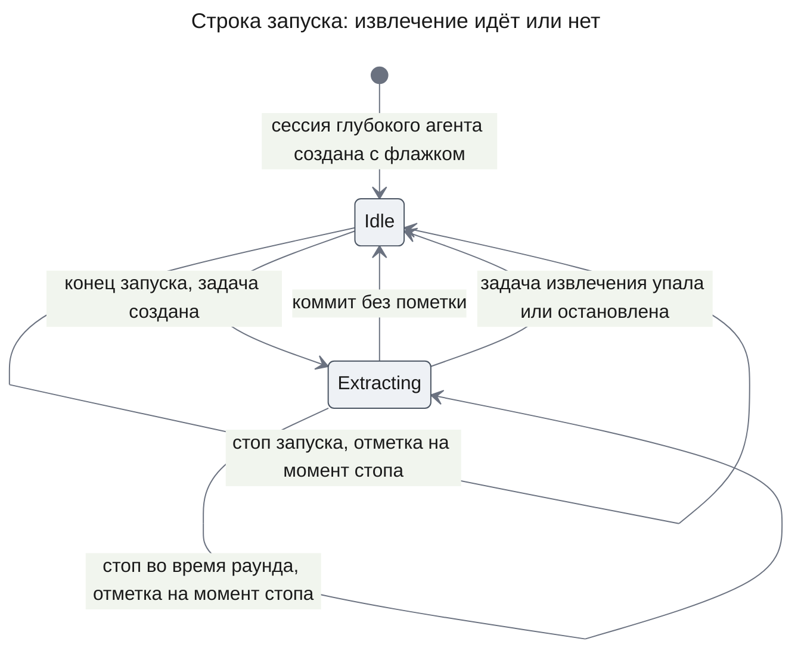

**Invariants**

1. У запуска не больше одной задачи извлечения в работе, и пишет в граф только она.
2. Раунд применяет операции, только если весь его коммит прошёл. Отметка «извлечено до» идёт только вперёд: её двигает успешный коммит раунда или стоп запуска.
3. Вызов попадает в успешный раунд не больше одного раза.
4. Число подтверждений записи не меньше 1; подтверждение без ссылки на вызов этого запуска не засчитывается.
5. Записи в граф одного глубокого агента — коммиты извлечения и удаления — идут по очереди, а не вперемешку.
6. Связь-факт соединяет сущности того же графа и не живёт без них.
7. Граф существует, пока существует запись глубокого агента; выключенный флажок его не трогает.
8. Строка настроек одна, её значения в границах.
9. Инструменты записей чата не меняют флажок: созданная ими запись получает `false`, правка сохраняет флажок сохранённой версии.
10. Граф — источник правды для векторов: запись без вектора доходит до запусков в общем порядке, а вектор без записи не попадает ни в промпт, ни в похожие сущности.
11. У ключа не больше одного вектора, и он несёт id своей модели; близость считается только между векторами одной модели.
12. Вектор вопроса считается один раз на вопрос сессии — при её старте и на каждое новое сообщение сотрудника глубокому агенту, — кроме повтора шага после рестарта; шаги модели и сжатия его только читают.
13. У глубокого агента не больше одного прохода векторов в работе.

### Логирование

Всё — через логгер `common`, дочерним логгером с идентификаторами.

- **Потребитель**: `runId`, `rootId`, `recordId`, `ownerId`, тип события, решение (задача создана с её номером, пометка «нужен ещё раунд», состояние `stopped`, сброс после падения задачи), `durationMs`.
- **Раунд**: `taskId`, `runId`, `recordId`, `ownerId`, `model`; число вызовов и байт входа, сколько обрезано; число записей графа и токенов блока; `modelCallId` и номер попытки; точная причина `model_error`; новые сущности, их кандидаты с близостью и выбор модели; операции после чистки секретов, отклонённые — с причиной; итог раунда, сдвиг отметки, `durationMs`; ошибка — целиком в поле `error`. Результаты инструментов в лог не идут — только их размеры.
- **Шаг запуска**: `taskId`, `recordId`, есть ли вектор вопроса, записей по близости, в общем порядке и не поместилось, токенов блока.
- **Вектор вопроса**: `taskId`, `recordId`, `ownerId`, откуда вопрос, модель, итог или причина `unavailable` с её `message`, `durationMs`.
- **Проход векторов**: `taskId`, `recordId`, на кого расход, модель, сколько записей без вектора, сколько с вектором старой модели, сколько посчитано, сколько лишних ключей удалено, итог или точная причина, `durationMs`.
- **Хранилище**: сбой `query` — предупреждением.
- **Маршруты**: сотрудник, `recordId`, действие, итог (`ok`, 404, 403), id удалённой записи без её текста, `durationMs`; смена настроек — «было» и «стало».

## Test Strategy

Тестами обязательно становятся: доступ к API графа (UC-8), отсутствие извлечения после стопа (UC-E1), один раунд на конец и только новые вызовы у продолженного запуска (UC-4), два одновременных извлечения (UC-E6), отказ операций с неизвестными id (UC-6), расход на запускающего (UC-1, UC-9), удалённая во время извлечения запись (UC-E5), запуск без эмбеддингов (UC-E7), пересчёт после смены модели эмбеддингов (UC-E8), удаление без находимых векторов (UC-E9), один вектор вопроса на сессию (UC-9). Отбор и проверка операций — по одному табличному тесту на функцию, без повторения их случаев выше. Провайдер эмбеддингов в тестах — двойник шва `EmbeddingClient`, хранилище — настоящий pgvector из образа CI.

### Main Use Cases

- **UC-1: Запуск учится и следующий запуск получает знание** — covers AC-01.1, AC-03.1, AC-07.3, AC-08.1, AC-08.3, AC-15.1, AC-15.2, NFR-01
  - Given: глубокий агент с самообучением на модели A, сабагент с сервером `logs`; после старта автор меняет модель глубокого агента на B.
  - When: сабагент вызывает `logs.search` (успех по `billing-api`, пусто по `payment-gateway`), запуск завершается (строкой таблицы — и падает), модель извлечения отвечает уроком, фактом и «искал — не нашёл».
  - Then: задача извлечения создана после события конца; вызов модели шёл на A; строка журнала токенов несёт владельца-запускающего, и месячный расход его вырос; в графе урок с `logs.search` и «искал — не нашёл» с `logs.search`; следующий запуск получает их внутри конверта данных у глубокого агента и у сабагента.

- **UC-2: Флажок выключен посреди запуска** — covers AC-01.2, AC-02.2, DC-1, Invariant 9
  - Given: глубокий агент без заданного флажка читается с `selfLearning = false`; автор включает флажок, запуск начат, в графе есть записи.
  - When: автор выключает флажок, запуск заканчивается, затем стартует новый запуск, затем автор включает флажок снова; строкой таблицы — автор правит запись из чата инструментом `edit_record`.
  - Then: первый запуск пополнил граф; новый запуск не получил блок знаний и строки запуска не получил; после включения граф тот же; после правки из чата флажок по-прежнему включён.

- **UC-3: Граф и жизнь записи** — covers AC-02.1, AC-02.3
  - Given: у глубокого агента есть граф.
  - When: автор сохраняет новую версию; сотрудник копирует запись; автор удаляет оригинал.
  - Then: запуск новой версии получает тот же граф; граф копии пуст; после удаления записей графа оригинала нет.

- **UC-4: Продолженный запуск** — covers AC-03.3, DC-4, DC-5
  - Given: запуск завершился, его раунд прошёл, в нём было три вызова.
  - When: сотрудник продолжает глубокого агента, тот делает два вызова и завершается; в строке таблицы второй конец приходит, пока первый раунд ещё идёт.
  - Then: второй раунд получает только два новых вызова; задач извлечения у запуска в работе никогда не две; конец без новых вызовов даёт «готово» с нулями без вызова модели.

- **UC-5: Отбор в пределе** — covers AC-04.3, AC-06.1, AC-06.2, AC-06.3, AC-15.3, AC-17.1, AC-18.1, DC-9, DC-12
  - Given: граф больше предела с записями разного числа подтверждений и дат, устаревшая связь, урок о инструменте, которого нет в реестре; пары близости, где близки к вопросу редко подтверждённые записи, а у самой подтверждённой вектора нет; предел, выключатель уроков, пары и состояние отбора меняются по строкам таблицы.
  - When: `selectKnowledge` строит блок и размещение для экрана.
  - Then: устаревшие и урок без инструмента — `outdated` и не в тексте; до половины предела занимают ближайшие к вопросу, остаток — общий порядок, и самая подтверждённая запись без вектора в тексте; без пар весь предел идёт в общем порядке; меньший предел режет в том же порядке; при выключенных уроках действующие уроки — `lessons_off`, а урок без инструмента остаётся `outdated` и после включения уроков; в `items` записи `lessons_off` стоят в общем порядке среди `active`, `outdated` — в конце; вернувшийся инструмент возвращает урок; строки блока идут в общем порядке, и одинаковый вход даёт одинаковый текст; `always` — начало общего порядка в пределе минус половина при `on` и во весь предел при `off`, остальные — `by_topic` или `does_not_fit`, а когда помещаются все — `null`.

- **UC-6: Проверка операций** — covers AC-04.1, AC-04.2, AC-05.1, AC-16.1, AC-16.2, DC-6, DC-11
  - Given: граф с сущностью `billing-api` и уроком о `logs.search` с одним подтверждением; вход с вызовами `logs.search`; среди секретов — значение ключа.
  - When: `checkOperations` получает по строке таблицы: связь к `e…` сущности `billing-api`; `add_entity` с именем ` Billing-API `; подтверждение урока со ссылкой на вызов `logs.search` и без такого вызова; операцию с неизвестным id; два подтверждения одного id; факт с секретом в описании.
  - Then: связь присоединена к существующей сущности, вторая сущность не появилась; повтор имени стал подтверждением; урок получил второе подтверждение и дату раунда только при ссылке на вызов `logs.search`; неизвестный id и повтор отклонены, остальное применено; на месте секрета — `[redacted]`.

- **UC-7: Граф читается на каждом шаге** — covers AC-07.1, AC-09.2
  - Given: запуск идёт, в графе сущность со связью.
  - When: автор удаляет сущность через API, начинается следующий шаг запуска.
  - Then: блок знаний шага не содержит ни сущности, ни её связи.

- **UC-8: Доступ к графу** — covers AC-09.1, AC-09.3, DC-2, DC-10
  - Given: глубокий агент Ани, открытый роли; Борис в роли; администратор; личный глубокий агент Бориса, не открытый ролям.
  - When: каждый запрашивает граф и удаляет запись; администратор меняет настройки, Борис пробует то же.
  - Then: Аня и администратор видят граф ролевой записи, у записей графа есть дата, но нет запуска и сотрудника; Борис получает 403 `KNOWLEDGE_FORBIDDEN` без единой записи; администратор на личной записи Бориса — 404 `RECORD_NOT_FOUND`; повторное удаление — 204 и одна запись аудита; настройки сохраняются у администратора, Борис получает 403 `ADMIN_REQUIRED`.

- **UC-9: Вектор вопроса и расход эмбеддингов** — covers AC-08.1, AC-18.2, DC-14
  - Given: граф больше предела, у записей есть векторы; глубокий агент учится, у него есть сабагент.
  - When: глубокий агент и сабагент делают по несколько шагов; сотрудник пишет глубокому агенту сообщение на другую тему; запуск заканчивается, извлечение добавляет записи, идёт проход векторов.
  - Then: вызовов эмбеддингов с `inputType` `query` — по одному на сессию и один на сообщение, сколько бы ни было шагов; после сообщения шаг глубокого агента получает записи, близкие к нему; строки журнала эмбеддингов сессий и прохода за новые записи — на запускающего, с номерами задач сессий и прохода.

- **UC-10: Похожие сущности при извлечении** — covers AC-20.1, DC-17
  - Given: в графе `billing-api` с вектором; модель извлечения предлагает сущность «сервис биллинга», двойник эмбеддингов даёт им близкие векторы.
  - When: идёт раунд; по строкам таблицы модель оставляет новую сущность, выбирает `billing-api`, или кандидатов нет.
  - Then: третий вызов модели показывает `billing-api` по id; при «оставить» в графе обе сущности, при выборе — одна `billing-api` с двумя подтверждениями; без кандидатов вызовов модели два.

### Error and Edge Use Cases

- **UC-E1: Стоп запуска** — covers AC-03.2, DC-3
  - Given: запуск с самообучением идёт и уже сделал вызовы.
  - When: сотрудник его останавливает; в строке таблицы — потом продолжает, и запуск завершается без новых вызовов.
  - Then: после стопа задачи извлечения нет, граф не изменился, `lastExtraction` — `skipped`, `stopped`; после завершения раунд не получает вызовов остановленного отрезка.

- **UC-E2: Ошибка модели извлечения** — covers AC-03.4, DC-13
  - Given: запуск завершился.
  - When: провайдер отвечает ошибкой на вызов извлечения; строкой таблицы — `ModelClient` отвечает `model_error` с причиной `provider_unavailable`.
  - Then: граф не изменился; запуск завершён, ответ в беседе; `lastExtraction` — `failed`, `model_error`.

- **UC-E3: Квота исчерпана** — covers AC-08.2
  - Given: квота запускающего на модель глубокого агента исчерпана к концу запуска.
  - When: идёт раунд.
  - Then: вызова модели нет; граф не изменился; `lastExtraction` — `skipped`, `quota_exhausted`.

- **UC-E4: Дважды негодный ответ** — covers DC-7
  - Given: модель дважды отвечает текстом без `record_knowledge`.
  - When: идёт раунд.
  - Then: вызовов модели два; граф не изменился; `failed`, `invalid_answer`.

- **UC-E5: Запись удалена во время извлечения** — covers DC-8
  - Given: раунд ждёт ответа модели.
  - When: автор удаляет глубокого агента, модель отвечает.
  - Then: в графе ничего нет, ошибки внешнего ключа наружу не вышли, задача извлечения завершена, доставка не ушла в `needs_attention`.

- **UC-E6: Два извлечения одновременно** — covers AC-04.4
  - Given: два запуска одного глубокого агента закончились одновременно, их ответы добавляют разные записи и одну одинаковую сущность.
  - When: оба коммита идут параллельно.
  - Then: в графе записи обоих, одинаковая сущность — одна, с двумя подтверждениями.

- **UC-E7: Эмбеддинги недоступны** — covers AC-18.3
  - Given: граф больше предела; по строкам таблицы модель эмбеддингов не выбрана или провайдер отвечает 5xx.
  - When: стартует сессия, идут несколько шагов, автор открывает вид знаний.
  - Then: запуск завершается как обычно; блок знаний — общий порядок во весь предел; `selection` — `off` с `model_not_selected` или с `provider_failed` и моделью; вызов эмбеддингов на вопрос — один на сессию.

- **UC-E8: Смена модели эмбеддингов** — covers AC-18.4
  - Given: у всех записей векторы модели A; администратор выбирает модель B.
  - When: начинается сессия, затем запуск заканчивается и идёт проход векторов.
  - Then: до прохода шаг получает граф в общем порядке, а `selection` — `preparing` с числом записей; проход считает векторы модели B: за записи с векторами A — отдельным вызовом со строкой журнала на `platform`, за записи этого извлечения — на запускающего; после прохода `selection` — `on`.

- **UC-E9: Удаление не оставляет векторов** — covers AC-19.1, DC-16
  - Given: у записи графа есть вектор, а вопрос сессии дословно совпадает с её текстом.
  - When: автор удаляет запись графа; строкой таблицы — удаляет глубокого агента целиком.
  - Then: следующий шаг не получает запись; после прохода векторов `list` коллекции не содержит её ключа; после удаления глубокого агента коллекция пуста.

### Non-Functional Use Cases

- **UC-N1: Рестарт посреди извлечения** — covers NFR-02
  - Given: раунд получил ответ модели.
  - When: процесс падает до коммита, шаг повторяется.
  - Then: в графе нет повторов записей этого запуска; в журнале токенов две строки на этот раунд.

AC-07.2 (ответ не называет граф источником) — поведение модели, автоматический тест его не проверяет. UC-1 проверяет, что правило стоит в блоке знаний; сам ответ проверяет владелец по критериям успеха PRD.

## Security Considerations

- **Authentication & Authorization**: маршруты под общей проверкой сеанса; граф — по правилу KD-7 в `LibraryService.knowledgeTarget`, настройки — `@AdminOnly()`. Пакет получает только номер записи и строку сотрудника, сеанса не знает. Знание из запуска одного сотрудника доходит до запусков других — принятое PRD исключение из бизнес-ограничений 1 и 2; сами вызовы инструментов идут по правам запускающего.
- **Input Validation**: результаты инструментов идут в извлечение в конверте данных; ответ модели — аргументы инструмента, которые проходят схему и `checkOperations`; граф идёт в шаг в конверте с экранированными разделителями (AC-07.3). Текст, похожий на приказ, может попасть в граф как данные; его удаляет автор (риск PRD).
- **Sensitive Data Handling**: перед записью тексты операций проходят `createSecretMasker` с памятью секретов процесса: туда кладут свой список логгер `apps/api` и ключи провайдеров `model-providers`. Маска не ловит токены MCP-серверов и аккаунтов сотрудников из базы, секреты короче 8 знаков и личные данные. Аудит удаления не хранит текст записи; лог раунда не хранит результаты инструментов. Тексты записей после маскировки и вопросы сессий уходят провайдеру эмбеддингов — принятое PRD исключение (Constraints); вектор текста не хранит, поэтому лишний вектор ничего не раскрывает.

## Risks and Mitigation

- **Неверное или подброшенное знание закрепляется** — сильно, вероятно. Граф — подсказка в конверте с правилом проверки; подтверждение требует ссылки на вызов этого запуска; модель помечает устаревшее; автор удаляет.
- **Ссылка на вызов доказывает только, что вызов был, а не что он вернул то же** — средне, вероятно. Код проверяет инструмент и исход вызова, а «то же самое» решает модель; эффект виден по критериям успеха PRD.
- **Вызов, закончившийся до чтения раунда, но закоммиченный после него, пропускается** — слабо, редко: так бывает, только если сабагент ещё работает после конца глубокого агента. Знание теряется, но не удваивается.
- **Смена графа посреди запуска сбрасывает кэш промпта идущих запусков** — средне, редко: один раз на изменение графа или векторов (KD-6).
- **Новое сообщение сотрудника меняет отбор и переписывает кэш глубокого агента** — средне, часто: один раз на сообщение, когда набор записей изменился; запись кэша стоит около 1,25 цены ввода против 0,1 за чтение. Цена отбора по смыслу.
- **Секреты из базы и личные данные попадают в общий граф** — сильно, средне. Маскировка известных секретов, указание модели, удаление автором; аудит и лог не копируют текст.
- **Стоимость извлечения на дорогой модели глубокого агента** — средне. Вход ограничен константами, не больше трёх вызовов модели на раунд, расход виден у запускающего.
- **Целевой Postgres без расширения `vector`** — сильно, вероятно: миграция не проходит, и `api` не стартует. Образы разработки и CI — с pgvector; владелец проверяет целевую базу до сборки (KD-8).
- **Порог похожих сущностей подобран неверно** — средне, вероятно: низкий порог даёт лишний вызов модели, высокий — дубликаты. Порог — константа, его подбирают по первым извлечениям; выбор всё равно за моделью.
- **Пересчёт после смены модели эмбеддингов ждёт конца запуска** — слабо: до него отбор идёт в общем порядке, а вид знаний показывает подготовку.
- **Хранилище не в Postgres не узнаёт об удалённой записи** — слабо, в будущем: pgvector уносит векторы каскадом, другому хранилищу понадобится своя очистка; вектор без записи в отбор всё равно не попадает.

## Update History

| Version | Date | Change |
|---------|------|--------|
| 1.0 – 1.3 | 2026-11-19 – 2026-11-20 | Первая версия, отбор по смыслу и векторы, расход эмбеддингов; утверждён |
| 1.4 | 2026-11-22 | Самообучение у глубокого агента и его сабагентов; описание сверено с кодом |
