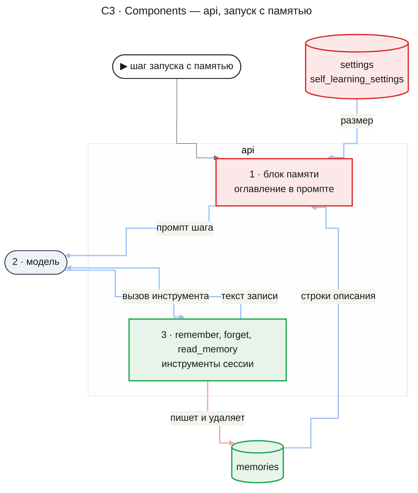
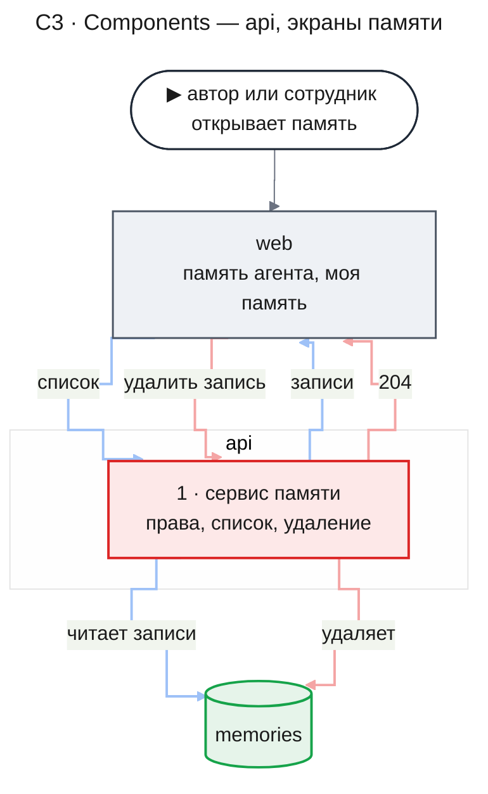
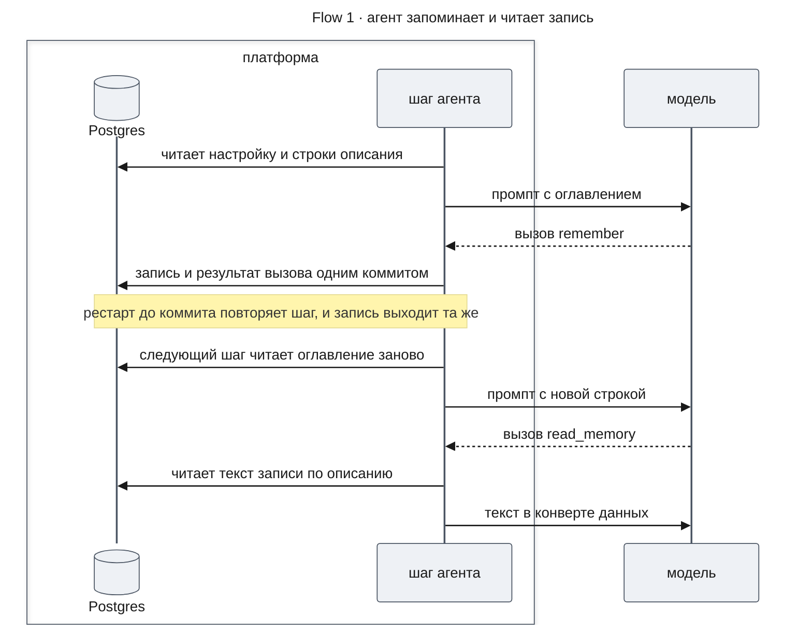

# Самообучение глубокого агента — Design Document — memory

**Status:** На утверждении · **Date:** 2026-11-23 · **PRD:** [prd.md](./prd.md) · **UXRD:** [uxrd.md](./uxrd.md) · **Depends on:** нет

## Snapshot

**Overview.** Глубокий агент из каталога с включённым самообучением получает память по образцу Claude Code. Во время запуска модель ведёт память тремя обычными инструментами: записывает или обновляет факт, удаляет неверный и читает текст записи. Одна запись — строка описания и текст, в области агента (её видят все запуски агента) или в области сотрудника (её видят запуски этого сотрудника с любым агентом с памятью). В промпт каждого шага платформа ставит оглавление — строки описания видимых записей, сначала недавно изменённые, в пределах размера из настроек. Всё хранится в одной таблице `memories`. Экран знаний агента становится экраном его памяти, сотрудник видит свои записи в разделе «Моя память» страницы «Мой доступ», а прежние знания — граф, разбор после запуска и векторы — удаляются целиком.

- **Не меняется**: права на вызовы инструментов, старт запусков, версии агента и их содержимое (кроме правила флажка у агентов по умолчанию, KD-4).
- **Главный риск**: модель класса Haiku запоминает мало или неточно. Правило в описании инструмента говорит, что и куда запоминать, а автор и сотрудник видят записи и удаляют неверные.
- **Открытые вопросы**: нет.

### Key Decisions

#### KD-1: Одна таблица `memories`; владелец записи — ровно один из двух внешних ключей, а колонки области нет

Запись принадлежит либо агенту, либо сотруднику, поэтому у строки две ссылки — `agent_id` на `agents` и `user_id` на `identity_users`, обе с каскадным удалением, — и проверка, что заполнена ровно одна. Область выводится из того, какая ссылка заполнена: отдельная колонка `scope` повторила бы этот факт и могла бы с ним разойтись. Внутри одного владельца описание уникально — по нему модель обновляет запись (KD-2). Колонок «кто записал» нет: экран памяти агента не показывает, в чьём запуске появилась запись (FR-32), а «Моя память» не показывает, какой агент её записал (UXRD ME-02), — читать их некому. Отвергнуто: две таблицы, по одной на область, — удвоили бы репозитории и маршруты ради одной колонки разницы.

#### KD-2: Три обычных системных инструмента в коммите шага; описание — ключ записи

`remember` создаёт или обновляет запись, `forget` удаляет, `read_memory` возвращает текст. Все три устроены как инструменты списка задач (`packages/agents/src/tools/system/task-list-tools.ts`): регистрируются в `SystemToolsRegistration.onModuleInit` (`agents-registration.ts`), работают в режиме `in_commit` и пишут строку в той же транзакции, что и результат вызова. Запись памяти и ответ модели появляются вместе или не появляются вовсе. Ключ записи — область и строка описания, как имя файла памяти в Claude Code: модель копирует строку из оглавления и не запоминает идентификаторов. `remember` с уже существующим описанием заменяет текст (AC-29.2), поэтому повтор шага после рестарта даёт ту же запись. Отвергнуто: обращение по uuid — 36 символов на строку оглавления и частые ошибки копирования у малой модели.

#### KD-3: Оглавление — существующий блок промпта шага, переписанный под память

Блок знаний (`knowledgeBlock`, его вызывают `agent/model-step.ts` и `agent/compaction-step.ts`, порядок задаёт `withStepBlocks`) становится блоком памяти по образцу [step-prompt-block.md](../../code-system/patterns/step-prompt-block.md). На каждом шаге он заново читает строки описания записей, видимых запуску, обеих областей вместе, сначала недавно изменённые, и берёт их, пока оценка размера (`tokensOfBytes`) укладывается в настройку (KD-6). Чтение ограничено этим размером и никогда не берёт всю таблицу. Строка помечена областью; список стоит внутри конверта данных (`envelope`) после строки-правила: память — подсказка, где искать, а не источник ответа, и не инструкции. Шаг модели и шаг сжатия строят текст одной функцией, поэтому он совпадает байт в байт, и кэш промпта ломается только тогда, когда память изменилась. Записей нет — блока нет.

#### KD-4: Флажок бывает только у глубокого агента из каталога; запуск читает только флажок версии

Временный агент — запуск версии агента по умолчанию под именем из вызова, и по версии его не отличить от агента каталога. Поэтому правило стоит там, где флажок пишется: правило сохранения (`decideSave` в `apps/api/src/library/save-rules.ts`) отказывает версии агента по умолчанию с включённым самообучением ответом 422 `RECORD_REJECTED` с уже существующей причиной `builtin`, а веб не показывает переключатель у агентов по умолчанию. Сегодня у всех агентов по умолчанию флажок выключен, и включить его больше нельзя (AC-01.3). Определение запуска (`deepAgentDefinition`, `subagentDefinition`) добавляет три инструмента памяти глубокому агенту и каждому его сабагенту, когда в версии включён флажок; у чата и обычных агентов флажка нет вовсе.

#### KD-5: Экран памяти агента вырастает из экрана знаний; раздел «Моя память» видит только хозяин записей

Маршруты экрана агента проверяют права той же проверкой, что сегодня экран знаний (`LibraryService.knowledgeTarget`, переименованная под память): автор, а для агента в панели — администратор; иначе 403. Ошибка `KNOWLEDGE_FORBIDDEN` становится `MEMORY_FORBIDDEN`, веб меняет её разбор в том же изменении. Маршруты «Моя память» берут сотрудника только из сеанса, а маршрута, который читает чужие записи области сотрудника, нет ни у кого, администратора тоже (AC-33.2). Удаление на обоих экранах идёт по id записи внутри своего владельца и отвечает 204, даже если записи уже нет: чужая запись так не удаляется и о себе не сообщает.

#### KD-6: Размер оглавления — ключ `self_learning_settings` таблицы `settings`

Размер задаёт администратор формой в панели, и он действует на всех агентов (FR-11). По образцу [keyed-settings.md](../../code-system/patterns/keyed-settings.md) это новый ключ `self_learning_settings` с полем `memoryIndexTokens`; пишет его `SettingsService`, а блок памяти читает строку на каждом шаге через `SettingsRepository`. Ключ назван по фиче, потому что часть `training` добавит в него потолок расхода, и администратор правит оба значения одной формой. Однострочная таблица `agent_knowledge_settings` уходит.

#### KD-7: Прежние знания удаляются в этой части целиком; схему генерируют заново, данных не переносят

Граф знаний, разбор запуска после конца, вектор вопроса и векторы записей заменяет память, которую модель пишет сама, — второй механизм рядом не остаётся. Удаляются семь таблиц `agent_knowledge_*`, их код, маршруты, экраны и тесты ([список](#что-удаляется)). Миграция схемы генерируется заново (`pnpm db:generate`), строка `agent_knowledge_settings` в миграции встроенных строк сменяется строкой ключа `self_learning_settings`. Миграция расширения `vector` уходит: после части тип `vector` не использует ни одна таблица — единственная его колонка была у `agent_knowledge_vectors`. Данные не переносятся (PRD, «Без переноса данных»): владелец создаёт базу разработки заново.

## Part

- **Prerequisite ADRs**: [ADR-0022](../../adr/ADR-0022-one-database-and-nestjs-modules.md) — одна база, репозитории в `packages/db`; [ADR-0023](../../adr/ADR-0023-live-task-objects-one-stepping-process.md) — живой объект агента читает то, от чего зависят права, на каждом шаге; [ADR-0024](../../adr/ADR-0024-every-reference-is-a-foreign-key.md) — обе ссылки записи стоят под внешними ключами; [ADR-0025](../../adr/ADR-0025-settings-key-table.md) — размер оглавления в таблице `settings`.

Часть покрывает FR-01, FR-07, FR-11, FR-29 – FR-33 и ни от чего не зависит.

**Out of scope**

- Блокнот и прошлые документы — часть `notepad`.
- Тренер, повторы и правило дерева обучения — часть `training`; здесь только место, где это правило встанет ([Contract Definitions](#что-может-дерево-обучения)).
- Внешний вид экранов — UXRD; дизайн называет только данные и действия.
- Права на вызовы инструментов и подтверждение записей во внешние системы.
- Сервис эмбеддингов фичи model-providers — `packages/agents/src/embeddings/`, модели назначения `embedding`, поле `model_defaults.embeddingModel` и `AccessGate.embedding` — остаётся как есть; часть убирает только его вызовы из кода знаний.
- Общие механизмы движка — обработчики задач без состояния (`HandlerRegistry.register`), крючки конца задачи (`TaskEndHooks`) и задачи без владельца — остаются как есть, со своими тестами.

**Constraints**

- **Встроено в то, что есть.** Инструменты — по [tool-declaration.md](../../code-system/patterns/tool-declaration.md), оглавление — существующий блок промпта, настройка — существующая таблица ключей, права экрана — существующая проверка библиотеки. Новый механизм в части один — таблица `memories`.
- **Без переноса данных и без совместимости.** Прежние таблицы и маршруты удаляются, не оставаясь рядом (KD-7).
- **Настройки в базе.** Размер оглавления — строка `settings`, без переменных окружения (KD-6).

## Building-block Inventory

Follows the [code system](../../code-system/README.md).

| Building block | Pattern | Status | Note |
|---|---|---|---|
| Таблица `memories` и её репозиторий | [repository-over-transaction.md](../../code-system/patterns/repository-over-transaction.md) | new | ничего похожего в `packages/db` нет: таблицы знаний хранят граф, а не записи |
| `remember`, `forget`, `read_memory` | [tool-declaration.md](../../code-system/patterns/tool-declaration.md) | new | по образцу инструментов списка задач; имена — в `packages/contracts` |
| Блок памяти | [step-prompt-block.md](../../code-system/patterns/step-prompt-block.md) | extended | блок знаний переписан; `withStepBlocks` берёт его на прежнем месте |
| Определение запуска глубокого агента | [immutable-versions.md](../../code-system/patterns/immutable-versions.md) | extended | три имени инструментов по флажку версии вместо `LearningRun` |
| Правило сохранения флажка | [pure-decision.md](../../code-system/patterns/pure-decision.md) | extended | `decideSave` отказывает агенту по умолчанию (KD-4) |
| Маска секретов | [logging.md](../../code-system/patterns/logging.md) | reused | `createSecretMasker` из `packages/common` с тем списком, по которому скрывает логгер |
| Ключ `self_learning_settings` | [keyed-settings.md](../../code-system/patterns/keyed-settings.md) | extended | новый ключ реестра и его строка по умолчанию |
| Маршруты памяти в `apps/api` | [auth-boundary.md](../../code-system/patterns/auth-boundary.md) | extended | модуль знаний `apps/api/src/knowledge/` переделан; сервис читает и пишет через репозиторий |
| Экран памяти агента, раздел «Моя память», форма настройки | [web-api-client.md](../../code-system/patterns/web-api-client.md) | extended | экран знаний и форма настроек знаний переделаны; раздел «Моя память» на странице «Мой доступ» — новый, на тех же `DataTable` и `ConfirmDialog` |

## Acceptance Criteria

### FR-01: флажок самообучения

- From the PRD: AC-01.1, AC-01.2, AC-01.3.
- Когда автор или администратор сохраняет агента по умолчанию с включённым самообучением, сохранение получает 422 `RECORD_REJECTED` с причиной `builtin`, а версия не создаётся (DC-1).

### FR-29, FR-30, FR-31: агент запоминает, области, оглавление

- From the PRD: AC-29.1, AC-29.2, AC-29.3, AC-30.1, AC-30.2, AC-30.3, AC-30.4, AC-31.1, AC-31.2.
- Когда модель вызывает `remember` с описанием, которое уже есть в той же области, запись остаётся одна, с новым текстом и новой датой изменения (DC-2).
- Когда описание длиннее 150 символов или текст длиннее 4 000 символов, вызов кончается ошибкой с названным пределом, и ничего не пишется (DC-3).

### FR-07, FR-11: секреты и размер

- From the PRD: AC-07.1, AC-11.1.

### FR-32, FR-33: экраны

- From the PRD: AC-32.1, AC-32.2, AC-33.1, AC-33.2.

## Design

### Architecture (C1–C4)

Память живёт внутри процесса `api`: пакет `agents` пишет и читает её в шагах агента, а модуль памяти `apps/api` отдаёт её экранам. Новых контейнеров нет. В `web` меняются экран знаний агента — он становится экраном памяти, — форма настроек знаний в панели, которая становится формой ключа `self_learning_settings`, и разбор ошибки `MEMORY_FORBIDDEN` вместо `KNOWLEDGE_FORBIDDEN`. Автор открывает экран памяти по ссылке с карточки агента, администратор — из двух экранов библиотеки панели, как сегодня экран знаний. Новый там — раздел «Моя память» существующей страницы «Мой доступ» (`/account`), без своего адреса. Оба списка — одна раскрываемая таблица (UXRD ME-01 – ME-04). В форме настроек самообучения на вкладке «Системные» эта часть даёт одно поле — размер оглавления (UXRD AS-01). Вызовы трёх инструментов лента показывает обычными блоками встроенного инструмента (`tool-fallback.aui.tsx`). Часть добавляет в переводы `tools.json` обоих языков их подписи «Запомнить», «Прочитать из памяти» и «Забыть» (UXRD MC-13). Второй строкой блок показывает аргумент `description` вызова; нового компонента нет. Переключатель самообучения у агентов по умолчанию скрыт (KD-4).

#### C3 · Components: api

**api — запуск с памятью**

- **Блок памяти** читает настройку и записи на каждом шаге и ничего не хранит между шагами (KD-3).
- **Инструменты сессии** берут агента из версии запуска (`ToolCaller.run`), а сотрудника — из владельца задачи (`ToolCaller.ownerId`); модель их не называет. Перед записью описание и текст проходят маску секретов, а описание сводится к одной строке.

**api — экраны памяти**

**Сервис памяти** — модуль `apps/api` вместо модуля знаний. Сначала он проверяет права: на экране агента — автор или администратор агента в панели, иначе 403 `MEMORY_FORBIDDEN`; в разделе «Моя память» — только сотрудник сеанса. Затем он читает или удаляет строки репозиторием `memories` в своей транзакции. Удалённая запись пропадает из оглавления со следующего шага любого запуска (AC-32.2). Размер оглавления администратор меняет формой панели через тот же модуль: `SettingsService` проверяет значение, пишет строку и `admin_change`, и следующий шаг читает новое значение (AC-11.1).

### Runtime Flows

#### Flow 1: агент запоминает, и следующий шаг видит запись

**Starts when:** модель запуска с памятью вызывает `remember`, для AC-29.1, AC-31.1.

Вызов `remember` попадает в историю ответом модели, а исполняет его следующий шаг инструментов: строка `memories` и запись `tool_result` уходят одним коммитом. Шаг, потерянный при рестарте до коммита, движок повторяет; повтор с тем же описанием заменяет текст тем же текстом (KD-2). Два запуска одного агента, которые одновременно запоминают одно описание, оставляют одну запись — с текстом того, кто закоммитил последним.

### Contract Definitions

**Инструменты модели.** Их получают запуски с памятью — глубокий агент из каталога с включённым самообучением и каждый его сабагент (KD-4). Описание каждого инструмента говорит модели правило области: о человеке, его предпочтениях и обстоятельствах — `user`; об области работы, инструментах и своём порядке работы — `agent`. Ещё оно говорит: одна запись — один факт; описание — одна строка о том, что внутри; поправить запись — вызвать `remember` с тем же описанием; неверную запись — удалить; секретов не записывать. В журнал вызова идут область и длины, но не описание и текст.

- **`remember`** — создаёт запись в области `scope` (`agent` или `user`) с описанием `description` и текстом `text` или заменяет текст записи с тем же описанием в той же области. Возвращает исход `success` и строку «сохранено» или «обновлено» с описанием. Описание длиннее 150 символов или текст длиннее 4 000 символов — ошибка проверки аргументов с названным пределом, ничего не пишется.
- **`forget`** — удаляет запись по `scope` и `description`. Возвращает `success`; записи нет — исход `empty` с текстом «такой записи нет».
- **`read_memory`** — возвращает текст записи по `scope` и `description` внутри конверта данных. Записи нет — исход `empty`.

**Оглавление в промпте.** Блок стоит первым после промпта определения, перед блоком задач. В нём строка-правило и конверт данных со строками «область: описание» — сначала недавно изменённые, пока размер укладывается в `memoryIndexTokens`. Видимые запуску записи — записи области агента его версии и записи области сотрудника — владельца задачи.

**Маршруты.** Ответ списка — записи `MemoryRecordView`: `id`, `description`, `text`, `updatedAt`, сначала недавно изменённые. Отказ — код и сообщение в общей форме ошибок API.

- **`GET /library/:id/memory`** — `selfLearning` агента (экран пишет строку над таблицей, когда флажок выключен) и записи области агента `:id`. 404 `RECORD_NOT_FOUND` — агента нет, он удалён, не глубокий или не виден; 403 `MEMORY_FORBIDDEN` — агент виден, но смотрящий не автор и не администратор агента в панели.
- **`DELETE /library/:id/memory/:memoryId`** — удаляет запись из памяти этого агента; 204, в том числе когда такой записи у агента нет. Те же 404 и 403.
- **`GET /memory`** — записи области сотрудника того, кто вошёл. Ошибок, кроме входа, нет.
- **`DELETE /memory/:memoryId`** — удаляет свою запись; 204, в том числе когда записи нет или она чужая (тогда ничего не меняется).
- **`GET /admin/self-learning/settings`**, **`PUT /admin/self-learning/settings`** — значение ключа `self_learning_settings` с `updatedAt`, под `@AdminOnly()`. Значение вне схемы — 400 `VALIDATION_FAILED`; запись пишет `admin_change` с «было» и «стало».

**Error handling**

- `MEMORY_FORBIDDEN` — 403 на маршрутах `/library/:id/memory`; заменяет `KNOWLEDGE_FORBIDDEN`, веб показывает его кодом и сообщением.
- `RECORD_REJECTED` с причиной `builtin` — 422 сохранения агента по умолчанию с включённым самообучением (DC-1); код и причина уже существуют.

**Runtime settings**

- `self_learning_settings.memoryIndexTokens` — по умолчанию `2000`, целое от `200` до `20000`; наибольший размер оглавления в оценочных токенах. Действует со следующего шага.

#### Что может дерево обучения

Правило задаёт часть `training`: дерево обучения — задачи под корнем `trainer`. Повторы читают память области агента и памяти не пишут, области сотрудника не видят; тренер читает только память области агента. Одна функция пакета `agents` выводит из `ToolCaller`, чью память видит запуск (агента и сотрудника) и может ли он писать. Её зовут блок памяти и все три инструмента, и часть `training` меняет правило только в ней: в дереве обучения сотрудника нет, а `remember` и `forget` ничего не меняют (AC-18.3).

Тренеру нужно одно чтение: записи области агента по id агента — описание, текст, дата изменения. Это тот же запрос репозитория `memories`, что у экрана памяти агента. Он отбирает строки по `agent_id`, а у записи области сотрудника эта ссылка пуста, поэтому такую запись он вернуть не может (AC-16.7).

### Data Model

Пример. Аня запускает глубокого агента «Разбор ошибок оплаты». Агент выясняет, что ошибки лежат в логах `billing-api`, и запоминает это в области агента. Ещё он запоминает в области Ани, что она всегда смотрит данные за прошлую неделю. В таблице появляются две строки: у первой заполнена ссылка на агента, у второй — на Аню. Борис, запустив того же агента, увидит в оглавлении первую строку, но не вторую; Аня, запустив другого агента с памятью, увидит вторую, но не первую.

Строка `memories` хранит:

- `id` — id записи, по нему удаляют на экранах;
- `agent_id` или `user_id` — владелец: агент для области агента, сотрудник для области сотрудника; заполнен ровно один;
- `description` — одна строка, уникальная у своего владельца (KD-1);
- `text` — сам факт;
- `created_at`, `updated_at` — когда запись появилась и когда её текст последний раз заменили; по второму идёт порядок оглавления и экранов.

Агента удаляют отметкой `deleted_at`: его записи остаются в таблице, но до них не доходит ни запуск, ни экран — удалённый агент отвечает как отсутствующий. Копия агента получает новый id и поэтому пустую память (AC-30.4). Выключение флажка записи не трогает, и после включения память та же (AC-01.2).

#### Что удаляется

- **База**: таблицы `agent_knowledge_embedding`, `agent_knowledge_entities`, `agent_knowledge_relations`, `agent_knowledge_questions`, `agent_knowledge_runs`, `agent_knowledge_settings`, `agent_knowledge_vectors`, общий набор полей `agent-knowledge-item-fields.ts`, репозитории `agent-knowledge`, `agent-knowledge-runs`, `agent-knowledge-vectors`, миграция `0000_vector_extension.sql`, строка настроек знаний в `0002_builtin_rows.sql`; старые имена в `packages/db/test/migrations.e2e-spec.ts`.
- **`packages/agents`**: `src/knowledge/` целиком, кроме блока и текста блока, которые переписываются под память; задачи `knowledge.extract` и `knowledge.embed` и крючок конца задачи знаний; вектор вопроса (`embedQuestion` в `BaseAgent` и `ChatAgent`, `embedsEmployeeMessages`); строка запуска в `DeepAgent.sessionCreated`; `LearningRun` и `learningOf`; зависимости знаний в `agent/agent-deps.ts`, `agents-registration.ts`, `agents.module.ts`; `AgentsKnowledge` и его экспорт.
- **`packages/contracts`**: схемы графа в `knowledge.ts`; упоминания `knowledge.embed` в комментариях `runtime`.
- **`apps/api`**: модуль `src/knowledge/` переделывается в модуль памяти, `KnowledgeTarget` — в цель памяти, `KNOWLEDGE_FORBIDDEN` — в `MEMORY_FORBIDDEN`.
- **`apps/web`**: экран знаний, его вид (`lib/library/knowledge-view.ts`) и форма настроек знаний переделываются под память; ключи переводов знаний.
- **Тесты**: `packages/agents/test/self-learning-core.int.e2e-spec.ts`, `knowledge-vector-store.e2e-spec.ts`, `support/knowledge.ts`; `apps/api/test/self-learning-core.int.e2e-spec.ts`, `support/knowledge.ts`; `apps/web/src/components/shell/self-learning-web.int.test.tsx`, `lib/library/knowledge-view.test.ts`; `packages/contracts/src/knowledge.spec.ts`; спецификации внутри `src/knowledge/`; разделы знаний в `access-gate.spec.ts`, `form-rules.test.ts`, `agentsHarness.ts`, `data-model-*.e2e-spec.ts`. Три заготовки прежней части — `packages/agents/test/self-learning-knowledge.int.e2e-spec.ts`, `apps/api/test/self-learning-knowledge.int.e2e-spec.ts`, `apps/web/src/components/shell/self-learning-knowledge.int.test.tsx` — удаляются вместе с ней.

## Test Strategy

Тесты пишутся один раз, в конце фичи. Остальные критерии — флажок после выключения (AC-01.2), временный агент (AC-01.3) и копия (AC-30.4) — следуют из того, чей id стоит в строке, и из правила сохранения; отдельных тестов у них нет.

- **UC-1: агент запоминает, читает и забывает** — covers AC-01.1, AC-29.1, AC-29.2, AC-29.3, AC-30.1, AC-31.1, AC-31.2, AC-07.1, AC-11.1
  - Given: глубокий агент с включённым самообучением, известный платформе секрет, размер оглавления, в который помещаются две строки.
  - When: запуск Ани запоминает три записи — одну с секретом в тексте, — обновляет одну, удаляет другую; затем начинается запуск Бориса.
  - Then: в промпте Бориса — строки описания записей области агента внутри конверта данных, только две самые новые; текста нет. `read_memory` возвращает текст в конверте, на месте секрета — маска; удалённой записи нет нигде.
- **UC-2: память сотрудника не уходит к другим** — covers AC-30.2, AC-30.3, AC-33.2; часть про тренера и повтор пишется вместе с `training`
  - Given: у Ани есть запись области сотрудника, у агента А — запись области агента.
  - When: Борис запускает агента А; Аня запускает агента Б; администратор открывает экран памяти агента А и «Моя память»; тренер и повтор обучения агента А читают память.
  - Then: запись Ани есть только в оглавлении запуска Ани; запись агента А не видна агенту Б; ни администратор, ни тренер, ни повтор записи Ани не получают, а `remember` в повторе ничего не меняет.
- **UC-3: права на двух экранах** — covers AC-32.1, AC-32.2, AC-33.1
  - Given: ролевой агент Ани, Борис может его запускать; у Бориса есть запись своей области.
  - When: Борис открывает память агента; Аня удаляет запись агента; Борис удаляет свою запись и пытается удалить запись Ани по её id.
  - Then: Борис получает 403 `MEMORY_FORBIDDEN`; удалённой записи нет в оглавлении следующего запуска; своя запись Бориса удалена, запись Ани на месте.
- **UC-4: рестарт посреди записи**
  - Given: шаг инструментов исполняет `remember`.
  - When: процесс падает до коммита шага, и движок повторяет шаг.
  - Then: запись одна, и результат вызова один.

## Security Considerations

- **Authentication & Authorization**: экран агента — проверка библиотеки (автор или администратор агента в панели); «Моя память» берёт сотрудника только из сеанса, а маршрута к чужой памяти сотрудника нет. Инструменты берут агента и сотрудника из задачи, а не из аргументов модели.
- **Input Validation**: аргументы инструментов проверяет схема с пределами (DC-3); маршруты проверяют id как uuid.
- **Sensitive Data Handling**: описание и текст маскируются перед записью (FR-07). Память — внешний текст, поэтому в промпт и в ответ `read_memory` она идёт внутри конверта данных. Журнал пишет id запуска, агента, сотрудника, вызова, область, исход и длины, но не описание и не текст: в них бывают личные данные.

## Risks and Mitigation

- **Запись области агента, сделанная по правам одного сотрудника, видна другим** — высокое влияние, средняя вероятность. Принятое исключение PRD; личное о сотруднике идёт в его область по правилу в описании инструмента.
- **Модель кладёт личное в область агента** — среднее влияние, средняя вероятность. Автор видит и удаляет записи на экране памяти агента.
- **Оглавление перерастает размер, и старые записи перестают доходить до запусков** — среднее влияние. В оглавление идут недавно изменённые; автор удаляет лишнее.
- **Запись памяти меняет промпт посреди запуска, и кэш промпта ломается** — низкое влияние. Это случается только после `remember` или `forget`; текст в шаге модели и в шаге сжатия один и тот же (KD-3).
- **Запись, сделанная до того, как строку объявили секретом, хранит описание без маски, а ключ поиска `forget` и `read_memory` после маски с ним уже не совпадает** — низкое влияние, редко. Автор или сотрудник удаляет такую запись на экране.

## Open Questions

Нет.

## Update History

| Version | Date | Change |
|---------|------|--------|
| 1.0 | 2026-11-23 | Память по образцу Claude Code: таблица `memories` с областями агента и сотрудника, инструменты `remember`, `forget`, `read_memory`, оглавление в блоке промпта, экраны памяти, удаление прежних знаний |
