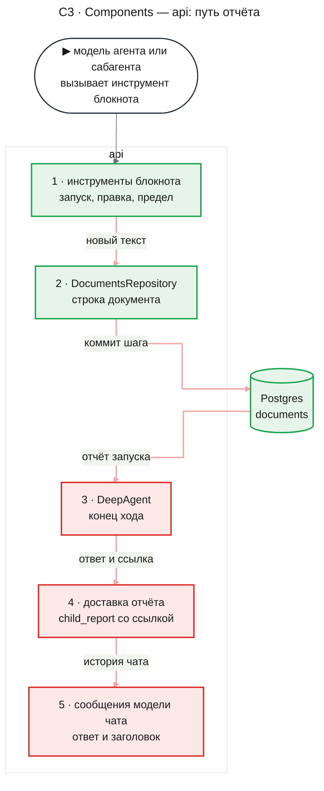
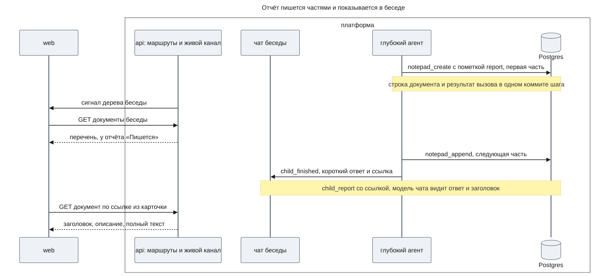

# Самообучение глубокого агента — Design Document — notepad

**Status:** На утверждении · **Date:** 2026-11-23 · **PRD:** [prd.md](./prd.md) · **UXRD:** [uxrd.md](./uxrd.md) · **Depends on:** нет

## Snapshot

**Overview.** Глубокий агент получает блокнот — место для больших текстов, которым не место в разговоре. Блокнот один на запуск: документы в нём пишут и читают сам глубокий агент и все его сабагенты, а хранятся они в таблице `documents`, поэтому их не теряют сжатие контекста, рестарт и продолжение беседы. Полный результат агент пишет частями в документ-отчёт и заканчивает коротким сообщением. Платформа кладёт в его ответ ссылку на отчёт: модель чата видит короткий ответ и заголовок, а сотрудник — документ целиком в ленте и на вкладке «Документы» панели беседы. Глубокий агент из каталога, кроме того, листает документы своих прошлых запусков у того же сотрудника как базу знаний.

- **Не меняется**: права на вызовы инструментов; инструменты чата и обычных агентов; движок задач, история и живой канал — блокнот встраивается в них и своих механизмов рядом не заводит.
- **Главный риск**: модель класса Haiku пишет весь отчёт в последнее сообщение и не создаёт документ. Конец хода не принимает ответ глубокого агента, пока в запуске нет документа-отчёта (KD-4).
- **Открытые вопросы**: нет.

### Key Decisions

#### KD-1: Документ — строка таблицы `documents`, привязанная к беседе глубокого агента

Запуск в движке — это задача глубокого агента, и у неё есть своя беседа с тем же id. Документ ссылается на эту беседу внешним ключом, и так блокнот принадлежит ровно одному запуску. Ключ по беседе того, кто вызвал инструмент, не подходит: у каждого сабагента своя беседа, и блокнот распался бы на части. Корень чата тоже не подходит: в одной беседе чата бывает несколько запусков. Продолжение беседы продолжает ту же задачу, поэтому документы остаются при ней (AC-34.4). Перезапуск через `POST /api/agents/:id/restart` создаёт нового агента, и у него новый пустой блокнот.

Текст документа — одна колонка `text`. Документ до предела (KD-5) помещается в одну строку Postgres, а хранение частями потребовало бы порядка частей и их сборки. У документа короткий номер (`id` — целое число): модель копирует его в вызовы, и число копируется надёжнее uuid. Отвергнуто: таблица списка задач `conversation_tasks` привязана к одной беседе, а `tool_results` — к вызову, и модель туда не пишет.

#### KD-2: Шесть инструментов в коммите шага; правка — дописать в конец или заменить точный фрагмент

Инструменты: `notepad_create`, `notepad_append`, `notepad_replace`, `notepad_read`, `notepad_list`, `notepad_past`. Все шесть устроены как инструменты списка задач: режим `in_commit`, регистрация в `SystemToolsRegistration.onModuleInit`, запись строки в той же транзакции, что результат вызова. Документ и ответ модели появляются вместе или не появляются вовсе, а повтор шага после рестарта пишет один раз. Имена инструментов — константы в `packages/contracts`.

Часть текста модель заменяет так: передаёт точный фрагмент, который встречается в документе ровно один раз, и новый текст вместо него. Это та же форма, что у инструмента правки текста `str_replace`, на котором учат модели семейства Claude, и малая модель повторяет её надёжно. Фрагмент не найден или найден несколько раз — отказ называет, сколько раз он нашёлся. Отвергнуты: замена раздела по заголовку — модель не всегда держит разметку Markdown, и заголовки повторяются; диапазон строк — номера сдвигаются после каждой правки; формат diff — малая модель ошибается в его синтаксисе.

Один ответ модели ограничен `AGENT_MAX_OUTPUT_TOKENS`, поэтому большой документ пишется частями: `notepad_create` с первой частью, затем `notepad_append`; описание инструмента это говорит. Модель получает в ответ номер, заголовок и размер документа в знаках и строках, но никогда не текст. Читает документ `notepad_read` страницами существующей функции `pageOf` с размером страницы `readMaxTokens` ключа `tool_result_settings`. У всех шести инструментов задан `loggedArgs`: в лог и Sentry идут номер, заголовок и длина текста, сам текст — нет.

#### KD-3: Запуск инструмент находит по `ToolCaller`, в котором появляется id родителя

`ToolCaller` получает поле `parentId`; `BaseAgent` заполняет его из задачи, у корня беседы оно `null`. Запуск для инструмента — сам вызывающий, когда он глубокий агент (`run.subagent` равен `null`), и его родитель, когда он сабагент. Сабагента запускает только глубокий агент инструментом `task`, поэтому родитель сабагента — всегда глубокий агент. Запуск берётся только из `ToolCaller`, никогда из аргументов модели.

Инструменты попадают в сессию по объявлению ([tool-declaration.md](../../code-system/patterns/tool-declaration.md)): шесть имён стоят в списке `tools` определения `deepAgentDefinition`, а пять, кроме `notepad_past`, — в списке `subagentDefinition`. Временный глубокий агент идёт по тому же определению и получает те же инструменты. Флажок самообучения на блокнот не влияет (AC-35.3). Чат и обычные агенты этих имён не объявляют и инструментов не получают. Отвергнуто: искать родителя запросом к беседе на каждом вызове — лишний запрос ради факта, который объект агента уже держит.

#### KD-4: Отчёт — документ с пометкой `report`; глубокий агент не заканчивает без него

`notepad_create` принимает флажок `report`: документ — отчёт сотруднику. Когда глубокий агент отвечает без вызовов инструментов, переопределение `DeepAgent.endOfTurn` сначала вызывает общий конец хода (`super`): открытые задачи и ответ финального сабагента. Затем оно ищет самый новый документ-отчёт запуска, созданный или дописанный после последнего события истории `continued`, а без такого события — любой документ-отчёт запуска; шаг, который сам продолжает запуск (флаг `continues`), всегда получает уведомление, потому что его событие ещё не записано. Если такого нет, ответ не принимается: в историю идёт уведомление «напиши полный результат документом с пометкой отчёта и закончи коротким сообщением», как уже делают уведомления об открытых задачах и о финальном сабагенте. Если он есть, задача завершается с результатом, где рядом с текстом ответа стоят номер и заголовок документа. Правило держит код, а не промпт: малая модель ненадёжно следует правилам промпта, а уведомление конца хода уже работает.

Когда версия называет финального сабагента, текстом результата остаётся его последний ответ, как сегодня. Поэтому `subagentDefinition` добавляет финальному сабагенту строку правила: полный результат пиши документом с пометкой отчёта, а последнее сообщение оставь коротким. Отчёт может написать и сам глубокий агент — правило конца хода требует только, чтобы документ-отчёт был записан после последнего старта или продолжения.

Так у отчёта один путь. У каждого завершённого запуска глубокого агента есть документ-отчёт, а у сабагентов и обычных агентов ссылка в результате пустая. Ссылка хранится в результате, а не находится при показе. Продолжение беседы завершает запуск ещё раз: агент пишет новый отчёт или дописывает прежний, и каждая карточка показывает текущий текст документа, на который ссылается. Модель чата видит короткий ответ и строку с заголовком отчёта; инструмента блокнота у чата нет (Won't Have). Отвергнуто: платформа сама превращает длинный ответ в документ — тогда длинный текст всё равно уходит модели чата, а ответ длиннее предела вывода обрезается.

#### KD-5: Предел документа — постоянное значение платформы; копии текста в истории принимаются

Документ не длиннее 200 000 знаков. Это постоянное значение в `packages/contracts`, а не настройка: администратору его не менять (`uxrd.md` AS-01). Запись, после которой документ стал бы длиннее, получает отказ с пределом и текущим размером, и документ не меняется.

Текст, который модель пишет инструментом, хранится трижды: в аргументах ответа модели, в копии аргументов в записи результата и в таблице. Копии в истории ограничены пределом одного ответа, а история и так хранит каждый ответ модели целиком. Убрать копию значило бы менять записи вызовов всех инструментов, поэтому три копии приняты.

#### KD-6: Прошлые документы — запуски того же агента из каталога у того же сотрудника, начатые из чата

`notepad_past` перечисляет документы запусков, где все условия верны:

- запуск начат тем же сотрудником;
- запуск идёт на любой версии того же агента (`agent_versions.agent_id`);
- это агент каталога, без встроенного ключа: все временные глубокие агенты идут на встроенном агенте по умолчанию, поэтому у временного агента перечень пуст;
- дерево беседы не удалено;
- родитель запуска — чат (`CHAT_TASK_TYPE`);
- это не текущий запуск.

Условие «родитель — чат» исключает беседы обучения и повторы: их запускает тренер внутри своего дерева. Это верно уже сейчас и останется верным, когда часть `training` добавит тип задачи тренера. В перечне — 30 документов, сначала недавно изменённые. `notepad_read` читает прошлый документ по тому же правилу. Отвергнуто: исключать дерево с корнем типа `trainer` — такого типа ещё нет, а условие на родителя-чат его не требует.

#### KD-7: Показ — два маршрута беседы, вкладка «Документы» и часть карточки отчёта; обновление по сигналу дерева

Документы показывает панель беседы чата: вкладка «Документы» перечисляет документы всех запусков беседы (UXRD DC-02), а карточка отчёта в ленте показывает свой документ по ссылке (UXRD DC-01). Поэтому маршруты стоят под беседой и проверяют владельца так же, как остальные маршруты бесед. Каждый коммит шага посылает сигнал дерева беседы, и веб перечитывает список и открытый документ по `live.onTree`, как список задач (`useAgentTasks`). Таймера опроса нет. Потоковой передачи аргументов инструментов тоже нет, поэтому документ растёт с каждой записанной частью, а не по словам.

## Terms

- **Запуск** — одна работа глубокого агента над заданием; в движке это задача `deep_agent` и её беседа.
- **Блокнот** — документы одного запуска.
- **Документ-отчёт** — документ с пометкой `report`, который платформа показывает сотруднику как результат запуска.
- **Коммит шага** — транзакция, в которой движок записывает итог шага агента: ответ модели, результаты вызовов и строки, которые записали инструменты `in_commit`.
- **Сигнал дерева** — уведомление `runtime_tree` с id корня беседы, которое движок посылает при каждом коммите шага; живой канал передаёт его вебу.

## Part

- **Prerequisite ADRs**: [ADR-0022](../../adr/ADR-0022-one-database-and-nestjs-modules.md) — одна база, таблица и репозиторий в `packages/db`; [ADR-0023](../../adr/ADR-0023-live-task-objects-one-stepping-process.md) — живой объект агента и его переопределения; [ADR-0024](../../adr/ADR-0024-every-reference-is-a-foreign-key.md) — обе ссылки документа под внешними ключами.

Часть покрывает FR-34 – FR-37 и ни от чего не зависит.

**Out of scope**

- Память агента и сотрудника — часть `memory`.
- Тренер и правило его дерева — часть `training`; она читает документы тем же путём ([что берёт `training`](#что-берёт-часть-training)).
- Внешний вид карточки и вкладки — UXRD DC-01, UXRD DC-02; дизайн задаёт данные, маршруты и то, какой компонент меняется.
- Удаление и правка документов человеком, скачивание, блокнот чата (PRD, Won't Have).

**Constraints**

- **Встроено в то, что есть.** Инструменты устроены как список задач и объявлены по [tool-declaration.md](../../code-system/patterns/tool-declaration.md), чтение страницами — существующая `pageOf`, доставка отчёта — существующие `child_finished` и `child_report`, живое обновление — сигнал дерева. Новое в части одно — таблица `documents`.
- **Без переменных окружения.** Предел документа — постоянное значение (KD-5), размер страницы — существующий ключ `tool_result_settings`.
- **Без переноса данных.** Миграция схемы генерируется заново, строки не переносятся ([Data Model](#data-model)).

## Building-block Inventory

Follows the [code system](../../code-system/README.md).

| Building block | Pattern | Status | Note |
|---|---|---|---|
| Таблица `documents` и `DocumentsRepository` | [repository-over-transaction.md](../../code-system/patterns/repository-over-transaction.md) | new | искали среди `conversation_tasks` и `tool_results`: первая привязана к одной беседе, во вторую модель не пишет (KD-1) |
| Шесть инструментов блокнота | [tool-declaration.md](../../code-system/patterns/tool-declaration.md) | new | по образцу инструментов списка задач (`task-list-tools.ts`) |
| Правило правки: дописать, заменить фрагмент, предел | [pure-decision.md](../../code-system/patterns/pure-decision.md) | new | чистая функция, как `decideTaskChange` |
| `ToolCaller` | — | extended | поле `parentId` (KD-3) |
| `deepAgentDefinition`, `subagentDefinition`, `DEEP_AGENT_RULES` | [immutable-versions.md](../../code-system/patterns/immutable-versions.md) | extended | имена инструментов и строка правила об отчёте |
| Конец хода `DeepAgent` | [step-handler.md](../../code-system/patterns/step-handler.md) | extended | уведомление без отчёта и ссылка в результате (KD-4) |
| Результат агента, `child_report`, сообщение модели чата | — | extended | поле `document` ([Contract Definitions](#результат-агента-и-отчёт-в-истории)) |
| `pageOf`, `linesOf` | — | reused | страницы документа |
| Маршруты бесед и `ConversationsService` | [auth-boundary.md](../../code-system/patterns/auth-boundary.md) | extended | два `GET` под `/api/threads/:threadId` |
| `AgentReport`, панель беседы `SchemaTabs`, клиент `threads-api-client` | [read-on-open.md](../../code-system/patterns/read-on-open.md) | extended | часть «Документ» в карточке, вкладка «Документы», перечитывание по `live.onTree` |
| Подписи инструментов `tools.json` | [interface-text.md](../../code-system/patterns/interface-text.md) | extended | шесть инструментов на обоих языках |

## Acceptance Criteria

DC-1 … DC-7 ниже — критерии этого дизайна. Экраны UXRD с похожими номерами везде названы с префиксом: UXRD DC-01, UXRD DC-02.

### FR-34: документы блокнота

- From the PRD: AC-34.1, AC-34.2, AC-34.3, AC-34.4.
- Когда запись сделала бы документ длиннее предела (KD-5), вызов получает отказ с пределом и текущим размером, а документ не меняется (DC-1).
- Когда фрагмент для замены не найден или найден больше одного раза, вызов получает отказ с числом найденных мест, а документ не меняется (DC-2).

### FR-35: один блокнот на запуск

- From the PRD: AC-35.1, AC-35.2, AC-35.3.
- У чата и обычного агента инструментов блокнота нет (DC-3).

### FR-36: отчёт — документ блокнота в чате

- From the PRD: AC-36.1, AC-36.2.
- Когда глубокий агент отвечает без вызовов, а документа-отчёта, записанного после последнего старта или продолжения запуска, нет, запуск не завершается: агент получает уведомление и продолжает (DC-4).
- Модель чата получает в отчёте ребёнка короткий ответ и заголовок документа, но не его текст (DC-5).

### FR-37: прошлые документы

- From the PRD: AC-37.1, AC-37.2, AC-37.3.
- У временного глубокого агента перечень прошлых документов пуст (DC-6).
- Документы удалённой беседы и запусков, чей родитель не чат, в перечень не входят (DC-7).

## Design

### Architecture (C1–C4)

Блокнот живёт в процессе `api`: пакет `agents` пишет и читает документы в шагах агента, а маршруты бесед отдают их вебу. Новых контейнеров нет; в `web` меняются карточка отчёта и панель беседы (KD-7).

#### C3 · Components: api

**api — путь отчёта от инструмента до модели чата**

Инструменты блокнота берут запуск из `ToolCaller` (KD-3), считают новый текст чистым правилом правки и проверяют предел до записи. `DeepAgent` читает самый новый документ-отчёт запуска в конце хода и кладёт его номер и заголовок в результат задачи (KD-4). Доставка отчёта ([deliver.ts](../../../packages/agents/src/agent/deliver.ts)) переносит ссылку из результата в запись `child_report` истории чата. Сообщения модели чата (`provider-messages.ts`) показывают модели короткий ответ и строку с заголовком документа.

### Runtime Flows

#### Flow 1: отчёт пишется частями и показывается в беседе

**Starts when:** глубокий агент пишет отчёт, for AC-34.1, AC-34.3, AC-35.1, AC-36.1, AC-36.2

Каждая часть видна вебу после коммита своего шага. Перед `child_finished` конец хода глубокого агента нашёл документ-отчёт; без него агент получил бы уведомление и продолжил работу (DC-4). Если сервер упал посреди записи, коммит шага не прошёл: документа без результата вызова нет, и повтор шага пишет часть один раз (AC-34.4). Сабагент пишет в тот же блокнот, потому что его запуск — родитель (KD-3, AC-35.1). Маршруты только читают, поэтому изменить документ из веба нечем (AC-36.2).

### Contract Definitions

#### Инструменты блокнота

Каждый инструмент работает в коммите шага и находит запуск по вызывающему (KD-3). Отказ приходит модели как `refused` с причиной `invalid_arguments` и текстом, который называет причину; документ при отказе не меняется.

- **`notepad_create`** — создаёт документ в блокноте запуска из `title` (до 200 знаков), `description` (одна строка до 300 знаков для перечней), `text` (первая часть, может быть пустой) и `report` (документ — отчёт сотруднику). Возвращает номер, заголовок и размер в знаках и строках. Отказ — текст длиннее предела документа.
- **`notepad_append`** — дописывает `text` в конец документа `document` (номер). Возвращает номер, заголовок и новый размер. Отказы: документа нет в блокноте запуска; итог длиннее предела; документ изменился в параллельном шаге после чтения — повторите.
- **`notepad_replace`** — заменяет в документе `document` фрагмент `old`, который встречается ровно один раз, на `new` (может быть пустым). Возвращает номер, заголовок и новый размер. Отказы: те же, что у `notepad_append`, и фрагмент найден 0 или больше одного раза — с числом мест.
- **`notepad_read`** — страница документа `document` от строки `offset` (с 1) не больше `limit` строк. Возвращает номер и заголовок, строку-баннер `pageOf` с номерами строк и следующей страницей, затем текст страницы; страницы склеиваются в документ точно. Размер страницы — `readMaxTokens` ключа `tool_result_settings`. Читает документ своего запуска и прошлый документ по правилу KD-6; любой другой номер — «документ не найден».
- **`notepad_list`** — документы блокнота запуска в порядке создания: номер, заголовок, описание, пометка отчёта, кто писал последним, размер. Аргументов нет.
- **`notepad_past`** — до 30 прошлых документов по правилу KD-6, сначала недавно изменённые: номер, заголовок, описание, дата изменения. Аргументов нет. Пустой перечень отвечает одной строкой, которая называет и временного агента: условие «агент каталога» стоит в запросе, поэтому у временного агента перечень всегда пуст. Только у глубокого агента.

`DEEP_AGENT_RULES` получает строку: полный результат для сотрудника пиши документом блокнота с пометкой отчёта, большой — частями, а последнее сообщение оставь коротким и назови в нём документ. Финальный сабагент получает такую же строку (KD-4).

#### Результат агента и отчёт в истории

- **`AgentResultSchema`** (`packages/agents/src/agent/deliver.ts`) — результат завершённой задачи агента: `report` (текст последнего ответа, у глубокого агента короткий) и `document` (номер `id` и `title` документа-отчёта у глубокого агента, `null` у всех остальных). `reportOf` по-прежнему отдаёт текст, и его читатели — `DeepAgent.finalSubagentReport`, правила делегирования, `childReport` — не меняются. Копию схемы `ReportSchema` в `view-operations.ts` заменяет `reportOf`.
- **`ChildFinishedPayload.result`** (`packages/contracts/src/runtime.ts`) — без изменений: поле несёт результат как есть.
- **`child_report`** — содержимое записи истории (`HistoryContent` в `packages/agents/src/history/history.ts`, `HistoryEntrySchema` в `packages/contracts/src/chat.ts`) получает поле `document`: `{ id, title }` или `null`. Вид записи тот же, поэтому перечень видов и проверка колонки `messages.kind` не меняются. Модель чата видит после текста отчёта строку с заголовком документа и пометкой, что сотрудник видит документ в беседе.

#### Маршруты беседы

Оба маршрута берут сотрудника из сеанса и проверяют, что беседа его и не удалена, тем же путём, что остальные маршруты `/api/threads/:threadId`. Чужая, удалённая и несуществующая беседа отвечают одинаково.

- **`GET /api/threads/:threadId/documents`** — документы всех запусков беседы, сначала недавно изменённые. Возвращает `{ documents }` из `DocumentSummary`. 404 `THREAD_NOT_FOUND`.
- **`GET /api/threads/:threadId/documents/:documentId`** — один документ целиком. Возвращает `Document`. 404 `THREAD_NOT_FOUND`; 404 `DOCUMENT_NOT_FOUND`, когда документа с таким номером нет в запусках этой беседы.

То же верно для беседы обучения, которую построит часть `training`: её владелец видит на этих маршрутах документы повторов, у каждого — кто писал; ничего отдельного для этого не строится.

**DocumentSummary**

- `id` — номер документа; по нему карточка отчёта читает документ.
- `agentId` — запуск: id глубокого агента, в чьём блокноте документ.
- `title`, `description` — заголовок и строка описания.
- `report` — документ-отчёт.
- `writer` — имя участника запуска, который писал последним: глубокого агента или сабагента.
- `chars` — размер текста в знаках.
- `writing` — запуск ещё работает; веб показывает «Пишется».
- `updatedAt` — время последней записи.

**Document** — поля `DocumentSummary` и `text`, весь текст.

**Error handling**

- `DOCUMENT_NOT_FOUND` — новый код в `ThreadsErrorCodeSchema`, 404: номер не число или документа с ним нет в беседе. Веб показывает «Не удалось загрузить документ» с «Повторить» (`uxrd.md` MC-13).

#### Веб

- **`AgentReport`** — когда у `child_report` есть `document`, под коротким ответом стоит часть «Документ»: заголовок, описание и текст Markdown, свёрнутый по UXRD DC-01, с копированием. Карточка читает документ вторым маршрутом и перечитывает его по `live.onTree` своей беседы.
- **Панель беседы** — `SchemaTabs` и `SchemaTab` из `workspace-store.ts` получают третью вкладку «Документы · {n}» (UXRD DC-02): она появляется с первым документом беседы, а число — размер перечня из первого маршрута; открытый документ читается вторым маршрутом. Хук перечитывает их по `live.onTree`, как `useAgentTasks`.
- **Клиент** — две функции чтения в `threads-api-client.ts`; типы и схемы ответов — из `packages/contracts`.
- **Вызовы инструментов** — подписи шести инструментов и их аргументов в `tools.json` на обоих языках (UXRD MC-13). Существующий блок вызова инструмента показывает второй строкой заголовок документа: у `notepad_create` — из аргумента `title`, у остальных — из первой строки результата `Document {id}: {title}`, с которой начинается ответ каждого инструмента одного документа.

#### Что берёт часть `training`

Тренер читает документы прошлых бесед тем же путём: репозиторий отдаёт документы запуска по его беседе, а страницы режет `pageOf`. Правило, какие беседы тренер видит, и его дерево задаёт часть `training`; блокнот для неё ничего отдельно не строит.

### Data Model

Пример. Сотрудница Анна запускает из чата глубокого агента «Разбор ошибок оплаты»; его беседа — `a1`. Сабагент «Сбор» создаёт документ 41 «Черновик выкладок». Сам глубокий агент создаёт документ 42 «Почему с 14:00 падают оплаты» с пометкой отчёта и дописывает его тремя частями. Обе строки ссылаются на беседу `a1`, а у строки 41 последний писавший — беседа «Сбора». Через неделю новый запуск того же агента у Анны видит документ 42 в `notepad_past`, а запуск у Бориса — нет.

Строка `documents` — один документ одного запуска:

- `id` — номер документа, целое число, которое выдаёт база;
- `conversation_id` — беседа глубокого агента, то есть запуск; внешний ключ на `conversations` с каскадным удалением;
- `title` и `description` — заголовок и строка для перечней;
- `text` — весь текст документа;
- `report` — документ-отчёт;
- `updated_by` — беседа участника запуска, который писал последним; внешний ключ на `conversations` с каскадным удалением;
- `created_at`, `updated_at`.

**Invariants**

1. Документ принадлежит ровно одному запуску, и инструменты пишут только в блокнот запуска вызывающего.
2. Текст документа не длиннее предела (KD-5).
3. Запись меняет документ, только если он не менялся с тех пор, как инструмент его прочёл; иначе вызов получает отказ, и параллельные шаги сабагентов не теряют записи друг друга.

Удаление беседы мягкое: строки остаются, как остаются сообщения и список задач. Маршруты видят только живую беседу, а перечень прошлых документов отбрасывает удалённые деревья (KD-6). Каскад сработает при будущей физической очистке.

Миграция схемы генерируется заново (`pnpm db:generate`). Встроенных строк часть не добавляет, данных не переносит: базу разработки создают заново.

## Test Strategy

Тесты пишутся один раз, в конце фичи.

- **UC-1: документы не выходят за сотрудника и агента** — covers AC-35.2, AC-37.1, AC-37.2, AC-37.3, DC-6, DC-7
  - Given: у Анны и Бориса есть завершённые запуски агента «Разбор ошибок оплаты» с отчётами; у Анны есть ещё отчёт другого агента, отчёт удалённой беседы и запуск временного агента
  - When: новый запуск Анны вызывает `notepad_past` и `notepad_read` с номером отчёта Бориса; Борис запрашивает документ Анны обоими маршрутами
  - Then: перечень Анны содержит только её отчёт этого агента из неудалённой беседы; чтение отчёта Бориса отвечает «документ не найден»; Борис получает 404 `THREAD_NOT_FOUND`; у временного агента перечень пуст
- **UC-2: отчёт частями и показ** — covers AC-34.1, AC-34.2, AC-34.3, AC-35.1, AC-35.3, AC-36.1, AC-36.2, DC-4, DC-5
  - Given: глубокий агент с выключенным самообучением и сабагентом; модель — тестовая
  - When: сабагент создаёт черновик; глубокий агент отвечает без отчёта, получает уведомление, создаёт отчёт, дописывает его, заменяет абзац, дочитывает черновик по страницам и отвечает коротко
  - Then: запуск завершён со ссылкой на отчёт; `child_report` чата несёт ссылку, а модель чата видит короткий ответ и заголовок; маршрут документа отдаёт полный текст с дописанным и новым абзацем
- **UC-3: рестарт посреди записи и продолжение** — covers AC-34.4, DC-4
  - Given: глубокий агент вызвал `notepad_append`
  - When: процесс падает до коммита шага, затем сервер поднимается; после завершения сотрудник продолжает беседу, и агент отвечает, не тронув отчёт
  - Then: часть записана один раз; продолжение видит тот же документ в `notepad_list`; ответ без новой записи в отчёт получает уведомление
- **UC-5: отчёт финального сабагента** — covers AC-36.1, DC-5
  - Given: версия глубокого агента называет финального сабагента
  - When: финальный сабагент пишет документ-отчёт и отвечает коротко, затем глубокий агент заканчивает
  - Then: результат запуска несёт короткий ответ сабагента и ссылку на его документ
- **UC-4: предел документа** — covers DC-1
  - Given: документ на 100 знаков меньше предела
  - When: модель дописывает 200 знаков
  - Then: вызов получает отказ с пределом и размером, документ не изменился

Сжатие контекста документов не касается: оно переписывает историю, а не таблицу, поэтому отдельного теста у этой части AC-34.4 нет. Отказ замены (DC-2) и отсутствие инструментов у чата (DC-3) отдельных тестов не получают: первое — чистое правило, второе задают списки определения.

## Security Considerations

- **Authentication & Authorization**: инструменты берут запуск и сотрудника только из `ToolCaller`; номер документа из аргументов ищется внутри блокнота запуска или внутри правила KD-6, где запрос сам фильтрует по сотруднику. Маршруты проверяют владельца беседы и то, что документ принадлежит её запуску; чужое отвечает 404 так же, как несуществующее.
- **Input Validation**: аргументы инструментов проверяет их схема с пределами длины; итог правки проверяется по пределу документа до записи. Номер в маршруте не число — 404 `DOCUMENT_NOT_FOUND`.
- **Sensitive Data Handling**: текст документа не попадает в лог и Sentry (`loggedArgs`). Прошлый документ модель получает результатом инструмента, то есть как данные, а не инструкции. Документ видит только сотрудник, чья беседа; исключение для тренера описывает часть `training`.

## Risks and Mitigation

- **Модель пишет весь отчёт в последнее сообщение** — высокая вероятность у малой модели. Конец хода требует документ-отчёт (KD-4), а строка правила и описание `notepad_create` говорят, как писать; длину последнего сообщения платформа не проверяет.
- **Отчёт растёт до предела, а лента становится длинной** — средняя вероятность. Предел документа (KD-5); карточка сворачивает текст (UXRD DC-01).
- **Сабагенты пишут один документ параллельно** — низкая вероятность. Запись поверх изменённого документа получает отказ и повторяется (инвариант 3).
- **История растёт на копиях текста** — средняя вероятность. Принято (KD-5); копии ограничены пределом одного ответа.

## Update History

| Version | Date | Change |
|---------|------|--------|
| 1.0 | 2026-11-23 | Initial version |
| 1.1 | 2026-11-24 | Сверено с кодом: продолжение по событию `continued`, строка пустого перечня, первая строка ответа инструментов |
