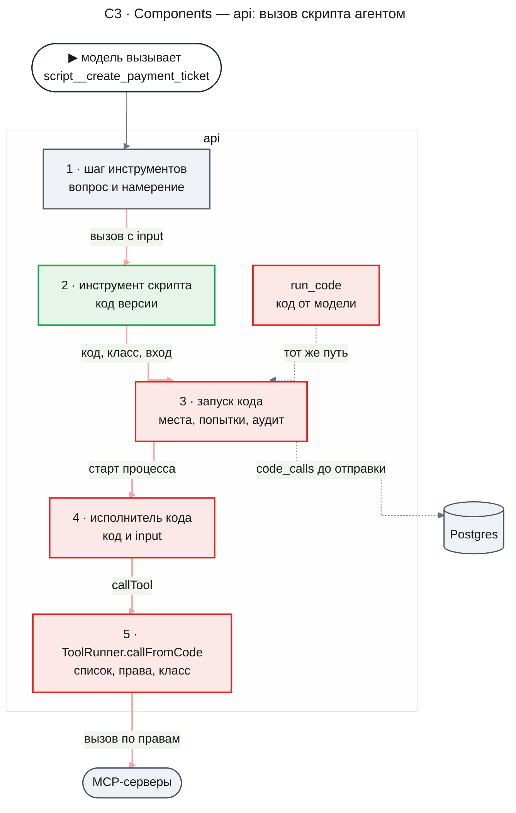
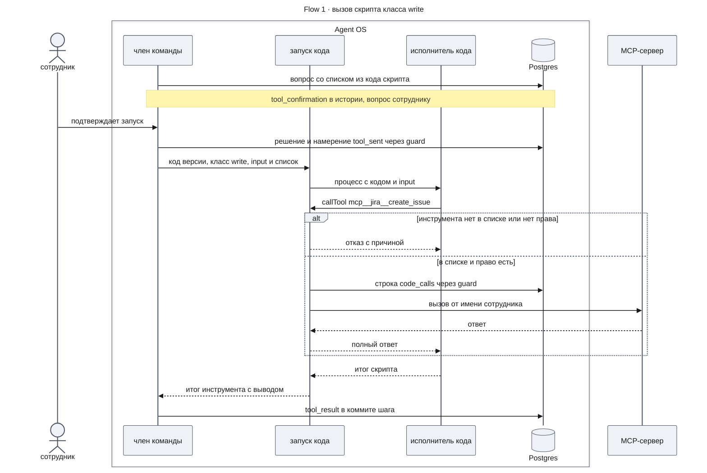

# Самообучение глубокого агента — Design Document — scripts

**Status:** На утверждении · **Date:** 2026-11-23 · **PRD:** [prd.md](./prd.md) · **UXRD:** [uxrd.md](./uxrd.md) · **Depends on:** нет

## Snapshot

**Overview.** Глубокий агент получает сохранённые скрипты: код на JavaScript, который лежит в версии агента и который агент или один его сабагент вызывает как свой инструмент. Скрипт — это `run_code` с кодом из версии вместо кода от модели. Вызов скрипта и вызов `run_code` входят в одно исполнение: тот же исполнитель кода, та же проверка каждого вызова из кода по правам сотрудника, тот же аудит до отправки и та же обработка рестарта. Скрипт, который меняет данные, подтверждается так же, как запуск `run_code` класса `write`: каждый запуск ждёт решения сотрудника, а карточка решения показывает список «Может вызвать», выведенный из кода в этот момент. Чтобы обучение могло предложить версию, не включая её, запись версии делится на две: создать версию и сделать её активной.

- **Не меняется**: исполнитель кода, его пределы и мост; вопрос сотруднику и его карточка у `run_code`; права и аудит вызовов; экраны (их строит `training-web`).
- **Главный риск**: скрипт пишет во внешнюю систему без ведома сотрудника. Каждый запуск класса `write` ждёт его решения, а вызовы вне показанного списка получают отказ до сервера.
- **Открытые вопросы**: нет.

### Key Decisions

#### KD-1: Скрипты — список `scripts` в содержимом версии глубокого агента; новой таблицы нет

Скрипт — часть определения агента, как промпт: он меняется только новой версией, беседа держит свою версию до конца (AC-12.2), а копия получает его вместе с определением. Всё это уже даёт неизменная версия ([immutable-versions.md](../../code-system/patterns/immutable-versions.md)). Поэтому скрипты — поле `scripts` в `DeepAgentContentSchema`: один список на версию, у скрипта — имя, описание, описание входа, код, класс и владелец (`owner`: `null` — сам глубокий агент, иначе имя сабагента). Код проверяется тем же правилом, что код `run_code`: предел 64 KiB и запрет скрытых символов выносятся из закрытой части `RunCodeArgsSchema` в общее место `packages/contracts`.

#### KD-2: Чат скрипты не меняет; правка, которая оставляет скрипт без владельца, получает отказ

Скрипты пишет автор на карточке, а позже тренер; модель чата код в версию не пишет. Инструменты записей не принимают поле `scripts`, а сохранение из чата берёт скрипты прежней версии — так же, как сегодня флажок самообучения (`withSelfLearning`, `library-chat.service.ts`). Если правка через чат убирает или переименовывает сабагента, которому принадлежит скрипт, собранное содержимое снова проверяется схемой вида, и чат получает отказ с путём `scripts.<i>.owner` ещё до карточки `library.record`. Скрипт молча не пропадает.

#### KD-3: Создание версии отделено от активации — два метода репозитория вместо `insertVersion`

Сегодня `AgentsRepository.insertVersion` вставляет версию и сразу переводит на неё указатель. Обучению нужна неактивная версия (FR-17) и активация позже. Поэтому метод делится на два:

- `createVersion` вставляет версию со следующим номером и автором-сотрудником и не трогает строку агента. Часть `training` расширяет его своим автором (`agent_versions.training_id`, [design-training.md](./design-training.md), KD-6).
- «Сделать активной» переводит указатель на заданную версию вместе с именем и описанием, только если агент не удалён и указатель ещё стоит на ожидаемой версии.

Сохранение сотрудника зовёт оба в своей точке сохранения: та же транзакция, те же 409 `RECORD_VERSION_CONFLICT` и `RECORD_NAME_TAKEN`. `insertVersion` удаляется: другого вызывающего, кроме `LibrarySave.updateSaved`, у него нет.

#### KD-4: Скрипт — внешний инструмент своего владельца под именем `script__<имя>` с одним аргументом `input`

Скрипт видит только член команды, которому он принадлежит (AC-12.1). `runDefinition` отдаёт скрипты этого члена, объявление инструментов (`ToolDeclaration`) несёт их как данные, а реестр строит из каждого инструмент сессии рядом с `run_code`, в `toolsFor` и в `checkTools` ([tool-declaration.md](../../code-system/patterns/tool-declaration.md)). Встроенный `general-purpose` строится вне `content.subagents` (`delegationTeam`) и скриптов не владеет.

Приставка `script__` не даёт скрипту совпасть ни с системным инструментом, в том числе с будущим, ни с MCP-инструментом: `checkCall` берёт первое совпадение имени и затенил бы инструмент молча. По ней же история и веб узнают вызов скрипта. Вход у всех скриптов один — аргумент `input`, любое значение JSON; описание входа идёт в описание инструмента, поэтому схема zod одна на все скрипты.

#### KD-5: Один путь запуска кода; подтверждение `write` — как у `run_code`

Исполнение, которое сегодня живёт внутри `createRunCodeTool`, становится общим запуском кода: код, класс, вход, описание и имя скрипта (у `run_code` — нет). `run_code`, инструмент скрипта и пробный запуск `try_script` части `training` — тонкие входы в него. Дальше путь один: места сотрудника, попытки чтения, снимок инструментов серверов вызывающего, строка `code_calls` через `guard` до отправки, `ToolRunner.callFromCode`, маска секретов, тексты ошибок.

Подтверждение у скрипта то же, что у `run_code`. Вопрос нужен классу `write`. Его содержимое — `{ canCall }` той же схемы `RunCodeConfirmationContentSchema`, а список выводит существующий `canCallOf` из кода скрипта над набором проверки сессии владельца в момент вызова. После решения содержимое приходит в исполнение как `confirmed`, и запуск зовёт только инструменты из него (`confirmedNamesOf`). Список в версии не хранится.

Общий код сегодня узнаёт запуск по имени `run_code`. Чтобы скрипт не требовал второй ветки:

- признак «вызов — запуск кода» один: функция `packages/contracts` по паре «инструмент, сервер» ([Contract Definitions](#contract-definitions)). Её зовут `CallRecords`, журнал шага модели, запрет вызовов из кода и веб;
- класс прерванного запуска больше не читается из аргументов `run_code`. Запуск класса `write` всегда пишет намерение `tool_sent` до старта, а `read` — никогда. Поэтому `CallRecords.close` закрывает открытые вызовы из кода по наличию намерения: есть — `unknown`, нет — `interrupted`. Закрытый вызов сохраняет свой исход, какой бы он ни был. Запуск, прерванный сигналом, берёт класс из самого запуска, а `startAttempt` зовут только для класса `read`.
#### KD-6: Скрипт получает вход глобальным `input`; предел тела JSON — 2 MiB

Запрос `CodeRunner.run` получает значение `input`, кадр старта его несёт, а песочница кладёт его в глобальное имя `input` рядом с `callTool`, `readResult` и `console`. У `run_code` значение — `null`, поэтому API скрипта одинаково в каждом запуске, как требует ADR-0011, а исполнитель по-прежнему ничего не знает об агентах.

Предел тела JSON у API сейчас по умолчанию — 100 KB, а один скрипт весит до 64 KiB, поэтому `configureApp` (`apps/api/src/app.setup.ts`) задаёт предел 2 MiB. Отдельного правила общего размера нет: сохранение, чьё тело больше 2 MiB, получает отказ 413 от предела тела, и активная версия не меняется. Это десятки скриптов обычного размера, но не 100 скриптов по 64 KiB. Там же собирается HTTP тестового приложения, поэтому предел действует и в тестах. Это постоянная сервера, а не настройка.

## Part

Часть покрывает FR-12 – FR-14. Её контракты потребляют:

- **`training`** — `createVersion`, который она расширяет автором-обучением, и «сделать активной» с ожидаемой версией-основой (KD-3); общий запуск кода для `try_script` и повторов. В повторе вопроса сотруднику нет, но запуск класса `write` всё равно пишет намерение `tool_sent` до старта: исход после рестарта берётся по намерению (KD-5). Правило «запись записывается и не отправляется» и исход `recorded` ставит `training` в единственной отправке MCP, через которую идут и вызовы из скриптов ([design-training.md](./design-training.md), KD-3).
- **`training-web`** — `scripts` в содержимом записи, сохранение существующими телами `POST` и `PUT`, признак «вызов — запуск кода», описание скрипта в `toolTitle` вида вызова (AC-24.3).

- **Prerequisite ADRs**: [ADR-0011](../../adr/ADR-0011-code-runner-quickjs-process.md) (недоверенный код — только через `CodeRunner.run`, правила держит процесс API), [ADR-0017](../../adr/ADR-0017-run-snapshots-from-library.md) (запуск идёт по снимку из библиотеки), [ADR-0021](../../adr/ADR-0021-deep-agent-record-kind.md), [ADR-0022](../../adr/ADR-0022-one-database-and-nestjs-modules.md), [ADR-0023](../../adr/ADR-0023-live-task-objects-one-stepping-process.md).

**Out of scope**

- Экраны (скрипты на карточке, их правка, блок вызова скрипта в чате) — `training-web`; тренер, повтор, `try_script`, права обучать и активировать — `training`.
- Ручной запуск скрипта с карточки и скрипты обычного агента.
- Исполнитель кода, его пределы (`CODE_RUN_*`) и мост, `canCallOf`, вопрос сотруднику и его карточка. Копирование: `planCopy` переносит содержимое целиком, поэтому скрипты копируются без нового кода.

**Constraints**

- PoC: `insertVersion` и ветки по имени `run_code` удаляются в том же изменении; базы создаются заново, поле `scripts` по умолчанию пустое.
- Без новых таблиц, колонок, настроек и переменных окружения.
- Логи — через обёртку из `packages/common`, с именем скрипта и номером версии, без кода и без значения `input`.

## Building-block Inventory

Follows the [code system](../../code-system/README.md). Перед `new` искал хранимый код в `packages/contracts/src/library.ts`, в схеме `packages/db/src/schema`, в `tool_results` и в реестре инструментов: его нет, ближайшее — `run_code`.

| Building block | Pattern | Status | Note |
|---|---|---|---|
| `scripts` в `DeepAgentContentSchema`; `createVersion` и «сделать активной»; сохранение из чата | [immutable-versions.md](../../code-system/patterns/immutable-versions.md) | extended | KD-1 – KD-3 |
| `runDefinition`, `ToolDeclaration`, `ToolRegistry` | [tool-declaration.md](../../code-system/patterns/tool-declaration.md) | extended | KD-4 |
| Запуск кода, `CallRecords`, `call-state`, журнал шага модели, `code-call.ts`, `ViewOperations` | — | extended | KD-5; признак «вызов — запуск кода» — new, в `packages/contracts` |
| `CodeRunner.run`, песочница, `configureApp` | — | extended | KD-6 |
| `copy-rules.ts`, `canCallOf`, `ToolRunner.callFromCode`, `AccessGate` | — | reused | — |

## Acceptance Criteria

- **FR-12**: AC-12.1, AC-12.2. Скрипт с именем вне правила, два скрипта с одним именем без учёта регистра, владелец не из команды или больше 100 скриптов — сохранение получает 400 `VALIDATION_FAILED` с путём `scripts.<i>`, активная версия не меняется (DC-1). Правка через чат скриптов не меняет, а правка, которая убирает владельца скрипта, получает отказ (DC-2).
- **FR-13**: AC-13.1, AC-13.2, AC-13.3. Скрипт не вызывает ни `run_code`, ни скрипт, ни системный инструмент: отказ `not_callable_from_code` (DC-3).
- **FR-14**: AC-14.3 — каждый запуск класса `write` ждёт решения сотрудника, вопрос показывает список, выведенный в момент вызова. Вызов вне списка получает отказ до сервера (DC-6). Подтверждённый вызов, чей шаг потерян после намерения, после рестарта не исполняется снова: вызов и его открытые строки `code_calls` закрыты `unknown` (DC-4).
- Версия, созданная `createVersion`, не активна; «сделать активной» после смены активной версии ничего не меняет (DC-5).

## Design

### Как часть встраивается в работу системы

Пример. У глубокого агента «Разбор ошибок оплаты» Аня сохраняет два скрипта. `count_errors_by_service` класса `read` принадлежит сабагенту `researcher` и считает ошибки через `mcp__logs__search`. `create_payment_ticket` класса `write` принадлежит самому агенту и заводит задачу через `mcp__jira__create_issue`. Когда агент в беседе Бориса вызывает `script__create_payment_ticket`, Борис видит карточку решения со списком: `mcp__jira__create_issue` меняет, `mcp__logs__search` читает.

C1 и C2 не рисуются: люди, процессы, база и внешние системы те же. Сохранение идёт прежним путём `LibrarySave` с двумя записями KD-3.

#### C3 · api — вызов скрипта

- **Инструмент скрипта** строит реестр из скрипта объявления. Модуль запуска кода отдаёт реестру при старте `run_code` и способ построить инструмент скрипта — одним вызовом вместо `useRunCode`.
- **Запуск кода** делит одни места сотрудника между всеми входами и пишет в лог начала имя скрипта и номер версии.
- **`ToolRunner.callFromCode`** меняется только в запрете: `run_code` и любой `script__…` получают `not_callable_from_code`.

### Runtime Flows

#### Flow 1: агент вызывает скрипт класса `write`

**Starts when:** модель члена команды вызывает свой скрипт класса `write`, for AC-12.1, AC-13.1, AC-13.3, AC-14.3, DC-3, DC-4, DC-6

Отказ тоже пишет строку `code_calls`: открытую через `guard`, затем закрытую `refused` с причиной `not_in_confirmed_script`, `no_access` или `changing_in_read_run`, как у `run_code`. Скрипт класса `read` идёт без вопроса и без намерения, а меняющий инструмент получает `changing_in_read_run` (AC-13.1, AC-13.2). Ошибка скрипта возвращается модели как `tool_error` с причиной и строкой.

Рестарт обрабатывается тем же кодом, что у `run_code`. Шаг подтверждённого запуска, потерянный после намерения, вызов снова не отправляет: шаг инструментов закрывает его `unknown`, а `CallRecords.close` закрывает его открытые строки `code_calls` тоже `unknown` (KD-5, DC-4). Запуск класса `read` после потерянного шага начинается со второй попыткой, а после второй потери кончается текстом «прервано рестартом дважды».

### Contract Definitions

**Скрипт в содержимом глубокого агента** (`DeepAgentContentSchema.scripts`, `packages/contracts`) — до 100 скриптов, по умолчанию пусто. Версия агента держит много скриптов, и сам глубокий агент и каждый сабагент может владеть несколькими. Скрипты версионируются вместе с версией агента: любая их правка — новая версия, отдельной истории у скрипта нет. Поля скрипта:

- `name` — латинская буква, затем латинские буквы, цифры и `_`, до 48 символов; в версии имена не повторяются без учёта регистра.
- `description` — когда звать скрипт и что он возвращает, 1–1 000 символов.
- `input` — описание входа словами, до 1 000 символов, может быть пустым.
- `code` — по общему правилу кода: до 64 KiB в UTF-8, без скрытых символов.
- `class` — `read` или `write`, тот же набор, что у `run_code`.
- `owner` — `null` или имя сабагента из `subagents`; `general-purpose` владельцем не бывает.

**Запись версии** (`AgentsRepository`, `packages/db`):

- `createVersion` — агент, содержимое, автор-сотрудник. Вставляет версию со следующим номером, строку агента и указатель не трогает. Ответ — id и номер версии или `number_taken`, когда номер занят одновременной записью.
- «Сделать активной» — агент, id версии, номер ожидаемой версии, имя и описание. Ответ — `activated`, `stale` или `name_taken`. Версия чужого агента невозможна: указатель стоит под внешним ключом на пару «агент, версия».

**Инструмент скрипта** (для модели владельца) — `script__<name>`, вид `external`, описание — `description` и строка с описанием входа. Аргументы — объект с необязательным `input` (JSON до 64 KiB), который песочница отдаёт скрипту глобальным `input`. Итог — как у `run_code`, с выводом скрипта (`output`); класс `write` спрашивает решение с содержимым `{ canCall }`, аргументы на карточке не правятся.

**История и веб.** Вызов скрипта лежит в истории с инструментом `script__<name>` и сервером `null`. Функция `packages/contracts` по паре «инструмент, сервер» говорит, что вызов — запуск кода, и отдаёт имя скрипта без приставки. Эта часть заводит в ней `run_code` и `script__…` с сервером `null`; часть `training` добавляет свой пробный запуск. Описание скрипта вид вызова несёт в `toolTitle` (`ToolDisplay`): его ставит `ViewOperations` там же, где `ToolRegistry.displays` даёт заголовки MCP-инструментов, — по скриптам версии сессии; в историю оно не пишется. Код в историю не пишется: строку `code_calls` связывает с кодом беседа, а беседу — её неизменная версия.

## Test Strategy

Тесты пишутся один раз, в общем проходе тестов в конце фичи. Исполнитель, мост, места и попытки уже покрывают тесты `code-execution`.

- **Главный путь и изоляция** — covers AC-12.1, AC-12.2, AC-13.1, AC-13.3, DC-1, DC-3. Модульный тест `runDefinition` и набора реестра: у `researcher` есть `script__count_errors_by_service`, у глубокого агента, другого сабагента, `general-purpose` и чата — нет. Интеграционный, `packages/agents`: скрипт `read` вызывает читающий инструмент и инструмент без права у сотрудника; вызов записан в `code_calls` от имени сотрудника, второй отказан.
- **Запись не уходит без решения** — covers AC-13.2, AC-14.3, DC-6. Интеграционный, `packages/agents`: скрипт `write` ждёт решения, вопрос несёт список из кода; вызов вне списка и меняющий вызов из скрипта `read` до сервера не доходят.
- **Рестарт** — covers DC-4. Интеграционный, `packages/agents`: подтверждённый запуск `write`, шаг потерян после намерения; скрипт не исполнен второй раз, вызов и его открытые строки `code_calls` закрыты `unknown`.
- **Версия без активации и чат** — covers DC-2, DC-5. Интеграционный, `packages/db`: созданная версия не активна, активация после смены указателя — `stale`. Интеграционный, `apps/api`: правка промпта через чат сохраняет скрипты; правка, убирающая владельца, получает отказ.

## Security Considerations

- **Authentication & Authorization**: каждый вызов из скрипта идёт через `ToolRunner.callFromCode` по правам сотрудника, от чьего имени идёт беседа. Скрипты сохраняет только тот, кто правит агента (`LibrarySave.checkSave`). Чужой скрипт недоступен: набор сессии строится из объявления своего члена команды.
- **Input Validation**: код — общее правило кода, имена — правило имени, `input` — предел размера. Песочница и мост — ADR-0011 без изменений.
- **Sensitive Data Handling**: итог и вывод скрипта проходят маску секретов; логи не несут ни кода, ни `input`.
- **Внедрение через код**: модель чата скрипты не пишет (KD-2), а каждый запуск класса `write` подтверждает сотрудник.

## Risks and Mitigation

- **Скрипт строит имя инструмента во время работы** — низкий. Такое имя не попадает в список из кода, и вызов получает отказ `not_in_confirmed_script` с именем инструмента.
- **Много скриптов у одного члена команды** — средний. Каждый скрипт — отдельный инструмент, и его описание занимает контекст модели на каждом шаге; у члена команды с десятками скриптов модель хуже выбирает инструмент и тратит больше токенов. Автор держит у члена команды только нужные скрипты; отдельного механизма нет.
- **Вызов скрипта в чате до `training-web`** — средний. Пока веб не знает варианта «Скрипт агента», вызов показан как вызов встроенного инструмента.

## Update History

| Version | Date | Change |
|---------|------|--------|
| 2.0 | 2026-11-23 | Скрипты в версии глубокого агента, до 100; инструмент `script__<name>` своего владельца; один путь запуска кода с `run_code`, подтверждение `write` в каждом запуске; создание версии отдельно от активации |
