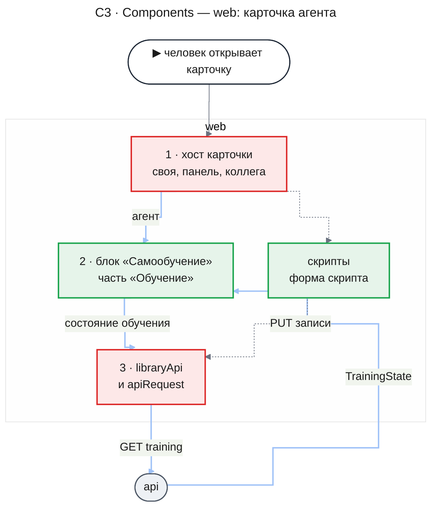
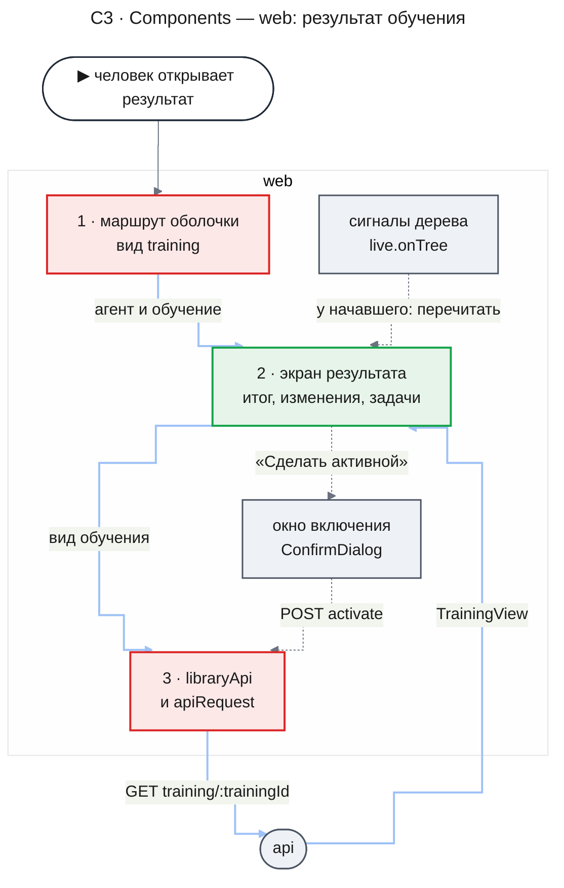
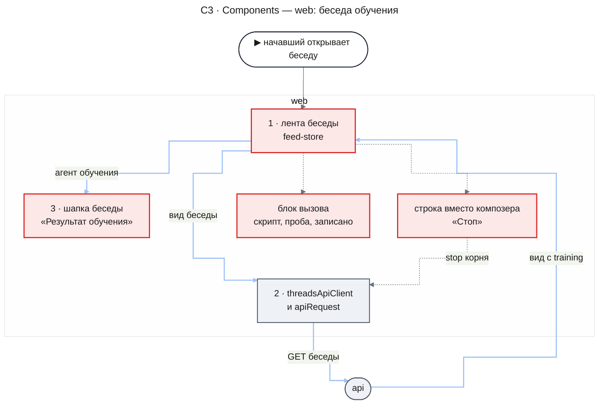
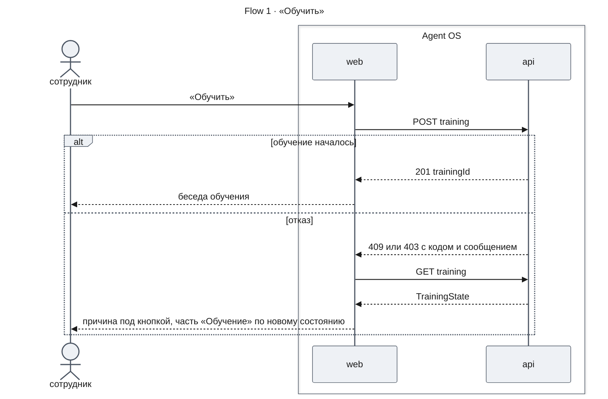
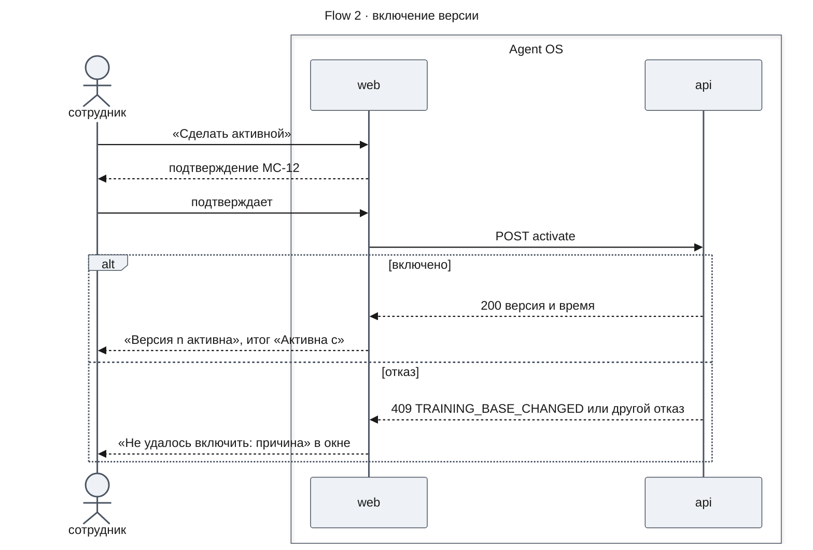
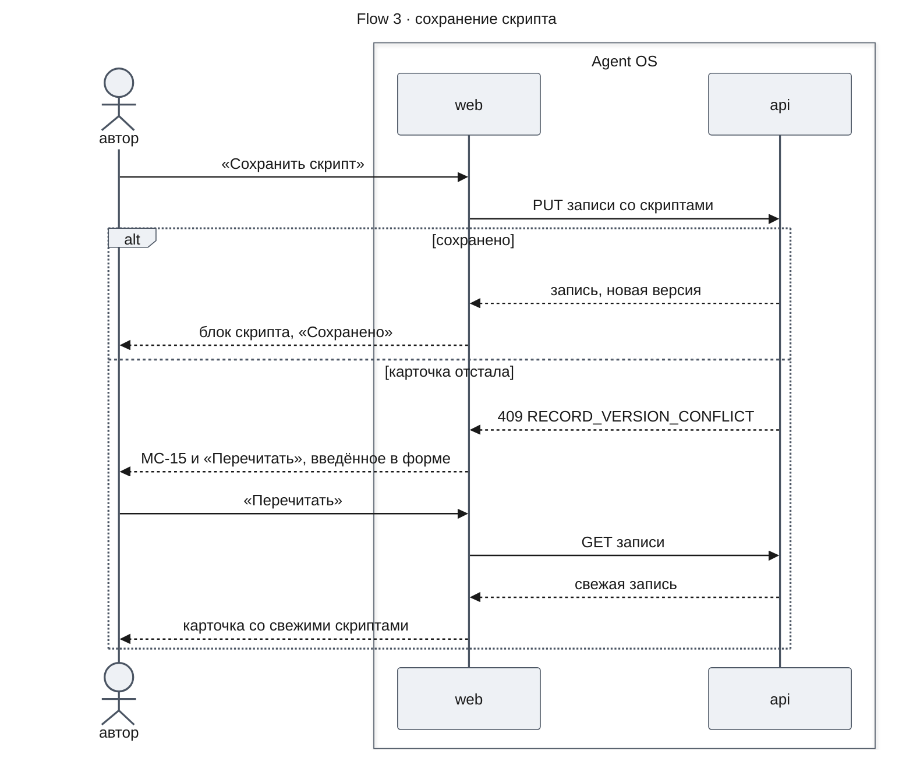

# Самообучение глубокого агента — Design Document — training-web

**Status:** На утверждении · **Date:** 2026-11-23 · **PRD:** [prd.md](./prd.md) · **UXRD:** [uxrd.md](./uxrd.md) · **Depends on:** [design-training.md#contract-definitions](./design-training.md#contract-definitions), [design-scripts.md#contract-definitions](./design-scripts.md#contract-definitions), [design-memory.md#contract-definitions](./design-memory.md#contract-definitions), [design-notepad.md#contract-definitions](./design-notepad.md#contract-definitions)

## Snapshot

**Overview.** Эта часть строит в вебе экраны обучения и скриптов глубокого агента поверх того, что уже есть. На карточке агента появляются блок «Самообучение» с кнопкой «Обучить» и скрипты с правкой на месте. Экран «Результат обучения» в библиотеке показывает ход обучения списком задач, прежний и новый текст инструкций двумя колонками, итоги по прошлым задачам и кнопку включения с обычным подтверждением. Беседа обучения — обычная беседа ленты, только для чтения, с кнопкой «Стоп». Вызов скрипта в беседе выглядит как вызов скрипта агента, а вызов из повтора — «записано, не выполнено». На странице роли администратор включает два права обучать, а в настройках задаёт потолок расхода. Может ли смотрящий обучать агента, веб узнаёт из состояния обучения этого агента.

- **Не меняется**: беседа с глубоким агентом и карточка решения, кроме вида вызова скрипта; экран памяти агента и поле размера оглавления в AS-01 — их строит часть `memory`; карточка отчёта и вкладка «Документы» панели беседы — часть `notepad`; правка агента через чат.
- **Главный риск**: контракты пока есть только в дизайнах `training` и `scripts`; веб строится после того, как они лягут в `@agent-os/contracts`.
- **Открытые вопросы**: нет.

### Key Decisions

#### KD-1: Право обучать веб узнаёт из состояния обучения агента при каждом открытии

У `CurrentUser` и у записи библиотеки прав обучать нет. Право зависит от пары «сотрудник и агент»: автор ли он, системный ли агент, открыт ли он ролям. Это правило считает сервер и отдаёт `canTrain` в `TrainingState`. Поэтому каждый хост карточки — своя карточка, системный агент и агент сотрудника в панели, просмотр коллеги — читает `GET /api/library/:id/training` при открытии и без `canTrain` части «Обучение» не показывает. Выданное право видно при следующем открытии (AC-27.1). Кто ведёт идущее обучение и начал ли его смотрящий, веб берёт из того же состояния, а не из тела отказа: отказ показывается кодом и сообщением.

#### KD-2: Результат обучения — один экран в библиотеке; у начавшего он обновляется по сигналам дерева, остальные обновляют страницу

Адрес `/library/<id>/training/<trainingId>` получает вид страницы `training` в `parseShellRoute` по образцу вида экрана памяти агента ([shell-route.md](../../code-system/patterns/shell-route.md)). Экран читает `GET /api/library/:id/training/:trainingId` через `useResource` ([read-on-open.md](../../code-system/patterns/read-on-open.md)). Дерево обучения принадлежит начавшему, поэтому его изменения приходят начавшему сигналами `live.onTree` по базовому потоку событий. Экран начавшего перечитывает вид на сигнал своей беседы обучения, как список задач сессии в `useAgentTasks`. Остальные видят состояние на момент открытия и обновляют страницу сами (UXRD TR-02). Ссылки из панели ведут на этот же экран.

«Было — стало» — две колонки текста как есть: прежняя инструкция слева, новая справа, на узком экране одна под другой (UXRD KD-4). Сравнивать строки веб не берётся.

#### KD-3: Беседа обучения только для чтения: поле сообщения заменяет строка с «Стоп»

Корень `trainer` приходит в список бесед и открывается по `/chat/<trainingId>` как обычная беседа. Веб узнаёт её только по полю `training` вида — id обучаемого агента, id обучения и признак «корень обучения или повтор» ([design-training.md, «Беседа обучения и беседы повторов»](./design-training.md#contract-definitions)), а не по тому, каким маршрутом пришёл вид. У корня обучения:

- на месте композера стоит строка MC-10 и, пока корень работает, «Стоп». Кнопка останавливает корень (`POST /api/agents/:agentId/stop`), а не прерывает шаг: прерванный шаг оставил бы обучение идущим;
- шапка показывает «Результат обучения» — ссылку из id агента и id обучения поля `training` — рядом с кнопкой панели; у маршрута чата слота действий нет, и `ChatHeader` получает одно действие от открытой беседы;
- панель беседы держит вкладку «Задачи» без «Схемы»: ход обучения — существующий список задач сессии корня через `useAgentTasks`, тексты задач — как их записал сервер. Вкладка «Документы» части `notepad` не прячется: повторы — запуски в дереве беседы обучения, поэтому их документы она показывает, как только повтор написал первый.

Беседы повторов открываются со страницы результата ссылками на страницу агента повтора (`agentPath`). У повтора поле `training` вида страницы агента говорит «повтор»: поля сообщения нет, «Стопа» и ссылки на результат тоже. Своего показа документов страница повтора и экран результата не добавляют: документы повторов — на вкладке «Документы» беседы обучения.

#### KD-4: Вызов скрипта и пробный запуск — варианты одного блока вызова; их узнаёт функция контракта

Функция `packages/contracts` «вызов — запуск кода» ([design-scripts.md, «История и веб»](./design-scripts.md#contract-definitions)) узнаёт `run_code`, скрипт `script__<name>` и `try_script`. Она заменяет веб-функцию `isRunCode`, и та удаляется вместе с ветками по ней в блоке вызова и в карточке решения.

- **«Скрипт агента»**: заголовок — имя скрипта моноширинным, вторая строка — «скрипт агента · {описание}», аргументы — строки значения `input`, вывод скрипта — как у запуска кода. Описание приходит в `toolTitle`; сегодня `ToolBlock` читает `toolTitle` только у вызова с сервером, поэтому у вызова скрипта он читает его тоже.
- **«Пробный запуск скрипта»**: подпись MC-10, имя черновика, аргументы со скриптом за раскрытием, вывод. Под выводом — строка «Не выполнено, только записано: {инструменты}» по полю `recorded` итога, которое лента переносит в данные блока; без поля строки нет.
- **Исход `recorded`** получает в таблице вида исходов иконку `PencilOff` и текст «записано, не выполнено»; лента его не прячет и ошибкой не считает. Так записанные вызовы видны в беседах повтора (AC-18.1).
- **Карточка решения** у вызова скрипта класса `write` показывает список «Может вызвать» из содержимого вопроса `{ canCall }`, как у `run_code` (AC-24.3).

#### KD-5: Скрипт сохраняется тем же сохранением записи, что переключатель; конфликт просит перечитать карточку

Правка, добавление и удаление скрипта — существующий `PUT` записи всей карточки с новым списком `scripts` и номером версии карточки, тем же путём, что сохраняет переключатель самообучения ([design-scripts.md, «Скрипт в содержимом»](./design-scripts.md#contract-definitions)). Поле кода — обычное многострочное поле моноширинным шрифтом. Если карточка отстала от сервера, сохранение получает 409 `RECORD_VERSION_CONFLICT`, и форма показывает MC-15 с кнопкой «Перечитать», которая перечитывает запись. Введённое остаётся в форме до перечитывания.

#### KD-6: Два права — два переключателя на странице роли

`RoleDetail` получает `trainOwn` и `trainAny` ([design-training.md, «Права обучать»](./design-training.md#contract-definitions)). На странице роли под правом администратора стоят два `SavingSwitch`, которые сохраняют `PATCH /api/admin/roles/:id` сразу, без окна подтверждения. `SavingSwitch` получает необязательную подсказку под подписью, связанную с переключателем как его описание: под каждым правом — MC-16, у роли «Супер-администратор» оба включены и недоступны, а подсказка объясняет почему. 409 `BUILTIN_ROLE` возвращает переключатель и перечитывает роль, как у права администратора.

## Terms

- **хост карточки** — экран, на котором стоит карточка глубокого агента: своя карточка в библиотеке, системный агент и агент сотрудника в панели, просмотр коллеги.
- **состояние обучения** — `TrainingState`: может ли смотрящий обучать, потолок, идущее и последнее обучение.
- **вид обучения** — `TrainingView`: всё, что показывает экран результата.

## Part

Часть покрывает FR-22 – FR-24, FR-26, FR-27. Контракты обучения, прав и потолка — [design-training.md](./design-training.md#contract-definitions), скриптов — [design-scripts.md](./design-scripts.md#contract-definitions).

- **Prerequisite ADRs**: [ADR-0016](../../adr/ADR-0016-library-records-and-visibility.md) (видимость записей библиотеки), [ADR-0020](../../adr/ADR-0020-next-intl-client-layer.md) (тексты интерфейса), [ADR-0025](../../adr/ADR-0025-settings-key-table.md) (настройки в базе и панели).

**Out of scope**

- Экран памяти агента, раздел «Моя память» и поле размера оглавления в форме AS-01 — часть `memory`; эта часть добавляет в ту же форму поле потолка.
- Документ-отчёт в ленте и вкладка «Документы» панели беседы — часть `notepad`.
- Сервер: маршруты, права, повторы, судья, потолок — части `training` и `scripts`.

**Constraints**

- Комфорт долгой работы: только токены дизайн-системы, без чистого белого и чёрного.
- Тексты — в `translations/<язык>/<область>.json` на обоих языках ([interface-text.md](../../code-system/patterns/interface-text.md)): карточка, скрипты и результат — `library`, права и потолок — `admin`, блок вызова и беседа — `chat`, статусы обучения — `agents`, отказы — `errors`.
- Новых зависимостей нет. PoC без обратной совместимости: `isRunCode` и его тесты удаляются в том же изменении.
- Схемы — только из `@agent-os/contracts`; веб не объявляет своих копий.

## Building-block Inventory

Follows the [code system](../../code-system/README.md). Перед `new` искал в `apps/web/src/components` (`library`, `admin`, `agents`, `shell`, `assistant-ui`).

| Building block | Pattern | Status | Note |
|---|---|---|---|
| Вид маршрута `training` в библиотеке | [shell-route.md](../../code-system/patterns/shell-route.md) | extended | разбор, функция адреса, `MainView`, `DocumentTitle` |
| Экран результата | [read-on-open.md](../../code-system/patterns/read-on-open.md) | new | по образцу экрана памяти агента; у начавшего — перечитывание по `live.onTree` (KD-2) |
| Клиент обучения | [web-api-client.md](../../code-system/patterns/web-api-client.md) | extended | функции в `libraryApi`; права и потолок — в `adminApi` |
| Блок «Самообучение» на четырёх хостах | — | new | обёртывает существующий `SelfLearningField` |
| Скрипты на карточке и форма скрипта | [agent-script.md](../../design-system/components/agent-script.md) | new | код — `ScriptToggle`; поле кода — `Textarea` |
| Окно включения | `ConfirmDialog` | reused | тело — строка MC-12 |
| Блок вызова: «Скрипт агента», «Пробный запуск скрипта», исход `recorded` | [tool-call.md](../../design-system/components/tool-call.md) | extended | KD-4 |
| Карточка решения | [decision-card.md](../../design-system/components/decision-card.md) | extended | признак запуска кода — функция контракта |
| Шапка, панель и композер беседы обучения | — | extended | `ChatHeader`, панель беседы, `thread.aui.tsx` (KD-3) |
| Ход обучения | [run-task-list.md](../../design-system/components/run-task-list.md) | extended | строки `SessionTaskList`; состояние «Работа кончилась» |
| Статусы обучения, состояние «Хуже» | [agent-status.md](../../design-system/components/agent-status.md), [state-badge.md](../../design-system/components/state-badge.md) | extended | новая таблица вида у `AgentStatus`, новое состояние у `StateBadge` |
| Таблица в варианте «Две строки» | [data-table.md](../../design-system/components/data-table.md) | extended | эта часть добавляет вариант: таблицы итогов и задач на экране результата уже 768 px |
| Права на странице роли | [settings-form.md](../../design-system/components/settings-form.md) | extended | подсказка `SavingSwitch` (KD-6) |
| Поле потолка в форме AS-01 | [settings-form.md](../../design-system/components/settings-form.md) | extended | сумма от 0,1 до 100 $ |

## Acceptance Criteria

### FR-22: кнопка «Обучить»

- From the PRD: AC-22.1, AC-22.2.
- Часть «Обучение» стоит только при `canTrain` и включённом самообучении: на хостах с переключателем — по его текущему значению, на остальных — по флажку из `TrainingState`; без права её нет вовсе (DC-1).

### FR-23: результат и включение

- From the PRD: AC-23.2.
- У начавшего экран идущего обучения обновляется сам по сигналам дерева; у остальных — после обновления страницы (DC-2).
- «Сделать активной» стоит при `canActivate` и открывает обычное подтверждение; отказ сервера остаётся в окне сообщением MC-12, активная версия на экране прежняя (DC-3).
- Прямая ссылка на результат при 404 или 403 ведёт на «Не найдено» (ME-04) (DC-4).

### FR-24: скрипты на карточке

- From the PRD: AC-24.1, AC-24.2, AC-24.3.
- Сохранение скрипта с устаревшей версией карточки показывает MC-15 с «Перечитать», введённое не пропадает (DC-5).
- Вызов из повтора с исходом `recorded` показан «записано, не выполнено», без результата и не как ошибка (DC-6).

### FR-26: потолок в панели

- From the PRD: AC-26.1.

### FR-27: права у роли

- From the PRD: AC-27.1, AC-27.2.

## Design

### Architecture (C1–C4)

Контейнеры и связи не меняются: веб, как и прежде, зовёт API через пересылку `/api` и получает живые сигналы из потока `/api/events`, поэтому C1 и C2 не нарисованы. Меняется устройство веба — три C3 ниже.

#### C3 · Components: web — карточка агента

| Хост | Показывает |
|---|---|
| Своя карточка в библиотеке (`DeepAgentCard`, режим `employee`) | переключатель и ссылку «Память», часть «Обучение» при `canTrain`, скрипты с правкой |
| Системный агент в панели (`DeepAgentCard`, режим `system`) | то же; вход на память — кнопкой в шапке, как сейчас |
| Агент сотрудника в панели (`EmployeeRecordPage`) | строку «Самообучение включено / выключено», часть «Обучение» при `canTrain`, скрипты для чтения |
| Просмотр коллеги или записи компании (`RecordView`) | строку о самообучении и часть «Обучение» — только при `canTrain`; скрипты для чтения — всем, кто видит запись |

Скрипты лежат в содержимом записи, которое хост уже прочитал. Часть «Обучение»: кнопка «Обучить» с текущим потолком из состояния, или идущее обучение со ссылкой — начавшему в беседу, остальным на результат — и «потрачено … из …» по потолку, с которым оно началось, а ещё строка последнего обучения. Ошибка чтения состояния прячет часть «Обучение» и пишется в лог; переключатель и скрипты работают.

#### C3 · Components: web — результат обучения

Экран собирает части и состояния UXRD TR-02 из одного `TrainingView`. Состояние — по статусу; у `stopped` с `cappedAt` — «Остановлено на потолке»; у `done` без версии — «Улучшать нечего». Строка рекомендации стоит, только когда `recommended` не `null` (законченное обучение с предложенной версией): «Рекомендована» или «Не рекомендована», а числа «лучше / хуже / равны» веб считает сам по вердиктам задач сравнения. «Сделать активной» — по `canActivate`, «Обучить заново» — у `stopped` и `failed`. Ход обучения — строки списка задач из пула; задача «В работе» у обучения, которое уже не идёт, показана «Работа кончилась». Скрипты в «Что меняет версия» сопоставляются по имени: есть только в новой версии — новый, только в основе — убран, отличается любое поле — изменён.

#### C3 · Components: web — беседа обучения

Лента отдаёт поле `training` шапке, панели и строке вместо композера (KD-3); блок вызова рисует варианты KD-4.

### Runtime Flows

#### Flow 1: «Обучить»

**Starts when:** человек с правом нажимает «Обучить» на карточке или «Обучить заново» на результате, for AC-22.2

После отказа блок перечитывает состояние: при `TRAINING_RUNNING` вместо кнопки встаёт идущее обучение со ссылкой по роли, при снятом праве часть «Обучение» уходит. Причину под кнопкой даёт `describeLibraryError` по коду: «нет прошлых задач» — текст MC-9, остальные — «Не удалось начать обучение: {причина}». Переход в беседу идёт по `/chat/<trainingId>` тем же путём, что открытие беседы по ссылке.

#### Flow 2: включение версии

**Starts when:** человек нажимает «Сделать активной» на результате, for AC-23.2, DC-3

После любого ответа экран перечитывает вид обучения.

#### Flow 3: сохранение скрипта на карточке

**Starts when:** автор нажимает «Сохранить скрипт» или подтверждает удаление, for AC-24.1, DC-5

Другие отказы сохранения показываются ошибкой формы «Не удалось сохранить: {причина}», введённое остаётся.

### Contract Definitions

Веб потребляет маршруты и формы [design-training.md](./design-training.md#contract-definitions) и [design-scripts.md](./design-scripts.md#contract-definitions) как есть: состояние, старт, вид и включение обучения, `ConversationViewSchema.training`, `PATCH /api/admin/roles/:id` с `trainOwn` и `trainAny`, `trainingCapUsd` в настройках самообучения, `scripts` в содержимом записи, функцию «вызов — запуск кода» и `toolTitle` вызова скрипта, исход `recorded`. Остановка беседы обучения — существующий `POST /api/agents/:agentId/stop`.

**Отказы.** Каждый отказ показывается текстом по коду и причине из каталога `errors` через `describeLibraryError` или `describeAdminError` ([web-api-client.md](../../code-system/patterns/web-api-client.md)): под кнопкой «Обучить», в окне включения, в форме скрипта. 404 и 403 на экране результата ведут на «Не найдено» (ME-04).

**Компоненты, которые ставят другие экраны**

- **Скрипт агента** — принимает скрипт из содержимого записи, вариант (на карточке, правка, изменение), прежний скрипт для варианта «Изменение» и признак «может править». Наружу сообщает «Изменить», «Удалить», сохранение формы и отмену.
- **Блок вызова** — те же входы, что сегодня; варианты KD-4 он выбирает сам по функции контракта.

## Test Strategy

Тесты пишутся один раз, в итоговом проходе тестов всей фичи, каждый на нижнем уровне, который ловит дефект: компонент с ответами API по схемам контрактов. Запись в повторе и пробе, потолок и рестарты проверяют тесты частей `training` и `scripts`; здесь — права, одно обучение на агента и главный путь экранов.

- **UC-1: кто видит и может нажать что** — covers AC-22.1, AC-24.2, AC-27.1, AC-27.2, DC-1, DC-4
  - Given: агент с самообучением и агент с выключенным; `TrainingState` с `canTrain` и без него; коллега, который только запускает агента; роль «Супер-администратор».
  - When: человек открывает карточку, просмотр, результат или страницу роли; автор выключает переключатель.
  - Then: «Обучить» только при `canTrain` и включённом самообучении, в том числе сразу после выключения переключателя её нет; у коллеги скрипты без «Изменить»; результат без права — «Не найдено»; у «Супер-администратора» оба права включены и недоступны.
- **UC-2: одно обучение на агента** — covers AC-22.2
  - Given: у агента идёт обучение, начатое Аней.
  - When: карточку открывают Аня и другой сотрудник с правом; другой нажимает «Обучить» в старой вкладке и получает 409 `TRAINING_RUNNING`.
  - Then: Ане — ссылка в беседу, другому — на результат; после отказа вместо кнопки идущее обучение.
- **UC-3: главный путь экранов** — covers AC-23.2, AC-24.1, AC-24.3, AC-26.1, DC-2, DC-3, DC-5, DC-6
  - Given: законченное обучение с версией и без версии; вызовы `script__…`, `try_script` и вызов с исходом `recorded` в истории; карточка с устаревшей версией.
  - When: человек открывает результат и включает версию; читает беседы; сохраняет скрипт; задаёт потолок 5 $.
  - Then: итог, две колонки и задачи; включение отправляет `activate` после подтверждения, отказ остаётся в окне; варианты блока вызова и «записано, не выполнено»; при конфликте MC-15 и «Перечитать»; потолок 5 $ виден после нового открытия.

## L1-сценарии

Проверка в настоящем браузере через Claude-in-Chrome на `next build && next start` с настоящим API, после частей `training` и `scripts`.

| Сценарий | Шаги | Что проверить |
|---|---|---|
| Обучить и следить | автор с правом нажимает «Обучить», затем открывает результат | беседа только для чтения со «Стоп», панель с «Задачами», а после первого документа повтора — и с «Документами»; результат у автора сам добавляет строки задач по мере сравнения |
| Стоп | начавший жмёт «Стоп» во время повторов | запрос `…/stop`; результат — «Остановлено вручную», «Обучить заново» |
| Повторы и включение | начавший открывает беседы повтора и включает версию | в беседе повтора меняющий вызов — «записано, не выполнено»; версия активна |
| Скрипт на карточке | автор пишет скрипт класса `write`, сохраняет, вызывает его в новой беседе | «Скрипт агента» в беседе, карточка решения со списком «Может вызвать» |
| Комфорт и ширина | результат и карточка на 360 px, светлая и тёмная тема | нет прокрутки страницы вбок; колонки «Было» и «Стало» одна под другой |

## Security Considerations

- **Authentication & Authorization**: показ в вебе — только удобство; права проверяет сервер на каждом маршруте (design-training, KD-8). По 403 и 404 веб показывает «Не найдено» без подробностей.
- **Input Validation**: форма скрипта проверяет имя, описание и код до запроса по правилам контракта; окончательная проверка — на сервере.
- **Sensitive Data Handling**: в лог веба идут метод, путь, статус и код отказа, без тел запросов, кода скриптов и аргументов ([logging.md](../../code-system/patterns/logging.md)).

## Risks and Mitigation

- **Контракты описаны в дизайнах, но ещё не построены** — высокий, вероятный. Веб строится после того, как `training` и `scripts` положат схемы в `@agent-os/contracts`.
- **Форма AS-01 меняется частью `memory` раньше этой части** — средний. Поле потолка добавляется в форму, какой её оставит `memory`.
- **Беседа с корнем не типа `chat` ведёт себя в ленте иначе** — средний. Корень обучения — первый такой; ленту, панель и законченный корень проверяют L1-сценарии.

## Update History

| Version | Date | Change |
|---------|------|--------|
| 2.2 | 2026-11-23 | Экраны обучения и скриптов поверх существующих: права из состояния обучения, результат в библиотеке с обновлением у начавшего по сигналам дерева, беседы обучения и повторов только для чтения по полю `training`, варианты блока вызова, сохранение скрипта записью карточки, два права у роли; опора на части `memory` и `notepad` |
