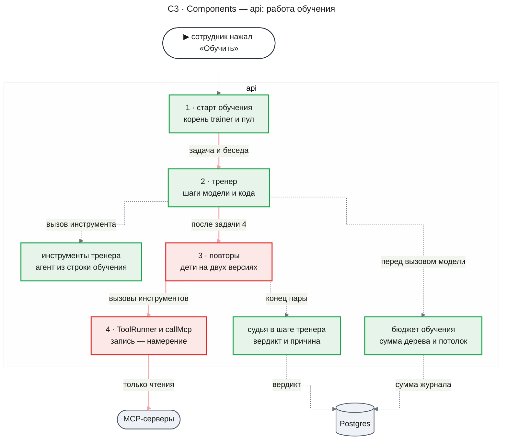
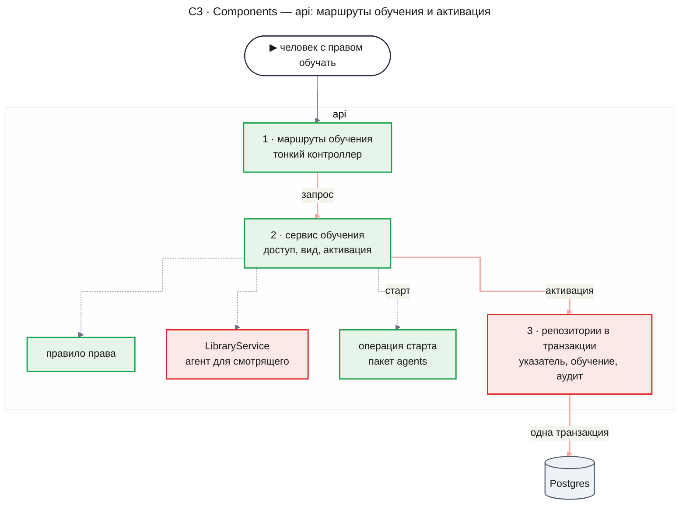
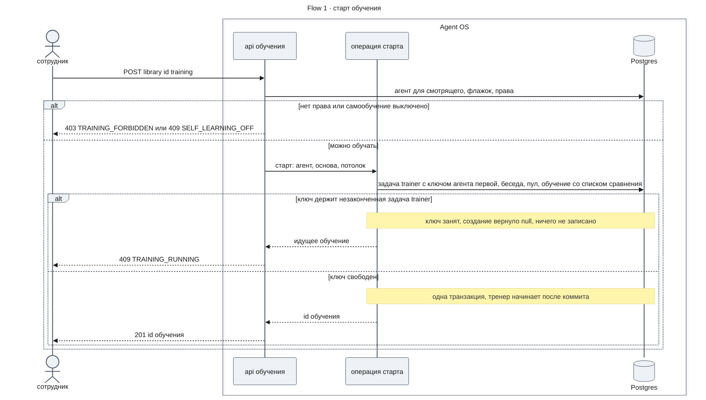
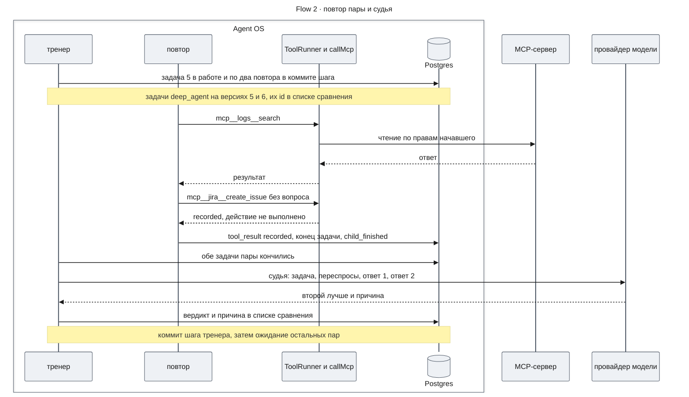
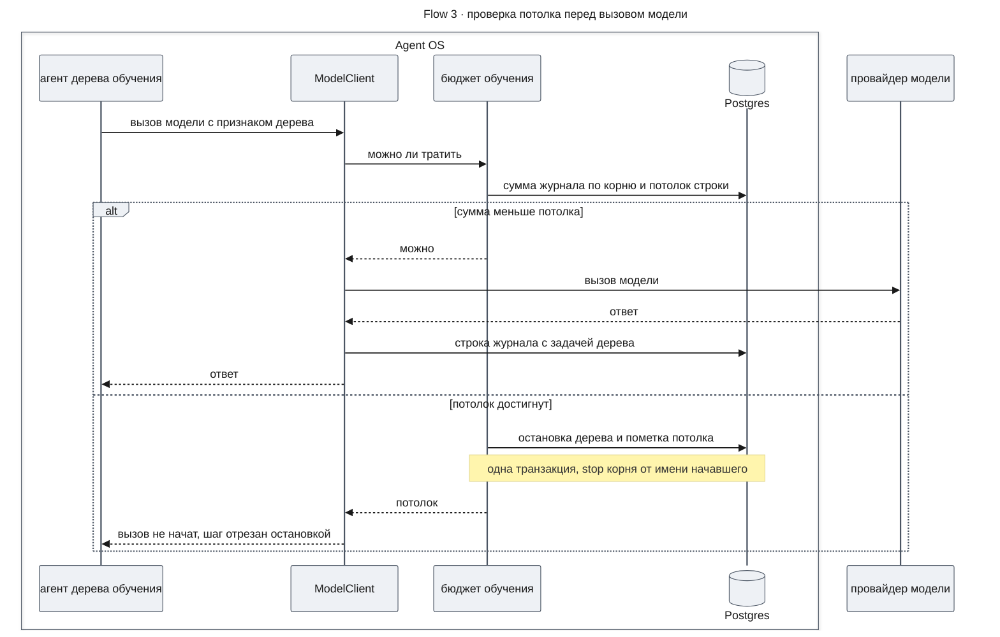
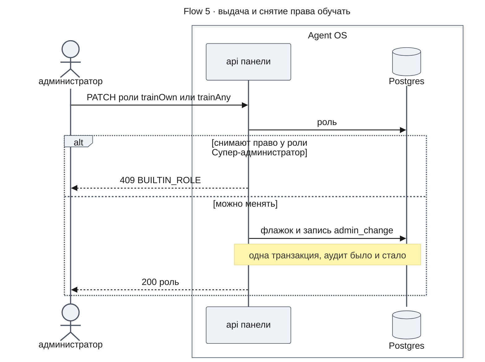
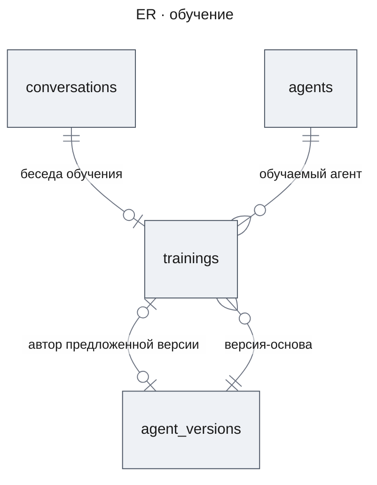
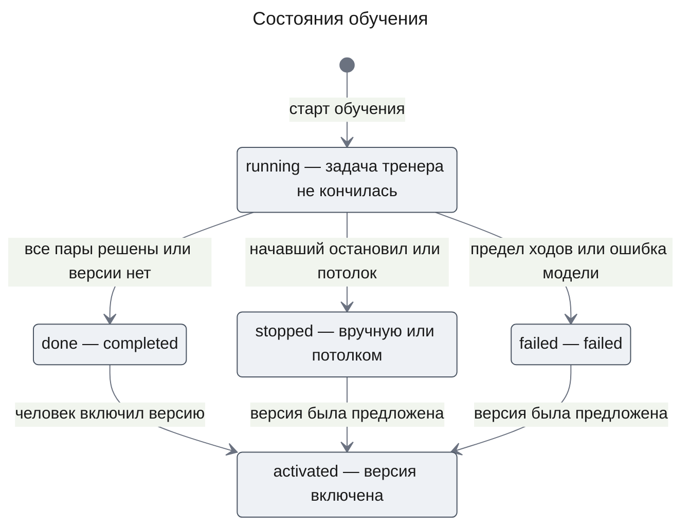

# Самообучение глубокого агента — Design Document — training

**Status:** На утверждении · **Date:** 2026-11-23 · **PRD:** [prd.md](./prd.md) · **UXRD:** [uxrd.md](./uxrd.md) · **Depends on:** [design-scripts.md#contract-definitions](./design-scripts.md#contract-definitions), [design-memory.md#contract-definitions](./design-memory.md#contract-definitions), [design-notepad.md#contract-definitions](./design-notepad.md#contract-definitions)

## Snapshot

**Overview.** Обучение — беседа сотрудника со встроенным агентом «Тренер», которую создаёт кнопка, а не сообщение в чате. Тренер — свой вид агента и своя корневая задача `trainer`; он идёт по постоянному списку из шести задач. Модель тренера читает память агента, прошлые беседы и их документы блокнота, проверяет догадки кодом и предлагает одну неактивную версию с новыми промптами и скриптами. Дальше работает код: он повторяет до пяти прошлых задач на активной и на предложенной версии, где чтения идут по-настоящему, а записи во внешние системы только записываются, и зовёт слепого судью на каждую пару. Весь расход упирается в потолок, а версию включает человек с правом обучать.

- **Не меняется**: права на каждый вызов инструмента и чат. Обучение собрано из задач движка, их детей, списка задач сессии и создания и активации версии; движок получает только общий ключ исключительности задачи.
- **Главный риск**: меняющий вызов из повтора дошёл бы до внешней системы. Правило «записать, не исполнять» стоит в единственной отправке MCP и зависит только от дерева задачи ([Risks and Mitigation](#risks-and-mitigation)).
- **Открытые вопросы**: четыре, решает владелец — [Open Questions](#open-questions).

### Key Decisions

#### KD-1: Тренер — свой вид агента с постоянным списком задач; модель свободна только в анализе и в тексте версии

Тренер — свой класс в семье `BaseAgent` и свой тип задачи `trainer`, рядом с `chat`, `agent` и `deep_agent`; его поведение — переопределённые методы класса. От `DeepAgent` он не наследует: инструментов блокнота у него нет, и правило «закончить с документом-отчётом» ([design-notepad.md, KD-4](./design-notepad.md#kd-4-отчёт--документ-с-пометкой-report-глубокий-агент-не-заканчивает-без-него)) его не касается, а повторы — обычные запуски глубокого агента и это правило выполняют. Его запись — встроенный агент с ключом `trainer` по образцу [builtin-record.md](../../code-system/patterns/builtin-record.md): администратор задаёт в ней промпт и модель, удалить её нельзя, а по имени и чипом из чата её не запустить. Обучение для одного глубокого агента начинает своя операция `AgentsModule`, а не старт чата: она создаёт корневую задачу `trainer`, её беседу, список задач и строку `trainings`. Корень без родителя попадает в список бесед начавшего; беседа только для чтения — начавший смотрит её и может остановить, но не пишет в неё (AC-15.4).

«Один тренер на агента» держит движок при создании задачи. У `runtime_tasks` есть необязательный ключ исключительности — непрозрачная строка от создающего — и частичный уникальный индекс по типу и ключу среди незаконченных задач. Задача `trainer` получает ключом id обучаемого агента. `TaskControl.create` при занятом ключе возвращает `null` вместо id — особого кода ошибки нет, — и операция отвечает идущим обучением (AC-15.2). Конечный статус выводит задачу из индекса, и закрывать ничего не нужно. Отвергнуто: уникальность в таблице `trainings` — отметку «закончено» ставил бы крючок конца, и упавший крючок запер бы обучение агента навсегда.

Флоу — шесть задач, которые старт пишет в обычный список задач беседы тренера ([Пул задач тренера](#пул-задач-тренера)). Модель делает три задачи свободной работы: разбор прошлых запусков кодом, проверку догадок и пробу скриптов, текст новой версии. Код делает то, от чего зависят сравнение и деньги: выбор задач, повторы, судью, цифры, потолок и конец обучения. Поэтому сравнение проходит, даже если модель класса Haiku не следует своему промпту.

Инструменты тренера регистрируются без флажков `rootOnly` и `everySession` и попадают только в объявление класса тренера; хранимое содержимое версии назвать их не может. Агента каждый инструмент берёт из строки обучения по `ToolCaller.rootId`, а не из аргументов модели. Отвергнуто: корень типа `chat` с особыми инструментами — получил бы инструменты корня и никогда не кончался бы сам; глубокий агент с промптом тренера — сравнение и деньги остались бы на совести модели.

#### KD-2: Тренер читает всё своего агента прямо из `packages/db`, только читая; код модели базы не получает

Код тренера читает репозиториями `packages/db` всё, чем пользуется и что произвёл обучаемый агент: беседы всех сотрудников с историей, вызовами, сохранёнными результатами, деревьями сабагентов, переспросами и документами блокнота, версии, память области агента, строки расхода, объявленные серверы и их инструменты (AC-16.1). Каждое чтение привязано в коде к id этого агента и только читает; запросы частей-владельцев переиспользуются: память — запросом экрана памяти агента ([design-memory.md, «Что может дерево обучения»](./design-memory.md#что-может-дерево-обучения)), документы — путём блокнота страницами ([design-notepad.md, «Что берёт часть `training`»](./design-notepad.md#что-берёт-часть-training)). Результаты не несут имён и id сотрудников. Память области сотрудника тренер не видит (AC-16.7, AC-16.8): чтение прошлой беседы в одном месте — инструменте чтения — отдаёт вызовы и результаты `remember`, `forget` и `read_memory` с `scope` `user` без описания и текста записи. Оглавление памяти в историю не пишется: промпт шага строится заново на каждом шаге и не хранится, поэтому строк оглавления в прочитанном нет. Читатели истории (`History`, `MessagesRepository`) владельца не проверяют, поэтому инструмент принимает id беседы от модели, только если это беседа его агента.

Прошлая задача — беседа задачи `deep_agent` с версией обучаемого агента, чей родитель — корень типа `chat`, которая закончилась ответом или ошибкой и чьё дерево не удалено. Условие «корень — чат» само исключает беседы обучения и повторов (AC-16.2). Прошлые задачи, которые видит тренер и которые берутся для сравнения, отбирает одно правило (`training-reads.ts`): 50 самых новых, без тех, чей запуск звал сервер, на который у начавшего нет права (`AccessGate.tools`). Список тренера показывает до 20 из них, сравнение берёт до пяти, а беседу вне правила инструменты тренера не читают. Если подходящих нет, старт получает отказ. Выборка идёт по всем владельцам запросом репозитория бесед с индексом по `conversations.agent_version_id`.

Код, который пишет модель тренера, базы не получает: песочница видит данные только через инструменты тренера, иначе приказ из чужой беседы стал бы запросом к любой таблице. Чтение прошлой беседы и пробный запуск скрипта хранят свой полный итог в `tool_results` под `callId` вызова, а модели большой итог отдают обёрткой. Код тренера читает оба целиком через `readResult` и сверяет их кодом, мимо контекста модели. Итоги проходят ту же маску секретов, что результаты инструментов. В конверте данных итог инструментов чтения тренера помечен автором «модель и прошлая работа», а не платформой: это чужие тексты, а не правила.

#### KD-3: Повтор — ребёнок тренера на заданной версии и модели исходной беседы; меняющий вызов в дереве обучения записывается

Повтор — ребёнок тренера на глубине 1, там же, где исходный запуск стоял под чатом, поэтому сабагенты, предел глубины и правила хода те же. Его `RunStart` строится вручную: версия-основа или предложенная, имя исходной беседы, модель версии, а без неё — `conversations.model` исходной беседы. Он проходит `resolveStart` как готовый запуск, и права начавшего на модель проверяются как при любом старте. Задание повтора — запись `task` исходной беседы.

**Дерево обучения** — задачи, чей корень имеет тип `trainer`. Объект агента узнаёт это один раз: при создании — от родителя или по своему типу, при восстановлении — по типу корневой задачи, и кладёт признак в `ToolCaller`. Общий код читает признак ровно в пяти местах, и каждое — про безопасность или деньги:

1. **Шаг инструментов** не задаёт вопросов сотруднику. MCP-вызов идёт обычным путём, а запуск кода класса `write` — `run_code`, скрипт, `try_script` — пишет намерение `tool_sent` через `guard` и исполняется как подтверждённый, со списком, который `canCallOf` выводит в этот момент. Намерение нужно правилу рестарта `scripts`: исход прерванного запуска берётся по нему. `run_code` класса `write` самого тренера тоже не отклоняется — его меняющие вызовы записывает место 2.
2. **Единственная отправка MCP** (`callMcp`; через неё идут прямые, подтверждённые и вызовы из кода). Вызов инструмента без `readOnlyHint` не отправляется и кончается новым исходом `recorded` с текстом «действие записано и не выполнено». Чтения идут к серверу по правам начавшего.
3. **`ModelClient.call`** перед каждым вызовом модели спрашивает бюджет обучения (KD-5).
4. **Функция памяти** `agents`, которая решает, чью память видит запуск и может ли писать ([design-memory.md, «Что может дерево обучения»](./design-memory.md#что-может-дерево-обучения)): в дереве обучения сотрудника нет, повторы читают только память области агента, а `remember` и `forget` ничего не меняют (AC-18.3). У самого тренера нет `remember`, `forget` и `read_memory`; память области агента он читает своим инструментом «Память» (Contract Definitions).
5. **Сообщение и перезапуск** агента дерева обучения API отвечает как отсутствующему агенту. Иначе сообщение остановленному тренеру разбудило бы его, и расход пошёл бы снова.

Правило отправки зависит только от дерева, а не от попытки, поэтому и после рестарта меняющий вызов не уходит (NFR-04). Шаг запуска `write`, потерянный после намерения, не исполняется снова: открытые строки `code_calls` закрываются `unknown`, закрытые раньше сохраняют `recorded` ([design-scripts.md, KD-5](./design-scripts.md#kd-5-один-путь-запуска-кода-подтверждение-write--как-у-run_code)). Отвергнуто: проверка только в отправке — прямой меняющий вызов задал бы вопрос, на который никто не ответит; проверка только перед вопросом — вызовы из кода дошли бы до сервера.

#### KD-4: Судья — один вызов модели в шаге тренера на каждую законченную пару, вслепую

Повторы — обычные дети тренера, не группа ожидания: их вызов старта — `replay:{n}:base` и `replay:{n}:proposed`, шаг тренера кончается исходом `wait` на сообщения, и конец каждого повтора будит его сообщением `child_finished`. Один шаг тренера судит одну готовую пару — оба повтора кончились, вердикта нет — и пишет её вердикт своим коммитом; осталась ещё готовая пара — следующий шаг идёт сразу, иначе тренер ждёт, не вызывая свою модель. Когда решены все пары, шаг кончает задачу тренера. Отвергнуто: суд после всех повторов — расход судьи пришёлся бы на конец, где его скорее всего съест потолок.

Повторы — запуски глубокого агента, поэтому каждый кончается документом-отчётом блокнота ([design-notepad.md, KD-4](./design-notepad.md#kd-4-отчёт--документ-с-пометкой-report-глубокий-агент-не-заканчивает-без-него)). Отчёт запуска — самый новый его документ с пометкой `report`, написанный после последнего старта запуска, по правилу блокнота. Судья получает задание исходной беседы, её документ-отчёт и сообщения сотрудника после него — переспросы, из которых видно, чего тот хотел. Если у прошлого запуска документа-отчёта нет, судья получает его короткий ответ из результата задачи. Каждый документ судья получает не длиннее 40 000 знаков — постоянная платформы — с пометкой, что текст обрезан: три документа и задание так помещаются в один вызов модели класса Haiku, и остаётся место на ответ. Затем «ответ 1» и «ответ 2» — документы-отчёты двух повторов — в случайном для каждой задачи порядке, без номеров версий и цифр. Ответ — одна структурная форма по образцу [tool-call-answer.md](../../code-system/patterns/tool-call-answer.md): «первый лучше», «второй лучше» или «равны» и причина одной фразой; платформа переводит его в термины версий. Ошибка модели или второй неразобранный ответ дают паре вердикт `not_compared` в том же коммите; пара с любым вердиктом решена и больше не судится. Судья идёт через `ModelClient.call` на модели беседы обучения — её задаёт администратор в версии тренера (FR-19) — от имени начавшего и с `taskId` тренера. В том же коммите шага код дописывает вердикт и причину к элементу пары в списке сравнения строки `trainings` (KD-6); в лог идёт запись о решённой паре.

#### KD-5: Расход — сумма журнала токенов по дереву; потолок — проверка перед каждым вызовом модели и обычная остановка

Каждый вызов модели в дереве — тренера, повторов, их сабагентов, судьи — пишет строку `runtime_model_calls` с задачей дерева. Расход обучения — сумма этих строк по `root_id` их задач; она читается из базы, и рестарт её не обнуляет (NFR-03). Перед каждым вызовом модели из дерева `ModelClient` спрашивает бюджет обучения. Если сумма дошла до потолка строки `trainings`, бюджет в одной транзакции останавливает дерево (`TaskControl.stop` корня от имени начавшего) и ставит строке пометку потолка; новых вызовов модели и инструментов нет (AC-21.1). Потолок берётся из настройки при старте, поэтому новое значение действует со следующего обучения (AC-26.1). Пометка нужна только для слов на экране: остановленное потолком обучение — такая же остановка, как ручная.

#### KD-6: Обучение хранит одна таблица `trainings`; сравнение — список в её строке; автор версии — ссылка на обучение

**Одна строка `trainings` — одно обучение одного агента.** Пример: Аня 20 ноября в 14:02 нажала «Обучить» у «Разбор ошибок оплаты», активна версия 5. Строка: id — беседа обучения, агент, основа — версия 5, потолок $2 и список сравнения. Его элемент — «Почему с 14:00 падают оплаты» из беседы Бориса 12 ноября, её повторы на версии 5 и на версии 6, вердикт «новая лучше» и причина. Тренер предложил версию 6 — у неё автор-обучение указывает на эту строку.

Список сравнения — колонка jsonb, а не своя таблица: в нём не больше пяти элементов, его читают только вместе с обучением, пишет только шаг тренера, и по разным обучениям его не ищут. Старт пишет элементы с id прошлых бесед, шаг тренера дописывает id бесед повторов в коммите, который их создаёт, и вердикт в коммите, который судил пару. Шаг, потерянный до коммита, повторяется с начала и ничего не дублирует, а записанный вердикт не перезаписывается (инвариант 8). Цифры пары — ошибки, вызовы, стоимость — список не копирует: экран считает их при чтении по дереву каждого повтора, его истории и журналу. Id бесед внутри jsonb — исключение из ADR-0024 для короткого списка, которым владеет строка: беседы физически не удаляются — удаление дерева только отмечает задачи, — поэтому id не повиснут.

Строку обучения не заменяют беседа и итог задачи тренера. Версия-основа и автор версии — ссылки на версии, и, в отличие от id бесед в списке сравнения, они остаются внешними ключами ([ADR-0024](../../adr/ADR-0024-every-reference-is-a-foreign-key.md), [design-agents.md, KD-2](../data-model/design-agents.md#kd-2-номер-версии-растёт-по-агенту-сохранение-сотрудника-создаёт-версию-и-делает-её-активной-в-одной-транзакции)); во входе задачи, JSON, ключей нет. Итог задачи движок пишет один раз, в конце, а вердикты появляются по ходу, пометка потолка — до остановки, включение — после конца. Состояние обучения строка не дублирует: идёт оно или кончилось — статус корневой задачи, объяснение «версии нет» — итог задачи тренера, расход — сумма журнала, рекомендация — вычисление при чтении.

#### KD-7: Рекомендация — подпись, а не замок; активация — одна транзакция с проверкой основы

Рекомендация — одна строка при чтении результата: версия рекомендована, когда она выиграла больше задач, чем проиграла. Решает человек: предложенную версию он включает, как бы обучение ни кончилось — готово, остановлено вручную или потолком, упало после предложения. Обучение, остановленное вручную или потолком, рекомендации не показывает, а рядом предлагает «Обучить заново» (FR-21).

Активирует сервис обучения `apps/api`. До транзакции он проверяет право (KD-8) и что смотрящий начал это обучение — иначе 403 `TRAINING_FORBIDDEN`, — что обучение кончилось, что версия предложена и ещё не включена. Затем одна транзакция: первым идёт метод `AgentsRepository` «сделать активной» с версией-основой как ожидаемой и текущими именем и описанием агента; он берёт строку агента, поэтому одновременное сохранение автора ждёт. Ответ `stale` значит, что активная версия сменилась после старта: откат и 409 `TRAINING_BASE_CHANGED` (AC-20.2). Ответа `name_taken` здесь не бывает: агент пишет себе то имя, которое уже держит. Дальше строка обучения получает время и автора включения, и пишется аудит `training_activate`. Памяти и документов блокнота активация не касается. Повторная активация после включения получает 409 `TRAINING_NOT_ACTIVATABLE` ещё до транзакции; вторая из двух одновременных получает `stale` — 409 `TRAINING_BASE_CHANGED`. Сама система версию не включает.

#### KD-8: Два права — флажки роли, как право администратора у роли

Право обучать своих и право обучать любых агентов — два флажка у `identity_roles` рядом с `is_admin`. Действующее право — членство в роли с флажком; вход сессии кладёт оба права в `AuthUser`, поэтому снятое право не действует со следующего запроса. Роль «Супер-администратор» получает оба флажка в миграции встроенных строк, а `RolesService` отказывает в их снятии 409 `BUILTIN_ROLE`. Изменения пишут `admin_change`.

Кто может обучать агента и включать его версию, решает одна чистая функция ([pure-decision.md](../../code-system/patterns/pure-decision.md)): автор с правом обучать своих; владелец права обучать любых — если агент системный или открыт хотя бы одной роли (условие панели, `inPanel`). Право администратора в правило не входит (AC-15.7). Свободные тексты результата — тексты задач сравнения, причины судьи, объяснение, `changes`, промпты и скрипты основы и новой версии — получает только начавший обучение: они прочитаны по его правам. Остальные владельцы права видят состояния, вердикты, числа, пул и расход, а эти поля у них `null`. Включает версию тоже только начавший. PRD даёт это всем, кто может обучать агента, — [Open Questions](#open-questions). Агента для смотрящего находит `LibraryService` рядом с проверкой доступа экрана памяти ([design-memory.md, KD-5](./design-memory.md#kd-5-экран-памяти-агента-вырастает-из-экрана-знаний-раздел-моя-память-видит-только-хозяин-записей)): видимый ему агент или, для владельца права обучать любых, агент панели. Маршруты обучения — в своём модуле API по образцу модуля памяти ([port-module-split.md](../../code-system/patterns/port-module-split.md)), без `@AdminOnly`.

## Terms

- **обучение** — одна работа тренера над одним агентом: корневая задача `trainer` с беседой и строка `trainings`.
- **пул** — шесть задач тренера в списке задач его беседы.
- **дерево обучения** — задачи, чей корень имеет тип `trainer`: тренер, повторы и их сабагенты.
- **версия-основа** — активная версия агента в момент старта обучения.
- **прошлая задача** — беседа глубокого агента прямо под корнем чата (KD-2).
- **повтор** — новый запуск прошлой задачи на основе или на предложенной версии; **пара** — два повтора одной задачи.
- **пробный запуск** — запуск черновика скрипта тренером инструментом `try_script`.

## Part

Часть покрывает FR-15 – FR-21 и FR-28, а также хранение, выдачу, снятие и проверку двух прав обучать (экран — FR-27 в `training-web`). Она потребляет контракты `memory` (функция памяти, чтение памяти области агента, ключ настроек), `notepad` (документы и документ-отчёт, чтение страницами) и `scripts` (скрипты в содержимом, один путь запуска кода, создание и активация версии).

- **Prerequisite ADRs**: [ADR-0011](../../adr/ADR-0011-code-runner-quickjs-process.md) (код — только через `CodeRunner.run`), [ADR-0022](../../adr/ADR-0022-one-database-and-nestjs-modules.md) (одна база, модули NestJS), [ADR-0023](../../adr/ADR-0023-live-task-objects-one-stepping-process.md) (живые объекты задач, порядок записей), [ADR-0024](../../adr/ADR-0024-every-reference-is-a-foreign-key.md) (каждая ссылка — внешний ключ), [ADR-0025](../../adr/ADR-0025-settings-key-table.md) (настройки по ключу).

**Out of scope**

- Экраны: кнопка, беседа обучения, результат, права и потолок в панели — `training-web`.
- Память и блокнот — как в `memory` и `notepad`; эта часть добавляет функции памяти одно правило дерева обучения (KD-3).
- Исполнение скриптов и `run_code` — как в `scripts`.
- Журнал токенов, `AccessGate` и квоты — без изменений.

**Constraints**

- PoC без переноса данных: схема генерируется заново, встроенные строки — в своей миграции.
- Настройки — в ключе `self_learning_settings`, без переменных окружения (ADR-0025).
- Каждый запрос — в репозиториях `packages/db`; репозиторий не берёт блокировок ([repository-over-transaction.md](../../code-system/patterns/repository-over-transaction.md)).
- Событий фича не вводит: ход обучения — старт, предложение, старт и конец повтора, вердикт, остановка потолком, активация — пишется в лог через обёртку `packages/common` с id и суммами, без текстов бесед и аргументов.

## Building-block Inventory

Follows the [code system](../../code-system/README.md). Учёта обучения, суммы расхода по дереву и режима «не исполнять запись» в коде нет — искал в `packages/agents/src`, репозиториях `packages/db` и `apps/api/src`.

| Building block | Pattern | Status | Note |
|---|---|---|---|
| Класс тренера, тип задачи `trainer`, его инструменты | [step-handler.md](../../code-system/patterns/step-handler.md), [tool-declaration.md](../../code-system/patterns/tool-declaration.md) | new | наследник `BaseAgent` |
| Встроенный агент «Тренер» с ключом `trainer` | [builtin-record.md](../../code-system/patterns/builtin-record.md) | extended | ключ в `BuiltinKeySchema`; пропуск в старте по имени, как у `chat` |
| Пул в списке задач сессии | — | extended | таблица, блок и инструменты списка; правило списка не даёт модели менять набор и порядок |
| Старт обучения и старт повтора | [immutable-versions.md](../../code-system/patterns/immutable-versions.md) | new, reused | операция рядом с `StartOperations`; повтор — готовый `RunStart` через `resolveStart` и `startChild` |
| Ключ исключительности задачи | — | extended | `TaskControl.create` и `runtime_tasks`, общий для движка |
| Признак дерева в `ToolCaller`, исход `recorded`, бюджет обучения | — | new | пять мест KD-3 |
| `trainings` со списком сравнения, `agent_versions.training_id`; суммы журнала по дереву; выборка прошлых задач | [repository-over-transaction.md](../../code-system/patterns/repository-over-transaction.md) | new | KD-6 |
| Судья | [tool-call-answer.md](../../code-system/patterns/tool-call-answer.md) | reused | одна структурная форма вердикта |
| Создание и активация версии, один путь запуска кода | [immutable-versions.md](../../code-system/patterns/immutable-versions.md) | reused | контракты `scripts`; создание получает автора-обучение |
| Модуль `training` в `apps/api`, правило права | [auth-boundary.md](../../code-system/patterns/auth-boundary.md), [pure-decision.md](../../code-system/patterns/pure-decision.md) | new | по образцу модуля памяти |
| Права роли: флажки, вход сессии, `RolesService`, контракты панели | [auth-boundary.md](../../code-system/patterns/auth-boundary.md) | extended | рядом с правом администратора роли |
| Ключ `self_learning_settings` | [keyed-settings.md](../../code-system/patterns/keyed-settings.md) | extended | поле `trainingCapUsd` |

## Acceptance Criteria

Номера `DC-n` уточняют критерии PRD там, где дизайн решает больше, чем PRD.

### FR-15: запуск обучения

- From the PRD: AC-15.1 – AC-15.8; AC-15.9 — [Open Questions](#open-questions).
- Тренера нельзя запустить из чата ни по имени, ни чипом (DC-1).
- Отказ AC-15.8 — 409 `TRAINING_NO_PAST_TASKS` (DC-2).
- Сообщение и перезапуск агента дерева обучения отвечают как отсутствующему агенту, и расход не растёт (DC-3).

### FR-28: ход обучения

- From the PRD: AC-28.1, AC-28.2.
- Модель тренера не создаёт, не удаляет и не переставляет задачи пула и не меняет задачи 1, 5 и 6 (DC-4).

### FR-16: что читает и делает тренер

- From the PRD: AC-16.1, AC-16.2, AC-16.4, AC-16.5.
- Инструмент тренера отклоняет id беседы другого агента и ничего из неё не читает; результаты не несут имён и id сотрудников (DC-5).
- From the PRD: AC-16.7, AC-16.8 — фильтр области сотрудника в инструменте чтения (KD-2).

### FR-17: предложенная версия

- From the PRD: AC-17.1, AC-17.2.

### FR-18: повтор

- From the PRD: AC-18.1, AC-18.2, AC-18.3.
- Повтор версии без модели идёт на модели исходной беседы, а не на модели тренера (DC-6).
- Запуск кода класса `write` в повторе и пробный запуск не задают вопроса, исполняют чтения и закрывают меняющие вызовы `recorded`; после потерянного шага запуск не исполняется снова (DC-7).

### FR-19: сравнение и рекомендация

- From the PRD: AC-19.1, AC-19.2.
- Судья получает два ответа без признака версии (DC-8).

### FR-20: активация

- From the PRD: AC-20.1, AC-20.2, AC-20.5.
- Активация пишет одну запись аудита `training_activate` с агентом и версиями «было — стало» (DC-9).

### FR-21: потолок и результат

- From the PRD: AC-21.1, AC-21.2, AC-21.3.
- После рестарта посреди повтора обучение продолжается и останавливается на том же потолке (DC-10, NFR-03).

### Права обучать (FR-15, контракт FR-27)

- From the PRD: AC-27.2.
- Выдача и снятие права у роли пишут `admin_change` «было — стало» (DC-11).

## Design

### Как часть встраивается в работу системы

Пример на весь документ. Аня — автор «Разбор ошибок оплаты», у её роли есть право обучать своих агентов. 20 ноября в 14:02 она нажимает «Обучить»; активна версия 5. Тренер читает память агента, прошлые беседы Ани и Бориса и их отчёты и кодом находит, что в 7 беседах сотрудники поправляли источник `payment-gateway` на `billing-api`. Он пробно запускает новый скрипт `count_errors_by_service`, сверяет итог с прошлыми запусками и предлагает версию 6. Код повторяет 5 прошлых задач на версиях 5 и 6. В задаче «Заведи тикет по сбою» обе версии вызывают `mcp__jira__create_issue`, и оба вызова записаны, а не выполнены. Судья даёт 3 победы, 1 поражение и 1 ничью — версия рекомендована; потрачено $1,40 из $2. Аня включает версию 6.

C1 и C2 не рисуются: люди, процессы, база, MCP-серверы и провайдеры моделей те же. Новое лежит в процессе API — в пакете `agents` и в модуле `apps/api`.

#### C3 · api — работа обучения

- **Старт обучения** разрешает модель тренера через `resolveStart` по ключу `trainer` от имени начавшего, как старт чата — по ключу `chat`. Беседа обучения получает название MC-10 и первую запись `task` — текст платформы с именем агента и номером основы. О старте пишется запись лога; аудит пишут активация (`training_activate`) и отказ старта, как у любого старта (открытый вопрос об AC-15.9 — [Open Questions](#open-questions)).
- **Тренер** берёт промпт, модель и предел ходов из своей версии. Пул он видит блоком списка задач в промпте.
- **Повторы** во всём остальном — обычные запуски глубокого агента: оглавление памяти области агента у версии с самообучением, блокнот и документ-отчёт, сабагенты, скрипты своей версии. Их документы не попадают в прошлые документы сотрудников: родитель повтора — не чат ([design-notepad.md, KD-6](./design-notepad.md#kd-6-прошлые-документы--запуски-того-же-агента-из-каталога-у-того-же-сотрудника-начатые-из-чата)).
- **Бюджет обучения** — сервис `packages/agents`; признак дерева приходит в `ModelCallRequest` рядом с `rootId`.

#### C3 · api — маршруты обучения и активация

Сервис обучения перед любым чтением находит агента для смотрящего и спрашивает правило права (KD-8). Вид результата он собирает из строки `trainings` с её списком сравнения, статуса корневой задачи, списка задач беседы, обеих версий и цифр повторов, которые считает при чтении по их деревьям, истории и журналу.

### Пул задач тренера

Старт пишет в список задач беседы тренера шесть задач, каждая заблокирована предыдущей; все шесть видны с начала (AC-28.1).

| № | Задача | Кто | Что получается | Кончается |
|---|---|---|---|---|
| 1 | Выбрать прошлые задачи | код старта | список сравнения до 5 задач | выполнена при старте |
| 2 | Разобрать прошлые запуски | модель с кодом | находки в беседе обучения | модель закрывает задачу |
| 3 | Проверить догадки и скрипты кодом | модель с кодом | проверенные находки, пробные запуски скриптов | модель закрывает задачу |
| 4 | Предложить новую версию | модель | версия с объяснениями или «улучшить нечего» с причиной | модель закрывает задачу |
| 5 | Повторить и сравнить прошлые задачи | код | вердикты пар с причиной | все пары решены или версии нет |
| 6 | Подвести итог | код | итог задачи тренера | задача тренера `completed` |

Носитель пула — существующий список задач сессии ([design-task-list.md](../deep-agents/design-task-list.md)): таблица `conversation_tasks`, блок списка в промпте и инструменты списка. Тренер объявляет инструменты списка без `task_create`, а правило списка отказывает модели в удалении задач, в новых зависимостях и в смене задач 1, 5 и 6. Задачи 2–4 модель закрывает обычным `task_update`; задачи 1, 5 и 6 двигает код. Правило списка «агент не кончает ход с открытыми задачами» класс тренера сужает до задач 2–4: задачи кода ход модели не держат. Пока открыта одна из задач 2–4, правило держит модель в работе, а предел ходов кончает петлю.

Код берёт работу у модели, как только версия предложена или задача 4 закрыта (`packages/agents/src/training/trainer.ts`); дальше шаги тренера — код. Если версия есть, код сам закрывает задачу 4, ставит задачу 5 в работу и запускает по два повтора на каждый элемент списка сравнения. Задача 4, закрытая без версии, значит «улучшить нечего»: код закрывает задачи 5 и 6, а итог задачи тренера — текст ответа модели, в котором стоит закрывающий вызов; список остаётся из шести задач. Ручная остановка, потолок или сбой останавливают пул на текущей задаче.

### Runtime Flows

#### Flow 1: старт обучения

**Starts when:** сотрудник нажимает «Обучить» — `POST /api/library/:id/training`, for AC-15.1 – AC-15.7, DC-1, DC-2

До транзакции операция выбирает задачи для сравнения; если подходящих нет — 409 `TRAINING_NO_PAST_TASKS`. Если начавшему недоступна модель тренера, `resolveStart` отказывает тоже до транзакции: 409 `START_REFUSED`, как у старта беседы. Невидимый, удалённый агент, не глубокий агент каталога и закрытый агент сотрудника для владельца права обучать любых отвечают 404 `RECORD_NOT_FOUND` (AC-15.5).

#### Flow 2: повтор пары и судья

**Starts when:** версия предложена, и код взял работу у модели, for AC-16.2, AC-18.1, AC-18.3, AC-19.1, AC-19.2, AC-28.2, DC-6, DC-7, DC-8

Повтор, который не смог стартовать, и прошлая беседа, удалённая до старта повторов, сразу дают паре вердикт `not_compared`; текста такой задачи экран не показывает. Упавший повтор судится как «запуск упал»: судья видит текст сбоя вместо отчёта. Остановленный повтор даёт паре `not_compared`. Шаг тренера, потерянный после ответа судьи, движок повторяет; вердикт пишется, только пока его нет, а оба вызова судьи оплачены и входят в сумму.

#### Flow 3: остановка потолком

**Starts when:** любая сессия дерева обучения собирается вызвать модель, for AC-21.1, AC-21.3, DC-10

Вторая остановка уже остановленного дерева ничего не меняет, а пометка ставится, только пока её нет. Вызовы, начатые до того, как сумма дошла до потолка, доходят до конца и записываются в журнал. Ручная остановка — `POST /api/agents/:agentId/stop` корня — останавливает дерево без пометки.

#### Flow 4: активация версии

**Starts when:** человек нажимает «Сделать активной» — `POST /api/library/:id/training/:trainingId/activate`, for AC-20.1, AC-20.2, AC-20.5, DC-9

```mermaid
---
title: "Flow 4 · активация версии"
config:
  theme: base
  look: classic
  themeVariables:
    primaryColor: "#eef1f5"
    primaryBorderColor: "#4b5563"
    primaryTextColor: "#1a1a1a"
    lineColor: "#6b7280"
  themeCSS: |
    @keyframes lit_tf4{0%,12.8%{stroke:#991b1b;stroke-width:6px}14.2%,100%{stroke:#37474f;stroke-width:2px}}
    @keyframes litr_tf4{0%,12.8%{stroke:#1d4ed8;stroke-width:6px}14.2%,100%{stroke:#37474f;stroke-width:2px}}
    .messageLine0[data-id='i0'],.messageLine1[data-id='i0']{animation:lit_tf4 8.4s linear 0s infinite}
    .messageLine0[data-id='i1'],.messageLine1[data-id='i1']{animation:litr_tf4 8.4s linear 1.2s infinite}
    .messageLine0[data-id='i3'],.messageLine1[data-id='i3']{animation:litr_tf4 8.4s linear 2.4s infinite}
    .messageLine0[data-id='i5'],.messageLine1[data-id='i5']{animation:lit_tf4 8.4s linear 3.6s infinite}
    .messageLine0[data-id='i7'],.messageLine1[data-id='i7']{animation:lit_tf4 8.4s linear 4.8s infinite}
    .messageLine0[data-id='i9'],.messageLine1[data-id='i9']{animation:lit_tf4 8.4s linear 6s infinite}
    .messageLine0[data-id='i11'],.messageLine1[data-id='i11']{animation:lit_tf4 8.4s linear 7.2s infinite}
---
sequenceDiagram
    actor Human as человек с правом
    box Agent OS
    participant Api as api обучения
    participant DB@{ "type": "database" } as Postgres
    end
    Human->>Api: POST activate
    Api->>DB: агент, право, обучение, обе версии
    alt нет права, обучение идёт, версии нет или она включена
    Api-->>Human: 403 TRAINING_FORBIDDEN или 409 TRAINING_NOT_ACTIVATABLE
    else можно включать
    Api->>DB: указатель с основы на версию обучения первым
    alt указатель уже не на основе
    Api-->>Human: 409 TRAINING_BASE_CHANGED
    else указатель переведён
    Api->>DB: время и автор включения, аудит
    Note over Api,DB: одна транзакция, первая запись — строка агента
    Api-->>Human: 200 версия и время включения
    end
    end
```

Ответ `stale` откатывает транзакцию, поэтому при отказе не записано ничего.

#### Flow 5: выдача права обучать

**Starts when:** администратор меняет право у роли — `PATCH /api/admin/roles/:id`, for AC-27.2, DC-11

### Contract Definitions

**Маршруты обучения** (`apps/api`, сессия сотрудника, без `@AdminOnly`; доступ — правило KD-8). Невидимый, удалённый агент и агент не того вида отвечают 404 `RECORD_NOT_FOUND`; видимый агент без права — 403 `TRAINING_FORBIDDEN`. Отказ — код и сообщение, без особых полей; у 409 `START_REFUSED` есть причина, а модели в теле нет.

- **`GET /api/library/:id/training`** — состояние обучения агента для карточки, `TrainingState`. Тому, кто видит агента без права обучать, — 200 с `canTrain: false`: отказ 403 относится только к действиям — старту, результату и активации.
- **`POST /api/library/:id/training`** — начинает обучение. Возвращает 201 `{ trainingId }` — это и id беседы обучения. Ошибки: 409 `SELF_LEARNING_OFF`; 409 `TRAINING_RUNNING`; 409 `TRAINING_NO_PAST_TASKS`; 409 `START_REFUSED` — начавшему недоступна модель тренера.
- **`GET /api/library/:id/training/:trainingId`** — результат обучения, `TrainingView`. 404 `TRAINING_NOT_FOUND` — обучения нет, оно другого агента или его беседу удалили.
- **`POST /api/library/:id/training/:trainingId/activate`** — включает предложенную версию; может только начавший. Возвращает 200 `{ version, activatedAt }`. Ошибки: 403 `TRAINING_FORBIDDEN` — смотрящий не начинал это обучение; 404 `TRAINING_NOT_FOUND`; 409 `TRAINING_NOT_ACTIVATABLE` — обучение ещё идёт, версии нет или она уже включена; 409 `TRAINING_BASE_CHANGED` — активная версия сменилась после старта.

**`TrainingState`** — что нужно карточке: может ли смотрящий обучать (`canTrain`), флажок самообучения активной версии и текущий потолок. При `canTrain` ещё идущее обучение — id, кто и когда начал, сколько потрачено, потолок, с которым оно стартовало (`trainings.cap_usd`), начал ли его смотрящий — и последнее законченное: id, время, состояние и рекомендация.

**`TrainingView`** — всё для одного экрана результата:

- шапка: агент, кто и когда начал, номер основы, начал ли смотрящий (`startedByMe`); свободные тексты ниже — только начавшему, у других они `null` (KD-8);
- состояние: `running`, `done`, `stopped`, `failed` с причиной сбоя, и `cappedAt` — когда остановка пришла от потолка; расход и потолок;
- пул — задачи по номеру с заголовком и статусом из `SessionTaskStatusSchema`;
- предложение: номер версии; промпты агента и сабагентов и скрипты — отдельно для основы и для новой версии, две колонки «Было» и «Стало»; объяснения изменений; без версии — объяснение тренера из итога его задачи;
- задачи сравнения из списка строки: текст задания, вердикт (`proposed_better`, `base_better`, `equal`, `not_compared`) с причиной судьи, у каждой версии ошибки, вызовы инструментов и стоимость, посчитанные при чтении, а для начавшего — id двух бесед повтора, где видны записанные вызовы; документы повторов начавший видит во вкладке «Документы» панели беседы обучения — маршруты блокнота перечисляют документы всех запусков беседы, — поэтому других полей документов результату не нужно; итоги по версиям;
- `recommended` — у обучения `done` с предложенной версией булево значение: `true`, когда побед больше, чем поражений, иначе `false`; во всех остальных случаях `null`. Числа «лучше», «хуже» и «равны» веб считает сам по вердиктам задач сравнения;
- включение: время или `null`, номер активной версии сейчас и `canActivate` — смотрящий начал обучение, оно кончилось с любым статусом, версия предложена, не включена, а активна всё ещё основа.

Ошибки задачи — падение повтора и вызовы его дерева с исходами `tool_error`, `transport_failure` и `refused`. Стоимость — сумма журнала по дереву повтора; расход судьи в неё не входит.

**Инструменты тренера** (агент — из строки обучения; сотрудники не названы)

- **Прошлые задачи** — среди прошлых задач, прошедших правило KD-2, новые сверху, до постоянного предела: id беседы, дата, первая фраза задания, итог, число переспросов.
- **Чтение прошлой задачи** — для прошлой задачи, прошедшей правило KD-2: задание, вызовы глубокого агента и сабагентов с итогами, короткий ответ из результата задачи, переспросы и перечень документов блокнота с заголовками; вызовы памяти области сотрудника — без описания и текста (KD-2).
- **Чтение документа прошлой задачи** — для прошлой задачи, прошедшей правило KD-2: страница документа блокнота по номеру, путём блокнота и `pageOf`, а не текстом целиком; отчёт прошлого запуска — его документ `report`.
- **Память** — записи области агента: описание, текст, дата изменения.
- **Определение агента** — содержимое версии-основы с серверами и их инструментами.
- **`try_script`** — пробный запуск черновика скрипта: имя, код, класс, владелец — сам агент или сабагент — и вход. Черновик идёт тем же путём запуска кода, что `run_code` и сохранённый скрипт, с инструментами серверов владельца в основе, в дереве обучения: по правам начавшего, без вопроса, меняющие вызовы — `recorded`. Места и пределы `CODE_RUN_*` общие, расход — в сумме обучения. Функция `scripts` «вызов — запуск кода» узнаёт и `try_script`, поэтому у вызова есть `output`, а после рестарта его строки `code_calls` закрываются тем же правилом. Константа имени — `TRY_SCRIPT_TOOL` рядом с `RUN_CODE_TOOL`. Запись `tool_result` этого вызова несёт необязательное поле `recorded` — имена инструментов, чьи вызовы записаны и не отправлены, в порядке вызова; у других вызовов поля нет.
- **Предложение версии** — новые промпты агента и сабагентов по имени, полный новый список скриптов и объяснения изменений. Сервер берёт содержимое основы и заменяет только эти поля, поэтому модель, серверы, лимиты, состав сабагентов и флажки равны основе (AC-17.2). Затем содержимое проверяет схема вида, и «Создать версию» `scripts` с автором-обучением создаёт неактивную версию. Вторую версию в одном обучении база не примет.

**Исход `recorded`** (`ToolOutcomeSchema`, `packages/contracts`) — меняющий вызов из дерева обучения, записанный и не отправленный. Его видят `tool_result` истории, строки `code_calls`, блок вызова в беседе повтора и `callTool` скрипта — как отказ с `outcome: 'recorded'`.

**Беседа обучения и беседы повторов** — `ConversationViewSchema` (`GET /threads/:threadId/history`) и `AgentPageViewSchema` (`GET /agents/:agentId/history`) получают поле `training`: у агента дерева обучения — `agentId` обучаемого агента, `trainingId` (id корня дерева) и `isRoot` — это сама беседа тренера, а не повтор; у остальных — `null`. Сборка вида читает его по id корня из `trainings`. По нему веб показывает беседу обучения и беседу повтора только для чтения, без поля сообщения, а у корня — кнопку результата; отправку и так отклоняет место 5 KD-3. Вердиктов в истории нет; пул — список задач сессии.

**Права обучать** (`packages/contracts`, маршрут панели под `@AdminOnly`) — `RoleSummary` и `RoleDetail` получают `trainOwn` и `trainAny`, `UpdateRoleBody` — необязательные `trainOwn` и `trainAny` в правиле «хотя бы одно поле». Снятие любого у встроенной роли — 409 `BUILTIN_ROLE`.

**Операция старта обучения** (`AgentsModule`, для `apps/api`) — вход: начавший, агент, версия-основа, потолок. Выход: id обучения; или идущее обучение агента; или «нет прошлых задач»; или отказ старта с причиной.

**Runtime settings**

- `self_learning_settings.trainingCapUsd` — по умолчанию `2`, сумма в долларах от `0.1` до `100`; потолок одного обучения, берётся при старте. Поле ключа `self_learning_settings` и его маршруты — [design-memory.md, Contract Definitions](./design-memory.md#contract-definitions).

### Data Model

#### `trainings` — обучения

| Колонка | Что это |
|---|---|
| `id` | id обучения — id корневой задачи `trainer` и её беседы; внешний ключ на `conversations` с каскадом |
| `agent_id` | обучаемый агент; внешний ключ на `agents` с каскадом и индексом |
| `base_version_id` | версия-основа; внешний ключ на `agent_versions` с каскадом и индексом |
| `cap_usd` | потолок на момент старта |
| `capped_at` | когда бюджет остановил обучение на потолке; пусто — не останавливал |
| `changes` | объяснения изменений предложенной версии; пусто, пока версии нет |
| `comparisons` | список сравнения, jsonb, до 5 элементов по порядку: id беседы прошлой задачи, id бесед двух повторов (пусто, пока повторов нет или повтор не стартовал), вердикт в терминах версий — `proposed_better`, `base_better`, `equal` или `not_compared` — и причина судьи (пусто — ещё не судили). Id бесед без внешнего ключа — исключение из ADR-0024 (KD-6) |
| `activated_at`, `activated_by` | когда и кто включил версию; сотрудник — внешний ключ на `identity_users` с обнулением |

Начавший — владелец задачи и беседы, время старта — их время создания. Идущее обучение агента — строка, чья корневая задача не кончилась; последнее — самое позднее.

Элементы списка сравнения пишет старт; id бесед повторов дописывает шаг тренера вместе с детьми, вердикт — шаг тренера, только пока он пуст.

#### Изменения существующих таблиц

- `agent_versions.training_id` — обучение-автор; внешний ключ на `trainings` с обнулением, уникален: у обучения не больше одной версии (FR-17).
- `runtime_tasks` — необязательный ключ исключительности и частичный уникальный индекс по типу и ключу среди задач в `queued`, `running` и `waiting` (KD-1). Вставка с занятым ключом ничего не пишет, и создание возвращает `null`.
- `conversations` — индекс по `agent_version_id` для выборки прошлых задач по всем владельцам.
- `identity_roles` — флажки `train_own` и `train_any` рядом с `is_admin`; у встроенной роли «Супер-администратор» оба включены.
- `agents` — встроенный агент с ключом `trainer`: `BuiltinKeySchema` и CHECK ключа получают значение, миграция встроенных строк — строку агента, его версию 1 с `maxTurns` 40 и долю «всем». Старт чата по имени, чипом и список записей чата его не предлагают.
- `code_calls` — CHECK исхода получает `recorded` из `ToolOutcomeSchema`.
- `settings` — строка `self_learning_settings` получает `trainingCapUsd`.

### State Transitions and Invariants

Состояние обучения выводится из статуса корневой задачи и строки `trainings`.

**Invariants**

1. Ни один вызов инструмента без `readOnlyHint` из дерева обучения не уходит к MCP-серверу — ни прямой, ни из кода, ни после рестарта.
2. Дерево обучения не задаёт вопросов человеку, не меняет память обучаемого агента, не видит памяти области сотрудника, и его беседы — не прошлые задачи.
3. У агента в каждый момент не больше одной незаконченной задачи `trainer`.
4. У обучения не больше одной предложенной версии, и от основы в ней отличаются только промпты и скрипты.
5. Вызов модели в дереве обучения не начинается, если на его проверке сумма журнала по дереву уже дошла до потолка.
6. Версия обучения становится активной только маршрутом активации и только с указателя на версии-основе.
7. Остановленное или законченное обучение не продолжается.
8. В списке сравнения не больше пяти элементов, и вердикт элемента записывается один раз.

## Test Strategy

Тесты пишутся один раз, в итоговом проходе тестов всей фичи. Модель — тестовый провайдер с заданными ответами, MCP-сервер — тестовый сервер, считающий вызовы.

- **UC-1: запись не уходит** — covers AC-18.1, AC-16.5, DC-7, NFR-04
  - Интеграционный, `packages/agents`: повтор вызывает меняющий инструмент напрямую, из `run_code` и из скрипта класса `write`, и читающий; тренер пробно запускает черновик `write` с тем же вызовом; в другом прогоне шаг запуска `write` теряется после намерения. Then: сервер получил только чтения; меняющие закрыты `recorded`, после потери — `unknown`, запуск не исполнен снова; вопросов сотруднику нет.
- **UC-2: потолок** — covers AC-21.1, AC-21.3, DC-10, NFR-03
  - Интеграционный, `packages/agents`: потолок кончается посреди повторов; в другом прогоне рестарт процесса после половины пар. Then: после пометки потолка нет новых вызовов модели и инструментов; сумма включает тренера, повторы и судью и записана на начавшего; после рестарта остановка на том же потолке, а вердикты пар, решённых до рестарта, записаны в списке сравнения по одному разу; рекомендации нет.
- **UC-3: права и изоляция** — covers AC-15.1, AC-15.3, AC-15.5, AC-15.6, AC-15.7, AC-20.5, AC-27.2, AC-16.4, AC-16.7, AC-16.8, AC-18.2, DC-5, DC-11
  - Модульный тест правила права. Интеграционный, `apps/api`: старт без права — 403, у закрытого агента — 404; право снято — активация 403; снятие права у «Супер-администратора» — 409; изменение права пишет `admin_change`. Интеграционный, `packages/agents`: тренер читает беседы Ани и Бориса без имён, память — только области агента, а в беседе Бориса вызовы памяти его области — без текста записи; id беседы другого агента получает отказ; повтор зовёт инструмент, на который у начавшего нет права, и получает отказ `no_access`.
- **UC-4: один тренер на агента** — covers AC-15.2
  - Интеграционный, `packages/agents`: два старта одного агента одновременно, затем старт после остановки первого. Then: одна задача `trainer`, второй старт получил идущее; после остановки ключ свободен.
- **UC-5: главный путь** — covers AC-15.4, AC-15.8, AC-16.1, AC-16.2, AC-17.1, AC-17.2, AC-19.1, AC-19.2, AC-20.1, AC-20.2, AC-21.2, AC-28.1, AC-28.2, AC-18.3, DC-1, DC-2, DC-3, DC-4, DC-6, DC-8, DC-9
  - Интеграционный, `packages/agents` и `apps/api`: пул из шести задач; модель закрывает задачи 2–4 и предлагает версию; код повторяет пять задач и судит их. Then: модель не изменила набор задач; повторы на модели исходных бесед; судья не получил номеров версий; список сравнения строки обучения несёт пять элементов с id повторов и вердиктами, а цифры результата посчитаны по деревьям повторов; рекомендация по числу побед; новая беседа идёт на прежней версии; после сохранения автором активация — 409, без сохранения — версия активна, аудит записан; `remember` повтора не изменил память агента, а судья получил документы-отчёты; вызов тренера из чата и сообщение тренеру получают отказ; у агента без прошлых задач старт отклонён.

## Security Considerations

- **Authentication & Authorization**: маршруты обучения проверяют правило KD-8 до любого чтения; право администратора в него не входит, невидимый агент отвечает как отсутствующий. Каждый вызов инструмента в дереве обучения идёт по правам начавшего через `AccessGate`.
- **Прямое чтение базы**: только код тренера, только у обучаемого агента и только чтение (KD-2). Код модели в песочнице базы не получает.
- **Sensitive Data Handling**: начавший видит из чужих бесед то, что прочитал тренер, тексты задач и причины вердиктов, без имён сотрудников и без записей памяти области сотрудника (PRD, Constraints; AC-16.8). Другие владельцы права этих свободных текстов не получают: результат отдаёт им только состояния, вердикты, числа, пул и расход (KD-8). Логи несут id, суммы и исходы, но не тексты бесед и аргументы вызовов.
- **Внедрение через прошлые беседы**: тренер может перенести приказ из беседы в промпт или скрипт. Человек видит каждое изменение и код до включения, ничего не включается само, а каждый запуск скрипта `write` в работе ждёт решения сотрудника.

## Risks and Mitigation

- **Потолок превышается на вызовы, уже идущие параллельно** — средний. Вызов, начатый до потолка, доходит до конца; новых нет. Превышение видно в расходе.
- **Повторы шумные, а судья той же семьи моделей** — высокий (PRD). Судья слеп к версиям и видит переспросы; человек видит каждый вердикт и цифры, а рекомендация лишь подпись.
- **Тренер подгоняет версию под задачи сравнения** — средний. Он читает и их; судья решает по исходной беседе с переспросами, а человек видит изменения и вердикты.
- **Беседа обучения — первый корень не типа `chat`** — средний. Её читают и останавливают существующие маршруты бесед; как лента показывает законченный корень, проверяет `training-web`.
- **Остановка потолком** — низкий, принято. Бюджет обрывает идущие шаги дерева внутри своей транзакции остановки, а не после её коммита.
- **Гонка двух стартов** — низкий, принято. Если первое обучение кончилось между проверкой ключа и чтением идущего, второй старт получает 500.
- **Остановить идущее обучение может только начавший** — низкий, принято: остановка — маршрут беседы её владельца.
- **Старт смотрит только 50 самых новых прошлых задач** — низкий, принято. Если все они отпали по правам начавшего, старт получает 409 `TRAINING_NO_PAST_TASKS`, даже когда подходят более старые.

## Open Questions

- Реальные чтения непроверенной предложенной версии идут в повторах по правам начавшего раньше, чем её увидит человек. Варианты: записывать в дереве обучения и инструменты открытого мира, или утверждать предложение до повторов. Решает владелец.
- Тренер видит аргументы и результаты вызовов других сотрудников как есть. Решает владелец, принимается ли это.
- Старт пишет запись лога, а не аудита, тогда как PRD (FR-15, AC-15.9) требует аудита старта. Варианты: PRD снимает AC-15.9, или старт пишет запись аудита `training_start`. Решает владелец.
- Включение версии и свободные тексты результата получает только начавший (KD-7, KD-8), а инструменты тренера читают только прошлые задачи, прошедшие правило KD-2; PRD (FR-16, FR-20, FR-21, FR-23) даёт результат и включение всем, кто может обучать агента, а тренеру — все беседы агента. Решает владелец, сузить ли PRD.

## Update History

| Version | Date | Change |
|---------|------|--------|
| 2.4 | 2026-11-24 | Дизайн части `training` по построенному коду |
