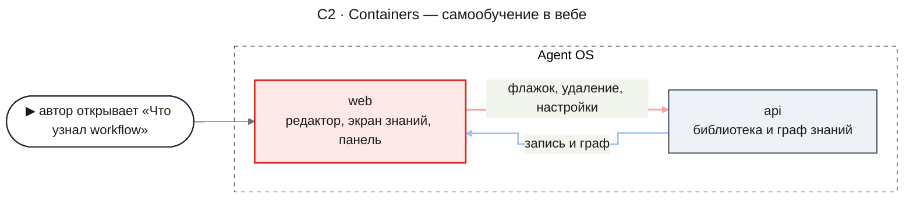
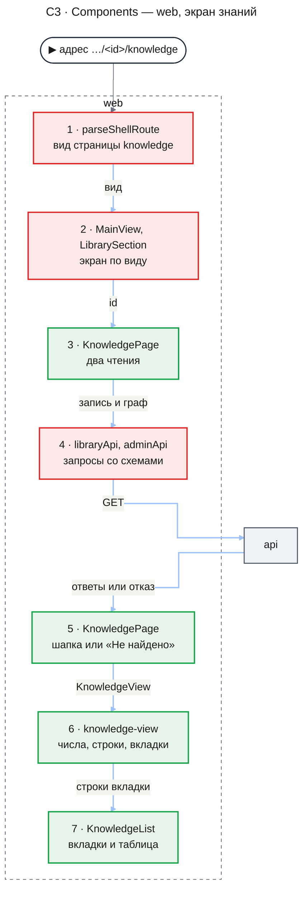
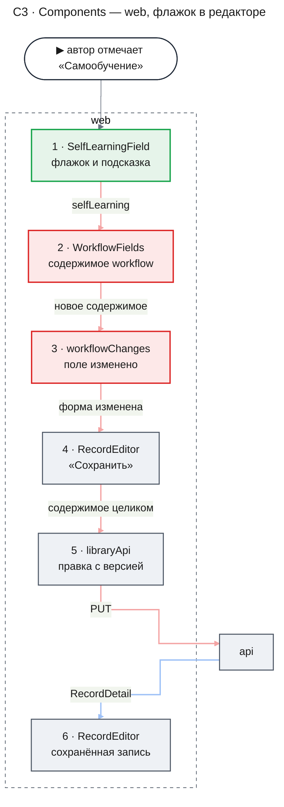
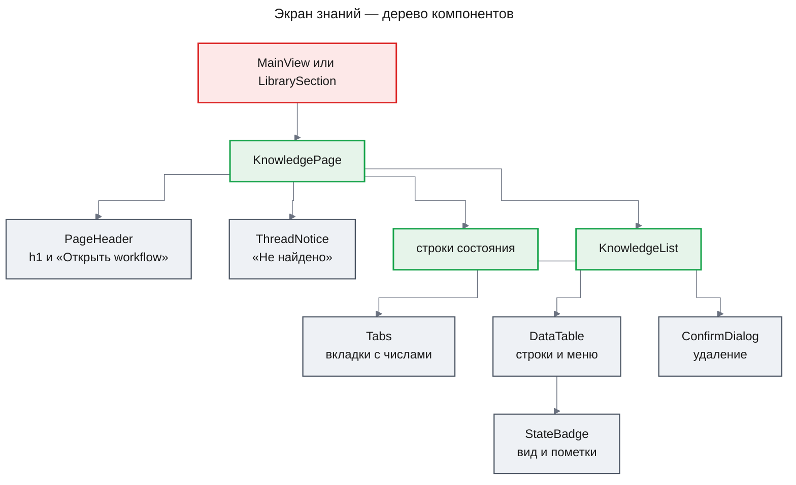
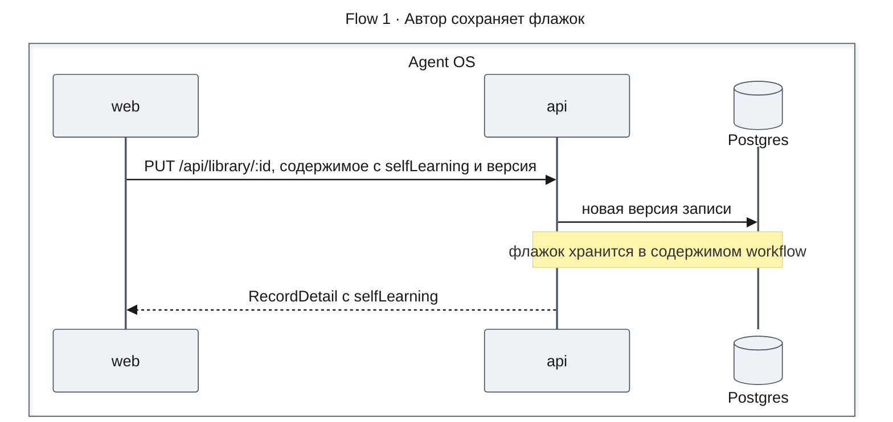
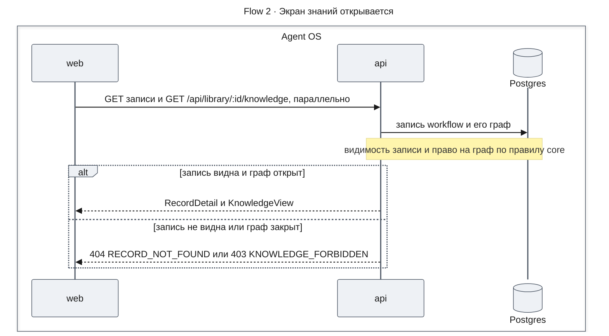
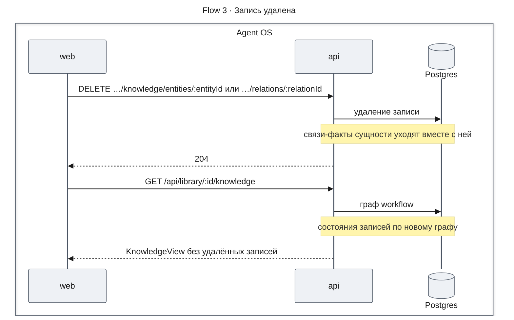
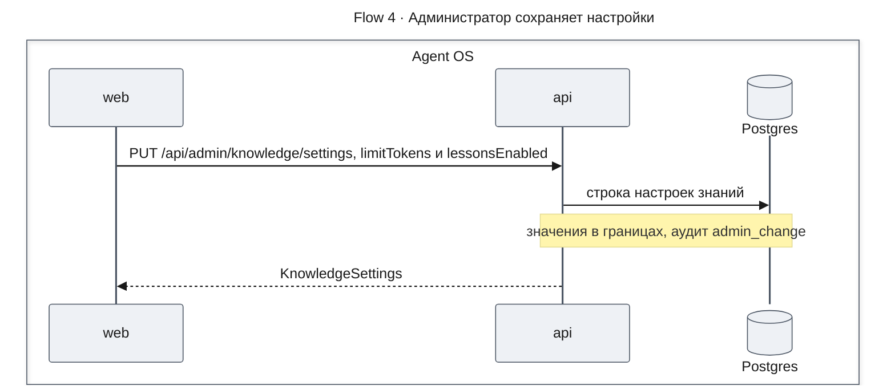
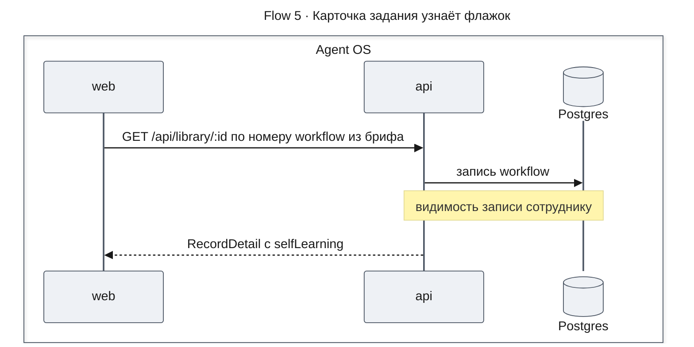

# Самообучение workflow — Design Document — web

**Status:** На утверждении · **Date:** 2026-11-20 · **PRD:** [prd.md](./prd.md) · **UXRD:** [uxrd.md](./uxrd.md) · **Depends on:** [design-core.md](./design-core.md#contract-definitions)

## Snapshot

**Overview.** Часть `core` даёт workflow граф знаний и API к нему; эта часть делает граф видимым и управляемым из веба. В редакторе workflow появляется флажок «Самообучение», и он сохраняется общей кнопкой «Сохранить» вместе с остальной формой. Новый экран «Что узнал workflow» в библиотеке и в панели администратора читает запись workflow и её граф, показывает записи списком с вкладками по видам и удаляет их по одной. Карточка задания перед запуском говорит сотруднику, что workflow учится, а панель получает форму с местом для знаний и выключателем уроков. Всё собрано из того, что в вебе уже есть: адресов оболочки, клиента API, чтения при открытии, таблицы данных и диалога подтверждения.

- **Не меняется**: контракт `core`, беседа и карточка хода; общие компоненты — таблица данных, шапка страницы, диалог подтверждения — не получают новых свойств.
- **Главный риск**: флажок молча не сохраняется, потому что редактор не считает его изменённым полем; закрыт KD-3 и тестом UC-1.
- **Открытые вопросы**: нет.

### Key Decisions

#### KD-1: Экран знаний — один компонент `KnowledgePage` для библиотеки и панели; имя, вид и автора workflow он берёт вторым чтением записи, параллельно с чтением графа

`KnowledgeView` из `core` не несёт имени workflow, его вида и автора, а экрану они нужны для `h1`, заголовка вкладки, кнопки «Открыть workflow» и текстов о workflow сотрудника в панели. Поэтому `KnowledgePage` читает две вещи сразу: запись — `libraryApi.get` в библиотеке или `adminApi.library.get` в панели — и граф через `libraryApi.knowledge`. Граф и в библиотеке, и в панели читается одним маршрутом `core` (design-core KD-7). 404 любого чтения или 403 `KNOWLEDGE_FORBIDDEN` чтения графа дают существующий экран «Не найдено»: RV-02 в библиотеке и AD-15 в панели (DC-2). Различия двух мест — какой клиент читает запись, какая шапка и куда ведёт «Открыть workflow» — передаются свойством `variant`.

Не взяты: имя в `KnowledgeView` — правка контракта `core` ради одного поля, которое веб уже умеет читать; имя из `libraryIndex.summaryOf` — это список записей, видимых сотруднику в библиотеке, и в нём нет workflow сотрудника, которые администратор видит только в панели; два экрана для библиотеки и панели — одна и та же разметка и логика дважды.

#### KD-2: Адреса — новый вид страницы `knowledge` внутри существующих видов маршрута `library` и `admin`; вкладки экрана — состояние компонента, а не адрес

Экран встаёт в оболочку по [shell-route.md](../../code-system/patterns/shell-route.md): `LibraryPage` и `AdminPage` получают вариант `knowledge`, `parseShellRoute` разбирает `/library/<id>/knowledge` и `/admin/library/<id>/knowledge`, а адреса строят `knowledgePath` и `adminKnowledgePath`. Страницы Next с необязательным catch-all уже занимают оба раздела, поэтому новых файлов страниц нет. Сегодня `/library/<id>/knowledge` открывает список библиотеки, а `/admin/library/<id>/knowledge` — раздел «Сотрудники»; новая ветка разбора стоит раньше разбора одного сегмента. Вкладки «Все», «Факты» и другие — локальное состояние: UXRD не требует, чтобы вкладка переживала перезагрузку, а таблица перерисовывается заново при смене вкладки (ключ таблицы — вкладка), чтобы строки чужой вкладки не «уходили» с анимацией.

Не взяты: вкладка в `?tab=` — `useSearchParams` под `cacheComponents` требует `Suspense`, а адреса оболочки держат состояние в сегментах; вкладки сегментами пути, как в разделе панели «Агенты и workflow», — пять новых адресов без требования, которое бы их оправдало.

#### KD-3: Флажок — поле `content.selfLearning` формы workflow; правило «что изменено» и подписи полей получают `selfLearning`

Флажок стоит в `WorkflowFields` между «Кто пишет ответ» и «Дополнительно» и меняет содержимое через тот же `setContent`, что и остальные поля. Сохранение уже отправляет содержимое целиком, поэтому отправка не меняется. Но «изменено» редактор считает по явному списку полей в `workflowChanges`, и без новой строки там форма после щелчка по флажку осталась бы «чистой», «Сохранить» — недоступной, а флажок не сохранился бы (DC-1). Поэтому `workflowChanges` сравнивает `selfLearning`, а `RECORD_FIELD_LABELS` получает подпись «Самообучение» из MC-1 — по ней блок конфликта называет изменённое поле. `DefinitionView` у workflow получает строку «Самообучение» со значением «включено» или «выключено». `blankWorkflow` начинает с `selfLearning: false`.

Не взяты: отдельный переключатель, который сохраняется сразу, — UXRD (KD-3) требует общей кнопки «Сохранить»; флажок без строки в `workflowChanges` — та самая молчаливая потеря.

#### KD-4: Список — существующая `DataTable` с меню строки и вкладки `ui/tabs` с числами; чего таблица не умеет, записано отклонением от UXRD

`DataTable` уже даёт всё, что нужно для критериев: состояния Loading, Error, Empty и «Нет совпадений», меню «⋯», уход строки и порядок строк от сервера без сортировки. Чего она не умеет — комфортной плотности, мобильного варианта «Две строки» с меню и фокуса на вкладку после последней строки, — мы не достраиваем, а строим как есть и записываем в [Отличия от UXRD](#отличия-от-uxrd). Имя строки для меню «Действия: {текст записи}» экран сам обрезает до 60 знаков, поэтому этот пункт UXRD выполнен без правки таблицы.

Не взяты: свойство плотности и вариант «Две строки» в `DataTable` — переделка общей таблицы, на которой стоит вся панель, ради одного экрана; своя таблица экрана — второй компонент того же назначения.

#### KD-5: Удаление — `ConfirmDialog`, ровно один `DELETE`, затем перечитывание графа; число уходящих связей считается по уже загруженным записям

«Удалить» в меню строки открывает `ConfirmDialog` с текстами MC-6. Подтверждение шлёт один `DELETE` в маршрут сущности или связи, показывает уведомление и перечитывает граф; строку убирает новый ответ сервера, а не правка на месте (DC-3). Сколько связей уйдёт с сущностью, экран считает по загруженным связям-фактам, у которых один из концов — эта сущность: `DELETE` отвечает 204 без тела. Отказ показывает сам диалог — так устроено каждое подтверждаемое удаление в продукте.

Не взяты: `recordAction` — он рассчитан на записи библиотеки с версией и видом и не подходит к записи графа; убрать строку до ответа — экран показывал бы то, чего на сервере, возможно, нет, а UXRD требует перечитывания.

#### KD-6: Строка в карточке задания читает запись по номеру workflow, который у брифа уже есть, и только пока карточка ждёт решения

`SelfLearningNote` внутри `DecisionCard` читает `libraryApi.get` по номеру workflow из брифа и показывает MC-9, когда у записи `content.selfLearning` включён. Чтение идёт, только пока решения нет, по одному на карточку брифа. Пока ответа нет или чтение не удалось, строки нет, и карточка работает как раньше (DC-4). Так `core` не меняет контракт: design-core прямо называет этот путь (Contract Definitions, «Маршруты библиотеки»).

Не взяты: `libraryIndex.summaryOf` — это `RecordSummary` без содержимого, флажка в нём нет; флажок в `RecordSummary` или в брифе `start_workflow` — правка контрактов `custom-agents` и `core` ради одной строки текста.

#### KD-7: Настройки — вторая форма `KnowledgeSettingsForm` под «Настройками новых записей»; флажок «Давать запускам уроки» — обычный `Checkbox` внутри `AdminForm`; границы — константы из `contracts`

Форма повторяет `LibrarySettingsForm`: `section` с `h2`, `useResource` над `adminApi.knowledge.settings`, `AdminForm` в варианте «Форма страницы» и одна кнопка «Сохранить» на оба значения. `AdminForm` хранит значения любого типа, поэтому флажок кладётся в форму через `form.set`, как в `model-dialog.tsx`. Поле места проверяется до отправки правилом `knowledgeSettingsRules` в `form-rules.ts` по константам границ из `contracts` — тем же путём, что «Лимит ходов» по `RECORD_MAX_TURNS_*` (DC-5). Сервер всё равно проверяет тело схемой и отвечает 400 `VALIDATION_FAILED`; тогда форма показывает ошибку сервера.

Не взяты: одна форма с лимитом ходов — разные маршруты и разные уведомления, а UXRD рисует две кнопки «Сохранить»; новый `AdminCheckboxField` — это второе использование флажка в форме панели, а общий компонент заводится на третьем; проверка только на сервере — MC-8 называет границы в тексте ошибки поля, и вебу их всё равно нужно знать.

## Terms

- **Экран знаний** — экран «Что узнал workflow» (UXRD KN-01) по адресам `/library/<id>/knowledge` и `/admin/library/<id>/knowledge`.
- **Запись знаний** — сущность или связь графа, одна строка списка; `KnowledgeItem` в контракте `core`.
- **Отбор по смыслу** — `core` отдаёт часть места в шаге записям, близким по смыслу к вопросу запуска; остальное место заполняет общий порядок по подтверждениям.
- **Строки состояния** — несколько строк текста над вкладками: сколько записей запуски получают при любом вопросе, сколько — только по теме или не помещается, работает ли отбор по смыслу, чем кончилось последнее обучение (UXRD KN-01, «Состояние»).
- **Вид страницы** — часть вида маршрута оболочки, которая говорит, какой экран раздела открыт: список, запись, новая запись, теперь и знания.
- **Чтение при открытии** — экран читает данные, когда его открыли, и перечитывает после своего изменения ([read-on-open.md](../../code-system/patterns/read-on-open.md)).

## Part

- **Part**: `web`
- **Covers**: FR-10, FR-11, FR-12, FR-13; видимая сторона FR-06, FR-08, FR-09, FR-15, FR-16, FR-17, FR-18
- **Depends on**: [design-core.md, Contract Definitions](./design-core.md#contract-definitions)
- **Prerequisite ADRs**: [ADR-0012](../../adr/ADR-0012-closed-api-and-server-issued-employee-id.md) (сотрудника веб не передаёт), [ADR-0016](../../adr/ADR-0016-library-records-and-visibility.md) («Не найдено» ничего не называет)
- **Sibling parts**: `core` (FR-01 – FR-09, FR-15 – FR-20) — граф, извлечение, доступ и маршруты; здесь только их контракт

**Out of scope**

- Месячный расход: стоимость обучения попадает в уже существующую строку расхода запускающего, новой строки нет (UXRD Snapshot; AC-08.1 проверяет `core`).
- Просмотр записи коллегой (RV-01) и просмотр workflow сотрудника в панели (AL-03) не меняются, кроме кнопки MC-7 в AL-03 и строки «Самообучение» в `DefinitionView` (KD-3).
- Очистка графа целиком (FR-14) — отложена в PRD.
- Живое обновление экрана знаний: экран читает граф при открытии и после удаления (UXRD KN-01).

**Constraints**

- PoC: самый короткий путь, ничего не копируется «на всякий случай». Каждый новый блок сначала искали среди существующих ([Building-block Inventory](#building-block-inventory)).
- Контракт `core` потребляется как есть: пометки и числа строк состояния экран берёт из полей `KnowledgeView`; по записям он считает только числа вкладок.
- Логи — через `src/lib/logger.ts`, обёртку над логгером `packages/common`; текст записей знаний в лог не попадает ([Логирование](#логирование)).
- Тестов мало, только на критичное ([Test Strategy](#test-strategy)).
- WCAG 2.1 AA и работа от 360 px без горизонтальной прокрутки страницы — как у библиотеки и панели (UXRD Accessibility).

## Building-block Inventory

Follows the [code system](../../code-system/README.md). Поиск перед «new»: `apps/web/src/components` (`library`, `admin`, `agents`, `shell`, `account`), `apps/web/src/lib`, `docs/design-system/components/`, `docs/code-system/patterns/`. Экрана графа, списка с вкладками по видам и формы настроек знаний в вебе нет.

| Building block | Pattern | Status | Note |
|---|---|---|---|
| `parseShellRoute`, `LibraryPage`, `AdminPage`, `knowledgePath`, `adminKnowledgePath` | [shell-route.md](../../code-system/patterns/shell-route.md) | extended | вид страницы `knowledge` (KD-2) |
| `MainView`, `LibrarySection`, `AdminScreen` | [shell-route.md](../../code-system/patterns/shell-route.md) | extended | ветки `knowledge`; фокус на `h1` при переходе между двумя экранами знаний |
| `libraryApi`, `adminApi` | [web-api-client.md](../../code-system/patterns/web-api-client.md) | extended | `knowledge`, `deleteKnowledgeEntity`, `deleteKnowledgeRelation`; `adminApi.knowledge` |
| `KnowledgePage`, `KnowledgeList` | [read-on-open.md](../../code-system/patterns/read-on-open.md) | new | KD-1; ничего похожего нет |
| `lib/library/knowledge-view.ts` | — | new | чистые функции: подписи по `state`, `placement`, `selection` и `counts`, вкладки, тексты строк |
| `DataTable`, `resourceTableState`, `StateBadge`, `ConfirmDialog`, `ThreadNotice`, `PageHeader`, `useResource`, `ShellLink`, `ui/tabs` | — | reused | без новых свойств (KD-4, KD-5) |
| `isKnowledgeHidden` в `library-errors.ts` | [web-api-client.md](../../code-system/patterns/web-api-client.md) | extended | 404 или 403 `KNOWLEDGE_FORBIDDEN` (DC-2) |
| `WorkflowFields`, `blankWorkflow`, `SelfLearningField` | — | extended / new | блок SL-01 (KD-3) |
| `workflowChanges`, `RECORD_FIELD_LABELS` | — | extended | поле `selfLearning` (KD-3) |
| `DefinitionView` | [definition-view.md](../../design-system/components/definition-view.md) | extended | строка «Самообучение» у workflow; видна на карточке черновика и в RV-01, AL-03 (KD-3) |
| `DecisionCard`, `SelfLearningNote` | [read-on-open.md](../../code-system/patterns/read-on-open.md) | extended / new | строка SL-02 (KD-6) |
| `EditorHeaderActions`, `EmployeeRecordPage` | — | extended | кнопка MC-7 у workflow в панели |
| `KnowledgeSettingsForm`, `knowledgeSettingsRules` | [settings-row.md](../../code-system/patterns/settings-row.md) | new / extended | форма AS-01 по образцу `LibrarySettingsForm` (KD-7) |
| `formatDay`, `formatDayTime` в `lib/agents/format.ts` | — | extended | день записи и время обучения; `library-row.tsx` берёт `formatDay` вместо своей копии |

Новых паттернов нет; `docs/code-system/` и `docs/design-system/` эта часть не меняет.

## Acceptance Criteria

### FR-10: Флажок в редакторе workflow

- From the PRD: AC-10.1
- Когда автор меняет только флажок, редактор считает форму изменённой и «Сохранить» становится доступной (DC-1).

### FR-11: Экран графа

- From the PRD: AC-11.1, AC-11.2, AC-11.3, AC-11.4, AC-11.5, AC-11.6
- Прямая ссылка, на которую любое из двух чтений ответило 404, а чтение графа — ещё и 403 `KNOWLEDGE_FORBIDDEN`, показывает тот же экран «Не найдено» KN-03 и не называет workflow (DC-2).
- Подтверждённое удаление шлёт ровно один `DELETE`, затем перечитывает граф; строка, а у сущности и её связи-факты, уходят из списка, и уведомление MC-6 называет число ушедших связей (DC-3).

### FR-12: Настройки в панели администратора

- From the PRD: AC-12.1
- Место вне границ контракта форма отклоняет до отправки ошибкой поля MC-8; отказ сервера показывает ошибку формы, введённое остаётся (DC-5).

### FR-13: Запускающий знает, что workflow учится

- From the PRD: AC-13.1
- Строка SL-02 стоит в карточке, только когда чтение записи показало включённый флажок; пока ответа нет или чтение не удалось, строки нет, а решение принимается как обычно (DC-4).

### Видимая сторона требований `core`

- From the PRD: AC-02.2, AC-03.2, AC-03.4, AC-04.3, AC-06.1, AC-06.2, AC-08.2, AC-09.1, AC-09.2, AC-09.3, AC-15.3, AC-16.1, AC-17.1, AC-18.3, AC-18.4 — каждый в той части, которую видит человек на экране знаний.

## Design

### Architecture (C1–C4)

#### C2 · Containers

Контейнеры те же; `web` получает новый экран, флажок, строку в карточке и форму в панели над маршрутами `core`.

`web` читает и меняет граф только маршрутами `core`; `api` здесь — готовый контракт, его устройство описано в design-core.

#### C3 · Components: web

**web — экран знаний.** Адрес выбирает экран, экран читает запись и граф, чистые функции превращают граф в строки вкладок.

- `KnowledgePage` в библиотеке монтирует `MainView`, в панели — `LibrarySection` под `AdminGate`; ключ компонента — номер workflow, поэтому экран другого workflow начинается заново.
- `knowledge-view` — чистые функции без чтений и единственное место, где `state`, `placement` и `selection` записи и графа становятся подписями: пометкой записи, пятой вкладкой и строками состояния. Числа строк состояния они берут из `counts` как есть, вкладки по виду отбирают записи по `kind`, а тексты каждой записи строят по MC-4. Порядок записей — тот, что прислал `core`; вкладка только отбирает записи, порядок не меняет.
- `KnowledgeList` держит активную вкладку, строки `DataTable` с меню «Удалить» и диалог удаления (KD-5).

**web — флажок в редакторе.** Флажок проходит путь любого поля формы; новое только в правиле «что изменено».

- `SelfLearningField` показывает подсказку MC-1 описанием флажка (`FieldDescription` и `aria-describedby`), ссылку «Что узнал workflow» — только у сохранённого workflow, и заметку MC-1, когда флажок снят у сохранённого включённого. Ссылка идёт через `ShellLink`, поэтому уход с несохранёнными правками спрашивает MC-11 сам. В режиме `employee` она ведёт на `knowledgePath`, в режиме `system` — на `adminKnowledgePath`.
- Ссылку видит только тот, кому открыт редактор: свой workflow с правом правки или системный в панели. Отдельного признака видимости не нужно; прямую ссылку закрывает ответ сервера (DC-2).

**Строка в карточке и настройки** устроены по уже нарисованным образцам. `SelfLearningNote` — чтение при открытии внутри `DecisionCard` по номеру workflow брифа (KD-6, Flow 5). `KnowledgeSettingsForm` повторяет `LibrarySettingsForm` на вкладке «Системные» (KD-7, Flow 4).

#### Дерево компонентов

Где стоит каждая часть экрана знаний.

Остальные части фичи стоят в существующих экранах.

| Компонент | Спецификация | Где | Статус |
|---|---|---|---|
| `SelfLearningField` | [record-editor.md](../../design-system/components/record-editor.md), «Workflow» | `WorkflowFields`, между «Кто пишет ответ» и «Дополнительно» (SL-01) | new |
| `SelfLearningNote` | [decision-card.md](../../design-system/components/decision-card.md), «Бриф» | `DecisionCard`, над кнопками, пока решения нет (SL-02) | new |
| кнопка «Что узнал workflow» | UXRD MC-7 | шапка `EditorHeaderActions` у системного workflow и `EmployeeRecordPage` у workflow сотрудника | extended |
| строка «Самообучение» | [definition-view.md](../../design-system/components/definition-view.md) | `DefinitionView` у workflow: карточка черновика, RV-01, AL-03 | extended |
| `KnowledgeSettingsForm` | [settings-form.md](../../design-system/components/settings-form.md), «Форма страницы» | вкладка «Системные», под `LibrarySettingsForm` (AS-01) | new |

Новые файлы — `components/library/knowledge-page.tsx`, `components/library/knowledge-list.tsx`, `components/library/self-learning-field.tsx`, `components/admin/library/knowledge-settings-form.tsx`, `lib/library/knowledge-view.ts` (пути от `apps/web/src`). Меняются `lib/shell-route.ts`, `components/shell/main-view.tsx`, `components/admin/admin-screen.tsx`, `components/admin/library/library-section.tsx`, `components/admin/library/employee-record-page.tsx`, `components/library/editor-header.tsx`, `components/library/workflow-fields.tsx`, `components/agents/decision-card.tsx`, `lib/library/library-api.ts`, `lib/library/library-errors.ts`, `lib/library/record-rules.ts`, `lib/admin/admin-api.ts`, `lib/admin/form-rules.ts`, `lib/agents/format.ts`, `components/library/library-row.tsx` и `test/fixtures.ts` (`selfLearning` в содержимом workflow). Остальные места, где содержимое workflow строится литералом, найдёт проверка типов.

#### Данные экранов

Каждый экран читает при открытии и после своего изменения перечитывает затронутое. Живого обновления и правок до ответа нет.

| Экран | Читает | Пишет |
|---|---|---|
| Экран знаний в библиотеке | `GET /api/library/:id`, `GET /api/library/:id/knowledge` | `DELETE …/knowledge/entities/:entityId`, `DELETE …/knowledge/relations/:relationId` |
| Экран знаний в панели | `GET /api/admin/library/:id`, `GET /api/library/:id/knowledge` | те же `DELETE` |
| Редактор workflow | как сегодня | `PUT /api/library/:id` или маршрут панели, содержимое с `selfLearning` |
| Карточка задания | `GET /api/library/:id` по номеру workflow брифа | — |
| «Системные» в панели | `GET /api/admin/knowledge/settings` | `PUT /api/admin/knowledge/settings` |

#### Как экран выбирает, что показать

Экран решает по двум ответам; тексты — по ID сообщений UXRD.

| Условие | Что показано (UXRD KN-01) |
|---|---|
| Любое чтение ещё идёт | Пока нет записи — скелетон страницы записи; есть запись, нет графа — шапка и Loading таблицы MC-5 |
| 404 любого чтения или 403 `KNOWLEDGE_FORBIDDEN` графа | KN-03: RV-02 в библиотеке, AD-15 в панели |
| Другая ошибка чтения записи | Ошибка страницы записи: RV-01 «Ошибка» в библиотеке, заглушка записи с «Повторить» в панели |
| Другая ошибка чтения графа | Шапка и ошибка таблицы MC-5 с «Повторить»; строк состояния нет |
| В графе нет записей | Пустое состояние таблицы MC-5 — вариант по `selfLearning`; ни вкладок, ни строк состояния |
| `selfLearning` включён | Строка 1 MC-3 — вариант «все», когда `counts.beyond` равно нулю; строка 2, когда оно больше нуля: «только по теме» при `selection` `on` или `preparing`, «не помещаются» при `off` |
| `selfLearning` выключен | Вместо строк 1–2 — строка 4 MC-3 о выключенном самообучении; строки об отборе по смыслу нет |
| `selection` `off` при включённом самообучении | Строка 4 MC-3 «Отбор по смыслу выключен» с причиной по `selection.reason` |
| `selection` `preparing` при включённом самообучении | Строка 4 MC-3 о записях, которые ещё готовят, с числом `selection.pending` |
| `lessonsEnabled` выключен при включённом самообучении | Строка 4 MC-3 об уроках |
| `counts.outdated` больше нуля | Строка 3 MC-3 |
| `lastExtraction` не `null` | Строка 5 MC-3 по `status` и `reason` |
| Есть записи с `placement` `by_topic` или `does_not_fit` | Пятая вкладка с такими записями: «Только по теме» или «Не помещаются» |
| Вкладка без записей | «Нет совпадений» таблицы с текстом MC-5 этой вкладки |

Пометку записи (MC-4) даёт сервер, у записи она одна. `state` `outdated` — «устарела», `lessons_off` — «уроки выключены»; у записи в `active` её даёт `placement`: `by_topic` — «только по теме», `does_not_fit` — «не помещается», `always` и `null` — без пометки. Запись, которая и устарела, и урок при выключенных уроках, получает ту пометку, что стоит в её `state`. При выключенном самообучении `core` ставит `placement` `null` всем записям, поэтому пометок «только по теме» и «не помещается» и пятой вкладки тогда нет.

Числа строк состояния — поля `counts` как есть: {M} — `active`, {N} — `always`, {K} — `beyond`, {O} — `outdated`, {P} — `percent`, в том числе больше 100. {X} строки об отборе — `selection.pending`. По записям экран считает только числа вкладок: сколько записей вкладка показывает. Слова при числах склоняет `pluralRu`.

Строка «Отбор по смыслу выключен» называет причину MC-3 по `selection.reason`: `model_not_selected` — модель не выбрана; `provider_failed` — модель не ответила или отказала. Модель в ней — `selection.model`, id в том виде, в каком его отдаёт `core`, через `formatModel`, как и модель строки 5; отдельного чтения моделей нет.

Строка 5 при `done` называет ненулевые числа `added`, `confirmed`, `outdated`, а при всех нулях — фразу «нового не нашлось». При `skipped` и `failed` она называет причину MC-3 по `reason`: `stopped` — запуск остановили; `model_error` — модель не ответила; `quota_exhausted` — кончилась квота; `model_not_connected` — модель отключена; `model_not_allowed` — нет доступа к модели; `no_models_allowed` — нет доступа ни к одной модели; `owner_disabled` — запустивший отключён; `invalid_answer` — ответ не разобран; `interrupted` — сбой на сервере. Модель в тексте — `lastExtraction.model` через `formatModel`, дата — `lastExtraction.at` днём и временем всегда (`formatDayTime`). Тексты «… Включить его может автор» в MC-3 и MC-5 идут на экране панели у workflow сотрудника, то есть когда у записи есть `author`.

Ячейка «Запись» строится по виду (MC-4): у сущности — имя и описание; у связи-факта — «{from.name} → {label} → {to.name}»; у урока — `server.tool` Mono и вопрос, второй строкой подсказка и исход; у «искал — не нашёл» — `server.tool` и вопрос, второй строкой «пусто». Пометка — `StateBadge`: «только по теме» состоянием «Нейтрально», остальные — «Выключено»; вид — `StateBadge` «Источник» в колонке «Вид» на вкладке «Все». «Дата» — день из `date` (`formatDay`): `date` — полная отметка времени, и день берётся в часовом поясе зрителя. Текст записей выводится как текст, без разметки.

#### Отличия от UXRD

Где буквальное выполнение UXRD потребовало бы нового компонента или переделки общего, экран строится на существующем поведении. Ни одно отличие не задевает критерий приёмки PRD.

| UXRD | Что строится | Почему |
|---|---|---|
| В библиотеке экран в комфортной плотности (Design System) | Таблица в компактной плотности, как в панели: строка 32 px, на грубом указателе 44 px | У `DataTable` одна плотность; свойство плотности — переделка общей таблицы всей панели |
| На < 768 px таблица «Две строки» с меню строки (Responsive Behavior) | Та же таблица; колонка «Запись» сжимается, остальное прокручивается вбок внутри блока таблицы, страница вбок не прокручивается | Вариант «Две строки» есть только локальной копией без меню в `account/models-section.tsx`; общий вариант — новый компонент |
| Удалена последняя строка вкладки — фокус на активную вкладку (Accessibility) | Фокус на `h1` страницы | Правило ухода фокуса живёт внутри `DataTable`; новое свойство общей таблицы ради одного случая |
| Вкладка браузера «Что узнал «{имя}» — Agent OS», в панели «… — Панель — Agent OS» (MC-2) | «Что узнал «{имя}» — Библиотека — Agent OS», в панели «… — Агенты и workflow — Панель — Agent OS» | `PageHeader` строит заголовок вкладки из заголовка, родителя и области, как у каждой страницы с родителем |
| Пока идёт удаление — строка в «Действие идёт»; отказ — причина под строкой, фокус на её меню (KN-02, Error Flows) | Ожидание и отказ показывает `ConfirmDialog`: он остаётся открытым с причиной MC-6, повтор — той же кнопкой | Так устроено каждое подтверждаемое удаление в продукте; вынести отказ под строку — переписать общий диалог |

### Runtime Flows

Все потоки идут одним путём: `web` зовёт `api`, `api` читает или пишет Postgres, ответ возвращается в `web`. Устройство `api` — в design-core.

#### Flow 1: Автор сохраняет флажок

**Starts when:** автор отметил «Самообучение» и нажал «Сохранить», for AC-10.1, DC-1

**Outcome:** форма снова «чистая» и держит сохранённый флажок; при новом открытии редактора флажок отмечен и под ним есть ссылка «Что узнал workflow». У системного workflow тот же путь идёт через маршрут панели.

**Failure handling:**

- Конфликт версии или отказ сервера → как у любого сохранения записи: блок конфликта называет изменённые поля, среди них «Самообучение» (KD-3).

#### Flow 2: Экран знаний открывается

**Starts when:** автор или администратор открывает `/library/<id>/knowledge` или `/admin/library/<id>/knowledge`, for AC-09.1, AC-09.3, AC-11.1, AC-11.3, AC-11.4, AC-11.5, DC-2

**Outcome:** экран показывает шапку, строки состояния, вкладки и список в порядке `core`; фокус — на `h1`. На отказ — экран «Не найдено», без имени workflow.

**Failure handling:**

- Сеть или 5xx на записи → ошибка страницы записи с «Повторить»; на графе → ошибка таблицы MC-5 с «Повторить». Ошибку каждого чтения `useResource` пишет в лог один раз.
- Пришёл ответ прежнего workflow после перехода на другой → его отбрасывает `useResource`, а `KnowledgePage` с другим ключом начинается заново.

#### Flow 3: Запись удалена

**Starts when:** автор или администратор подтверждает «Удалить» в диалоге KN-02, for AC-09.2, AC-11.2, DC-3

**Outcome:** строка и связи сущности уходят из списка, числа вкладок и строки состояния пересчитаны по новому ответу, уведомление MC-6 — «Удалено» или «Удалено вместе со связями: {N}». Фокус переходит на меню следующей строки, без неё — предыдущей, без строк — на `h1`.

**Failure handling:**

- Запись уже удалил другой человек → сервер отвечает 204, и удаление идёт как обычное.
- Отказ или сеть → диалог остаётся открытым с MC-6 «Не удалось удалить: {причина}» (`deleteFailed`), строка на месте; веб пишет отказ в лог.
- 404 или 403 на удалении (workflow удалён или доступ закрыт за время работы) → тот же отказ в диалоге; после закрытия диалога «Повторить» не нужен: следующее открытие экрана покажет «Не найдено».

#### Flow 4: Администратор сохраняет настройки

**Starts when:** администратор нажимает «Сохранить» в группе AS-01, for AC-12.1, DC-5

**Outcome:** уведомление MC-8; форма перечитывает настройки и начинается заново с сохранённых значений (её ключ — `updatedAt`, как у `LibrarySettingsForm`).

**Failure handling:**

- Место не целое или вне границ → запроса нет, ошибка поля MC-8 и фокус на поле.
- 400 `VALIDATION_FAILED` или другой отказ → ошибка формы MC-8 «Не удалось сохранить: {причина}», введённое остаётся; `AdminForm` пишет отказ в лог.

#### Flow 5: Карточка задания узнаёт флажок

**Starts when:** в беседе появилась карточка брифа `start_workflow`, которая ждёт решения, for AC-13.1, DC-4

**Outcome:** при включённом флажке над кнопками карточки стоит MC-9; при выключенном строки нет. После решения карточка строку не показывает и запись больше не читает.

**Failure handling:**

- Чтение не удалось или запись не видна → строки нет, карточка решается как обычно; ошибку пишет в лог `useResource`.

### Contract Definitions

Контракт `core` — маршруты, `KnowledgeView`, `KnowledgeSelection`, `KnowledgeItem`, `LastExtraction`, `KnowledgeSettings`, схемы и константы границ в `packages/contracts/src/knowledge.ts` и коды ошибок — потребляется как написан в [design-core.md](./design-core.md#contract-definitions). Ниже — что эта часть даёт остальному вебу.

#### Адреса

- **`LibraryPage` вариант `knowledge`** с `id` и **`knowledgePath(id)`** — `/library/<id>/knowledge`; номер кодируется как у `recordPath`.
- **`AdminPage` вариант `knowledge`** с `key` в разделе `library` и **`adminKnowledgePath(id)`** — `/admin/library/<id>/knowledge`. `AdminScreen` переводит фокус на `h1` и при смене номера между двумя экранами знаний.

#### Клиент API

- **`libraryApi.knowledge(id)`** — `GET /api/library/:id/knowledge`, ответ разбирает `KnowledgeViewSchema` из `contracts`. Бросает `ApiRequestError`; 403 приходит видом `http` с кодом.
- **`libraryApi.deleteKnowledgeEntity(id, entityId)`** и **`libraryApi.deleteKnowledgeRelation(id, relationId)`** — `DELETE` маршрутов `core`, без тела ответа. Экран панели зовёт те же функции: маршрут графа у `core` один.
- **`adminApi.knowledge.settings()`** и **`adminApi.knowledge.saveSettings({ limitTokens, lessonsEnabled })`** — маршруты настроек `core`; общий обработчик 403 `ADMIN_REQUIRED` работает как у всей панели.
- **`isKnowledgeHidden(error)`** — истина для 404 и для 403 с кодом `KNOWLEDGE_FORBIDDEN`. Только по ней экран знаний решает показать «Не найдено».

#### Компоненты

- **`KnowledgePage`** — свойства `id` и `variant` (`library` или `panel`). Сам читает запись и граф, сам ставит фокус на `h1`, когда шапка нарисована, сам показывает «Не найдено». Наружу ничего не отдаёт.
- **`SelfLearningField`** — значение флажка, было ли оно включено в сохранённой записи, адрес экрана знаний или его отсутствие у нового workflow, и `onChange`. Ошибок проверки у флажка нет.
- **`SelfLearningNote`** — номер workflow; рисует MC-9 или ничего.
- **`KnowledgeSettingsForm`** — без свойств; читает и сохраняет настройки сама.

### Логирование

Через `logger` из `src/lib/logger.ts` с `describeApiError` ([logging.md](../../code-system/patterns/logging.md)); пишет место, где ошибка обработана. Текст записей знаний в лог не идёт: в нём могут быть секреты и личные данные, ради удаления которых экран и существует (UC-5 PRD).

- Чтения записи и графа на экране знаний и в карточке: `useResource` с меткой `library` пишет метод, путь, статус, код и причину.
- Удаление: `library: knowledge delete` — `recordId`, `type` и `id` записи, итог или статус, код и причина отказа, `durationMs`.
- Настройки: `AdminForm` с событием `admin: knowledge settings` пишет отказ сервера.

### Доступность и ширина

Роли, имена и клавиатура компонентов — в их спецификациях; экран добавляет только своё.

- `h1` экрана получает фокус при открытии и при переходе между двумя экранами знаний.
- Подпись таблицы (`caption`) — название активной вкладки; вкладки называют вид и число записей.
- Меню строки называется «Действия: {текст записи}», текст обрезан после 60 знаков; `DataTable` строит имя из имени строки, которое передаёт экран.
- Фокус по умолчанию в диалоге — на «Отмена»: она первая в подвале `ConfirmDialog`. Это поведение `alert-dialog` не проверено кодом и проверяется сценарием L1.
- Полоса вкладок на узком экране прокручивается вбок внутри себя; «Открыть workflow» ниже 768 px `PageHeader` уже переносит строкой под заголовок.

## Test Strategy

Автотестами становятся UC-1 – UC-4 и UC-E1 — по одному на сохранение флажка, открытие экрана, удаление, настройки и отказ в доступе. UC-1 — строка в существующем табличном тесте `workflowChanges` плюс сохранение в интеграционном тесте; остальные — в существующей обвязке интеграционных тестов оболочки с подменой API. UC-5 и UC-6 проверяют сценарии L1: их тексты и ветви не защищают ни права, ни данные.

### Main Use Cases

- **UC-1: Автор включает самообучение и сохраняет** — covers AC-10.1, DC-1
  - Given: сохранённый workflow автора с выключенным флажком; редактор открыт.
  - When: автор отмечает только «Самообучение» и нажимает «Сохранить», затем открывает редактор снова.
  - Then: после щелчка форма «Изменено» и «Сохранить» доступна; тело `PUT` несёт `selfLearning: true`; в новом редакторе флажок отмечен и есть ссылка «Что узнал workflow».

- **UC-2: Автор открывает экран знаний** — covers AC-11.1, AC-11.4, AC-11.5, AC-06.1, AC-16.1
  - Given: workflow автора с включённым самообучением; граф с уроком `logs.search` с тремя подтверждениями, фактом с двумя, двумя записями с `placement` `by_topic`, `selection` `on`, `counts` с `beyond` 2 и последним обучением `done`.
  - When: автор открывает `/library/<id>/knowledge`.
  - Then: `h1` «Что узнал «{имя}»» в фокусе; строка 1 называет `always` из `active` и `percent` из `counts`, строка 2 — вариант MC-3 о записях только по теме с числом 2; строки об отборе по смыслу нет; у урока видны вид «рабочий урок», `logs.search` и 3; у двух записей пометка «только по теме», вкладка «Только по теме · 2» показывает их; ни имени сотрудника, ни ссылки на запуск на экране нет.

- **UC-3: Автор удаляет сущность со связями** — covers AC-11.2, AC-09.2, DC-3
  - Given: экран знаний с сущностью и двумя связями-фактами с ней.
  - When: автор выбирает «Удалить» в меню сущности; диалог называет 2 связи; автор подтверждает, сервер отвечает 204, следующее чтение графа приходит без сущности и связей.
  - Then: ушёл ровно один `DELETE` в маршрут сущности; после него — одно чтение графа; на экране нет ни сущности, ни её связей; уведомление «Удалено вместе со связями: 2».

- **UC-4: Администратор задаёт место и выключает уроки** — covers AC-12.1, DC-5
  - Given: настройки по умолчанию; администратор на вкладке «Системные».
  - When: он вводит число вне границ и сохраняет; затем вводит 12000, снимает «Давать запускам уроки», сохраняет и открывает вкладку снова.
  - Then: в первый раз запроса нет, под полем ошибка MC-8 с границами из `contracts`; во второй `PUT` несёт 12000 и `lessonsEnabled: false`, уведомление MC-8, и форма показывает 12000 и снятый флажок.

- **UC-5: Состояния графа на экране** — covers AC-02.2, AC-03.2, AC-03.4, AC-04.3, AC-06.2, AC-08.2, AC-11.6, AC-15.3, AC-17.1, AC-18.3, AC-18.4
  - Given: по строкам сценария — самообучение выключено при непустом графе; уроки выключены; есть устаревшие записи; последнее обучение `skipped` с `stopped` и с `quota_exhausted`, `failed` с `model_error`; предел уменьшен; отбор по смыслу выключен — `selection` `off` с `model_not_selected` и с `provider_failed` и моделью, записи сверх части «при любом вопросе» — `does_not_fit`; записи ещё готовят — `selection` `preparing`.
  - When: автор открывает экран.
  - Then: строки состояния и пометки соответствуют таблице [«Как экран выбирает, что показать»](#как-экран-выбирает-что-показать): причина названа словами MC-3, устаревшие стоят в конце с «устарела», у уроков «уроки выключены»; при выключенном отборе строка называет причину, а при `provider_failed` и модель, вкладка — «Не помещаются», пометки — «не помещается»; при `preparing` строка называет число из `pending`; при выключенном самообучении нет ни «только по теме», ни «не помещается», ни строки об отборе.

- **UC-6: Сотрудник видит, что workflow учится** — covers AC-13.1, DC-4
  - Given: ролевой workflow коллеги с включённым самообучением и такой же без него.
  - When: сотрудник просит чат запустить каждый из них.
  - Then: в карточке первого над кнопками MC-9, у второго строки нет; решение в обеих карточках принимается как обычно.

### Error and Edge Use Cases

- **UC-E1: Нет доступа к графу** — covers AC-09.1, AC-09.3, AC-11.3, DC-2
  - Given: ролевой workflow Ани, Борис в роли; личный workflow Бориса, не открытый ролям; администратор.
  - When: Борис открывает `/library/<id>/knowledge` workflow Ани, граф отвечает 403 `KNOWLEDGE_FORBIDDEN`; администратор открывает `/admin/library/<id>/knowledge` личного workflow Бориса, запись отвечает 404.
  - Then: Борис видит RV-02, администратор — AD-15; ни один экран не называет workflow и не показывает ни одной записи; в просмотре workflow Ани у Бориса ссылки «Что узнал workflow» нет.

AC-08.1 (стоимость обучения в расходе запускающего) веб не меняет: расход показывает существующая строка, а запись расхода проверяет `core`.

### L1-сценарии в браузере

Готовый интерфейс принимается в настоящем браузере против настоящего API, после `next build && next start`.

| Сценарий | Шаги | Проверяемый сигнал |
|---|---|---|
| Флажок и экран | Включить «Самообучение», сохранить, запустить workflow из чата, после конца открыть «Что узнал workflow» | MC-9 в карточке задания; в Network `PUT` с `selfLearning: true`; на экране новые записи и строка 5 |
| Удаление и фокус | Удалить запись клавиатурой: меню, «Удалить», Enter; затем «Отмена» на другой строке | Фокус в диалоге на «Отмена»; после удаления — на меню следующей строки; после «Отмена» — на меню своей строки; один `DELETE` в Network |
| Состояния | Выключить уроки в панели, уменьшить место, выключить самообучение у workflow; открыть экран после каждого шага | Строки и пометки по UC-5 |
| 360 px | Экран знаний и форма AS-01 на ширине 360 px | Нет прокрутки страницы вбок; вкладки и таблица прокручиваются внутри своих блоков; «Открыть workflow» строкой под заголовком; цели касания 44 px |
| Тема | Экран знаний в светлой и тёмной теме | Цвета меток и строк состояния из токенов; нет чистого белого и чёрного |

## Security Considerations

- **Authentication & Authorization**: веб ничего не решает о праве на граф: ссылки и кнопки входа стоят только там, где человек уже правит workflow или видит его в панели, а прямой адрес закрывает ответ `core` (404 или 403). Сотрудника веб не передаёт (ADR-0012). «Не найдено» не называет workflow и не говорит, есть ли граф (ADR-0016).
- **Input Validation**: ответы разбирают схемы `contracts`. Текст записей знаний пришёл из результатов инструментов и может содержать что угодно, в том числе похожее на приказ; веб выводит его как текст, без разметки и ссылок. Поле места проверяется до отправки, сервер проверяет его снова.
- **Sensitive Data Handling**: текст записей в лог не идёт; отказ удаления пишется с номерами, без текста. Скрытый `core` секрет показывается его пометкой о скрытии, как сохранён.

## Risks and Mitigation

- **Флажок не сохраняется молча** — сильно, вероятно без правки. Строка `selfLearning` в `workflowChanges` и UC-1.
- **Экран и карточка делают лишнее чтение записи** — слабо, всегда. Одно чтение на открытие экрана и одно на карточку брифа, пока она ждёт решения.
- **Экран показывает устаревшее, пока открыт** — слабо, часто. UXRD это принимает: новые записи видны при следующем открытии и после удаления.
- **Контракт `core` ещё не реализован** — средне, точно. Часть строится после `core`, на его схемах и константах границ из `packages/contracts/src/knowledge.ts`.

## Appendix: Fact Disposition

| Fact | Disposition | Handled in |
|------|-------------|------------|
| `WorkflowFields`: место блока, тексты, ключи полей, проверка, `blankWorkflow`, `setContent` (`components/library/workflow-fields.tsx`, W1) | transform: блок SL-01 между «Кто пишет ответ» и «Дополнительно»; `blankWorkflow` с `selfLearning: false`; ключ поля не нужен — `setContent` принимает `null` | KD-3 |
| «Изменено» по списку полей, флажок молча не сохранился бы (`lib/library/record-rules.ts`, W2) | transform: `selfLearning` в `workflowChanges` и `RECORD_FIELD_LABELS` | KD-3, DC-1, UC-1 |
| Системный workflow правится тем же редактором в режиме `system`; `DefinitionView` о самообучении молчит (`components/admin/library/system-record-page.tsx`, W3) | transform: тот же блок и кнопка MC-7 в шапке; `DefinitionView` получает строку «Самообучение» | C3 «флажок», KD-3 |
| `/library/<id>/knowledge` открывает список (`lib/shell-route.ts` `parseLibraryPage`, W4) | transform: вид страницы `knowledge`, `knowledgePath`, ветка в `MainView`, строка теста адресов | KD-2 |
| `/admin/library/<id>/knowledge` открывает «Сотрудники» (`lib/shell-route.ts` `parseAdminPage`, W5) | transform: вид `knowledge`, `adminKnowledgePath`, ветка в `LibrarySection`, ключ фокуса в `AdminScreen` | KD-2 |
| «Не найдено» только на 404; 403 приходит видом `http` (`components/shell/thread-notice.tsx`, W6) | transform: `isKnowledgeHidden` для 404 и 403 `KNOWLEDGE_FORBIDDEN` | KD-1, DC-2 |
| `KnowledgeView` без имени, вида и автора; схем знаний в `contracts` нет (`design-core.md` `KnowledgeView`, W7) | transform: второе чтение записи; схемы `core` кладёт в `packages/contracts/src/knowledge.ts` | KD-1, Contract Definitions |
| `DataTable` одной плотности, без «Двух строк», фокус после последней строки на `h1` (`components/admin/data-table.tsx`, W8) | out-of-scope: используется как есть, отличия записаны; имя меню обрезает экран | KD-4, Отличия от UXRD |
| Форма настроек библиотеки — образец, у `AdminForm` нет поля флажка, границы неизвестны (`components/admin/library/library-settings-form.tsx`, W10) | transform: `KnowledgeSettingsForm` с `Checkbox` через `form.set`, границы из `contracts` | KD-7 |
| Карточка брифа знает номер workflow, но `RecordSummary` без содержимого (`components/agents/decision-card.tsx` `TaskHeading`, W11) | transform: `SelfLearningNote` читает `RecordDetail` | KD-6 |
| Удаление записей библиотеки идёт через `recordAction`; `ConfirmDialog` держит отказ в себе (`components/admin/confirm-dialog.tsx`, W13) | transform: `ConfirmDialog` без `recordAction`, свой лог отказа; число связей по загруженным записям | KD-5, Отличия от UXRD |
| День без времени есть только локальной копией в строке библиотеки; `formatTime` за сегодня даёт только время (`lib/i18n/plural-ru.ts`, `lib/agents/format.ts`, W14) | transform: `formatDay` и `formatDayTime` в `format.ts`, `library-row.tsx` берёт `formatDay` | Как экран выбирает, что показать |
| Заголовок вкладки включает родителя (`components/shell/page-header.tsx`, W15) | out-of-scope: `PageHeader` не меняется, отличие записано | Отличия от UXRD |

The design preserves `StateBadge` as is — вид записи вариантом «Источник», пометки состояниями «Выключено» и «Нейтрально», у записи одна пометка (W9); видимость редактора только автору с правом правки или администратору на системной записи, без нового поля (W12); обвязку интеграционных тестов оболочки с подменой API, где живут автотесты этой части (W16).

## Update History

| Version | Date | Change |
|---------|------|--------|
| 1.0 | 2026-11-20 | Initial version |
| 1.1 | 2026-11-20 | Пометки, пятая вкладка и строки состояния из `state`, `placement`, `counts` и `selection`; строки об отборе по смыслу; закрыты вопросы о схемах и дате, снята пометка «изменено» у флажка в черновике |
