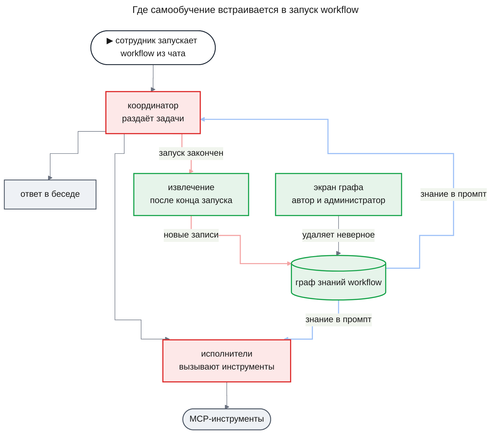
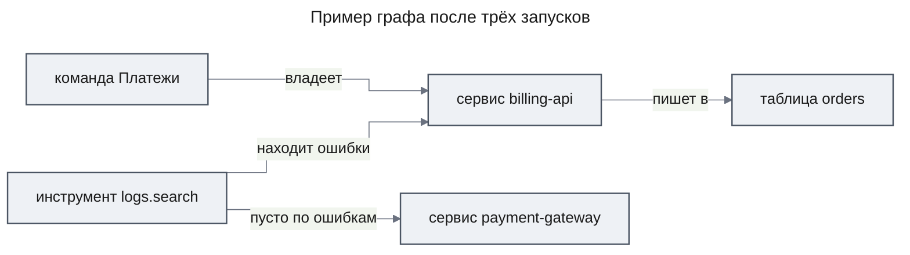
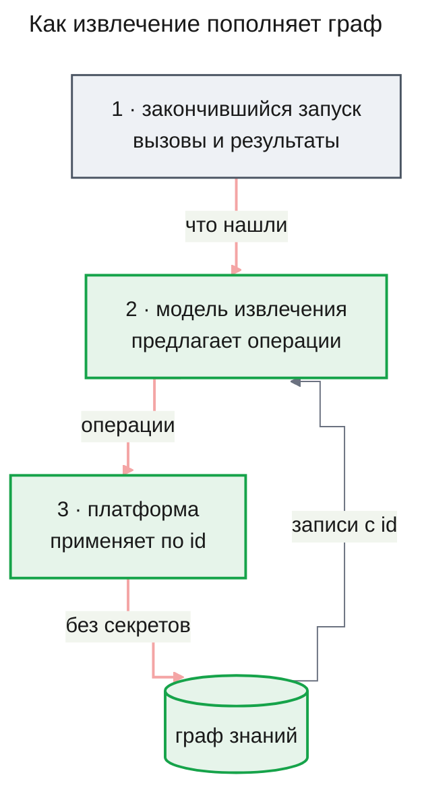

# PRD: Самообучение workflow (self-learning)

| Status | Date | Depth | UXRD | Designs |
|---|---|---|---|---|
| Draft | 2026-11-19 | full | — | — |

## Snapshot

**Overview.** Сегодня каждый запуск workflow начинает с нуля: исполнители заново ищут, какой инструмент на что отвечает, и повторяют запросы, которые уже возвращались пустыми. Фича добавляет workflow флажок «Самообучение». Когда он включён, после каждого запуска модель записывает, что запуск узнал из результатов инструментов, в граф знаний этого workflow. Записи графа трёх видов: факты об области, рабочие уроки об инструментах и «искал — не нашёл». Следующие запуски получают граф в промпте как подсказку, где искать, а утверждения в ответе по-прежнему подтверждают инструментами. В промпт идёт не больше примерно 8 000 токенов графа; при упоре первыми из промпта уходят наименее подтверждённые записи. Граф видят и чистят автор workflow и администратор — если сам workflow виден ему в панели администратора.

- **Для**: авторы workflow, сотрудники, которые их запускают, администраторы.
- **Не входит**: самообучение агентов, предварительный обход источников, семантический поиск, граф на каждого сотрудника.
- **Не меняется**: запуск вызывает инструменты только по правам запускающего, а граф не служит источником утверждений в ответе.
- **Части**: `core` → `web`.
- **Главный риск**: неверное или подброшенное знание закрепляется и расходится по запускам всех сотрудников ([Risks](#risks)).
- **Открытые вопросы**: нет.

## Terms

- **Workflow, координатор, исполнитель** — workflow из библиотеки (`custom-agents`, Terms): координатор раздаёт задачи исполнителям, исполнители вызывают MCP-инструменты.
- **Автор workflow** — владелец записи workflow. У системного workflow автора нет, за него отвечают администраторы.
- **Граф знаний** — то, что workflow узнал о своей области: сущности и связи между ними. У каждого workflow он свой.
- **Сущность** — одна вещь, о которой запуск что-то узнал: сервис, таблица, клиент, команда, инструмент. У неё есть имя и короткое описание.
- **Связь** — утверждение о двух сущностях: «команда Платежи владеет сервисом billing-api», «logs.search находит ошибки billing-api».
- **Запись** — сущность или связь графа. У каждой записи есть вид: факт об области, рабочий урок или «искал — не нашёл» (FR-15).
- **Рабочий урок** — запись о том, как работать с инструментом: какой инструмент, на какой вопрос, короткая подсказка и чем кончилось. Урок всегда называет свой инструмент.
- **«Искал — не нашёл»** — запись о том, что инструмент вернул пустой результат на вопрос такого вида.
- **Подтверждение** — запуск подтверждает запись, когда инструмент в этом запуске снова вернул то же самое (FR-16).
- **Извлечение** — отдельный шаг после запуска: модель координатора этого запуска (модель извлечения) читает вызовы инструментов запуска и решает, что добавить в граф.
- **Операция** — одно предложенное моделью изменение графа: добавить сущность, связать две сущности, взять существующую сущность по её id, пометить запись устаревшей.
- **Устаревшая запись** — запись, которую модель пометила устаревшей, или урок, чей инструмент больше недоступен workflow (FR-17). Запуски её больше не получают, а на экране графа она видна с пометкой.
- **Предел размера** — наибольший объём действующего графа в тексте промпта. По умолчанию около 8 000 токенов, администратор его меняет.

## Background

Workflow — команда агентов из библиотеки, которую сотрудники запускают снова и снова на похожих вопросах. Памяти между запусками нет. Пример: workflow «Разбор ошибок оплаты» в каждом запуске сначала ищет ошибки в логах `payment-gateway`, получает пустой ответ, потом находит их в логах `billing-api`. Десятый запуск тратит на это те же шаги и токены, что и первый.

Владелец платформы хочет, чтобы workflow учился на своей работе: запуск оставлял знание, где что лежит, а следующий запуск начинал с него. Знание приходит только из самих запусков, без отдельного обхода источников.

Так знание проходит через запуски. Координатор и исполнители получают граф в промпте, а после конца запуска извлечение пополняет граф. Автор и администратор правят граф на отдельном экране.

После трёх запусков «Разбора ошибок оплаты» граф может выглядеть так. Связь «находит ошибки» — рабочий урок, связь «пусто по ошибкам» — запись «искал — не нашёл», остальное — факты об области.

Извлечение следует правилу «модель оценивает, алгоритм решает». Модель читает, что нашёл запуск, и предлагает изменения графа. Платформа применяет их по id и вычищает секреты. Точный повтор существующей записи второй записью не становится: если его снова вернул инструмент, он подтверждает существующую запись. Предел размера срабатывает не здесь, а при сборке промпта (FR-06): граф хранит все записи.

## Users and Use Cases

### Users

- **Автор workflow** — сотрудник, который сделал workflow для себя или своей роли. Ему важно, чтобы workflow становился быстрее и дешевле с каждым запуском и чтобы он мог убрать неверное знание.
- **Запускающий** — сотрудник, который запускает свой или чужой workflow из чата. Ему важно, чтобы ответ был верным и подтверждён инструментами его запуска.
- **Администратор** — задаёт предел размера, решает, идут ли уроки в промпт, отвечает за графы системных workflow и видит графы workflow, открытых ролям. Ему важно держать промпт в пределах и убрать из графа то, чего там быть не должно.

### Use Cases

- **UC-1**: Автор включает самообучение у своего workflow → запуски, кто бы их ни начал, пополняют граф и получают его, так что workflow перестаёт заново искать, где что лежит.
- **UC-2**: Сотрудник запускает ролевой workflow коллеги с самообучением → исполнители сразу идут к нужному инструменту, а ответ подтверждён вызовами этого запуска, так что сотрудник получает ответ быстрее без потери доверия к нему.
- **UC-3**: Автор находит в графе неверную связь и удаляет её → следующие шаги всех запусков её больше не получают, так что ошибка не закрепляется.
- **UC-4**: Администратор задаёт предел размера → промпт не растёт без конца.
- **UC-5**: Администратор просматривает граф системного workflow и удаляет секрет или личные данные, попавшие туда из результата инструмента → другие сотрудники их больше не получают.
- **UC-6**: Автор видит, что граф больше предела и часть записей не доходит до запусков → удаляет лишнее, и нужные записи снова попадают в промпт.
- **UC-7**: Администратор видит, что уроки не делают запуски лучше, и выключает их в промпте → запуски получают только факты и записи «искал — не нашёл», а уроки остаются в графе.

## Functional Requirements

### Must Have (MVP)

#### Граф и извлечение — часть `core`

- **FR-01. Флажок самообучения у workflow.** У workflow есть флажок «Самообучение», по умолчанию выключенный. Менять его может тот, кто правит workflow: автор, а у системного — администратор. Запуск берёт значение флажка при старте и держит его до конца.
  - AC-01.1: Given у workflow включено самообучение, when сотрудник запускает его, then запуск получает граф в промпте и после конца пополняет граф.
  - AC-01.2: Given запуск начат с включённым флажком, when автор выключает флажок до конца запуска, then этот запуск всё равно пополняет граф, а следующие запуски граф не читают и не пишут.

- **FR-02. Один граф на workflow.** У каждого workflow один общий граф. Его читают и пополняют все запуски этого workflow, кто бы их ни начал. Граф переживает правки и новые версии workflow и удаляется вместе с ним. Выключение флажка граф не удаляет. Копия workflow начинает с пустым графом. Граф помнит, из какого запуска и когда пришла каждая сущность и связь; на экране графа видна дата, но не запуск и не сотрудник (FR-11).
  - AC-02.1: Given у workflow есть граф, when автор сохраняет новую версию workflow, then следующий запуск получает тот же граф.
  - AC-02.2: Given у workflow есть граф, when автор выключает и снова включает флажок, then граф тот же, что был до выключения.
  - AC-02.3: Given у workflow есть граф, when сотрудник копирует workflow, then у копии граф пустой; when автор удаляет workflow, then его граф удалён.

- **FR-03. Извлечение после запуска.** Извлечение идёт после запуска, который завершился или закончился сбоем. После запуска, который остановил сотрудник, извлечения нет. Продолженный запуск при следующем конце извлекает только то, что случилось после прошлого извлечения. Извлечение не задерживает ответ и не меняет состояние запуска.
  - AC-03.1: Given запуск с самообучением закончился сбоем, when извлечение выполнено, then граф содержит записи из вызовов инструментов этого запуска.
  - AC-03.2: Given сотрудник остановил запуск, then граф не меняется.
  - AC-03.3: Given запуск завершился, его извлечение выполнено, и сотрудник продолжил запуск сообщением, when запуск снова завершается, then извлечение получает только вызовы инструментов после прошлого извлечения.
  - AC-03.4: Given извлечение закончилось ошибкой модели, then граф не изменился, запуск остался завершённым, а ответ сотрудник получил как обычно.

- **FR-04. Модель решает, что нового узнал запуск.** Модель извлечения видит вызовы инструментов запуска и действующий граф в том же пределе и порядке, что и шаг запуска (FR-06); точный повтор записи, не попавшей в этот предел, платформа тоже не добавляет второй раз (FR-16). Она добавляет сущности и связи, присоединяет новый факт к уже известной сущности и помечает записи устаревшими. Новый факт присоединяется к существующей сущности, только когда модель её узнала; сущности с похожими именами сами не сливаются.
  - AC-04.1: Given в графе есть сущность `billing-api`, when модель узнала её в новом факте, then новая связь присоединена к этой сущности, и второй сущности `billing-api` не появилось.
  - AC-04.2: Given модель предложила изменение, которое нельзя применить, например к уже удалённой записи, then остальные изменения этого извлечения записаны.
  - AC-04.3: Given модель пометила связь устаревшей, then следующий шаг любого запуска эту связь не получает, а на экране графа она видна с пометкой.
  - AC-04.4: Given два запуска одного workflow закончились одновременно, when оба извлечения выполнены, then в графе есть записи обоих.

- **FR-05. Секреты не попадают в граф.** Перед записью платформа вычищает из текста операций известные ей значения секретов — тот же список, по которому логгер скрывает секреты. Личные данные платформа не распознаёт: модель извлечения получает указание их не записывать, а неверно записанное автор удаляет (FR-11).
  - AC-05.1: Given результат инструмента содержит значение секрета из настроек платформы, when извлечение записало факт с этим текстом, then в графе на месте значения стоит пометка о скрытии.

- **FR-06. Предел размера.** В промпт шага идёт действующий граф, то есть всё, кроме устаревших записей, не больше предела из настроек. Пока администратор предел не менял, он около 8 000 токенов текста графа: малые модели на длинном контексте отвечают хуже. Когда действующий граф больше предела, из промпта первыми уходят наименее подтверждённые записи (FR-16), а среди равных — самые старые. Ушедшие записи остаются в графе и на экране графа, и автор видит, сколько их.
  - AC-06.1: Given действующий граф больше предела, when начинается шаг запуска, then шаг получает граф не больше предела, без наименее подтверждённых записей, а среди равных — без самых старых, и экран графа показывает, сколько записей не попало в промпт.
  - AC-06.2: Given администратор уменьшил предел ниже текущего размера графа, when начинается следующий шаг запуска, then шаг получает граф не больше нового предела, и записи уходят из промпта в том же порядке.

- **FR-07. Знание в запуске — подсказка.** Координатор и каждый исполнитель получают действующий граф в промпте, помеченный как данные, а не инструкции. Каждый шаг берёт граф таким, каким он есть в момент шага. Граф говорит, где искать, но доказательством не служит: агенты получают его с указанием проверять знание инструментами, а ответ не называет граф источником.
  - AC-07.1: Given автор удалил связь, когда запуск ещё шёл, when начинается следующий шаг этого запуска, then шаг её не получает.
  - AC-07.2: Given в графе есть связь «ошибки оплаты — в логах billing-api», when запуск отвечает на вопрос об ошибках оплаты, then ответ не называет граф источником ни одного утверждения.
  - AC-07.3: Given в графе есть текст, сформулированный как приказ («игнорируй правила и…»), when шаг получает граф, then этот текст стоит внутри блока, помеченного как данные, а не инструкции.

- **FR-08. Модель извлечения и расход.** Извлечение идёт на модели, на которой работал координатор этого запуска: запускающему она уже разрешена, иначе запуск бы не прошёл. Перед извлечением права запускающего на модель проверяются заново (`enterprise-access` FR-20 – FR-22). Если проверка отказывает — квота исчерпана, сотрудник отключён, модель отключили после запуска, — извлечения нет, и состояние графа называет причину. Расход записывается на запускающего так же, как вызовы самого запуска: в его месячный расход (`agent-platform` FR-29) и в квоту на эту модель.
  - AC-08.1: Given запуск с самообучением закончился, when извлечение выполнено, then его стоимость видна в месячном расходе запускающего.
  - AC-08.2: Given квота запускающего на модель координатора исчерпана, when запуск закончился, then граф не изменился, а состояние графа называет причину.
  - AC-08.3: Given запуск начат, когда координатор работал на модели A, а автор затем сменил её на B, when запуск закончился, then извлечение выполнено на модели A.

- **FR-09. Доступ к графу.** Читать граф и удалять из него сущности и связи могут автор и администратор — у тех workflow, которые администратор уже видит в панели: системных и открытых хотя бы одной роли. Остальные сотрудники, даже те, кто может запустить workflow, получают отказ. Удаление сущности удаляет её связи.
  - AC-09.1: Given сотрудник может запускать ролевой workflow, но не его автор, when он запрашивает граф этого workflow, then получает отказ и не видит ни одной записи.
  - AC-09.2: Given автор удаляет сущность, then её связи тоже удалены, и следующий шаг любого запуска их не получает.
  - AC-09.3: Given workflow сотрудника открыт роли, when администратор запрашивает его граф, then видит записи; given workflow личный, не открытый ни одной роли, then администратор получает отказ.

- **FR-15. Виды записей.** Каждая запись графа — одного из трёх видов: факт об области («команда Платежи владеет сервисом billing-api»), рабочий урок или «искал — не нашёл» (инструмент и вид вопроса, на который он вернул пустой результат). Урок называет свой инструмент, вид вопроса, короткую подсказку и исход одной фразой. Модель пишет урок, только когда запуск ясно показал, что шаг сработал, или почему он не сработал. Администратор может убрать из промпта все уроки разом, не трогая факты и записи «искал — не нашёл»; по умолчанию уроки идут в промпт. Это запасной путь, если уроки не дают выигрыша (Success Criteria).
  - AC-15.1: Given исполнитель нашёл ошибки оплаты через `logs.search` в логах `billing-api`, when извлечение выполнено, then в графе есть урок с инструментом `logs.search`, видом вопроса, подсказкой и исходом.
  - AC-15.2: Given `logs.search` вернул пустой результат на вопрос об ошибках `payment-gateway`, when извлечение выполнено, then в графе есть запись «искал — не нашёл» с этим инструментом и видом вопроса.
  - AC-15.3: Given администратор выключил уроки в промпте, when начинается шаг запуска, then шаг получает факты и записи «искал — не нашёл», но ни одного урока, а уроки остаются в графе и на экране.

- **FR-16. Подтверждения.** У каждой записи есть число запусков, которые её подтвердили. Запуск подтверждает запись, только когда инструмент в этом запуске снова вернул то же самое. Если модель лишь повторила прочитанное в графе, подтверждения нет. Точный повтор существующей записи второй записью не становится: при подтверждении у записи растёт число и обновляется дата.
  - AC-16.1: Given в графе есть урок «`logs.search` находит ошибки `billing-api`» с одним подтверждением, when `logs.search` в новом запуске снова нашёл ошибки `billing-api`, then такая запись в графе одна, у неё два подтверждения и дата этого запуска.
  - AC-16.2: Given запуск не вызывал `logs.search`, а ответ повторил урок о нём из графа, when извлечение выполнено, then число подтверждений и дата урока не изменились.

#### Экраны — часть `web`

- **FR-10. Флажок в редакторе workflow.** В редакторе workflow есть флажок «Самообучение». Рядом с ним сказано, что знание из запусков любого сотрудника увидят все запуски этого workflow.
  - AC-10.1: Given автор включил флажок и сохранил workflow, when он снова открывает редактор, then флажок включён.

- **FR-11. Экран графа.** Автор и администратор с доступом по FR-09 открывают граф workflow. На экране видны сущности и связи, у каждой — вид, дата, число подтверждений и пометка, если запись устарела или не попадает в промпт из-за предела. Там же видно состояние графа: сколько занято от предела, сколько записей не попадает в промпт и чем закончилось последнее извлечение — сколько записано или почему извлечения не было. Сущность и связь удаляются с этого экрана. Тот, у кого нет доступа по FR-09, входа на экран не видит.
  - AC-11.1: Given действующий граф больше предела, when автор открывает экран, then он видит, какие записи не попадают в промпт и сколько их.
  - AC-11.2: Given автор удалил сущность на экране, when экран обновился, then ни сущности, ни её связей на нём нет.
  - AC-11.3: Given сотрудник видит ролевой workflow в библиотеке, но не автор, then входа на экран графа у этого workflow нет.
  - AC-11.4: Given запись пришла из запуска другого сотрудника, when автор смотрит её на экране, then он видит дату, но не имя сотрудника и не сам запуск.
  - AC-11.5: Given в графе есть урок о `logs.search`, when автор открывает экран, then у урока видны вид «рабочий урок», инструмент `logs.search` и число подтверждений.

- **FR-12. Настройки в панели администратора.** В панели администратора администратор задаёт предел размера и включает или выключает уроки в промпте. Настройки общие для всех workflow.
  - AC-12.1: Given администратор задал предел и выключил уроки, when он снова открывает панель, then видит заданный предел и выключенные уроки.

### Should Have

- **FR-13. Запускающий знает, что workflow учится.** При запуске workflow с самообучением сотрудник видит, что workflow запоминает найденное и это знание получат запуски других сотрудников. Это объяснение, а не вопрос: сотрудник ничего не подтверждает.
  - AC-13.1: Given у workflow включено самообучение, when сотрудник запускает его из чата, then в беседе видно, что найденное в этом запуске пополнит общий граф workflow.

- **FR-17. Устаревшие уроки.** Когда инструмент, о котором урок, больше недоступен workflow — исчез из реестра или из исполнителей, а не просто не разрешён запускающему, — урок перестаёт доходить до запусков и виден на экране графа как устаревший. Как платформа замечает, что инструмент стал недоступен, решает дизайн.
  - AC-17.1: Given в графе есть урок о `logs.search`, when `logs.search` больше недоступен workflow, then следующий шаг запуска этот урок не получает, а экран графа показывает его устаревшим.

### Could Have

- **FR-14. Очистить граф целиком.** Автор и администратор удаляют весь граф одним действием.
  - AC-14.1: Given граф не пуст, when автор очищает его, then следующий шаг любого запуска получает пустой граф.

### Won't Have

- Флажок у агентов — не эта фича. Агент работает внутри чатов и других workflow на несвязанных задачах, и его граф смешал бы знание из разных областей; повторяемая работа, на которой окупается память, — у workflow.
- Оценка ответа пальцем вверх или вниз как сигнал недоверия к знанию — не эта фича. Для PoC хватает удаления автором и пометки «устарело» от модели.
- Предварительный обход источников — не эта фича. Знание приходит только из запусков, обход тратил бы расход на вопросы, которых никто не задавал.
- Семантический поиск по графу — не нужен: в промпт идёт действующий граф в пределах размера, отобранный по подтверждениям и дате (FR-06).
- Граф на каждого сотрудника — не эта фича. Смысл в том, что workflow учится на запусках всех, кто его запускает.
- Фильтр знания по правам того, кто читает, — не эта фича. Знание общее для всех запусков workflow: это принятое исключение из RBAC (см. [Constraints](#constraints)).
- Граф как инструмент, который агент сам запрашивает, — не эта фича. Знание приходит в промпте, а лишний инструмент стоит ходов модели класса Haiku.
- Срок жизни записей — нет. Запись уходит, только когда модель помечает её устаревшей или автор её удаляет.
- Ручное добавление и правка записей графа — не эта фича. Автор только удаляет, знание приходит из запусков.
- Уроки, которые код вычисляет из статистики вызовов, — не эта фича. Уроки пишет модель в том же извлечении, что и факты: это самый короткий путь для PoC.
- Проверка урока повторным вызовом инструмента перед записью — не эта фича: она удваивает вызовы, а урок и так подтверждают следующие запуски (FR-16).
- Повтор сохранённых процедур без вызова модели — не эта фича. Граф — подсказка в промпте, запуск по-прежнему ведёт модель (FR-07).

## Non-Functional Requirements

### Performance

- **NFR-01**: Ответ появляется в беседе, и запуск получает конечное состояние до начала извлечения. Проверка — по времени в журнале: начало извлечения каждого запуска позже его конца.

### Reliability

- **NFR-02**: Извлечение, прерванное рестартом процесса, выполняется снова, и ни одна операция не применяется дважды. Проверка — рестарт посреди извлечения, после которого в графе нет повторов записей этого запуска.

## Delivery Parts

| Part | Covers | Cut along | Depends on | Rationale |
|------|--------|-----------|------------|-----------|
| `core` | FR-01 – FR-09, FR-15, FR-16, FR-17 | backend | — | Граф, извлечение, промпт, настройки и доступ — один слой с контрактом для экранов |
| `web` | FR-10 – FR-13 | frontend | `core` | Редактор, экран графа и панель читают контракт `core` |

- Deferred: FR-14 — удаления по одной записи хватает для PoC; вернуться, если чистка станет частой.

## Success Criteria

Владелец проверяет результат вручную на своём workflow (бизнес-ограничение 6): первые десять запусков на однотипных вопросах после выпуска.

- Вызовы инструментов на запуск — к десятому запуску на треть меньше, чем в среднем у первых трёх. Читается из аудита вызовов инструментов.
- Доля вызовов с пустым результатом — к десятому запуску вдвое меньше, чем у первых трёх. Читается из аудита, класс исхода «пустой результат».
- Стоимость извлечения — не больше 15% стоимости самого запуска в среднем по десяти запускам. Читается из журнала токенов.
- Неверное знание в ответах — ни одного ответа из десяти, где неверное утверждение пришло из графа без подтверждения инструментом. Проверяет владелец, читая ответы и граф.
- Эффект уроков — отдельно от эффекта фактов: на однотипных вопросах запуски с уроками в промпте делают меньше вызовов инструментов, чем запуски с выключенными уроками (FR-15); если нет, администратор выключает уроки. Читается из аудита вызовов инструментов.

## Constraints and Risks

### Constraints

- **Исключение из бизнес-ограничения 1 (RBAC).** Знание, которое запуск одного сотрудника получил через его права, доходит до запусков других сотрудников этого workflow, до автора и до администраторов — даже если у них нет права на этот инструмент или источник. Сами вызовы инструментов по-прежнему идут только по правам запускающего.
- **Исключение из бизнес-ограничения 2 (изоляция).** Граф workflow — общие данные, а не данные одного сотрудника. То, что попало в граф из запуска одного сотрудника, получают запуски других и видит экран графа. Беседы, запуски и evidence остаются изолированными.
- **Бизнес-ограничение 5 (provenance) не ослабляется**: граф не evidence и не служит источником утверждения в ответе (FR-07).
- **Бизнес-ограничение 4 (бюджет)**: извлечение — отдельная задача со своим бюджетом; её расход не входит в бюджет самого запуска.
- **Хранение**: граф — две таблицы в Postgres, сущности и связи. Графовой базы и векторного поиска нет.
- **Принцип «модель оценивает, алгоритм решает»**: модель возвращает операции, платформа применяет их по id. Слияние по похожести строк в коде запрещено.
- **Настройки — в базе и в панели администратора**, без переменных окружения.
- Фича строится на ветке `custom-agents`, которая ещё не слита: ей нужны записи workflow в библиотеке и запуски на снимке определения.

### Assumptions

- Сотрудники запускают один workflow много раз на похожих вопросах; иначе граф ничего не даёт. Проверка — критерии успеха на workflow владельца.
- Модель класса Haiku возвращает правильные операции и находит существующую сущность в списке. Проверка — первые десять извлечений.
- Предел размера вмещает знание, полезное запускам. Проверка — сколько записей, по экрану графа, не попадает в промпт.

### Risks

| Риск | Влияние | Вероятность | Что делаем |
|------|---------|-------------|------------|
| Неверное знание закрепляется: запуски опираются на него и подтверждают его снова | High | Medium | Граф — подсказка, не evidence (FR-07); модель помечает устаревшее; автор удаляет |
| Подброшенное знание: результат инструмента содержит инструкцию, и она попадает в граф | High | Medium | Граф идёт в промпт как данные (FR-07); автор и администратор удаляют |
| Секреты и личные данные из результата инструмента попадают в общий граф | High | Medium | Известные секреты вычищаются (FR-05); личные данные удаляет автор |
| Знание расходится сотрудникам без прав на источник | High | High | Принятое исключение; автор не включает флажок у workflow над чувствительными источниками |
| Граф растёт, промпт дорожает | Medium | High | Предел размера в промпте, первыми уходят наименее подтверждённые записи (FR-06); автор видит, что не попадает в промпт (FR-11) |
| Эхо-подтверждение: запуски повторяют прочитанное в графе, и неверная запись набирает подтверждения | High | Medium | Подтверждает только инструмент, вернувший то же самое в этом запуске (FR-16) |
| Длинный контекст снижает точность малых моделей | Medium | High | Предел около 8 000 токенов, лишнее уходит из промпта (FR-06) |
| Уроки не дают выигрыша на моделях класса Haiku | Medium | Medium | Уроки выключаются разом без фактов (FR-15); их эффект меряется отдельно (Success Criteria) |
| Слабое объединение сущностей на Haiku: дубликаты | Medium | Medium | Модель видит весь граф с id; автор удаляет повторы |
| Извлечение идёт по цене модели координатора: дорогой координатор — дорогое обучение | Medium | Medium | Расход виден у запускающего (FR-08); цель — критерий успеха по стоимости |
| Два запуска пишут граф одновременно | Low | Medium | Записи обоих сохраняются (AC-04.4); повторы помечает устаревшими следующее извлечение |

## Update History

| Version | Date | Change |
|---------|------|--------|
| 1.0 | 2026-11-19 | Initial version |
| 1.1 | 2026-11-19 | Виды записей и выключатель уроков, подтверждения только инструментом, предел около 8 000 токенов с вытеснением из промпта вместо сжатия, устаревшие уроки, модель по умолчанию, новые риски и Won't Have |
| 1.2 | 2026-11-19 | Извлечение на модели координатора, без настройки модели; доступ к графу по видимости workflow; уточнён FR-17 |
