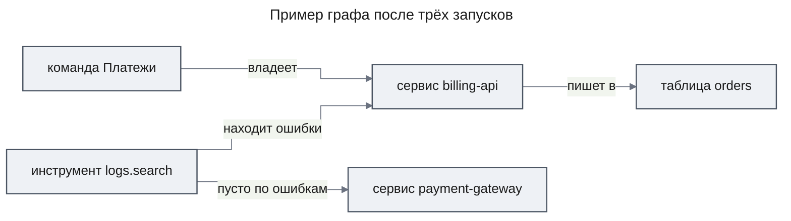
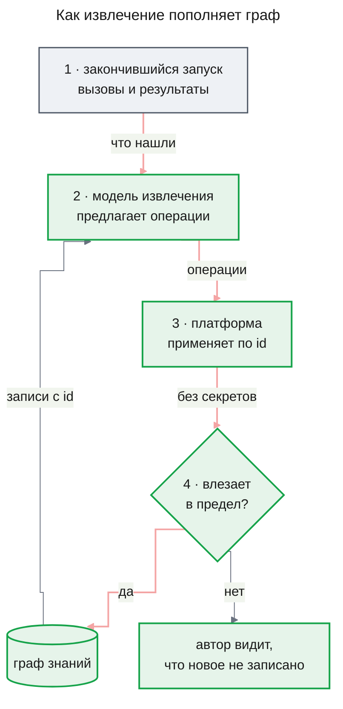

# PRD: Самообучение workflow (self-learning)

| Status | Date | Depth | UXRD | Designs |
|---|---|---|---|---|
| Draft | 2026-11-19 | full | — | — |

## Snapshot

**Overview.** Сегодня каждый запуск workflow начинает с нуля: исполнители заново ищут, какой инструмент на что отвечает, и повторяют запросы, которые уже возвращались пустыми. Фича добавляет workflow флажок «Самообучение». Когда он включён, после каждого запуска модель записывает, что запуск узнал из результатов инструментов, в граф знаний этого workflow. Следующие запуски получают этот граф в промпте как подсказку, где искать, а утверждения в ответе по-прежнему подтверждают инструментами. Автор workflow и администратор видят граф и удаляют из него неверное.

- **Для**: авторы workflow, сотрудники, которые их запускают, администраторы.
- **Не входит**: самообучение агентов, предварительный обход источников, семантический поиск, граф на каждого сотрудника.
- **Не меняется**: запуск вызывает инструменты только по правам запускающего, а граф не служит источником утверждений в ответе.
- **Части**: `core` → `web`.
- **Главный риск**: неверное или подброшенное знание закрепляется и расходится по запускам всех сотрудников ([Risks](#risks)).
- **Открытые вопросы**: нет.

## Terms

- **Workflow, координатор, исполнитель** — workflow из библиотеки (`custom-agents`, Terms): координатор раздаёт задачи исполнителям, исполнители вызывают MCP-инструменты.
- **Автор workflow** — владелец записи workflow. У системного workflow автора нет, за него отвечают администраторы.
- **Граф знаний** — то, что workflow узнал о своей области: сущности и связи между ними. У каждого workflow он свой.
- **Сущность** — одна вещь, о которой запуск что-то узнал: сервис, таблица, клиент, команда, инструмент. У неё есть имя и короткое описание.
- **Связь** — утверждение о двух сущностях: «команда Платежи владеет сервисом billing-api», «logs.search находит ошибки billing-api».
- **Рабочий урок** — связь или описание о том, как работать: какой инструмент отвечает на какой вопрос, какой запрос возвращается пустым.
- **Извлечение** — отдельный шаг после запуска: модель читает вызовы инструментов запуска и решает, что добавить в граф.
- **Операция** — одно предложенное моделью изменение графа: добавить сущность, связать две сущности, взять существующую сущность по её id, пометить запись устаревшей.
- **Устаревшая запись** — сущность или связь, которую модель пометила устаревшей. Запуски её больше не получают, а на экране графа она видна с пометкой.
- **Предел размера** — наибольший объём действующего графа в тексте промпта. Его задаёт администратор.

## Background

Workflow — команда агентов из библиотеки, которую сотрудники запускают снова и снова на похожих вопросах. Памяти между запусками нет. Пример: workflow «Разбор ошибок оплаты» в каждом запуске сначала ищет ошибки в логах `payment-gateway`, получает пустой ответ, потом находит их в логах `billing-api`. Десятый запуск тратит на это те же шаги и токены, что и первый.

Владелец платформы хочет, чтобы workflow учился на своей работе: запуск оставлял знание, где что лежит, а следующий запуск начинал с него. Знание приходит только из самих запусков, без отдельного обхода источников.

Так знание проходит через запуски. Координатор и исполнители получают граф в промпте, а после конца запуска извлечение пополняет граф. Автор и администратор правят граф на отдельном экране.

После трёх запусков «Разбора ошибок оплаты» граф может выглядеть так. Связь от инструмента к сервису — рабочий урок, остальное — факты об области.

Извлечение следует правилу «модель оценивает, алгоритм решает». Модель читает, что нашёл запуск, и предлагает изменения графа. Платформа применяет их по id, вычищает секреты и следит за пределом размера.

## Users and Use Cases

### Users

- **Автор workflow** — сотрудник, который сделал workflow для себя или своей роли. Ему важно, чтобы workflow становился быстрее и дешевле с каждым запуском и чтобы он мог убрать неверное знание.
- **Запускающий** — сотрудник, который запускает свой или чужой workflow из чата. Ему важно, чтобы ответ был верным и подтверждён инструментами его запуска.
- **Администратор** — выбирает модель извлечения и предел размера, отвечает за графы системных workflow. Ему важно держать расход под контролем и убрать из графа то, чего там быть не должно.

### Use Cases

- **UC-1**: Автор включает самообучение у своего workflow → запуски, кто бы их ни начал, пополняют граф и получают его, так что workflow перестаёт заново искать, где что лежит.
- **UC-2**: Сотрудник запускает ролевой workflow коллеги с самообучением → исполнители сразу идут к нужному инструменту, а ответ подтверждён вызовами этого запуска, так что сотрудник получает ответ быстрее без потери доверия к нему.
- **UC-3**: Автор находит в графе неверную связь и удаляет её → следующие шаги всех запусков её больше не получают, так что ошибка не закрепляется.
- **UC-4**: Администратор выбирает модель извлечения и предел размера → извлечение стоит предсказуемо, а промпт не растёт без конца.
- **UC-5**: Администратор просматривает граф системного workflow и удаляет секрет или личные данные, попавшие туда из результата инструмента → другие сотрудники их больше не получают.
- **UC-6**: Автор видит, что граф упёрся в предел и новое знание не записывается → удаляет лишнее, и запись нового возобновляется.

## Functional Requirements

### Must Have (MVP)

#### Граф и извлечение — часть `core`

- **FR-01. Флажок самообучения у workflow.** У workflow есть флажок «Самообучение», по умолчанию выключенный. Менять его может тот, кто правит workflow: автор, а у системного — администратор. Запуск берёт значение флажка при старте и держит его до конца.
  - AC-01.1: Given у workflow включено самообучение, when сотрудник запускает его, then запуск получает граф в промпте и после конца пополняет граф.
  - AC-01.2: Given запуск начат с включённым флажком, when автор выключает флажок до конца запуска, then этот запуск всё равно пополняет граф, а следующие запуски граф не читают и не пишут.

- **FR-02. Один граф на workflow.** У каждого workflow один общий граф. Его читают и пополняют все запуски этого workflow, кто бы их ни начал. Граф переживает правки и новые версии workflow и удаляется вместе с ним. Выключение флажка граф не удаляет. Копия workflow начинает с пустым графом. Граф помнит, из какого запуска и когда пришла каждая сущность и связь; на экране графа видна только дата (FR-11).
  - AC-02.1: Given у workflow есть граф, when автор сохраняет новую версию workflow, then следующий запуск получает тот же граф.
  - AC-02.2: Given у workflow есть граф, when автор выключает и снова включает флажок, then граф тот же, что был до выключения.
  - AC-02.3: Given у workflow есть граф, when сотрудник копирует workflow, then у копии граф пустой; when автор удаляет workflow, then его граф удалён.

- **FR-03. Извлечение после запуска.** Извлечение идёт после запуска, который завершился или закончился сбоем. После запуска, который остановил сотрудник, извлечения нет. Продолженный запуск при следующем конце извлекает только то, что случилось после прошлого извлечения. Извлечение не задерживает ответ и не меняет состояние запуска.
  - AC-03.1: Given запуск с самообучением закончился сбоем, when извлечение выполнено, then граф содержит записи из вызовов инструментов этого запуска.
  - AC-03.2: Given сотрудник остановил запуск, then граф не меняется.
  - AC-03.3: Given запуск завершился, его извлечение выполнено, и сотрудник продолжил запуск сообщением, when запуск снова завершается, then извлечение получает только вызовы инструментов после прошлого извлечения.
  - AC-03.4: Given извлечение закончилось ошибкой модели, then граф не изменился, запуск остался завершённым, а ответ сотрудник получил как обычно.

- **FR-04. Модель решает, что нового узнал запуск.** Модель извлечения видит вызовы инструментов запуска и весь действующий граф. Она добавляет сущности и связи, присоединяет новый факт к уже известной сущности и помечает записи устаревшими. Новый факт присоединяется к существующей сущности, только когда модель её узнала; сущности с похожими именами сами не сливаются.
  - AC-04.1: Given в графе есть сущность `billing-api`, when модель узнала её в новом факте, then новая связь присоединена к этой сущности, и второй сущности `billing-api` не появилось.
  - AC-04.2: Given модель предложила изменение, которое нельзя применить, например к уже удалённой записи, then остальные изменения этого извлечения записаны.
  - AC-04.3: Given модель пометила связь устаревшей, then следующий шаг любого запуска эту связь не получает, а на экране графа она видна с пометкой.
  - AC-04.4: Given два запуска одного workflow закончились одновременно, when оба извлечения выполнены, then в графе есть записи обоих.

- **FR-05. Секреты не попадают в граф.** Перед записью платформа вычищает из текста операций известные ей значения секретов — тот же список, по которому логгер скрывает секреты. Личные данные платформа не распознаёт: модель извлечения получает указание их не записывать, а неверно записанное автор удаляет (FR-11).
  - AC-05.1: Given результат инструмента содержит значение секрета из настроек платформы, when извлечение записало факт с этим текстом, then в графе на месте значения стоит пометка о скрытии.

- **FR-06. Предел размера.** Действующий граф, то есть всё, кроме устаревших записей, в тексте промпта не больше предела из настроек. Модель извлечения знает предел и сжимает граф своими операциями: помечает устаревшим лишнее и повторы. Новые записи, которые после этого всё равно не влезают, не записываются, и автор видит это в состоянии графа.
  - AC-06.1: Given действующий граф близок к пределу, when извлечение предлагает новые записи сверх предела, then записано только то, что влезает, а состояние графа показывает, сколько записей не записано.
  - AC-06.2: Given администратор уменьшил предел ниже текущего размера графа, when начинается следующий шаг запуска, then шаг получает граф не больше нового предела.

- **FR-07. Знание в запуске — подсказка.** Координатор и каждый исполнитель получают действующий граф в промпте, помеченный как данные, а не инструкции. Каждый шаг берёт граф таким, каким он есть в момент шага. Граф говорит, где искать, но доказательством не служит: агенты получают его с указанием проверять знание инструментами, а ответ не называет граф источником.
  - AC-07.1: Given автор удалил связь, когда запуск ещё шёл, when начинается следующий шаг этого запуска, then шаг её не получает.
  - AC-07.2: Given в графе есть связь «ошибки оплаты — в логах billing-api», when запуск отвечает на вопрос об ошибках оплаты, then ответ не называет граф источником ни одного утверждения.
  - AC-07.3: Given в графе есть текст, сформулированный как приказ («игнорируй правила и…»), when шаг получает граф, then этот текст стоит внутри блока, помеченного как данные, а не инструкции.

- **FR-08. Модель извлечения, предел и расход.** Администратор выбирает модель извлечения и задаёт предел размера; обе настройки общие для всех workflow и хранятся в базе. Модель извлечения — выбор платформы: разрешена ли она запускающему, не проверяется. Расход на извлечение записывается на запускающего и входит в его месячный расход (`agent-platform` FR-29). Если у запускающего есть квота на эту модель (`enterprise-access` FR-21, FR-22), расход идёт в квоту, а при исчерпанной квоте извлечение не выполняется, и автор видит это в состоянии графа. Если модель запускающему не разрешена, квоты у него нет, и расход идёт только в месячный расход.
  - AC-08.1: Given запуск с самообучением закончился, when извлечение выполнено, then его стоимость видна в месячном расходе запускающего.
  - AC-08.2: Given квота запускающего на модель извлечения исчерпана, when запуск закончился, then граф не изменился, а состояние графа называет причину.

- **FR-09. Доступ к графу.** Читать граф и удалять из него сущности и связи могут автор workflow и администраторы, а у системного workflow — только администраторы. Остальные сотрудники, даже те, кто может запустить workflow, получают отказ. Удаление сущности удаляет её связи.
  - AC-09.1: Given сотрудник может запускать ролевой workflow, но не его автор, when он запрашивает граф этого workflow, then получает отказ и не видит ни одной записи.
  - AC-09.2: Given автор удаляет сущность, then её связи тоже удалены, и следующий шаг любого запуска их не получает.
  - AC-09.3: Given workflow системный, when его граф запрашивает сотрудник без прав администратора, then он получает отказ.

#### Экраны — часть `web`

- **FR-10. Флажок в редакторе workflow.** В редакторе workflow есть флажок «Самообучение». Рядом с ним сказано, что знание из запусков любого сотрудника увидят все запуски этого workflow.
  - AC-10.1: Given автор включил флажок и сохранил workflow, when он снова открывает редактор, then флажок включён.

- **FR-11. Экран графа.** Автор и администратор открывают граф workflow. На экране видны сущности и связи, у каждой — дата и пометка, если она устарела. Там же видно состояние графа: сколько занято от предела и чем закончилось последнее извлечение — сколько записано, сколько не влезло, или почему извлечения не было. Сущность и связь удаляются с этого экрана. Сотрудник, который не автор и не администратор, входа на экран не видит.
  - AC-11.1: Given граф упёрся в предел, when автор открывает экран, then он видит, что новые записи не записаны и сколько их.
  - AC-11.2: Given автор удалил сущность на экране, when экран обновился, then ни сущности, ни её связей на нём нет.
  - AC-11.3: Given сотрудник видит ролевой workflow в библиотеке, но не автор, then входа на экран графа у этого workflow нет.
  - AC-11.4: Given запись пришла из запуска другого сотрудника, when автор смотрит её на экране, then он видит дату, но не имя сотрудника и не сам запуск.

- **FR-12. Настройки в панели администратора.** Администратор выбирает модель извлечения из каталога моделей и задаёт предел размера в панели администратора.
  - AC-12.1: Given администратор сменил модель извлечения, when заканчивается следующий запуск, then извлечение идёт на новой модели.

### Should Have

- **FR-13. Запускающий знает, что workflow учится.** При запуске workflow с самообучением сотрудник видит, что workflow запоминает найденное и это знание получат запуски других сотрудников. Это объяснение, а не вопрос: сотрудник ничего не подтверждает.
  - AC-13.1: Given у workflow включено самообучение, when сотрудник запускает его из чата, then в беседе видно, что найденное в этом запуске пополнит общий граф workflow.

### Could Have

- **FR-14. Очистить граф целиком.** Автор и администратор удаляют весь граф одним действием.
  - AC-14.1: Given граф не пуст, when автор очищает его, then следующий шаг любого запуска получает пустой граф.

### Won't Have

- Флажок у агентов — не эта фича. Агент работает внутри чатов и других workflow на несвязанных задачах, и его граф смешал бы знание из разных областей; повторяемая работа, на которой окупается память, — у workflow.
- Оценка ответа пальцем вверх или вниз как сигнал недоверия к знанию — не эта фича. Для PoC хватает удаления автором и пометки «устарело» от модели.
- Предварительный обход источников — не эта фича. Знание приходит только из запусков, обход тратил бы расход на вопросы, которых никто не задавал.
- Семантический поиск по графу — не нужен: весь действующий граф влезает в предел и целиком идёт в промпт.
- Граф на каждого сотрудника — не эта фича. Смысл в том, что workflow учится на запусках всех, кто его запускает.
- Фильтр знания по правам того, кто читает, — не эта фича. Знание общее для всех запусков workflow: это принятое исключение из RBAC (см. [Constraints](#constraints)).
- Граф как инструмент, который агент сам запрашивает, — не эта фича. Знание приходит в промпте, а лишний инструмент стоит ходов модели класса Haiku.
- Срок жизни записей — нет. Запись уходит, только когда модель помечает её устаревшей или автор её удаляет.
- Ручное добавление и правка записей графа — не эта фича. Автор только удаляет, знание приходит из запусков.

## Non-Functional Requirements

### Performance

- **NFR-01**: Ответ появляется в беседе, и запуск получает конечное состояние до начала извлечения. Проверка — по времени в журнале: начало извлечения каждого запуска позже его конца.

### Reliability

- **NFR-02**: Извлечение, прерванное рестартом процесса, выполняется снова, и ни одна операция не применяется дважды. Проверка — рестарт посреди извлечения, после которого в графе нет повторов записей этого запуска.

## Delivery Parts

| Part | Covers | Cut along | Depends on | Rationale |
|------|--------|-----------|------------|-----------|
| `core` | FR-01 – FR-09 | backend | — | Граф, извлечение, промпт, настройки и доступ — один слой с контрактом для экранов |
| `web` | FR-10 – FR-13 | frontend | `core` | Редактор, экран графа и панель читают контракт `core` |

- Deferred: FR-14 — удаления по одной записи хватает для PoC; вернуться, если чистка станет частой.

## Success Criteria

Владелец проверяет результат вручную на своём workflow (бизнес-ограничение 6): первые десять запусков на однотипных вопросах после выпуска.

- Вызовы инструментов на запуск — к десятому запуску на треть меньше, чем в среднем у первых трёх. Читается из аудита вызовов инструментов.
- Доля вызовов с пустым результатом — к десятому запуску вдвое меньше, чем у первых трёх. Читается из аудита, класс исхода «пустой результат».
- Стоимость извлечения — не больше 15% стоимости самого запуска в среднем по десяти запускам. Читается из журнала токенов.
- Неверное знание в ответах — ни одного ответа из десяти, где неверное утверждение пришло из графа без подтверждения инструментом. Проверяет владелец, читая ответы и граф.

## Constraints and Risks

### Constraints

- **Исключение из бизнес-ограничения 1 (RBAC).** Знание, которое запуск одного сотрудника получил через его права, доходит до запусков других сотрудников этого workflow, до автора и до администраторов — даже если у них нет права на этот инструмент или источник. Сами вызовы инструментов по-прежнему идут только по правам запускающего.
- **Исключение из бизнес-ограничения 2 (изоляция).** Граф workflow — общие данные, а не данные одного сотрудника. То, что попало в граф из запуска одного сотрудника, получают запуски других и видит экран графа. Беседы, запуски и evidence остаются изолированными.
- **Исключение из правила моделей (`enterprise-access` FR-20).** Извлечение идёт на модели, которую выбрал администратор, даже если запускающему она не разрешена (FR-08).
- **Бизнес-ограничение 5 (provenance) не ослабляется**: граф не evidence и не служит источником утверждения в ответе (FR-07).
- **Бизнес-ограничение 4 (бюджет)**: извлечение — отдельная задача со своим бюджетом; её расход не входит в бюджет самого запуска.
- **Хранение**: граф — две таблицы в Postgres, сущности и связи. Графовой базы и векторного поиска нет.
- **Принцип «модель оценивает, алгоритм решает»**: модель возвращает операции, платформа применяет их по id. Слияние по похожести строк в коде запрещено.
- **Настройки — в базе и в панели администратора**, без переменных окружения.
- Фича строится на ветке `custom-agents`, которая ещё не слита: ей нужны записи workflow в библиотеке и запуски на снимке определения.

### Assumptions

- Сотрудники запускают один workflow много раз на похожих вопросах; иначе граф ничего не даёт. Проверка — критерии успеха на workflow владельца.
- Модель класса Haiku возвращает правильные операции и находит существующую сущность в списке. Проверка — первые десять извлечений; если дубликатов много, администратор выбирает модель сильнее в настройках.
- Предел размера вмещает знание, полезное запускам. Проверка — как часто состояние графа сообщает, что новое не записано.

### Risks

| Риск | Влияние | Вероятность | Что делаем |
|------|---------|-------------|------------|
| Неверное знание закрепляется: запуски опираются на него и подтверждают его снова | High | Medium | Граф — подсказка, не evidence (FR-07); модель помечает устаревшее; автор удаляет |
| Подброшенное знание: результат инструмента содержит инструкцию, и она попадает в граф | High | Medium | Граф идёт в промпт как данные (FR-07); автор и администратор удаляют |
| Секреты и личные данные из результата инструмента попадают в общий граф | High | Medium | Известные секреты вычищаются (FR-05); личные данные удаляет автор |
| Знание расходится сотрудникам без прав на источник | High | High | Принятое исключение; автор не включает флажок у workflow над чувствительными источниками |
| Граф растёт, промпт дорожает | Medium | High | Предел размера, сжатие моделью, автор видит упор (FR-06) |
| Слабое объединение сущностей на Haiku: дубликаты | Medium | Medium | Модель видит весь граф с id; администратор меняет модель; автор удаляет повторы |
| Лишний вызов модели на каждый запуск | Low | High | Расход виден у запускающего; цель — критерий успеха по стоимости |
| Два запуска пишут граф одновременно | Low | Medium | Записи обоих сохраняются (AC-04.4); повторы помечает устаревшими следующее извлечение |

## Update History

| Version | Date | Change |
|---------|------|--------|
| 1.0 | 2026-11-19 | Initial version |
