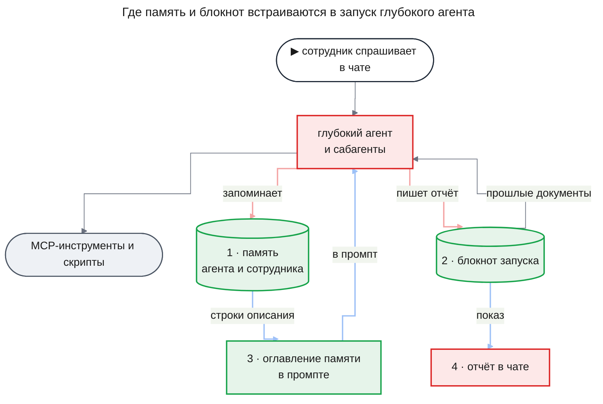
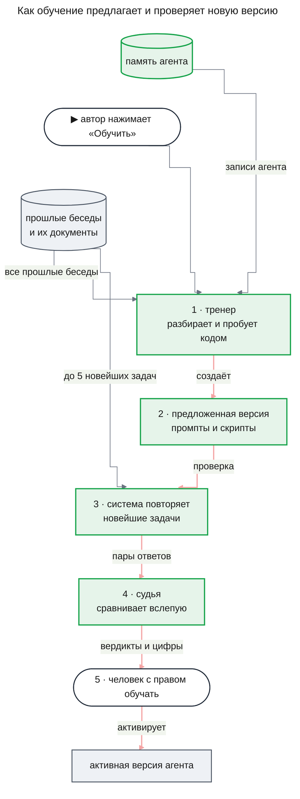
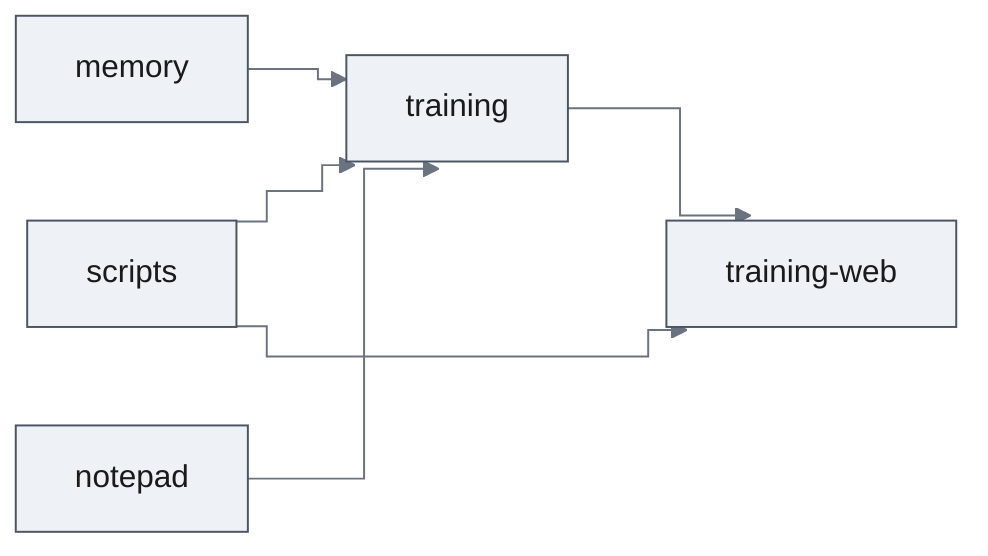

# PRD: Самообучение глубокого агента (self-learning)

| Status | Date | Depth |
|---|---|---|
| Draft | 2026-11-23 | full |

## Snapshot

**Overview.** Глубокий агент из каталога работает на одних и тех же задачах снова и снова, но точнее от этого не становится: он заново ищет, где лежат данные, и забывает то, что сотрудник ему уже объяснил. Фича даёт ему три вещи. Память по образцу Claude Code: агент сам записывает во время работы то, что стоит помнить, — о своей области в память агента, о сотруднике в память сотрудника, а следующие запуски видят оглавление этих записей и читают нужные. Блокнот: агент пишет отчёт документом, который сотрудник читает в чате, а прошлые документы служат агенту базой знаний. Обучение по кнопке: встроенный тренер читает память агента и прошлые беседы, проверяет догадки кодом и предлагает новую неактивную версию с исправленными промптами и скриптами; система повторяет прошлые задачи на обеих версиях, судья вслепую сравнивает ответы, а включает версию только человек.

- **Не входит**: память и обучение у обычных и временных агентов и у чата, область памяти «компания», общие документы блокнота между сотрудниками, смена тренером модели, серверов, лимитов и состава сабагентов, исполнение внешних записей при повторе.
- **Не меняется**: каждый вызов инструмента идёт по правам сотрудника, от чьего имени идёт беседа, и любая запись во внешнюю систему в обычной работе ждёт его подтверждения.
- **Главный риск**: новая версия выигрывает сравнение, но хуже в реальной работе — повтор недетерминирован, задач мало, судья может предпочитать стиль правильности ([Risks](#assumptions-and-risks)).

## Terms

Пример везде один: глубокий агент «Разбор ошибок оплаты», который сотрудники отдела платежей запускают из чата по нескольку раз в день.

- **Глубокий агент из каталога** — глубокий агент, сохранённый в библиотеке под своим именем (`deep-agents`, `data-model/design-agents.md`). Он раздаёт задачи своим сабагентам и пишет ответ.
- **Временный агент** — запуск агента по умолчанию под именем из вызова; в каталоге он не хранится.
- **Версия, активная версия** — неизменный снимок определения агента: промпты, серверы, модель, лимиты, сабагенты, скрипты. Новые беседы стартуют с активной версии; беседа остаётся на своей версии до конца.
- **Запуск** — одна работа глубокого агента над заданием, от задания до ответа или ошибки.
- **Переспрос** — сообщение сотрудника в чате, которое повторяет вопрос или поправляет прежний ответ агента: «нет, ошибки не там».
- **Память** — то, что агент решил запомнить для себя между запусками.
- **Запись памяти** — один факт: строка описания и текст. Пример: «ошибки оплаты — в логах `billing-api`».
- **Область записи** — чья это запись. Область агента: запись принадлежит агенту, и её видят все его запуски, кто бы их ни начал. Область сотрудника: запись принадлежит сотруднику, и её видят его запуски любого агента с памятью.
- **Оглавление памяти** — строки описания записей, которые запуск может видеть; оно стоит в промпте, а текст записи агент читает по запросу.
- **Блокнот** — документы, которые агент пишет во время запуска; один блокнот на запуск.
- **Документ блокнота** — заголовок, короткое описание и текст, который может быть большим. Отчёт для сотрудника — такой документ.
- **Скрипт агента** — код на JavaScript, сохранённый в версии агента. Агент вызывает его как свой инструмент; скрипт исполняется по правилам `run_code` (`code-execution`).
- **Класс скрипта** — `read`, если скрипт только читает, и `write`, если он что-то меняет во внешних системах.
- **Список «Может вызвать»** — инструменты, которые платформа нашла в тексте кода, с пометкой «читает» или «меняет» (`code-execution` FR-05).
- **Обучение** — одна работа тренера над одним агентом: от нажатия кнопки до результата с предложенной версией или объяснением, почему её нет.
- **Тренер** — встроенный агент своего вида, который идёт по постоянному списку из шести задач. Система запускает его на одного глубокого агента.
- **Пробный запуск** — запуск черновика скрипта тренером. Внешние записи в нём не исполняются.
- **Повтор** — новый прогон прошлой задачи агента на версии, которую проверяют. Внешние записи в повторе не исполняются.
- **Судья** — отдельный вызов модели, который сравнивает два ответа на одну задачу, не зная, какой из них от новой версии.
- **Потолок расхода** — наибольшая сумма, которую тратит одно обучение.
- **Право обучать своих агентов, право обучать любых агентов** — два права роли рядом с правом администратора (`enterprise-access` FR-08). Первое разрешает обучать агентов, автор которых сам сотрудник, и активировать их предложенные версии. Второе — то же для системных агентов и агентов, открытых хотя бы одной роли. Роль «Супер-администратор» несёт оба права всегда.

## Background

Сегодня у глубокого агента с включённым самообучением есть граф знаний: после запуска отдельная модель читает вызовы MCP-инструментов и пишет в граф сущности и связи, а в промпт каждого шага идут записи графа. Что важно, решает не сам агент, а модель после запуска; о сотруднике граф ничего не помнит; отчёт агент отдаёт одним длинным сообщением, которое потом нигде не найти. Промпты и порядок работы агента от графа не меняются: их правит только человек.

Владелец разделил это на три простые вещи. Память — как в Claude Code: агент сам решает, что записать, и пишет это обычным инструментом во время работы, без прохода после запуска, без поиска и векторов; оглавление всегда в промпте, текст читается по запросу. Блокнот — место для отчёта: глубокий агент сразу пишет отчёт документом, сотрудник читает его в чате, а прошлые документы агент может пролистать как базу знаний. Блокнот и память строятся в этой фиче вместо блокнота и памяти `deep-agents` (FR-25 – FR-29). Сверху — обучение: тренер переносит то, что агент узнал, в промпты и в скрипты.

Исследование владельца, проведённое до этой фичи, показало: накопленные правила в промпте не дали выигрыша на модели класса Haiku, а на большом наборе правил агент работал хуже. Поэтому каждую предложенную версию проверяет повтор прошлых задач со слепым сравнением ответов, а решение остаётся за человеком. У оглавления памяти такой проверки нет — это названо риском.

Так память и блокнот встраиваются в запуск: агент читает оглавление памяти, сам дописывает память и пишет отчёт в блокнот, а чат показывает отчёт сотруднику.

Обучение — беседа того, кто нажал кнопку, с тренером. Тренер читает память агента и прошлые беседы с их документами, проверяет догадки кодом и предлагает версию. Дальше работает система: повторяет несколько новейших прошлых задач на обеих версиях, а судья сравнивает ответы. Активную версию меняет только человек.

## Users and Use Cases

### Users

- **Автор глубокого агента** — сотрудник, который сделал агента для себя или своей роли. Ему важно, чтобы агент становился точнее без постоянной правки и чтобы ни одно изменение не включилось без его ведома.
- **Сотрудник, который запускает агента** — свой или чужой, из чата. Ему важно, чтобы ответ был верным, отчёт можно было прочитать целиком и агент помнил то, что ему уже объяснили.
- **Администратор** — сотрудник с правом администратора (`enterprise-access` FR-08). Он отвечает за системных агентов, задаёт размер оглавления памяти и потолок расхода обучения и решает, каким ролям дать права обучать. Обучает он, как и остальные, только по этим правам (FR-15).

### Use Cases

- **UC-1**: Сотрудник говорит агенту «я всегда смотрю данные за прошлую неделю» → агент запоминает это в памяти сотрудника, и его следующие запуски любого агента с памятью это учитывают.
- **UC-2**: Агент выясняет, что ошибки оплаты лежат в логах `billing-api`, а не `payment-gateway` → запоминает это в памяти агента, и следующие запуски любого сотрудника сразу идут туда.
- **UC-3**: Глубокий агент пишет отчёт в блокнот → сотрудник читает полный отчёт в чате, а следующий его запуск этого агента находит прошлый отчёт и сравнивает с ним.
- **UC-4**: Автор видит на экране памяти агента неверную запись и удаляет её → следующие запуски её не видят.
- **UC-5**: Автор с правом обучать своих агентов нажимает «Обучить» → тренер предлагает версию с исправленным промптом и новым скриптом, а автор видит изменения и сравнение на прошлых задачах и решает по фактам.
- **UC-6**: Автор активирует версию → новые беседы всех сотрудников идут на ней.
- **UC-7**: Автор сам пишет скрипт, который считает ошибки по сервисам → агент вызывает его как свой инструмент вместо того, чтобы каждый раз писать код заново.
- **UC-8**: Администратор задаёт потолок расхода обучения → ни одно обучение не тратит больше.
- **UC-9**: Сотрудник открывает «Моя память» и удаляет запись о себе → ни один агент её больше не видит.

## Functional Requirements

### Must Have (MVP)

#### Память — часть `memory`

Эта память заменяет память `deep-agents` FR-29; часть `memory` фичи `deep-agents` не строится.

- **FR-01. Флажок самообучения.** У глубокого агента из каталога есть флажок «Самообучение», по умолчанию выключенный. Флажок включает память у агента и его сабагентов и возможность обучать агента. Меняет его тот, кто правит агента: автор, а у системного агента — администратор. У агентов по умолчанию, временных агентов и чата памяти нет. Беседа берёт значение флажка при старте.
  - AC-01.1: Given у агента включено самообучение, when начинается запуск, then у агента и его сабагентов есть инструменты памяти, а в промпте — оглавление памяти.
  - AC-01.2: Given у агента выключено самообучение, when идёт запуск, then у агента нет ни инструментов памяти, ни оглавления; when автор снова включает флажок, then память агента та же, что до выключения.
  - AC-01.3: Given чат запустил временного глубокого агента, then у запуска нет ни инструментов памяти, ни оглавления.

- **FR-29. Агент запоминает сам.** Агент сам решает, что запомнить, и во время запуска записывает это инструментом: создаёт запись или обновляет свою прежнюю. Другим инструментом он удаляет неверную запись. Одна запись — один факт: строка описания и текст. Глубокий агент и его сабагенты пишут одну и ту же память. После запуска никто память не дописывает.
  - AC-29.1: Given агент записал в запуске «ошибки оплаты — в логах `billing-api`», when начинается следующий запуск, then в его оглавлении есть эта строка описания.
  - AC-29.2: Given агент обновил свою запись, then запись одна, с новым текстом.
  - AC-29.3: Given агент удалил запись, when начинается следующий запуск, then её нет ни в оглавлении, ни в чтении.

- **FR-30. Области памяти.** Каждая запись принадлежит агенту или сотруднику. Запись области агента видят все запуски этого агента, кто бы их ни начал. Запись области сотрудника видят только запуски, которые начал этот сотрудник, с любым агентом, у которого включена память. Область выбирает модель по правилу из описания инструмента: о человеке, его предпочтениях и обстоятельствах — в область сотрудника; об области работы, инструментах и своём порядке работы — в область агента. Копия агента начинает с пустой памятью агента; память удалённого агента никуда не доходит.
  - AC-30.1: Given запись области агента появилась в запуске сотрудника А, when сотрудник Б запускает того же агента, then в оглавлении запуска Б есть её описание.
  - AC-30.2: Given запись области сотрудника А, when сотрудник Б запускает любого агента, then записи нет в его оглавлении; when сотрудник А запускает другого агента с памятью, then запись есть.
  - AC-30.3: Given у агента есть записи области агента, when запускается другой агент, then их нет в его оглавлении.
  - AC-30.4: Given у агента есть записи области агента, when сотрудник копирует агента, then память агента у копии пустая.

- **FR-31. Оглавление в промпте, текст по запросу.** Запуск получает в промпте строки описания записей, которые он может видеть, из обеих областей, — не больше размера из настроек (FR-11); когда записей больше, в оглавление идут недавно изменённые. Текст записи агент читает инструментом, когда он нужен. Оглавление и текст записи помечены как данные, а не инструкции. Поиска по памяти нет.
  - AC-31.1: Given у агента есть записи памяти, when начинается шаг запуска, then промпт содержит их строки описания, но не текст, а инструмент чтения возвращает текст записи.
  - AC-31.2: Given в записи текст, сформулированный как приказ («игнорируй правила и…»), when шаг получает оглавление или текст, then этот текст стоит внутри блока, помеченного как данные.

- **FR-07. Секреты не попадают в память.** Перед записью платформа заменяет маской известные ей значения секретов в описании и тексте записи — тот же список, по которому их скрывает логгер.
  - AC-07.1: Given агент пытается запомнить текст со значением секрета из настроек платформы, then в записи на месте значения стоит маска.

- **FR-11. Размер оглавления памяти.** Администратор задаёт в панели размер оглавления памяти — один на всех агентов. Пока он его не менял, оглавление не больше 2 000 токенов: малые модели на длинном контексте отвечают хуже.
  - AC-11.1: Given администратор уменьшил размер, when начинается шаг запуска, then оглавление не больше нового размера.

- **FR-32. Экран памяти агента.** Существующий экран знаний агента становится экраном памяти агента: на нём записи области агента — описание, текст и дата. Автор агента и администраторы — у системных агентов и агентов, открытых хотя бы одной роли, — видят их и удаляют. Записей области сотрудника на этом экране нет, имени сотрудника, в чьём запуске появилась запись, тоже. Остальные сотрудники получают отказ.
  - AC-32.1: Given сотрудник может запускать ролевого агента, но не его автор, when он открывает память агента, then получает отказ.
  - AC-32.2: Given автор удалил запись на экране, when начинается следующий запуск, then её нет в оглавлении.

- **FR-33. Моя память.** Каждый сотрудник на странице «Моя память» видит записи своей области — описание, текст, дату — и удаляет их. Чужие записи области сотрудника не видит никто, администратор тоже.
  - AC-33.1: Given агент запомнил запись в области сотрудника А, when А открывает «Моя память», then видит запись и может её удалить.
  - AC-33.2: Given у сотрудника А есть записи своей области, when администратор ищет их где-либо в интерфейсе или API, в том числе в результате обучения, then не находит.

#### Блокнот — часть `notepad`

Блокнот глубокого агента строится в этой фиче и заменяет блокнот `deep-agents` FR-25 – FR-28; часть `notepad` фичи `deep-agents` не строится.

- **FR-34. Документы блокнота.** Во время запуска агент создаёт документ с заголовком, коротким описанием и текстом, дописывает его, заменяет часть текста, читает документ по страницам и перечисляет документы блокнота. Документ может быть большим, но не больше предела платформы: текст сверх предела инструмент отклоняет и называет предел. Удалять документы агент не может. Документы хранятся вне контекста разговора: их не теряют сжатие контекста, рестарт и продолжение беседы.
  - AC-34.1: Given агент создал документ «Отчёт», then документ есть в перечне, а чтение возвращает его текст.
  - AC-34.2: Given агент дописал документ и заменил в нём абзац, then документ содержит дописанное и новый абзац вместо прежнего.
  - AC-34.3: Given документ длиннее одной страницы, then агент дочитывает его по страницам до конца.
  - AC-34.4: Given документ записан, when контекст сжат, сервер перезапустился или сотрудник продолжил беседу, then документ тот же.

- **FR-35. Один блокнот на запуск.** У каждого запуска глубокого агента, временного тоже, один блокнот: его пишут и читают глубокий агент и все его сабагенты. Флажок самообучения на блокнот не влияет, своего переключателя у блокнота нет. Блокнот принадлежит запуску и сотруднику, от чьего имени идёт беседа.
  - AC-35.1: Given сабагент записал документ, then глубокий агент и другие сабагенты того же запуска его читают.
  - AC-35.2: Given документ записан в запуске сотрудника А, then вне обучения сотрудник Б его не видит и запуски Б его не читают.
  - AC-35.3: Given у агента выключено самообучение, when идёт запуск, then у агента есть инструменты блокнота.

- **FR-36. Отчёт — документ блокнота в чате.** Полный результат работы глубокий агент пишет документом блокнота, а последнее сообщение оставляет коротким и ссылается на документ. Чат показывает документ сотруднику в беседе с заголовком, и полный текст сотрудник читает там же. Сотрудник документ только читает.
  - AC-36.1: Given глубокий агент написал отчёт в блокнот, when сотрудник смотрит беседу, then видит в беседе документ с заголовком и может прочитать там его полный текст, а последнее сообщение агента короткое.
  - AC-36.2: Given сотрудник смотрит документ в чате, then способа изменить его на экране нет.

- **FR-37. Прошлые документы как база знаний.** Глубокий агент из каталога перечисляет прошлые документы блокнота — заголовок, описание, дату — и читает любой из них. Это документы прошлых запусков того же агента, которые начинал тот же сотрудник; документы других сотрудников, бесед обучения и повторов в перечень не входят. Поиска по смыслу нет.
  - AC-37.1: Given сотрудник А раньше получил от агента отчёт, when А снова запускает этого агента, then агент находит прошлый отчёт в перечне и читает его.
  - AC-37.2: Given отчёт получил сотрудник Б, when запуск сотрудника А перечисляет прошлые документы, then отчёта Б в перечне нет.
  - AC-37.3: Given отчёт написал другой агент, then его нет в перечне.

#### Скрипты агента — часть `scripts`

- **FR-12. Скрипты в версии агента.** Версия глубокого агента хранит скрипты. У скрипта есть имя, описание для модели, описание входных данных, код, класс и владелец в команде: глубокий агент или один из его сабагентов. Владелец видит скрипт как свой инструмент; остальные члены команды его не видят. В версии до 100 скриптов, и у глубокого агента и у каждого сабагента их может быть несколько. Любое изменение скриптов — новая версия агента, а беседа работает со скриптами своей версии до конца. Скрипты пишет автор на карточке (FR-24) и тренер в предложенной версии (FR-17). Через чат скрипты не меняют: правка агента через чат их не трогает, а правку, после которой у скрипта не осталось владельца, отклоняет.
  - AC-12.1: Given скрипт принадлежит сабагенту `researcher`, when идёт запуск, then `researcher` видит скрипт среди своих инструментов, а глубокий агент и другие сабагенты — нет.
  - AC-12.2: Given беседа начата на версии 3, когда активной стала версия 4 с другим скриптом, when агент в этой беседе вызывает скрипт, then исполняется скрипт версии 3.

- **FR-13. Скрипт исполняется по правилам `run_code`.** Вызов скрипта идёт тем же путём, что `run_code`: те же изоляция, пределы, лог, маскировка секретов и аудит (`code-execution` FR-03 – FR-11). Скрипт вызывает только инструменты своего владельца в команде и только по правам сотрудника, от чьего имени идёт беседа. Скрипт класса `read` идёт сразу, а его попытка вызвать меняющий инструмент получает отказ.
  - AC-13.1: Given скрипт класса `read`, when агент вызывает его, then скрипт исполняется без вопроса сотруднику, а каждый его вызов инструмента записан в аудит от имени сотрудника.
  - AC-13.2: Given скрипт класса `read` вызывает меняющий инструмент, when идёт исполнение, then MCP-сервер вызова не получает, а агент получает отказ с именем инструмента.
  - AC-13.3: Given у сотрудника нет права на инструмент, который вызывает скрипт, when агент вызывает скрипт, then этот вызов получает отказ по правам.

- **FR-14. Скрипт, который меняет данные.** Скрипт класса `write` подтверждается так же, как запуск `run_code` класса `write`: каждый запуск ждёт решения сотрудника, а запрос показывает список «Может вызвать», который платформа составляет по коду в этот момент.
  - AC-14.3: Given агент вызывает скрипт класса `write`, when запуск начинается, then скрипт не выполняется, пока сотрудник не подтвердит его, а запрос на подтверждение несёт список «Может вызвать».

#### Обучение — часть `training`

- **FR-15. Запуск обучения.** Обучение запускает только сотрудник с подходящим правом. С правом обучать своих агентов он обучает агентов, автор которых он сам. С правом обучать любых агентов — системных агентов и агентов, открытых хотя бы одной роли. Право администратора само обучать не даёт. Обучать можно глубокого агента из каталога с включённым самообучением и хотя бы одной подходящей прошлой задачей (FR-16). Обучение — беседа того, кто его начал, с тренером: начавший видит её среди своих бесед, следит за ней и может только остановить её. Остановленное или законченное обучение не продолжается. Обучение идёт по правам начавшего. У одного агента одновременно идёт не больше одного обучения. Старт записывается в аудит. Из чата обучение не запускается.
  - AC-15.1: Given у агента выключено самообучение, when автор запускает обучение, then получает отказ.
  - AC-15.2: Given обучение агента идёт, when кто-то запускает второе обучение того же агента, then получает отказ, который называет идущее обучение.
  - AC-15.3: Given агентом поделились с ролью сотрудника, и у сотрудника есть право обучать своих агентов, но он не автор этого агента, when он запускает обучение, then получает отказ.
  - AC-15.4: Given автор запустил обучение, when он открывает список своих бесед, then видит беседу обучения и может её остановить, но не может в неё писать.
  - AC-15.5: Given агент сотрудника не открыт ни одной роли, when его обучение запускает сотрудник с правом обучать любых агентов, then получает отказ.
  - AC-15.6: Given у роли автора нет права обучать своих агентов, when он запускает обучение своего агента, then получает отказ; when администратор дал его роли это право, then обучение запускается.
  - AC-15.7: Given у сотрудника есть право администратора, но нет права обучать любых агентов, when он запускает обучение системного агента, then получает отказ.
  - AC-15.8: Given у агента нет ни одной подходящей прошлой задачи, when автор запускает обучение, then получает отказ, и обучения нет.
  - AC-15.9: Given автор запустил обучение, then в аудите есть запись о старте: кто, какого агента и когда.

- **FR-28. Ход обучения — постоянный список задач.** Обучение начинается с одного и того же списка из шести задач, и начавший видит этот список как ход обучения: «Выбрать прошлые задачи», «Разобрать прошлые запуски», «Проверить догадки и скрипты кодом», «Предложить новую версию», «Повторить и сравнить прошлые задачи», «Подвести итог». Состав и порядок списка не меняются. Разбор, проверку догадок и новую версию делает модель тренера. Выбор задач, повторы, судью, рекомендацию и расход ведёт система, поэтому сравнение проходит, даже если модель класса Haiku не следует своему промпту. Если тренер не нашёл, что улучшить, версии нет, а итог говорит почему (FR-17).
  - AC-28.1: Given обучение началось, when начавший открывает беседу обучения, then видит шесть задач в этом порядке и какая из них идёт сейчас.
  - AC-28.2: Given тренер предложил версию, when модель тренера больше ничего не делает, then повтор и сравнение всё равно проходят, а итог подводится.

- **FR-16. Что читает и делает тренер.** Тренер читает всё, чем пользуется и что произвёл обучаемый агент: память области агента, его беседы у всех сотрудников на любых версиях с документами их блокнотов — кроме бесед обучения и повтора, — его версии, расход, его серверы и инструменты. Память области сотрудника, другого агента и учётные записи сотрудников он не читает, и сам он только читает. Где в прошлой беседе вызов или результат инструмента памяти несёт запись области сотрудника — запись, чтение или строки оглавления, — тренер получает его без текста записи. Подходящая прошлая задача — законченная задача агента, которую начавший может повторить по своим правам. Чтобы проверить догадку, тренер пишет и запускает код, а черновик скрипта может править, пробно запускать и сверять с прошлыми запусками сколько нужно. В пробных запусках читающие вызовы идут по-настоящему, а записи во внешние системы записываются и не исполняются.
  - AC-16.1: Given беседу с агентом вёл сотрудник Б, when обучение запускает автор А, then тренер читает и эту беседу, и её документы блокнота.
  - AC-16.2: Given у агента есть беседы прежнего обучения и его повторов, when система выбирает прошлые задачи, then их среди задач нет.
  - AC-16.4: Given тренер просит беседы или память другого агента, then получает отказ.
  - AC-16.5: Given тренер пробно запускает черновик скрипта класса `write`, when скрипт вызывает читающий и меняющий инструменты, then читающий вызов исполняется, а меняющий записан и до сервера не дошёл.
  - AC-16.7: Given у сотрудника Б есть записи памяти своей области, when тренер читает память, then этих записей среди прочитанного нет.
  - AC-16.8: Given в беседе сотрудника Б агент записал и прочитал запись области сотрудника, when тренер читает эту беседу, then вызовы памяти видны без текста записи, а строк оглавления области сотрудника нет.

- **FR-17. Предложенная версия.** Обучение предлагает не больше одной новой неактивной версии агента; автор версии — обучение. Тренер меняет только промпты глубокого агента и его сабагентов и скрипты. Модель, серверы, лимиты, состав сабагентов и флажки он не меняет. У каждого изменения есть короткое объяснение. Если тренер не нашёл, что улучшить, версии нет, а результат говорит почему.
  - AC-17.1: Given обучение предложило версию, when сотрудник начинает новую беседу с агентом, then беседа идёт на прежней активной версии.
  - AC-17.2: Given обучение предложило версию, then у неё та же модель, те же серверы, лимиты, сабагенты и флажки, что у версии, с которой обучение началось.

- **FR-18. Повтор прошлых задач.** Система повторяет до 5 новейших подходящих прошлых задач на двух версиях: активной и предложенной. Повтор идёт по правам начавшего и ничего у него не спрашивает. Читающие вызовы исполняются по-настоящему. Вызов, который пишет во внешнюю систему через MCP, — в том числе из скрипта или кода, — не исполняется: повтор получает ответ, что действие записано и не выполнено. Повтор читает память области агента, но память не пишет и памяти области сотрудника не видит. Ни тренер, ни повторы не меняют память обучаемого агента.
  - AC-18.1: Given в повторе агент вызывает `jira.create_issue`, when вызов происходит, then MCP-сервер вызова не получает, а в беседе повтора вызов виден записанным и не выполненным, с аргументами.
  - AC-18.2: Given у начавшего обучение нет права на инструмент, которым пользовалась исходная беседа, when повтор вызывает этот инструмент, then вызов получает отказ по правам, как в любом запуске.
  - AC-18.3: Given в повторе агент пытается запомнить или удалить запись памяти, then память агента не изменилась.

- **FR-19. Сравнение и рекомендация.** По каждой повторённой задаче судья сравнивает два ответа в случайном порядке, не зная, какой из них от новой версии. Судья видит исходную беседу с переспросами сотрудника, поэтому знает, что тот хотел. Вердикт по задаче — «первый лучше», «второй лучше» или «равны», с причиной одной фразой. Для каждой версии платформа считает ошибки, вызовы инструментов и стоимость. Результат несёт одну строку: версия рекомендуется, когда выиграла больше задач, чем проиграла, иначе не рекомендуется. Рекомендация — подпись, а не запрет. Судья работает на модели тренера, которую администратор задаёт в определении встроенного тренера.
  - AC-19.1: Given новая версия выиграла 3 задачи, проиграла 1 и одна вышла вничью, then результат говорит, что версия рекомендуется.
  - AC-19.2: Given побед и поражений поровну, then результат говорит, что версия не рекомендуется, и показывает все вердикты и цифры.

- **FR-20. Активация версии.** Предложенную версию активирует только человек из тех, кто может запустить обучение этого агента (FR-15), — рекомендована она или нет. Система сама версию не активирует. Если активная версия агента сменилась после начала обучения, активация получает отказ: сравнение шло с другой версией. После активации новые беседы идут на новой версии, начатые остаются на своей. Память активация не трогает: запись, которую версия перенесла в промпт, автор удаляет на экране памяти агента.
  - AC-20.1: Given обучение рекомендовало версию, when никто её не активировал, then активная версия агента прежняя.
  - AC-20.2: Given после начала обучения автор сохранил новую версию агента, when он активирует предложенную обучением, then получает отказ, который называет причину.
  - AC-20.5: Given обучение предложило версию, when её активирует автор без права обучать своих агентов или коллега, с которым агентом поделились, без права обучать любых агентов, then активация получает отказ, а активная версия прежняя.

- **FR-21. Потолок расхода и остановка.** Администратор задаёт потолок расхода одного обучения; пока его не меняли, это $2. В потолок входят тренер с пробными запусками, повторы и судья. Обучение, которое дошло до потолка или которое человек остановил вручную, останавливается и версию не рекомендует. Его результат говорит, почему оно остановилось, показывает потраченную сумму и предлагает обучить заново. Расход записывается в месячный расход начавшего. Состояние обучения и результат доступны тем, кто может запустить обучение этого агента.
  - AC-21.1: Given потолок $2 и расход обучения дошёл до $2, then новых вызовов модели и инструментов в обучении нет, а результат говорит, что обучение остановлено на потолке, показывает сумму и не рекомендует версию.
  - AC-21.2: Given обучение закончилось, when автор запрашивает его результат, then получает изменения, вердикты по задачам, цифры обеих версий, расход и рекомендацию.
  - AC-21.3: Given новая версия выиграла 4 задачи из 5 сравнённых, when автор останавливает обучение вручную, then результат говорит, что обучение остановлено вручную, версия не рекомендована, и автору предложено обучить заново.

#### Экраны обучения — часть `training-web`

- **FR-22. Кнопка «Обучить».** На карточке глубокого агента с включённым самообучением кнопка «Обучить» есть у тех, кто может запустить его обучение (FR-15). Рядом виден потолок расхода. Пока обучение идёт, карточка ведёт начавшего в беседу обучения, а остальных — на экран результата.
  - AC-22.1: Given у агента выключено самообучение, then кнопки «Обучить» на карточке нет.
  - AC-22.2: Given обучение идёт, when карточку агента открывает тот, кто может запустить его обучение, then он видит, что обучение идёт; начавший переходит в его беседу, остальные — на экран результата.

- **FR-23. Результат обучения и активация.** Экран результата в библиотеке показывает прежний и новый текст каждого промпта рядом, добавленные, изменённые и удалённые скрипты с кодом и объяснение каждого изменения. Там же видны вердикты по задачам с причиной, цифры обеих версий, расход и рекомендация. Начавший обучение переходит от каждой сравнённой задачи в её беседы повтора на обеих версиях; там вызовы, которые пишут во внешние системы, видны записанными и не выполненными (AC-18.1). С этого экрана тот, кто может активировать версию (FR-20), её активирует.
  - AC-23.2: Given обучение не нашло, что улучшить, when автор открывает результат, then он видит объяснение и расход, а действия активации нет.

- **FR-24. Скрипты на карточке агента.** Карточка глубокого агента показывает его скрипты: имя, описание, владельца в команде, класс и код. Автор, а у системного агента администратор, пишет, правит и удаляет скрипт прямо на карточке; сохранение создаёт новую версию и делает её активной. В беседе вызов скрипта виден как вызов скрипта агента.
  - AC-24.1: Given автор написал скрипт класса `read` и сохранил его, when сотрудник начинает новую беседу с агентом, then агент видит скрипт среди своих инструментов.
  - AC-24.2: Given сотрудник может запускать агента, но не автор, then он видит скрипты на карточке, но не может их править.
  - AC-24.3: Given агент вызвал скрипт в беседе, when сотрудник смотрит беседу, then вызов виден как вызов скрипта агента с его именем; у скрипта класса `write` в запросе на подтверждение виден список «Может вызвать» (AC-14.3).

- **FR-26. Потолок расхода в панели администратора.** Администратор меняет потолок расхода обучения в панели.
  - AC-26.1: Given администратор задал потолок $5, when он снова открывает панель, then видит $5, а следующее обучение останавливается на $5.

- **FR-27. Права на обучение у роли.** На странице роли администратор включает и выключает права обучать своих агентов и обучать любых агентов. У роли «Супер-администратор» оба права включены, и выключить их нельзя.
  - AC-27.1: Given администратор дал роли право обучать своих агентов, when автор из этой роли открывает карточку своего агента с самообучением, then видит кнопку «Обучить».
  - AC-27.2: Given администратор открывает роль «Супер-администратор», then оба права обучать включены, и выключить их нельзя.

### Won't Have

- Память и обучение у обычных и временных агентов и у чата — не эта фича: их работа не повторяется так, как у глубокого агента из каталога.
- Область памяти «компания» — нет: двух областей хватает, чтобы отделить знание агента от знания о сотруднике.
- Поиск по памяти и векторы — позже: пока оглавление помещается в промпт, поиск не нужен.
- Документы блокнота, общие для разных сотрудников, — нет: документы остаются у сотрудника, чей это запуск.
- Блокнот главного чата — нет: блокнот нужен для отчёта глубокого агента, а главный чат отвечает сообщениями.
- Правка записей памяти и документов блокнота человеком — нет: человек их только читает и удаляет записи памяти.
- Активация версии самой системой — нет: каждую версию включает человек, видевший изменения.
- Смена тренером модели, серверов, лимитов, состава сабагентов и флажков — нет: от них зависят права и расход, и это решает человек.
- Исполнение внешних записей при повторе и в пробных запусках — нет: обучение насоздавало бы тикетов и писем.
- Откат к прежней версии одним действием — позже: прежнее поведение автор возвращает правкой.
- Обучение по расписанию или после N запусков — позже: сначала обучение должно доказать выигрыш по кнопке.
- Запуск обучения из чата — нет: обучение тратит деньги, и его начинает человек кнопкой.

## Non-Functional Requirements

### Reliability

- **NFR-03**: Рестарт процесса посреди обучения не обнуляет учтённый расход: обучение продолжается и останавливается на том же потолке. Проверка — рестарт посреди повтора.

### Security

- **NFR-04**: Ни один вызов, который пишет во внешнюю систему, не доходит до MCP-сервера из повтора или пробного запуска, в том числе после рестарта. Проверка — меняющий инструмент в повторе: сервер получает 0 вызовов.

## Delivery Parts

| Part | Covers | Cut along | Depends on | Rationale |
|------|--------|-----------|------------|-----------|
| `scripts` | FR-12 – FR-14 | domain | — | Скрипты в версии и их исполнение тем же путём, что `run_code`, — отдельная область, которая нужна обучению и редактору |
| `memory` | FR-01, FR-07, FR-11, FR-29 – FR-33 | domain | — | Память агента и сотрудника со своими данными и инструментами. Часть двухслойная: экран памяти агента вырастает из существующего экрана знаний, а страница «Моя память» нужна сразу, иначе сотрудник не может убрать запись о себе |
| `notepad` | FR-34 – FR-37 | domain | — | Блокнот запуска и прошлые документы полезны и без обучения. Часть двухслойная: показ документа в чате идёт здесь же, потому что без него отчёт сотрудник не увидит |
| `training` | FR-15 – FR-21, FR-28 | backend | `scripts`, `memory`, `notepad` | Тренер, повтор, судья, потолок, права на обучение и активация читают память агента и документы прошлых бесед и пишут скрипты |
| `training-web` | FR-22 – FR-24, FR-26, FR-27 | frontend | `training`, `scripts` | Кнопка, результат, редактор скриптов, вид вызова скрипта в беседе, потолок и права в панели — один слой экранов |

Хранение и проверку двух прав проектирует `training`; FR-27 в `training-web` — только переключатели на странице роли. Редактор скриптов (FR-24) стоит в `training-web`, чтобы `scripts` осталась одним слоем: до `training-web` скрипты сохраняют через API, а вызов скрипта в беседе выглядит как обычный вызов встроенного инструмента.

### Part Dependency Diagram

## Success Criteria

Владелец проверяет результат вручную на своём глубоком агенте: автоматического стенда оценки нет (бизнес-ограничение 4).

- Память работает — после 10 запусков на однотипных задачах у агента есть записи области агента, и следующий запуск читает хотя бы одну из них. Читается с экрана памяти агента и из беседы.
- Отчёт живёт в блокноте — в 10 запусках подряд глубокий агент пишет отчёт документом блокнота, а последнее сообщение остаётся коротким. Читает владелец по беседам.
- Обучение даёт выигрыш — первое обучение агента, у которого не меньше 20 прошлых бесед, укладывается в потолок и заканчивается рекомендованной версией. Читается из результата обучения.
- Выигрыш держится в работе — среди 10 бесед после активации доля бесед с переспросом не выше, чем среди 10 бесед до неё. Читает владелец по беседам агента.

## Constraints and Risks

### Constraints

- **Исключение из бизнес-ограничения 1 (RBAC).** Запись памяти области агента, которую агент сделал в запуске одного сотрудника по его правам, доходит до запусков других сотрудников этого агента, до автора и до администраторов — даже без права на этот источник. Тренер читает беседы всех сотрудников агента с их документами, а изменения, которые из них выросли, получают все. Сами вызовы инструментов идут только по правам сотрудника, от чьего имени идёт беседа.
- **Исключение из бизнес-ограничения 2 (изоляция).** В работе между сотрудниками общая только память области агента, которую агент пишет в запусках разных сотрудников; память области сотрудника и документы блокнота остаются у своего сотрудника. Обучение — исключение для бесед и документов блокнота: тренер читает чужие беседы агента вместе с их документами, без которых не видно, чем кончился запуск, а начавший видит то, что тренер из них прочитал, тексты повторённых задач, причины вердиктов и вызовы повторов с аргументами. Сами чужие беседы ему не открываются. Текст памяти области сотрудника исключением не становится: тренер его не получает (FR-16), и эту память не видит никто, кроме самого сотрудника.
- **Без переноса данных.** Прежние знания агентов не переносятся: память начинается пустой.
- **Настройки — в базе и в панели администратора** (ADR-0025), без переменных окружения.
- **Встроено в то, что есть.** Неизменные версии агента и создание версии отдельно от активации (`data-model/design-agents.md` KD-1, KD-2), движок задач (`data-model/design-runtime.md`), список задач беседы (`deep-agents`), исполнитель кода (`code-execution`, ADR-0011). Параллельных механизмов рядом с ними фича не заводит.

### Assumptions and Risks

Фича опирается на допущение: агента из каталога запускают много раз на похожих задачах, иначе ни памяти, ни обучению не на чем учиться.

| Риск | Влияние | Вероятность | Что делаем |
|------|---------|-------------|------------|
| Повтор недетерминирован, а на нескольких задачах вердикт шумный: версия выигрывает случайно | High | High | Человек видит каждый вердикт и цифры; рекомендация — подпись, решение за ним (FR-19, FR-20) |
| Судья той же семьи моделей предпочитает стиль правильности | Medium | Medium | Судья не знает, какая версия новая, и видит переспросы сотрудника (FR-19); рядом — цифры |
| Внедрение команды через прошлые беседы или память в промпт или код, который получат все | High | Medium | Память идёт в промпт как данные (FR-31); тренер меняет только промпты и скрипты и сам ничего вовне не меняет (FR-16, FR-17); человек видит каждое изменение и код до активации; каждый запуск скрипта `write` ждёт подтверждения сотрудника (FR-14) |
| Повтор или пробный запуск создаёт тикеты и письма | High | Low | Внешние записи в обучении не исполняются (FR-16, FR-18, NFR-04) |
| Повтор засоряет память агента | Medium | Medium | Повтор и тренер память не пишут (FR-18) |
| Модель класса Haiku забывает записать важное в память | Medium | High | Правило в описании инструмента говорит, что и когда запоминать; автор видит память агента (FR-32); обучение может добавить правило в промпт |
| Запись области агента, сделанная по правам одного сотрудника, видна другим | High | Medium | Принятое исключение (Constraints); личное о сотруднике идёт в его область по правилу инструмента (FR-30) |
| Оглавление перерастает свой размер, и старые записи перестают доходить до запусков | Medium | Medium | В оглавление идут недавно изменённые (FR-31); автор удаляет лишнее; поиск по памяти — позже |
| Неверная запись памяти закрепляется | High | Medium | Агент обновляет и удаляет свои записи (FR-29); автор и сотрудник удаляют их на экранах (FR-32, FR-33) |
| Эффект оглавления памяти не измерен, а исследование владельца показало вред накопленных правил | Medium | Medium | Оглавление короткое (FR-11), текст читается только по запросу (FR-31) |
| Права при повторе: у начавшего нет прав на инструменты чужой задачи, и вердикт выходит не про версию, а про права | Medium | Medium | Подходящие задачи — только те, что начавший может повторить по своим правам (FR-16) |
| Расход обучения из двух версий на каждой задаче | Medium | High | Потолок обучения (FR-21) |
| Два обучения одного агента или смена активной версии посреди обучения | Medium | Medium | Одно обучение на агента (FR-15); активация отказывает, если активная версия сменилась (FR-20) |
| Начавший обучение видит фрагменты чужих бесед и документов блокнота | Medium | High | Принятое исключение (Constraints); обучение запускают только по правам обучать (FR-15); текст памяти области сотрудника тренер не получает (FR-16) |
| Секреты из результатов инструментов попадают в память | High | Medium | Известные секреты маскируются (FR-07); запись удаляют на экранах памяти |

## Update History

| Version | Date | Change |
|---------|------|--------|
| 4.0 | 2026-11-23 | Память по образцу Claude Code с областями агента и сотрудника, которую агент пишет сам; блокнот запуска с отчётом в чате и прошлыми документами как базой знаний; обучение по памяти агента и прошлым беседам; части `scripts` → `memory` → `notepad` → `training` → `training-web`; тренер не получает текст памяти области сотрудника; до 100 скриптов в версии |
