# UXRD: Самообучение workflow (self-learning)

| Статус | Дата | PRD | Дизайны |
|---|---|---|---|
| Черновик | 2026-11-20 | [prd.md](./prd.md) | — |

## Snapshot

**Overview.** Автор включает у workflow флажок «Самообучение» прямо в редакторе, и подсказка под флажком говорит, что найденное в запусках получат все следующие запуски, даже у сотрудников без доступа к этим системам. Сотрудник, который запускает такой workflow, видит то же в карточке задания до запуска. Что workflow узнал, автор и администратор смотрят на экране «Что узнал workflow»: это список записей с вкладками по видам, с числом подтверждений, датой и пометками «устарела» и «только по теме». Запись «только по теме» запуск получает, лишь когда она близка по смыслу к его вопросу. Над списком видно, сколько записей запуски получают при любом вопросе, работает ли отбор по смыслу и чем закончилось обучение после последнего запуска. Лишнее удаляют по одной записи. Предел места и выключатель уроков администратор задаёт в панели, в разделе «Агенты и workflow».

- **Не меняется**: беседа, ответ и карточка хода. Стоимость обучения попадает в уже существующий месячный расход запускающего без новой строки.
- **Главный UX-риск**: автор включает флажок, не поняв, что знание из его систем уйдёт сотрудникам без доступа к ним. Защищают подсказка под флажком (MC-1) и строка в карточке задания (MC-9).
- **Открытые вопросы**: нет.

### Key Decisions

| ID | Решение | Почему |
|---|---|---|
| KD-1 | Знания — список, а не нарисованный граф: таблица с вкладками «Факты», «Уроки», «Искал — не нашёл» и «Только по теме» (KD-7). Порядок строк — общий порядок без учёта вопроса: больше подтверждений выше, среди равных новее выше; устаревшие — в конце | Список читается на телефоне и легко чистится. Записи, которые доходят до запусков не всегда, оказываются в конце списка и на своей вкладке, где автор их и ищет (UC-6) |
| KD-2 | Один экран для автора и администратора, два входа: ссылка «Что узнал workflow» под флажком в редакторе и кнопка на странице workflow в панели. У кого нет доступа, тот входа не видит, а прямая ссылка ведёт на «Не найдено» | Вход стоит там, где человек уже работает с workflow. «Не найдено» не выдаёт, что граф есть (AC-09.1) |
| KD-3 | Флажок стоит в форме на виду, а не под «Дополнительно», и сохраняется общей кнопкой «Сохранить» | Флажок меняет, кто получит знание из систем автора. Такое решение не прячут среди редких настроек |
| KD-4 | Сотрудник не видит слов «граф», «промпт», «извлечение», «токены», «вектор» и «эмбеддинг»: экран называется «Что узнал workflow», предел — «место», записи сверх места — «только по теме» или «не помещаются», отбор по векторам — «отбор по смыслу». Токены видит только администратор в панели | Сотрудник думает о том, что workflow запомнил, а не о том, как это хранится |
| KD-5 | Удаляют по одной записи через подтверждение. У сущности диалог называет, сколько связей уйдёт вместе с ней | Удаление не отменить, а знание получают запуски всех сотрудников (FR-09) |
| KD-6 | Запускающий узнаёт о самообучении из строки в карточке задания — до запуска, без вопроса и без кнопки | Карточка задания стоит перед каждым запуском workflow из чата. Строка не добавляет шага (FR-13) |
| KD-7 | Пометка записи, которая доходит до запусков не при любом вопросе, зависит от отбора по смыслу: работает — «только по теме», выключен — «не помещается». Пятая вкладка называется так же. Записи без вектора своей пометки нет | При работающем отборе такая запись доходит до запуска, когда она по теме его вопроса (AC-11.1), и «не помещается» было бы неправдой. При выключенном отборе она до запусков не доходит. Вектор появляется вскоре после записи (FR-18), а долгую подготовку после смены модели объясняет строка об отборе |

## Design System

Фича следует [дизайн-системе](../../design-system/README.md). Экран «Что узнал workflow» в библиотеке — комфортная плотность, в панели — компактная, как остальная панель ([foundations → Spacing & Density](../../design-system/foundations.md#spacing--density)).

### Component Inventory

Перед решением «new» поиск шёл по `docs/design-system/components/` и `apps/web/src/components/` (`admin`, `library`). Новых компонентов нет.

| Компонент | Спецификация | Статус | Примечание |
|---|---|---|---|
| Редактор записи | [record-editor.md](../../design-system/components/record-editor.md) | extended | Блок «Самообучение» в варианте «Workflow» (SL-01) |
| Карточка решения | [decision-card.md](../../design-system/components/decision-card.md) | extended | Строка о самообучении в варианте «Бриф» (SL-02) |
| Метка состояния | [state-badge.md](../../design-system/components/state-badge.md) | extended | Виды записей и пометки «устарела», «только по теме», «не помещается», «уроки выключены» |
| Таблица данных | [data-table.md](../../design-system/components/data-table.md) | reused | Список записей, вариант «Строка с действиями» (KN-01) |
| Форма настроек | [settings-form.md](../../design-system/components/settings-form.md) | reused | Настройки самообучения в панели (AS-01) |
| Каркас панели, «Запись не найдена» | enterprise-access UXRD, AD-01, AD-15 | reused | Экран знаний в панели |
| Экран «Не найдено» | custom-agents UXRD, RV-02 | reused | Прямая ссылка без доступа (KN-03) |
| Уведомления | chat-shell UXRD, TST-01 | reused | «Удалено», «Сохранено» |
| Вкладки, диалог подтверждения, меню, флажок, скелетон | shadcn `tabs`, `alert-dialog`, `dropdown-menu`, `checkbox`, `skeleton` | reused | — |

## User Flows

### Primary User Flow

**Flow 1. Включить и посмотреть, что узнал.** Implements: UC-1, UC-2; AC-10.1, AC-13.1, AC-11.5, AC-15.1, AC-15.2, AC-16.1

Автор отмечает «Самообучение» в редакторе workflow и сохраняет (SL-01). Коллега запускает workflow из чата и в карточке задания видит строку о том, что workflow учится (SL-02). После конца запуска автор открывает «Что узнал workflow» и видит новые записи с их видом, числом подтверждений и датой (KN-01). Обучение идёт после ответа, поэтому записи появляются чуть позже конца запуска; экран сам не обновляется, их видно при следующем открытии.

```mermaid
---
title: "Flow 1 · Включить и посмотреть, что узнал"
config:
  theme: base
  look: classic
  themeVariables:
    primaryColor: "#eef1f5"
    primaryBorderColor: "#4b5563"
    primaryTextColor: "#1a1a1a"
    lineColor: "#6b7280"
  flowchart:
    curve: step
  themeCSS: |
    @keyframes lit_sl1{0%,22.5%{stroke:#991b1b;stroke-width:6px}25%,100%{stroke:#f4a5a5;stroke-width:2px}}
    @keyframes litr_sl1{0%,22.5%{stroke:#1d4ed8;stroke-width:6px}25%,100%{stroke:#9ec1f7;stroke-width:2px}}
---
flowchart LR
    entry(["▶ автор открывает workflow"])
    flag["1 · редактор<br/>флажок «Самообучение»"]
    saved["2 · сохранено<br/>флажок включён"]
    task["3 · карточка задания<br/>строка «учится»"]
    run["запуск идёт<br/>и заканчивается"]
    screen["4 · Что узнал workflow<br/>новые записи"]
    entry --> flag
    flag e1@-->|"«Сохранить»"| saved
    saved e2@-->|"коллега запускает"| task
    task e3@-->|"подтверждает"| run
    run e4@-->|"автор открывает"| screen
    classDef entry fill:#ffffff,stroke:#1f2937,stroke-width:1.5px,color:#1a1a1a
    classDef changed fill:#fde8e8,stroke:#dc2626,stroke-width:2px,color:#1a1a1a
    classDef new fill:#e6f4ea,stroke:#16a34a,stroke-width:2px,color:#1a1a1a
    classDef unchanged fill:#eef1f5,stroke:#4b5563,stroke-width:1.5px,color:#1a1a1a
    classDef w1 stroke:#f4a5a5,stroke-width:2px,animation:lit_sl1 4.8s linear 0s infinite
    classDef w2 stroke:#f4a5a5,stroke-width:2px,animation:lit_sl1 4.8s linear 1.2s infinite
    classDef r1 stroke:#9ec1f7,stroke-width:2px,animation:litr_sl1 4.8s linear 2.4s infinite
    classDef r2 stroke:#9ec1f7,stroke-width:2px,animation:litr_sl1 4.8s linear 3.6s infinite
    class entry entry
    class flag,saved,task changed
    class screen new
    class run unchanged
    class e1 w1
    class e2 w2
    class e3 r1
    class e4 r2
```



**Flow 2. Почистить знания.** Implements: UC-3, UC-5, UC-6; AC-11.1, AC-11.2, AC-11.4, AC-09.2, AC-06.1, AC-04.3, AC-17.1

Автор открывает экран из редактора, администратор — со страницы workflow в панели. Неверную запись находят на вкладке её вида, лишние — на вкладке «Только по теме» (KD-7). «Удалить» в меню строки открывает подтверждение (KN-02). После него строка уходит, а счётчики над списком пересчитываются: место освободилось, и часть записей снова доходит до запусков при любом вопросе.

```mermaid
---
title: "Flow 2 · Почистить знания"
config:
  theme: base
  look: classic
  themeVariables:
    primaryColor: "#eef1f5"
    primaryBorderColor: "#4b5563"
    primaryTextColor: "#1a1a1a"
    lineColor: "#6b7280"
  flowchart:
    curve: step
  themeCSS: |
    @keyframes litr_sl2{0%,22.5%{stroke:#1d4ed8;stroke-width:6px}25%,100%{stroke:#9ec1f7;stroke-width:2px}}
---
flowchart LR
    editor(["▶ редактор workflow"])
    panel(["▶ страница workflow в панели"])
    screen["1 · Что узнал workflow<br/>состояние и список"]
    tab["2 · вкладка<br/>вид или «Только по теме»"]
    confirm["3 · подтверждение<br/>что уйдёт"]
    done["4 · строка ушла<br/>счётчики пересчитаны"]
    editor e1@--> screen
    panel --> screen
    screen e2@--> tab
    tab e3@-->|"«Удалить»"| confirm
    confirm e4@-->|"«Удалить»"| done
    classDef entry fill:#ffffff,stroke:#1f2937,stroke-width:1.5px,color:#1a1a1a
    classDef new fill:#e6f4ea,stroke:#16a34a,stroke-width:2px,color:#1a1a1a
    classDef r1 stroke:#9ec1f7,stroke-width:2px,animation:litr_sl2 4.8s linear 0s infinite
    classDef r2 stroke:#9ec1f7,stroke-width:2px,animation:litr_sl2 4.8s linear 1.2s infinite
    classDef r3 stroke:#9ec1f7,stroke-width:2px,animation:litr_sl2 4.8s linear 2.4s infinite
    classDef r4 stroke:#9ec1f7,stroke-width:2px,animation:litr_sl2 4.8s linear 3.6s infinite
    class editor,panel entry
    class screen,tab,confirm,done new
    class e1 r1
    class e2 r2
    class e3 r3
    class e4 r4
```



**Flow 3. Настройки администратора.** Implements: UC-4, UC-7; AC-12.1, AC-06.2, AC-15.3

Администратор открывает в панели «Агенты и workflow», вкладку «Системные», и под «Настройками новых записей» меняет место для знаний или снимает «Давать запускам уроки» (AS-01). После «Сохранить» форма показывает сохранённые значения. На экране знаний любого workflow строки над списком пересчитаны по новому месту, а у уроков стоит пометка «уроки выключены». Модель для отбора по смыслу администратор выбирает не здесь, а в разделе панели «Модели» (фича `model-providers`).

### Alternative Flows

- **Самообучение выключено, знания остались** (AC-02.2). Автор снимает флажок, и под ним встаёт заметка MC-1: знания сохранятся. Экран знаний открывается как раньше, над списком строка MC-3 говорит, что запуски их не получают и не пополняют. Флажок включили снова — список тот же.
- **Обучения после запуска не было** (AC-03.2, AC-03.4, AC-08.2). Строка о последнем запуске называет причину словами MC-3: запуск остановили, модель не ответила, у запустившего кончилась квота, модель отключена или запустивший отключён. Имени запустившего в строке нет (AC-11.4).
- **Уроки выключены** (AC-15.3). Уроки остаются в списке с пометкой «уроки выключены», над списком — строка MC-3. В счётчики над списком уроки не входят.
- **Отбор по смыслу выключен** (AC-11.6, AC-18.3). Над списком строка MC-3 называет причину: модель для отбора не выбрана или модель не ответила или отказала. Пока отбор выключен, место целиком заполняет общий порядок, поэтому пометка и вкладка — «не помещается» и «Не помещаются» (KD-7). Когда отбор снова работает, экран при следующем открытии показывает «только по теме».
- **Записи ещё готовят к отбору** (AC-18.4). После смены модели векторы пересчитываются, и пока у части записей их нет, отбор работает только для остальных. Над списком строка MC-3 говорит, сколько записей ещё готовят; пометки и вкладка — как при работающем отборе.
- **Копия и удаление workflow** (AC-02.3). Экран знаний копии пуст, как у нового workflow. Удалённого workflow нет, и его экран — «Не найдено».
- **Нет доступа** (AC-09.1, AC-09.3, AC-11.3). Коллега, который видит ролевой workflow в библиотеке, получает его просмотр (custom-agents UXRD, RV-01) без входа на экран знаний. Личный workflow сотрудника не появляется в панели, поэтому администратор входа не видит. Прямая ссылка в обоих случаях ведёт на KN-03.

### Error Flows

- Знания не загрузились — ошибка таблицы с «Повторить» (MC-5); строки состояния не показываются.
- Удаление не прошло — строка остаётся, под ней причина MC-6; повтор — из того же меню. Если запись уже удалил другой человек, удаление считается успешным: строка уходит с обычным уведомлением.
- Настройки не сохранились — ошибка формы MC-8, введённое остаётся (settings-form, «Сервер отказал»).

## Screens

### Screen 1: Флажок в редакторе workflow

```
│ Кто пишет ответ   [ Ответ                 ▾ ]                │
│ ☑ Самообучение                                               │ SL-01
│   Запуски запоминают, где что нашли, и это получат все       │
│   следующие запуски — кто бы их ни начал, даже без доступа   │
│   к этим системам.                                           │
│   Что узнал workflow →                                       │
│ ▸ Дополнительно: модель и максимум шагов координатора        │
```

**SL-01. Самообучение** — блок [редактора записи](../../design-system/components/record-editor.md), вариант «Workflow», между «Кто пишет ответ» и «Дополнительно» (custom-agents UXRD, WF-01). Флажок «Самообучение» выключен у нового workflow, подсказка — MC-1. Значение сохраняется общей кнопкой «Сохранить» и переводит форму в «Изменено», как любое поле (AC-10.1).

- **Ссылка «Что узнал workflow»** ведёт на KN-01. Она есть только у сохранённого workflow, при любом положении флажка. Уход по ней с несохранёнными изменениями спрашивает подтверждение, как любой уход из редактора (custom-agents UXRD, MC-11).
- **Флажок снят у сохранённого включённого** — под подсказкой заметка MC-1 о том, что знания сохранятся.
- **В панели** блок тот же в варианте «Системная» (custom-agents UXRD, AL-02): флажок системного workflow меняет администратор.

| Состояние | Что показано | AC |
|---|---|---|
| Новый workflow | Флажок снят, ссылки нет | — |
| Сохранён включённым | Флажок отмечен при новом открытии, ссылка есть | AC-10.1 |
| Снят, пока не сохранено | Заметка MC-1 о том, что знания сохранятся | AC-02.2 |

### Screen 2: Строка в карточке задания

```
┌──────────────────────────────────────────────────────┐
│ ✋ Ждёт подтверждения                         14:36  │
│ Задание · Разбор ошибок оплаты                       │
│ Разбор ошибок оплаты · Аня Смирнова  SRE             │
│ Вопрос      Почему с 14:00 падают оплаты             │
│ Границы     …                                        │
│ Результат   …                                        │
│ ⓘ Workflow учится: что найдёт этот запуск, он        │
│   запомнит, и это получат запуски других сотрудников.│ SL-02
│ [ кнопки задания ]                                   │
└──────────────────────────────────────────────────────┘
```

**SL-02. Строка о самообучении** — в [карточке решения](../../design-system/components/decision-card.md), вариант «Бриф» (custom-agents UXRD, RN-05), над кнопками; текст MC-9. Строка есть, только когда у workflow включено самообучение. Это пояснение: кнопок и вопроса у строки нет, решение сотрудника то же, что без неё (AC-13.1).

### Screen 3: Что узнал workflow (`/library/<id>/knowledge`, `/admin/library/<id>/knowledge`)

```
┌──────────────────────────────────────────────────────────────────┐
│ ◧ Библиотека / Что узнал «Разбор ошибок оплаты» [Открыть workflow]│ KN-01
│ При любом вопросе запуски получают 64 из 126 записей ·           │
│ знания занимают 180% места                                       │
│ ⓘ Ещё 62 — только по теме вопроса: до половины места запуск      │
│   отдаёт записям, ближайшим по смыслу к вопросу, остальное —     │
│   самым подтверждённым, а среди равных — самым новым.            │
│ Последний запуск, 19 нояб., 14:32: добавлено 5, подтверждено 3   │
│──────────────────────────────────────────────────────────────────│
│ [Все · 131] Факты · 80  Уроки · 30  Искал — не нашёл · 21        │
│ Только по теме · 62                                              │
│ Запись                              Вид           Подтв.  Дата   │
│ команда Платежи → владеет →         факт              4  19 нояб.⋯│
│ сервис billing-api                                               │
│ logs.search · ошибки оплаты         рабочий урок      3  19 нояб.⋯│
│ Искать в логах billing-api — ошибки нашлись                      │
│ logs.search · ошибки payment-gateway искал — не нашёл 2  18 нояб.⋯│
│ пусто                                                            │
│ billing-api                         факт              1  12 нояб.⋯│
│ Сервис списаний · ○ только по теме                               │
│ таблица orders → пишет → billing-api факт             1   3 нояб.⋯│
│ ⊖ устарела                                                       │
└──────────────────────────────────────────────────────────────────┘
```

Мобильный 360 px:

```
┌──────────────────────────────┐
│ ≡  Что узнал «Разбор ош…»    │
│ [ Открыть workflow ]         │
│ При любом вопросе запуски    │
│ получают 64 из 126 записей · │
│ знания занимают 180% места   │
│ ⓘ Ещё 62 — только по теме …  │
│ Последний запуск, 19 нояб.…  │
│ [Все · 131] Факты · 80  Ур… →│
│ команда Платежи → владеет → ⋯│
│ сервис billing-api           │
│ факт · 4 · 19 нояб.          │
│ logs.search · ошибки оплаты ⋯│
│ Искать в логах billing-api…  │
│ рабочий урок · 3 · 19 нояб.  │
└──────────────────────────────┘
```

**KN-01. Что узнал workflow.** В библиотеке экран стоит в колонке ленты (chat-shell UXRD, D-01), в панели — в каркасе панели (enterprise-access UXRD, AD-01). Шапка: ссылка на раздел («Библиотека» или «Агенты и workflow»), `h1` «Что узнал «{имя}»» и справа «Открыть workflow» (`outline` `sm`). Кнопка ведёт автора в редактор, администратора — на страницу workflow в панели (custom-agents UXRD, AL-02 или AL-03).

**Входы** (KD-2). Автор приходит по ссылке в SL-01. Администратор приходит по кнопке MC-7 в шапке страницы workflow в панели: у системного workflow (AL-02) и у workflow сотрудника, открытого ролям (AL-03). У агентов кнопки нет. В просмотре коллеги (custom-agents UXRD, RV-01) входа нет (AC-11.3).

**Состояние** — строки под шапкой, без рамки и подложки. Первая — UI `--foreground`, остальные — Caption `--muted-foreground`, тексты MC-3. Строки сверху вниз:

1. Сколько записей запуски получают при любом вопросе из скольких и сколько места занимают знания (FR-11); только при включённом самообучении. «При любом вопросе» — та часть места, которую запуск заполняет в общем порядке; где проходит её граница, решает дизайн части `core`. Когда помещаются все записи, строка говорит «все».
2. Сколько записей сверх этой части — с иконкой `Info` `--info`; только при включённом самообучении и когда такие есть. При работающем отборе по смыслу это записи «только по теме» (AC-11.1), при выключенном — записи, которые не помещаются (KD-7).
3. Сколько записей устарело; только когда такие есть.
4. Самообучение выключено, уроки выключены, отбор по смыслу выключен или работает не для всех записей — с иконкой `Info` `--info`, каждое своей строкой; только в этих случаях. Строка об отборе называет причину или число записей, которые ещё готовят, и стоит только при включённом самообучении (AC-11.6, AC-18.3, AC-18.4).
5. Чем закончился последний запуск, обучение после которого уже прошло или не состоялось: сколько добавлено, подтверждено и устарело или почему обучения не было. Причина стоит после иконки `CircleMinus` `--muted-foreground`. Строка остаётся и при выключенном самообучении.

**Список** — вкладки shadcn `tabs` с числом записей и под ними [таблица данных](../../design-system/components/data-table.md), вариант «Строка с действиями». «Все» включает устаревшие. Пятая вкладка — «Только по теме», при выключенном отборе по смыслу — «Не помещаются» (KD-7); она появляется, только когда такие записи есть. Порядок строк на каждой вкладке — KD-1. Колонки: «Запись», «Вид» (только на вкладке «Все»), «Подтверждений», «Дата» — день последнего подтверждения или добавления. Справа — меню «⋯» с одним пунктом «Удалить».

Ячейка «Запись» по виду записи (тексты MC-4):

| Вид | Первая строка | Вторая строка |
|---|---|---|
| Факт — сущность | Имя | Описание |
| Факт — связь | «{сущность} → {связь} → {сущность}» | — |
| Рабочий урок | Инструмент Mono и вид вопроса | Подсказка и исход одной фразой |
| Искал — не нашёл | Инструмент Mono и вид вопроса | «пусто» |

Пометки стоят во второй строке после текста: [метка состояния](../../design-system/components/state-badge.md) «Нейтрально» — «только по теме», «Выключено» — «устарела», «не помещается» или «уроки выключены». «Только по теме» и «не помещается» не стоят вместе: какая из них, решает отбор по смыслу (KD-7). Запись, у которой ещё нет вектора, отдельной пометки не получает. Вид записи — та же метка, вариант «Источник». Текст записи показан так, как его сохранила платформа: скрытый секрет виден как её пометка о скрытии (AC-05.1). Имени сотрудника и ссылки на запуск у записи нет (AC-11.4).

Экран не обновляется сам. Новые записи появляются при следующем открытии или после удаления, которое перечитывает список и состояние.

| Состояние | Что показано | AC |
|---|---|---|
| Loading | Скелетон строк состояния, вкладок и таблицы | — |
| Default | Состояние, вкладки, список | AC-11.5 |
| Больше предела, отбор по смыслу работает | Строка 2 и вкладка «Только по теме»; у записей сверх части «при любом вопросе» — «только по теме» | AC-11.1, AC-06.1 |
| Отбор по смыслу выключен | Строка 4 с причиной; при графе больше предела — строка 2 о том, что не помещается, вкладка «Не помещаются» и пометки «не помещается» | AC-11.6, AC-18.3 |
| Записи ещё готовят к отбору | Строка 4 о том, сколько записей ещё готовят; пометки и вкладка — как при работающем отборе | AC-18.4 |
| Устаревшие | Строка 3; строки в конце списка с «устарела» | AC-04.3, AC-17.1 |
| Уроки выключены | Строка 4; у уроков — «уроки выключены» | AC-15.3 |
| Самообучение выключено, записи есть | Строка 4 со словами MC-3 о выключенном самообучении вместо строк 1–2; строки об отборе по смыслу, пометок «только по теме» и «не помещается» и пятой вкладки нет | AC-02.2 |
| Обучения не было | Строка 5 с причиной | AC-08.2, AC-03.2, AC-03.4 |
| Пусто, самообучение включено | Пустое состояние таблицы MC-5; строк состояния нет | — |
| Пусто, самообучение выключено | Пустое состояние MC-5 о выключенном самообучении; путь — «Открыть workflow» | — |
| Вкладка пуста | Строка «Нет совпадений» таблицы, текст MC-5 | — |
| Ошибка | Ошибка таблицы MC-5 и «Повторить» | — |

**KN-02. Удаление** — `alert-dialog` MC-6, кнопка «Удалить» сплошной `--destructive`, фокус по умолчанию — «Отмена». У сущности диалог называет, сколько связей уйдёт вместе с ней; у связи, урока и «искал — не нашёл» — текст самой записи. Пока идёт удаление, строка в состоянии «Действие идёт» таблицы. После удаления строка и строки связей сущности уходят, состояние и числа на вкладках пересчитываются, уведомление MC-6 (AC-11.2, AC-09.2).

**KN-03. Не найдено.** Прямая ссылка без доступа, на чужой личный, удалённый или несуществующий workflow ведёт на один и тот же экран. В библиотеке это custom-agents UXRD, RV-02, с его текстами; в панели — enterprise-access UXRD, AD-15 (AC-09.1, AC-09.3).

### Screen 4: Настройки самообучения в панели (`/admin/library`, вкладка «Системные»)

```
│ Настройки новых записей                                      │
│ Лимит ходов для новой записи  [ 30 ]                         │
│ [ Сохранить ]                                                │
│                                                              │
│ Самообучение workflow                                        │ AS-01
│ Место для знаний в запуске, токенов  [ 12000 ]               │
│ Сколько знаний получает каждый шаг запуска: до половины —    │
│ записи, ближайшие по смыслу к вопросу, остальное — самые     │
│ подтверждённые.                                              │
│ ☑ Давать запускам уроки                                      │
│ Выключите, если уроки не сокращают поиск. Уроки останутся…   │
│ [ Сохранить ]                                                │
```

**AS-01. Самообучение workflow** — группа [формы настроек](../../design-system/components/settings-form.md), вариант «Форма страницы», под «Настройками новых записей» на вкладке «Системные» (custom-agents UXRD, AL-01). Поле места — целое число с проверкой при сохранении; границы задаёт дизайн части `core`. Флажок «Давать запускам уроки» отмечен по умолчанию. Одна кнопка «Сохранить» сохраняет оба значения, тексты — MC-8. Настройки общие для всех workflow, поэтому ссылки на отдельные workflow здесь нет.

| Состояние | Что показано | AC |
|---|---|---|
| Loading, ошибка загрузки | Как у таблицы данных; ошибка — MC-8 и «Повторить» | — |
| Сохранено | Уведомление MC-8; при новом открытии — сохранённые место и флажок | AC-12.1 |
| Ошибка поля | MC-8 под полем, фокус — на поле | — |

## Accessibility

- **Целевой уровень**: WCAG 2.1 AA и работа от 360 px — как у библиотеки и редакторов (custom-agents PRD NFR-05); экран и настройки в панели — на уровне остальной панели (enterprise-access PRD NFR-05). Роли, имена и клавиатура компонентов — в их спецификациях.
- **Заголовки**: `h1` — «Что узнал «{имя}»»; заголовок вкладки браузера — MC-2. «Самообучение workflow» в панели — `h2`, как «Настройки новых записей».
- **Флажок**: подсказка и заметка MC-1 — описание флажка. Ссылка «Что узнал workflow» стоит после подсказки и идёт в порядке Tab за флажком.
- **Список**: вкладки называют вид и число записей. Таблица подписана названием вкладки. Пометки и вид — слова, а не только цвет. Меню строки называется «Действия: {текст записи}», текст усекается после 60 знаков.
- **Сочетаний клавиш нет.**

| Событие | Куда фокус |
|---|---|
| Открытие экрана знаний | `h1` |
| Смена вкладки | Остаётся на вкладке |
| «Отмена» в диалоге удаления | Кнопка меню строки |
| Запись удалена | Кнопка меню следующей строки, без неё — предыдущей, без строк — активная вкладка |
| Удаление не прошло | Кнопка меню той же строки; причина — её описание |
| «Открыть workflow» | `h1` редактора или страницы в панели |

**Объявления** — вежливые (`polite`): уведомление об удалении (MC-6) и о сохранении настроек (MC-8). Загрузка и ошибка таблицы — `status`, как в её спецификации. Строки состояния — обычный текст, читаются по порядку перед вкладками. Строка SL-02 читается в карточке задания перед кнопками.

## Responsive Behavior

| Брейкпоинт | Ширина | Экран | Что меняется |
|---|---|---|---|
| Mobile | < 768 px | Что узнал workflow (библиотека) | Таблица в варианте «Две строки»: текст записи, под ним «{вид} · {подтверждений} · {дата}» и пометки; «Открыть workflow» — строкой под заголовком; вкладки прокручиваются вбок внутри своей полосы |
| Mobile | < 768 px | Что узнал workflow (панель), AS-01 | Как остальная панель (enterprise-access UXRD, Responsive Behavior) |
| Desktop | ≥ 1024 px | Что узнал workflow (библиотека) | Колонка ленты (chat-shell UXRD, D-01) |
| Desktop | ≥ 1024 px | Что узнал workflow (панель) | Ширина основной области панели |

На 360 px нет горизонтальной прокрутки страницы; цели касания при грубом указателе — 44 px.

## Content and Microcopy

Тон и знаки — как в chat-shell UXRD, Content and Microcopy. Сотрудник не видит слов «граф», «промпт», «извлечение», «токены», «вектор» и «эмбеддинг» (KD-4); «токенов» есть только в подписи поля панели. Имена инструментов, сервисов, моделей и тексты записей не переводятся. Числа склоняются: «1 запись», «2 записи», «5 записей»; «1 связь», «2 связи», «5 связей».

| ID | Где | Текст | Примечание |
|---|---|---|---|
| MC-1 | Флажок (SL-01) | «Самообучение»; подсказка «Запуски запоминают, где что нашли, и это получат все следующие запуски — кто бы их ни начал, даже без доступа к этим системам.»; ссылка «Что узнал workflow»; заметка после снятия «Знания сохранятся: включите снова — запуски продолжат с них.» | — |
| MC-2 | Экран знаний — шапка (KN-01) | `h1` «Что узнал «{имя}»»; «Открыть workflow»; вкладка браузера «Что узнал «{имя}» — Agent OS», в панели — «Что узнал «{имя}» — Панель — Agent OS» | — |
| MC-3 | Экран знаний — состояние | Все записи помещаются — «Запуски получают все {M} записей · знания занимают {P}% места»; не все — «При любом вопросе запуски получают {N} из {M} записей · знания занимают {P}% места»; отбор по смыслу работает — «Ещё {K} — только по теме вопроса: до половины места запуск отдаёт записям, ближайшим по смыслу к вопросу, остальное — самым подтверждённым, а среди равных — самым новым.»; отбор выключен — «{K} не помещаются: первыми выпадают записи, которые подтверждались реже, а среди равных — самые старые.»; «Отбор по смыслу выключен: {причина}. Пока он выключен, место заполняют самые подтверждённые записи.»; причины — «для него не выбрана модель — её выбирает администратор в панели, в разделе «Модели»», «модель {модель} не ответила или отказала — проверить её может администратор в панели, в разделе «Модели»»; часть записей без вектора, например после смены модели, — «Отбор по смыслу пока работает не для всех записей: {X} ещё готовят к нему, до тех пор они идут в запуски по подтверждениям.»; «Ещё {O} устарели — запуски их не получают.»; «Самообучение выключено: запуски не получают эти знания и не пополняют их.», у workflow сотрудника в панели — «… Включить его может автор.»; «Уроки сейчас не идут в запуски — их выключил администратор. Факты и «искал — не нашёл» идут как обычно.»; «Последний запуск, {дата}: добавлено {a}, подтверждено {c}, устарело {o}» — без нулевых частей; «Последний запуск, {дата}: нового не нашлось»; «Последний запуск, {дата}, ничему не научил: {причина}»; причины — «запуск остановили», «модель {модель} не ответила», «у запустившего закончилась квота на модель {модель}», «модель {модель} отключена», «у запустившего больше нет доступа к модели {модель}», «у запустившего нет доступа ни к одной модели — его выдаёт администратор», «запустивший отключён», «модель {модель} дважды дала ответ, который не удалось разобрать», «работа прервалась из-за сбоя на сервере» | {M} — записи без устаревших, а при выключенных уроках — и без уроков; {P} — целое число процентов, больше 100, когда знаний больше места; {N} при выключенном отборе — записи, которые помещаются |
| MC-4 | Экран знаний — список | Вкладки «Все · {N}», «Факты · {N}», «Уроки · {N}», «Искал — не нашёл · {N}», «Только по теме · {N}», при выключенном отборе по смыслу — «Не помещаются · {N}»; колонки «Запись», «Вид», «Подтверждений», «Дата»; виды «факт», «рабочий урок», «искал — не нашёл»; пометки «устарела», «только по теме», «не помещается», «уроки выключены»; у «искал — не нашёл» — «пусто»; меню «Действия: {текст записи}»: «Удалить» | Дата — по data-table, Content Rules |
| MC-5 | Экран знаний — пусто, загрузка, ошибка | «Workflow пока ничего не узнал» / «Знания появятся после первого законченного запуска. Остановленные запуски не учат.»; «Самообучение выключено» / «Включите его в редакторе workflow — запуски начнут запоминать, где что нашли.», у workflow сотрудника в панели — «Включить его может автор.»; «Фактов нет», «Уроков нет», «Записей «искал — не нашёл» нет»; скринридер «Загружаем знания…»; «Не удалось загрузить знания» + «Повторить» | — |
| MC-6 | Удаление (KN-02) | Сущность — «Удалить «{имя}»?» / «Вместе с ней удалятся связи: {N}. Следующие шаги запусков их уже не получат. Вернуть нельзя — workflow может узнать это снова.»; без связей — «Следующие шаги запусков её уже не получат. Вернуть нельзя — workflow может узнать это снова.»; другие записи — «Удалить запись?» / «{текст записи}» / та же фраза о шагах; «Удалить», «Отмена»; уведомление «Удалено», у сущности со связями — «Удалено вместе со связями: {N}»; «Не удалось удалить: {причина}» | — |
| MC-7 | Вход на экран знаний в панели (AL-02, AL-03) | «Что узнал workflow» | Кнопка `outline` `sm` в шапке страницы workflow |
| MC-8 | Настройки (AS-01) | «Самообучение workflow»; «Место для знаний в запуске, токенов»; подсказка «Сколько знаний получает каждый шаг запуска: до половины — записи, ближайшие по смыслу к вопросу, остальное — самые подтверждённые.»; «Давать запускам уроки»; подсказка «Выключите, если уроки не сокращают поиск. Уроки останутся в знаниях каждого workflow, а факты и «искал — не нашёл» запуски получают как обычно.»; «Сохранить»; уведомление «Настройки самообучения сохранены»; «Нужно целое число от {мин} до {макс}»; «Не удалось загрузить настройки» + «Повторить»; «Не удалось сохранить: {причина}» | — |
| MC-9 | Карточка задания (SL-02) | «Workflow учится: что найдёт этот запуск, он запомнит, и это получат запуски других сотрудников.» | — |

## Undetermined Items

Нет: UX-вопросов не осталось.

## Update History

| Версия | Дата | Изменение |
|---------|------|--------|
| 1.0 | 2026-11-19 | Первая версия |
| 1.1 | 2026-11-19 | MC-3: причины «нет доступа ни к одной модели», «ответ не удалось разобрать», «сбой на сервере» |
| 1.2 | 2026-11-20 | Отбор по смыслу на экране знаний: пометка и вкладка «только по теме», строки состояния «при любом вопросе», строки «отбор по смыслу выключен» с причинами и «работает не для всех записей» (KD-7), подсказка места в AS-01 |
