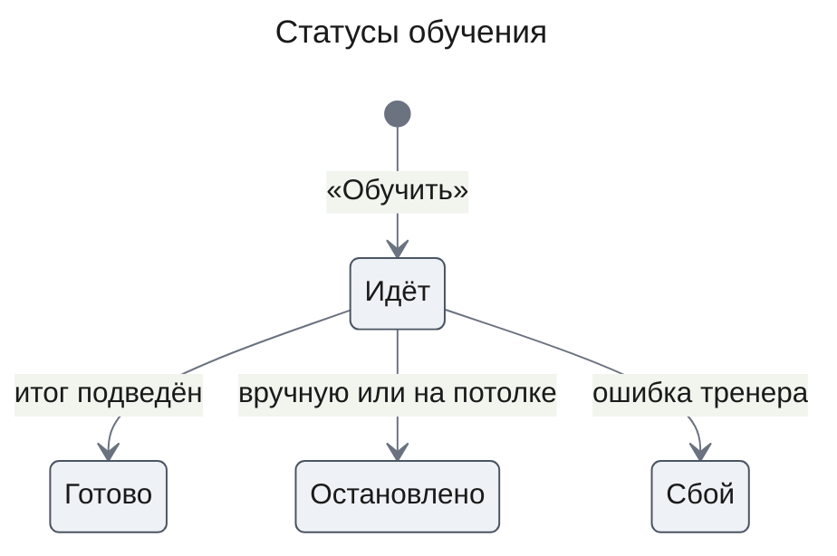

# UXRD: Самообучение глубокого агента (self-learning)

| Дата | PRD |
|---|---|
| 2026-11-25 | [prd.md](./prd.md) |

## Snapshot

**Overview.** Глубокий агент сам запоминает важное: о своей работе — в память агента, о сотруднике — в память сотрудника. Автор и администратор смотрят и чистят память агента на экране «Память «{имя}»», а каждый сотрудник видит и удаляет то, что агенты запомнили о нём, в разделе «Моя память» на странице «Мой доступ». Полный результат работы глубокий агент пишет документом блокнота: в беседе отчёт стоит документом с заголовком и текстом, а все документы беседы лежат на вкладке «Документы» панели. На карточке агента блок «Самообучение» собирает переключатель, ссылку на память и кнопку «Обучить»; в беседе обучения правая панель на вкладке «Обучение» показывает ход шестью задачами, изменения, итоги по прошлым задачам и расход. Версию включает человек обычным подтверждением, а скрипты автор правит прямо на карточке.

- **Не меняется**: беседа с глубоким агентом, кроме того, что его отчёт приходит документом. Вызов скрипта, который меняет данные, ждёт подтверждения так же, как запуск кода.
- **Главный UX-риск**: сотрудник не знает, что агент запомнил о нём. «Моя память» показывает всё, что о нём записано, и любую запись можно удалить.

### Key Decisions

| ID | Решение | Почему |
|---|---|---|
| KD-1 | Память агента и «Моя память» — один вид списка: строка описания и дата изменения; текст — по раскрытию строки; «Удалить» с подтверждением. «Моя память» — раздел страницы «Мой доступ» | Записи короткие, а описание и так говорит, о чём запись. Свои настройки сотрудник уже ищет на «Мой доступ» |
| KD-2 | Переключатель, ссылка на память и обучение стоят одним блоком «Самообучение» на карточке. Часть «Обучение» видит только тот, кто может обучать этого агента | Всё о самообучении — там, где его включают; цена обучения видна до нажатия |
| KD-3 | Отчёт глубокого агента стоит в беседе документом: короткий ответ агента и под ним заголовок и текст документа, свёрнутый до 24 строк с «Показать полностью». Все документы беседы, в том числе ещё не дописанные, — на вкладке «Документы» панели; там документ растёт, пока агент пишет | Большой отчёт не заливает ленту, а прочитать его целиком — одно нажатие. Панель беседы уже есть, у неё есть вкладка «Задачи» |
| KD-4 | Ход и итог обучения — вкладка «Обучение» правой панели беседы обучения; отдельного экрана нет. Та же вкладка служит проверке агента (create-and-test UXRD, CT-04): один вид, свой средний блок. Ход — шесть задач тренера тем же [списком задач](../../design-system/components/run-task-list.md), что у беседы глубокого агента; «было — стало» — два блока текста один под другим, без подсветки. Видит вкладку и включает версию из неё только начавший | Всё идёт в чате: начавший следит за ходом и решает о версии, не уходя из беседы. Одна вкладка на два прогона — один компонент |
| KD-5 | Рекомендация — строка итога, а не замок: «Сделать активной» доступна при любом итоге и открывает обычное подтверждение. Остановленное обучение рекомендации не даёт и предлагает «Обучить заново» | Решает человек; итог и вердикты — подсказка ему |
| KD-6 | Скрипт правят на месте: блок скрипта становится формой с обычным многострочным полем кода; сохранение сразу делает новую версию активной | Это единственная правка на карточке, и второго шага у неё нет |
| KD-7 | Права «Обучать своих агентов» и «Обучать любых агентов» — два переключателя на странице роли под правом администратора; у «Супер-администратора» оба включены и недоступны | Права роли выдают там же, где право администратора |

## Design System

Фича следует [дизайн-системе](../../design-system/README.md). Экраны библиотеки и беседы — комфортная плотность, панель администратора — компактная ([foundations → Spacing & Density](../../design-system/foundations.md#spacing--density)).

### Component Inventory

| Компонент | Спецификация | Статус | Примечание |
|---|---|---|---|
| Отчёт агента | [agent-report.md](../../design-system/components/agent-report.md) | extended | Документ блокнота в отчёте и в панели |
| Таблица данных | [data-table.md](../../design-system/components/data-table.md) | extended | Вариант «Раскрываемая строка» для записей памяти; цифры и задачи результата |
| Скрипт агента | [agent-script.md](../../design-system/components/agent-script.md) | new | Скрипт на карточке, в правке и в результате |
| Статус агента | [agent-status.md](../../design-system/components/agent-status.md) | extended | Статусы обучения |
| Список задач | [run-task-list.md](../../design-system/components/run-task-list.md) | extended | Ход обучения; «Работа кончилась» |
| Метка состояния | [state-badge.md](../../design-system/components/state-badge.md) | extended | Класс скрипта, итог задачи; состояние «Хуже» |
| Вызов инструмента | [tool-call.md](../../design-system/components/tool-call.md) | extended | Память и блокнот во второй строке; «Скрипт агента», «Пробный запуск скрипта», «записано, не выполнено» |
| Карточка решения | [decision-card.md](../../design-system/components/decision-card.md) | extended | «Может вызвать» у скрипта, который меняет данные |
| Карточка хода | [agent-run-card.md](../../design-system/components/agent-run-card.md), вариант «Проверка» | reused | Ход обучения в ленте (TR-01) |
| Форма настроек | [settings-form.md](../../design-system/components/settings-form.md) | reused | AS-01, RT-01, форма скрипта |
| Панель беседы | deep-agents UXRD, DA-12 | extended | Вкладки «Документы» (DC-02) и «Обучение» (TR-02) |
| Карточка глубокого агента, просмотр, страницы в панели | deep-agents UXRD, DA-13; custom-agents UXRD, RV-01, AL-02, AL-03 | extended | Блок «Самообучение», скрипты |
| «Мой доступ», страница роли | enterprise-access UXRD, «Мой доступ», AD-06 | extended | «Моя память» (ME-02), права обучать (RT-01) |
| Экран «Не найдено» | custom-agents UXRD, RV-02; enterprise-access UXRD, AD-15 | reused | ME-04 |

## User Flows

### Primary User Flow

**Flow 1. Память: агент запоминает, человек чистит.** Implements: UC-1, UC-2, UC-4, UC-9; AC-01.2, AC-29.1, AC-32.2, AC-33.1

```mermaid
---
title: "Flow 1 · Память: агент запоминает, человек чистит"
config:
  theme: base
  look: classic
  themeVariables:
    primaryColor: "#eef1f5"
    primaryBorderColor: "#4b5563"
    primaryTextColor: "#1a1a1a"
    lineColor: "#6b7280"
  flowchart:
    curve: step
  themeCSS: |
    @keyframes litr_slf1{0%,22.5%{stroke:#1d4ed8;stroke-width:6px}25%,100%{stroke:#9ec1f7;stroke-width:2px}}
---
flowchart LR
    entry(["▶ автор включает самообучение"])
    run["1 · запуск сотрудника<br/>агент запоминает"]
    agentmem["2 · Память «{имя}»<br/>записи об агенте"]
    mymem["2 · Моя память<br/>записи о сотруднике"]
    del["3 · подтверждение<br/>«Удалить»"]
    done["запись удалена"]
    entry e1@--> run
    run e2@-->|"автор открывает"| agentmem
    run -->|"сотрудник открывает"| mymem
    agentmem e3@-->|"неверная запись"| del
    mymem -->|"запись о себе"| del
    del e4@-->|"подтверждает"| done
    classDef entry fill:#ffffff,stroke:#1f2937,stroke-width:1.5px,color:#1a1a1a
    classDef changed fill:#fde8e8,stroke:#dc2626,stroke-width:2px,color:#1a1a1a
    classDef new fill:#e6f4ea,stroke:#16a34a,stroke-width:2px,color:#1a1a1a
    classDef unchanged fill:#eef1f5,stroke:#4b5563,stroke-width:1.5px,color:#1a1a1a
    classDef r1 stroke:#9ec1f7,stroke-width:2px,animation:litr_slf1 4.8s linear 0s infinite
    classDef r2 stroke:#9ec1f7,stroke-width:2px,animation:litr_slf1 4.8s linear 1.2s infinite
    classDef r3 stroke:#9ec1f7,stroke-width:2px,animation:litr_slf1 4.8s linear 2.4s infinite
    classDef r4 stroke:#9ec1f7,stroke-width:2px,animation:litr_slf1 4.8s linear 3.6s infinite
    class entry entry
    class agentmem changed
    class mymem,del new
    class run,done unchanged
    class e1 r1
    class e2 r2
    class e3 r3
    class e4 r4
```



Агент пишет в память во время запуска; запись видна на экранах при следующем открытии. В беседе каждое обращение к памяти — строка [вызова инструмента](../../design-system/components/tool-call.md) с описанием записи (MC-13).

**Flow 2. Отчёт документом.** Implements: UC-3; AC-36.1, AC-36.2

Глубокий агент создаёт документ и дописывает его; на вкладке «Документы» панели беседы документ появляется с пометкой «Пишется» и растёт (DC-02). Закончив, агент отвечает коротким сообщением, и под ним в ленте стоит документ-отчёт: заголовок и текст, свёрнутый с «Показать полностью» (DC-01). Полный текст сотрудник читает в ленте одним нажатием «Показать полностью» или в панели (AC-36.1). Документ только читают и копируют. Остальные документы запуска открывают на той же вкладке.

**Flow 3. Обучить и включить версию.** Implements: UC-5, UC-6; AC-15.4, AC-21.3, AC-22.2, AC-28.1

```mermaid
---
title: "Flow 3 · Обучить и включить версию"
config:
  theme: base
  look: classic
  themeVariables:
    primaryColor: "#eef1f5"
    primaryBorderColor: "#4b5563"
    primaryTextColor: "#1a1a1a"
    lineColor: "#6b7280"
  flowchart:
    curve: step
  themeCSS: |
    @keyframes litr_slf2{0%,22.5%{stroke:#1d4ed8;stroke-width:6px}25%,100%{stroke:#9ec1f7;stroke-width:2px}}
---
flowchart LR
    entry(["▶ автор нажимает «Обучить»"])
    conv["1 · беседа обучения<br/>ход — шесть задач"]
    result["2 · вкладка «Обучение»<br/>было — стало и итоги"]
    dialog["3 · подтверждение<br/>«Сделать активной»"]
    active["4 · версия активна<br/>новые беседы на ней"]
    entry e1@--> conv
    conv e2@-->|"правая панель"| result
    result e3@-->|"«Сделать активной»"| dialog
    dialog e4@-->|"подтверждает"| active
    classDef entry fill:#ffffff,stroke:#1f2937,stroke-width:1.5px,color:#1a1a1a
    classDef changed fill:#fde8e8,stroke:#dc2626,stroke-width:2px,color:#1a1a1a
    classDef new fill:#e6f4ea,stroke:#16a34a,stroke-width:2px,color:#1a1a1a
    classDef unchanged fill:#eef1f5,stroke:#4b5563,stroke-width:1.5px,color:#1a1a1a
    classDef r1 stroke:#9ec1f7,stroke-width:2px,animation:litr_slf2 4.8s linear 0s infinite
    classDef r2 stroke:#9ec1f7,stroke-width:2px,animation:litr_slf2 4.8s linear 1.2s infinite
    classDef r3 stroke:#9ec1f7,stroke-width:2px,animation:litr_slf2 4.8s linear 2.4s infinite
    classDef r4 stroke:#9ec1f7,stroke-width:2px,animation:litr_slf2 4.8s linear 3.6s infinite
    class entry entry
    class conv changed
    class result,dialog new
    class active unchanged
    class e1 r1
    class e2 r2
    class e3 r3
    class e4 r4
```



«Обучить» видит только тот, кто может обучать этого агента: автор, у роли которого есть право обучать своих агентов, а у системного агента и агента, открытого ролям, — сотрудник с правом обучать любых агентов. Начавший попадает в беседу обучения: её можно только читать и остановить, а ход и итог стоят в правой панели на вкладке «Обучение» (TR-02). Остальные, кто может обучать агента, видят на карточке, что обучение идёт, и строку последнего итога (SL-01).

Обучение проходит такие статусы; рекомендацию итог даёт только при «Готово».



**Flow 4. Скрипт на карточке.** Implements: UC-7; AC-24.1, AC-24.2, AC-24.3

Автор нажимает «Добавить скрипт», заполняет форму на месте и сохраняет (SC-02): новая версия сразу становится активной. Следующий шаг — «Использовать в чате» в шапке карточки. В беседе вызов виден блоком вызова, вариант «Скрипт агента»; вызов скрипта, который меняет данные, ждёт подтверждения в [карточке решения](../../design-system/components/decision-card.md) со списком «Может вызвать».

**Flow 5. Настройки и права.** Implements: UC-8; AC-11.1, AC-26.1, AC-27.1, AC-27.2

Администратор в панели, в «Агентах и глубоких агентах» на вкладке «Системные», задаёт размер оглавления памяти и потолок расхода обучения (AS-01), а права обучать включает роли на её странице (RT-01). Право администратора само обучать не даёт. Модель тренера меняют на странице встроенного агента «Тренер».

### Alternative Flows

- **Самообучение выключено** (AC-01.2, AC-22.1). Части «Обучение» нет, под переключателем — MC-1 о том, что память сохранится. Экран памяти агента открывается, строка MC-3 говорит, что запуски её не видят и не пополняют. Блокнот работает и без самообучения.
- **Отчёта-документа нет.** Если агент не написал документ, ответ стоит в ленте как сейчас (agent-report, вариант «Глубокий агент»).
- **Обучение уже идёт** (AC-15.2, AC-22.2). Вместо кнопки — идущее обучение; у начавшего — со ссылкой в беседу обучения.
- **Нет прошлых задач** (AC-15.8). «Обучить» получает отказ MC-9, обучения нет.
- **Улучшать нечего** (AC-23.2). Итог показывает причину тренера и расход; изменений, сравнения и кнопки включения нет.
- **Остановлено** (AC-21.1, AC-21.3). Вручную или на потолке: итог говорит, как остановили, рекомендации нет, есть «Обучить заново»; если версия уже предложена — изменения и «Сделать активной».
- **Нет прав** (AC-32.1). Части «Обучение» на карточке нет; прямая ссылка на память агента ведёт на ME-04.
- **Копия агента** (AC-30.4). Память агента у копии пуста, скрипты те же.

### Error Flows

- Переключатель не сохранился — возвращается, под ним ошибка (deep-agents UXRD, MC-26).
- «Обучить» или включение отказаны — причина от сервера под кнопкой или в окне (MC-9, MC-12); у включения — например, активная версия сменилась после начала обучения (AC-20.2).
- Память, документ или вкладка «Обучение» не загрузились — ошибка с «Повторить» (MC-5, MC-13, MC-11).
- Удаление записи не прошло — строка остаётся, под ней причина MC-6.
- Скрипт не сохранился — ошибка формы, введённое остаётся; если агента изменили, пока скрипт правили, ошибка просит перечитать карточку (MC-15).

## Screens

### Screen 1: Блок «Самообучение» на карточке глубокого агента

```
│ ◧ Библиотека / Разбор ошибок оплаты                          │
│──────────────────────────────────────────────────────────────│
│ Самообучение                                                 │ SL-01
│ ◉ Самообучение                                               │
│   Агент запоминает, где что нашёл, и это видят все его …     │
│   Память →                                                   │
│ [ Обучить ]  Потратит не больше 2 $                          │
│   Последнее обучение, 20 нояб.: Готово · рекомендована       │
│   Открыть результат →                                        │
```

**SL-01. Блок «Самообучение»** — секция под шапкой карточки (deep-agents UXRD, DA-13), над определением:

1. **Переключатель** — MC-1, сохраняется сразу (форма настроек, «Сохранение на месте»), под ним ссылка «Память» на ME-01.
2. **Обучение** — только при включённом самообучении и у того, кто может обучать агента (KD-2). «Обучить» (`outline` `sm`) и потолок Caption `--muted-foreground`. Нажатие создаёт беседу обучения и переводит в неё; отказ — Caption `--destructive` под кнопкой.
3. **Идущее обучение** — вместо кнопки [статус обучения](../../design-system/components/agent-status.md#статусы-обучения) «Идёт» с расходом; у начавшего рядом — «Открыть беседу обучения».
4. **Последнее обучение** — дата, статус и рекомендация одной строкой Caption; у начавшего рядом — «Открыть результат»: беседа обучения с правой панелью на вкладке «Обучение».

На карточке системного агента в панели (custom-agents UXRD, AL-02) переключатель меняет администратор, а вход на память — кнопка MC-7 в шапке. У агента сотрудника, открытого ролям (AL-03), вместо переключателя строка MC-1, а в шапке — та же кнопка MC-7. В просмотре коллеги (RV-01) блок есть, только если смотрящий может обучать агента: строка MC-1 и части 2–4.

### Screen 2: Память агента и «Моя память»

```
┌──────────────────────────────────────────────────────────────────┐
│ ◧ Библиотека / Память «Разбор ошибок оплаты»                     │ ME-01
│                                     [ Открыть глубокого агента ] │
│ Запись                                         Изменена          │
│ ▸ Ошибки оплаты — в логах billing-api          20 нояб.        ⋯ │
│ ▾ Команда Платежи владеет billing-api          19 нояб.        ⋯ │
│   Владелец сервиса — команда Платежи, дежурный канал #pay-oncall.│
└──────────────────────────────────────────────────────────────────┘

│ Мой доступ                                                       │
│ …                                                                │
│ Моя память                                                       │ ME-02
│ Запись                                         Изменена          │
│ ▸ Смотрю данные за прошлую неделю              18 нояб.        ⋯ │
```

**ME-01. Память агента** — в библиотеке в колонке ленты, в панели — в каркасе панели. Шапка — MC-2 и «Открыть глубокого агента». Автор приходит по ссылке из SL-01, администратор — по кнопке MC-7 на AL-02 и AL-03. Под шапкой при выключенном самообучении — строка MC-3. Ниже — [таблица данных](../../design-system/components/data-table.md), вариант «Раскрываемая строка», новые изменения сверху: описание записи, дата изменения, меню «⋯» с «Удалить». Раскрытая строка показывает текст записи — как его сохранила платформа, скрытый секрет виден маской (AC-07.1). Записей области сотрудника и имён сотрудников здесь нет.

**ME-02. Моя память** — раздел страницы «Мой доступ» (enterprise-access UXRD) после «Моделей и расхода», заголовок `h2`. Та же таблица, что ME-01. Видна только самому сотруднику; администратор чужих записей не видит нигде (AC-33.2).

**ME-03. Удаление записи** — `alert-dialog` MC-6, «Удалить» сплошной `--destructive`, фокус по умолчанию — «Отмена». После удаления строка уходит, уведомление MC-6 (AC-32.2).

**ME-04. Не найдено.** Прямая ссылка на память агента без доступа, на чужого личного, удалённого или несуществующего агента: в библиотеке — custom-agents UXRD, RV-02, в панели — enterprise-access UXRD, AD-15.

| Состояние | Что показано |
|---|---|
| Loading, ошибка | Скелетон таблицы; ошибка MC-5 и «Повторить» |
| Пусто | Пустое состояние таблицы MC-5 |
| Самообучение выключено (ME-01) | Строка MC-3 над таблицей |

### Screen 3: Документ блокнота в беседе

```
┌──────────────────────────────────────────────────────┐
│ Отчёт · Разбор ошибок оплаты            ✓ Завершён   │ DC-01
│ 41 вызов · 6 мин 12 с · 14:24                         │
│ Отчёт готов: причина — сбой шлюза, детали ниже.       │
│ ┌──────────────────────────────────────────────────┐ │
│ │ Почему с 14:00 падают оплаты                     │ │
│ │ Сбой шлюза и повторные списания за 14:00–15:10   │ │
│ │ ## Что случилось …                               │ │
│ │ … (24 строки)                                    │ │
│ │ [ Показать полностью ]  [ Открыть в панели ]     │ │
│ └──────────────────────────────────────────────────┘ │
└──────────────────────────────────────────────────────┘
⧉

│ Схема · Задачи · Документы · 2 │                          DC-02
│ ⟳ Черновик выкладок   Пишется  │
│   Сбор · 14:20                 │
│ Почему с 14:00 падают оплаты   │
│   Отчёт для сотрудника · 14:24 │
```

**DC-01. Отчёт-документ** — ответ глубокого агента в ленте ([отчёт агента](../../design-system/components/agent-report.md), вариант «Глубокий агент») с частью «Документ»: короткий ответ агента и под ним документ, на который он ссылается, — заголовок, описание и текст Markdown, свёрнутый до 24 строк. «Показать полностью» раскрывает текст на месте, «Открыть в панели» открывает его на DC-02. «Копировать» копирует текст документа. Скачивания, правки и удаления нет (AC-36.2).

**DC-02. Вкладка «Документы»** — третья вкладка панели беседы (deep-agents UXRD, DA-12) «Документы · {n}»; появляется с первым документом беседы. Список — документы всех запусков беседы, новые сверху: заголовок, описание, кто пишет и время; у документа, который агент ещё пишет, — `LoaderCircle` и «Пишется». Нажатие открывает документ в панели целиком (отчёт агента, вариант «Документ в панели») со стрелкой назад к списку; пока агент пишет, текст растёт на месте. Документ не загрузился — на месте текста ошибка MC-13 и «Повторить», в ленте и в панели одинаково.

**Вызовы блокнота и памяти** — блоки вызова встроенных инструментов: подпись действия (MC-13) и второй строкой заголовок документа или описание записи памяти; аргументы и результат — по раскрытию, как у любого вызова.

### Screen 4: Беседа обучения

```
┌──────────────────────────────────────────┬───────────────────────────────┐
│ Обучение «Разбор ошибок оплаты»          │ [ Обучение ] [ Документы · 2 ]│
│                          [ Ход и итог ]  │ Идёт · потрачено 0,40 $ из 2 $│
│ ▸ ✓ Прошлые задачи        готово   14:03 │ ✓ 1 Выбрать прошлые задачи    │
│ Тренер: в 7 беседах сотрудники…          │ ⟳ 2 Разобрать прошлые запуски │
│ ▸ ✓ Пробный запуск скрипта  готово 14:09 │ ○ 3 Проверить догадки и …     │
│ Беседа только для чтения.          [ ⏹ ] │ ○ 4 Предложить новую версию   │
└──────────────────────────────────────────┴───────────────────────────────┘
```

**TR-01. Беседа обучения** — беседа начавшего с тренером в ленте чата, название — MC-10. Ссылка на итог обучения — ссылка на эту беседу.

- **Ход и итог** — вкладка «Обучение» правой панели беседы (TR-02). В шапке беседы «Ход и итог» (`outline` `sm`) открывает панель на этой вкладке: от 1024 px — рядом с лентой, уже — шторкой (chat-shell UXRD, D-05). Вкладки «Задачи» у беседы обучения нет: шесть задач стоят в итоге вкладки «Обучение». Кнопки «Схема» (chat-shell UXRD, HD-04) в шапке беседы прогона нет: панель открывает «Ход и итог», и панель с её «×» называются «Ход и итог» и «Закрыть ход и итог» (MC-10).
- **Документы** — когда повтор написал документ, в панели появляется вкладка «Документы · {n}» (DC-02): отчёты повторов с тем, кто их написал, — так начавший читает отчёт повтора.
- **Карточка хода** — первый элемент ленты: [карточка хода](../../design-system/components/agent-run-card.md), вариант «Проверка», та же, что у проверки агента (create-and-test UXRD, CT-06). Она показывает статус, текущую задачу, в конце — рекомендацию, и обновляется на месте; «Ход и итог» на ней открывает панель на вкладке «Обучение». Тексты — MC-10.
- **Работа тренера** — его сообщения и блоки вызова: чтение прошлых задач и памяти агента, запуски кода, пробные запуски черновиков (вариант «Пробный запуск скрипта»).
- **Поля сообщения нет**: на его месте строка MC-10 и «Стоп», пока обучение идёт (AC-15.4).

### Screen 5: Вкладка «Обучение»

```
┌──────────────────────────────────────────┐
│ [ Обучение ]  [ Документы · 6 ]        × │ TR-02
│ 20 нояб., 14:02 · с версии 5             │
│ Открыть глубокого агента                 │
│ ✓ Готово · потрачено 1,62 $ из 2 $       │
│ Рекомендована: лучше в 4 задачах, хуже   │
│ в 1, равны в 1.                          │
│ [ Сделать активной ]                     │
│ ✓ 1 Выбрать прошлые задачи               │
│ …                                        │
│ ✓ 6 Подвести итог                        │
│ Что меняет версия 6                      │
│ Инструкция агента                        │
│ Было                                     │
│ Ищи ошибки в payment-gateway.            │
│ Стало                                    │
│ Ошибки оплаты ищи в billing-api.         │
│ Почему: в 7 прошлых беседах сотрудники … │
│ Сравнение на прошлых задачах             │
│ Ошибок · Версия 5 3 · Версия 6 1         │
│ 1  Почему с 14:00 падают оплаты?         │
│    ✓ новая лучше     Повтор 5 · Повтор 6 │
│    Назвала сбой шлюза; прежняя — нет.    │
│    Вызовы 14 → 9 · Стоимость 0,21 → 0,18 $│
└──────────────────────────────────────────┘
```

**TR-02. Вкладка хода и итога** — первая вкладка правой панели беседы (chat-shell UXRD, рабочая область WS-01–WS-03; deep-agents UXRD, DA-12). Одна вкладка на два прогона: «Обучение» у обучения и «Проверка» у проверки агента (create-and-test UXRD, CT-04). Строка «когда и с чего», итог, состояния, открытие и ширина у них общие, а средний блок свой — фронтенд строит один компонент вкладки. Видит вкладку только начавший: беседа его, а чужую беседу по ссылке открыть нельзя. Пока прогон идёт, вкладка обновляется сама.

0. **Строка «когда и с чего»** — Caption `--muted-foreground`: дата и время старта и, у обучения, «с версии {b}» (MC-11); у обучения ниже — ссылка «Открыть глубокого агента».
1. **Итог** (AC-19.1, AC-19.2, AC-21.2) — блок с рамкой `--border` на `--card`: [статус обучения](../../design-system/components/agent-status.md#статусы-обучения) и расход, строка итога (у обучения — рекомендация, только при «Готово»), кнопки и ход списком задач. «Сделать активной» (`default`) есть, пока предложенная версия не включена (KD-5); у остановленного обучения рядом — «Обучить заново» (`outline`): оно начинает новое обучение и переводит в его беседу, как «Обучить» на карточке. После включения — «Активна с …». Кнопки стоят в ряд и переносятся, когда ряд не помещается.
2. **Средний блок обучения:**
   - **Что меняет версия {n}** — инструкции агента и сабагентов блоками «Было» и «Стало» один под другим (KD-4), затем скрипты — [скрипт агента](../../design-system/components/agent-script.md), вариант «Изменение»: блоки один под другим, как у инструкций. Под изменением — «Почему»: объяснение тренера как есть.
   - **Сравнение на прошлых задачах** — [таблица цифр](../../design-system/components/data-table.md) двух версий в варианте «Две строки» (ошибки, вызовы, средняя стоимость задачи), затем задачи списком. У задачи — текст, первой строкой под ним итог меткой состояния и ссылки на два повтора, второй — причина итога, третьей — ошибки, вызовы и стоимость парами «было → стало». Повтор открывает страницу агента повтора только для чтения, где вызов, который меняет данные, виден с исходом «записано, не выполнено» (AC-18.1, AC-18.2). Отчёт повтора читают на вкладке «Документы» (TR-01).

**Раскладка одна** для любой ширины панели: панель не уже 360 px (WS-02), поэтому таблицы всегда в варианте «Две строки», блоки идут один под другим, строки переносятся, а не обрезаются. На экранах 1024–1280 px лента рядом с панелью не уже 480 px (WS-02); если основной области на обе не хватает, сайдбар на время сворачивается в полосу (chat-shell UXRD, «Desktop 1280 px — рабочая область открыта»). Уже 1024 px панель — шторка 400 px, уже 480 px — во всю ширину (deep-agents UXRD, Responsive Behavior).

**Открытие.** Панель сама не открывается: её открывают «Ход и итог» в шапке беседы и «Ход и итог» на карточке хода в ленте (TR-01; create-and-test UXRD, CT-06). Фокус после открытия остаётся на кнопке, как в DA-12. «Открыть результат» на карточке агента (SL-01) ведёт в беседу обучения с панелью, открытой на этой вкладке.

| Состояние | Что показано |
|---|---|
| Loading, ошибка | Скелетон; ошибка MC-11 и «Повторить» |
| Идёт | Статус, расход, ход; средний блок по мере готовности |
| Готово | Рекомендована или нет, средний блок, «Сделать активной» |
| Улучшать нечего | Причина тренера и расход; среднего блока и кнопки нет |
| Остановлено, сбой | Как остановили или причина, расход, без рекомендации; «Что меняет версия» и «Сделать активной» — если версия уже предложена; сравнённые задачи; «Обучить заново» |

**TR-03. Окно включения** — `alert-dialog` MC-12: кого коснётся новая версия; фокус по умолчанию — «Отмена». Отказ — ошибка формы в окне; после успеха — уведомление MC-12.

### Screen 6: Скрипты на карточке

```
│ Скрипты · 2                                                  │ SC-01
│ count_errors_by_service                        читает        │
│ Считает ошибки оплаты по сервисам за период                  │
│ Вызывает: сабагент «Сбор» · Вход: период и список сервисов   │
│ ▸ Показать код                         [ Изменить ] [Удалить]│
│ [ Добавить скрипт ]                                          │
```

**SC-01. Скрипты** — секция после определения, «Скрипты · {n}», каждый — [скрипт агента](../../design-system/components/agent-script.md), вариант «На карточке». У автора (у системного агента — у администратора) — «Изменить», «Удалить» и «Добавить скрипт»; остальные видят скрипты только для чтения (AC-24.2).

**SC-02. Правка скрипта** — блок становится формой, вариант «Правка». Сохранение — KD-6, под блоком на 4 s «Сохранено» (AC-24.1). Удаление — `alert-dialog` MC-15, тоже новая версия.

### Screen 7: Настройки и права в панели

```
│ Самообучение глубоких агентов                                │ AS-01
│ Размер оглавления памяти, токенов  [ 2000 ]                  │
│ Потолок расхода одного обучения, $  [ 2 ]                    │
│ [ Сохранить ]                                                │

│ Роли / SRE                                                ⋯  │
│ ◉ Право администратора                                       │
│ ◉ Обучать своих агентов                                      │ RT-01
│ ○ Обучать любых агентов                                      │
```

**AS-01. Самообучение глубоких агентов** — группа [формы настроек](../../design-system/components/settings-form.md), «Форма страницы», на вкладке «Системные» под «Настройками новых записей» (custom-agents UXRD, AL-01). Два поля и одна «Сохранить», тексты MC-8 (AC-11.1, AC-26.1). Предел размера документа блокнота — постоянный предел платформы, а не настройка.

**RT-01. Права обучать** — на странице роли (enterprise-access UXRD, AD-06) под правом администратора два переключателя «Сохранение на месте» с подсказками MC-16 (AC-27.1). У «Супер-администратора» оба включены и недоступны (AC-27.2).

## Accessibility

- **Целевой уровень**: WCAG 2.1 AA и работа от 360 px, как у библиотеки, беседы и панели (custom-agents PRD, NFR-05; enterprise-access PRD, NFR-05). Роли, имена и клавиатура компонентов — в их спецификациях.
- **Заголовки**: `h1` — «Память «{имя}»»; «Моя память», «Самообучение», «Скрипты» и части вкладки «Обучение» — `h2`.
- **Вкладка «Обучение»**: вкладка панели — как вкладки DA-12; «Ход и итог» в шапке называет, что открывает, и сообщает, открыта ли панель. Задача в сравнении — элемент списка, её строки читаются одной фразой: «{итог}. {причина}. Вызовы {было} → {стало}, стоимость {было} → {стало}»; у ссылок повтора доступное имя «Повтор задачи {номер} на версии {v}».
- **Фокус**: при открытии экрана — на `h1`; после удаления записи — на меню следующей строки; «Показать полностью» оставляет фокус на кнопке; документ, открытый в панели, ставит фокус на его заголовок, стрелка назад — на строку списка; после «Изменить» — на поле «Имя»; закрытое окно возвращает фокус на кнопку, которая его открыла.
- **Объявления**: уведомления — `polite`; рост документа и смена статуса обучения не объявляются, кроме конца обучения (MC-11).

## Responsive Behavior

Экраны библиотеки и документ в ленте стоят в колонке ленты (chat-shell UXRD, D-01); панель беседы на узком экране — шторка, как в DA-12; экраны панели администратора ведут себя как остальная панель. У вкладки «Обучение» одна раскладка для любой ширины панели (TR-02). На экранах библиотеки уже 768 px таблицы переходят в вариант «Две строки», кнопки шапки переносятся под заголовок. Цели касания — 44 px.

## Content and Microcopy

Тон и знаки — как в chat-shell UXRD; деньги и даты — [foundations → Language & Formats](../../design-system/foundations.md#language--formats). В библиотеке и в беседе сотрудник не видит слов «промпт», «оглавление», «эмбеддинг» и «судья»: «инструкция», «итог задачи»; панель администратора называет размер оглавления, как PRD (FR-11). Имена инструментов и скриптов, тексты записей памяти, документов, задач и объяснения тренера не переводятся.

| ID | Где | Текст |
|---|---|---|
| MC-1 | Переключатель (SL-01) | «Самообучение»; подсказка «Агент запоминает, где что нашёл, и это видят все его следующие запуски — кто бы их ни начал, даже без доступа к этим системам. То, что агент запомнил о сотруднике, видит только этот сотрудник.»; ссылка «Память»; после выключения «Память сохранится: включите снова — агент продолжит с неё.»; без переключателя — «Самообучение включено» / «Самообучение выключено. Включить его может автор.» |
| MC-2 | Память агента — шапка | `h1` «Память «{имя}»»; «Открыть глубокого агента» |
| MC-3 | Память агента — состояние | «Самообучение выключено: запуски не видят эту память и не пополняют её.» |
| MC-4 | Таблицы памяти | Колонки «Запись», «Изменена»; меню «Удалить»; «Моя память» |
| MC-5 | Память — пусто, ошибка | Агента — «Агент пока ничего не запомнил» / «Записи появятся, когда агент решит что-то запомнить.»; моя — «Агенты пока ничего не запомнили о вас»; «Не удалось загрузить память» + «Повторить» |
| MC-6 | Удаление записи (ME-03) | «Удалить запись?» / «{описание}» / «Агенты больше её не увидят. Вернуть нельзя.»; «Удалить», «Отмена»; «Запись удалена»; «Не удалось удалить: {причина}» |
| MC-7 | Вход на память в панели | «Память» |
| MC-8 | Настройки (AS-01) | «Самообучение глубоких агентов»; «Размер оглавления памяти, токенов»; «Потолок расхода одного обучения, $» — «Дойдя до потолка, обучение останавливается.»; «Сохранить»; «Настройки самообучения сохранены»; подсказка размера — «Сколько места в каждом шаге запуска занимают строки описания записей памяти; когда записи не помещаются, идут недавно изменённые.»; «Не удалось сохранить: {причина}» |
| MC-9 | Обучение на карточке (SL-01) | «Обучить»; «Потратит не больше {потолок}»; «Обучение идёт · потрачено {сумма} из {потолок}»; «Открыть беседу обучения»; «Последнее обучение, {дата}: {статус}» и « · рекомендована» / « · не рекомендована»; «Открыть результат»; отказы — «У агента пока нет законченных задач, на которых можно обучать.», «Не удалось начать обучение: {причина}» |
| MC-10 | Беседа обучения (TR-01) | «Обучение «{имя}»»; кнопка и панель «Ход и итог», «×» панели — «Закрыть ход и итог»; карточка хода — название «Обучение «{имя}»», «Сейчас: {задача}», в конце строка рекомендации или «Тренер не нашёл, что улучшить» (MC-11), кнопка «Ход и итог»; вместо поля — «Беседа обучения только для чтения.», после конца — «Обучение закончено. Итог — на вкладке «Обучение».»; «Пробный запуск скрипта», под выводом — «Не выполнено, только записано: {инструменты}» |
| MC-11 | Вкладка «Обучение» (TR-02) | Вкладка «Обучение»; «{дата и время} · с версии {b}»; «Открыть глубокого агента»; статусы «Идёт», «Готово», «Остановлено вручную», «Остановлено на потолке», «Сбой: {причина}»; «потрачено {сумма} из {потолок}»; «Рекомендована: лучше в {w} задачах, хуже в {l}, равны в {d}.» / «Не рекомендована: …»; «Тренер не нашёл, что улучшить: {объяснение}»; «Сделать активной», «Обучить заново», «Активна с {дата и время}»; «Что меняет версия {n}», «Инструкция агента», «Инструкция сабагента «{имя}»», «Было», «Стало», «Почему»; «Сравнение на прошлых задачах», «Версия {b} · активная», «Версия {n} · новая», «Ошибок», «Вызовов инструментов», «Средняя стоимость задачи»; подписи третьей строки задачи «Ошибки», «Вызовы», «Стоимость»; итоги «новая лучше», «прежняя лучше», «равны», «не сравнена»; «Повтор на версии {b}», «Повтор на версии {n}»; «Обучение закончено: {статус}»; «Не удалось загрузить ход и итог» + «Повторить» |
| MC-12 | Окно включения (TR-03) | «Сделать версию {n} активной?» / «Новые беседы всех сотрудников пойдут на ней; начатые доработают на версии {b}.»; «Сделать активной», «Отмена»; «Версия {n} активна»; «Не удалось включить: {причина}» |
| MC-13 | Документы и вызовы (DC-01, DC-02) | «Показать полностью» / «Свернуть»; «Открыть в панели»; вкладка «Документы · {n}»; «Пишется»; «Не удалось загрузить документ» + «Повторить»; подписи вызовов — «Создать документ», «Дописать документ», «Заменить часть документа», «Прочитать документ», «Документы блокнота», «Прошлые документы», «Запомнить», «Прочитать из памяти», «Забыть» |
| MC-14 | Скрипты (SC-01) | «Скрипты · {n}»; «Скриптов нет. Скрипт — ваш код, который агент вызывает как свой инструмент.»; «Добавить скрипт», «Изменить», «Удалить»; «Вызывает: сам агент» / «Вызывает: сабагент «{имя}»»; «Вход: {описание}»; «читает», «меняет данные»; «Показать код» / «Скрыть код» |
| MC-15 | Правка скрипта (SC-02) | «Имя» — «Латинские буквы, цифры и _.»; «Описание для агента» — «Когда звать скрипт и что он возвращает.»; «Входные данные»; «Кто вызывает»; «Что делает» — «Только читает», «Меняет данные во внешних системах»; «Код»; «Сохранить скрипт», «Отмена»; «Сохранено»; «Не удалось сохранить: {причина}»; «Пока вы правили, агента изменили. Перечитайте карточку и повторите правку.» + «Перечитать»; «Удалить скрипт «{имя}»?» / «Новые беседы его не получат.» |
| MC-16 | Права обучать (RT-01) | «Обучать своих агентов» — «Обучать и включать версии агентов, автор которых сам сотрудник.»; «Обучать любых агентов» — «То же для системных агентов и агентов, открытых ролям.»; у «Супер-администратора» — «Включено всегда.» |

## Update History

| Версия | Дата | Изменение |
|---------|------|--------|
| 4.0 | 2026-11-23 | Память агента и сотрудника вместо заметок, «Моя память», отчёт документом блокнота и вкладка «Документы» (и в беседе обучения), обучение, результат, скрипты, права обучать, настройки |
| 4.1 | 2026-11-25 | Ход и итог обучения — вкладка «Обучение» правой панели беседы обучения (TR-02), общая с проверкой агента; итог видит только начавший |
| 4.2 | 2026-11-25 | Карточка хода в ленте беседы обучения; панель с вкладкой «Обучение» сама не открывается |
