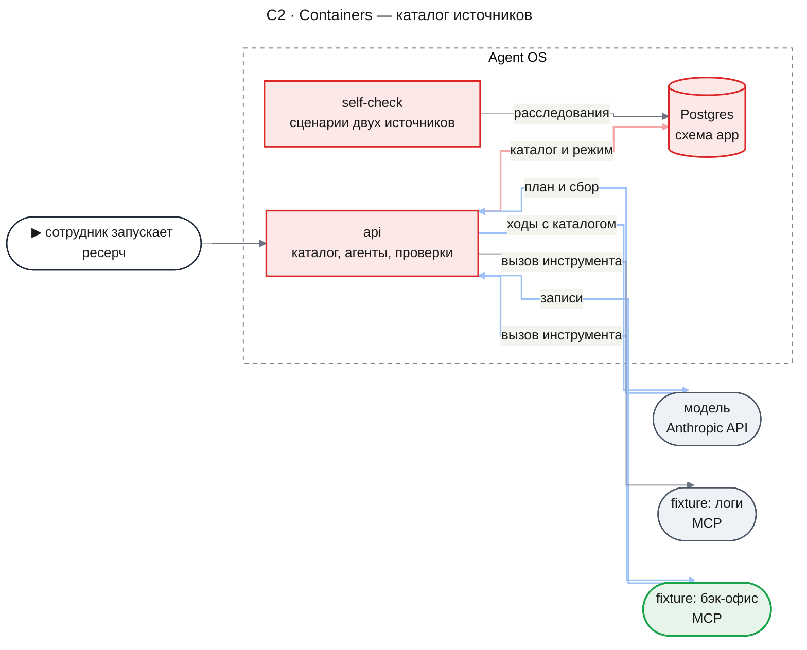
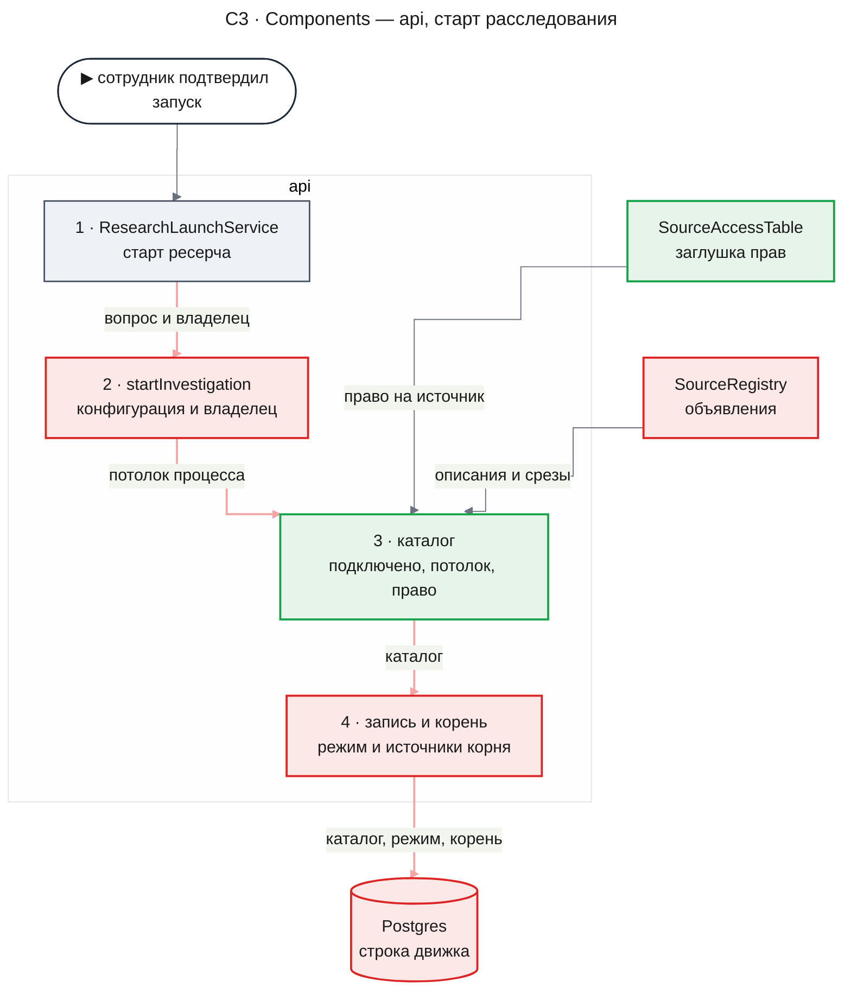
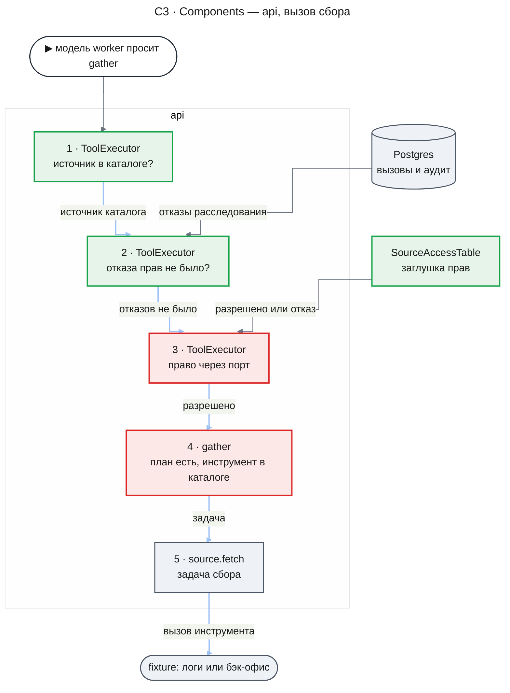
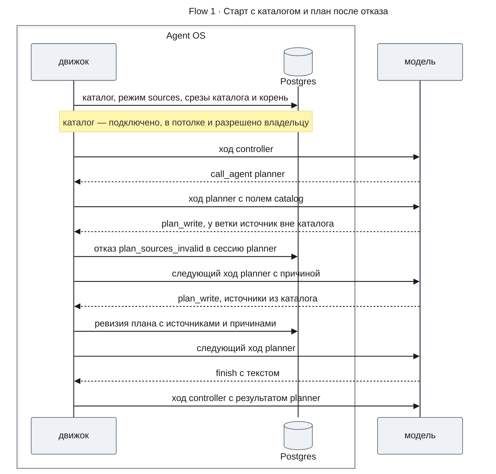
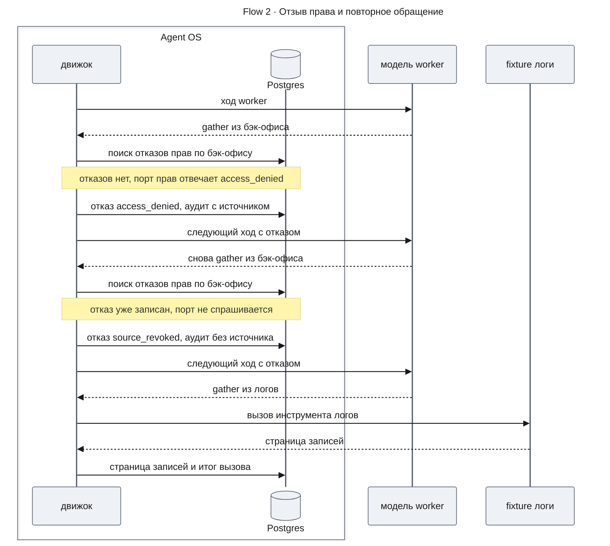
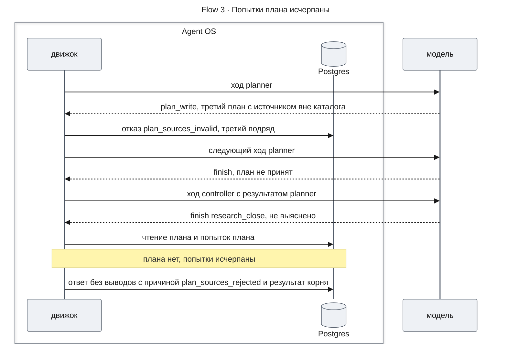
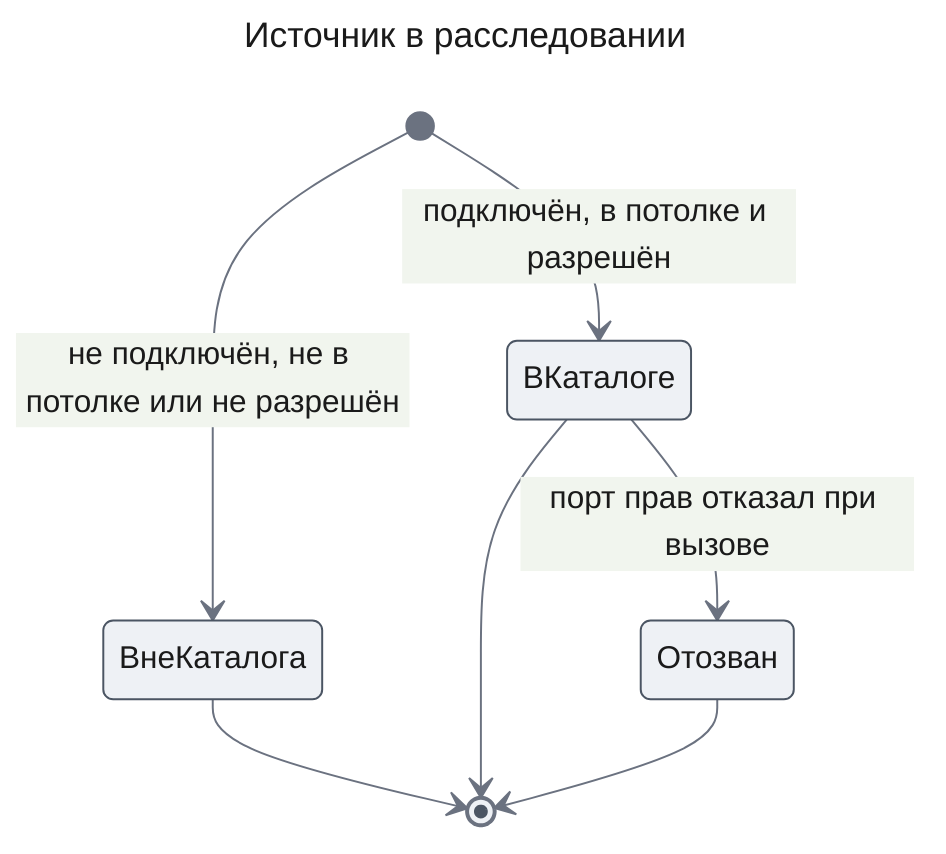

# План расследования по доступным источникам — Design Doc — catalog-planning

**Status:** На утверждении · **Date:** 2026-11-10 · **PRD:** [prd.md](./prd.md) · **UXRD:** нет — новые отметки только в [deep-research/uxrd.md](../deep-research/uxrd.md) · **Depends on:** ничего внутри фичи; контракты [agent-core](../agent-runtime/design-agent-core.md#contract-definitions), [research-flow](../agent-runtime/design-research-flow.md#contract-definitions), [mcp-source](../research-runtime/design-mcp-source.md#contract-definitions)

## Snapshot

**Overview.** Сейчас расследование видит все источники процесса, а проверка прав разрешает всё. Эта часть добавляет каталог: при старте расследования код берёт подключённые источники, оставляет те, что входят в потолок процесса и разрешены сотруднику по временной таблице прав, и записывает результат вместе с описаниями в строку расследования. Дальше дерево агентов видит только каталог: агент плана получает список источников с описаниями и называет источник каждой ветки, worker получает источники и их инструменты с описаниями, а код сверяет план с каталогом и перед каждым вызовом источника проверяет каталог, прежний отказ и право. Пустой каталог переводит расследование в сегодняшний режим знаний модели. Рядом с учебными логами встаёт учебный бэк-офис, чтобы выбор источника был осмысленным.

- **Не меняется**: ход агента, его сессия и вызов агента (`agent-core`); проверяющий агент, его отпечаток и таблица групп; экраны беседы — кроме строки новой причины остановки (MC-25).
- **Главный риск**: проверяющий откалиброван на утверждениях по логам, а теперь оценивает и утверждения по записям бэк-офиса ([Risks and Mitigation](#risks-and-mitigation)).
- **Открытые вопросы**: три. Вопросы 1 и 2 расходятся с утверждённым PRD (AC-05.2, Constraints) и решаются владельцем PRD до утверждения дизайна, вопрос 3 — владельцем `agent-runtime` ([Open Questions](#open-questions)).

### Key Decisions

#### KD-1: Каталог собирает старт расследования и записывает его в строку движка вместо снимков срезов; режим знаний модели включает пустой каталог (U-1)

Старт расследования уже читает конфигурацию процесса и знает владельца. Он же собирает каталог: подключённые источники, входящие в потолок процесса, о каждом из которых порт прав ответил «разрешено». Подключённые источники — список `connectedSources`, который точка сборки передаёт `createEngine`; по нему же движок считает `Engine.sourceMode`. Поэтому в каталог не попадёт источник, которого развёртывание не считает подключённым, а `SourceRegistry` о подключённых источниках по-прежнему не сообщает. Каталог пишется в строку расследования движка одним полем `source_catalog`. Это поле заменяет `source_snapshots`: у каждого источника каталога в нём описание, инструменты из потолка с описаниями и срез данных, прочитанный при старте. Срез теперь читается только у источников каталога, поэтому старт не обращается к источнику, запрещённому сотруднику.

Каталог должен лежать в строке, а не считаться заново: повторный старт с тем же ключом запуска строит корневую задачу только из строки, и пересчёт по новым правам дал бы второй корень. Корневой запуск получает источниками идентификаторы каталога, а дочерние наследуют их пересечением, как сейчас (DC-12 `agent-core`). Поэтому каталог доходит до каждого агента по уже существующему каналу источников запуска.

Режим расследования (`sourceMode`) тоже решает старт: пустой каталог — `model_knowledge`, иначе `sources`, и режим пишется в ту же строку, как сейчас. Так сотрудник без прав получает сегодняшний ответ из знаний модели (FR-09). Если бы режим по-прежнему включал только пустой список подключённых источников (`connectedSources`), сотрудник с пустым каталогом попал бы в режим с источниками: агент плана не смог бы назвать ни одного источника, и расследование остановилось бы с причиной «план не прошёл проверку» — это противоречит FR-09. Признак движка `Engine.sourceMode` остаётся признаком развёртывания: по нему карточка-предложение решает, показывать ли предупреждение, ещё до старта (AC-09.2).

Отдельное поле каталога рядом с `source_snapshots` не взято: два поля об одних и тех же источниках расходились бы, а ключи снимков молча значили бы «каталог».

#### KD-2: Описания пишет объявление источника в сборке `apps/api`, а реестр источников проверяет их при старте и отдаёт агентам

Объявление источника — один список в `sources.config.ts`: у источника идентификатор и описание, у каждого инструмента имя и описание. Этот список заменяет `SOURCES_ALLOWLIST`: allowlist типа `source.fetch` выводится из объявления — это все его инструменты, — и проверка исполнителя пакета источников по `workflowType` остаётся прежней второй линией (AC-11.1 `research-runtime`). Каталог расследования сужает этот allowlist, но не заменяет его. `createSources` получает объявление и при старте отказывает, если у подключённого источника или его инструмента нет описания; ошибка называет источник и инструмент, как нынешняя сверка allowlist (AC-01.1). `SourceRegistry` отдаёт описание источника и описание инструмента рядом со схемой аргументов. Текст, который сообщает сам MCP-сервер, пакет источников не читает и сейчас, поэтому до агентов доходит только объявленное описание (AC-01.2).

Описание в дескрипторе адаптера (`SourceDescriptor`) не взято. Дескриптор — код адаптера, а будущий адаптер `mcp-registry` будет один на любые серверы, и описания ему всё равно дадут данные администратора. Объявление — тот разъём «какие источники есть», который потом заменит реестр `mcp-registry` (PRD, «Почему сейчас»).

#### KD-3: Каталог приходит агентам полями шаблона — worker получает строку на источник в `{{sources}}`, агент плана получает новое поле `{{catalog}}`

**Worker и subworker.** Значение `{{sources}}` становится одной строкой JSON на источник запуска: идентификатор, описание источника и его инструменты — имя, описание и схема аргументов. Строка на инструмент, как сейчас, повторяла бы описание источника у каждого его инструмента. Значение строит та же чистая функция из пар конфигурации, источников запуска и `SourceRegistry`, поэтому сужение по каталогу работает само.

**Агент плана.** Новое поле шаблона `{{catalog}}` даёт по строке JSON на источник запуска — идентификатор и описание, без инструментов (FR-05). Поле допустимо только у определения с инструментом, помеченным признаком реестра «проверяет план по каталогу» (`readsRunCatalog`); этот признак получает `plan_write`. Правило то же, что у `{{sources}}`, и вход проверяющего так остаётся независимым от источников. `{{sources}}` агенту плана по-прежнему недоступно (DC-14 `research-flow`).

Отдельный инструмент чтения каталога не взят. Агент плана тратил бы на него ход в каждом расследовании, а NFR-03 разрешает добавить ходы агента плана только на повторы после отказа; ещё модель может не вызвать такой инструмент. Это расходится с выбором PRD «каталог подключается новым инструментом реестра» — [вопрос 2](#open-questions). Каталог в задании агента плана не взят: его собирал бы controller, а controller каталога не видит (FR-07).

Оба поля стоят в системном блоке, до метки кэша, и не меняются от хода к ходу. Ход, сессия и вызов агента не меняются: новое поле — запись закрытого списка полей и его проверки при загрузке.

#### KD-4: `plan_write` сам сверяет источники веток с каталогом и отклоняет план с причиной; после трёх отказов подряд план больше не принимается, а без плана расследование не собирает записи и останавливается с новой причиной

У ветки плана появляются `sources` — идентификаторы источников — и `sourceReason`, причина выбора. Схема аргументов проверяет только форму. Смысл проверяет код инструмента в своей охраняемой записи: у каждой ветки хоть один источник, и каждый источник есть среди источников запуска агента плана, то есть в каталоге. Иначе вызов отклоняется причиной `plan_sources_invalid`, а `detail` называет номера веток и идентификаторы вне каталога, которые написала сама модель (AC-06.1, NFR-02). Ревизия не пишется, а агент плана читает причину в результате вызова на следующем ходе — это существующий путь отказа `agent-core`.

Предел попыток — `PLAN_SOURCE_ATTEMPTS` = 3 отказа подряд после последней принятой ревизии в расследовании. Дальше `plan_write` отвечает `plan_attempts_exhausted` без проверки. Если принятой ревизии нет, работа без плана невозможна, и остановку держит код:

- `gather` отказывает `plan_missing`, пока у расследования нет принятого плана, поэтому ни один источник не вызывается (AC-06.2);
- закрытие корня (`research_close`) без плана принимает только «не выяснено», а причину остановки `plan_sources_rejected` ставит правило старшинства и при «не выяснено», и при принудительном конце корня.

Если план уже был принят, исчерпанные попытки только запрещают новые ревизии, и расследование идёт по последней.

Не взяты: новая причина сбоя запуска, по которой движок сам кончает корень, — это правка хода `agent-core`; проверка плана на закрытии формы агента плана — тогда план записывался бы и проверялся позже, а отказ приходил бы модели в другом месте.

#### KD-5: Вызов источника проверяется в порядке «каталог → прежний отказ → право»; отказы первых двух проверок пишутся в аудит без источника, а «источник отозван» выводится из уже записанного отказа прав

Исполнитель вызовов `ToolExecutor` (`agent-core`) до порта прав делает две новые проверки. Первая: источника вызова нет среди источников запуска — отказ `source_not_in_catalog`. Вторая: в этом расследовании уже есть вызов, который порт прав отклонил по этому источнику, — отказ `source_revoked`. Порт прав спрашивается только после них. В обоих отказах строка аудита пишется, как у любого вызова, но без источника: вызов не дошёл ни до проверки прав, ни до источника, а аргументы вызова остаются в его строке. Поэтому после первого отказа по правам в аудите больше нет ни одной записи по этому источнику (AC-08.2), а правило «на вызов — ровно одна запись аудита» остаётся верным.

Состояние «отозван» не хранится отдельно: это факт уже записанного отказа порта в вызовах расследования, и его видят все ветки. Флаг недоступных источников в строке расследования не взят: это новое изменяемое состояние на месте уже записанного факта. Проверка прав внутри `gather` не взята: каждый будущий инструмент источника повторял бы её сам, а общая проверка перед каждым вызовом — правило `agent-core` (FR-10 `agent-runtime`).

Эти проверки меняют исполнение вызова в `agent-core`, но не ход, сессию и вызов агента — [вопрос 3](#open-questions).

#### KD-6: Заглушка прав — реализация существующего порта `ToolAccessPolicy` в `apps/api` по таблице из настройки; каталог спрашивает тот же порт о праве на источник целиком

`SourceAccessTable` в сборке `apps/api` читает таблицу «пользователь → разрешённые источники» из настройки `SOURCE_ACCESS_TABLE` и отвечает по ней. Вызов без источника — например, `memory_read` — разрешён. Пользователя нет в таблице — ни один источник не разрешён (AC-03.2). `CONFIGURATION_ACCESS_POLICY` удаляется, а `createEngine` требует порт явно. Самопроверка строит ту же заглушку в коде: её системному владельцу разрешены все подключённые источники.

Каталог спрашивает порт тем же запросом без инструмента: «может ли владелец читать этот источник». Так права идут через один разъём (FR-03), и `access-control` заменит заглушку одной реализацией порта. Вторая операция порта только для каталога не взята: две операции одного разъёма могли бы ответить по-разному.

#### KD-7: Учебный бэк-офис — второй режим учебного MCP-сервера, а его данные строит тот же генератор по номерам заказов из логов

Пакет `@agent-os/mcp-fixture` запускает свой сервер во втором режиме — бэк-офис с источником `backoffice` и двумя инструментами: `search_orders` (заказы по времени и статусу) и `get_order` (заказ с его платежами). Записи бэк-офиса генератор строит из того же набора данных, что логи: заказ с номером `ord-…` из лога оплаты есть в бэк-офисе (AC-02.1). В пакете источников встаёт второй адаптер MCP с тем же клиентом, срезом и учётом сбоев. Пропал пакет fixture — не подключён ни один из двух источников, как сейчас с логами.

Адаптер без MCP внутри процесса не взят: учебный бэк-офис должен идти тем же путём, что пойдут настоящие серверы, — клиент MCP, срез, текст сервера, которого агенты не видят.

#### KD-8: Отпечатки меняются у `controller`, `planner`, `worker` и `subworker`, а проверяющий не меняется, поэтому таблица групп остаётся верной и новой калибровки не нужно

Отпечаток определения (`agentFingerprint`) считается от модели, усилия, шаблона до подстановки, схем инструментов, формы результата и потолка выхода. Эта часть правит шаблоны четырёх агентов, предел ходов агента плана и схему `plan_write`. Определение `verifier` — шаблон, инструменты, форма `claim_assessment` — не меняется, а значения полей и признаки реестра в отпечаток не входят. Поэтому пара отпечатков проверяющего прежняя, `Engine.checkCalibration` находит прежнюю таблицу, и платный прогон не нужен. Отпечатки четырёх агентов меняются в файлах результатов самопроверки; сравнение прогонов это видит, но не блокирует.

Шаблон проверяющего называет утверждение «утверждением расследования по логам». Нейтральная формулировка потребовала бы новой калибровки на платном прогоне — это решение владельца, и эта часть его не принимает ([Risks and Mitigation](#risks-and-mitigation)).

## Terms

Слова фичи — источник, инструмент, объявление и описание источника, заглушка прав, потолок процесса, каталог, агент плана, worker, проверяющий, режим знаний модели, ход расследования — объяснены в [Terms PRD](./prd.md#terms). Агент, ход, сессия, запуск, отпечаток, класс эффекта, охраняемая запись — в [Terms design-agent-core.md](../agent-runtime/design-agent-core.md#terms). Ниже только слова этого дизайна.

- **Источники запуска** — список идентификаторов источников в строке запуска агента. У корня это каталог, у дочернего — пересечение с родителем.
- **Поле шаблона** — место `{{имя}}` в промпте определения, куда движок подставляет значение; список полей закрыт.
- **Строка расследования движка** — запись `research_engine_runs`: замороженная конфигурация, режим, бюджет и теперь каталог.
- **Отказ каталога** — отказ вызова, источник или инструмент которого не в каталоге запуска (`source_not_in_catalog`, `tool_not_in_catalog`).
- **Отозванный источник** — источник каталога, по которому порт прав уже отказал в этом расследовании.
- **Попытка плана** — вызов `plan_write`, который прошёл схему аргументов; отклонённая попытка — отказ `plan_sources_invalid`.

## Part

- **Part**: `catalog-planning`
- **Covers**: FR-01, FR-02, FR-03, FR-04, FR-05, FR-06, FR-07, FR-08, FR-09, FR-10; NFR-01, NFR-02, NFR-03
- **Depends on**: нет — единственная часть фичи. Потребляет как контракт: [design-agent-core.md, Contract Definitions](../agent-runtime/design-agent-core.md#contract-definitions) — поле `sources`, реестр инструментов, порт прав, операции движка; [design-research-flow.md, Contract Definitions](../agent-runtime/design-research-flow.md#contract-definitions) — `gather`, `plan_write`, `research_close`, конфигурация v3; [design-mcp-source.md, SourceDescriptor и allowlist](../research-runtime/design-mcp-source.md#sourcedescriptor-и-allowlist); [design-self-check.md, Contract Definitions](../agent-quality/design-self-check.md#contract-definitions) — ключ сценария и результат прогона. Что из них эта часть меняет — [Что меняется у соседей](#что-меняется-у-соседей).
- **Prerequisite ADRs**: [ADR-0001](../../adr/ADR-0001-durable-runtime-owner.md) (runtime — единственный долговечный владелец), [ADR-0003](../../adr/ADR-0003-drizzle-data-layer.md) (миграции схемы `app`), [ADR-0004](../../adr/ADR-0004-agent-framework-packages.md) (слои пакетов: заглушка прав и объявления — в сборке `apps/api`), [ADR-0006](../../adr/ADR-0006-investigation-final-states.md) (остановка с ответом, запрет вызова после закрытия), [ADR-0009](../../adr/ADR-0009-agent-definitions-as-process-data.md) (процесс — данные; права сужают источники запуска, а не расширяют), [ADR-0010](../../adr/ADR-0010-result-form-process-code.md) (код процесса у формы результата: закрытие и принудительный конец корня)
- **ADR**: новый не пишется. Ни одно решение не проходит первое условие теста — «дорого откатить». Каталог в строке расследования, порядок проверок, таблица прав и описания в объявлении живут внутри одного репозитория, их потребители — движок и самопроверка, а продукт не в продакшене, поэтому смена любого из них — правка кода без переноса данных у потребителей. Это верно и для прав на источник целиком через один порт: `access-control` может сменить вопрос порта правкой кода, потому что хранимых прав ещё нет. ADR-0009 (Implementation Guidance) требует, чтобы права сужали источники запуска, а не расширяли; эта часть ему следует.
- **Sibling parts**: нет.

**Out of scope**

- Настоящие права, роли и вход (`access-control`), подключение серверов администратором и проверка текста сервера (`mcp-registry`), свой потолок у шаблона процесса (`workflow-templates`), показ плана в беседе (`investigation-ui`).
- Тексты новой причины остановки и предупреждений: строки MC-25, MC-31–MC-33 и поток «Без источников» правит владелец [deep-research/uxrd.md](../deep-research/uxrd.md); эта часть только отображает новую причину по её строке.
- Шаблон, модель и калибровка проверяющего агента (KD-8).
- Расследования, начатые до выпуска: они не доводятся и не переносятся.
- Подсказка сотрудника «посмотри в бэк-офисе» не обрабатывается кодом: она часть вопроса, и источник по ней выбирает модель (UC-2 PRD).

**Constraints**

- **Без обратной совместимости.** Прежняя форма ветки плана, `SOURCES_ALLOWLIST`, `CONFIGURATION_ACCESS_POLICY`, строка `{{sources}}` на инструмент и поле `source_snapshots` заменяются сразу, без переключателей и версий рядом. Процесс остаётся `deep-research` версии 3: его файл правится на месте.
- **Модель оценивает, алгоритм решает.** Какой источник нужен ветке, решает модель агента плана; принять ли план, решает код по идентификаторам. Списков слов и поиска подстрок нет: подсказка сотрудника и описания — текст для модели.
- **Чего нет в каталоге, того нет.** Код не добавляет ни пометок, ни текстов о недоступных источниках, а модель не получает дополнительных инструкций. Отказы каталога называют только код причины.
- **Ход, сессия и вызов агента не меняются** (успех `agent-runtime`). Каталог идёт по источникам запуска и полям шаблона; проверки — в исполнении вызова до порта прав (KD-5, [вопрос 3](#open-questions)).
- **Только чтение.** Оба учебных источника объявляют только читающие инструменты; сверка `createSources` по-прежнему не пропускает другой.
- **Все агенты на `anthropic/claude-haiku-5-5`.** Платные прогоны на настоящей модели не входят в тесты и CI; ручной прогон из PRD (Assumptions) — дело владельца.

## Building-block Inventory

В репозитории нет `docs/code-system/`. Эта часть его не создаёт: блоки ниже — расширения существующего кода, а не новые общие шаблоны. Строки называют, что искали перед выбором.

| Building block | Status | Note |
|---|---|---|
| `startInvestigation` | extended | шаг каталога и режима перед записью строки (KD-1) |
| `research_engine_runs` | extended | поле `source_catalog` заменяет `source_snapshots` (KD-1) |
| `readSourceSnapshots` | extended | читает срез только у источников каталога |
| `rootTaskSpec` | extended | источники корня — каталог из строки (KD-1) |
| `ToolAccessPolicy` | extended | вопрос о праве на источник без инструмента (KD-6) |
| `SourceAccessTable` | new | реализация порта; искали в `apps/api` и `packages`: таблицы «пользователь → источник» нет, есть только роль `AGENT_MEMORY_ADMIN_ROLE` |
| `ToolExecutor` | extended | проверки каталога и прежнего отказа до порта (KD-5) |
| Объявление источника в `sources.config.ts`, `createSources`, `SourceRegistry` | extended | описания, проверка при старте, выдача описаний (KD-2) |
| `buildSourcesField`, `FetchToolLine` | extended | строка на источник с описаниями (KD-3) |
| Поле `{{catalog}}` и признак `readsRunCatalog` | new | искали в закрытом списке полей и признаках реестра: поля уровня источника без инструментов нет (KD-3) |
| `plan_write` | extended | источники ветки, проверка по каталогу, предел попыток (KD-4) |
| `gather` | extended | отказ без плана, отказ инструмента вне каталога |
| `research_close`, правило причины остановки | extended | «не выяснено» без плана, причина `plan_sources_rejected` (KD-4) |
| Адаптер MCP fixture, генератор данных `mcp-fixture` | extended | режим бэк-офиса и его данные (KD-7) |
| `readAgentTree`, `RunRecord`, `RunResult`, ключ сценария | extended | каталог в ходе расследования; источники ключа и доля (FR-10) |

## Acceptance Criteria

### FR-01: Описания источника и инструментов

- From the PRD: AC-01.1, AC-01.2
- Объявление с описанием источника, которого нет среди подключённых адаптеров, тоже не проходит старт: сверка `createSources` называет источник (DC-1).

### FR-02: Второй учебный источник — бэк-офис

- From the PRD: AC-02.1, AC-02.2
- Поставляемый процесс `deep-research` v3 включает в потолок `backoffice/search_orders` и `backoffice/get_order` рядом с тремя инструментами логов.

### FR-03: Права через временную заглушку

- From the PRD: AC-03.1, AC-03.2
- Таблица прав с неразборчивым значением или с источником, которого нет в объявлении, не проходит старт сервера; ошибка называет пользователя и источник (DC-2).

### FR-04: Каталог источников при запуске

- From the PRD: AC-04.1, AC-04.2, AC-04.3 — каталог виден в `readAgentTree` и в `RunRecord` самопроверки.
- Срез данных при старте читается только у источников каталога; у источника вне каталога старт ничего не читает (DC-3).

### FR-05: План называет источник для каждой ветки

- From the PRD: AC-05.1, AC-05.3
- AC-05.2 — [вопрос 1](#open-questions).

### FR-06: Код проверяет план по каталогу

- From the PRD: AC-06.1, AC-06.2
- Ветка без источника отклоняет весь вызов `plan_write` причиной `plan_sources_invalid` с номером ветки; ревизия не пишется (DC-5).
- После трёх отклонённых попыток подряд `plan_write` отвечает `plan_attempts_exhausted` без проверки и без ревизии; если принятый план есть, расследование продолжается по нему (DC-6).
- Пока у расследования нет принятого плана, `gather` отклоняется `plan_missing`, и источник не вызывается (DC-7).

### FR-07: Worker видит каталог с описаниями

- From the PRD: AC-07.1, AC-07.2, AC-07.3
- Вызов с источником вне каталога отклоняется `source_not_in_catalog`, а вызов с инструментом вне каталога у источника каталога — `tool_not_in_catalog`; строка аудита первого отказа не называет источник (DC-8).

### FR-08: Права проверяются при каждом вызове

- From the PRD: AC-08.1, AC-08.2
- Вызов источника, по которому в расследовании уже записан отказ порта прав, отклоняется `source_revoked` без вопроса к порту, а строка аудита не называет источник (DC-9).

### FR-09: Пустой каталог — сегодняшний путь без источников

- From the PRD: AC-09.1, AC-09.2
- При пустом каталоге строка расследования хранит режим `model_knowledge`, корень — `modelKnowledgeRoot`, а срезы источников не читаются; признак развёртывания `Engine.sourceMode` остаётся `sources` (DC-10).

### FR-10: Сценарии самопроверки с двумя источниками

- From the PRD: AC-10.1 — сравнивается первая принятая ревизия плана сценария с источниками его ключа.

## Design

### Как каталог встраивается в нынешний путь

Путь расследования v3 остаётся прежним: старт пишет строку движка и ставит корень, controller вызывает агента плана, раздаёт ветки worker, worker собирает записи инструментом `gather`, проверяющий сверяет утверждения, закрытие корня пишет ответ ([design-research-flow.md](../agent-runtime/design-research-flow.md#как-v3-встраивается-в-нынешний-путь)). Эта часть встраивается в четыре места этого пути: старт собирает каталог, два поля шаблона показывают его агентам, `plan_write` сверяет с ним план, исполнитель вызовов сверяет с ним каждый вызов источника. Как каталог собирается и как план выбирает источники, по шагам показывает PRD ([Как работают новые алгоритмы](./prd.md#как-работают-новые-алгоритмы)); здесь — где это живёт в коде и что пишется.

### Architecture (C1–C4)

#### C2 · Containers

Контекст системы (C1) почти тот же: сотрудник, модель и учебные источники; новым стал только второй учебный источник, и он виден здесь.

- `api` собирает каталог при старте, подставляет его в поля шаблона, сверяет план и каждый вызов источника; заглушка прав и объявления источников — его сборка.
- `Postgres` хранит каталог в строке расследования движка; новых таблиц нет.
- `self-check` подключает оба учебных источника и считает, назвал ли план источники ключа сценария.
- `fixture: бэк-офис` — второй процесс учебного MCP-сервера; процесс логов не меняется.

#### C3 · Components: api

**api — старт расследования**

- Шаг каталога идёт после проверки процесса и бюджета и после поиска уже записанного запуска: повторный старт с тем же ключом возвращает прежнее расследование и каталог не пересчитывает.
- Каталог — источники, которые одновременно подключены (`connectedSources` точки сборки), названы в потолке процесса и разрешены владельцу портом; описания даёт `SourceRegistry`. Порядок источников — по идентификатору в порядке кодовых точек, поэтому одинаковый каталог даёт одинаковые поля шаблона байт в байт.
- Пустой каталог даёт режим `model_knowledge` и корень `modelKnowledgeRoot`, без чтения срезов. Непустой даёт режим `sources`, срезы источников каталога и корень `rootAgent` с источниками каталога, суженными `sources` корневого определения, если оно их задаёт.

**api — вызов сбора**

- Каждая проверка, которая не прошла, кончает вызов отказом с причиной, и worker продолжает ветку. Шаги 1 и 2 пишут строку аудита без источника, шаг 3 — с источником и исходом `access_denied`, шаг 4 — с источником и исходом `rejected`.
- Источник вызова исполнитель берёт у реализации инструмента: её необязательный член `sourceOf` (`ImmediateTool`, `TaskTool`) уже питает порт прав и аудит. У `gather` это `sourceId` аргументов. Это не поле записи реестра, и в `agentFingerprint` оно не входит. Проверки 1–3 общие для любого инструмента, который объявляет источник; имени `gather` исполнитель не знает.
- Проверка 2 ищет среди вызовов этого расследования отказ порта по тому же источнику. Отказ, записанный в одной ветке, видят все.

#### Что видит каждый агент

Таблица сравнивает агентов по тому, как каталог доходит до них и что код проверяет в их вызовах.

| Агент | Что видит из каталога | Как | Что проверяет код |
|---|---|---|---|
| `controller` | только источники веток в плане | вид `plan` инструмента `investigation_read` | закрытие без плана — только «не выяснено» |
| `planner` | источники с описаниями, без инструментов | поле `{{catalog}}` | источники веток, предел попыток |
| `worker`, `subworker` | источники с описаниями и их инструменты с описаниями и схемами | поле `{{sources}}` | каталог, прежний отказ, право, план, инструмент |
| `verifier` | ничего | — | не вызывает источников |
| `synthesis` | ничего | — | не вызывает источников |

В режиме знаний модели работает только `synthesis`, поэтому каталог там никому не нужен. Промпты процесса не называют ни одного источника: всё, что относится к конкретному источнику, — в его описании, и сотрудник без права не увидит этого ни в одном транскрипте (NFR-02).

#### Как план проверяется и когда расследование останавливается

`plan_write` читает в своей охраняемой записи источники запуска агента плана и вызовы `plan_write` этого расследования. По ним он решает одно из трёх:

1. **Принять.** У каждой ветки хоть один источник, все источники в каталоге, а отклонённых попыток подряд меньше трёх. Пишется ревизия плана с источниками и причиной выбора каждой ветки.
2. **Отклонить с причиной.** Ветка без источника или источник вне каталога — отказ `plan_sources_invalid` с `detail`: номера веток, у каждой — идентификаторы вне каталога или признак «нет источника». Это попытка.
3. **Отказать без проверки.** Уже три отклонённые попытки подряд после последней принятой ревизии — `plan_attempts_exhausted`. Это не попытка.

Если принятого плана нет, а попытки кончились, расследование кончается так:

- агент плана кончает свой запуск текстом, что план не принят, — это указание его шаблона;
- `gather` любого worker отклоняется `plan_missing`, поэтому ни один источник не вызывается;
- корень вызывает `finish` «не выяснено» — это указание его шаблона, — и закрытие принимает его без плана; если корень этого не сделал, его ходы кончаются, и принудительный конец собирает тот же ответ;
- в обоих случаях причину ставит новое первое правило старшинства [research-flow](../agent-runtime/design-research-flow.md#как-причина-остановки-получается-из-конца-корня): «плана нет, а попытки исчерпаны» — `plan_sources_rejected`.

Сотрудник получает ответ без выводов с этой причиной; её строку пишет владелец UXRD (MC-25).

#### Определения v3: что меняется

Таблица сравнивает правку каждого определения и то, меняется ли его отпечаток.

| Агент | Что меняется | Отпечаток |
|---|---|---|
| `controller` | шаблон: давать worker ветку вместе с её источниками; без принятого плана закончить «не выяснено» | меняется |
| `planner` | шаблон: поле `{{catalog}}`, источник и причина у каждой ветки, исправлять ветки по отказу, после `plan_attempts_exhausted` закончить; мёртвая фраза о режиме знаний модели удалена. `maxTurns` 4 → 5: чтение данных при пересмотре, три попытки и `finish`. Схема `plan_write` с новыми полями | меняется |
| `worker`, `subworker` | шаблон: брать любой источник каталога, начиная с источников ветки; советы по инструментам логов переходят в описания инструментов в объявлении | меняется |
| `verifier`, `synthesis` | нет | прежний |

Окно агента плана остаётся 60 000: наибольшее значение `{{catalog}}` на пределе 8 192 байт добавляет к оценке наименьшего вида около 2 730 токенов при запасе 5 594 ([Агенты v3](../agent-runtime/design-research-flow.md#агенты-v3-и-кто-кого-вызывает)). Это допущение проверяет загрузка (DC-1 `agent-core`); если она откажет, план поднимает окно до 64 000. Значение `{{sources}}` с двумя источниками и описаниями — около 6–7 KB против нынешних 2 750 байт на трёх инструментах логов, в пределе 8 192 байт. Это тоже проверяет загрузка (DC-31 `agent-core`); если она откажет, описания сокращают.

#### Самопроверка с двумя источниками

Набор сценариев `two-sources` строит генератор `mcp-fixture`: причина каждого сценария видна только по логам и бэк-офису вместе. Пример: логи показывают отказы авторизации у части заказов, а общий у этих заказов способ оплаты виден только в бэк-офисе. Ключ сценария получает поле `sources` — идентификаторы нужных источников. Сборка сценария подключает оба адаптера — два процесса fixture на одном сценарии `FIXTURE_SCENARIO`, по одному на источник, — и строит заглушку прав для системного владельца самопроверки. Правило «один процесс fixture — один сценарий» остаётся; сценарий теперь отдают два процесса, как в развёртывании сотрудников.

Результат прогона называет по каждому сценарию источники первой принятой ревизии плана и признак «план назвал все источники ключа»; отчёт показывает долю таких сценариев. Первая ревизия выбрана потому, что её агент плана пишет только по вопросу и описаниям, а поздние ревизии видят уже собранные записи. Сравнивает алгоритм — по идентификаторам, без судьи (AC-10.1).

### Что меняется у соседей

Эти утверждённые документы получат отметки у своих владельцев; здесь они не правятся.

- **`agent-runtime/design-agent-core.md`**
  - KD-9 и «Поле шаблона `sources`»: значение — строка на источник с описаниями (KD-3); фраза «Порт прав `ToolAccessPolicy` значение не сужает» перестаёт быть верной — источники корня уже сужены по правам при старте (KD-1).
  - «Порт прав»: вопрос без инструмента; сборка `apps/api` ставит заглушку прав, а не разрешение по конфигурации (KD-6).
  - «Как исполняется вызов инструмента» и KD-3: проверки каталога и прежнего отказа до порта, строка аудита без источника для этих отказов (KD-5).
  - «Реестр инструментов»: рядом с признаком `readsRunCatalog` назвать член `sourceOf` реализации инструмента — по нему исполнитель узнаёт источник вызова; ни признак, ни `sourceOf` в `agentFingerprint` не входят (KD-5).
  - «Сообщения кода в сессии», закрытый список кодов отказа: `source_not_in_catalog`, `source_revoked`; `tool_not_in_catalog` — код `gather`, его отмечает `research-flow`.
  - «Поле шаблона `sources`», «Если источников нет»: вызов сбора в запуске без источников получает `source_not_in_catalog`, а не `access_denied`.
  - UC-11 (AC-10.1 `agent-runtime`, DC-12): вызов инструмента чужого источника получает `source_not_in_catalog`, и порт о нём не спрашивается; вызов, запрещённый тестовой политикой, остаётся `access_denied`; Then переписать по вызову.
  - «Операции движка», `startInvestigation`: каталог и режим по каталогу из `connectedSources` и порта; `readAgentTree` отдаёт каталог. Закрытый список полей шаблона получает `catalog`, реестр — признак `readsRunCatalog`.
  - Out of scope «Права сотрудника на отдельные источники» и вопрос о месте прав: временный ответ даёт заглушка.
- **`agent-runtime/design-research-flow.md`** — KD-7 и «Режим без источников»: режим включает пустой каталог; таблица агентов и «Промпты»: правки из [таблицы выше](#определения-v3-что-меняется); абзац оценки окон и таблица байтов вида: значение `{{sources}}` — оценка около 6–7 KB вместо 2 750 байт (две строки источников, пять инструментов, описания по объявлению; наибольшее значение проверяет загрузка против `SOURCES_FIELD_MAX_BYTES`), у `planner` шаблон с полем `{{catalog}}` и новая оценка против доступных 57 000, у `worker` — оценка с новым значением поля; «Инструменты возможностей»: `plan_write` и отказы `gather`; «Как причина остановки получается из конца корня»: первое правило и `plan_sources_rejected`; ворота 1 закрытия корня; «Что меняется у соседей».
- **`research-runtime/design-mcp-source.md`** — KD-4 и «SourceDescriptor и allowlist»: объявление с описаниями заменяет `SOURCES_ALLOWLIST`, allowlist `source.fetch` выводится из него, сверка требует описаний, второй адаптер fixture и переменная `FIXTURE_SOURCE` (KD-2, KD-7); `createSources` получает объявление и выводит из него allowlist; проверка `ToolExecutor` по `FetchInput.workflowType` и отказ `allowlist_rejected` (`tool_not_allowlisted`) сохраняются; AC-11.1 и AC-11.3 `research-runtime` выполняются как прежде, а UC-E1 и UC-E2 называют объявление источником allowlist.
- **`agent-quality/design-self-check.md`** — KD-4: «один процесс fixture — один сценарий» сохраняется, но сценарий отдают два процесса fixture на одном `FIXTURE_SCENARIO`; отвергнутый вариант «несколько источников fixture в одном процессе» остаётся отвергнутым: и сценарий, и развёртывание сотрудников подключают два процесса fixture, поэтому список источников у них один; ключ сценария с полем `sources`, набор `two-sources`, источники плана и доля в результате прогона (FR-10).
- **`deep-research/design-engine.md`** — KD-8: режим при старте берётся из каталога, а `connectedSources` от точки сборки остаётся источником `Engine.sourceMode` и списка подключённых для каталога; DC-14 и DC-18: конфигурация сверяется с allowlist, выведенным из объявления; фраза «allowlist `source.fetch` получает строки `aggregate_logs` и `get_trace`»: инструменты задаёт объявление.
- **`deep-research/prd.md`** — FR-25 и FR-27 (AC-27.4, UC-11): режим без источников включается и при подключённых источниках, когда каталог пуст; FR-12: источники в пределах прав появляются через заглушку.
- **`deep-research/uxrd.md`** — MC-25: новая причина `plan_sources_rejected`; поток «Без источников» и KD-9: повод «пустой каталог». Обе отметки делает владелец UXRD.
- **`docs/adr/ADR-0009-agent-definitions-as-process-data.md`** — «Known unknowns»: сужение источников по правам начинается здесь, через порт и каталог; Context, п. 2: каталог `source-planning` — поле шаблона агента плана, а не инструмент (KD-3, [вопрос 2](#open-questions)); Implementation Guidance, пункт «Источник определения должен быть в allowlist задачи `source.fetch`»: allowlist выводится из объявления источников.
- **`research-runtime/prd.md`**, дорожная карта — фича идёт раньше `access-control` и `mcp-registry`.

### Runtime Flows

#### Flow 1: старт с каталогом и план после одного отказа

**Starts when:** сотрудник с правом на оба источника подтвердил запуск ресерча, for AC-03.1, AC-04.1, AC-04.3, AC-05.1, AC-06.1, NFR-03

**Outcome:** строка расследования хранит каталог из двух источников с описаниями и режим `sources`; у агента плана один отклонённый вызов `plan_write` с идентификатором вне каталога в `detail` и одна ревизия плана, где у каждой ветки источники и причина. Ходов агента плана на один больше, чем без отказа.

**Failure handling:**

- Порт прав отказал по всем источникам → каталог пуст, строка хранит режим `model_knowledge`, корень — `synthesis`, срезы не читаются, controller и агент плана не запускаются (DC-10).
- Срез источника каталога не прочитан за срок чтения → источник остаётся в каталоге со срезом `null`, как сейчас со снимком; `gather` прочитает срез сам.
- План отклонён три раза подряд → [Flow 3](#flow-3-план-не-принят-расследование-останавливается).
- Процесс упал после записи строки → повторный старт с тем же ключом запуска находит строку и ничего не пересчитывает; корень строится из записанного каталога.

#### Flow 2: право отозвано посреди расследования

**Starts when:** после старта таблица прав больше не разрешает владельцу бэк-офис (в развёртывании — правка `SOURCE_ACCESS_TABLE` и перезапуск сервера; расследование продолжается после перезапуска), а worker просит записи из бэк-офиса, for AC-08.1, AC-08.2, AC-07.2, NFR-01

**Outcome:** бэк-офис ни разу не вызван после отзыва; в аудите по нему одна новая запись — первый отказ с владельцем, инструментом, временем и исходом `access_denied`; ветка идёт по логам. Записи бэк-офиса, собранные до отзыва, остаются в расследовании, проверяющий сверяет утверждения по ним как обычно.

**Failure handling:**

- Два worker одновременно обращаются к источнику в момент отзыва → оба вызова могут дойти до порта и получить `access_denied` с источником в аудите; после первого записанного отказа новых записей по источнику нет.
- Worker называет источник, которого никогда не было в каталоге → отказ `source_not_in_catalog`, аудит без источника, порт не спрашивается (AC-07.2).
- Право вернули посреди расследования → источник остаётся отозванным до конца этого расследования; следующее расследование соберёт каталог заново.

#### Flow 3: план не принят, расследование останавливается

**Starts when:** агент плана в третий раз подряд пишет план с источником вне каталога, for AC-06.2

**Outcome:** расследование закрыто `completed` с ответом исхода `inconclusive` и причиной `plan_sources_rejected`; ревизий плана нет, вызовов источников нет. Беседа получает ответ тем же путём, что ответ при остановке по бюджету.

**Failure handling:**

- Controller вызывает worker, хотя плана нет → каждый `gather` отклоняется `plan_missing`, источник не вызывается; ворота закрытия по-прежнему не принимают ответ `answer` без плана.
- Controller не вызывает `finish`, пока не кончатся ходы → принудительный конец корня собирает тот же ответ с той же причиной.
- Агент плана снова вызывает `plan_write` → отказ `plan_attempts_exhausted` без проверки и без ревизии.

### Contract Definitions

#### Объявление источника и реестр источников

- **Объявление** (`sources.config.ts` в `apps/api`) — список источников. У источника `sourceId`, `description` — что в нём лежит, на какие вопросы отвечает, ограничения, 1–600 символов — и `tools`: у каждого `name` и `description`, 1–300 символов. Инструменты объявления — allowlist типа `source.fetch`: `createSources` выводит его из объявления сам. Проверка исполнителя пакета источников по `FetchInput.workflowType` до вызова не меняется: инструмент вне объявления получает `allowlist_rejected` (`tool_not_allowlisted`), а нечитающий инструмент не проходит старт (AC-11.1, AC-11.3 `research-runtime`). Самопроверка берёт то же объявление.
- **Подключённые источники** — `connectedSources`, который точка сборки передаёт `createEngine` (`sourceId` адаптеров `SourcesModule`), как сейчас. Из него движок считает и `Engine.sourceMode`, и каталог; новой операции перечисления у `SourceRegistry` нет.
- **`createSources`** — получает адаптеры и объявление вместо allowlist и выводит из объявления allowlist `source.fetch`. К нынешней сверке (инструмент есть в дескрипторе, только читает, `sourceId` не повторяются) добавляются: у объявленного источника есть адаптер, у источника и каждого его инструмента есть описание в пределах длины. Нарушение — исключение с `sourceId` и `toolName`, старт не проходит (AC-01.1).
- **`SourceRegistry.resolveTool`** — как сейчас, и ещё отдаёт описание инструмента из объявления. **`SourceRegistry.describeSource`** — по `sourceId` подключённого источника отдаёт его описание из объявления; неизвестный источник — исключение.
- **Источник `backoffice`** — второй режим сервера `@agent-os/mcp-fixture`: `search_orders` — заказы за окно времени, по статусу и способу оплаты, с курсором; `get_order` — один заказ по номеру с его платежами. Оба только читают. Режим процесса выбирает новая переменная `FIXTURE_SOURCE` (`logs` по умолчанию или `backoffice`), которую адаптер бэк-офиса передаёт своему процессу. Сценарий или версию данных оба процесса берут из тех же настроек источников — `FIXTURE_SCENARIO` или `FIXTURE_DATASET`, — поэтому они строят данные из одного набора, номера заказов совпадают, а срезы идут от одного сценария.

#### Порт прав и заглушка

- **`ToolAccessPolicy.decide`** — запрос: владелец расследования, имя инструмента или `null`, источник или `null`. `toolName: null` значит вопрос о праве на источник целиком — его задаёт старт для каждого кандидата в каталог. Ответ — `allowed` или `access_denied`. `createEngine` требует порт явно; значения по умолчанию нет.
- **`SourceAccessTable`** (`apps/api`) — запрос без источника: `allowed`. С источником: `allowed`, если источник в строке владельца таблицы, иначе `access_denied`. Таблица читается один раз при старте сервера.

#### Старт расследования

- **`Engine.startInvestigation`** — для вызывающего без изменений: тот же вход и те же исходы `created`, `existing`, `rejected`. Внутри: каталог по KD-1, режим по каталогу, срезы только источников каталога, запись строки с `source_catalog` и режимом, корень с источниками каталога. `rejected` новых причин не получает: пустой каталог — не отказ, а режим знаний модели.
- **`Engine.sourceMode`** — признак развёртывания, как сейчас: `model_knowledge`, только если не подключён ни один источник. По нему карточка-предложение решает о предупреждении; карточка идущего расследования и ответ берут режим расследования (AC-09.2).
- **`readAgentTree`** — к прежним полям добавляется `catalog`: источники каталога с описаниями, инструментами с описаниями и срезом. `RunRecord` самопроверки берёт его оттуда.

#### Поля шаблона

- **`{{sources}}`** — по одной строке JSON на источник запуска, у которого есть пары в конфигурации, разрешённые `resolveTool`: `sourceId`, `description`, `tools` — по каждому `toolName`, `description` и `argsSchema`. Источники и инструменты — по порядку кодовых точек. Без источников — прежний текст `No data source is available to this run.` Предел `SOURCES_FIELD_MAX_BYTES` и его проверка при загрузке — как в `agent-core`.
- **`{{catalog}}`** — по одной строке JSON на источник запуска: `sourceId` и `description`, по порядку кодовых точек; без источников — тот же текст. Предел `CATALOG_FIELD_MAX_BYTES` = 8 192 байт. Загрузка отклоняет конфигурацию с кодом `process_config_rejected` и путём `agents.<имя>.prompt`, если поле стоит у определения без инструмента с признаком `readsRunCatalog` или его наибольшее значение — все источники процесса, суженные `sources` определения, — длиннее предела. Наибольшее значение входит в оценку наименьшего вида, как у `{{sources}}`.
- **`readsRunCatalog`** — признак записи реестра инструментов, моделью не виден; в отпечаток не входит. Его несёт `plan_write`.

#### Инструменты расследования

- **`plan_write`** (`write`) — критерии готовности, ветки и причина ревизии. У ветки: `question`, `approach`, `sources` — 0–8 идентификаторов, `sourceReason` — 1–500 символов. Пишет ревизию и возвращает её номер. Отказы:
  - `plan_sources_invalid` — у ветки нет источника или источник не среди источников запуска; `detail.branches` — номера веток с идентификаторами вне каталога или признаком «нет источника»; ревизии нет;
  - `plan_attempts_exhausted` — попытки плана исчерпаны; проверки и ревизии нет.

  **Попытки плана исчерпаны** — после последней принятой ревизии, а если её нет, с начала расследования, `PLAN_SOURCE_ATTEMPTS` (3) попыток подряд отклонены `plan_sources_invalid`. Вызовы с отказом `plan_attempts_exhausted` и отказы схемы аргументов попытками не считаются и серию не прерывают. Это определение — одно для `plan_write`, ворот 1 закрытия корня и правила старшинства.
- **`gather`** (`task`) — аргументы прежние. Новые отказы до задачи сбора: `plan_missing` — у расследования нет ревизии плана; `tool_not_in_catalog` — пары источника и инструмента нет в потолке процесса. Нынешние отказы `access_denied` при источнике вне источников запуска и при промахе `resolveTool` заменяются отказами исполнителя и `tool_not_in_catalog`.
- **Отказы исполнителя вызовов** для любого инструмента, который объявляет источник, до порта прав и в этом порядке:
  - `source_not_in_catalog` — источника нет среди источников запуска; строка аудита без источника;
  - `source_revoked` — в расследовании уже есть вызов с исходом `access_denied` по этому источнику; порт не спрашивается, строка аудита без источника;
  - `access_denied` — ответ порта, как сейчас; строка аудита с источником.

  Все три — исход `rejected` или `access_denied` с кодом причины в результате вызова; `detail` у них нет, поэтому модель не получает никаких сведений об источнике сверх того, что назвала сама.

#### Закрытие корня и причина остановки

- **`research_close`**, ворота 1 — без ревизии плана `answer` отклоняется `plan_missing`, как сейчас; `inconclusive` без плана принимается, если [попытки плана исчерпаны](#инструменты-расследования), иначе тоже `plan_missing`.
- **Правило старшинства** получает первым правило: принятой ревизии плана нет, а попытки плана исчерпаны (то же определение) — причина `plan_sources_rejected`. Оно действует для закрытия «не выяснено» и для любого принудительного конца корня.
- **`STOP_REASONS`** и **`ResearchStopReasonSchema`** получают значение `plan_sources_rejected`. `apps/web` показывает для него строку MC-25 `deep-research/uxrd.md`, когда её добавит владелец UXRD.

#### Самопроверка

- **Ключ сценария** получает `sources` — идентификаторы источников, без которых причину не найти; у сценариев только по логам — `["fixture"]`.
- **`RunResult`** по сценарию получает `planSources` — источники всех веток первой принятой ревизии плана — и `planNamedKeySources` — содержат ли они все `sources` ключа; у прогона без принятого плана — `false`. Отчёт показывает долю сценариев с `planNamedKeySources`.

#### Error Handling

Коды причин, которые получает модель агента в результате вызова, и где каждый возникает:

- `plan_sources_invalid`, `plan_attempts_exhausted` — `plan_write`, агент плана;
- `plan_missing` — `gather` без плана; прежний код ворот 1 закрытия корня;
- `source_not_in_catalog`, `source_revoked`, `access_denied` — исполнитель вызовов;
- `tool_not_in_catalog` — `gather`.

Ошибки старта сервера: описание отсутствует или длиннее предела, объявлен источник без адаптера — исключение `createSources` с `sourceId` и `toolName`; таблица прав неразборчива или называет необъявленный источник — отказ сборки `apps/api` с пользователем и источником; поле `{{catalog}}` не на месте или длиннее предела — `process_config_rejected`.

#### Runtime Settings

- `SOURCE_ACCESS_TABLE` — по умолчанию пусто: ни у кого нет прав, и каждое расследование идёт в режиме знаний модели. Значение — JSON «идентификатор пользователя → список `sourceId`». Пример для разработки: `{"<user-id>":["fixture","backoffice"]}`.
- `FIXTURE_SOURCE` — задавать не нужно: адаптер бэк-офиса ставит её своему процессу в `backoffice`; без неё процесс отдаёт логи (`logs`).
- `PLAN_SOURCE_ATTEMPTS` — постоянная движка, 3.
- `CATALOG_FIELD_MAX_BYTES` — постоянная движка, 8 192.

### Data Model

- **Каталог расследования** — поле `source_catalog` строки `research_engine_runs` заменяет `source_snapshots`. Это список источников каталога по порядку идентификаторов; у каждого описание, инструменты из потолка с описаниями и срез данных или `null`, если срез не прочитан. Поле обязательное; пустой список значит режим знаний модели. Поле пишется один раз при старте и потом не меняется — это и есть правило «каталог не меняется до конца расследования».
- **Ревизия плана** (`research_plan_revisions.plan`) — у каждой ветки добавляются `sources` и `sourceReason`. Ревизия с веткой без источника или с источником вне каталога не пишется никогда.
- **Отозванный источник** — не хранится отдельно: это вызов расследования с исходом `access_denied` и строкой аудита с этим источником.

Миграция drizzle-kit заменяет поле: удаляет `source_snapshots` и добавляет `source_catalog`. Строки, записанные до выпуска, получают пустой каталог; такие расследования не доводятся.

### State Transitions and Invariants

Источник в одном расследовании проходит не больше трёх состояний.

**Invariants**

1. Каталог расследования пишется при старте один раз и не меняется; источники корня — его идентификаторы, источники дочерних — их подмножество.
2. У расследования, начатого после выпуска, пустой каталог и режим `model_knowledge` строки всегда совпадают.
3. Источник вне каталога запуска не вызывается, и порт прав о нём во время вызова не спрашивается.
4. После того как в расследовании записан отказ порта по источнику, ни одна новая строка аудита этого расследования не называет этот источник.
5. В принятой ревизии плана у каждой ветки хоть один источник, и все её источники в каталоге.
6. Пока у расследования нет принятой ревизии плана, ни один источник не вызывается.
7. Вход ни одного агента не содержит идентификатора или описания источника вне каталога, кроме идентификатора, который модель написала сама и получила обратно в `detail` отказа `plan_sources_invalid`.

## Test Strategy

Сценарии идут на поставляемой конфигурации v3 с двумя учебными источниками, а модель каждого агента отвечает по сценарию вызовами инструментов. Платного прогона на настоящей модели в тестах нет.

### Main Use Cases

- **UC-1: ответ по двум источникам** — covers AC-02.1, AC-03.1 (вариант с обоими источниками), AC-04.3, AC-05.1, AC-07.1, AC-07.3, NFR-03
  - Given: таблица прав разрешает владельцу `fixture` и `backoffice`; сценарий `two-sources`, где у заказа из лога ошибки оплаты есть запись в бэк-офисе.
  - When: агент плана пишет план, где одной ветке назван только `fixture`, а worker этой ветки собирает записи из `fixture` и `backoffice`.
  - Then: каталог в `readAgentTree` — два источника с описаниями; у каждой ветки ревизии источник и причина; сбор из `backoffice` принят; в транскрипте worker у каждого источника и инструмента есть описание; у агента плана нет ходов сверх `plan_write` и `finish`.
- **UC-2: каталог по таблице прав** — covers AC-03.1, AC-04.1, NFR-02
  - Given: таблица разрешает владельцу только `fixture`; во второй конфигурации теста `backoffice` разрешён, но не входит в потолок процесса.
  - When: владелец запускает расследование с вопросом, который не называет бэк-офис.
  - Then: в каталоге только `fixture`; ни один транскрипт ни одного агента не содержит `backoffice` и описания бэк-офиса; во второй конфигурации `backoffice` тоже нет в каталоге.
- **UC-3: каталог не меняется по ходу** — covers AC-04.2
  - Given: расследование идёт с каталогом из `fixture`.
  - When: двойник порта начинает разрешать `backoffice`, а потом владелец запускает второе расследование.
  - Then: в первом расследовании каталог и источники запусков прежние; во втором каталог — `fixture` и `backoffice`.
- **UC-4: план после отказа** — covers AC-06.1, AC-05.3
  - Given: каталог — `fixture`; агент плана сначала называет у ветки `backoffice`, а при пересмотре плана по вызову controller снова пишет план.
  - When: `plan_write` получает первый план, затем исправленный, затем пересмотренный.
  - Then: первый вызов отклонён `plan_sources_invalid`, и транскрипт следующего хода агента плана содержит `backoffice` в причине; исправленный и пересмотренный планы записаны ревизиями 1 и 2 по тому же каталогу.
- **UC-5: объявление и описания** — covers AC-01.1, AC-01.2
  - Given: объявление без описания у инструмента `get_order`; в другом случае учебный сервер сообщает в списке инструментов описание `search_logs`, отличное от объявленного.
  - When: сервер стартует; во втором случае идёт расследование.
  - Then: старт не проходит, а ошибка называет `backoffice` и `get_order`; во втором случае транскрипты содержат объявленное описание и не содержат текста сервера.
- **UC-6: учебные данные для двух источников** — covers AC-02.1, AC-02.2
  - Given: сгенерированный набор `two-sources`.
  - When: генератор строит логи, бэк-офис и ключи.
  - Then: у каждого заказа из лога ошибки оплаты есть заказ с тем же номером в бэк-офисе; у каждого сценария ключ называет оба источника и записанный ответ.
- **UC-7: доля сценариев, где план назвал источники** — covers AC-10.1
  - Given: прогон набора из трёх сценариев, где первая принятая ревизия плана называет оба источника в двух сценариях и только `fixture` в одном.
  - When: строится отчёт прогона.
  - Then: у двух сценариев `planNamedKeySources` — да, у одного — нет; доля — две трети.

### Error and Edge Use Cases

- **UC-E1: пустой каталог** — covers AC-03.2, AC-09.1, AC-09.2
  - Given: оба источника подключены, а владельца нет в таблице прав.
  - When: он видит предложение запуска и запускает расследование.
  - Then: предложение без предупреждения режима без источников; строка расследования — пустой каталог и `model_knowledge`; работает только `synthesis`; ни одного вызова источника и ни одного чтения среза; карточка идущего расследования и ответ показывают предупреждения режима знаний модели, как в развёртывании без источников.
- **UC-E2: попытки плана исчерпаны** — covers AC-06.2
  - Given: каталог — `fixture`; агент плана трижды пишет план с `backoffice`, а controller до этого пробует вызвать worker.
  - When: идут три вызова `plan_write`, четвёртый вызов и `finish` корня «не выяснено».
  - Then: `gather` worker отклонён `plan_missing`; четвёртый `plan_write` отклонён `plan_attempts_exhausted`; ревизий плана нет; ни одного вызова источника; ответ с исходом `inconclusive` и причиной `plan_sources_rejected`. Тот же итог, если корень кончил ходы без `finish`.
- **UC-E3: сбор вне каталога** — covers AC-07.2, NFR-01
  - Given: по каждому из двух источников — расследование, где владельцу этот источник не разрешён.
  - When: worker просит записи из неразрешённого источника.
  - Then: вызов отклонён `source_not_in_catalog`, источник не вызван, порт о нём не спрошен, строка аудита без источника.
- **UC-E4: инструмент вне каталога у источника каталога** — covers AC-07.2
  - Given: каталог — оба источника.
  - When: worker просит `backoffice` с инструментом `search_logs`.
  - Then: отказ `tool_not_in_catalog`, источник не вызван.
- **UC-E5: отзыв права** — covers AC-08.1, AC-08.2, NFR-01
  - Given: каталог — оба источника; из `backoffice` уже собрана страница, по ней написано утверждение; затем двойник порта отказывает по `backoffice`.
  - When: worker дважды просит записи из `backoffice`, затем из `fixture`, а проверяющий проверяет утверждение по записям бэк-офиса.
  - Then: первый вызов — `access_denied`, источник не вызван, аудит с владельцем, `gather`, `backoffice`, временем и исходом `access_denied`; второй — `source_revoked`, порт не спрошен; до конца расследования в аудите нет новых строк с `backoffice`; сбор из `fixture` идёт; утверждение получает статус по записям бэк-офиса и может стоять в «Установлено».
- **UC-E6: каталог не помещается** — covers AC-05.2
  - Given: объявление с описаниями, при которых наибольшее значение `{{catalog}}` длиннее 8 192 байт.
  - When: сервер стартует.
  - Then: старт не проходит с `process_config_rejected`, который называет процесс и `planner`; расследований нет.
- **UC-E7: таблица прав с ошибкой** — covers DC-2
  - Given: `SOURCE_ACCESS_TABLE` называет источник `crm`, которого нет в объявлении.
  - When: сервер стартует.
  - Then: старт не проходит, ошибка называет пользователя и `crm`.

### Non-Functional Use Cases

- **UC-N1: каталог без вызовов модели** — covers NFR-03
  - Given: расследование из UC-1 и расследование из UC-4.
  - When: читается журнал вызовов.
  - Then: до первого хода корня строк журнала нет; ходов агента плана в UC-4 на один больше, чем в UC-1, — ровно по одному отклонённому вызову.

## Security Considerations

- **Authentication & Authorization**: каталог строится по владельцу расследования — субъекту запроса, а не данным из запроса; каждый вызов источника проходит каталог, прежний отказ и порт прав. Заглушка прав — не защита для настоящих сотрудников: таблица в настройке, без ролей и без входа; развёртывание с настоящими данными требует `access-control` (PRD, Constraints).
- **Input Validation**: идентификаторы источников от модели — в `plan_write` и `gather` — сверяются с каталогом по точному совпадению; таблица прав и объявления проверяются при старте сервера.
- **Sensitive Data Handling**: описания — текст разработчика, а не сервера: текст, который сообщает MCP-сервер, до агентов не доходит, поэтому сервер не может вставить в описание команду для модели (AC-01.2). Отказы каталога не называют источников, а аудит хранит только факт вызова, как сейчас. Идентификатор источника вне каталога может вернуться только той модели, которая сама его написала (NFR-02).

## Risks and Mitigation

- **Проверяющий откалиброван на утверждениях по логам и с промптом «расследование по логам»** — средний эффект, средняя вероятность: группы уверенности утверждений по бэк-офису могут быть смещены. Отпечаток проверяющего не меняется, поэтому сервер стартует с прежней таблицей; смещение покажут сценарии FR-10. Нейтральный промпт и новая калибровка — платный прогон по решению владельца.
- **Учебный бэк-офис доказывает механизм, но не качество выбора на настоящих серверах** — средний эффект, высокая вероятность. Доля сценариев FR-10 — базовая линия; переоценка — с первым настоящим сервером.
- **Модель не следует указанию закончить «не выяснено» при исчерпанных попытках** — низкий эффект: ходы корня тратятся до `maxTurns`, но ответ и причина те же благодаря принудительному концу и правилу старшинства.
- **Одновременный отзыв** — низкий эффект: два вызова в один момент могут оба дойти до порта и оставить два отказа с источником в аудите; источник при этом не вызывается.
- **Описания растут и не помещаются в пределы полей** — средний эффект, низкая вероятность на учебных данных: сервер не стартует, а не урезает каталог; описания сокращают в объявлении.
- **Агент плана подсказывает модели несуществующий источник** — низкий эффект: отказ с причиной, три попытки, видимая остановка (FR-06).

## Open Questions

1. **AC-05.2 выполняется отказом при старте сервера, а не остановкой расследования.** Предлагаемый ответ: если наибольшее значение поля `{{catalog}}` длиннее `CATALOG_FIELD_MAX_BYTES` или вид агента плана с ним не помещается в окно, сервер не стартует с отказом `process_config_rejected`, который называет процесс и агента; во время расследования каталог не урезается и такого случая нет (DC-4). Каталог собирается из объявлений, которые не меняются за жизнь процесса, поэтому наибольший каталог известен при загрузке. Путь остановки идущего расследования по переполнению каталога понадобится, когда источники станут меняться без перезапуска (`mcp-registry`). Блокирует AC-05.2 и UC-E6; решает владелец PRD. Рекомендация: принять, отметить в PRD.
2. **Каталог доходит до агента плана полем шаблона `{{catalog}}`, а не новым инструментом, как записано в PRD (Constraints).** Инструмент чтения каталога добавлял бы ход в каждом расследовании, а NFR-03 это запрещает; ход, сессия и вызов агента при поле не меняются. Блокирует KD-3; решает владелец PRD. Рекомендация: принять поле и поправить строку Constraints.
3. **Проверки каталога и прежнего отказа встают в исполнитель вызовов `agent-core` до порта прав, а запрос порта получает вопрос без инструмента.** Ход, сессия и вызов агента не меняются, но меняются раздел «Как исполняется вызов инструмента» и контракт порта `design-agent-core.md`. Блокирует KD-5 и KD-6; решает владелец `agent-runtime`. Рекомендация: принять как отметку в `design-agent-core.md` — это не нарушение критерия успеха `agent-runtime`.

## Appendix: Fact Disposition

| Fact | Disposition | Handled in |
|------|-------------|------------|
| Режим — постоянная движка по `connectedSources`, `source-check.ts` (`packages/engine/src/config/source-check.ts:SourceMode`) | transform | режим расследования по каталогу при старте; признак развёртывания остаётся для предложения — KD-1, DC-10 |
| Источники корня — все источники процесса, `start-rules.ts` (`packages/engine/src/runs/start-rules.ts:rootTaskSpec`) | transform | источники корня — каталог из строки — KD-1 |
| Строка `{{sources}}` на инструмент без описаний, `sources-field.ts` (`packages/engine/src/capabilities/sources-field.ts:buildSourcesField`) | transform | строка на источник с описаниями — KD-3 |
| Правило `{{sources}}` только с инструментом чтения источников, `definition-check.ts` (`packages/engine/src/agents/definition-check.ts:checkSourcesReader`) | transform | правило остаётся; рядом такое же для `{{catalog}}` и `readsRunCatalog` — KD-3 |
| Один адаптер fixture в сборке, `sources.module.ts` (`apps/api/src/sources/sources.module.ts:fixtureAdapters`) | transform | два адаптера, бэк-офис — KD-7 |
| Порт прав разрешает всё и спрашивается до проверки источников запуска, `tool-access-policy.ts` (`packages/engine/src/agents/tool-access-policy.ts:ToolAccessPolicy`) | transform | заглушка, вопрос без инструмента, порядок проверок — KD-5, KD-6 |
| `gather` отказывает `access_denied` вне источников запуска; недоступность без состояния, `gather.ts` (`packages/engine/src/research-flow/tools/gather.ts:createGatherTool`) | transform | отказы исполнителя, `tool_not_in_catalog`, `plan_missing`; «отозван» из записанного отказа — KD-5 |
| Ветка плана без источника, проверки только схемой, `plan-write.ts` (`packages/engine/src/research-flow/tools/plan-write.ts:planWriteTool`) | transform | источники ветки, проверка по каталогу, предел попыток — KD-4 |
| Определения `planner` и `controller` v3, `deep-research.v3.json` (`packages/engine/src/processes/deep-research.v3.json:planner`) | transform | правки шаблонов и `maxTurns` — [Определения v3](#определения-v3-что-меняется) |
| Реестр инструментов закрыт и статичен, `tool-registry.ts` (`packages/engine/src/agents/tool-registry.ts:ToolRegistryEntry`) | transform | признак `readsRunCatalog` у `plan_write`; нового инструмента нет — KD-3 |
| Причины остановки — закрытые списки, `code-answer.ts` (`packages/engine/src/answer/code-answer.ts:STOP_REASONS`) | transform | `plan_sources_rejected` и первое правило старшинства — KD-4 |
| Вход агента — промпт, память, инструменты, сессия, `agent-run.handler.ts` (`packages/engine/src/agents/agent-run.handler.ts:begin`) | transform | новое поле `{{catalog}}` в системном блоке; NFR-02 — инвариант 7 |
| Самопроверка с одним адаптером и ключом без источников, `scenario-assembly.ts` (`apps/api/src/self-check/scenario-assembly.ts:assembleScenario`) | transform | два адаптера, заглушка прав, `sources` ключа, доля — [Самопроверка](#самопроверка-с-двумя-источниками) |
| Старт читает срезы всех источников процесса, без порта прав, `start-investigation.ts` (`packages/engine/src/runs/start-investigation.ts:startInvestigation`) | transform | шаг каталога, срезы только каталога — KD-1, DC-3 |

Дизайн сохраняет: дескриптор адаптера без описаний — описания живут в объявлении (`packages/sources/src/source-adapter.ts:SourceDescriptor`, KD-2); формулу отпечатка и таблицу групп проверяющего — их ключ не меняется (`packages/engine/src/agents/fingerprint.ts:agentFingerprint`, KD-8).

## Update History

| Version | Date | Change |
|---------|------|--------|
| 1.0 | 2026-11-10 | Первая версия |
| 1.1 | 2026-11-10 | Сверка с соседними дизайнами: allowlist `source.fetch` выводится из объявления, проверка по `workflowType` остаётся; подключённые источники — `connectedSources` точки сборки; `sourceOf` как источник вызова; выбор режима бэк-офиса `FIXTURE_SOURCE` и один сценарий на оба процесса; список отметок у соседей дополнен |
