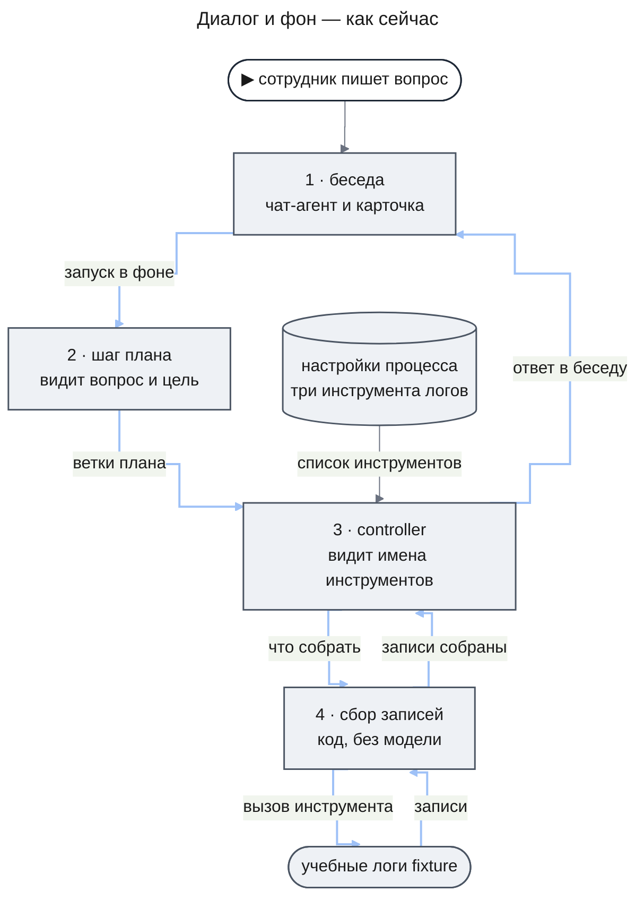
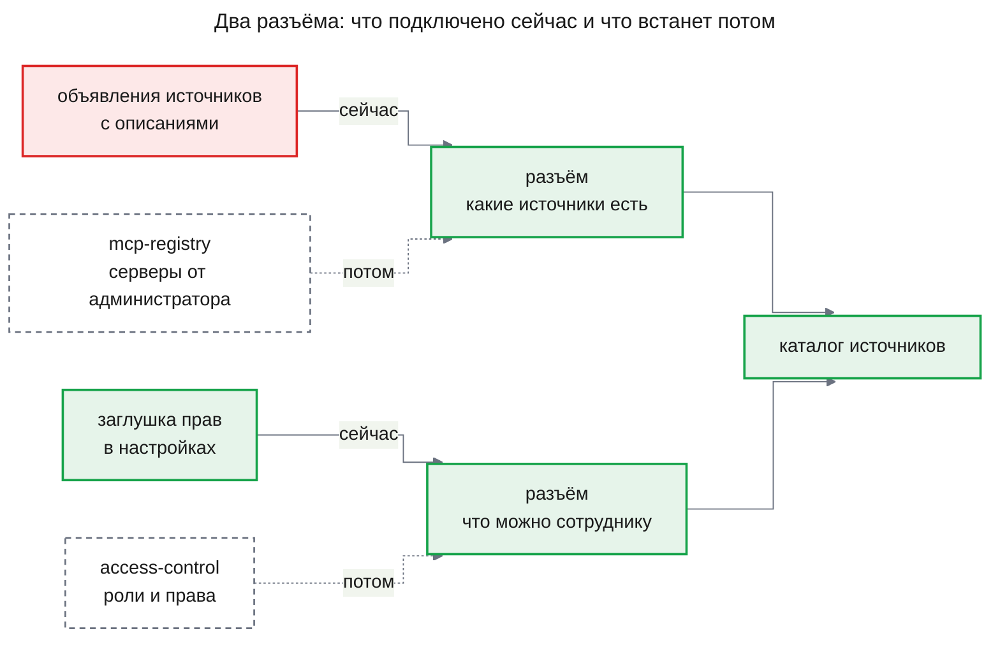
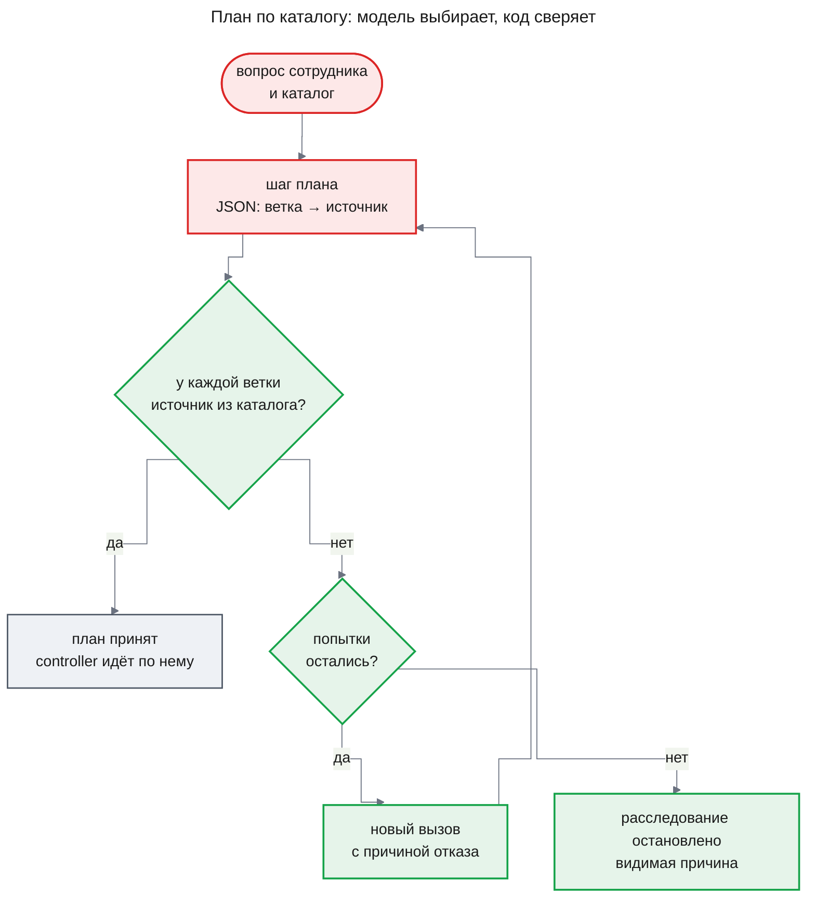
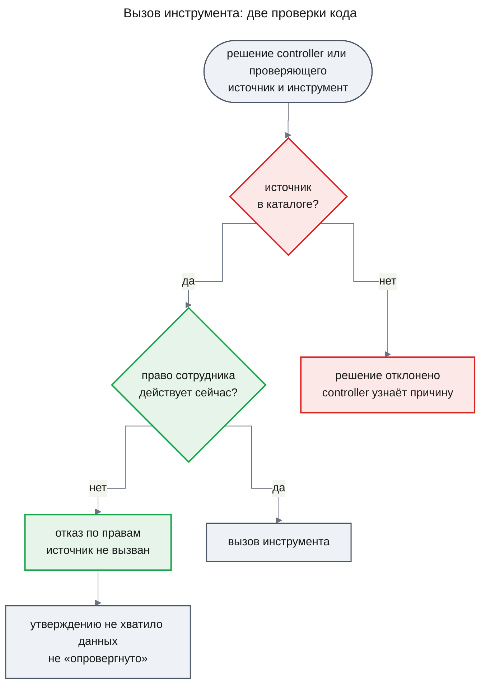

# PRD: План расследования по доступным источникам (source-planning)

| Status | Date | Depth | UXRD | Designs |
|---|---|---|---|---|
| Draft, ждёт утверждения владельца | 2026-11-06 | full | не нужен: новая причина остановки (FR-06) и новый повод потока «Без источников» (FR-09) — отметки в [deep-research/uxrd.md](../deep-research/uxrd.md) | — |

## Snapshot

**Overview.** Расследование сейчас знает один источник — учебные логи, а шаг плана пишет план, не зная, какие источники есть. Когда рядом с логами появятся бэк-офис или кодовая база, план будет писаться вслепую, а читать сможет любой сотрудник что угодно. Фича даёт расследованию каталог источников: при запуске код собирает, что подключено и что разрешено этому сотруднику, с описанием каждого источника. Шаг плана для каждой ветки называет источник из каталога, код сверяет план с каталогом и проверяет права перед каждым вызовом. `source-planning` — рабочее название.

- **Для сотрудника**: ответ из нескольких источников; в запрещённый ему источник расследование не заглянет.
- **Когда строим**: сразу после `agent-quality`, за двумя сменными разъёмами, не дожидаясь `access-control` и `mcp-registry` ([почему](#почему-сейчас-и-что-поменялось-в-рекомендации)).
- **Часть**: одна — `catalog-planning`.
- **Не входит**: настоящие права и SSO, подключение серверов администратором, журнал аудита, показ плана в беседе, особая обработка недоступного источника.
- **Главный риск**: учебный второй источник докажет механизм, но не качество выбора на настоящих серверах.
- **Открытые вопросы**: нет.

## Terms

Пример везде один: сотрудник спрашивает «почему вчера вечером не прошли оплаты заказов?».

- **Источник** — система, из которой расследование читает данные: логи, бэк-офис, кодовая база, граф знаний. Сейчас он один — учебные логи `fixture`.
- **MCP-сервер** — программа-посредник, через которую расследование обращается к источнику.
- **Инструмент** — одна операция источника, например `search_logs`: «найти записи логов по сервису и времени».
- **Объявление источника** — запись в настройках развёртывания, которой разработчик подключает источник: его идентификатор (короткое имя вроде `fixture`), инструменты, а после фичи — описания.
- **Описание источника** — что в нём лежит, на какие вопросы он отвечает, какие у него ограничения. Пример: «Бэк-офис: заказы и платежи по номеру заказа; о работе серверов не знает». Короткое описание есть и у каждого инструмента.
- **Заглушка прав** — временная таблица в настройках: пользователь → разрешённые ему источники. Потом её заменят права из `access-control`.
- **Потолок процесса** — список пар «источник — инструмент» в настройках процесса расследования. Сейчас это весь список доступного, после фичи — верхняя граница каталога.
- **Каталог источников** — источники, которые можно читать в этом расследовании, с описаниями. Его собирает код при запуске.
- **Шаг плана** — первый вызов модели в расследовании. Пишет критерии готовности и ветки — направления поиска вроде «что писал payment-api в 19:40–20:15».
- **Controller** — роль «руководитель расследования»: на каждом шаге выбирает одно действие, например «собрать записи из логов инструментом `search_logs`».
- **Проверяющий** — роль, которая выбирает, какие записи запросить для проверки утверждения.
- **Окно роли** — сколько текста роль принимает за один вызов.
- **Режим знаний модели** — сегодняшний путь расследования без источников ([deep-research/prd.md](../deep-research/prd.md), FR-25): план и один синтез ответа из общих знаний модели с предупреждением об этом.
- **Ход расследования** — сохранённая запись того, что делало расследование: план, решения controller, собранные записи, отказы. Её читает разработчик; сотрудник в беседе её не видит.
- **«Установлено»** — группа ответа ресерча с утверждениями, которые код подтвердил записями источников. Рядом стоят группы «Предположения» и «Не выяснено».
- **Транскрипт** — полная запись вызова модели: что роль получила и что ответила. Его вводит фича `agent-quality` ([prd.md](../agent-quality/prd.md), FR-01).
- **Разъём** — место, куда временная часть подключается так, что её потом меняют на настоящую, не трогая остального.

## Background

### Как это работает сейчас

Сотрудник видит только беседу. Расследование идёт в фоне: шаг плана, затем controller шаг за шагом собирает записи, и в беседу приходит ответ.

Шаг плана видит вопрос, цель и одну отметку: подключены источники или нет. Его ветки — «подвопрос и подход», источника в них нет.

Список инструментов зашит в настройках процесса: три инструмента учебных логов. Controller видит их имена и форму аргументов, но не описания: короткие описания у инструментов логов есть, только до моделей они не доходят. Что можно вызывать, решает список на тип работы, а не на сотрудника, и подключённые серверы никто не опрашивает.

### Что не так

- **План пишется вслепую.** С одним источником это не мешает. С логами и бэк-офисом план не знает, что вопрос об оплатах заказов требует обоих.
- **Controller выбирает инструмент по имени.** Имя `list_items` не говорит, что инструмент вернёт.
- **Права сотрудника не учитываются.** С настоящими источниками это нарушило бы первое бизнес-ограничение проекта: источник вызывается только при праве пользователя на него.

### Почему сейчас и что поменялось в рекомендации

Владелец спросил, нужен ли планировщик, который найдёт доступные инструменты и построит план. Раньше мы ответили «не сейчас»: каталог опирается на права по ролям и реестр серверов, а их строит платформенная ветка `access-control` → `mcp-registry`. Анализ требований показал, что ждать не обязательно: список источников и права можно брать через два сменных разъёма.

**За то, чтобы строить сейчас.** Второй источник подключается дёшево: в тестах учебный источник `stub-catalog` без MCP уже встаёт через объявление, срез данных и строку разрешений. Сохранённые планы принимают новое поле без переделки старых. Выбор источника отлаживается на учебных данных до прихода настоящих серверов.

**За то, чтобы ждать.** Заглушка прав — не защита: развёртывание для настоящих сотрудников всё равно требует `access-control`. Журнала аудита до `mcp-registry` не будет. Если настоящие права окажутся устроены иначе, например выдаются на инструмент, а не на источник, разъём придётся переделывать.

Владелец решил строить сразу после `agent-quality` за двумя разъёмами (2026-11-06).

## Что меняется и куда встраивается

Та же картина после изменений. Зелёное — новое звено, красное — изменённое.

```mermaid
---
title: "Диалог и фон — после изменений"
config:
  theme: base
  look: classic
  themeVariables:
    primaryColor: "#eef1f5"
    primaryBorderColor: "#4b5563"
    primaryTextColor: "#1a1a1a"
    lineColor: "#6b7280"
  flowchart:
    curve: step
  themeCSS: |
    @keyframes litr_sp2{0%,11.25%{stroke:#1d4ed8;stroke-width:6px}12.5%,100%{stroke:#9ec1f7;stroke-width:2px}}
---
flowchart TB
    entry(["▶ сотрудник пишет вопрос"])
    decl[("объявления источников<br/>с описаниями")]
    rights[("заглушка прав")]
    chat["1 · беседа<br/>чат-агент и карточка"]
    cat["2 · каталог источников<br/>код, при запуске"]
    plan["3 · шаг плана<br/>ветка → источник"]
    ctl["4 · controller<br/>видит описания"]
    fetch["5 · сбор записей<br/>сверка прав"]
    logs(["учебные логи fixture"])
    bo(["учебный бэк-офис"])
    entry --> chat
    chat e1@-->|"запуск в фоне"| cat
    cat e2@-->|"каталог"| plan
    plan e3@-->|"план с источниками"| ctl
    ctl e4@-->|"что и откуда"| fetch
    fetch -->|"вызов инструмента"| logs
    fetch e5@-->|"вызов инструмента"| bo
    bo e6@-->|"записи"| fetch
    fetch e7@-->|"записи собраны"| ctl
    ctl e8@-->|"ответ в беседу"| chat
    decl -->|"что подключено"| cat
    rights -->|"что разрешено"| cat
    rights -->|"право на вызов"| fetch
    classDef entry fill:#ffffff,stroke:#1f2937,stroke-width:1.5px,color:#1a1a1a
    classDef changed fill:#fde8e8,stroke:#dc2626,stroke-width:2px,color:#1a1a1a
    classDef new fill:#e6f4ea,stroke:#16a34a,stroke-width:2px,color:#1a1a1a
    classDef unchanged fill:#eef1f5,stroke:#4b5563,stroke-width:1.5px,color:#1a1a1a
    classDef r1 stroke:#9ec1f7,stroke-width:2px,animation:litr_sp2 9.6s linear 0s infinite
    classDef r2 stroke:#9ec1f7,stroke-width:2px,animation:litr_sp2 9.6s linear 1.2s infinite
    classDef r3 stroke:#9ec1f7,stroke-width:2px,animation:litr_sp2 9.6s linear 2.4s infinite
    classDef r4 stroke:#9ec1f7,stroke-width:2px,animation:litr_sp2 9.6s linear 3.6s infinite
    classDef r5 stroke:#9ec1f7,stroke-width:2px,animation:litr_sp2 9.6s linear 4.8s infinite
    classDef r6 stroke:#9ec1f7,stroke-width:2px,animation:litr_sp2 9.6s linear 6s infinite
    classDef r7 stroke:#9ec1f7,stroke-width:2px,animation:litr_sp2 9.6s linear 7.2s infinite
    classDef r8 stroke:#9ec1f7,stroke-width:2px,animation:litr_sp2 9.6s linear 8.4s infinite
    class entry entry
    class cat,bo,rights new
    class plan,ctl,fetch,decl changed
    class chat,logs unchanged
    class e1 r1
    class e2 r2
    class e3 r3
    class e4 r4
    class e5 r5
    class e6 r6
    class e7 r7
    class e8 r8
```

У источников и инструментов появляются описания, а рядом с логами встаёт учебный бэк-офис (FR-01, FR-02). Между запуском и шагом плана встаёт новое звено — каталог (FR-03, FR-04). Шаг плана остаётся тем же, но называет источник каждой ветки, а код сверяет план с каталогом (FR-05, FR-06). Controller и проверяющий видят каталог с описаниями (FR-07), а сбор записей перед каждым вызовом сверяет право сотрудника по той же заглушке (FR-08).

Обратный путь не меняется: записи возвращаются к controller, а готовый ответ, как и сегодня, дописывается в беседу.

## Как работают новые алгоритмы

Везде действует принцип владельца: модель оценивает, алгоритм решает. Что требует понимания текста, делает вызов модели и отвечает заполненной формой (JSON). Код решает только по полям формы, идентификаторам и статусам.

### Как собирается каталог

Приходят подключённые источники с описаниями, права сотрудника и потолок процесса. Решает код, модель не вызывается. Выходит каталог, который не меняется до конца расследования: источник, подключённый или разрешённый позже, попадёт только в следующее.

Если каталог пуст, расследование идёт сегодняшним путём без источников, с сегодняшними предупреждениями (FR-09). Новым здесь стало только то, что этот путь выбирает пустой каталог, а не развёртывание без источников.

### Как план выбирает источники и как его проверяет код

Приходят вопрос и каталог. Какой источник нужен ветке, решает модель в шаге плана; подходит ли ответ, решает код, сравнивая идентификаторы с каталогом. Выходит план, где у каждой ветки есть источник и причина выбора.

Не прошедший проверку план уходит на новый вызов с причиной отказа. Когда попытки кончились, расследование останавливается: молча идти без источников оно не может. Сотрудник обычно ничего не замечает; при остановке приходит ответ без выводов с новой причиной.

Подсказку сотрудника «посмотри в бэк-офисе» код не разбирает: вопрос может быть на любом языке и с файлами. Подсказка остаётся частью вопроса, а источник по ней называет шаг плана идентификатором из каталога. Если подсказанного источника в каталоге нет, особой обработки тоже нет (подход, раздел 5).

### Что происходит при каждом вызове инструмента

Приходит решение собрать или проверить записи: источник, инструмент, аргументы. Код проверяет дважды: источник есть в каталоге, и право сотрудника на него действует в момент вызова. При отказе по правам источник не вызывается ни разу, отказ записан в ходе расследования, а утверждение без этих записей получает «мало данных» — как сейчас при недоступном источнике. Сотрудник видит ответ без данных из этого источника и не видит его названия.

Вторая проверка нужна, потому что право могут отозвать посреди расследования, а каталог собран на старте.

## Что увидит сотрудник в диалоге

Беседа, карточка ресерча и место ответа остаются прежними, нового экрана нет. Меняется то, откуда ответ берёт данные, и появляются два крайних случая.

Пустой каталог даёт тот же ответ и те же предупреждения, что сегодня даёт развёртывание без источников (FR-09). Для сотрудника без прав эти предупреждения неточны, и это [принятое ограничение](#constraints).

Ответ при непрошедшем плане выглядит как сейчас ответ при остановке по бюджету, только причина остановки новая; её текст добавит [UXRD глубокого ресерча](../deep-research/uxrd.md). План и выбранные источники в беседе не видны — это фича `investigation-ui`; разработчик видит их в ходе расследования.

## Подход и почему мы в него верим

У опоры стоит её тип: **измерено** (исследование с числами), **практики** (опыт специалистов без измерений), **мнение** владельца, **наш вывод**. Числа сверены с оригиналами статей.

### 1. Каталог считает код, а не промпт

Владелец спросил: может, список источников придёт из промпта, который запускает расследование? Нет. Что подключено и что разрешено сотруднику — факты развёртывания и прав, и код знает их точно в момент запуска. Список в промпте устаревает с первым новым источником и не знает, кто спрашивает — **наш вывод**.

### 2. Модель выбирает источник, код сверяет идентификаторы

Понять вопрос и описание источника — работа модели, поэтому источник ветки называет шаг плана. Правило по словам в коде ломается на первой смене языка или формата — **мнение** владельца. Модель может назвать несуществующий источник, поэтому код сверяет идентификаторы с каталогом — **наш вывод**.

### 3. Чем меньше вариантов, тем точнее выбор

Шаг плана выбирает среди источников, а инструменты видит controller, когда направление уже ясно.

- В HumanMCP модель выбирала один верный инструмент среди N. Claude 3.5 Haiku был прав в 97,8% случаев при 10 инструментах, в 91,9% — при 50, в 88,6% — при 100. В другом опыте Gemini 2.0 Flash был прав в 87,4% случаев при 500 инструментах и в 65% — при 2000 — **измерено**, [HumanMCP](https://arxiv.org/html/2602.23367).
- В RAG-MCP модель выбирала MCP-сервер для задач веб-поиска. С описаниями всех серверов в промпте она была права в 13,62% случаев, с заранее отобранными поиском — в 43,13% — **измерено**, [RAG-MCP](https://arxiv.org/html/2505.03275).

Наш каталог — два источника и несколько инструментов, так что падение пока не грозит. Отбор описаний до плана откладываем до настоящих серверов — **наш вывод**.

### 4. Описание пишет тот, кто подключает источник

Модель читает описание инструмента как часть промпта. MCP-сервер может спрятать в описании команду для модели и сменить описание уже после одобрения — **практики**, [Invariant Labs, Tool Poisoning Attacks](https://invariantlabs.ai/blog/mcp-security-notification-tool-poisoning-attacks); это не стандарт и не измерение. Поэтому до моделей доходят только описания из объявления, а текст сервера — нет — **наш вывод**.

Выбирает ли шаг плана верный источник по нашим описаниям, на русском, не измерено: это проверяют ручной прогон на вопросе из AC-02.2 и сценарии FR-10.

### 5. Чего нет в каталоге, того нет — без особой обработки

Правило владельца: когда источника или инструмента нет — он не подключён, не разрешён сотруднику или не входит в потолок процесса, — код ничего особого не делает, а модель не получает дополнительных инструкций. Модель работает с тем, что дал каталог — **мнение** владельца.

- **Сотрудник просит источник, которого нет в его каталоге.** Шаг плана видит вопрос с этой просьбой и каталог. Как поступить с подсказкой, решает модель; код не добавляет ни отметки, ни строки в ответ.
- **Каталог пуст.** Расследование идёт сегодняшним путём без источников, со своими сегодняшними предупреждениями (FR-09).

Правило не отменяет проверку плана. План, назвавший идентификатор вне каталога, код возвращает с причиной отказа, а после лимита попыток останавливает расследование (FR-06): это проверка ответа модели, а не обработка отсутствующего источника.

## Как это скажется на качестве

Полнота растёт там, где ответ лежит в нескольких источниках: вопрос об оплатах получит и ошибки из логов, и состояние заказов. Проверка утверждений не меняется, а данные берутся только из каталога. Цена растёт немного: описания увеличивают вход шага плана и каждого шага controller, а отклонённый план стоит ещё одного вызова. Если `agent-quality` переведёт план или controller на более дешёвую модель, выбор источников может ухудшиться; это покажут сценарии FR-10.

## Users and Use Cases

### Users

- **Сотрудник (аналитик, SRE, поддержка)** — задаёт вопрос в чате. Ему важно, чтобы расследование само нашло нужные источники и не читало запрещённое.
- **Разработчик Agent OS** — подключает источники и пишет описания. Ему важно подключить источник без правки промптов и видеть, почему выбран источник.
- **Владелец развёртывания** — назначает права в заглушке, пока нет `access-control`.

### Use Cases

- **UC-1**: Сотрудник спрашивает о проблеме, видной только в логах и бэк-офисе вместе → ответ ссылается на записи обоих, и сводить данные вручную не нужно. Covers FR-01, FR-02, FR-04, FR-05, FR-07.
- **UC-2**: Сотрудник подсказывает «посмотри в бэк-офисе» → подсказка доходит до шага плана вместе с вопросом, и источник по ней выбирает модель из каталога. Covers FR-05.
- **UC-3**: Сотрудник без права на источник запускает расследование → источник ни разу не вызван, ответ строится из остальных. Covers FR-03, FR-04, FR-08.
- **UC-4**: В каталоге сотрудника нет ни одного источника, хотя источники подключены → он получает ответ из знаний модели так же, как сегодня в развёртывании без источников. Covers FR-09.
- **UC-5**: Разработчик подключает источник → пишет описание вместе с объявлением, и источник попадает в каталог без правки промптов. Covers FR-01, FR-04.
- **UC-6**: Разработчик разбирает плохой выбор источника → видит каталог, ветки с источниками и причинами и отказы проверки, и знает, чинить описание или промпт. Covers FR-04, FR-05, FR-06.
- **UC-7**: Разработчик после смены модели прогоняет сценарии с двумя источниками → видит долю сценариев, где план назвал нужные источники. Covers FR-10.

## Functional Requirements

### Must Have (MVP)

- **FR-01. Описания источника и инструментов.** У каждого подключённого источника есть описание: что в нём лежит, на какие вопросы он отвечает, ограничения. У каждого инструмента — своё короткое описание. Описания пишет тот, кто подключает источник, и они хранятся вместе с объявлением как данные.
  - AC-01.1: Given объявление без описания источника или одного из инструментов, When развёртывание запускается, Then запуск не проходит, а ошибка называет источник и инструмент.
  - AC-01.2: Given MCP-сервер сам сообщает описание инструмента, отличное от объявленного, Then в транскрипте любой роли стоит объявленное описание, а текста сервера нет.
- **FR-02. Второй учебный источник — бэк-офис.** Рядом с учебными логами подключается учебный бэк-офис: заказы и платежи, связанные с логами общими идентификаторами. На часть вопросов отвечают только оба источника вместе. Источник только читается, а поставляемый процесс глубокого ресерча включает его инструменты в свой потолок.
  - AC-02.1: Given в учебных логах есть ошибка оплаты заказа, Then в учебном бэк-офисе есть заказ с тем же идентификатором.
  - AC-02.2: Given учебные данные, Then к ним есть хотя бы один вопрос с записанным ответом, для которого нужны записи обоих источников.
- **FR-03. Права через временную заглушку.** Пока нет `access-control`, права задаёт таблица в настройках развёртывания: пользователь → разрешённые источники. Пользователь не из таблицы не имеет прав ни на один источник. Фича спрашивает права через один разъём, и `access-control` заменит заглушку без изменения поведения FR-04–FR-09.
  - AC-03.1: Given таблица разрешает пользователю только логи, When он запускает расследование, Then в его каталоге только логи.
  - AC-03.2: Given пользователя нет в таблице, When он запускает расследование, Then его каталог пуст.
- **FR-04. Каталог источников при запуске.** При запуске код собирает каталог: источники, которые подключены, разрешены сотруднику и входят в потолок процесса. Список источников в настройках процесса остаётся и служит этим потолком. У каждого источника в каталоге — те его инструменты, которые названы в потолке. Каталог не меняется до конца расследования, и разработчик видит его в ходе расследования.
  - AC-04.1: Given источник подключён и разрешён, но не входит в потолок процесса, Then его нет в каталоге.
  - AC-04.2: Given источник подключили или выдали на него право после запуска, Then в каталоге идущего расследования его нет, а в следующем расследовании этого сотрудника он есть.
  - AC-04.3: Given расследование запущено, When разработчик открывает его ход, Then он видит каталог с описаниями.
- **FR-05. План называет источник для каждой ветки.** Когда каталог не пуст, шаг плана получает вопрос и каталог с описаниями источников, без описаний инструментов. Он отвечает формой, где у каждой ветки есть источник из каталога и причина выбора. Подсказка сотрудника остаётся частью вопроса. Это тот же шаг плана, нового планировщика нет.
  - AC-05.1: Given план принят, Then у каждой ветки есть хотя бы один источник из каталога и причина, и разработчик видит их в ходе расследования.
  - AC-05.2: Given каталог не помещается в окно шага плана, Then расследование останавливается с причиной переполнения окна до первого сбора записей, а каталог не урезается молча.
  - AC-05.3: Given план пересматривается по ходу расследования, Then новая редакция строится по тому же каталогу и проходит ту же проверку (FR-06).
- **FR-06. Код проверяет план по каталогу.** Код сверяет каждый источник плана с каталогом по идентификатору. План с источником вне каталога или с веткой без источника отклоняется, и шаг плана вызывается снова с причиной отказа. Число повторов ограничено лимитом процесса; потом расследование останавливается с новой видимой причиной и не идёт молча без источников.
  - AC-06.1: Given план назвал источник вне каталога, Then транскрипт следующего вызова шага плана содержит причину отказа с этим идентификатором.
  - AC-06.2: Given все попытки отклонены, Then расследование остановлено с новой причиной остановки — план не прошёл проверку источников (текст — `deep-research/uxrd.md`, MC-25), ни один источник не вызван, а сотрудник получает ответ с этой причиной.
- **FR-07. Controller и проверяющий видят каталог с описаниями.** Во входе controller и проверяющего — источники каталога и их инструменты, с описаниями. Решение собрать записи из источника вне каталога код отклоняет с причиной. Controller берёт записи из любого источника каталога, даже не названного планом: план направляет, а пересмотр плана его обновляет.
  - AC-07.1: Given расследование идёт, Then в транскрипте controller у каждого источника и инструмента есть описание.
  - AC-07.2: Given controller запросил записи из источника вне каталога, Then решение отклонено, источник не вызван, а следующая попытка controller получает причину.
  - AC-07.3: Given план назвал только логи, а бэк-офис есть в каталоге, When controller запрашивает записи из бэк-офиса, Then запрос принят.
- **FR-08. Права проверяются при каждом вызове.** Перед каждым вызовом инструмента — для сбора и для проверки утверждений — код заново проверяет право сотрудника на источник. Без права источник не вызывается ни разу, а отказ записан в ходе расследования: сотрудник, источник, инструмент, время. Утверждение, которому не хватило записей из-за отказа, получает «мало данных», а не «опровергнуто».
  - AC-08.1: Given право на источник отозвано после запуска, When controller запрашивает из него записи, Then источник не вызван ни разу, а в ходе расследования есть отказ с сотрудником, источником, инструментом и временем.
  - AC-08.2: Given проверка утверждения требует записей из источника, право на который отозвано, Then утверждение получает «мало данных», а не «опровергнуто».
- **FR-09. Пустой каталог — сегодняшний путь без источников.** Если каталог сотрудника пуст — ему не разрешён ни один источник или разрешённые не входят в потолок процесса, — расследование идёт режимом знаний модели так же, как сегодня (`deep-research/prd.md`, FR-25): план без источников и без проверки FR-06, один синтез ответа, сегодняшние предупреждения. Для этого случая нет ни новых инструкций модели, ни новой обработки, ни новых текстов.
  - AC-09.1: Given источники подключены, а каталог сотрудника пуст, When он запускает расследование, Then ни один источник не вызван, а ответ построен из знаний модели и показан так же, как сегодня ответ в развёртывании без источников.
  - AC-09.2: Given источники подключены, а каталог сотрудника пуст, Then предложение запуска идёт без предупреждения режима без источников, а карточка идущего расследования и ответ показывают его так же, как сегодня.

### Should Have

- **FR-10. Сценарии самопроверки с двумя источниками.** Если к началу дизайна выпущена часть `self-check` фичи `agent-quality`, генератор закладывает сценарии, где причина видна только по логам и бэк-офису вместе. Ключ сценария называет нужные источники идентификаторами. Детерминированные тесты и ручной прогон проверяют Must Have и без этих сценариев.
  - AC-10.1: Given набор с двумя источниками прогнан, Then отчёт показывает по каждому сценарию, назвал ли план источники ключа, и долю таких сценариев; сравнивает алгоритм по идентификаторам.

### Won't Have

- **Настоящие права, роли и вход через SSO** — фича `access-control`; до неё права даёт заглушка.
- **Подключение серверов и правка описаний администратором, проверка текста сервера** — фича `mcp-registry`.
- **Журнал аудита каждого вызова** — фича `mcp-registry`. До неё отказ записан только в ходе расследования; это известный разрыв с третьим бизнес-ограничением.
- **Свой потолок источников у каждого шаблона процесса** — фича `workflow-templates`.
- **Показ плана и выбранных источников в беседе** — фича `investigation-ui`.
- **Отбор источников поиском или моделью до плана** — не нужен, пока каталог мал; вернёмся с настоящими серверами.
- **Отдельная роль-планировщик** — план пишет существующий шаг плана.
- **Сопоставление подсказки сотрудника с источниками в коде** — нарушает принцип «модель оценивает, алгоритм решает».
- **Особая обработка недоступного источника** — ни отметки и строки в ответе, когда сотрудник просит источник вне каталога, ни своего предупреждения для пустого каталога: без источника — без особой обработки (подход, раздел 5). Текст предупреждения для сотрудника без прав можно пересмотреть в `access-control`.
- **Изменяющие инструменты** — изменяющий вызов требует подтверждения пользователя в беседе, а его приносит `mcp-registry`.

## Non-Functional Requirements

### Security

- **NFR-01**: для каждого источника есть e2e-тест, где пользователь без права получает отказ, а источник не вызывается (первое бизнес-ограничение).
- **NFR-02**: код не кладёт во вход ни одной роли идентификатор и описание источника вне каталога сотрудника. Идентификатор, который модель назвала сама, может вернуться к ней в причине отказа (AC-06.1). Проверяется тестом: пользователю разрешены только логи, вопрос бэк-офис не называет, и транскрипты всех ролей не содержат ни идентификатора, ни описания бэк-офиса.

### Performance

- **NFR-03**: сборка каталога не вызывает модель; вызовов шага плана больше только на число повторов после отказа. Проверяется по журналу вызовов.

## Delivery Parts

| Part | Covers | Cut along | Depends on | Rationale |
|------|--------|-----------|------------|-----------|
| `catalog-planning` | FR-01, FR-02, FR-03, FR-04, FR-05, FR-06, FR-07, FR-08, FR-09, FR-10 | domain | — | Каталог, план по нему и проверки прав — одна область с одним владельцем данных; делить её можно только по шагам работы, а это фазы, не части. |

FR-10 входит в дизайн, только если `self-check` к тому времени выпущен; иначе он откладывается.

## Success Criteria

- **Данные только из каталога** — за первый месяц после выпуска ни одно расследование не содержит записей из источника вне своего каталога, а каждый отказ по правам записан в его ходе. Читается в ходе расследований.
- **Выбор источника измерен** — если выпущен `self-check`, доля сценариев с двумя источниками, где план назвал источники ключа, есть в отчёте самопроверки, и первое значение записано как базовая линия.

## Constraints and Risks

### Constraints

- **Принцип владельца.** Что требует понимания текста, делает вызов модели с ответом-формой; код решает только по её полям, идентификаторам и статусам — без списков слов и поиска подстрок.
- **Заглушка прав — не защита для настоящих сотрудников.** Развёртывание с настоящими данными требует `access-control`.
- **Только чтение.** Каждый инструмент каталога только читает данные.
- **Порядок фич.** Фича строится после `agent-quality`: её проверки опираются на транскрипты оттуда (FR-01 той фичи), а отказ controller с причиной (AC-07.2) — на повтор решения controller с причиной отказа (FR-08 той фичи). Повтор шага плана с причиной отказа (FR-06) — новый и строится здесь.
- **Принятое ограничение: предупреждение для пустого каталога неточно.** Сегодняшнее предупреждение говорит, что источники данных не подключены, а сотруднику без прав они просто недоступны. Предложение запуска следует развёртыванию и идёт без предупреждения, а карточка идущего расследования и ответ показывают его так же, как сегодня (AC-09.2).

### Решения, которые зафиксирует дизайн

Это технические вопросы, их решает дизайн, возможно отдельным ADR. Здесь они только названы.

- Где проверяются права сотрудника и в каком модуле.
- Где проходит граница доверия для текста описаний: что может попасть во вход модели и откуда.
- Описания становятся обязательной частью объявления, и каждый будущий источник обязан их дать.
- Список источников в настройках процесса меняет смысл: был «список», станет «потолок».

### Затронутые утверждённые решения

После утверждения этого PRD в этих документах понадобятся отметки; здесь они не правятся.

- `deep-research/prd.md`, FR-25, и `deep-research/design-engine.md`, KD-8 — режим без источников выбирает пустой каталог расследования, а не развёртывание: при подключённых источниках он включается для сотрудника с пустым каталогом (FR-09). Путь режима и его тексты не меняются.
- `deep-research/prd.md`, FR-27, AC-27.4 и UC-11, и `deep-research/uxrd.md`, поток «Без источников» и KD-9 — предупреждения режима без источников появляются и при подключённых источниках, когда каталог сотрудника пуст; предложение запуска их не показывает (FR-09, AC-09.2). Тексты MC-31, MC-32, MC-33 не меняются.
- `deep-research/uxrd.md`, MC-25 — новая причина остановки: план не прошёл проверку источников (FR-06).
- `deep-research/prd.md`, FR-12 — источники в пределах прав пользователя появляются раньше `access-control`, через заглушку.
- `docs/adr/ADR-0005-process-config-data-only.md` — список источников конфигурации становится потолком, а сужение по правам, отданное `access-control`, начинается здесь.
- `research-runtime/design-mcp-source.md`, «SourceDescriptor и allowlist» — объявление источника получает описания.
- `research-runtime/prd.md`, дорожная карта — фича идёт раньше `access-control` и `mcp-registry`.

### Assumptions

- **Описаний на уровне источника хватает для выбора.** Проверяется ручным прогоном: владелец задаёт вопрос из AC-02.2, план должен назвать оба источника, а «Установлено» — содержать выводы с записями из обоих. Потом — сценарии FR-10.
- **Учебный бэк-офис отличается от логов настолько, что выбор осмыслен.** Проверяется тем же прогоном: план с одним источником должен ответить хуже.
- **`access-control` и `mcp-registry` встанут в разъёмы без изменения поведения FR-04–FR-09.** Проверяется при дизайне этих фич.

### Risks

| Risk | Impact | Probability | Mitigation |
|------|--------|-------------|------------|
| Учебный второй источник доказывает механизм, но не качество выбора на настоящих серверах | Medium | High | Сценарии FR-10; переоценка с первым настоящим сервером |
| Каталог не помещается в окно роли | Medium | Low, выше с настоящими серверами | План видит только уровень источников; явная остановка (AC-05.2) |
| Точность выбора падает с ростом числа инструментов и на более дешёвых моделях | Medium | Medium | Выбор в два уровня; сценарии FR-10 после смены модели |
| Описание управляет моделью: сервер прячет команду или меняет описание после одобрения | High | Low до `mcp-registry` | До моделей доходят только описания из объявления (AC-01.2) |
| Каталог устаревает: источник отключили или право отозвали посреди расследования | Medium | Medium | Право проверяется при каждом вызове (FR-08); нечитаемый источник даёт «мало данных» |
| План называет несуществующий или запрещённый источник | Low | Medium | Сверка идентификаторов, повтор с причиной, видимая остановка (FR-06) |
| Controller уходит от плана | Low | Medium | Controller ограничен каталогом; пересмотр плана обновляет ветки (FR-07) |

## Undetermined Items

Открытых вопросов нет: владелец решил все.

## Update History

| Version | Date | Change |
|---------|------|--------|
| 1.0 | 2026-11-06 | Первая версия; идея перенесена из Won't Have фичи `agent-quality` |
| 1.1 | 2026-11-06 | Решения владельца: рекомендации по описаниям, проверке плана, правам, controller, потолку, окну, сценариям и сроку приняты; недоступный источник без особой обработки — просьба о нём в Won't Have, пустой каталог идёт сегодняшним путём без источников с принятой неточностью предупреждения; NFR-02 о входе ролей; убраны повторы; в Terms — «Ход расследования» и «Установлено»; на схемах путь возвращается в беседу, есть сверка права на вызов, будущие фичи не отмечены как неизменные |
