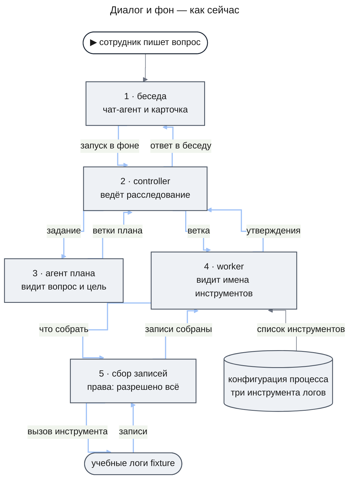
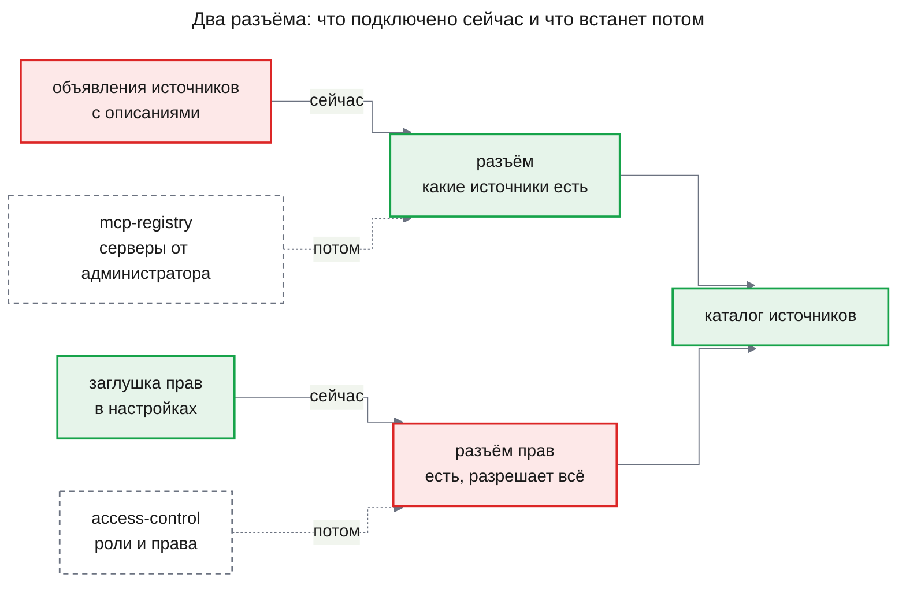
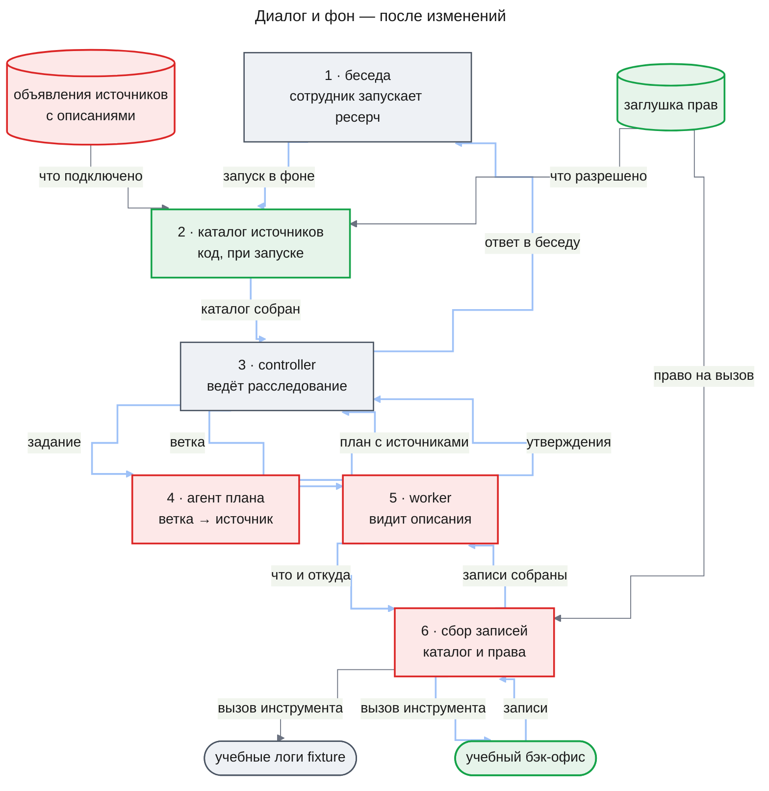
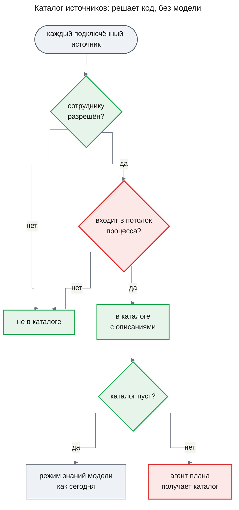
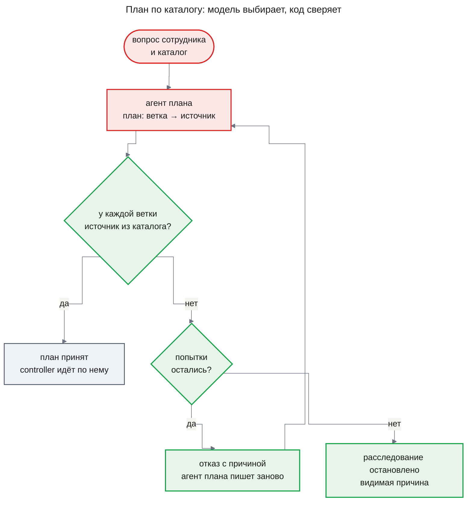
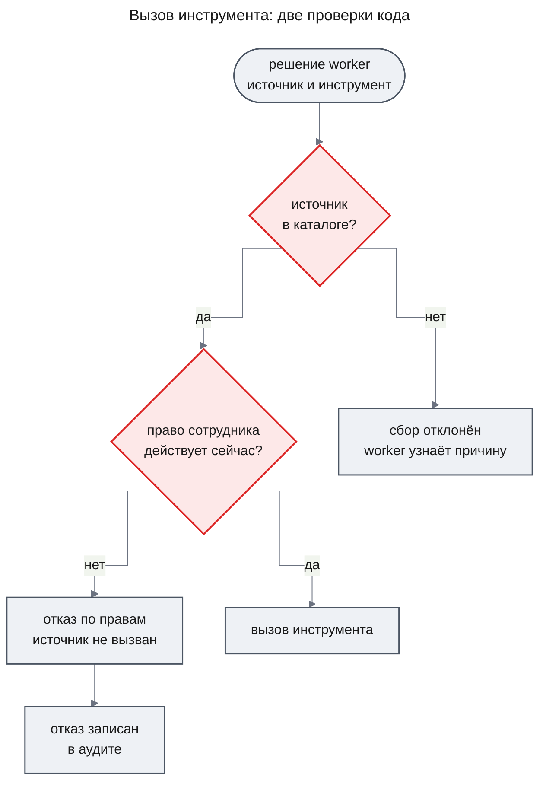
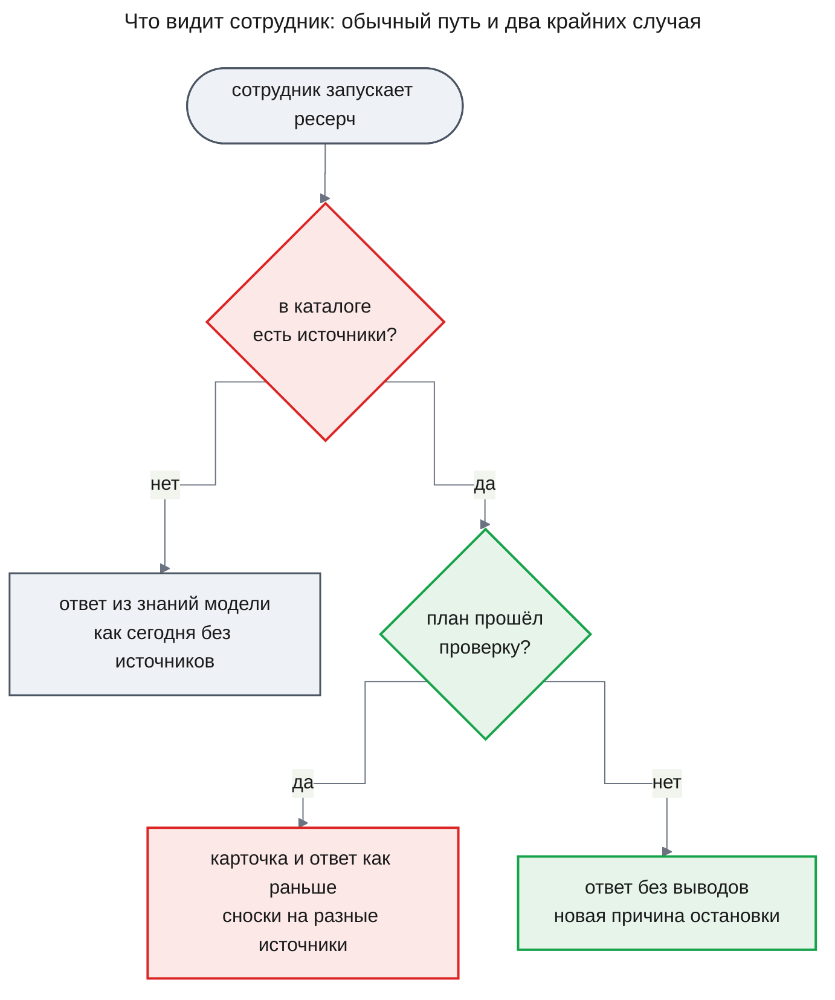

# PRD: План расследования по доступным источникам (source-planning)

| Status | Date | Depth | UXRD | Designs |
|---|---|---|---|---|
| Approved | 2026-11-10 | full | не нужен: новая причина остановки (FR-06) и новый повод потока «Без источников» (FR-09) — отметки в [deep-research/uxrd.md](../deep-research/uxrd.md) | — |

## Snapshot

**Overview.** Расследование сейчас знает один источник — учебные логи. Агент плана пишет план, не зная, какие источники есть, а право сотрудника на источник не проверяется: проверка перед каждым вызовом есть, но разрешает всё. Когда рядом с логами появятся бэк-офис или кодовая база, план будет писаться вслепую, а читать сможет любой сотрудник что угодно. Фича даёт расследованию каталог источников: при запуске код собирает, что подключено и что разрешено этому сотруднику, с описанием каждого источника. Агент плана для каждой ветки называет источник из каталога, код сверяет план с каталогом и проверяет права перед каждым вызовом.

- **Для сотрудника**: ответ из нескольких источников; в запрещённый ему источник расследование не заглянет.
- **Когда строим**: сразу — расследование на агентах (`agent-runtime`) уже построено. Фича не ждёт `access-control` и `mcp-registry`: подключённые источники и права приходят через два сменных разъёма ([почему](#почему-сейчас)).
- **Часть**: одна — `catalog-planning`.
- **Не входит**: настоящие права и SSO (`access-control`), подключение серверов администратором (`mcp-registry`), свой потолок у шаблона процесса (`workflow-templates`), показ плана в беседе (`investigation-ui`).
- **Главный риск**: учебный второй источник докажет механизм, но не качество выбора на настоящих серверах.
- **Открытый вопрос**: что включает режим без источников (решает дизайн) — [Undetermined Items](#undetermined-items).

## Terms

Пример везде один: сотрудник спрашивает «почему вчера вечером не прошли оплаты заказов?».

- **Источник** — система, из которой расследование читает данные: логи, бэк-офис, кодовая база, граф знаний. Сейчас он один — учебные логи `fixture`.
- **MCP-сервер** — программа-посредник, через которую расследование обращается к источнику.
- **Инструмент** — одна операция источника, например `search_logs`: «найти записи логов по сервису и времени». У агентов свои инструменты: например, `gather` собирает записи инструментом источника, а `plan_write` записывает план.
- **Объявление источника** — запись в настройках развёртывания, которой разработчик подключает источник: его идентификатор (короткое имя вроде `fixture`), инструменты, а после фичи — описания.
- **Описание источника** — что в нём лежит, на какие вопросы он отвечает, какие у него ограничения. Пример: «Бэк-офис: заказы и платежи по номеру заказа; о работе серверов не знает». Короткое описание есть и у каждого инструмента.
- **Заглушка прав** — временная таблица в настройках: пользователь → разрешённые ему источники. Потом её заменят права из `access-control`.
- **Потолок процесса** — список пар «источник — инструмент» в конфигурации процесса расследования. Сейчас это весь список доступного, после фичи — верхняя граница каталога.
- **Каталог источников** — источники, которые можно читать в этом расследовании, с описаниями. Его собирает код при запуске.
- **Агент** — модель со своей сессией и своими инструментами. Расследование — дерево агентов, которые вызывают друг друга; что делает каждый, задаёт его определение — данные в конфигурации процесса ([agent-runtime/prd.md](../agent-runtime/prd.md)).
- **Controller** — агент-руководитель расследования: вызывает агента плана, раздаёт ветки плана, отдаёт утверждения на проверку и вызывает агента ответа.
- **Агент плана** (`planner`) — пишет критерии готовности и ветки — направления поиска вроде «что писал payment-api в 19:40–20:15».
- **Worker** — агент одной ветки: выбирает источник и инструмент, собирает записи и пишет по ним утверждения. Часть ветки он может отдать агенту `subworker` с теми же инструментами; ниже «worker» означает обоих.
- **Проверяющий** (`verifier`) — агент, который сверяет одно утверждение с уже собранными записями, на которые оно ссылается. Источники он не вызывает.
- **Агент ответа** (`synthesis`) — собирает ответ сотруднику из проверенных утверждений; в режиме знаний модели он единственный агент расследования.
- **Окно агента** — сколько текста агент принимает за один ход.
- **Режим знаний модели** — сегодняшний путь расследования без источников ([deep-research/prd.md](../deep-research/prd.md), FR-25): ответ из общих знаний модели пишет один агент ответа, без плана и без сбора записей, с предупреждением об этом.
- **Ход расследования** — сохранённая запись того, что делало расследование: план, запуски агентов, их вызовы инструментов с отказами, собранные записи. Её читает разработчик; сотрудник в беседе её не видит.
- **«Установлено»** — группа ответа ресерча с утверждениями, которые код подтвердил записями источников. Рядом стоят группы «Предположения» и «Не выяснено».
- **Транскрипт** — полная запись хода агента: что он получил и что ответил. Его вводит фича `agent-quality` ([prd.md](../agent-quality/prd.md), FR-01).
- **Разъём** — место, куда временная часть подключается так, что её потом меняют на настоящую, не трогая остального.

## Background

### Как это работает сейчас

Сотрудник видит только беседу. Расследование идёт в фоне деревом агентов: controller вызывает агента плана, раздаёт ветки плана worker-агентам, те собирают записи и пишут утверждения, проверяющий их сверяет, а агент ответа собирает ответ в беседу.

Агент плана видит вопрос, цель и одну отметку: подключены источники или нет. Его ветки — «подвопрос и подход», источника в них нет.

Список инструментов зашит в конфигурации процесса: три инструмента учебных логов. Worker видит их имена и форму аргументов, но не описания: короткие описания у инструментов логов есть на MCP-сервере, только до агентов они не доходят. Controller и агент плана инструментов источников не видят.

Перед каждым вызовом инструмента код спрашивает проверку прав: кто владелец расследования, какой инструмент и какой источник. Сейчас она разрешает всё, что разрешает конфигурация процесса, поэтому право сотрудника на источник не проверяется. Код отказывает только в источнике или инструменте вне списка процесса. Каждый вызов, и отказ тоже, оставляет запись аудита.

### Что не так

- **План пишется вслепую.** С одним источником это не мешает. С логами и бэк-офисом план не знает, что вопрос об оплатах заказов требует обоих.
- **Worker выбирает инструмент по имени.** Имя `list_items` не говорит, что инструмент вернёт.
- **Права сотрудника не проверяются.** С настоящими источниками это нарушило бы первое бизнес-ограничение проекта: источник вызывается только при праве пользователя на него. Пока права не проверяются, настоящий источник подключать нельзя.

### Почему сейчас

Каталогу нужны две вещи: какие источники подключены и что разрешено сотруднику. Настоящими их сделают платформенные фичи `access-control` (роли и права) и `mcp-registry` (серверы от администратора). Фича их не ждёт: каталог получает обе вещи через два сменных разъёма.

Потом объявления заменит реестр `mcp-registry`, а заглушку — права `access-control`. Каталог, план и проверки при этой замене остаются прежними.

Строить можно сразу. Расследование на агентах уже даёт то, на что опирается каталог: проверку прав перед каждым вызовом, которой не хватает только настоящего ответа, и источники, которые дочерний агент получает не шире родительских. Второй источник подключается дёшево: в тестах учебный источник `stub-catalog` без MCP уже встаёт через объявление, срез данных и строку разрешений. Выбор источника отлаживается на учебных данных ещё до прихода настоящих серверов.

## Что меняется и куда встраивается

Та же картина после изменений. Зелёное — новое звено, красное — изменённое.

У источников и инструментов появляются описания, а рядом с логами встаёт учебный бэк-офис (FR-01, FR-02). Между запуском и controller встаёт новое звено — каталог (FR-03, FR-04): дальше всё дерево агентов работает только с ним. Агент плана получает каталог и называет источник каждой ветки, а код сверяет план с каталогом (FR-05, FR-06). Controller каталога не видит: он раздаёт ветки по плану, где у каждой назван источник. Worker видит источники каталога и их инструменты с описаниями (FR-07), а проверка прав перед каждым вызовом отвечает по заглушке прав вместо «разрешено всё» (FR-08).

Обратный путь не меняется: утверждения сверяет проверяющий, а ответ, как и сегодня, собирает агент ответа и дописывает в беседу.

## Как работают новые алгоритмы

Везде действует принцип «Модель оценивает, алгоритм решает». Что требует понимания текста, делает вызов модели и отвечает заполненной формой (JSON). Код решает только по полям формы, идентификаторам и статусам.

### Как собирается каталог

Приходят подключённые источники с описаниями, права сотрудника и потолок процесса. Решает код, модель не вызывается. Выходит каталог, который не меняется до конца расследования: источник, подключённый или разрешённый позже, попадёт только в следующее.

Если каталог пуст, расследование идёт сегодняшним путём без источников, с сегодняшними предупреждениями (FR-09). Новым здесь стало только то, что этот путь выбирает пустой каталог, а не развёртывание без источников.

### Как план выбирает источники и как его проверяет код

Приходят вопрос и каталог. Какой источник нужен ветке, решает модель агента плана; подходит ли план, решает код, сравнивая идентификаторы с каталогом. Выходит план, где у каждой ветки есть источник и причина выбора.

Не прошедший проверку план не записывается: агент плана получает причину отказа и пишет план заново. Когда попытки кончились, расследование останавливается: молча идти без источников оно не может. Сотрудник обычно ничего не замечает; при остановке приходит ответ без выводов с новой причиной.

Подсказка сотрудника «посмотри в бэк-офисе» остаётся частью вопроса, и по ней агент плана называет источник идентификатором из каталога. Если подсказанного источника в каталоге нет, действует общее правило «Чего нет в каталоге, того нет» ([Constraints](#constraints)).

### Что происходит при каждом вызове инструмента

Приходит решение worker собрать записи: источник, инструмент, аргументы. Код проверяет две вещи: источник есть в каталоге, и право сотрудника на него действует в момент вызова; в каком порядке, решает дизайн. При отказе по правам источник не вызывается ни разу, а отказ записан в аудите, как любой вызов инструмента. Worker получает отказ и продолжает ветку без этого источника; сотрудник не видит названия источника.

Вторая проверка нужна, потому что право могут отозвать посреди расследования, а каталог собран на старте. После отзыва первый же вызов источника получает отказ по правам. С этого момента и до конца расследования источник считается недоступным: агенты больше не обращаются к нему, и ветка идёт без него. Записи, собранные до отзыва, остаются в расследовании: их читают и сверяют, как все остальные.

## Что увидит сотрудник в диалоге

Беседа, карточка ресерча и место ответа остаются прежними, нового экрана нет. Меняется то, откуда ответ берёт данные, и появляются два крайних случая.

Пустой каталог даёт тот же ответ и те же предупреждения, что сегодня даёт развёртывание без источников (FR-09). Для сотрудника без прав эти предупреждения неточны, и это [принятое ограничение](#constraints).

Ответ при непрошедшем плане выглядит как сейчас ответ при остановке по бюджету, только причина остановки новая; её текст добавит [UXRD глубокого ресерча](../deep-research/uxrd.md). План и выбранные источники в беседе не видны — это фича `investigation-ui`; разработчик видит их в ходе расследования.

## Подход и почему мы в него верим

У опоры стоит её тип: **измерено** (исследование с числами), **практики** (опыт специалистов без измерений), **мнение** владельца, **наш вывод**. Числа сверены с оригиналом статьи.

### 1. Каталог считает код, а не промпт

Что подключено и что разрешено сотруднику — факты развёртывания и прав, и код знает их точно в момент запуска. Список в промпте устаревает с первым новым источником и не знает, кто спрашивает — **наш вывод**.

### 2. Модель выбирает источник, код сверяет идентификаторы

Понять вопрос и описание источника — работа модели, поэтому источник ветки называет агент плана. Правило по словам в коде ломается на первой смене языка или формата — **мнение** владельца. Модель может назвать несуществующий источник, поэтому код сверяет идентификаторы с каталогом — **наш вывод**.

### 3. Чем меньше вариантов, тем точнее выбор

Агент плана выбирает среди источников, а инструменты видит worker, когда направление ветки уже ясно.

В HumanMCP модель выбирала один верный инструмент среди N. Claude 3.5 Haiku был прав в 97,8% случаев при 10 инструментах, в 91,9% — при 50, в 88,6% — при 100. В другом опыте Gemini 2.0 Flash был прав в 87,4% случаев при 500 инструментах и в 65% — при 2000 — **измерено**, [HumanMCP](https://arxiv.org/html/2602.23367).

Наш каталог — два источника и несколько инструментов, на таком числе точность высокая. Поэтому агент плана получает описания всех источников каталога сразу — **наш вывод**.

### 4. Описание пишет тот, кто подключает источник

Модель читает описание инструмента как часть промпта. MCP-сервер может спрятать в описании команду для модели и сменить описание уже после одобрения — **практики**, [Invariant Labs, Tool Poisoning Attacks](https://invariantlabs.ai/blog/mcp-security-notification-tool-poisoning-attacks); это не стандарт и не измерение. Поэтому до агентов доходят только описания из объявления, а текст сервера — нет — **наш вывод**.

Выбирает ли агент плана верный источник по нашим описаниям, на русском, не измерено: это проверяют ручной прогон на вопросе из AC-02.2 и сценарии FR-10.

## Как это скажется на качестве

Полнота растёт там, где ответ лежит в нескольких источниках: вопрос об оплатах получит и ошибки из логов, и состояние заказов. Проверка утверждений не меняется, а данные берутся только из каталога. Цена растёт немного: описания увеличивают вход агента плана и каждого хода worker, а отклонённый план стоит ещё одного хода агента плана. Все агенты расследования работают на модели класса Haiku; если агенту плана или worker сменят модель, выбор источников может ухудшиться, и это покажут сценарии FR-10.

## Users and Use Cases

### Users

- **Сотрудник (аналитик, SRE, поддержка)** — задаёт вопрос в чате. Ему важно, чтобы расследование само нашло нужные источники и не читало запрещённое.
- **Разработчик Agent OS** — подключает источники и пишет описания. Ему важно подключить источник без правки промптов и видеть, почему выбран источник.
- **Владелец развёртывания** — назначает права в заглушке, пока нет `access-control`.

### Use Cases

- **UC-1**: Сотрудник спрашивает о проблеме, видной только в логах и бэк-офисе вместе → ответ ссылается на записи обоих, и сводить данные вручную не нужно. Covers FR-01, FR-02, FR-04, FR-05, FR-07.
- **UC-2**: Сотрудник подсказывает «посмотри в бэк-офисе» → подсказка доходит до агента плана вместе с вопросом, и модель по этой подсказке выбирает источник из каталога. Covers FR-05.
- **UC-3**: Сотрудник без права на источник запускает расследование → источник ни разу не вызван, ответ строится из остальных. Covers FR-03, FR-04, FR-08.
- **UC-4**: В каталоге сотрудника нет ни одного источника, хотя источники подключены → он получает ответ из знаний модели так же, как сегодня в развёртывании без источников. Covers FR-09.
- **UC-5**: Разработчик подключает источник → пишет описание вместе с объявлением, и источник попадает в каталог без правки промптов. Covers FR-01, FR-04.
- **UC-6**: Разработчик разбирает плохой выбор источника → видит каталог, ветки с источниками и причинами и отказы проверки, и знает, чинить описание или промпт. Covers FR-04, FR-05, FR-06.
- **UC-7**: Разработчик после смены модели прогоняет сценарии с двумя источниками → видит долю сценариев, где план назвал нужные источники. Covers FR-10.

## Functional Requirements

### Must Have (MVP)

- **FR-01. Описания источника и инструментов.** У каждого подключённого источника есть описание: что в нём лежит, на какие вопросы он отвечает, ограничения. У каждого инструмента — своё короткое описание. Описания пишет тот, кто подключает источник, и они хранятся вместе с объявлением как данные.
  - AC-01.1: Given объявление без описания источника или одного из инструментов, When развёртывание запускается, Then запуск не проходит, а ошибка называет источник и инструмент.
  - AC-01.2: Given MCP-сервер сам сообщает описание инструмента, отличное от объявленного, Then в транскрипте любого агента стоит объявленное описание, а текста сервера нет.
- **FR-02. Второй учебный источник — бэк-офис.** Рядом с учебными логами подключается учебный бэк-офис: заказы и платежи, связанные с логами общими идентификаторами. На часть вопросов отвечают только оба источника вместе. Источник только читается, а поставляемый процесс глубокого ресерча включает его инструменты в свой потолок.
  - AC-02.1: Given в учебных логах есть ошибка оплаты заказа, Then в учебном бэк-офисе есть заказ с тем же идентификатором.
  - AC-02.2: Given учебные данные, Then к ним есть хотя бы один вопрос с записанным ответом, для которого нужны записи обоих источников.
- **FR-03. Права через временную заглушку.** Пока нет `access-control`, права задаёт таблица в настройках развёртывания: пользователь → разрешённые источники. Пользователь не из таблицы не имеет прав ни на один источник. Фича спрашивает права через один разъём, и `access-control` заменит заглушку без изменения поведения FR-04–FR-09.
  - AC-03.1: Given таблица разрешает пользователю только логи, When он запускает расследование, Then в его каталоге только логи.
  - AC-03.2: Given пользователя нет в таблице, When он запускает расследование, Then его каталог пуст.
- **FR-04. Каталог источников при запуске.** При запуске код собирает каталог: источники, которые подключены, разрешены сотруднику и входят в потолок процесса. Список источников в конфигурации процесса остаётся и служит этим потолком. У каждого источника в каталоге — те его инструменты, которые названы в потолке. Каталог не меняется до конца расследования, и разработчик видит его в ходе расследования.
  - AC-04.1: Given источник подключён и разрешён, но не входит в потолок процесса, Then его нет в каталоге.
  - AC-04.2: Given источник подключили или выдали на него право после запуска, Then в каталоге идущего расследования его нет, а в следующем расследовании этого сотрудника он есть.
  - AC-04.3: Given расследование запущено, When разработчик открывает его ход, Then он видит каталог с описаниями.
- **FR-05. План называет источник для каждой ветки.** Когда каталог не пуст, агент плана получает вопрос и каталог с описаниями источников, без описаний инструментов. Он записывает план, где у каждой ветки есть источник из каталога и причина выбора. Подсказка сотрудника остаётся частью вопроса.
  - AC-05.1: Given план принят, Then у каждой ветки есть хотя бы один источник из каталога и причина, и разработчик видит их в ходе расследования.
  - AC-05.2: Given каталог не помещается в окно агента плана, Then расследование останавливается с причиной переполнения окна до первого сбора записей, а каталог не урезается молча.
  - AC-05.3: Given план пересматривается по ходу расследования, Then новая редакция строится по тому же каталогу и проходит ту же проверку (FR-06).
- **FR-06. Код проверяет план по каталогу.** Код сверяет каждый источник плана с каталогом по идентификатору. План с источником вне каталога или с веткой без источника не записывается, и агент плана получает причину отказа, чтобы написать план заново. Число попыток ограничено; потом расследование останавливается с новой видимой причиной и не идёт молча без источников.
  - AC-06.1: Given план назвал источник вне каталога, Then транскрипт следующего хода агента плана содержит причину отказа с этим идентификатором.
  - AC-06.2: Given все попытки отклонены, Then расследование остановлено с новой причиной остановки — план не прошёл проверку источников (текст — `deep-research/uxrd.md`, MC-25), ни один источник не вызван, а сотрудник получает ответ с этой причиной.
- **FR-07. Worker видит каталог с описаниями.** Во входе worker, включая subworker, — источники каталога и их инструменты, с описаниями: worker выбирает источник и инструмент через `gather`. Controller каталога не видит, он получает план, где у каждой ветки назван источник; агент плана видит каталог по FR-05. Сбор из источника вне каталога код отклоняет с причиной. Worker берёт записи из любого источника каталога, даже не названного планом для его ветки: план направляет, а пересмотр плана его обновляет.
  - AC-07.1: Given расследование идёт, Then в транскрипте worker у каждого источника и инструмента есть описание.
  - AC-07.2: Given worker запросил записи из источника вне каталога, Then сбор отклонён, источник не вызван, а worker получает причину.
  - AC-07.3: Given план назвал для ветки только логи, а бэк-офис есть в каталоге, When worker этой ветки запрашивает записи из бэк-офиса, Then запрос принят.
- **FR-08. Права проверяются при каждом вызове.** Перед каждым вызовом инструмента источника — любым агентом расследования — код заново проверяет право сотрудника на источник по заглушке (FR-03). Без права источник не вызывается ни разу, а отказ записан в аудите вызовов: сотрудник, источник, инструмент, время и исход «отказ по правам». Агент продолжает работу без этого источника. Если право отозвали посреди расследования, после первого отказа источник до конца расследования считается недоступным: агенты больше не обращаются к нему, и ветка идёт без него. Записи, собранные до отзыва, никакой особой обработки не получают: их читают и сверяют, как остальные.
  - AC-08.1: Given право на источник отозвано после запуска, When worker запрашивает из него записи, Then источник не вызван ни разу, в аудите есть запись отказа по правам с сотрудником, источником, инструментом и временем, а worker продолжает ветку.
  - AC-08.2: Given до отзыва права из источника собраны записи, а после отзыва обращение к этому источнику получило отказ по правам, When расследование продолжается, Then до его конца в аудите вызовов нет ни одной новой записи по этому источнику — ни вызова, ни отказа, — ветка продолжается без него, а проверяющий сверяет утверждения с записями, собранными до отзыва, и такие утверждения могут попасть в «Установлено».
- **FR-09. Пустой каталог — сегодняшний путь без источников.** Если каталог сотрудника пуст — ему не разрешён ни один источник или разрешённые не входят в потолок процесса, — расследование идёт режимом знаний модели так же, как сегодня (`deep-research/prd.md`, FR-25): один агент ответа без плана и без проверки FR-06, сегодняшние предупреждения. Сверх сегодняшнего пути для пустого каталога ничего не добавляется: действует правило «Чего нет в каталоге, того нет» ([Constraints](#constraints)). Включает ли режим знаний модели пустой каталог или только развёртывание без подключённых источников, решает дизайн (U-1).
  - AC-09.1: Given источники подключены, а каталог сотрудника пуст, When он запускает расследование, Then ни один источник не вызван, а ответ построен из знаний модели и показан так же, как сегодня ответ в развёртывании без источников.
  - AC-09.2: Given источники подключены, а каталог сотрудника пуст, Then предложение запуска идёт без предупреждения режима без источников, а карточка идущего расследования и ответ показывают его так же, как сегодня.

### Should Have

- **FR-10. Сценарии самопроверки с двумя источниками.** Генератор сценариев самопроверки (`agent-quality`, часть `self-check`) закладывает сценарии, где причина видна только по логам и бэк-офису вместе. Ключ сценария называет нужные источники идентификаторами. Детерминированные тесты и ручной прогон проверяют Must Have и без этих сценариев.
  - AC-10.1: Given набор с двумя источниками прогнан, Then отчёт показывает по каждому сценарию, назвал ли план источники ключа, и долю таких сценариев; сравнивает алгоритм по идентификаторам.

### Could Have

Нет.

### Won't Have

- **Настоящие права, роли и вход через SSO** — фича `access-control`; до неё права даёт заглушка.
- **Подключение серверов, правка описаний администратором, проверка текста сервера и изменяющие инструменты с подтверждением пользователя в беседе** — фича `mcp-registry`.
- **Свой потолок источников у каждого шаблона процесса** — фича `workflow-templates`.
- **Показ плана и выбранных источников в беседе** — фича `investigation-ui`.

## Non-Functional Requirements

### Security

- **NFR-01**: для каждого источника есть e2e-тест, где пользователь без права получает отказ, а источник не вызывается (первое бизнес-ограничение).
- **NFR-02**: код не кладёт во вход ни одного агента идентификатор и описание источника вне каталога сотрудника. Идентификатор, который модель назвала сама, может вернуться к ней в причине отказа (AC-06.1). Проверяется тестом: пользователю разрешены только логи, вопрос бэк-офис не называет, и транскрипты всех агентов не содержат ни идентификатора, ни описания бэк-офиса.

### Performance

- **NFR-03**: сборка каталога не вызывает модель; ходов агента плана больше только на число повторов после отказа. Проверяется по журналу вызовов.

## Delivery Parts

| Part | Covers | Cut along | Depends on | Rationale |
|------|--------|-----------|------------|-----------|
| `catalog-planning` | FR-01, FR-02, FR-03, FR-04, FR-05, FR-06, FR-07, FR-08, FR-09, FR-10 | domain | — | Каталог, план по нему и проверки прав — одна область с одним владельцем данных; делить её можно только по шагам работы, а это фазы, не части. |

## Success Criteria

- **Данные только из каталога** — за первый месяц после выпуска ни одно расследование не содержит записей из источника вне своего каталога, а каждый отказ по правам записан в аудите. Читается в ходе расследований и в аудите вызовов.
- **Выбор источника измерен** — доля сценариев с двумя источниками, где план назвал источники ключа, есть в отчёте самопроверки, и первое значение записано как базовая линия.

## Constraints and Risks

### Constraints

- **Модель оценивает, алгоритм решает.** Что требует понимания текста, делает вызов модели с ответом-формой; код решает только по её полям, идентификаторам и статусам — без списков слов и поиска подстрок.
- **Чего нет в каталоге, того нет.** Источник или инструмент может не попасть в каталог сотрудника: он не подключён, не разрешён или не входит в потолок процесса. Для этого случая код не добавляет ни отметок, ни текстов, а модель не получает дополнительных инструкций. Модель работает с тем, что дал каталог, а если каталог не пуст, проверки её ответов по каталогу (FR-06, FR-07) действуют как обычно.
- **Заглушка прав — не защита для настоящих сотрудников.** Развёртывание с настоящими данными требует `access-control`.
- **Только чтение.** Каждый инструмент каталога только читает данные.
- **Порядок фич.** Фича строится после `agent-quality` и `agent-runtime`; обе построены. Проверки опираются на транскрипты (`agent-quality`, FR-01). Отказ сбора с причиной (AC-07.2) и новая попытка плана после отказа (FR-06) опираются на то, что агент получает причину отклонённого вызова инструмента в своей сессии (`agent-runtime`).
- **Каталог доходит до агента плана инструментом.** Технический выбор владельца: каталог подключается новым инструментом реестра инструментов и строкой определения агента плана, а ход агента, его сессия и вызов агента не меняются ([agent-runtime/prd.md](../agent-runtime/prd.md), Success Criteria).
- **Принятое ограничение: предупреждение для пустого каталога неточно.** Сегодняшнее предупреждение говорит, что источники данных не подключены, а сотруднику без прав они просто недоступны. Предложение запуска следует развёртыванию и идёт без предупреждения, а карточка идущего расследования и ответ показывают его так же, как сегодня (AC-09.2).

### Затронутые утверждённые решения

После утверждения этого PRD в этих документах понадобятся отметки; здесь они не правятся.

- `deep-research/prd.md`, FR-25, и `agent-runtime/design-research-flow.md`, KD-7 — режим без источников выбирает пустой каталог расследования, а не развёртывание: при подключённых источниках он включается для сотрудника с пустым каталогом (FR-09, U-1). Путь режима и его тексты не меняются.
- `deep-research/prd.md`, FR-27, AC-27.4 и UC-11, и `deep-research/uxrd.md`, поток «Без источников» и KD-9 — предупреждения режима без источников появляются и при подключённых источниках, когда каталог сотрудника пуст; предложение запуска их не показывает (FR-09, AC-09.2). Тексты MC-31, MC-32, MC-33 не меняются.
- `deep-research/uxrd.md`, MC-25 — новая причина остановки: план не прошёл проверку источников (FR-06).
- `deep-research/prd.md`, FR-12 — источники в пределах прав пользователя появляются раньше `access-control`, через заглушку.
- `docs/adr/ADR-0009-agent-definitions-as-process-data.md` — список источников конфигурации становится потолком каталога, а сужение источников по правам сотрудника, отданное `access-control`, начинается здесь.
- `agent-runtime/design-agent-core.md`, «Порт прав» и значение поля источников в промпте агента — проверка прав отвечает по заглушке, а не разрешает всё, и агенты не видят источников вне каталога сотрудника (FR-08, NFR-02).
- `research-runtime/design-mcp-source.md`, «SourceDescriptor и allowlist» — объявление источника получает описания.
- `research-runtime/prd.md`, дорожная карта — фича идёт раньше `access-control` и `mcp-registry`.

### Assumptions

- **Описаний на уровне источника хватает для выбора.** Проверяется ручным прогоном: владелец задаёт вопрос из AC-02.2, план должен назвать оба источника, а «Установлено» — содержать выводы с записями из обоих. Потом — сценарии FR-10.
- **Учебный бэк-офис отличается от логов настолько, что выбор осмыслен.** Проверяется тем же прогоном: план с одним источником должен ответить хуже.
- **`access-control` и `mcp-registry` встанут в разъёмы без изменения поведения FR-04–FR-09.** Разъём прав рассчитан на права на источник; если права будут выдаваться на отдельный инструмент, разъём придётся переделать. Проверяется при дизайне этих фич.

### Risks

| Risk | Impact | Probability | Mitigation |
|------|--------|-------------|------------|
| Учебный второй источник доказывает механизм, но не качество выбора на настоящих серверах | Medium | High | Сценарии FR-10; переоценка с первым настоящим сервером |
| Каталог не помещается в окно агента | Medium | Low, выше с настоящими серверами | Агент плана видит только уровень источников; явная остановка (AC-05.2) |
| Точность выбора падает с ростом числа инструментов и после смены модели | Medium | Medium | Выбор в два уровня: источник — агент плана, инструмент — worker; сценарии FR-10 после смены модели |
| Описание управляет моделью: сервер прячет команду или меняет описание после одобрения | High | Low до `mcp-registry` | До агентов доходят только описания из объявления (AC-01.2) |
| Каталог устаревает: источник отключили или право отозвали посреди расследования | Medium | Medium | Право проверяется при каждом вызове; после отказа источник до конца расследования считается недоступным (FR-08) |
| План называет несуществующий или запрещённый источник | Low | Medium | Сверка идентификаторов, новая попытка с причиной, видимая остановка (FR-06) |
| Worker уходит от плана своей ветки | Low | Medium | Worker ограничен каталогом; пересмотр плана обновляет ветки (FR-07) |

## Undetermined Items

- **U-1. Что включает режим без источников.** Режим знаний модели может включать одно из двух:
  - отсутствие подключённых источников в развёртывании — пустой список подключённых источников `connectedSources`, который получает движок; так сейчас ([design-research-flow.md](../agent-runtime/design-research-flow.md), KD-7);
  - пустой каталог сотрудника.

  FR-09 с AC-09.1 и AC-09.2, абзац о пустом каталоге в разделе «Как работают новые алгоритмы», принятое ограничение о неточном предупреждении и первые две отметки в «Затронутых утверждённых решениях» написаны для второго варианта; если дизайн выберет первый, их перепишут. Блокирует FR-09 и отметки в документах `deep-research`. Решает дизайн этой фичи.

## Update History

| Version | Date | Change |
|---------|------|--------|
| 1.0 | 2026-11-06 | Первая версия; идея перенесена из Won't Have фичи `agent-quality` |
| 1.1 | 2026-11-06 | Решения владельца: приняты рекомендации по описаниям, проверке плана, правам, controller, потолку, окну, сценариям и сроку; недоступный источник без особой обработки, просьба о нём в Won't Have; пустой каталог идёт сегодняшним путём без источников, неточность предупреждения принята; добавлены NFR-02 и термины «Ход расследования», «Установлено»; схемы исправлены |
| 1.2 | 2026-11-06 | Текст описывает только то, что строится, и границы с соседними фичами; история решений и отвергнутые идеи убраны; правило «чего нет в каталоге, того нет» перенесено в Constraints |
| 1.3 | 2026-11-06 | Решения владельца: из «Подход» убран пример RAG-MCP, принцип назван «Модель оценивает, алгоритм решает»; FR-09 ссылается на правило «Чего нет в каталоге, того нет»; уточнён UC-2; добавлен Could Have |
| 1.4 | 2026-11-08 | Фича строится после `agent-runtime`: в v3 шаг плана — агент `planner`, каталог источников станет его инструментом (Snapshot, Background, Constraints); открыт вопрос U-1 о том, что включает режим без источников, ссылка на него в FR-09 |
| 1.5 | 2026-11-10 | Текст описывает построенное расследование на агентах: агент плана, worker и проверяющий вместо шага плана и ролей, раздел о будущем `agent-runtime` убран; честно описано, что проверка прав сейчас разрешает всё; FR-07 переписан на worker, FR-08 — на аудит вызовов; открыт U-2 о записях после отзыва права; FR-10 без условия о выпуске самопроверки; убраны вопросы для дизайна, ADR-0005 заменён на ADR-0009, добавлена отметка в `design-agent-core.md` |
| 1.6 | 2026-11-10 | Утверждён владельцем. Решение по U-2: после отказа по правам источник до конца расследования считается недоступным, записи до отзыва без особой обработки; AC-08.2 переписан, U-2 закрыт. FR-07: каталог с описаниями видят worker и subworker, controller видит только план; подпись на схеме «после изменений» исправлена |
