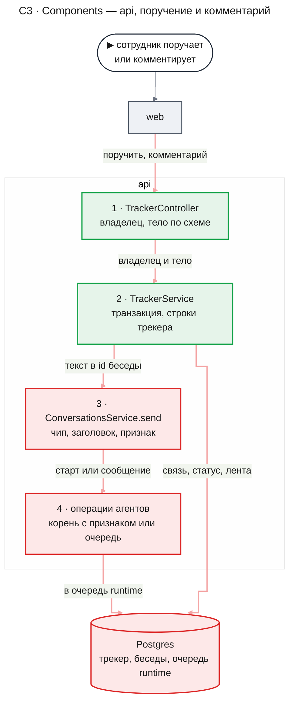
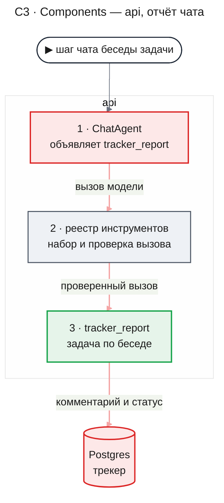
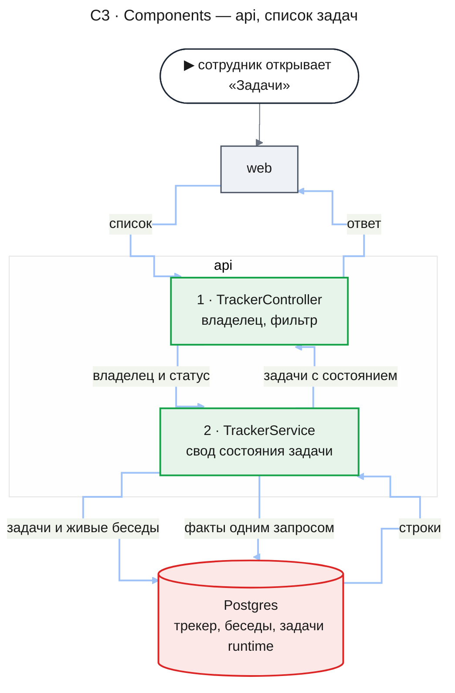
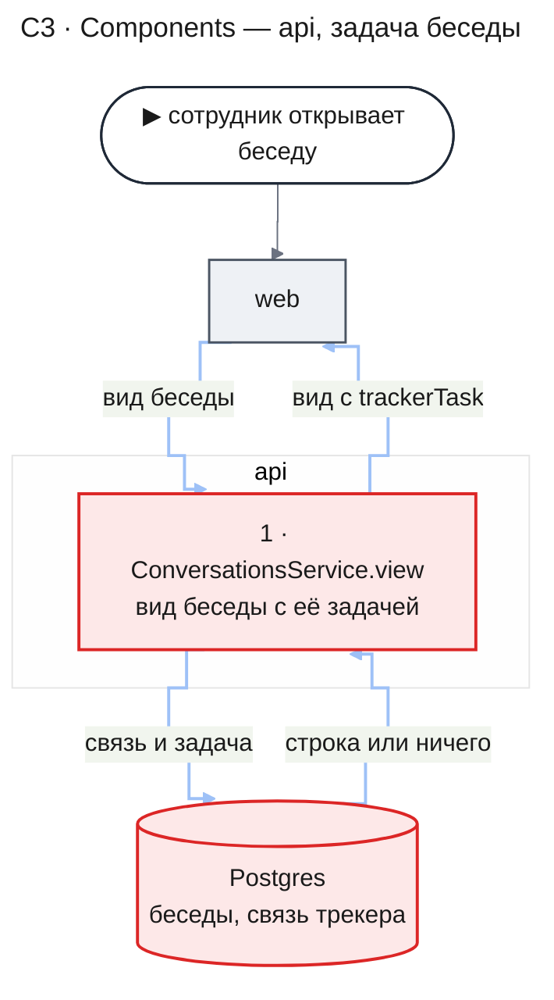
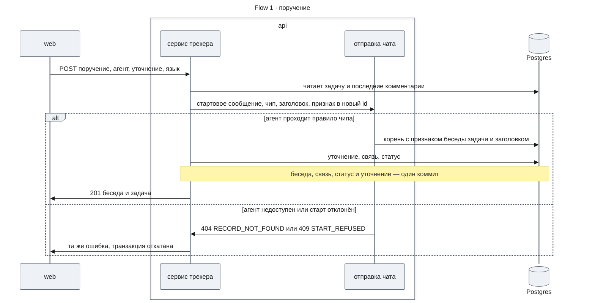
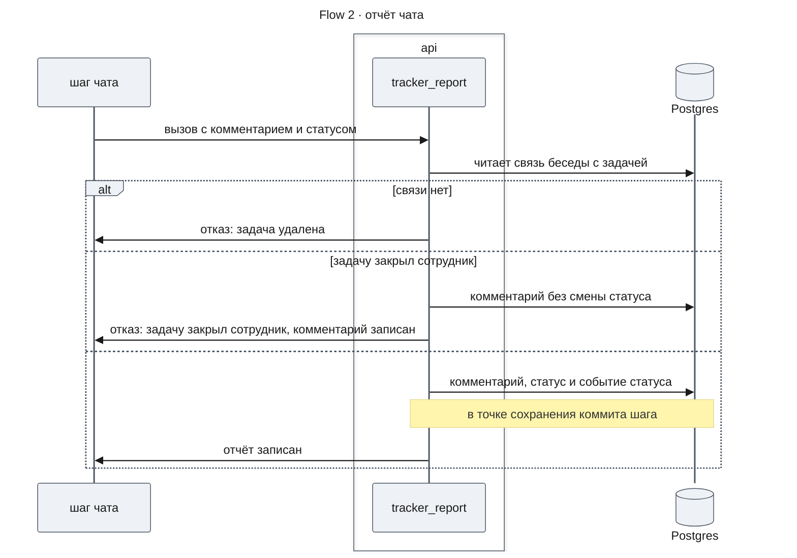
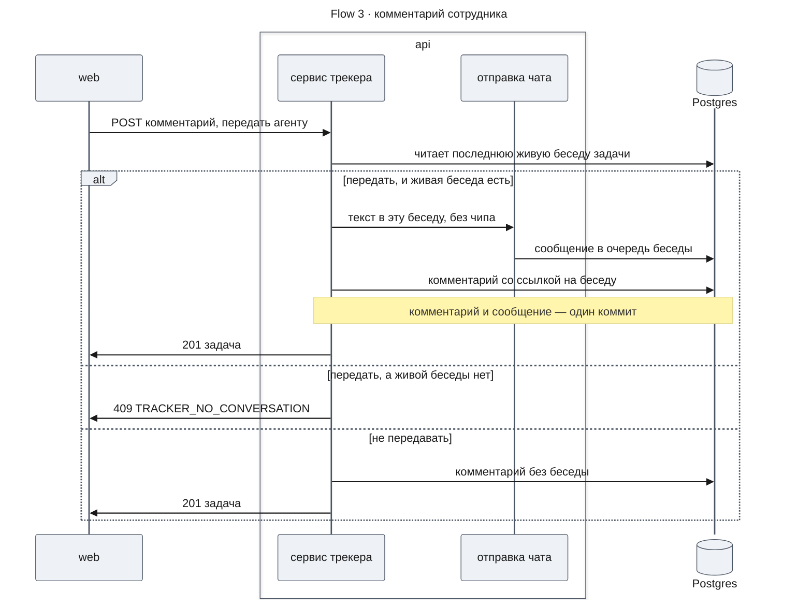
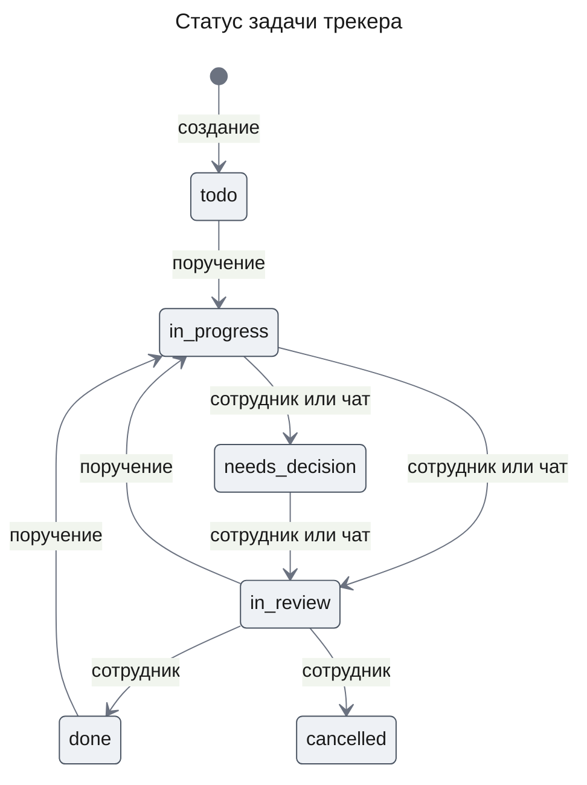

# Трекер задач с «поручить агенту» — Design Document — server

**Status:** На утверждении · **Date:** 2026-11-28 · **PRD:** [prd.md](./prd.md) · **UXRD:** [uxrd.md](./uxrd.md) · **Depends on:** нет

## Snapshot

**Overview.** Часть добавляет в `api` личный список задач сотрудника: задачи, их ленту из комментариев и смен статуса и связи задачи с беседами. Поручение — одна транзакция сервиса трекера: он собирает стартовое сообщение и отправляет его прежней отправкой чата в новый id беседы с заголовком — названием задачи, а затем пишет связь и статус «в работе». Корень такой беседы несёт во входе признак беседы задачи, и поэтому только его чат получает инструмент `tracker_report`; инструмент находит задачу по связи своей беседы, а не по аргументам. Комментарий с передачей агенту — обычное сообщение в последнюю живую беседу, закоммиченное вместе с комментарием. Какой задаче принадлежит беседа, вид беседы читает из связи, и веб подписывает по нему беседу задачи. Что делает каждая беседа, задача не хранит: состояние читается тем же запросом, что у списка бесед, а веб узнаёт об изменениях по событиям `change` бесед задачи.

- **Не меняется**: runtime, шаг агента, правило чипа, история бесед и её записи, права, квоты, карточки подтверждения и аудит вызовов — беседа задачи для них обычная беседа.
- **Главный риск**: чат на модели класса Haiku не вызывает `tracker_report` или не запускает выбранного агента по чипу ([Risks](#risks-and-mitigation)).

### Key Decisions

Ниже KD-n — решения этого дизайна; решения UXRD названы с приставкой «UXRD».

#### KD-1: Связь задачи с беседой — своя таблица, и по ней же вид беседы называет её задачу

Задаче нужно найти свои беседы, последнюю живую из них и их состояние (FR-06, FR-08), инструменту — задачу своей беседы (FR-07), а вебу — задачу открытой беседы для подписи (FR-12). Все три — запросы по связи, поэтому связь — строка таблицы `tracker_task_conversations`: задача, беседа, агент поручения с его именем и время. Вид беседы получает поле `trackerTask` — id и нынешнее название задачи из связи или `null`; записи истории не меняются. Отвергнуто: отметка задачи на каждом сообщении — ради подписи она прошла бы через запись истории, доставку, старт, форк и ленту веба, хотя задачу беседы связь уже знает; колонка задачи в `conversations` — таблица бесед узнала бы о трекере, а агенту поручения там нет места; свой маршрут трекера «задача беседы» — вебу понадобились бы ещё один запрос и ещё одно обновление там, где вид беседы он уже читает и перечитывает.

#### KD-2: Поручение — одна транзакция сервиса трекера вокруг отправки чата в новый id

Поручение должно оставить либо беседу, связь и «в работе» вместе, либо ничего (AC-04.4, AC-04.6). `TrackerService` открывает транзакцию, читает задачу, отправляет стартовое сообщение через `ConversationsService.send` в новый случайный id и пишет связь, статус и уточнение из диалога (UXRD KD-6). Отправка внутри транзакции вызывающего присоединяет к ней все свои записи, а объект агента runtime отдаётся только после коммита (schedules [design-schedules.md](../schedules-search-memory/design-schedules.md), KD-2). Отказ отправки — агент не проходит правило чипа (404 `RECORD_NOT_FOUND`), старт отклонён (409 `START_REFUSED`) — откатывает всю транзакцию, и ответ несёт ту же ошибку. Правило чипа проверяет сама отправка, так что своей копии правила у трекера нет.

Повтор запроса сервер не отсекает: кнопка поручения занята, пока запрос идёт, а два дошедших запроса дают две беседы, как два поручения подряд (AC-04.2). Отвергнуто: точка сохранения, как у расписаний, — там отказ должен израсходовать срок, а здесь отказ обязан не оставить ничего; отправка после коммита связи — рестарт между ними оставил бы задачу «в работе» без беседы; ключ повтора запроса — ни один критерий не просит отсекать повтор, а от двойного нажатия защищает занятая кнопка.

#### KD-3: Отправка чата принимает заголовок без расписания и признак беседы задачи

Поручению нужны от `ConversationsService.send` две вещи сверх сообщения с чипом: заголовок новой беседы без генерации заголовка моделью и признак беседы задачи во входе корня (KD-4). Последний параметр отправки сегодня — расписание с необязательным заголовком, и отправка с этим параметром генерацию не начинает. Расписание в параметре становится необязательным, рядом появляется необязательный признак, а правило «с параметром — без генерации» остаётся прежним. Запрос старта `StartOperations.start` получает тот же признак и кладёт его во вход корневой задачи; заголовок он уже пишет в транзакции создания корня. Срабатывание расписания передаёт то же, что сейчас. Переданный комментарий идёт в беседу с заголовком, а отправка в такую беседу генерацию не начинает, поэтому трекер шлёт его без параметра. Отвергнуто: параметры «источника» с отметками для истории — отметок у трекера нет (KD-1); свой метод отправки для трекера — второй путь с тем же правилом чипа; дописать признак во вход после отправки — объект агента строится в транзакции создания задачи из её входа и поздней правки не увидит.

#### KD-4: `tracker_report` есть только у чата беседы задачи: признак беседы задачи лежит во входе корневой задачи

AC-07.3 требует, чтобы вне беседы, открытой поручением, у чата инструмента не было. Предлагать его по живому чтению связи нельзя: вызов сверяется со статическим объявлением (`checkTools` по `agent.declaration`), и инструмент был бы предложен, но отклонён. Поэтому поручение кладёт признак беседы задачи во вход корневой задачи (`AgentTaskInputSchema`), а `ChatAgent` объявляет `tracker_report` в инструментах своего вида (`kindTools`), когда признак есть, — так `Trainer` объявляет инструменты тестового запуска по `testRun`. Вход задачи не меняется всю её жизнь и переживает рестарт, а форк строит корень с пустым входом. Задачу инструмент берёт по связи, которую находит по `ToolCaller.rootId`; id задачи в аргументах нет (AC-07.2).

Простое правило «инструмент у чата всегда, без связи — отказ» не трогает путь старта, но нарушает AC-07.3: описание и схема инструмента стоят в каждом шаге каждого чата, и модель класса Haiku получает повод звать его в обычной беседе рядом с инструментами MCP-сервера `tracker`. Признак стоит одного поля во входе задачи, одного поля запроса старта и одного переопределения `kindTools`.

Отчитывается чат, а не выбранный агент, — так решил PRD (Undetermined Items). Следствие: чип стартового сообщения — подсказка модели чата, а не команда платформы (`withChip`, `CHIP_RULE`), поэтому выбранного агента запускает модель чата, и она же переносит его итог на задачу. Дать инструмент выбранному агенту отвергнуто: признак пришлось бы передавать в старты, которые делает модель, и он дошёл бы до сабагентов.

#### KD-5: Комментарий с передачей агенту — одна транзакция с сообщением в последнюю живую беседу

Комментарий на задаче и сообщение в беседе должны появиться вместе и по одному разу (AC-08.5). `TrackerService` в одной транзакции находит последнюю по времени поручения живую беседу задачи, отправляет в неё текст комментария через `ConversationsService.send` без чипа и пишет комментарий со ссылкой на эту беседу. Если живой беседы нет или её удалили между чтением и отправкой, ответ — 409 `TRACKER_NO_CONVERSATION`, и не пишется ничего: веб не даёт включить передачу без беседы (AC-08.4), так что сюда попадает только гонка. Чипа у переданного комментария нет, поэтому он не запускает агента заново: его читает чат. Отвергнуто: точка сохранения с комментарием без передачи — сотрудник думал бы, что агент его получил; передача после коммита — рестарт между ними потерял бы сообщение.

#### KD-6: Состояние бесед — один запрос фактов на все живые беседы, свод по задаче — чистая функция

Состояние беседы уже определено (`improvements` FR-06): факты дерева читает `ConversationsRepository.stateFacts` одним запросом для любого набора корней, а состояние из них выводит `conversationState`. Трекер собирает id живых бесед всех задач списка или одной задачи, зовёт эти функции один раз и не выводит состояние сам. Состояние строки списка — чистая функция над состояниями бесед задачи: «ждёт вас», затем «сбой», «новый ответ», «работает» (AC-10.2); правило живёт на сервере, потому что состояния бесед есть только у него, а веб показывает готовое значение. `stateFacts` не отделяет удалённые беседы, поэтому удалённость трекер берёт из связи, соединённой с отметкой удаления задачи runtime, и у удалённой беседы состояния нет.

#### KD-7: Удаление задачи удаляет её строки каскадом и не трогает беседы

Удаление задачи — физическое: связь и лента уходят каскадом по ключу задачи, а беседы и их записи остаются (AC-09.2). Признак беседы задачи во входе корня остаётся, поэтому чат удалённой задачи по-прежнему видит `tracker_report`, а инструмент, не найдя связи, отвечает отказом «задача удалена» (AC-07.4). Вид беседы после удаления отдаёт `trackerTask: null`. Удаление беседы — отметка в runtime, и связь остаётся (AC-09.1). Ключ беседы в связи — каскад: строку `conversations` физически удаляет только удаление сотрудника, которое уносит и его задачи. Отвергнуто: удаление задачи отметкой — удалённую задачу никто не читает, а мягкое удаление отложено для всей платформы; ключи без правила удаления — удаление сотрудника упёрлось бы в них.

## Terms

- **Беседа задачи** — беседа, которую открыло поручение; у её корня есть признак беседы задачи, у неё есть строка связи.
- **Живая беседа** — беседа задачи, не удалённая сотрудником.
- **Лента задачи** — события задачи по времени: создание, поручения, комментарии сотрудника и чата, смены статуса.
- **Признак беседы задачи** — поле входа корневой задачи runtime, по которому чат объявляет `tracker_report` (KD-4).
- **Стартовое сообщение** — первое сообщение беседы задачи, его собирает сервис трекера (Contract Definitions, «Стартовое сообщение»).

## Part

- **Prerequisite ADRs**: [ADR-0022](../../adr/ADR-0022-one-database-and-nestjs-modules.md) — одна база, репозитории в `packages/db`, модули NestJS; [ADR-0023](../../adr/ADR-0023-live-task-objects-one-stepping-process.md) — один процесс шагов, без блокировок строк; [ADR-0024](../../adr/ADR-0024-every-reference-is-a-foreign-key.md) — каждая ссылка трекера — внешний ключ с правилом удаления.

Часть покрывает FR-01 – FR-09 и NFR-01 – NFR-03 и даёт части `web` задачу беседы для FR-12. Часть `web` строится на её контракте.

**Out of scope**

- Экраны, сайдбар, выбор агента, подпись в беседе и вкладка «План» (FR-10 – FR-13) — часть `web`. Список агентов для выбора — тот же, что берёт окно расписания; новой выдачи сервер не добавляет.
- Runtime, шаг агента и правило чипа: чат запускает агента по чипу стартового сообщения, как после сообщения вручную.
- История бесед: записи, доставка сообщений и форк не меняются.
- Права, квота, карточки подтверждения, «разрешить в этой беседе» и аудит вызовов в беседе задачи работают прежним путём (FR-05).
- Форк беседы задачи — обычная беседа: связи и признака у форка нет, поэтому нет ни `tracker_report`, ни задачи в виде беседы (PRD, Won't Have).
- Расписания: их отметка, подпись и правило вызовов не меняются.
- Уведомления вне экрана задачи и события потока `/api/events` — фича `live-feed`; трекер своих событий не добавляет.
- Защита от повтора запроса поручения и комментария: от двойного нажатия защищает занятая кнопка (KD-2).

**Constraints**

- **PoC.** Сжатая миграция `0000_schema.sql` генерируется заново по порядку из [design-conversation-search.md](../schedules-search-memory/design-conversation-search.md), тест миграций знает три новые таблицы, база разработки создаётся заново; записи не переносятся.
- **Изоляция (NFR-02).** Каждый маршрут берёт владельца из сеанса, и чужая задача отвечает так же, как отсутствующая; e2e с двумя сотрудниками проходит каждый маршрут.
- **Производительность (NFR-01).** Список и экран задачи читают каждую таблицу одним запросом по индексу задачи или владельца и зовут `stateFacts` один раз.
- **Журнал (NFR-03).** Каждое изменение задачи пишется в журнал с id задачи, сотрудника, беседы и агента и с длинами текстов, без самих текстов ([logging.md](../../code-system/patterns/logging.md)).

## Building-block Inventory

Follows the [code system](../../code-system/README.md).

| Building block | Pattern | Status | Note |
|---|---|---|---|
| Таблицы `tracker_tasks`, `tracker_task_conversations`, `tracker_task_events`, их `TrackerTasksRepository` | [repository-over-transaction.md](../../code-system/patterns/repository-over-transaction.md) | new | искали среди `conversation_tasks` и `schedules`: план беседы и расписание — другие сущности (KD-1) |
| `TrackerService`, `TrackerController`, модуль `apps/api/src/tracker/` | [auth-boundary.md](../../code-system/patterns/auth-boundary.md) | new | устроены как `apps/api/src/schedules/`: владелец из `req.user`, одна 404 на чужое и отсутствующее |
| Сборка стартового сообщения, свод состояния задачи | [pure-decision.md](../../code-system/patterns/pure-decision.md) | new | чистые функции рядом со службой |
| `tracker_report` и его регистрация в `onModuleInit` | [tool-declaration.md](../../code-system/patterns/tool-declaration.md) | new | регистрация как у `RecordToolsRegistration`, режим `in_commit` |
| `ChatAgent` (инструменты вида), `AgentTaskInputSchema` | [tool-declaration.md](../../code-system/patterns/tool-declaration.md) | extended | признак беседы задачи, как `testRun` у `Trainer` (KD-4) |

## Acceptance Criteria

DC-n ниже — критерии этого дизайна.

### FR-01: свои задачи

- From the PRD: AC-01.1, AC-01.2, AC-01.3, AC-01.4.
- Когда тело создания или правки не проходит схему — пустое или слишком длинное название, слишком длинное описание, правка без полей, неизвестный статус, — маршрут отвечает 400 `VALIDATION_FAILED`, и задача не меняется (DC-1).
- Когда id задачи не uuid, задачи нет или она чужая, любой маршрут задачи отвечает 404 `TRACKER_TASK_NOT_FOUND` (DC-2).

### FR-02: статусы и кто их ставит

- From the PRD: AC-02.1, AC-02.2, AC-02.3.
- Когда сотрудник правкой или чат через `tracker_report` действительно меняют статус, в ленте появляется событие смены статуса с тем, кто его сменил; смена на тот же статус события не пишет (DC-3).

### FR-03: комментарии

- From the PRD: AC-03.1, AC-03.2.

### FR-04: поручить агенту

- From the PRD: AC-04.1, AC-04.2, AC-04.3, AC-04.4, AC-04.5, AC-04.6.
- Поручение принимает ровно тех агентов, кого принимает чип сообщения чата, и агента чата (`agentId: null`); для AC-04.3 этого достаточно, потому что окно расписания предлагает тот же набор.
- Когда поручение несёт уточнение, уточнение стоит в ленте комментарием сотрудника раньше события поручения и входит в стартовое сообщение; при отказе поручения уточнения на задаче нет (DC-4).

### FR-05: беседа задачи — обычная беседа

- From the PRD: AC-05.1, AC-05.2. Нового кода нет: карточка — задача-вопрос в дереве беседы, и `stateFacts` даёт «ждёт вас».

### FR-06: состояние бесед на задаче

- From the PRD: AC-06.1, AC-06.2, AC-06.3.

### FR-07: отчёт на задаче

- From the PRD: AC-07.1, AC-07.2, AC-07.3, AC-07.4.
- Когда беседа задачи форкнута, у чата форка `tracker_report` нет, и форк не связан с задачей (DC-5).

### FR-08: комментарий уходит агенту

- From the PRD: AC-08.2, AC-08.3, AC-08.4, AC-08.5. AC-08.1 — поведение веба; сервер отдаёт цель передачи (`forwardTo`).
- Когда тело просит передать комментарий, а живой беседы у задачи нет, маршрут отвечает 409 `TRACKER_NO_CONVERSATION`, и не пишется ничего (DC-6).

### FR-09: удаление задачи и беседы не трогает друг друга

- From the PRD: AC-09.1, AC-09.2.

### FR-12: задача беседы для части `web`

- Когда беседа связана с задачей, вид беседы отдаёт `trackerTask` с id и нынешним названием задачи; у беседы без связи, у форка и после удаления задачи — `null` (DC-7).

### NFR-01 – NFR-03

- NFR-01 держат индексы и один запрос фактов (KD-6); тестом число не проверяется.
- NFR-02 — e2e с двумя сотрудниками на каждый маршрут, включая поручение и комментарий.
- NFR-03 — журнал из Security Considerations.

## Design

### Architecture (C1–C4)

Новых контейнеров и внешних систем нет: трекер — новый модуль процесса `api`, его таблицы — в той же базе Postgres. Поэтому C1 и C2 не меняются, а C3 показывает четыре пути внутри `api`.

#### C3 · Components: api

**api — поручение и комментарий**

- **`TrackerService`** держит все правила трекера: владение задачей, переходы статуса, сборку стартового сообщения, выбор последней живой беседы, свод состояния и журнал. Транзакцию поручения и передачи открывает он. Его зависимости: `Db`, `TrackerTasksRepository`, `ConversationsRepository` для фактов состояния, `ConversationsService`, часы и журнал. Модуль трекера импортирует `ChatModule` ради `ConversationsService`, а `ChatModule` модуля трекера не импортирует.
- **`ConversationsService.send`** принимает в последнем параметре заголовок и признак беседы задачи без расписания (KD-3). Переданный комментарий она отправляет как сообщение вручную.
- **Операции агентов** — `StartOperations.start` кладёт признак во вход корневой задачи, а заголовок пишет в транзакции создания корня, как для расписания. `ControlOperations.send` ставит переданный комментарий в очередь беседы без изменений.

**api — отчёт чата беседы задачи**

- **`ChatAgent`** объявляет `tracker_report` в инструментах своего вида, когда во входе его задачи есть признак беседы задачи (KD-4). Агенты, которых он запускает, — другие задачи без признака, и инструмента у них нет.
- **Реестр инструментов** не меняется: инструмент попадает в набор по имени из объявления, а аргументы проверяет схема инструмента до его запуска.
- **`tracker_report`** зарегистрирован из модуля трекера и работает в режиме `in_commit`: его записи ложатся в точку сохранения коммита шага вместе с его `tool_result`, поэтому повторённый после рестарта шаг не пишет дважды. Свои правила он берёт у `TrackerService`.

**api — список задач с состоянием бесед**

Первое чтение отдаёт задачи сотрудника со связями их живых бесед, второе — факты состояния всех этих бесед из `ConversationsRepository.stateFacts` (KD-6). Экран одной задачи читает так же: задачу, её ленту, все её связи с названиями и живостью бесед и факты живых бесед. Нового события в потоке `/api/events` трекер не добавляет: веб перечитывает задачу по событиям `change` её бесед (AC-11.1). Вызов `tracker_report` коммитится в коммите шага чата, где `History.append` пишет его `tool_result` и шлёт `change` `entries` этой беседы, а запись статуса корня в конце хода даёт ещё `change` `state` ([live-feed design-server.md](../live-feed/design-server.md#how-the-change-kinds-are-derived)). Какие чтения меняет каждый вид, говорит таблица `LiveChangeKind` ([Contract Definitions](../live-feed/design-server.md#contract-definitions)).

**api — задача в виде беседы**

`ConversationsService.view` после проверки владельца читает связь по id беседы вместе с названием задачи одним запросом `TrackerTasksRepository`, который строит `DbModule`; модуля трекера `ChatModule` для этого не импортирует. Название приходит нынешнее при каждом чтении вида, а удалённая задача уносит связь, и поле становится `null` (KD-7). Тот же запрос по беседе даёт задачу инструменту `tracker_report`.

### Runtime Flows

#### Flow 1: сотрудник поручает задачу агенту

**Starts when:** сотрудник выбирает «Поручить» в диалоге, для AC-04.1, AC-04.2, AC-04.4, AC-04.5, AC-04.6, DC-4.

Поручение не пишет события `status`: переход в «в работе» показывает запись ленты `delegated`. Генерации заголовка моделью у беседы задачи нет (KD-3). Квоту отправка не проверяет: при исчерпанной квоте беседа создаётся и связывается, а агент в ней заканчивается сбоем на шаге модели (AC-04.5). Два поручения подряд — и два дошедших повтора одного запроса — дают две беседы и две связи; более позднее становится целью передачи комментариев (AC-04.2). Если задачу удалили между чтением и записью связи, ключ связи не даёт вставки, транзакция откатывается, и ответ — 404 `TRACKER_TASK_NOT_FOUND`.

#### Flow 2: чат беседы задачи отчитывается

**Starts when:** модель чата беседы задачи вызывает `tracker_report`, для AC-02.2, AC-02.3, AC-03.1, AC-06.3, AC-07.1, AC-07.2, AC-07.4.

Статус, которого нет среди «на проверке» и «нужно решение», отклоняет проверка аргументов до запуска инструмента: отказ `invalid_arguments`, и его текст называет разрешённые значения (AC-02.2). Отказы инструмента — тоже `invalid_arguments` с текстом причины. Комментарий из беседы записан от имени агента поручения этой беседы (AC-03.1). Проверка «задача закрыта» и смена статуса — одна запись, поэтому чат не открывает задачу, которую сотрудник закрыл в тот же момент. Текст ответа чата инструмент не читает: без вызова на задаче ничего не меняется (AC-06.3).

#### Flow 3: сотрудник пишет комментарий

**Starts when:** сотрудник сохраняет комментарий на экране задачи, для AC-03.2, AC-08.2, AC-08.3, AC-08.4, AC-08.5, AC-09.1, DC-6.

Сообщение встаёт в очередь беседы, даже если чат ещё отвечает или ждёт решения сотрудника, как сообщение вручную (AC-08.2); остановленный чат продолжает работу по этому сообщению (`ControlOperations.send`). Если беседу удалили между чтением и отправкой, отправка отвечает «беседы нет», транзакция откатывается, и ответ — тот же 409 `TRACKER_NO_CONVERSATION`.

### Contract Definitions

#### Маршруты

Все маршруты — под `/api/tracker/tasks`, за `SessionGuard`; владелец — сотрудник сеанса, администратор чужих задач не видит. Тела и ответы — схемы `packages/contracts`, ошибка — код и сообщение в общей форме ошибок API. Каждый маршрут с `:id` отвечает на чужую, отсутствующую и негодную задачу одинаково: 404 `TRACKER_TASK_NOT_FOUND`.

- **`GET /api/tracker/tasks?status=`** — задачи сотрудника, недавно изменённые сверху. С `status` — только задачи этого статуса; без него — все, кроме `done` и `cancelled` (AC-01.3). Возвращает `TrackerTaskListResponse`. Неизвестный статус — 400 `VALIDATION_FAILED`.
- **`POST /api/tracker/tasks`** — создаёт задачу в статусе `todo` из тела `TrackerTaskCreateBody` и возвращает 201 `TrackerTaskView`. 400 `VALIDATION_FAILED` — тело не по схеме.
- **`GET /api/tracker/tasks/:id`** — `TrackerTaskView`.
- **`PATCH /api/tracker/tasks/:id`** — меняет название, описание или статус телом `TrackerTaskPatchBody` и возвращает `TrackerTaskView`. Сотрудник ставит любой статус; беседы задачи смена статуса не трогает (AC-02.1). 400 `VALIDATION_FAILED` — тело без полей или не по схеме.
- **`DELETE /api/tracker/tasks/:id`** — удаляет задачу с её лентой и связями; беседы остаются и работают (AC-09.2). 204.
- **`POST /api/tracker/tasks/:id/comments`** — комментарий сотрудника из тела `TrackerCommentBody` и, при `forward: true`, сообщение в `forwardTo` задачи (KD-5). Возвращает 201 `TrackerTaskView`. 409 `TRACKER_NO_CONVERSATION` — передача без живой беседы, ничего не записано (DC-6).
- **`POST /api/tracker/tasks/:id/delegations`** — поручение из тела `TrackerDelegationBody` (KD-2). Возвращает 201 `TrackerDelegationResponse`. 404 `RECORD_NOT_FOUND` — агент не проходит правило чипа сотрудника (AC-04.4); 409 `START_REFUSED` с причиной — старт беседы отклонён; в обоих случаях ничего не записано.

**`TrackerTaskStatus`** — `todo` («к выполнению»), `in_progress` («в работе»), `in_review` («на проверке»), `needs_decision` («нужно решение»), `done` («готово»), `cancelled` («отменена»).

**`TrackerTaskCreateBody`** — `title`, от 1 до 200 символов без крайних пробелов (`THREAD_TITLE_MAX_LENGTH`: название становится заголовком беседы); `description` — до 6000 символов, по умолчанию пустое.

**`TrackerTaskPatchBody`** — хотя бы одно из `title`, `description`, `status` с теми же правилами.

**`TrackerCommentBody`** — `text`, от 1 до 4000 символов без крайних пробелов; `forward` — передать ли агенту.

**`TrackerDelegationBody`** — `agentId`: id агента или глубокого агента из меню «+», `null` — агент чата; `note` — необязательное уточнение с пределами `text` комментария; `language` (`LanguageSchema`) — язык стартового сообщения.

**`TrackerTaskSummary`** — строка списка.

- `id`, `title`, `status`, `updatedAt` — время последнего изменения задачи: правки, смены статуса, комментария, поручения или отчёта.
- `state` — состояние бесед задачи для строки: то из состояний живых бесед, что раньше требует сотрудника, — `waiting_for_you`, затем `failed`, `new_answer`, `working` (AC-10.2); `null`, когда все живые беседы прочитаны и стоят без дела или живых бесед нет.

**`TrackerTaskListResponse`** — `tasks`, массив `TrackerTaskSummary`.

**`TrackerTaskView`** — экран задачи.

- `id`, `title`, `description`, `status`, `createdAt`, `updatedAt`.
- `conversations` — беседы задачи, последнее поручение первым, удалённые тоже (`TrackerTaskConversation`).
- `feed` — лента задачи по времени, старые сверху (`TrackerFeedItem`).
- `forwardTo` — куда уйдёт переданный комментарий: `conversationId` и `title` последней по времени поручения живой беседы; `null`, когда живой беседы нет (AC-08.4).

**`TrackerTaskConversation`** — одна беседа задачи.

- `id`, `title` — заголовок беседы сейчас, и у удалённой тоже.
- `agent` — агент поручения: `null` для агента чата, иначе `id` и `name` на момент поручения; `id` равен `null`, если записи агента больше нет в базе. Веб берёт отсюда агента для выбора по умолчанию (UXRD KD-6).
- `delegatedAt` — время поручения.
- `deleted` — беседа удалена; тогда `state` равно `null`, а веб показывает её без ссылки (AC-09.1).
- `state` — `ConversationState` или `null`, то же, что у беседы в списке бесед (AC-06.1, AC-06.2).

**`TrackerFeedItem`** — запись ленты по `kind`, у каждой `at` — время.

- `created` — задача создана.
- `delegated` — поручение: `conversationId`; агент — у этой беседы в `conversations`.
- `comment` — `id`, `author` (`employee` или `agent`), `text`, `conversationId`. У комментария агента это беседа, из которой он пришёл, и автор — агент поручения этой беседы; у комментария сотрудника — беседа, куда он передан, или `null` (AC-03.1, AC-03.2).
- `status` — `status`, ставший у задачи, `author` (`employee` или `agent`) и `conversationId` беседы агента или `null`.

**`TrackerDelegationResponse`** — `conversationId` новой беседы и `task` — `TrackerTaskView` после поручения (AC-12.1).

**Error handling.** Свои коды: `TRACKER_TASK_NOT_FOUND` (404) и `TRACKER_NO_CONVERSATION` (409). Остальные уже есть в API: `VALIDATION_FAILED` (400), `RECORD_NOT_FOUND` (404) и `START_REFUSED` (409).

#### Задача в виде беседы

- **`trackerTask`** — новое поле `ConversationView` (`GET /api/threads/:threadId/history`, [design-chat.md](../agent-platform/design-chat.md)): `id` и `title` — нынешнее название задачи, когда беседа связана с задачей; `null` у беседы без связи, у форка и после удаления задачи (DC-7). Сервер отдаёт поле в каждом ответе; остальные поля вида и записи истории не меняются (KD-1).

#### Инструмент `tracker_report`

- **`tracker_report`** — инструмент чата беседы задачи; имя — константа в `packages/contracts`. Аргументы: `comment` — текст до 4000 символов, и `status` — `in_review` или `needs_decision`; нужен хотя бы один из двух. Id задачи он не принимает: задачу даёт связь беседы вызова (AC-07.2). Исходы: «отчёт записан» — комментарий в ленте от агента и смена статуса с событием (AC-07.1); отказ «задача удалена» — ничего не записано (AC-07.4); отказ «задачу закрыл сотрудник» — статус `done` или `cancelled` не меняется, а комментарий того же вызова записан (AC-02.3); недопустимый статус — отказ проверки аргументов (AC-02.2). Отказ читает модель чата в `tool_result`. Вызов поднимает `updatedAt` задачи только тогда, когда что-то записано.

#### Стартовое сообщение

Стартовое сообщение видят и сотрудник в беседе, и модель чата, поэтому его содержание — контракт поручения. Его собирает чистая функция на языке `language` из тела поручения:

- название и описание задачи;
- до трёх последних комментариев ленты, старые сверху, с автором — «вы» или имя агента; уточнение из тела поручения — последний из них;
- правила отчёта: вызывать `tracker_report` с комментарием о ходе работы, ставить `in_review`, когда работа готова, и `needs_decision`, когда нужно решение сотрудника; переносить на задачу итог агента, которого чат запустил;
- чип выбранного агента — как у сообщения с чипом, набранного руками; у агента чата чипа нет, и чат работает над задачей сам.

Пределы тел держат сообщение в пределе `CHAT_MESSAGE_MAX_LENGTH`: название, описание и три комментария вместе с правилами короче его.

### Data Model

Пример. Аня создаёт задачу «Разобрать алерты за выходные» и поручает её агенту «Сводка дежурства» с уточнением «Возьми и стейдж тоже». В одной транзакции появляются комментарий-уточнение, беседа X «Разобрать алерты за выходные» с признаком беседы задачи во входе корня, связь задачи с X и статус «в работе». Вид беседы X отдаёт задачу Ани. Чат X запускает агента, затем вызывает `tracker_report` с комментарием и `in_review`: в ленте — комментарий агента из X и событие статуса. Аня удаляет X и пишет комментарий с передачей: у задачи нет живой беседы, и ответ — 409.

Имена трекера начинаются с `tracker`: в коде уже заняты `conversation_tasks`, `runtime_tasks`, `TaskStatus`, `SessionTask*`, `ConversationTasksRepository` и инструменты `task_*`.

- **`tracker_tasks`** — задача: владелец (ключ на `identity_users`, каскад), название, описание, статус (CHECK по `TrackerTaskStatus` через `isOneOf`), время создания и изменения. Индекс по владельцу и времени изменения держит список.
- **`tracker_task_conversations`** — связь: задача (каскад), беседа — ключ на корень в `conversations` (каскад), агент поручения — ключ на `agents` с обнулением и его имя на момент поручения; оба `null` у агента чата. Имя хранится в связи, потому что ключ агента обнуляется при удалении его записи, а имя нужно ленте и экрану. Беседа — первичный ключ: беседа принадлежит не больше чем одной задаче, и по нему же вид беседы и `tracker_report` находят её задачу. Индекс по задаче и времени поручения даёт последнюю живую беседу.
- **`tracker_task_events`** — комментарии и смены статуса: единственные события ленты, которых больше нигде нет. Задача (каскад), вид (`comment` или `status`), автор (`employee` или `agent`), беседа — ключ на `conversations` с обнулением, текст комментария или новый статус, время. CHECK держит, что у комментария есть текст, а у события статуса — статус. Индекс по задаче и времени.

Событие создания служба строит из задачи, а событие поручения — из связи. Имя агента в ленте и на экране — имя из связи беседы.

Правила, которые держат схема и служба:

1. Связь есть тогда и только тогда, когда корень её беседы закоммичен с ней в одной транзакции поручения.
2. У корня есть признак беседы задачи тогда и только тогда, когда его создало поручение; удаление задачи признак не снимает.
3. Строка ленты после вставки не меняется: лента только растёт.
4. Переданный комментарий и его сообщение в беседе закоммичены вместе.

### State Transitions and Invariants

Диаграмма показывает обычный ход поручения. Сотрудник может поставить любой статус из любого, а поручение ставит `in_progress` из любого статуса (AC-04.2); эти переходы не нарисованы, чтобы схема читалась.

**Invariants**

1. Чат беседы задачи ставит только `in_review` и `needs_decision` и только задаче, которая не в `done` и не в `cancelled`.
2. Статус не выводится из текста беседы и её состояния: его меняют только маршруты сотрудника, поручение и `tracker_report` (AC-06.3).
3. Смена статуса не останавливает беседы и не пишет в них (AC-02.1).
4. Удаление задачи не трогает беседы, а удаление беседы не трогает задачу (FR-09).

## Security Considerations

- **Authentication & Authorization**: маршруты за `SessionGuard`, владелец из `req.user`, каждое чтение и запись задачи идёт с условием владельца, и чужая задача отвечает 404 как отсутствующая — администратору тоже (AC-01.4). Поручение и передача отправляют от имени владельца через отправку чата, поэтому агент проверяется правилом чипа, а беседа дальше живёт по правам, квоте и подтверждениям владельца (FR-05). `tracker_report` берёт задачу только из связи беседы своего вызова, поэтому чат не дотягивается до чужой или другой своей задачи (AC-07.2). Вид беседы читает связь только после проверки владельца беседы, а беседу задачи открывает только её владелец, поэтому чужая задача в вид не попадает.
- **Input Validation**: тела и аргументы инструмента — схемы `packages/contracts`; id задачи — проверка uuid до запроса; статус — закрытый набор и CHECK в базе.
- **Sensitive Data Handling**: название, описание и тексты комментариев попадают только в задачу и беседы владельца. Журнал на каждое изменение — создание, правку, смену статуса, комментарий, поручение, передачу, вызов `tracker_report` и его отказ, удаление — пишет id задачи, владельца, беседы и агента, статус, длины текстов, исход и длительность, без самих текстов (NFR-03); `tracker_report` отдаёт в журнал аргументов только статус и длину комментария. Нового вида событий аудита нет: задача — собственная запись сотрудника, как расписание, а вызов `tracker_report` остаётся в истории беседы своим `tool_result` и в журнале.

## Risks and Mitigation

- **Чат не вызывает `tracker_report`** — высокое влияние, средняя вероятность. Правила отчёта стоят в стартовом сообщении и в описании инструмента, а состояние беседы на задаче показывает работу и без отчёта (FR-06). Насколько это помогает, владелец проверит на реальных задачах (PRD, Assumptions and Risks).
- **Чат не запускает выбранного агента по чипу или не переносит его итог** — среднее влияние, средняя вероятность. Чип — подсказка модели, как в любом сообщении с чипом (KD-4); сотрудник видит в беседе, кто работал.
- **Переданный комментарий читает чат, а не работающий агент** — среднее влияние. Чат передаёт его агенту своими инструментами или отвечает сам; без чипа комментарий не запускает агента заново.
- **Модель путает `tracker_report` с инструментами MCP-сервера `tracker` из тестового набора** — низкое влияние. Инструмент есть только в беседе задачи, а его описание говорит, что он пишет на задачу сотрудника.
- **Список закрытых задач растёт без страниц** — низкое влияние для PoC: по умолчанию закрытые скрыты, а фильтр закрытого статуса отдаёт их все.

## Update History

| Version | Date | Change |
|---------|------|--------|
| 1.0 | 2026-11-28 | Initial version |
| 1.1 | 2026-11-28 | Живое обновление задачи — по событиям `change` бесед задачи из live-feed. Упрощение: задачу беседы отдаёт её вид по связи вместо отметки на каждом сообщении истории (KD-1, DC-7); отправка чата принимает заголовок и признак беседы задачи без расписания (KD-3); от повтора запроса поручения и комментария защищает занятая кнопка, а не сервер (KD-2) |
