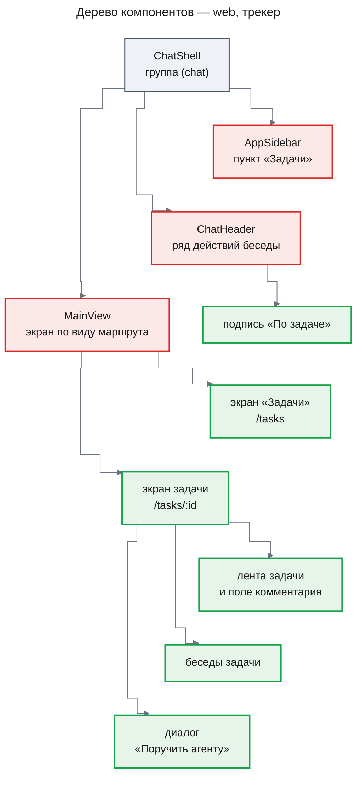
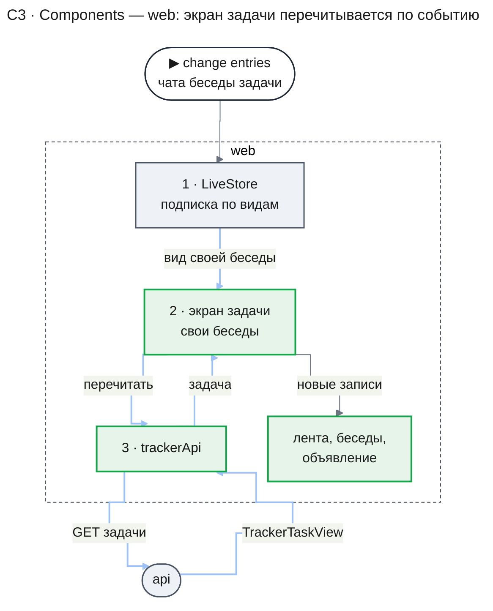
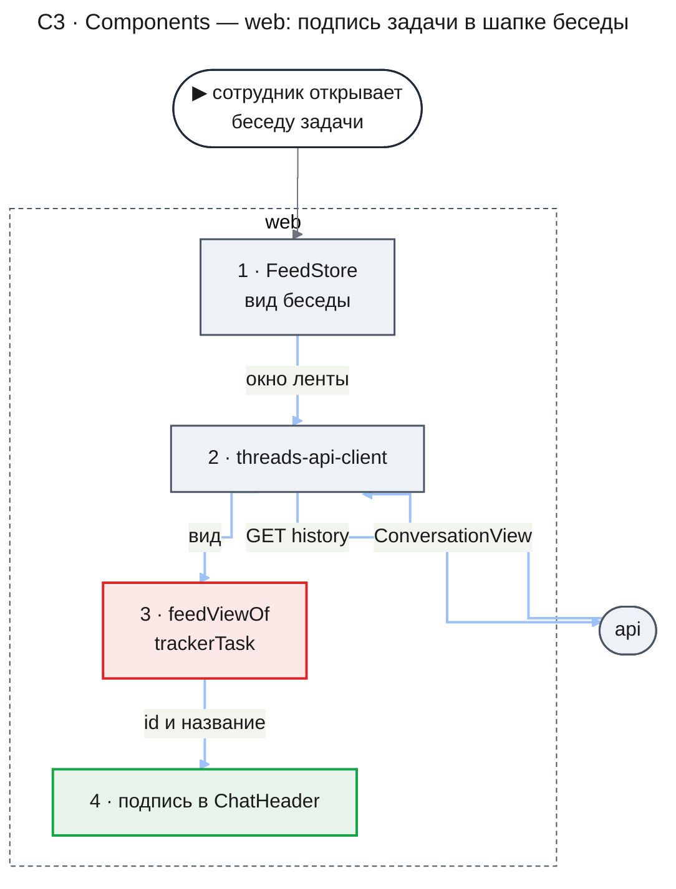
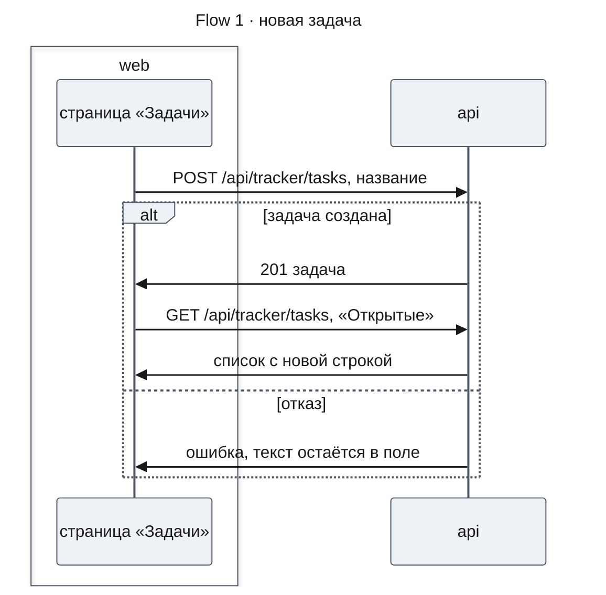
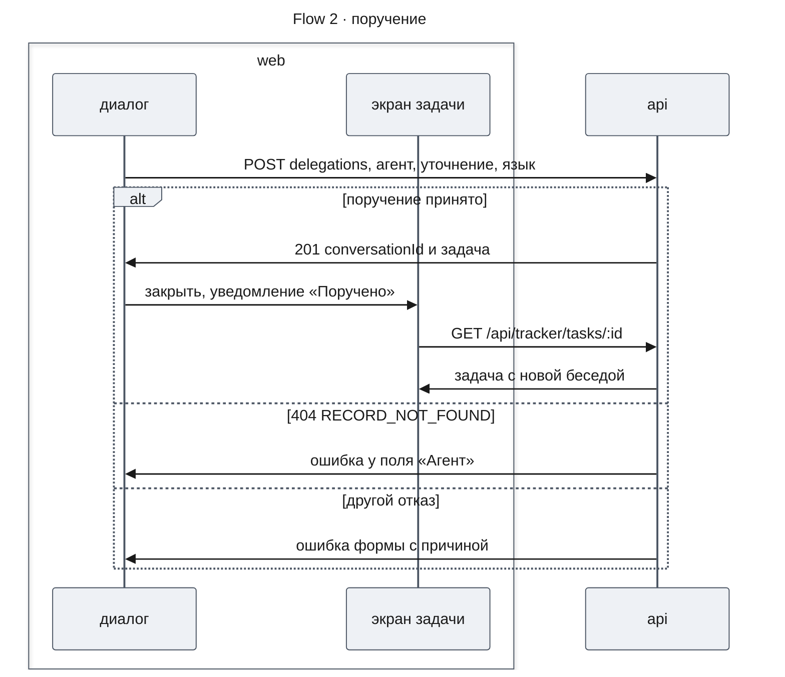
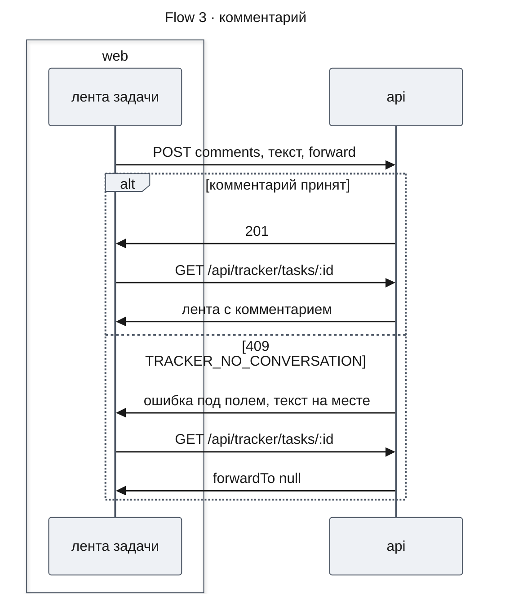
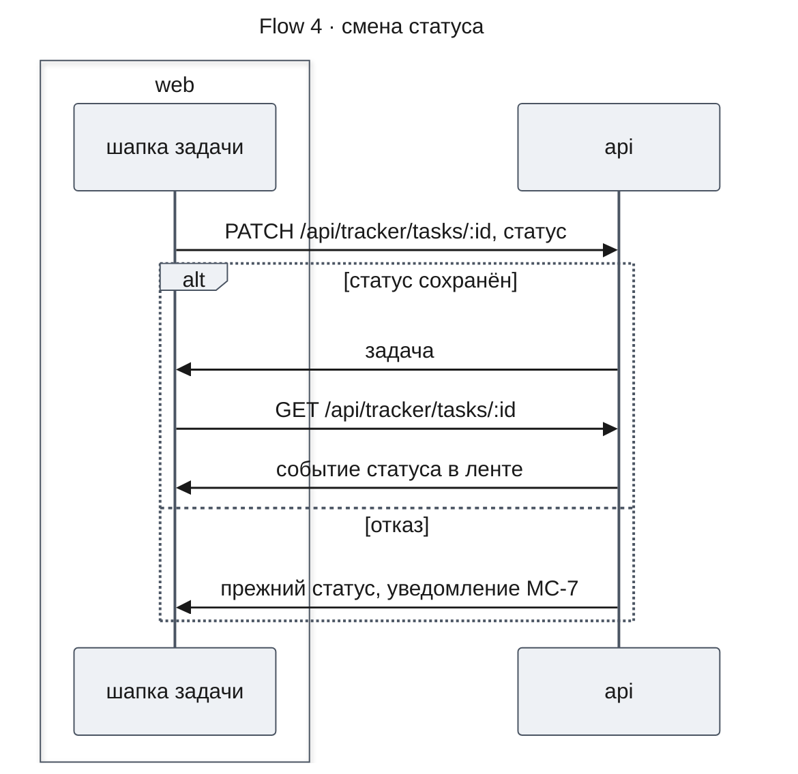
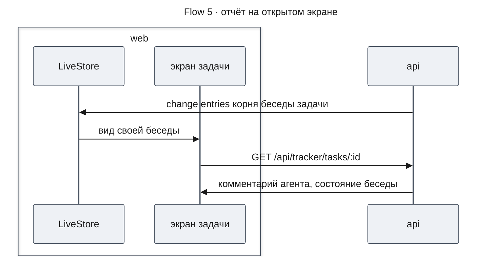

# Трекер задач с «поручить агенту» — Design Document — web

**Status:** На утверждении · **Date:** 2026-11-28 · **PRD:** [prd.md](./prd.md) (v1.2) · **UXRD:** [uxrd.md](./uxrd.md) (v1.1) · **Depends on:** [design-server.md#contract-definitions](./design-server.md#contract-definitions)

## Snapshot

**Overview.** Часть добавляет в оболочку чата два экрана по адресам `/tasks` и `/tasks/:id` и пункт «Задачи» первым в разделах сайдбара. Оба экрана устроены как страницы расписаний: читают свои данные при открытии, перечитывают их после своего действия и по живым событиям бесед. Поэтому комментарий агента и новое состояние беседы встают на экран задачи без перезагрузки. Диалог «Поручить агенту» берёт агентов из того же списка, что «+» и `@` в поле сообщения, и тем же полем «Агент», что окно расписания. В шапке беседы задачи стоит одна подпись «По задаче «…»»; её даёт поле `trackerTask` вида беседы, которое лента уже читает. Вкладка плана у беседы и у глубокого агента меняет только тексты: «План», «шаг».

- **Не меняется**: лента беседы, сообщения и их подписи, поле ввода, отправка сообщений с `sendKey`, поток событий и его виды, страницы расписаний.
- **Главный риск**: статус, поставленный отчётом агента, встаёт в список задач только с ближайшим `state` беседы ([Risks](#risks-and-mitigation)).
- **Открытые вопросы**: [Open Questions](#open-questions) — слово «задача» о плане вне MC-15; блокирующих нет.

### Key Decisions

#### KD-1: Два экрана — виды маршрута оболочки по образцу расписаний, а пункт «Задачи» — первый в `SectionNavItems`

Экраны ложатся на [shell-route.md](../../code-system/patterns/shell-route.md) так же, как `schedules` и `schedule`: два новых вида в `parseShellRoute`, функции адресов списка и задачи, одна пустая страница `app/(chat)/tasks/[[...path]]/page.tsx`, ветки в `MainView`, `isPageRoute` и `AppSidebar`. Адрес `/tasks` свободен: путь `/agents/:id/tasks` разбирается своей веткой и не меняется. Пункт сайдбара — ещё один `SectionNavItem` перед «Агентами»; отметка текущего раздела, подсказка свёрнутой полосы и закрытие шторки на телефоне у него от этого компонента. Простого варианта проще шаблона нет: шаблон и есть самый короткий путь в оболочку.

#### KD-2: Свежесть — `useResource`, перечитывание после своего действия и по видам `change` бесед; своего канала нет

Оба экрана читают данные `useResource` ([read-on-open.md](../../code-system/patterns/read-on-open.md)), после своего действия зовут `reload()` и перечитывают по подписке живого стора по видам из live-feed ([design-web.md, KD-1](../live-feed/design-web.md#kd-1-виды-изменения-фильтрует-подписка-живого-стора-неизвестный-вид-идёт-путём-ready)):

- **Список** перечитывается по `state`, `summary`, `deleted` любой беседы и по `ready`. Это ровно подписка списка расписаний, поэтому список трекера берёт тот же хук `useReloadOnAnyTree` из `schedule-parts.tsx` в его виде после live-feed; второй пользователь переносит хук в `src/hooks`.
- **Экран задачи** перечитывается по `entries` корневого агента, `state`, `summary` и `deleted` своих бесед и по `ready`. Свои беседы — id из `conversations` последнего ответа. Это правило ленты беседы из таблицы live-feed, только по нескольким беседам. `entries` корня нужен, потому что отчёт `tracker_report` пишет чат-корень, и сигнал его коммита — `entries` и `state` беседы ([design-server.md](./design-server.md), C3 «список задач»).

Неудачное перечитывание не стирает экран: экран задачи держит последний прочитанный `TrackerTaskView` сам и при ошибке перечитывания показывает его дальше, а ошибку только пишет в лог. Поле комментария и его текст поэтому не пропадают. Экран ошибки — только при неудаче первого чтения; 404 при перечитывании ведёт на «Задача не найдена». Отвергнуто: держать данные при ошибке в самом `useResource` — общий хук сменил бы поведение страниц библиотеки, панели и расписаний ради одного экрана.

Ответ своего изменения экран не показывает вместо чтения: он только закрывает диалог или очищает поле, а данные даёт `reload()`, как требует шаблон. Отвергнуто: только перечитывание при возврате на экран — нарушает AC-11.1. Список на `entries` любой беседы — список не знает id бесед своих строк, и каждая запись любого агента читала бы весь список. Поэтому статус, поставленный отчётом, встаёт в список с ближайшим `state` этой беседы — когда чат закончит ход и беседа станет «новым ответом».

#### KD-3: Группы и фильтр — в вебе над готовым списком; состояние строки берётся из ответа

Сервер отдаёт открытые задачи недавно изменёнными сверху, а при `status` — только этот статус ([Contract](./design-server.md#маршруты)). Веб раскладывает открытые по группам KD-2 UXRD одной чистой функцией ([pure-decision.md](../../code-system/patterns/pure-decision.md)) и не сортирует сам. Фильтр — состояние экрана и ключ `useResource`: при уходе со страницы оно пропадает, поэтому при возврате стоит «Открытые», как требует TT-02. Состояние бесед в строке — поле `state` ответа (AC-10.2): правило «что раньше требует сотрудника» держит сервер, веб его не повторяет. Отвергнуто: фильтр в адресе — UXRD просит сбрасывать его при возврате.

#### KD-4: Поле «Агент» — одно общее поле над `useChatAgents()`; окно расписания теряет свою копию списка

Сегодня окно расписания строит список агентов сам — тот же конвейер `canUseInChat` и `builtinName`, что `useChatAgents()` для «+» и `@` (`schedule-dialog.tsx`, `agentChoices`), и рисует поле `AdminSelectField` с «Агентом чата» первым. Диалогу поручения нужно то же поле (TT-09, AC-04.3), и сервер принимает поручением тот же набор — правило чипа `inRootLaunchSet` ([design-server.md](./design-server.md)). Это поле выносится из окна расписания в одно общее поле агента; список ему даёт `useChatAgents()`, а «Агент чата» и значки вида он ставит сам. Окно расписания передаёт полю свой список из `useChatAgents()` вместе с сохранённым агентом расписания (`agentChoices` остаётся у окна), а свой конвейер удаляет. Диалог поручения передаёт список как есть. Агент по умолчанию — агент последнего поручения (`conversations[0].agent`), если его id есть в списке, иначе «Агент чата» (UXRD KD-6). Отвергнуто: только общий список без общего поля — двадцать строк поля стояли бы двумя копиями; третий конвейер в диалоге — то, чего просит не делать задача.

#### KD-5: Подпись задачи — из `trackerTask` вида беседы, в ряду действий `ChatHeader` перед `ForksButton`

`ChatHeader` уже держит в ряду действий ссылку теста «Открыть агента» — `ShellLink` со значком, текстом и подсказкой на узком экране. Подпись TT-10 — такая же ссылка на экран задачи, первой в ряду, перед `ForksButton`. Данные она берёт из `FeedView`: `feedViewOf` кладёт туда `trackerTask` из `ConversationView`, как кладёт `thread` и `focus`. Так подписи нет у беседы без связи, у ветки и после удаления задачи без своего правила в вебе: сервер отдаёт там `null` (DC-7 `server`). У сообщений подписи нет. Подписи задачи у сообщений в коде нет, удалять нечего; подписи расписания (SH-07) и источника (`sourceCaption`) не трогаются.

Лента беседы кэшируется в `ShellServices.feeds` на всю жизнь оболочки, и вид при повторном открытии не перечитывается. Свежесть подписи даёт сервер: переименование и удаление задачи шлют владельцу после коммита `change` `summary` каждой её беседы ([design-server.md](./design-server.md)). Лента беседы уже перечитывает вид по `summary` своей беседы (таблица live-feed), поэтому подпись меняется или исчезает в каждой вкладке без нового кода в вебе. Описание и статус задачи подпись не показывает, и событий о них нет.

#### KD-6: Переименование на месте `h1` — `PageHeader` принимает поле вместо заголовка

TT-05 ставит поле переименования SB-08 на место `h1`. `h1` рисует `PageHeader` в слоте шапки оболочки, и экран не может поставить туда ничего, кроме `title`, `badge` и действий. `PageHeader` получает необязательный элемент, который стоит вместо `h1`, пока он задан; поле — готовый `ThreadTitleField`. Это новый проп общего компонента, поэтому он решение: страницы библиотеки, расписаний и панели его не передают и не меняются. Отвергнуто: переименование в диалоге, как у расписания, — UXRD просит поле на месте; поле в `badge` — рядом остался бы старый `h1`.

#### KD-7: «План» вместо «Задачи» — только значения текстов

FR-13 меняет слова, а не устройство: вкладка в `schema-panel.tsx` и `agent-screen.tsx`, список `session-task-list.tsx`, адрес `/agents/:id/tasks`, вид `tab: 'tasks'` и ключи `agents.tasks.*` остаются. Меняются значения ключей MC-15 в `ru/agents.json` и `en/agents.json`: вкладка, имя списка, кнопка строки, пусто, загрузка, ошибка и «шаг {N}» у поручения. Отвергнуто: переименовать ключи и адрес — правка десятка файлов без видимого сотруднику результата.

## Terms

- **Свои беседы** — беседы задачи из `conversations` последнего прочитанного `TrackerTaskView`, удалённые тоже.
- **Цель передачи** — `forwardTo` задачи: беседа, куда уйдёт комментарий с «Передать агенту».
- **Вид маршрута** — значение `ShellRoute`, в которое `parseShellRoute` превращает адрес.

## Part

- **Prerequisite ADRs**: [ADR-0020](../../adr/ADR-0020-next-intl-client-layer.md) — тексты через `next-intl` в React.

Часть покрывает FR-10 – FR-13 и NFR-04 и показывает веб-поверхность критериев `server` (FR-01 – FR-09) через его контракт. Часть строится после live-feed, agent-guidance, chat-scheduling и theming и проектируется на их дизайны там, где они трогают те же файлы: подписка по видам вместо `onTree` и лента окнами — [live-feed design-web.md](../live-feed/design-web.md); окно расписания без «Без вас», с полем «Доступ» — [chat-scheduling design-web.md](../chat-scheduling/design-web.md).

**Out of scope**

- Лента беседы, её сообщения, очередь, карточки решений и подписи сообщений: беседа задачи показывается как любая беседа (UXRD Snapshot).
- Отправка сообщений и `sendKey`: маршруты трекера ключа не берут, от двойного нажатия защищает занятая кнопка ([design-server.md](./design-server.md), KD-2).
- Уведомления браузера о беседах задачи — хук live-feed, беседа задачи для него обычная.
- Список бесед сайдбара: новая беседа поручения встаёт туда по `state` от сервера.
- Спецификация варианта «План» списка задач в дизайн-системе — `ux-designer`.

**Constraints**

- **NFR-04, от 360 px.** Каждый экран и диалог проверяется в браузере на 360, 900 и 1280 px ([Проверка в браузере](#проверка-в-браузере)).
- **Тексты.** Все строки — в каталоге переводов, новая область `tracker` в `ru` и `en` ([interface-text.md](../../code-system/patterns/interface-text.md)).
- **Тесты.** Интеграционные тесты пишутся в конце всего прогона, после проверки владельца ([Test Strategy](#test-strategy)).

## Building-block Inventory

Follows the [code system](../../code-system/README.md).

| Building block | Pattern | Status | Note |
|---|---|---|---|
| Виды `/tasks`, `/tasks/:id`, пустая страница, ветки `MainView`, `AppSidebar`, `isPageRoute` | [shell-route.md](../../code-system/patterns/shell-route.md) | extended | по образцу `schedules`, `schedule` (KD-1) |
| `trackerApi`, `describeTrackerError` в `lib/tracker/` | [web-api-client.md](../../code-system/patterns/web-api-client.md) | new | по образцу `schedulesApi`, `describeSchedulesError`; схемы из `@agent-os/contracts` |
| Экран «Задачи» и экран задачи | [read-on-open.md](../../code-system/patterns/read-on-open.md) | new | как `schedules-screen.tsx` и `schedule-screen.tsx` (KD-2) |
| Хук перечитывания по любой беседе | [read-on-open.md](../../code-system/patterns/read-on-open.md) | reused | `useReloadOnAnyTree` переезжает в `src/hooks` (KD-2) |
| Раскладка списка по группам | [pure-decision.md](../../code-system/patterns/pure-decision.md) | new | одна функция рядом с экраном (KD-3) |
| Поле «Агент» | — | extended | вынесено из `ScheduleDialog`, список — `useChatAgents()` (KD-4) |
| `PageHeader` | [shell-route.md](../../code-system/patterns/shell-route.md) | extended | элемент вместо `h1` (KD-6) |
| `FeedView`, `feedViewOf` | — | extended | поле `trackerTask` (KD-5) |
| `ThreadNotice` | — | extended | варианты «задача не найдена» и «не удалось загрузить задачу» |
| Компоненты трекера: статус, список, лента, беседы, диалог | — | new | по спецификациям [tracker-status.md](../../design-system/components/tracker-status.md), [tracker-list.md](../../design-system/components/tracker-list.md), [tracker-feed.md](../../design-system/components/tracker-feed.md), [tracker-conversations.md](../../design-system/components/tracker-conversations.md); искали в `components/agents` и `components/schedules` — список задач плана и `DataTable` не знают групп и поля комментария (UXRD Component Inventory) |

## Acceptance Criteria

DC-Wn ниже — критерии этого дизайна; критерии `server` названы с пометкой «`server`».

### FR-10: «Задачи» в сайдбаре и список

- From the PRD: AC-10.1, AC-10.2, AC-10.3.
- Когда сотрудник вводит название в «Новая задача» и нажимает Enter при фильтре другого статуса, фильтр переключается на «Открытые», а новая строка стоит в группе «К выполнению» (DC-W1, TT-04).

### FR-11: Экран задачи

- From the PRD: AC-11.1, AC-11.2.
- Когда «Передать агенту» включено, кнопка — «Отправить агенту», а тело запроса несёт `forward: true`; выключено — «Комментировать» и `forward: false` (DC-W2, UXRD KD-5).
- Когда сохранение комментария отвечает 409 `TRACKER_NO_CONVERSATION`, текст остаётся в поле, под полем ошибка MC-9, а переключатель после перечитывания недоступен с причиной (DC-W3).

### FR-12: Поручение и подпись задачи в беседе

- From the PRD: AC-12.1, AC-12.2.
- Когда поручение отвечает 404 `RECORD_NOT_FOUND`, диалог остаётся открытым, у поля «Агент» ошибка MC-11 с фокусом на нём, а текст «Что ещё сказать агенту» на месте (DC-W4, AC-04.4).
- Когда беседа — ветка беседы задачи или задача удалена, в шапке беседы подписи нет (DC-W5, AC-09.2).

### FR-13: «План»

- From the PRD: AC-13.1.

### Трассировка

Каждый критерий с поверхностью в вебе, где его держит часть и чем он проверяется. «Тест» — интеграционный тест из [Test Strategy](#test-strategy), «браузер» — сценарий из [Проверки в браузере](#проверка-в-браузере).

| Критерий | Где в вебе | Проверка |
|---|---|---|
| AC-01.1, DC-W1 | поле «Новая задача», список | браузер |
| AC-01.2, AC-01.3, AC-10.3 | фильтр, раскладка по группам (KD-3) | браузер |
| AC-01.4 | экран «Задача не найдена» на любой 404 задачи | браузер |
| AC-02.1 | статус «Выбор» в шапке; беседы продолжают работу | браузер |
| AC-03.1 – AC-03.4 | лента задачи: автор, время, источник, события, «беседа удалена» | браузер |
| AC-04.1, AC-04.2, AC-12.1 | диалог, уведомление MC-7, новая беседа первой | браузер |
| AC-04.3 | поле «Агент» над `useChatAgents()` (KD-4) | браузер |
| AC-04.4, DC-W4 | ошибка у поля «Агент» | тест 2 |
| AC-04.5, AC-05.1, AC-06.1, AC-06.2 | состояние беседы в строке и в «Беседах» — поле `state` | браузер |
| AC-08.1, AC-08.4, DC-W2 | переключатель «Передать агенту» и кнопка | тест 1 |
| AC-08.2, AC-08.3 | тело `forward`; беседа принимает сообщение как ручное | тест 1, браузер |
| DC-W3 | ошибка 409 и перечитывание | тест 1 |
| AC-09.1 | строка удалённой беседы, переключатель на оставшуюся | браузер |
| AC-09.2, DC-W5 | подписи нет после удаления и у ветки (KD-5) | браузер |
| AC-10.1, AC-10.2 | строка списка: статус, название, состояние, время | браузер |
| AC-11.1 | перечитывание по `entries` и `state` своих бесед (KD-2) | тест 3, браузер |
| AC-11.2 | строка беседы — ссылка | браузер |
| AC-12.2 | подпись в шапке беседы (KD-5) | браузер |
| AC-13.1 | тексты MC-15 (KD-7) | браузер |
| NFR-04 | раскладка на 360 px | браузер |

## Design

### Architecture (C1–C4)

Новых контейнеров нет: веб зовёт маршруты `api` и слушает тот же поток `/api/events`, поэтому C1 и C2 не меняются.

#### C3 · Components: web

**Где монтируется каждый кусок**

- **Экран «Задачи»** — шапка `PageHeader` с `h1` MC-2 и фильтром (shadcn `select`) в действиях; поле «Новая задача»; [список трекера](../../design-system/components/tracker-list.md) со [статусом](../../design-system/components/tracker-status.md) «Иконка» и `ConversationStateGlyph` состояния беседы. Строка — `ShellLink` на экран задачи.
- **Экран задачи** — `PageHeader` со ссылкой на «Задачи», `h1` или поле переименования (KD-6), статусом «Выбор» в `badge`, «Поручить агенту» и «⋯» в действиях; под шапкой описание, [лента задачи](../../design-system/components/tracker-feed.md) и [беседы задачи](../../design-system/components/tracker-conversations.md). Подтверждение удаления — shadcn `alert-dialog` MC-13.
- **Диалог «Поручить агенту»** — `AdminForm` в варианте `dialog` (форма настроек, вариант «Форма диалога»): общее поле «Агент» (KD-4), многострочное поле уточнения, подсказка и блок «уже работает беседа» MC-11. Блок стоит, когда у задачи есть беседа с `state` `working`.
- **Подпись «По задаче»** — `ShellLink` в ряду действий `ChatHeader` перед `ForksButton` (KD-5); значок — тот же, что у пункта «Задачи» в сайдбаре.
- **Не найдено и ошибка чтения** — `ThreadNotice` с двумя новыми вариантами, как `schedule-not-found` и `schedule-load-error`; любая 404 чтения задачи — «Задача не найдена» MC-14 (AC-01.4).

**Экран задачи узнаёт об отчёте агента**

Просьбы перечитать идут через `createCoalescedRunner`, как у страниц расписаний: событие во время чтения даёт одно чтение после него. Пока идёт перечитывание, на экране остаются прежние данные (`useResource`), поэтому поле комментария, его текст и положение переключателя не сбрасываются, а прокрутка не прыгает. Новый комментарий агента экран находит, сравнивая id комментариев нового ответа с прошлым, и объявляет его через стор объявлений оболочки MC-8; первое чтение не объявляет ничего.

**Беседа показывает подпись задачи**

Каждое чтение вида, в том числе дочитывание по `afterSeq` после события беседы, приносит нынешний `trackerTask`. Ширина подписи: уже 640 px — только значок, текст MC-12 в доступном имени и подсказке; дальше значок и текст с усечением после 200 px, от 1024 px — после 320 px; полное название — в подсказке, когда оно усечено.

### Состояния экранов

Каждое состояние UXRD и то, откуда экран его берёт. `status` — состояние `useResource`.

| Экран и состояние UXRD | Откуда |
|---|---|
| TT-03 Loading | `status` `loading` без данных; поле и фильтр доступны |
| TT-03 Открытых нет / В статусе нет задач | пустой `tasks` при «Открытых» / при выбранном статусе |
| TT-03 Error | `status` `error`; «Повторить» — `reload()` |
| TT-04 Создание идёт | запрос `POST` в полёте; поле только для чтения, а не `disabled`, чтобы фокус остался в нём |
| TT-04 Создание не удалось | ошибка запроса — Caption под полем, текст на месте |
| TT-05 Сохранение статуса | новый статус на кнопке, пока идёт `PATCH`; при ошибке — прежний и уведомление MC-7 |
| TT-05 – TT-08 Loading | `status` `loading` без данных — скелетоны; «Поручить агенту» недоступна |
| TT-08 Не поручена | `conversations` пуст; переключатель недоступен с причиной «Задача ещё не поручена агенту» |
| TT-08 Все беседы удалены | все `conversations` с `deleted`; причина «Все беседы задачи удалены» |
| TT-08 Закрыта | `status` задачи `done` или `cancelled`; «Поручить агенту» доступна |
| TT-08 Error | ошибка не 404 при первом чтении — вариант `ThreadNotice` «не удалось загрузить»; при перечитывании — прежние данные и запись в лог (KD-2) |
| TT-12 Не найдено | 404 `TRACKER_TASK_NOT_FOUND` при любом чтении |
| TT-07 Передать: включено / выключено / недоступно | `forwardTo` не `null` и положение переключателя / `forwardTo` `null` |
| TT-07 Отправка, ошибка отправки | запрос `POST` комментария в полёте; ошибка — Caption под полем |
| TT-09 Поручение идёт / Агент недоступен / Ошибка формы | запрос в полёте / 404 `RECORD_NOT_FOUND` / любая другая ошибка |

Переключатель «Передать агенту» — состояние ленты. Он включается, когда у задачи впервые появляется цель передачи, и держит положение сотрудника до ухода с экрана. Он выключается и становится недоступным, как только `forwardTo` стал `null`.

### Runtime Flows

#### Flow 1: сотрудник записывает задачу

**Starts when:** сотрудник нажимает Enter в поле «Новая задача», для AC-01.1, DC-W1.

После ответа 201 поле очищается, фокус остаётся в нём, а объявление MC-5 называет задачу. Если стоял фильтр другого статуса, экран сначала ставит «Открытые», и чтение идёт уже с ним.

#### Flow 2: сотрудник поручает задачу агенту

**Starts when:** сотрудник выбирает «Поручить» в диалоге, для AC-04.1, AC-04.2, AC-04.4, AC-12.1, DC-W4.

`language` — язык интерфейса сотрудника. Уведомление MC-7 несёт действие «Открыть беседу» на `conversationId` ответа; фокус возвращается на «Поручить агенту». При отказе диалог не закрывается, а текст уточнения остаётся в поле: сервер ничего не записал. Пока запрос идёт, «Поручить» занята, и второй запрос не уходит (server KD-2).

#### Flow 3: сотрудник пишет комментарий

**Starts when:** сотрудник отправляет комментарий из ленты задачи, для AC-03.2, AC-08.1 – AC-08.4, DC-W2, DC-W3.

`forward` — положение переключателя. После 201 поле очищается и фокус остаётся в нём. Ответ 409 бывает только в гонке с удалением беседы, поэтому экран перечитывает задачу, и переключатель становится недоступным с причиной MC-9.

#### Flow 4: сотрудник меняет статус

**Starts when:** сотрудник выбирает статус в меню шапки, для AC-02.1.

Выбор текущего статуса запроса не шлёт. После сохранения объявление `status` «Статус: {метка}». Переименование и описание идут тем же путём с `title` и `description` в теле.

#### Flow 5: отчёт агента появляется на открытом экране

**Starts when:** чат беседы задачи вызвал `tracker_report`, пока экран задачи открыт, для AC-11.1, AC-03.1, AC-06.1.

События других бесед и записи сабагентов своих бесед экран не перечитывают. После `ready` экран перечитывается целиком, как любая страница.

### Contract Definitions

Часть берёт [контракт `server`](./design-server.md#contract-definitions) как есть и отдаёт другим частям только общее поле «Агент» (KD-4). Как веб показывает каждый ответ:

- **`GET /api/tracker/tasks?status=`** — экран «Задачи»; без `status` при «Открытых». Ошибка — состояние Error с «Повторить».
- **`POST /api/tracker/tasks`** — поле «Новая задача»; любая ошибка — Caption под полем MC-5 с причиной.
- **`GET /api/tracker/tasks/:id`** — экран задачи; 404 `TRACKER_TASK_NOT_FOUND` — TT-12, другая ошибка — «не удалось загрузить» с «Повторить».
- **`PATCH /api/tracker/tasks/:id`** — статус, название, описание; ошибка — прежнее значение и уведомление MC-7; 404 — TT-12 при следующем чтении.
- **`DELETE /api/tracker/tasks/:id`** — 204: переход на «Задачи», уведомление MC-13, фокус на `h1`; подпись в беседах снимает `summary` от сервера (KD-5).
- **`POST /api/tracker/tasks/:id/comments`** — поле ленты; 409 `TRACKER_NO_CONVERSATION` — Flow 3; другая ошибка — MC-9 под полем.
- **`POST /api/tracker/tasks/:id/delegations`** — диалог; 404 `RECORD_NOT_FOUND` — ошибка поля «Агент» MC-11; 409 `START_REFUSED` и другие — ошибка формы MC-11 с причиной; 404 `TRACKER_TASK_NOT_FOUND` — ошибка формы, а экран при следующем чтении покажет TT-12.
- **`ConversationView.trackerTask`** — подпись в шапке беседы (KD-5).

`describeTrackerError` переводит код и причину в текст и место показа — поле, форма или уведомление, — как `describeSchedulesError`.

- **Общее поле «Агент»** — выпадающий список с «Агентом чата» первым и переданными агентами со значками вида. Вход — список агентов (`ChipRecord`), выбранное значение (id или «Агент чата»), ошибка поля; выход — новый выбор. Им пользуются окно расписания и диалог поручения.

## Change Impact

Места найдены поиском по тексту с чтением каждого места (LSP не вызывался); пути — от `apps/web/src`. `coverage.notSearched` — поля `ConversationView` в `packages/contracts` и ключи `chat.json`, `shell.json` вне найденных совпадений.

| Файл | Изменение |
|---|---|
| `lib/shell-route.ts` | два вида маршрута, функции адресов `/tasks` и `/tasks/:id`, ветка `parseShellRoute`, `isPageRoute` (KD-1) |
| `app/(chat)/tasks/[[...path]]/page.tsx` | новая пустая страница (KD-1) |
| `components/shell/main-view.tsx` | два экрана трекера |
| `components/shell/app-sidebar.tsx` | пункт «Задачи» первым в `SectionNavItems` |
| `components/shell/chat-header.tsx` | подпись перед `ForksButton` (KD-5) |
| `components/shell/page-header.tsx` | элемент вместо `h1` (KD-6) |
| `components/shell/thread-notice.tsx` | варианты «задача не найдена» и «не удалось загрузить задачу» |
| `lib/feed/to-feed.ts` | `trackerTask` в `FeedView` и `feedViewOf` (KD-5) |
| `lib/tracker/` — новые файлы | `trackerApi`, `describeTrackerError` |
| `components/tracker/` — новые файлы | экраны, статус, список, лента, беседы, диалог, раскладка по группам |
| `components/schedules/schedule-dialog.tsx` | поле «Агент» — общее поле над `useChatAgents()` (KD-4) |
| `components/schedules/schedule-parts.tsx`, `schedules-screen.tsx`, `schedule-screen.tsx` | хук перечитывания по любой беседе уезжает в `src/hooks` (KD-2) |
| общий файл поля «Агент» — новый | поле из окна расписания (KD-4) |
| `i18n/catalog.ts`, `i18n/translations/{en,ru}/tracker.json` | новая область `tracker`: MC-2 – MC-14 |
| `i18n/translations/{en,ru}/shell.json` | пункт сайдбара MC-1 |
| `i18n/translations/{en,ru}/agents.json` | значения ключей MC-15 (KD-7) |
| `i18n/translations/{en,ru}/schedules.json`, `common.json` | подписи поля «Агент» и «Агент чата» переезжают к общему полю |

**Что удаляется в этой части**

- В `schedule-dialog.tsx`: свой конвейер списка агентов (`canUseInChat`, `builtinName` над `libraryIndex`) и встроенное поле `AdminSelectField` агента.
- В `schedule-parts.tsx`: хук перечитывания по любой беседе — переезжает, копии не остаётся.
- Ключи `schedules.dialog.agent` и `schedules.dialog.chatAgent`, когда их забирает общее поле.

## Test Strategy

Интеграционные тесты пишутся в конце всего прогона, после проверки владельца. Только три — там, где ошибка потратит квоту сотрудника втихую, потеряет его текст или оставит экран без отчёта агента.

- **Тест 1: «Передать агенту»** — лента задачи с MSW на `POST comments`. С `forwardTo` переключатель включён, кнопка «Отправить агенту», тело `forward: true`; выключенный — «Комментировать» и `forward: false`; без `forwardTo` переключатель недоступен с причиной MC-9. Ответ 409 оставляет текст и делает переключатель недоступным после перечитывания. Ловит комментарий, который ушёл агенту без ведома сотрудника, и потерянный текст. AC-08.1, AC-08.3, AC-08.4, DC-W2, DC-W3.
- **Тест 2: отказ поручения** — диалог с MSW на `POST delegations`, ответ 404 `RECORD_NOT_FOUND`: диалог открыт, ошибка у поля «Агент» с фокусом, текст уточнения на месте, уведомления нет. Ловит закрытый диалог с потерянным уточнением. AC-04.4, DC-W4.
- **Тест 3: экран задачи по событию** — экран задачи с поддельным живым стором: `entries` корня своей беседы вызывает одно чтение задачи и новый комментарий в ленте, `entries` чужой беседы не вызывает чтения. Ловит экран, который молчит при отчёте агента. AC-11.1.

### Проверка в браузере

jsdom не показывает раскладку, фокус и переходы, поэтому экраны проверяют на `next build && next start` против настоящего API по навыку `browser-check`, на 1280, 900 и 360 px в светлом и тёмном режимах.

| Сценарий | Шаги | Что должно быть видно |
|---|---|---|
| Пункт и список | Открыть «Задачи» в сайдбаре; свернуть сайдбар; на 360 px открыть из шторки | Пункт первым, перед «Агентами», отмечен на списке и на экране задачи; подсказка в полосе; шторка закрывается, фокус на `h1` |
| Новая задача | Ввести название и Enter; выбрать фильтр «Готово» и создать ещё одну; Esc в поле | Строка первой в «К выполнению», поле пустое, фокус в нём; фильтр вернулся к «Открытым»; Esc очищает поле |
| Группы и фильтр | Задачи во всех статусах; выбрать каждый статус; уйти и вернуться | Группы в порядке UXRD KD-2 с числами; один статус — без групп; закрытые — только в своих фильтрах; после возврата — «Открытые» |
| Поручение | На экране задачи «Поручить агенту», выбрать глубокого агента, написать уточнение, «Поручить» | Диалог закрыт, фокус на «Поручить агенту»; уведомление «Поручено: …» с «Открыть беседу»; беседа первой с «Работает»; статус «В работе»; уточнение и событие поручения в ленте; беседа в списке бесед |
| Агент по умолчанию и список | Открыть диалог снова; сравнить список с «+» и `@` | Выбран агент прошлого поручения; список тот же, «Агент чата» первым; блок «уже работает беседа» |
| Отчёт без перезагрузки | Оставить экран задачи открытым, пока агент отчитывается | Комментарий агента и событие статуса встают в конец ленты, прокрутка не сдвигается, текст в поле цел; состояние беседы меняется; в Network одно `GET` задачи на событие |
| Комментарий агенту | Комментарий с включённым и с выключенным переключателем; удалить все беседы задачи | «Передано в беседу …» и сообщение в беседе без отметок; второй — только на задаче; после удаления переключатель недоступен с причиной, строки бесед с «беседа удалена» |
| Статус, имя, описание | Сменить статус; «⋯» → «Переименовать», Enter; «Изменить» описание, Ctrl+Enter | Статус на кнопке со спиннером, событие в ленте; поле на месте `h1`, фокус после — на «⋯»; описание с переносами, фокус на «Изменить» |
| Подпись в беседе | Открыть беседу из «Бесед»; переименовать задачу и вернуться в беседу; открыть ветку беседы; удалить задачу и открыть беседу | Подпись первой перед «Ветками», ведёт на задачу; новое название; у ветки подписи нет; после удаления подписи нет, беседа работает |
| Не найдено | Открыть адрес чужой и удалённой задачи | «Задача не найдена» с «К задачам» |
| «План» | Открыть панель рядом с чатом в беседе с планом и страницу глубокого агента | Вкладка «План · N», строки «Шаг N: …», нигде «Задачи» |
| Ширина | Список, экран задачи, диалог и шапка беседы на 360 и 900 px | На 360 px: узкий список, фильтр своей строкой, одна колонка тела, кнопки диалога видны, у подписи только значок с подсказкой; на 900 px — одна колонка тела; на 1280 px — беседы справа 288 px; без горизонтальной прокрутки, цели 44 px при грубом указателе |

## Security Considerations

- **Authentication & Authorization**: новых входов нет; маршруты трекера проверяют владельца на сервере, а веб показывает любую 404 задачи как «не найдено» и ничего о задаче не называет (AC-01.4).
- **Input Validation**: названия, описания, комментарии и имена бесед выводятся текстом, без разметки; пределы длины берутся из схем `@agent-os/contracts`.
- **Sensitive Data Handling**: лог веба пишет через `describeApiError` метод, путь, статус и код, без тел запросов, поэтому тексты задач и комментариев в лог не попадают.

## Risks and Mitigation

- **Статус из отчёта встаёт в список с задержкой** — низкое влияние. Список узнаёт о нём с ближайшим `state` беседы, обычно в конце хода чата (KD-2); экран задачи показывает его сразу.
- **Иконок трёх четвертей и половины круга нет в наборе значков** — низкое влияние. Иконки статуса строятся по [tracker-status.md](../../design-system/components/tracker-status.md); недостающая форма — зазор дизайн-системы, о котором исполнитель сообщает, а не рисует свою.

## Open Questions

- Слова «задача» о плане остаются вне MC-15: заголовки инструментов `task_*` в `tools.json`, `agents.tasksOpen` и `library.taskList`. UXRD KD-8 оставляет слово только за трекером, а MC-15 этих строк не называет. Блокирует только полноту FR-13; решает владелец или `ux-designer`.
## Update History

| Version | Date | Change |
|---------|------|--------|
| 1.0 | 2026-11-28 | Первая версия |
| 1.1 | 2026-11-28 | `server` шлёт `summary` бесед задачи при переименовании и удалении: подпись освежает прежняя подписка ленты, операция `ThreadFeeds` убрана (KD-5); список агентов — правило чипа `inRootLaunchSet` (KD-4); два вопроса к `server` закрыты |
