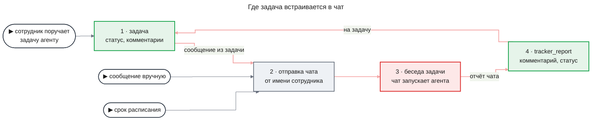
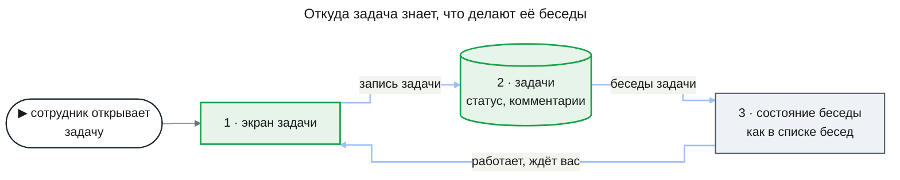
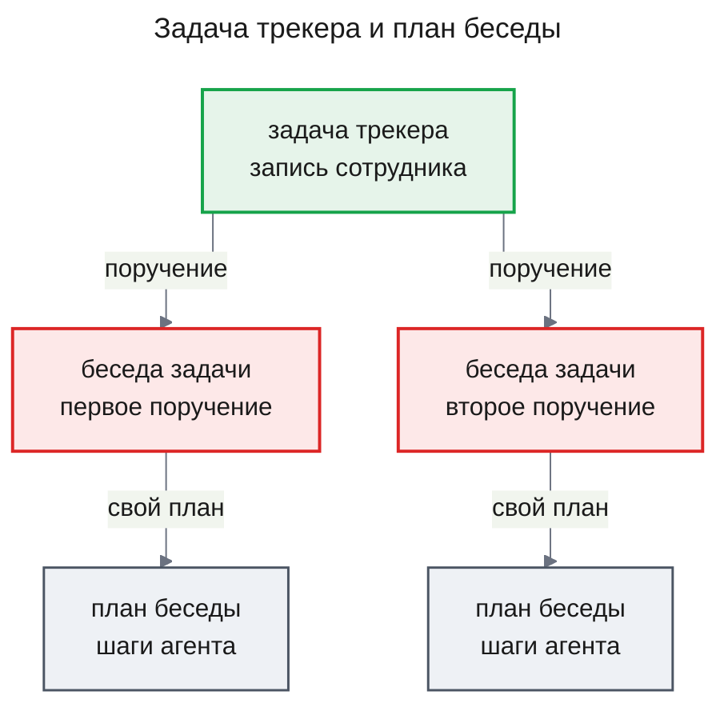

# PRD: Трекер задач с «поручить агенту» (task-tracker)

| Date | Depth |
|---|---|
| 2026-11-28 | full |

## Snapshot

**Overview.** Сегодня у сотрудника нет в Agent OS места для дел, которые ему нужно сделать: работа с агентом живёт только внутри бесед, и что агенту поручено, на чём он остановился и чем кончил, приходится искать по списку чатов. Фича добавляет личный список задач сотрудника. Задачу можно поручить агенту: платформа открывает от имени сотрудника новую беседу, в которой чат запускает этого агента, а затем оставляет на задаче комментарии о ходе работы и может перевести её «на проверку» или в «нужно решение». На задаче видно, что сейчас делает каждая её беседа — работает, ждёт сотрудника, дала новый ответ или упала, — а комментарий сотрудника на задаче уходит агенту следующим сообщением.

- **Не входит**: проекты, метки, доска, подзадачи и вложения; общие и командные доски; внешний API, вебхуки и Agent OS как MCP-сервер ([Won't Have](#wont-have)).
- **Не меняется**: беседа задачи — обычная беседа сотрудника: его права, квота, подтверждения изменяющих вызовов и аудит работают в ней так же, как в беседе, начатой руками.
- **Главный риск**: чат на модели класса Haiku забывает отчитаться на задаче, и задача молчит, пока беседа работает ([Assumptions and Risks](#assumptions-and-risks)).
- **Открытые вопросы**: блокирующих нет; решения, принятые по рекомендации и ждущие подтверждения владельца, перечислены в [Undetermined Items](#undetermined-items).

## Terms

- **Задача** — запись сотрудника в его трекере: название, описание, статус, комментарии и беседы, в которых над ней работали. Задача живёт дольше любой беседы, и её создаёт и меняет сам сотрудник.
- **Статус** — где задача сейчас: «к выполнению», «в работе», «на проверке», «нужно решение», «готово» или «отменена».
- **Поручить агенту** — действие на задаче: сотрудник выбирает агента, и платформа открывает новую беседу о задаче, первое сообщение которой несёт чип этого агента — как если бы сотрудник выбрал агента в меню «+» и написал сам.
- **Беседа задачи** — беседа, открытая поручением. У задачи их может быть несколько: каждое поручение открывает новую.
- **Чат беседы задачи** — главный чат, который отвечает в беседе задачи. Он запускает выбранного агента, как запускает агента по чипу в любой беседе, и он же отчитывается на задаче. Если сотрудник выбрал самого агента чата, чат работает над задачей сам.
- **Стартовое сообщение** — первое сообщение беседы задачи. Платформа собирает его из названия, описания и последних комментариев задачи и добавляет правила, как агенту отчитываться.
- **Состояние беседы** — то, что беседа делает сейчас: «работает», «ждёт вас», «новый ответ» или «сбой». Список бесед уже показывает его у каждой беседы (`improvements` FR-06).
- **`tracker_report`** — инструмент чата беседы задачи: оставить комментарий на задаче и, если нужно, сменить её статус.
- **План** — рабочий список шагов, который глубокий агент ведёт сам внутри своей беседы (`deep-agents` FR-12 – FR-17). Это не задача трекера: план принадлежит агенту и одной беседе, задача — сотруднику.

## Background

Agent OS — чат, в котором сотрудник пишет агенту, а агент работает и отвечает. Беседу начинает сообщение сотрудника или срабатывание расписания (`schedules-search-memory` FR-04). В обоих случаях платформа отправляет текст одной и той же отправкой чата от имени сотрудника. Результат работы остаётся в беседе: чтобы вспомнить, что он поручал на прошлой неделе и чем это кончилось, сотрудник листает список бесед или ищет по ним.

Идея взята из плагина `tasks` открытого проекта bb, клон которого лежит рядом с репозиторием. В bb задачу трекера поручают агенту: открывается беседа-исполнитель, агент получает описание и последние комментарии, комментирует ход работы и переводит задачу «на проверку», а комментарий человека на задаче уходит агенту. Agent OS берёт это ядро. Тяжесть управления проектами из bb — проекты с ключами, папки, метки, доска, подзадачи, вложения, пресеты агентов — не берётся: здесь задачи одного сотрудника, а не команды.

Так поручение встраивается в чат: задача отправляет стартовое сообщение той же отправкой, что сообщение вручную и срабатывание расписания, а чат беседы возвращает отчёт на задачу своим инструментом.

«Сообщение из задачи» — это стартовое сообщение поручения и каждый комментарий сотрудника, который он передаёт агенту. Всё, что происходит в беседе после отправки, — права, квота, очередь сообщений, карточки подтверждения, сбои, аудит — работает так же, как после сообщения, набранного руками. Беседа задачи отличается от обычной двумя вещами: в ней есть отметка со ссылкой на задачу, и у её чата есть инструмент `tracker_report`. Выбранный агент работает в ней так же, как агент, которого сотрудник выбрал в меню «+»: его запускает чат, и его итог чат переносит на задачу.

Что делает беседа, задача не хранит и не угадывает: она читает состояние каждой своей беседы там же, откуда его берёт список бесед.

Статус задачи меняют только сотрудник и инструмент чата. Если чат написал в ответе «готово», но инструмент не вызвал, статус остаётся прежним: платформа не выводит статус из текста беседы.

В Agent OS уже есть второе понятие «задача» — план глубокого агента. Это разные вещи, и они не сливаются:

Задача — дело сотрудника: она переживает беседы, сотрудник пишет её сам и может поручать её разным агентам по очереди. План — рабочий список агента внутри одной беседы (`deep-agents` FR-12 – FR-17): его ведёт агент, а сотрудник только смотрит. Сегодня план показывает вкладка «Задачи» рядом с чатом и на странице глубокого агента; чтобы два понятия не путались, эта вкладка становится «Планом», а слово «Задачи» остаётся за трекером (FR-13).

## Users and Use Cases

### Users

- **Сотрудник** — аналитик, SRE или менеджер, который ведёт свои дела и часть из них отдаёт агентам. Ему важно видеть в одном месте, что поручено, что ждёт его ответа и что готово к проверке, не открывая каждую беседу.

### Use Cases

- **UC-1**: сотрудник записывает дело, которое ему нужно сделать → оно лежит в его списке со статусом «к выполнению», чтобы не держать его в голове или в другом инструменте.
- **UC-2**: сотрудник поручает задачу агенту → агент начинает работу в новой беседе, уже зная, что сделать, чтобы не пересказывать задачу в чате.
- **UC-3**: сотрудник следит за поручением → на задаче видны комментарии из беседы о ходе работы и то, работает ли беседа или ждёт его, чтобы вмешиваться только тогда, когда это нужно.
- **UC-4**: сотрудник уточняет поручение → он пишет комментарий на задаче, и агент получает его в беседе, чтобы вести разговор о задаче в одном месте.
- **UC-5**: сотрудник принимает результат → агент перевёл задачу «на проверку», сотрудник смотрит итог и ставит «готово» или поручает задачу снова, чтобы решение о готовности оставалось за ним.

## Functional Requirements

Требования идут в порядке частей: FR-01 – FR-09 — часть `server`, FR-10 – FR-13 — часть `web`.

### Must Have (MVP)

- **FR-01. Свои задачи.** Сотрудник создаёт задачу с названием и описанием, меняет их, меняет статус, удаляет задачу и получает список своих задач с фильтром по статусу.
  - AC-01.1: Given сотрудник создал задачу «Разобрать алерты за выходные», when он запрашивает свой список, then задача в нём со статусом «к выполнению».
  - AC-01.2: Given сотрудник выбрал фильтр «на проверке», when он запрашивает список, then в нём только его задачи с этим статусом.
  - AC-01.3: Given сотрудник не выбирал фильтр, when он запрашивает список, then в нём его задачи во всех статусах, кроме «готово» и «отменена», сначала недавно изменённые.
  - AC-01.4: Given задача сотрудника А, when сотрудник Б — в том числе администратор — запрашивает, меняет, комментирует, поручает или удаляет её по id, then Б получает тот же ответ, что на несуществующую задачу, а задача А не меняется.

- **FR-02. Статусы и кто их ставит.** Сотрудник ставит задаче любой статус, а чат беседы задачи — только «на проверке» и «нужно решение».
  - AC-02.1: Given задача «в работе», when сотрудник ставит «готово», then задача в статусе «готово», а её беседы продолжают то, что делали: смена статуса работу агента не останавливает.
  - AC-02.2: Given чат беседы задачи пытается поставить «готово» или «отменена», when он вызывает `tracker_report`, then статус не меняется, а чат получает отказ с перечнем статусов, которые ему разрешены.
  - AC-02.3: Given сотрудник поставил задаче «готово» или «отменена», when чат её беседы ставит «на проверке», then статус не меняется, комментарий из того же вызова, если он был, сохраняется, а чат получает отказ с причиной: задачу закрыл сотрудник.

- **FR-03. Комментарии.** Сотрудник и чат беседы задачи оставляют на задаче комментарии, и у каждого комментария видны автор и время, а у комментария из беседы ещё и сама беседа.
  - AC-03.1: Given чат беседы задачи вызвал `tracker_report` с текстом, when сотрудник открывает задачу, then комментарий стоит в ленте задачи с именем агента, которому поручена задача, временем и ссылкой на беседу, из которой он пришёл.
  - AC-03.2: Given сотрудник оставил комментарий, when он открывает задачу снова, then комментарий стоит в ленте с его именем и временем.

- **FR-04. Поручить агенту.** Сотрудник выбирает агента для задачи, и платформа открывает от его имени новую беседу, начатую стартовым сообщением с чипом этого агента, связывает беседу с задачей и ставит задаче «в работе».
  - AC-04.1: Given задача с описанием и двумя комментариями, when сотрудник поручает её агенту, then в его списке бесед появляется новая беседа с названием задачи, её первое сообщение — стартовое сообщение от имени сотрудника с названием, описанием, последними комментариями, правилами отчёта и чипом выбранного агента, чат запускает этого агента, как после сообщения с чипом, набранного руками, а задача в статусе «в работе» и показывает эту беседу.
  - AC-04.2: Given задача в любом статусе, в том числе «готово» или с уже работающей беседой, when сотрудник поручает её снова, then у задачи появляется ещё одна беседа, прежние беседы остаются связанными, а статус — «в работе».
  - AC-04.3: Given сотрудник выбирает агента для поручения, when он смотрит выбор, then ему предложены те же агенты, что в окне расписания (`schedules-search-memory` FR-01): агент чата и агенты меню «+», в том числе глубокие.
  - AC-04.4: Given агент сотруднику больше недоступен, when сотрудник поручает задачу этому агенту, then беседы нет, статус задачи не меняется, а сотрудник видит причину отказа.
  - AC-04.5: Given квота сотрудника на модель агента исчерпана, when он поручает задачу, then беседа открыта и связана с задачей, а агент в ней заканчивается сбоем «квота исчерпана», как после сообщения вручную (`enterprise-access` FR-22).
  - AC-04.6: Given сервер перезапустился посреди поручения, when сервер поднялся, then либо есть одна беседа, связанная с задачей, и задача «в работе», либо нет ни беседы, ни смены статуса: двух бесед на одно поручение и беседы без связи с задачей не бывает.

- **FR-05. Беседа задачи — обычная беседа.** Беседа задачи работает с правами, квотой и доступными агентами сотрудника на момент каждого сообщения, а изменяющие вызовы MCP-инструментов в ней ждут его подтверждения так же, как в беседе, начатой руками.
  - AC-05.1: Given чат беседы задачи или запущенный им агент дошёл до изменяющего вызова MCP-инструмента, when сотрудник открывает задачу, then у этой беседы состояние «ждёт вас», вызов не отправлен, пока сотрудник не ответит на карточку в беседе, и вызов записан в аудит, как в ручной беседе.
  - AC-05.2: Given сотрудник ответил «разрешить в этой беседе» на карточке беседы задачи, when агент снова вызывает тот же инструмент в этой беседе, then вызов идёт без карточки, как в ручной беседе (`improvements` FR-04).

- **FR-06. Состояние бесед на задаче.** Задача сообщает у каждой своей беседы её текущее состояние — то же, что у этой беседы в списке бесед.
  - AC-06.1: Given беседа задачи работает, when сотрудник открывает задачу, then у беседы состояние «работает».
  - AC-06.2: Given чат беседы задачи закончил ответ, а сотрудник эту беседу ещё не открывал, when сотрудник открывает задачу, then у беседы состояние «новый ответ»; после того как сотрудник открыл беседу, отметка снимается (`improvements` FR-06).
  - AC-06.3: Given чат беседы задачи написал в ответе «задача выполнена», но не вызвал `tracker_report`, when сотрудник открывает задачу, then статус задачи прежний и нового комментария из беседы нет.

- **FR-07. Отчёт на задаче.** Чат беседы задачи одним инструментом `tracker_report` добавляет комментарий на свою задачу и, если нужно, ставит разрешённый ему статус, а другую задачу этот инструмент затронуть не может.
  - AC-07.1: Given чат беседы задачи вызвал `tracker_report` с комментарием и статусом «нужно решение», when сотрудник открывает задачу, then комментарий в ленте, а статус «нужно решение».
  - AC-07.2: Given у сотрудника две задачи, каждая со своей беседой, when чат беседы первой задачи вызывает `tracker_report`, then комментарий и статус появляются только на первой задаче, что бы чат ни написал в аргументах: id задачи инструмент не принимает.
  - AC-07.3: Given беседа не открыта поручением, when чат в ней работает, then инструмента `tracker_report` у него нет; агенты, которых запускает чат беседы задачи, в том числе выбранный агент, инструмента не получают, а их итог чат переносит на задачу сам.
  - AC-07.4: Given сотрудник удалил задачу, when чат её беседы вызывает `tracker_report`, then ничего не записано, а чат получает отказ с причиной: задача удалена.

- **FR-08. Комментарий уходит агенту.** Комментарий сотрудника с включённым «передать агенту» сохраняется на задаче и уходит следующим сообщением сотрудника в последнюю по времени поручения беседу задачи, которая не удалена.
  - AC-08.1: Given у задачи есть беседа, when сотрудник пишет комментарий, then «передать агенту» включено по умолчанию.
  - AC-08.2: Given «передать агенту» включено, а чат беседы ещё отвечает, when сотрудник сохраняет комментарий, then комментарий на задаче, а в беседе он стоит в очереди с отметкой задачи, как сообщение, отправленное руками.
  - AC-08.3: Given «передать агенту» выключено, when сотрудник сохраняет комментарий, then комментарий только на задаче, а в беседе нового сообщения нет.
  - AC-08.4: Given у задачи нет беседы или все её беседы удалены, when сотрудник пишет комментарий, then «передать агенту» недоступно, и комментарий остаётся только на задаче.
  - AC-08.5: Given сервер перезапустился сразу после сохранения переданного комментария, when сервер поднялся, then комментарий на задаче один и в беседе одно такое сообщение.

- **FR-09. Удаление задачи и беседы не трогает друг друга.** Удаление беседы не удаляет и не меняет задачу, а удаление задачи не удаляет и не останавливает её беседы.
  - AC-09.1: Given у задачи две беседы, when сотрудник удаляет одну из них, then задача, её статус и все комментарии на месте, удалённая беседа стоит у задачи без ссылки с пометкой «беседа удалена», а «передать агенту» отправляет комментарии в оставшуюся беседу.
  - AC-09.2: Given у задачи работающая беседа, when сотрудник удаляет задачу, then задачи нет в его списке, беседа остаётся в списке бесед и продолжает работу, а её отметка задачи показывает, что задача удалена, без ссылки.

- **FR-10. «Задачи» в сайдбаре и список.** Сотрудник открывает «Задачи» в сайдбаре рядом с «Агентами», «Библиотекой» и «Расписаниями» и видит свой список задач с фильтром по статусу, откуда создаёт новую задачу.
  - AC-10.1: Given у сотрудника есть задачи, when он открывает «Задачи», then у каждой строки видны название, статус и состояние её бесед, если хоть одна из них не прочитана и не стоит без дела.
  - AC-10.2: Given беседы задачи в разных состояниях, when сотрудник смотрит строку, then строка показывает то, что раньше требует сотрудника: «ждёт вас», затем «сбой», «новый ответ», «работает».
  - AC-10.3: Given сотрудник выбрал статус в фильтре, when список обновился, then в нём только задачи этого статуса (AC-01.2, AC-01.3).

- **FR-11. Экран задачи.** На экране задачи сотрудник меняет название, описание и статус, читает ленту комментариев, пишет комментарий с переключателем «передать агенту», видит беседы задачи с их состоянием и открывает любую из них, а также удаляет задачу.
  - AC-11.1: Given агент оставил комментарий, пока экран задачи открыт, when проходит обновление экрана, then комментарий и новое состояние беседы появляются без перезагрузки страницы.
  - AC-11.2: Given у задачи есть беседа, when сотрудник выбирает её на экране задачи, then открывается эта беседа.

- **FR-12. Поручение и отметка задачи в беседе.** Сотрудник поручает задачу агенту с экрана задачи, выбирая агента так же, как в окне расписания, а беседа задачи несёт отметку, которая ведёт обратно на задачу.
  - AC-12.1: Given сотрудник поручил задачу, when поручение принято, then экран задачи показывает новую беседу и статус «в работе», а сотрудник может сразу открыть беседу.
  - AC-12.2: Given беседа задачи открыта, when сотрудник смотрит стартовое сообщение и сообщения из переданных комментариев, then у каждого видна отметка с названием задачи, и выбор отметки открывает задачу.

- **FR-13. «План» вместо «Задачи» у беседы и глубокого агента.** Вкладка, которая показывает план беседы рядом с чатом и план глубокого агента на его странице (`deep-agents` FR-15), называется «План», а слово «Задачи» в интерфейсе остаётся только за трекером.
  - AC-13.1: Given в беседе есть план агента, when сотрудник открывает панель рядом с чатом или страницу глубокого агента, then план стоит на вкладке «План», а вкладки «Задачи» там нет.

### Could Have

- **FR-14. Приоритет и срок.** Сотрудник задаёт задаче приоритет и срок, видит их в списке и сортирует список по ним.
  - AC-14.1: Given у задач разные сроки, when сотрудник сортирует список по сроку, then первыми стоят задачи с ближайшим сроком, а задачи без срока — в конце.

### Won't Have

- Проекты, ключи задач, папки, метки, доска-канбан, подзадачи, вложения и пресеты агентов — не эта фича: это тяжесть управления проектами из bb, а здесь личный список одного сотрудника.
- Общие и командные доски, задачи, видимые другим сотрудникам, — не эта фича: трекер — личный список сотрудника, и его задачи видит только он (NFR-02).
- Внешний API, вебхуки и Agent OS как MCP-сервер для внешних трекеров — не эта фича: задачи создаются и ведутся только внутри Agent OS, и связь с внешними системами не нужна, чтобы поручать задачи агентам.
- Создание и просмотр задач трекера из главного чата словами («запиши задачу …») — позже: сначала трекер должен заработать сам по себе.
- Привязка к задаче беседы, начатой не поручением, — позже: такая беседа не получала стартового сообщения и правил отчёта, а её агент не имеет `tracker_report`.
- Правка и удаление комментариев — не эта фича: переданный агенту комментарий уже ушёл в беседу, и лента задачи остаётся честной историей.
- Автоматическая смена статуса, когда беседа закончила работу или упала, — не эта фича: статус — суждение сотрудника и агента, а что делает беседа, уже видно по её состоянию (FR-06).
- Перенос плана агента в задачи трекера и обратно — не эта фича: план — рабочий список агента одной беседы, задача — запись сотрудника.
- Уведомления о событиях задачи вне экрана задачи и списка — не эта фича: их даст фича уведомлений `live-feed`, которая проектируется параллельно; беседа задачи — обычная беседа, и уведомления о беседах дойдут и до неё.

## Non-Functional Requirements

### Производительность

- **NFR-01**: список из 200 задач сотрудника отдаётся за p95 ≤ 300 мс, экран задачи со 100 комментариями и 10 беседами — за p95 ≤ 500 мс, на локальном Postgres.

### Безопасность

- **NFR-02**: каждый эндпоинт трекера покрыт e2e-тестом с двумя сотрудниками, и ни один из них не даёт чужую задачу, её комментарии или беседы — 0 случаев доступа.

### Наблюдаемость

- **NFR-03**: каждое изменение задачи — создание, правка, смена статуса, комментарий, поручение, передача комментария, вызов `tracker_report` и его отказ, удаление — пишется в журнал платформы с id задачи, сотрудника, беседы и агента, без названия, описания и текста комментариев.

### Адаптивность

- **NFR-04**: список задач, экран задачи и выбор агента для поручения пригодны к работе на экране шириной от 360 px.

## Delivery Parts

| Part | Covers | Cut along | Depends on | Rationale |
|------|--------|-----------|------------|-----------|
| `server` | FR-01 – FR-09 | backend | — | Задачи, статусы, поручение через отправку чата, инструмент агента и передача комментариев — одна модель данных и один контракт API, который читает экран. |
| `web` | FR-10 – FR-13 | frontend | `server` | Сайдбар, список, экран задачи, выбор агента, отметка в беседе и переименование вкладки строятся на готовом контракте `server`. |

- Deferred: FR-14 (Could Have) — после того как обе части построены; приоритет и срок не нужны, чтобы проверить поручение агенту.

## Success Criteria

- Владелец поручает агентам свои настоящие рабочие задачи и доводит их до «готово» с экрана задачи — не меньше пяти задач за две недели после слияния; читается из его списка задач.

## Constraints and Risks

### Constraints

- Изоляция: задачи сотрудника видит и меняет только он; администратор чужих задач не видит (NFR-02).
- Беседа задачи открывается от имени сотрудника той же отправкой чата, что сообщение вручную и срабатывание расписания, и подчиняется его правам, квоте и доступности агента в момент каждого сообщения.
- Каждый вызов MCP-инструмента в беседе задачи пишется в аудит так же, как сегодня.
- Удаление беседы помечает удалённой только беседу; удаление задачи не трогает беседы.

### Assumptions and Risks

Главный риск — модель класса Haiku не вызывает `tracker_report`: работа идёт, а на задаче нет комментариев и статус не двигается. Сотрудник всё равно видит состояние беседы на задаче (FR-06) и открывает её, а правила отчёта в стартовом сообщении делают вызов частью поручения; насколько это помогает, владелец проверит вручную на реальных задачах.

Изменяющий вызов в беседе задачи ждёт сотрудника, а уведомлений вне веба нет. Поручение может часами стоять в «ждёт вас», пока сотрудник не откроет список задач или бесед; фича уведомлений `live-feed` закрывает это, но не нужна для запуска.

Каждый переданный агенту комментарий начинает новый ход беседы и тратит квоту сотрудника. Переключатель «передать агенту» видим у каждого комментария, и его выключение оставляет комментарий только на задаче.

Сотрудник может спутать задачу трекера с планом агента. Разные слова — «Задачи» для трекера и «План» для списка агента (FR-13) — снимают путаницу, если UXRD выдержит их на всех экранах.

Инструмент спросить сотрудника из беседы (`ask_user`, фича `agent-guidance`) проектируется параллельно. Без него чат беседы задачи просит решения комментарием и статусом «нужно решение», а с ним вопрос придёт карточкой в беседе и задача покажет «ждёт вас». Трекеру он не нужен, чтобы работать.

## Undetermined Items

Блокирующих вопросов нет. Решения ниже приняты по рекомендации анализа или по моей оценке и действуют, пока владелец не изменит их при утверждении PRD.

- Поля и вид: название, описание, статус, комментарии, беседы; список только с фильтром по статусу, приоритет и срок — Could Have; меняет FR-01, FR-10, FR-14; решает владелец.
- Набор статусов и то, что агент ставит только «на проверке» и «нужно решение», а «готово» и «отменена» — только сотрудник; меняет FR-02, FR-07; решает владелец.
- Комментарий сотрудника уходит агенту по переключателю «передать агенту», включённому по умолчанию, в последнюю по времени поручения живую беседу задачи; меняет FR-08; решает владелец.
- Названия: трекер — «Задачи» в сайдбаре, вкладка плана у беседы и у глубокого агента — «План», инструмент агента — `tracker_report`; меняет FR-10, FR-13, FR-07; решает владелец.
- Изменяющие вызовы в беседе задачи идут через карточки подтверждения, как в ручной беседе, а задача показывает «ждёт вас»; заранее данного разрешения, как у расписания (`improvements` FR-07), у поручения нет; меняет FR-05; решает владелец.
- Агента для поручения выбирают из того же набора, что в окне расписания, с теми же правилами для глубоких агентов; меняет AC-04.3, FR-12; решает владелец.
- Главный чат не создаёт и не показывает задачи трекера словами — Won't Have; решает владелец.
- Поручение ставит «в работе» из любого статуса, в том числе из «готово»; агент не меняет статус задачи, которую сотрудник закрыл; меняет AC-04.2, AC-02.3; решает владелец.
- Отчитывается на задаче чат беседы задачи: `tracker_report` есть только у него, а выбранный агент и другие агенты, которых чат запускает, инструмента не получают; комментарий чата показан с именем агента, которому поручена задача. Другой вариант — дать инструмент и выбранному агенту; меняет FR-07, AC-03.1; решает владелец.
- Список без фильтра скрывает «готово» и «отменена»; удалённая беседа остаётся у задачи без ссылки с пометкой; меняет AC-01.3, AC-09.1; решает владелец.

## Update History

| Version | Date | Change |
|---------|------|--------|
| 1.0 | 2026-11-28 | Initial version |
