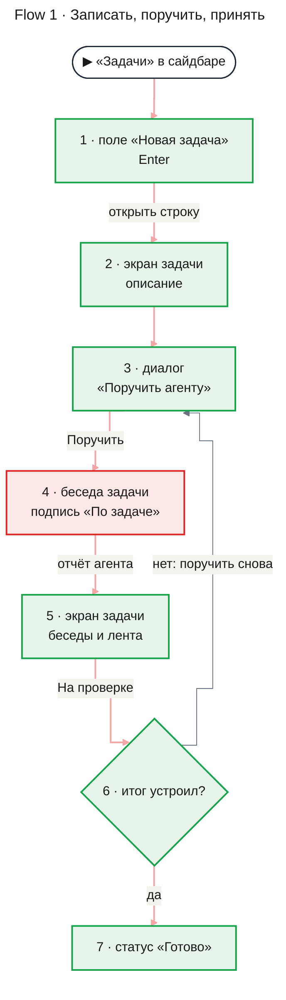
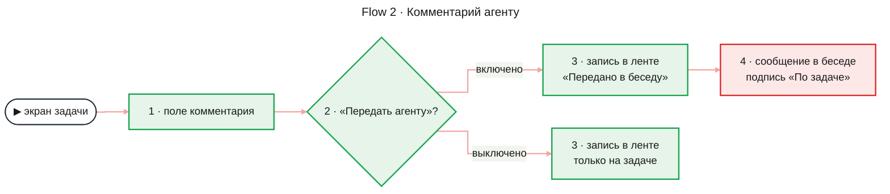

# UXRD: Трекер задач с «поручить агенту» (task-tracker)

| Дата | PRD |
|---|---|
| 2026-11-28 | [prd.md](./prd.md) |

## Snapshot

**Overview.** Сотрудник открывает «Задачи» в сайдбаре и видит свои открытые дела, разложенные по статусу: сверху то, что ждёт его решения или проверки. Новое дело он записывает одной строкой в поле над списком. На экране задачи он правит описание и статус, поручает задачу агенту коротким диалогом и следит за работой: справа беседы задачи с тем, что каждая делает сейчас, слева одна лента, где стоят его комментарии, отчёты агента и события. Комментарий из этой ленты по переключателю уходит агенту следующим сообщением беседы, а сообщения беседы, пришедшие из задачи, подписаны ссылкой обратно на неё. Вкладка плана агента рядом с чатом и на странице глубокого агента называется «План», чтобы слово «задача» значило только дело сотрудника.

- **Не меняется**: беседа задачи выглядит и работает как любая беседа — карточки подтверждения, очередь сообщений, сбои и состояние в списке бесед остаются прежними; новое в ней только подпись над сообщениями из задачи.
- **Главный UX-риск**: агент не отчитался, и лента молчит. Тогда о работе говорит только состояние беседы в строке списка и на экране задачи (KD-4), поэтому оно стоит на виду в обоих местах.

### Key Decisions

| ID | Решение | Почему |
|---|---|---|
| KD-1 | «Задачи» — первый пункт разделов сайдбара, перед «Агентами». Счётчика у пункта нет | Список дел — место, с которого сотрудник начинает день, а «Агенты», «Библиотека» и «Расписания» — инструменты. Звать сотрудника к задаче вне экрана задач будет фича уведомлений `live-feed` |
| KD-2 | Открытые задачи — одним списком по группам статуса: «Нужно решение», «На проверке», «В работе», «К выполнению»; внутри группы — недавно изменённые сверху. Фильтр — выпадающий список над списком: «Открытые» по умолчанию или один из шести статусов; с одним статусом групп нет | Так устроены «Мои задачи» Linear и личные списки Todoist, Things, Microsoft To Do: открытое сгруппировано, закрытое убрано, фильтр — в меню, а не полосой вкладок. Группы, которые ждут сотрудника, стоят первыми, потому что за ними он и пришёл (UC-3, UC-5). Семь вкладок не помещаются на 360 px |
| KD-3 | Новая задача создаётся полем «Новая задача» над списком: Enter создаёт задачу с одним названием, поле очищается и ждёт следующую. Описание пишут на экране задачи | Записать дело — первое, что нужно (UC-1), и оно не должно стоить диалога. Так быстро записывают в Todoist и Things |
| KD-4 | Экран задачи: в шапке название, статус, «Поручить агенту» и «⋯»; ниже слева описание и одна лента задачи, справа беседы задачи. Уже 1024 px — одной колонкой: описание, беседы, лента | Беседы со своим состоянием отвечают на главный вопрос «что сейчас с поручением» и не должны тонуть в ленте; так стоят сессии агента в Linear и Jira. Одна лента вместо отдельных журналов — как у Linear: ход работы читается сверху вниз |
| KD-5 | С агентом говорят только полем комментария на задаче. Переключатель «Передать агенту» называет беседу, куда уйдёт комментарий, а кнопка меняет слова: «Отправить агенту» или «Комментировать» | Сотрудник всегда видит, потратит ли комментарий ход агента и квоту и в какую беседу он попадёт. GitHub, где агент не читает комментарии к задаче после поручения, путает людей — здесь комментарий доходит |
| KD-6 | «Поручить агенту» открывает диалог: «Агент» — тот же выбор, что в диалоге расписания, по умолчанию агент прошлого поручения, иначе «Агент чата»; необязательное поле «Что ещё сказать агенту». Этот текст становится обычным комментарием сотрудника на задаче, только если поручение принято | Агента выбирают так же, как везде в продукте (AC-04.3). Уточнение к одному поручению остаётся в ленте задачи и попадает в стартовое сообщение вместе с последними комментариями, поэтому отдельного места для него не нужно |
| KD-7 | Стартовое сообщение и каждое сообщение из переданного комментария подписаны «По задаче «{название}»», так же как подписаны сообщения от расписания; название — ссылка на задачу | Из беседы сотрудник одним нажатием возвращается к задаче (AC-12.2), и подпись знакома ему по расписаниям |
| KD-8 | Вкладка плана рядом с чатом и на странице глубокого агента — «План · {N}», строка плана — «шаг». Слова «задача» и «задачи» в интерфейсе остаются только за трекером | Две разные вещи под одним словом путают сотрудника (FR-13). Меняет deep-agents UXRD, MC-9 – MC-12 и MC-14, и вариант «Задачи» [списка задач](../../design-system/components/run-task-list.md) |

## Terms

- **Лента задачи**: история задачи на её экране — комментарии сотрудника, отчёты агента и события, по времени.
- **Событие**: строка ленты без текста комментария — создание задачи, поручение агенту, смена статуса.
- **Живая беседа**: беседа задачи, которую сотрудник не удалил. Переданный комментарий уходит в последнюю по времени поручения живую беседу (FR-08).

## Design System

Фича следует [дизайн-системе](../../design-system/README.md) и использует только роли цветов, без своих значений. Страница «Задачи» — компактная плотность, экран задачи, лента и диалог — комфортная ([foundations → Spacing & Density](../../design-system/foundations.md#spacing--density)).

### Component Inventory

| Компонент | Спецификация | Статус | Примечание |
|---|---|---|---|
| Список трекера | [tracker-list.md](../../design-system/components/tracker-list.md) | new | Таблица данных не знает групп и строк без колонок; список задач плана — чужие шаги агента только для чтения; список бесед сайдбара сгруппирован по датам |
| Статус задачи трекера | [tracker-status.md](../../design-system/components/tracker-status.md) | new | У статуса агента три статуса шага плана и вращение «В работе»; у задачи трекера шесть статусов, которые ставит человек, и выбор статуса |
| Лента задачи | [tracker-feed.md](../../design-system/components/tracker-feed.md) | new | Ленты комментариев и поля вне чата в интерфейсе нет; лента чата — это беседа с моделью |
| Беседы задачи | [tracker-conversations.md](../../design-system/components/tracker-conversations.md) | new | Строка списка бесед несёт только название и иконку состояния, без агента и времени поручения, и удалённых бесед не показывает |
| Состояние беседы | [agent-status.md → Состояния беседы](../../design-system/components/agent-status.md#состояния-беседы) | reused | Иконки и метки improvements UXRD, MC-10; в строке задачи и в беседах задачи — иконка с меткой рядом |
| Форма настроек | [settings-form.md](../../design-system/components/settings-form.md), вариант «Форма диалога» | reused | Диалог «Поручить агенту» (TT-09) |
| Выбор агента | schedules-search-memory UXRD, SH-02, поле «Агент» | reused | TT-09 |
| Подпись источника сообщения | agent-platform UXRD, MC-10; schedules-search-memory UXRD, SH-07 | extended | Подпись «По задаче «{название}»» (TT-10) |
| Сайдбар | chat-shell UXRD, SB-01; schedules-search-memory UXRD, SH-03 | extended | Пункт «Задачи» (TT-01) |
| Шапка страницы | schedules-search-memory UXRD, SH-05 | reused | Ссылка на родителя, `h1`, метка, действия, «⋯» (TT-05) |
| Поле переименования | chat-shell UXRD, SB-08 | reused | Название задачи (TT-05) |
| Список задач | [run-task-list.md](../../design-system/components/run-task-list.md), вариант «Задачи» | extended | Вариант становится «План», строка — «шаг» (KD-8, TT-11) |
| Экран «Не найдено» | chat-shell UXRD, Screen 4 | reused | TT-12 |

## User Flows

### Primary User Flow

**Записать, поручить, принять.** Implements: UC-1, UC-2, UC-3, UC-5; AC-01.1, AC-04.1, AC-04.3, AC-06.1, AC-06.2, AC-07.1, AC-10.1, AC-11.1, AC-12.1, AC-12.2



После «Поручить» диалог закрывается, а экран задачи сразу показывает новую беседу первой строкой с состоянием «Работает», статус «В работе» и событие поручения в ленте. Уведомление MC-7 даёт «Открыть беседу» (AC-12.1). Сотрудник может остаться на экране задачи: отчёты агента и смена состояния беседы встают без перезагрузки (AC-11.1). В списке задача с отчётом «На проверке» переходит в группу «На проверке», а её строка показывает «Новый ответ», пока беседа не открыта (AC-06.2, AC-10.1).

### Alternative Flows

**Комментарий агенту.** Implements: UC-4; AC-08.1 – AC-08.4



Переключатель включён по умолчанию, когда у задачи есть живая беседа (AC-08.1). Если агент в беседе ещё отвечает, сообщение встаёт в лоток очереди беседы с той же подписью, как сообщение, отправленное руками (AC-08.2). Без живой беседы переключатель выключен и недоступен, а вместо цели стоит причина MC-9 (AC-08.4).

- **Сменить статус** (FR-02, AC-02.1). Выбор статуса в шапке меняет его сразу, без подтверждения, и ставит событие в ленту. Беседы задачи продолжают то, что делали: «Готово» не останавливает агента, его останавливают в беседе.
- **Поручить снова** (AC-04.2). «Поручить агенту» доступна в любом статусе. Если у задачи уже работает беседа, диалог предупреждает, что поручение откроет ещё одну (MC-11). Новая беседа встаёт первой в «Беседах», прежние остаются, и переданные комментарии теперь уходят в новую.
- **Агенту нужно решение** (AC-05.1, AC-07.1). Отчёт «нужно решение» переводит задачу в первую группу списка. Если агент остановился на изменяющем действии, у беседы состояние «Ждёт вас»: решение принимают на карточке в беседе, куда ведёт строка беседы.
- **Отфильтровать** (AC-01.2, AC-01.3, AC-10.3). Фильтр со статусом показывает только его задачи без групп; «Открытые» возвращают группы. Закрытые задачи видны только в фильтрах «Готово» и «Отменена».
- **Вернуться из беседы** (AC-12.2). Подпись «По задаче «{название}»» над сообщением открывает экран задачи.
- **Удалить беседу задачи** (AC-09.1). В «Беседах» строка остаётся с пометкой «беседа удалена», без ссылки; источник и пометка передачи в ленте называют беседу без ссылки. Переключатель передаёт комментарии в оставшуюся живую беседу.
- **Удалить задачу** (AC-09.2). «⋯» → «Удалить», подтверждение MC-13, затем страница «Задачи». Беседы остаются в списке бесед и продолжают работу, а их подпись говорит, что задача удалена, и не ведёт никуда.

### Error Flows

- **Агент недоступен** (AC-04.4). Диалог не закрывается: у поля «Агент» ошибка MC-11, статус задачи прежний, беседы и комментария из диалога нет, а текст уточнения остаётся в поле.
- **Квота исчерпана** (AC-04.5). Поручение проходит как обычно; беседа заканчивается сбоем «квота исчерпана», и у неё на экране задачи и в строке списка состояние «Сбой».
- **Агент написал «готово», но не отчитался** (AC-06.3). На задаче ничего не меняется: ни комментария, ни статуса. О законченной работе говорит только состояние «Новый ответ» у беседы.
- **Отчёт агента отклонён** (AC-02.2, AC-02.3, AC-07.4). Сотрудник видит итог, а не отказ: комментарий агента, если он был, стоит в ленте, а статус не меняется и события нет. Причину отказа агент получает в беседе.
- **Чужая или удалённая задача** (AC-01.4). Прямая ссылка открывает TT-12.
- **Действие не удалось** — сохранение названия, описания, статуса или комментария: значение возвращается к прежнему или текст остаётся в поле, причина — MC-7 или под полем (MC-9).

## Screens

### Screen 1: Страница «Задачи»

```
┌──────────────────────────────────────────────────────────────────┐
│ Задачи                                        [ Открытые      ▾ ]│ TT-02
│ ┌──────────────────────────────────────────────────────────────┐ │
│ │ + Новая задача                                               │ │ TT-04
│ └──────────────────────────────────────────────────────────────┘ │
│ Нужно решение · 1                                                │ TT-03
│ ?  Согласовать окно релиза                  ✋ Ждёт вас    14:20  │
│ На проверке · 2                                                  │
│ ◕  Разобрать алерты за выходные             • Новый ответ  12:05  │
│ ◕  Сводка по инцидентам ноября                            вчера  │
│ В работе · 1                                                     │
│ ◐  Найти, почему падает выгрузка            ◌ Работает     11:40  │
│ К выполнению · 3                                                 │
│ ○  Подготовить отчёт для финансов                         24 нояб.│
└──────────────────────────────────────────────────────────────────┘
```

**TT-01. Пункт сайдбара «Задачи»** — первым среди разделов, перед «Агентами» (KD-1), со значком списка с галочкой. Текущий раздел отмечен так же, как «Агенты»: на странице «Задачи» и на экране любой задачи. В свёрнутой полосе — значок с подсказкой MC-1. Счётчика нет.

**TT-02. Шапка и фильтр** — шапка страницы с `h1` MC-2 и выпадающим списком фильтра справа (shadcn `select`). Пункты: «Открытые», затем шесть статусов в порядке [статуса задачи трекера](../../design-system/components/tracker-status.md), каждый со своей иконкой. Выбор живёт, пока сотрудник на странице; при возвращении на страницу стоит «Открытые».

**TT-03. Список** — [список трекера](../../design-system/components/tracker-list.md). При «Открытых» — вариант «По группам» в порядке KD-2; при выбранном статусе — «Один статус». Внутри группы и в одном статусе — недавно изменённые сверху (AC-01.3). Состояние бесед в строке — то, что раньше всех требует сотрудника: «Ждёт вас», затем «Сбой», «Новый ответ», «Работает» (AC-10.1, AC-10.2). Список обновляется без перезагрузки, как список бесед.

**TT-04. Новая задача** — однострочное поле с плюсом и подсказкой MC-5 во всю ширину списка, над первой группой. Enter создаёт задачу «К выполнению» с введённым названием (AC-01.1); пустое поле не создаёт ничего. Строка новой задачи встаёт первой в группе «К выполнению», поле очищается, фокус остаётся в нём. Если выбран фильтр другого статуса, создание переключает его на «Открытые», чтобы новая строка была видна. Esc очищает поле.

| Состояние | Что показано | AC |
|---|---|---|
| Loading | Скелетон списка; поле и фильтр доступны | — |
| Открытых нет | Пустое состояние списка MC-5: записать дело в поле выше | — |
| В статусе нет задач | Пустое состояние MC-5 с названием статуса | AC-10.3 |
| Создание идёт | Поле недоступно, в его конце вращающийся индикатор | — |
| Создание не удалось | Под полем Caption `--destructive` MC-5; текст остаётся в поле | — |
| Error | Ошибка списка MC-5 и «Повторить»; поле доступно | — |

### Screen 2: Экран задачи

От 1024 px:

```
┌────────────────────────────────────────────────────────────────────────────┐
│ Задачи /                                                                   │ TT-05
│ Разобрать алерты за выходные  ◕ На проверке ▾      [ Поручить агенту ]  ⋯  │
├───────────────────────────────────────────────┬────────────────────────────┤
│ Описание                           [Изменить] │ Беседы · 2                 │ TT-06 · TT-08
│ Пройти алерты за 22–23 нояб., отделить новые  │ • Новый ответ              │
│ от известных, по новым — сервис и причина.    │ Разбор алертов за выходные↗│
│                                               │ Сводка дежурства ·         │
│ Вы создали задачу · 22 нояб., 09:10           │ поручено 27 нояб., 14:00   │
│ Вы · 27 нояб., 13:58                          │ ────────────────────────── │
│ Возьми и стейдж тоже.                         │ Разбор алертов за выходные↗│
│ ⌬ Вы поручили задачу агенту «Сводка дежурства»│ Агент чата ·               │
│   · беседа «Разбор алертов за выходные» · 14:00│ поручено 26 нояб., 18:30  │
│ ⌬ Сводка дежурства · 14:20 · из беседы «…» ↗  │                            │ TT-07
│ Нашёл 12 алертов, три новых — по оплатам.     │                            │
│ ◕ Агент «Сводка дежурства» сменил статус на   │                            │
│   «На проверке» · 14:20                       │                            │
│ ┌───────────────────────────────────────────┐ │                            │
│ │ Комментарий                               │ │                            │
│ └───────────────────────────────────────────┘ │                            │
│ [●─] Передать агенту · в беседу «Разбор…»     │                            │
│                           [ Отправить агенту ]│                            │
└───────────────────────────────────────────────┴────────────────────────────┘
```

**TT-05. Шапка** — шапка страницы, как у расписания: ссылка на родителя «Задачи», `h1` с названием задачи, рядом [статус задачи трекера](../../design-system/components/tracker-status.md), вариант «Выбор». Справа «Поручить агенту» (`default`) и «⋯» с пунктами «Переименовать» и «Удалить». «Переименовать» ставит на место `h1` поле переименования по правилам chat-shell UXRD, SB-08: Enter и уход фокуса сохраняют, Esc отменяет, пустое название не сохраняется (MC-6). Смена статуса сохраняется сразу; при отказе выбор возвращает прежний статус, а уведомление MC-7 называет причину.

**TT-06. Описание** — `h2` MC-6 и «Изменить» (`ghost` `sm`) в его строке; ниже текст как его написали, с переносами, не шире 640 px. «Изменить» ставит на место текста многострочное поле с текущим описанием и кнопками «Сохранить» и «Отмена»: Ctrl+Enter или ⌘+Enter сохраняют, Esc отменяет, Enter переносит строку. Без описания вместо текста стоит «Добавить описание» (`ghost` `sm`), который открывает то же поле.

**TT-07. Лента** — [лента задачи](../../design-system/components/tracker-feed.md) под описанием, отделённая от него 24 px. Комментарии сотрудника и агента идут с именами и временем (AC-03.1, AC-03.2). События — создание задачи, поручение с названием беседы, смена статуса сотрудником или агентом. Переключатель «Передать агенту» и цель — по KD-5; цель — последняя по времени поручения живая беседа (FR-08). Новые записи встают без перезагрузки и не сдвигают прокрутку (AC-11.1).

**TT-08. Беседы** — [беседы задачи](../../design-system/components/tracker-conversations.md): от 1024 px — правая колонка 288 px, которая не прокручивается вместе с лентой, пока помещается по высоте; уже 1024 px — между описанием и лентой. Строка открывает беседу (AC-11.2). Состояние у каждой беседы — то же, что в списке бесед (AC-05.1, AC-06.1, AC-06.2). Удалённая беседа — строкой без ссылки (AC-09.1).

| Состояние | Что показано | AC |
|---|---|---|
| Loading | Скелетоны названия, статуса, описания, ленты и бесед; «Поручить агенту» недоступна | — |
| Не поручена | Беседы — пустое состояние MC-10; переключатель недоступен с причиной MC-9 | AC-08.4 |
| Все беседы удалены | Строки удалённых бесед; переключатель недоступен с причиной MC-9 | AC-08.4, AC-09.1 |
| Закрыта | Статус «Готово» или «Отменена»; всё остальное доступно, «Поручить агенту» тоже | AC-04.2 |
| Error | Ошибка MC-6 и «Повторить» на месте тела экрана | — |

### Screen 3: Диалог «Поручить агенту»

```
┌─ Поручить агенту ───────────────────────────────────── ✕ ┐  TT-09
│ Агент                                                    │
│ [ ⌬ Сводка дежурства                                 ▾ ] │
│ Что ещё сказать агенту (необязательно)                   │
│ [                                                      ] │
│ [                                                      ] │
│ Агент получит название, описание и последние             │
│ комментарии задачи.                                      │
│ ⓘ У задачи уже работает беседа «Разбор алертов…».        │
│   Поручение откроет ещё одну.                            │
│                               [ Поручить ] [ Отмена ]    │
└──────────────────────────────────────────────────────────┘
```

**TT-09. Диалог** — [форма настроек](../../design-system/components/settings-form.md), вариант «Форма диалога», ширина 560 px, поля одной колонкой (KD-6):

- «Агент» — тот же выпадающий список, что в диалоге расписания (schedules-search-memory UXRD, SH-02): первым «Агент чата», за ним агенты и глубокие агенты из меню «+» со значками вида (AC-04.3). Выбран агент последнего поручения задачи, если он доступен, иначе «Агент чата».
- «Что ещё сказать агенту» — необязательное многострочное поле с пределом длины комментария. Непустой текст сохраняется на задаче комментарием сотрудника перед поручением и попадает в стартовое сообщение вместе с другими последними комментариями.
- Под полями — подсказка MC-11: что агент получит.
- Если у задачи уже работает беседа — блок сведений формы настроек MC-11.

Комментарий из поля «Что ещё сказать агенту» сохраняется только вместе с принятым поручением. При отказе на задаче нет ни комментария, ни беседы, а текст остаётся в поле для повтора.

«Поручить» закрывает диалог после того, как поручение принято, и возвращает фокус на «Поручить агенту». «Отмена» и Esc закрывают диалог без изменений.

| Состояние | Что показано | AC |
|---|---|---|
| Поручение идёт | «Поручить» с вращающимся индикатором; поля недоступны | — |
| Агент недоступен | Ошибка у поля «Агент» MC-11, фокус на нём; диалог открыт | AC-04.4 |
| Ошибка формы | Блок ошибки формы над кнопками MC-11 | — |

### Screen 4: Подпись задачи в беседе

```
                          ☑ По задаче «Разобрать алерты за выходные»   TT-10
                       ┌──────────────────────────────────────────┐
                       │ Задача: Разобрать алерты за выходные     │
                       │ Пройти алерты за 22–23 нояб., …          │
                       └──────────────────────────────────────────┘
```

**TT-10. Подпись** — над стартовым сообщением и над каждым сообщением из переданного комментария, по краю сообщения, тем же видом, что «По расписанию «{название}»» (schedules-search-memory UXRD, SH-07): значок пункта «Задачи» и текст MC-12. Название задачи — ссылка на экран задачи (AC-12.2). Сообщение в очереди беседы несёт ту же подпись (AC-08.2). У удалённой задачи подпись — MC-12 без ссылки (AC-09.2). Сам текст сообщения показан как любое сообщение сотрудника.

### Screen 5: Вкладка «План»

**TT-11. «План»** — вкладка рядом с чатом в панели беседы и вкладка страницы глубокого агента называются «План · {N}» вместо «Задачи · {N}» (AC-13.1). Список на ней — тот же [список задач](../../design-system/components/run-task-list.md), но строка зовётся шагом: имя кнопки, пустое состояние, загрузка и ошибка — MC-15. Место вкладок, порядок и поведение не меняются (deep-agents UXRD, KD-3, KD-7).

### Screen 6: Задача не найдена

**TT-12. Не найдено** — экран «Не найдено» (chat-shell UXRD, Screen 4) с текстом MC-14 для ссылки на чужую, удалённую или несуществующую задачу (AC-01.4).

**TT-13. Удаление** — подтверждение (shadcn `alert-dialog`) MC-13; «Удалить» — сплошная `--destructive`. После удаления — страница «Задачи» и уведомление MC-13.

## Accessibility

- **Целевой уровень**: WCAG 2.1 AA — уровень продукта из PRD chat-shell, принятый в [foundations](../../design-system/foundations.md); PRD этой фичи своего уровня не задаёт.
- **Порядок фокуса**:
  - Открытие страницы «Задачи» и экрана задачи ставит фокус на `h1`, как у других страниц оболочки.
  - На странице «Задачи» Tab идёт: фильтр, поле «Новая задача», строки списка сверху вниз.
  - На экране задачи: статус, «Поручить агенту», «⋯», «Изменить» описания, ссылки ленты, поле комментария, переключатель, кнопка, затем строки бесед. Уже 1024 px беседы стоят перед лентой и в порядке Tab тоже.
  - После переименования и после правки описания фокус возвращается на «⋯» и на «Изменить».
  - После удаления задачи фокус на `h1` страницы «Задачи».
- **Объявления**:
  - Создание задачи — `status` MC-5.
  - Смена статуса в шапке — `status` «Статус: {метка}».
  - Новый комментарий агента — по спецификации ленты задачи; события, смены состояния бесед и перестановки строк списка не объявляются.
  - Уведомления MC-7 и MC-13 читаются как обычные уведомления.
- **Заголовки**: `h1` — «Задачи» и название задачи; `h2` — группы списка, «Описание», «Беседы»; лента — область с именем «Лента задачи».
- **Клавиатура без мыши**: каждое действие — кнопкой или пунктом меню; горячих клавиш, кроме Enter и Esc в полях и Ctrl+Enter в описании, нет.

## Responsive Behavior

Все экраны работают от 360 px без прокрутки страницы вбок (NFR-04). Цели касания — 44 px при грубом указателе.

| Экран | < 640 px | < 1024 px | ≥ 1024 px |
|---|---|---|---|
| TT-02 шапка списка | Фильтр — своей строкой под `h1`, во всю ширину | Фильтр справа от `h1` | Как < 1024 px |
| TT-03 список | Вариант «Узкий» списка трекера | «Узкий» до 768 px, дальше колонки | Колонки, ширина до 1024 px |
| TT-05 шапка задачи | Ссылки на родителя нет; статус — строкой под названием; следующей строкой «Поручить агенту» на всю ширину, кроме места «⋯», и «⋯» справа | Действия под названием, как у шапки страницы | В одну строку с названием |
| TT-06 – TT-08 тело | Одна колонка: описание, беседы, лента | Как < 640 px | Две колонки: описание и лента до 768 px, беседы 288 px |
| TT-07 поле комментария | Переключатель и цель — двумя строками, кнопка — третьей строкой справа | Переключатель, цель и кнопка в одну строку; цель усекается | Как < 1024 px |
| TT-09 диалог | Ширина экрана минус 16 px с каждой стороны; тело прокручивается, кнопки видны всегда | Как ≥ 1024 px | 560 px по центру |
| TT-10 подпись | Переносится на вторую строку целыми словами | Как ≥ 1024 px | В одну строку |
| TT-01 пункт | В мобильной шторке строка 44 px; выбор пункта закрывает шторку | Как ≥ 1024 px | В сайдбаре |

## Content and Microcopy

Тон, даты и время — как в chat-shell UXRD и [foundations → Language & Formats](../../design-system/foundations.md#language--formats). Сотрудник не видит слов «трекер», «стартовое сообщение», «`tracker_report`», «отчёт инструментом»: только «задача», «поручить», «беседа», «комментарий». Слово «задача» означает только дело сотрудника (KD-8). Названия задач, описания, комментарии, имена агентов и названия бесед не переводятся. Все тексты идут через каталог переводов; английские пишутся по смыслу под теми же ключами.

| ID | Где | Текст |
|---|---|---|
| MC-1 | Сайдбар (TT-01) | «Задачи» |
| MC-2 | Шапка списка (TT-02) | `h1` «Задачи»; фильтр — доступное имя «Показать», пункт «Открытые», далее статусы MC-3 |
| MC-3 | Статусы (все экраны) | «К выполнению», «В работе», «На проверке», «Нужно решение», «Готово», «Отменена»; кнопка выбора — «Статус: {метка}» |
| MC-4 | Список (TT-03) | Заголовок группы «{статус} · {N}»; скрытый текст строки «, {состояние беседы}, изменена {время}»; состояния — improvements UXRD, MC-10 |
| MC-5 | Список — поле и состояния (TT-03, TT-04) | Подсказка поля «Новая задача»; объявление «Задача «{название}» создана»; ошибка «Не удалось создать задачу: {причина}»; открытых нет — «Открытых задач нет» / «Запишите дело в поле выше — сделаете сами или поручите агенту.»; в статусе нет — «Задач со статусом «{статус}» нет»; «Не удалось загрузить задачи» + «Повторить» |
| MC-6 | Экран задачи (TT-05, TT-06) | «Поручить агенту»; «⋯» — доступное имя «Действия с задачей», пункты «Переименовать», «Удалить»; пустое название — «Введите название»; `h2` «Описание»; «Изменить»; «Добавить описание»; «Сохранить», «Отмена»; «Не удалось загрузить задачу» + «Повторить» |
| MC-7 | Уведомления экрана задачи | «Поручено: {агент}» с действием «Открыть беседу»; «Не удалось сменить статус: {причина}»; «Не удалось сохранить: {причина}» |
| MC-8 | Лента (TT-07) | Автор «Вы»; источник «из беседы «{название}»», у удалённой беседы — «из беседы «{название}» · беседа удалена»; пометка «Передано в беседу «{название}»», без беседы — «Передано в беседу «{название}» · беседа удалена»; события «Вы создали задачу», «Вы поручили задачу агенту «{имя}» · беседа «{название}»», у агента чата — «Вы поручили задачу агенту чата · беседа «{название}»», «Вы сменили статус на «{статус}»», «Агент «{имя}» сменил статус на «{статус}»», у агента чата — «Агент чата сменил статус на «{статус}»»; пусто — «Комментариев пока нет»; область «Лента задачи»; объявление «Комментарий от {агент}: {начало текста}» |
| MC-9 | Поле комментария (TT-07) | Подсказка поля «Комментарий»; «Передать агенту»; цель «в беседу «{название}»»; причины недоступности «Задача ещё не поручена агенту» и «Все беседы задачи удалены»; кнопки «Отправить агенту» и «Комментировать»; ошибка «Не удалось отправить: {причина}» |
| MC-10 | Беседы (TT-08) | `h2` «Беседы · {N}», без бесед — «Беседы»; «поручено {время}»; «беседа удалена»; «Агент чата»; пусто — «Задача ещё не поручена агенту.» |
| MC-11 | Диалог (TT-09) | Заголовок «Поручить агенту»; «Агент» — первым «Агент чата»; «Что ещё сказать агенту» (необязательно); подсказка «Агент получит название, описание и последние комментарии задачи.»; блок «У задачи уже работает беседа «{название}». Поручение откроет ещё одну.»; «Поручить», «Отмена»; ошибка поля «Агент «{имя}» вам недоступен — выберите другого.»; ошибка формы «Не удалось поручить: {причина}» |
| MC-12 | Подпись в беседе (TT-10) | «По задаче «{название}»»; у удалённой задачи — «По задаче «{название}» · задача удалена» |
| MC-13 | Удаление (TT-13) | «Удалить задачу?» / «Задача «{название}» и её комментарии исчезнут. Беседы задачи останутся в списке бесед и продолжат работу.»; «Удалить», «Отмена»; уведомление «Задача удалена» |
| MC-14 | Не найдено (TT-12) | «Задача не найдена» / «Её удалили, или она принадлежит другому сотруднику.»; «К задачам» |
| MC-15 | Вкладка «План» (TT-11) | Вкладка «План · {N}»; имя списка «План»; кнопка строки «Шаг {N}: {тема}, {статус}»; статусы шага «Ожидает», «В работе», «Готов»; у поручения, которое назвало шаг, — «шаг {N}»; пусто — «Плана пока нет» / «Здесь появятся шаги плана и поручения агента.»; «Загружаем план…»; «Не удалось загрузить план» + «Повторить» |

## Update History

| Version | Date | Change |
|---------|------|--------|
| 1.0 | 2026-11-28 | Первая версия |
