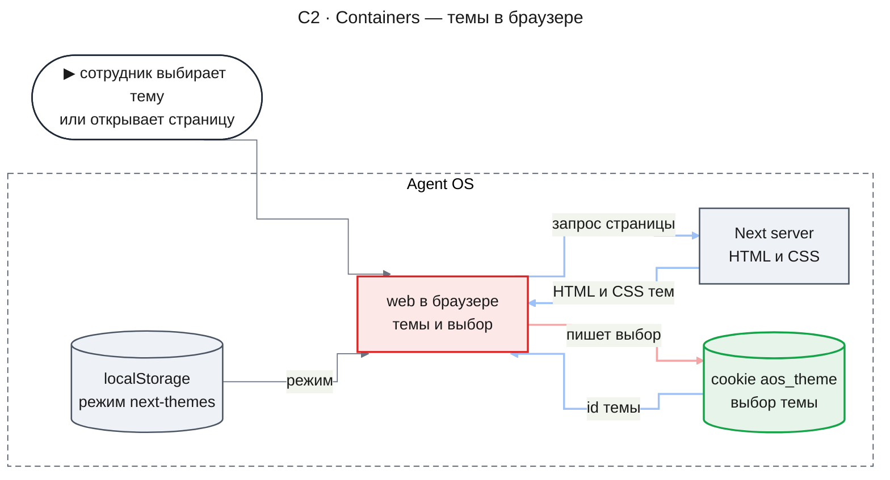
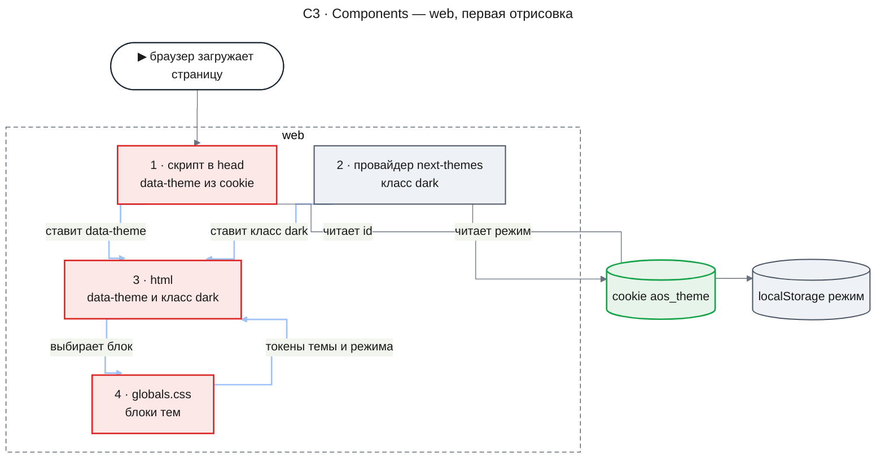
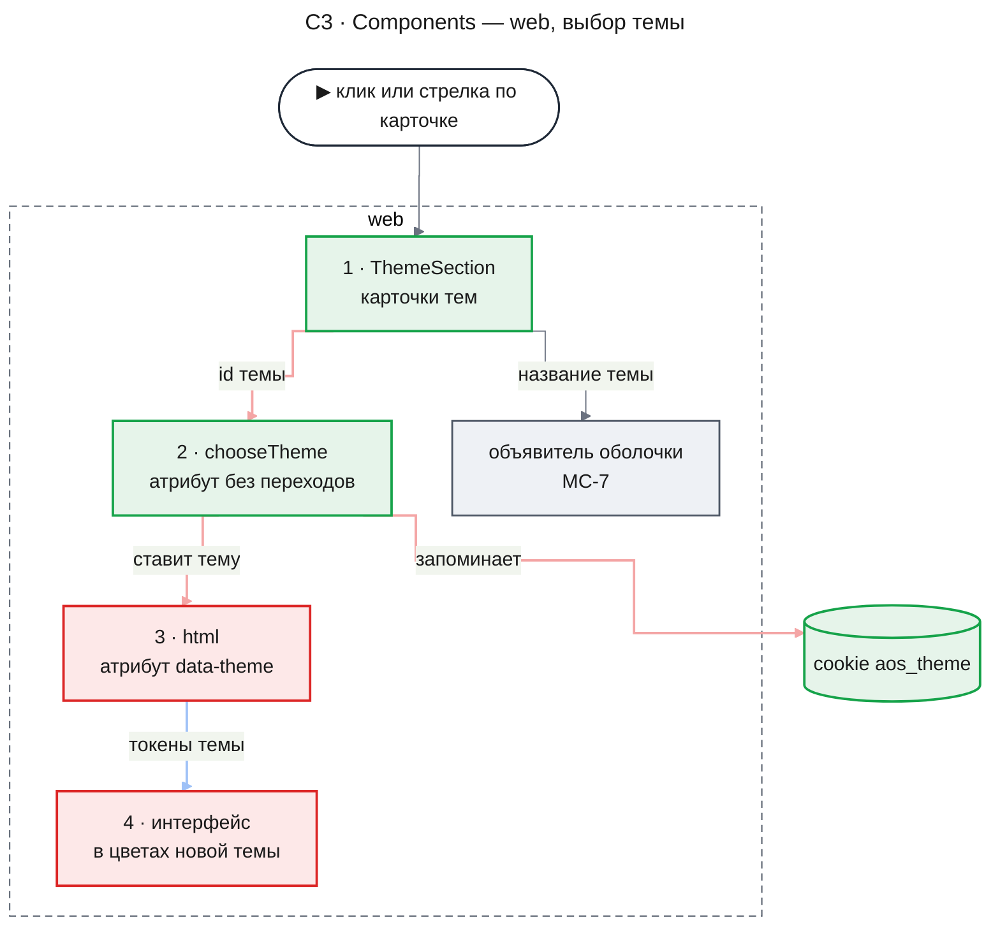
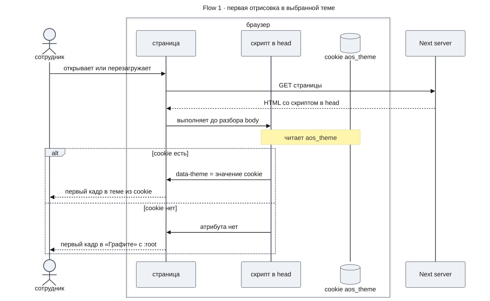
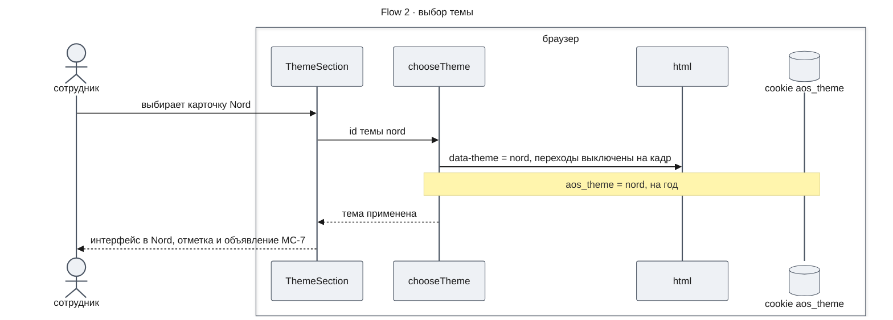

# Темы оформления — Design Document — engine

**Status:** Draft · **Date:** 2026-11-28 · **PRD:** [prd.md](./prd.md) · **UXRD:** [uxrd.md](./uxrd.md) · **Depends on:** nothing

## Snapshot

**Overview.** Сегодня `globals.css` держит значения цветовых токенов в блоках светлого режима, тёмного режима и повышенного контраста, а утилиты Tailwind уже следуют за этими свойствами. Эта часть добавляет рядом такие же блоки для каждой темы, выбранные атрибутом `data-theme`: «Графит» становится значениями по умолчанию, «Петроль» и Nord — блоками по атрибуту. Сотрудник выбирает тему карточкой в новой секции «Тема» на «Мой доступ». Выбор пишется в cookie, а скрипт в `<head>`, который уже есть в корневом layout, до первой отрисовки переносит её значение в атрибут `<html>`. Режим по-прежнему переключает next-themes классом `dark`, поэтому тема и режим меняются независимо.

- **Не меняется**: переключатель режима и его хранение у next-themes; токены, которыми пользуются компоненты; затемнения и подписи поверх картинок.
- **Главный риск**: значение в CSS разойдётся со значением на странице тем, которое проверено на контраст; это ловит проверка в браузере (KD-4).
- **Открытые вопросы**: нет.

### Key Decisions

#### KD-1: Тема — блоки CSS в `globals.css` по атрибуту `data-theme`, а «Графит» стоит ещё и на `:root`

Это та же форма, что работает сегодня: блок значений светлого режима, блок тёмного и блок `@media (prefers-contrast: more)`, только по набору на тему. Значения берутся со страницы [тем](../../design-system/themes.md) как есть, с прежним приёмом: токены, которые основы объявляют равными, записаны одинаковыми литералами. Порядок в файле — «Графит», «Петроль», Nord, затем блок повышенного контраста с теми же темами в том же порядке; тёмный блок темы несёт атрибут и класс `dark` и поэтому сильнее светлых блоков любой темы. Рядом со значениями «Графита» стоит строка об авторских правах bb, рядом с Nord — Nord и bb.

- Селекторы не привязаны к `<html>`, потому что иначе карточка выбора не нарисует образец чужой темы: половина образца с `data-theme="nord"` берёт светлые значения Nord, с ещё и классом `dark` — тёмные, что бы ни было выбрано на странице.
- «Графит» стоит на `:root`, потому что тогда страница без атрибута — без cookie или с чужим значением — уже в теме по умолчанию, и скрипту не нужен список тем.

Отвергнуты данные тем в TypeScript с функцией, которая строит из них CSS, — второе представление и генератор нужны только автоматической проверке, которой нет (KD-4); и подмена текста `<style>` скриптом, как в bb, — образцу тогда нужны значения в JS.

#### KD-2: Режим остаётся у next-themes, а тему ставит атрибут; переименований — минимум

next-themes уже ставит класс `dark` до отрисовки и отключает переходы цвета при смене режима. Нести id темы он не может: он хранит одно значение «светлый, тёмный или системный», и тема с режимом слились бы в одно. Тему ставит маленькая функция `chooseTheme` веба: атрибут на `<html>`, переходы цвета отключены на кадр смены, как требует [foundations → Motion](../../design-system/foundations.md#motion), запись cookie, строка лога. Переходы отключаются своим кодом, потому что next-themes этот приём наружу не отдаёт, а без него `transition-colors` растягивает смену темы на 150 ms.

В меню пользователя группа режима получает подписи «Режим», «Светлый», «Тёмный», «Системный» (UXRD MC-1). Переименовываются только имена, которые иначе читались бы наоборот рядом с новой строкой темы: список пунктов режима, его тип и проверка в `user-menu.tsx` и ключи каталога `shell.userMenu.theme*`. Обёртка провайдера next-themes остаётся как есть.

#### KD-3: Выбор хранится в cookie `aos_theme`, и скрипт в `<head>` переносит её в атрибут до первой отрисовки

Скрипт в `<head>` корневого layout уже держит `<meta name="theme-color">` равным фону. Теперь он сначала копирует значение cookie `aos_theme` в атрибут `data-theme`, а затем следит за атрибутом наравне с классом, иначе `theme-color` отстанет от смены темы.

- Cookie, а не `localStorage`, потому что часть `preference` сможет поставить cookie ответом API при входе, и первая страница на новом устройстве будет уже в теме сотрудника (AC-07.1).
- Скрипт в `<head>`, а не чтение cookie сервером внутри `<Suspense>`, как у языка, потому что такой скрипт приходит с потоковым содержимым, и браузер может нарисовать пустую страницу в «Графите» раньше него.
- Значение не сверяется со списком тем, потому что неизвестный id не совпадает ни с одним блоком и даёт «Графит», а `setAttribute` разметку не разбирает.

#### KD-4: Значения темы проверяются на контраст, когда тему добавляют, и результат записан на странице тем

Три темы уже проверены, и их числа стоят в таблице «Проверка контраста» на странице [тем](../../design-system/themes.md#проверка-контраста). Новая или исправленная тема проходит ту же проверку вручную, и её результат записывается туда же. Расчёта цвета и теста контраста в репозитории нет. То, что CSS совпадает с проверенными значениями, проверка в браузере смотрит по вычисленным токенам каждой темы в обоих режимах и в повышенном контрасте.

#### KD-5: Строка «Тема: …» в меню ведёт на `/account#theme`, и «Мой доступ» ставит фокус на отмеченную карточку

Переход к секции с фокусом на отмеченной карточке требует UXRD (TP-01, Accessibility). Пункт меню — ссылка оболочки с якорем секции; `parseShellRoute` сравнивает только путь, маршрут не меняется. Экран «Мой доступ» при монтировании выбирает цель фокуса по якорю: с `#theme` — отмеченную карточку через новую цель `theme-picker` в `focus.ts`, без него — заголовок страницы, как сейчас. Фокус сам прокручивает страницу к карточке. Если «Мой доступ» уже открыт, Next прокручивает к якорю, а фокус не двигается: этот случай не просит ни один критерий.

## Terms

- **Токен** — CSS-свойство цвета, которое читают компоненты, например `--background`; список ролей и токенов ведут основы ([foundations → Color](../../design-system/foundations.md#color)).
- **Блок темы** — набор значений всех токенов темы для одного режима в `globals.css`.
- **Повышенный контраст** — режим ОС `prefers-contrast: more`; в нём каждая тема меняет основной и вторичный текст и рамки.
- **Образец** — схема интерфейса на карточке темы в цветах этой темы, светлая и тёмная половины.
- **Скрипт в `<head>`** — встроенный скрипт корневого layout; он выполняется до разбора `<body>` и поэтому до первой отрисовки.

## Part

- **Prerequisite ADRs**: [ADR-0020](../../adr/ADR-0020-next-intl-client-layer.md) — названия тем и подписи идут через каталоги next-intl.

**Out of scope**

- Карточка «Как в организации», тема организации, раздел «Оформление» и хранение выбора в профиле — часть `preference`; она же вынесет карточки в общий компонент, когда у них появится второе место.
- Состояние «Не сохранилось» и ошибка MC-6: запись cookie не падает, состояние появится с сохранением в профиль.
- Блок визуализации — часть `inline-vis`; цвета она берёт по контракту ниже.
- Затемнения под диалогами и шторкой и подписи поверх картинок (`bg-black/…`, `text-white`) остаются: от темы они не зависят, а роли для них в дизайн-системе нет.
- Синхронизация открытых вкладок: другая вкладка видит новую тему со следующей загрузки (UXRD, Primary User Flow).

**Constraints**

- Фронтенд без бэкенда: до части `preference` выбор живёт только в cookie браузера, сервер Next её не читает; id тем, тема по умолчанию и имя cookie лежат в вебе, в `@agent-os/contracts` их перенесёт `preference`.
- Без обратной совместимости: прежние блоки `:root`, `.dark` и повышенного контраста становятся блоками «Графита», серая палитра графиков уходит.
- Тексты en и ru под одинаковыми ключами: подписи режима (MC-1) и строка меню (MC-2) — в области `shell`; заголовок и пояснение секции (MC-3), названия тем (MC-4) и объявление (MC-7) — в области `account`, рядом с секцией «Язык» ([interface-text.md](../../code-system/patterns/interface-text.md)). Пока выбор не хранится в профиле, пояснение секции — только вторая фраза MC-3: первая обещала бы тему на всех устройствах.

## Building-block Inventory

Follows the [code system](../../code-system/README.md) и [web.md](../../code-system/packages/web.md). Искали в `apps/web/src` модуль тем, карточную радиогруппу и образец: цвета есть только в `globals.css`, а в `components/ui` есть лишь радиогруппа с точкой.

| Building block | Pattern | Status | Note |
|---|---|---|---|
| `lib/theme.ts`: id тем, тема по умолчанию, имя cookie, `chooseTheme` | — | new | одно место для списка тем, его читают секция и меню |
| секция «Тема» `ThemeSection` с карточками | — | new | по образцу `LanguageSection`; карточки — `Radio` и `RadioGroup` base-ui, стрелки и Space даёт библиотека |
| адрес секции в `shell-route.ts` | [shell-route.md](../../code-system/patterns/shell-route.md) | extended | `/account#theme` |
| каталоги текста | [interface-text.md](../../code-system/patterns/interface-text.md) | extended | MC-1 … MC-4, MC-7 |

## Acceptance Criteria

### FR-01: Тема как данные

- From the PRD: AC-01.1 — роль без значения ловит проверка темы при её добавлении (KD-4); в CSS тема без токена молча берёт значение «Графита», поэтому проверка в браузере сверяет все токены каждой темы.

### FR-02: Первый набор тем

- From the PRD: AC-02.1, AC-02.2, AC-02.3, AC-02.4.
- Без cookie, с пустой или чужой cookie `aos_theme` страница открывается в «Графите».

### FR-03: Переключение без перезагрузки и без вспышки

- From the PRD: AC-03.1, AC-03.2, AC-03.3.
- После смены темы и после смены режима `<meta name="theme-color">` равен фону страницы.

### FR-04: Проверка комфорта

- Каждая тема в обоих режимах и в повышенном контрасте проверена на пороги основ, и результат записан на странице тем (KD-4); AC-04.1 … AC-04.3 в их PRD-формулировке эта часть не выполняет.

### FR-05: Палитра графиков у каждой темы

- From the PRD: AC-05.1 — подтверждение записано на странице тем.

### FR-06: Выбор темы

- From the PRD: AC-06.1, AC-06.2.
- Стрелки переводят фокус на соседнюю карточку и сразу применяют её тему; программа чтения с экрана слышит MC-7.
- Строка «Тема: {тема}» в меню открывает «Мой доступ» на секции «Тема» с фокусом на отмеченной карточке (UXRD TP-02, KD-5).

## Design

### Architecture (C1–C4)

Акторы и внешние системы не меняются, поэтому C1 не нарисован.

#### C2 · Containers

Сервер Next отдаёт страницу и CSS как сегодня и cookie не читает. API в этой части не участвует.

#### C3 · Components: web

**web — первая отрисовка**

Скрипт темы и скрипт next-themes работают независимо: каждый ставит своё на `<html>`, а CSS выбирает блок по обоим.

**web — выбор темы**

- **`ThemeSection`** устроена как `LanguageSection`: `section` с заголовком, радиогруппа, пояснение, объявление через объявитель оболочки. Карточки рисуются по [theme-picker](../../design-system/components/theme-picker.md), вариант «Сотрудник» без карточки организации. Каждая половина образца — элемент с `data-theme` своей темы, у тёмной ещё класс `dark`; внутри только токены, без утилит `dark:`.
- Отмеченную карточку секция берёт из атрибута `<html>` при монтировании, а строка меню — при открытии меню; значение не из списка тем читается как «Графит».

### Runtime Flows

#### Flow 1: первая отрисовка в выбранной теме

**Starts when:** сотрудник открывает или перезагружает любую страницу, for AC-02.1, AC-03.2, AC-06.2

Скрипт next-themes ставит класс `dark` в начале `<body>`, тоже до отрисовки. Значение cookie, которому не соответствует ни один блок, тоже даёт «Графит».

#### Flow 2: выбор темы

**Starts when:** сотрудник кликает карточку или переходит на неё стрелкой, for AC-03.1, AC-03.3, AC-06.1

Атрибут меняется в обработчике выбора, поэтому действует последний выбор, а состояние страницы не трогается. Класс режима при этом не меняется, а смена режима не трогает атрибут (AC-03.3).

### Contract Definitions

Часть ничего не потребляет. Ниже — то, на что опираются `preference` и `inline-vis`.

**Cookie `aos_theme`** — для `preference`

- Значение — id темы: `graphite`, `petrol` или `nord`. Путь `/`, срок год, `SameSite=Lax`, без `HttpOnly`: её читает скрипт страницы. Скрипт в `<head>` переносит любое значение в атрибут, кто бы его ни записал; `preference` ставит её ответом API с теми же атрибутами.
- `chooseTheme(id)` — применяет тему ко всей странице в том же кадре без переходов цвета и пишет cookie; отказов нет.

**Тема на странице** — для `inline-vis`

- `<html>` несёт `data-theme` с id темы — без атрибута действует «Графит» — и класс `dark` в тёмном режиме. Каждый цветовой токен основ, прочитанный через `getComputedStyle` у `<html>`, даёт значение текущих темы и режима с учётом повышенного контраста.
- Смена темы видна как изменение атрибута `data-theme`, смена режима — как изменение `class` у `<html>`, смена контраста — как событие `change` у `matchMedia('(prefers-contrast: more)')`.

## Test Strategy

- **Секция «Тема»** — covers AC-06.1, AC-03.1. Отмечена текущая тема; выбор Nord ставит атрибут, пишет cookie и объявляет MC-7.
- **Меню пользователя** — существующий тест переписывается под подписи MC-1; добавляется строка «Тема: Графит» со ссылкой на секцию.

### Проверка в браузере

jsdom не применяет CSS, поэтому цвета, вспышку и фокус проверяют на `next build && next start` по навыку `browser-check`.

| Сценарий | Шаги | Что должно быть видно |
|---|---|---|
| Значения тем | Для каждой темы, режима и `prefers-contrast: more` (DevTools → Rendering) прочитать вычисленные токены `<html>` | Каждое значение совпадает со страницей тем |
| Нет вспышки | Перезагрузить страницу в каждой теме и режиме с записью Performance | Первый кадр уже в выбранной теме; ошибок гидратации нет |
| Фокус из меню | Выбрать «Тема: …» в меню из беседы | «Мой доступ» на секции, фокус на отмеченной карточке |
| Образец | Открыть секцию в тёмном режиме в «Петроль» | Каждая карточка показывает свою тему в обеих половинах |
| Перекрашивание | Листать темы стрелками; в беседе из 50 сообщений сменить режим | Перекрашены сайдбар, шапка, карточки и меню без загрузки документа; смена укладывается в NFR-01 |
| `theme-color` | Сменить тему и режим | `<meta name="theme-color">` равен фону |
| 360 px | Открыть секцию | Две карточки в ряд, без прокрутки вбок |

## Security Considerations

- **Authentication & Authorization**: новых маршрутов и обращений к API нет.
- **Input Validation**: значение cookie попадает только в значение атрибута через `setAttribute`; в разметку и CSS оно не вставляется.
- **Sensitive Data Handling**: id темы не секрет; лог несёт id прежней и новой темы.

## Risks and Mitigation

- **Литерал в CSS разойдётся со страницей тем** — среднее влияние при ручном переносе таблиц. Первая строка проверки в браузере сверяет каждый токен каждой темы.
- **Отметка карточки появляется на кадр позже секции** — низкое влияние, только при прямой загрузке «Мой доступ»: сервер атрибута не знает, и отметка встаёт при монтировании; цвета страницы верны с первого кадра.

## Update History

| Version | Date | Change |
|---------|------|--------|
| 1.0 | 2026-11-28 | Первая версия |
| 1.1 | 2026-11-28 | Упрощение: темы — блоки CSS в `globals.css` вместо данных TypeScript и генератора; проверка контраста — при добавлении темы, без теста в репозитории; константы в вебе; скрипт без списка тем; минимум переименований; карточки внутри секции; без отдельного паттерна |
