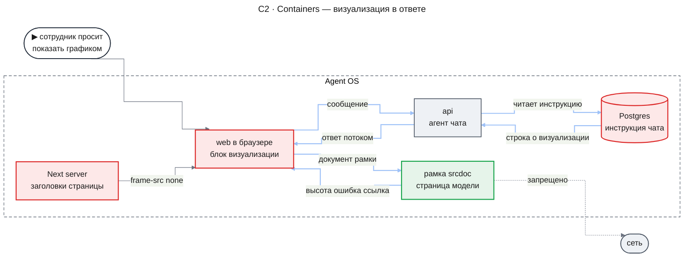
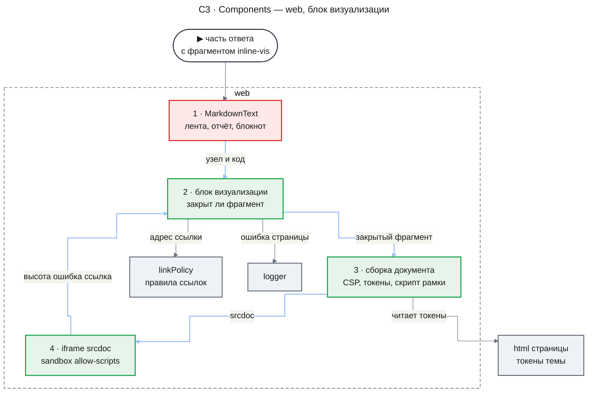
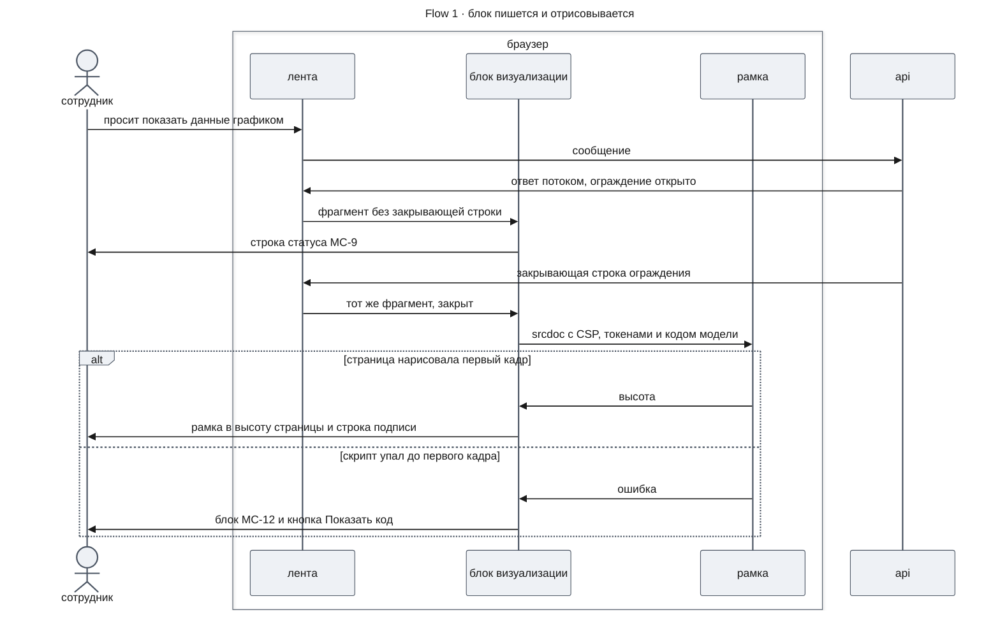
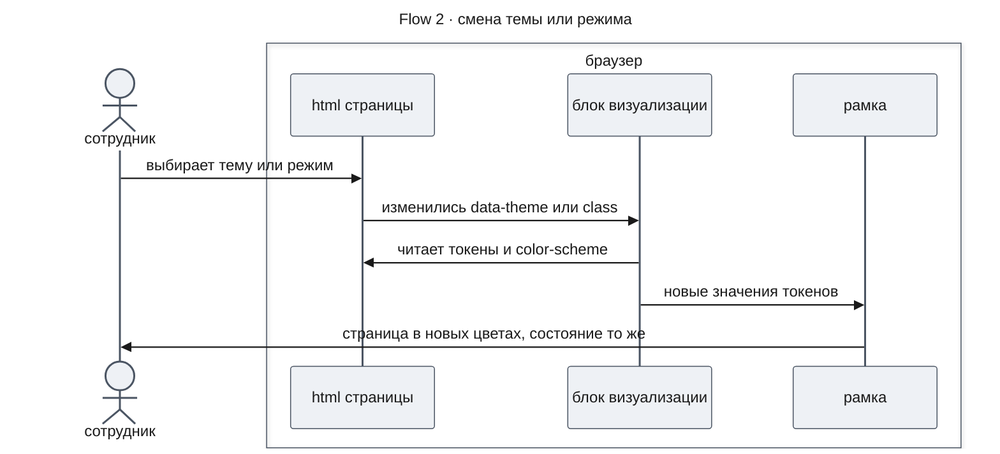
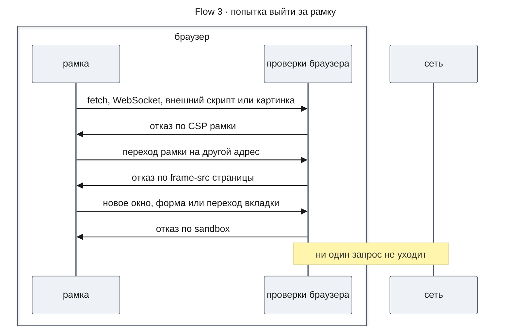
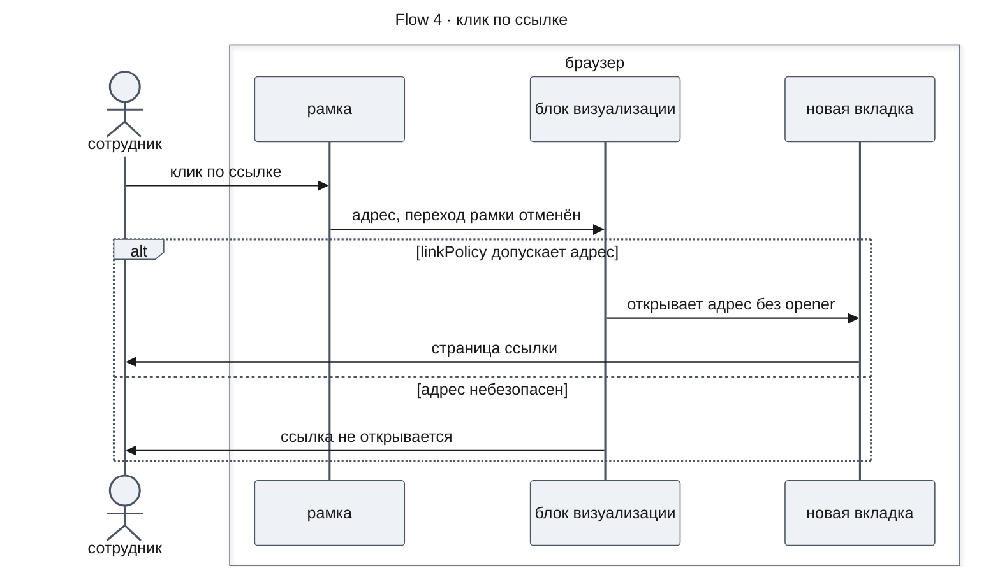

# Темы оформления — Design Document — inline-vis

**Status:** Draft · **Date:** 2026-11-28 · **PRD:** [prd.md](./prd.md) · **UXRD:** [uxrd.md](./uxrd.md) · **Depends on:** [design-engine.md#contract-definitions](./design-engine.md#contract-definitions)

## Snapshot

**Overview.** Агент чата может ответить графиком: он пишет в ответе фрагмент кода на языке `inline-vis` с HTML-страницей, и на месте фрагмента сотрудник видит отрисованную страницу. Рендерер Markdown ответа уже подставляет свой компонент для фрагмента кода выбранного языка, поэтому вся часть — один новый компонент, зарегистрированный там, где показывается текст модели: в ленте, в отчёте агента и в документе блокнота. Компонент запускает страницу в `iframe` со `srcdoc` и `sandbox="allow-scripts"`, а первой строкой документа ставит политику безопасности без сети. Цвета текущей темы он копирует в документ при сборке и присылает заново, когда тема или режим меняются, а рамка в ответ сообщает высоту, ошибку скрипта и клик по ссылке. Инструкция агента чата получает строку о том, когда и как рисовать.

- **Не меняется**: рендерер Markdown, правила ссылок и картинок в тексте модели, движок тем; остальные встроенные агенты не получают строки о визуализации.
- **Главный риск**: изоляция держится на правилах браузера, и часть из них проверяется только в настоящем Chrome; WebRTC и DNS-предвыборку политика безопасности не закрывает ([Open Questions](#open-questions)).
- **Открытые вопросы**: [два](#open-questions) — каналы связи, которые CSP не закрывает, и ссылка, которую страница открывает после любого клика.

### Key Decisions

#### KD-1: Блок — компонент языка `inline-vis`, зарегистрированный через существующий `componentsByLanguage` в ленте, отчёте и документе блокнота

`MarkdownText` уже принимает `componentsByLanguage`, но ни одно место его пока не передаёт. Лента, отчёт агента и документ блокнота передают один и тот же набор с языком `inline-vis`, и для этого языка библиотека отдаёт заголовок и тело фрагмента нашему компоненту вместо обычного блока кода. Компонент заменяет обе части: заголовок языка он не рисует, а тело показывает строкой статуса, рамкой или обычным блоком кода с тем же заголовком и кнопкой «Копировать», что у кода в ответе. Название блока агент пишет в строке ограждения после языка; библиотека Markdown кладёт этот текст в данные узла, поэтому разбирать HTML ради названия не нужно. Название становится текстом строки подписи и атрибутом `title` рамки, по которому программа чтения с экрана её объявляет (MC-10, AC-11.4).

- Набор передают три места, а не `MarkdownText` по умолчанию, потому что `MarkdownText` рисует ещё и рассуждения модели, а визуализацию там не просит ни один критерий.
- Язык назван как в bb, потому что промпт и рендерер должны совпадать, а у bb это имя уже проверено на моделях.

#### KD-2: Фрагмент считается закрытым, когда исходный текст под позицией узла кончается закрывающей строкой ограждения

Библиотека передаёт компоненту языка только узел, язык и код (`SyntaxHighlighterProps` в `@assistant-ui/react-markdown` 0.14.26) и не говорит, дописан ли фрагмент. Узел несёт позицию в тексте части ответа (`mdast-util-to-hast` 13.2.1 ставит её на `pre` и `code`), а сам текст части компонент читает через `useMessagePartText` — его дают и лента, и `TextMessagePartProvider` отчёта и блокнота. Плавный показ текста раскрывает начало того же текста, поэтому срез по позиции совпадает с тем, что разобрал рендерер. Пока фрагмент не закрыт, «пишется» (даже при пустом пока коде) от оборванного ответа отличает статус показа текста, который даёт `MarkdownTextPrimitive` (`useSmoothStatus`), а не статус самой части: плавный показ догоняет текст уже после конца потока, и по статусу части фрагмент в конце ответа на мгновение считался бы оборванным. Оборванный ответ и закрытый фрагмент с пустым кодом показываются обычным блоком кода (AC-09.3).

Простой вариант — ждать, пока сообщение перестанет быть `running`, — не работает по двум причинам. Картинка ждала бы конца всего ответа, хотя AC-11.1 показывает её, когда закрыт блок. Свёрнутый документ блокнота обрезает текст при статусе «готово», и оборванный фрагмент запустился бы как страница.

Следствие: в свёрнутом документе блокнота фрагмент, который обрезала свёртка, виден как блок кода, пока документ не развёрнут.

#### KD-3: Изоляция — `srcdoc`, `sandbox="allow-scripts"`, CSP первой строкой документа и `frame-src 'none'` у страницы Agent OS

Каждый слой закрывает то, что не закрывают остальные:

- **`srcdoc`**, а не адрес на нашем сервере: документ не идёт по сети и не требует маршрута, который раздавал бы страницы модели.
- **`sandbox="allow-scripts"`** без остальных флагов: без `allow-same-origin` у документа непрозрачное происхождение, и скрипт не читает cookies, хранилище и DOM Agent OS (AC-10.2). Без `allow-popups`, `allow-forms`, `allow-top-navigation` и `allow-modals` у страницы нет новых окон, форм, ухода вкладки и диалогов (AC-10.3). `srcdoc` без песочницы получил бы происхождение Agent OS.
- **`<meta http-equiv="Content-Security-Policy">` первой строкой документа** с `default-src 'none'; script-src 'unsafe-inline'; style-src 'unsafe-inline'; img-src data:; font-src data:`: песочница сеть не запрещает, а политика запрещает `fetch`, WebSocket, внешние скрипты, стили, картинки, шрифты и вложенные рамки (AC-10.1). Политика из `<meta>` действует только на то, что идёт после неё, поэтому она первая.
- **`frame-src 'none'` в заголовке `Content-Security-Policy` страницы** (`next.config.ts`, рядом с `frame-ancestors 'none'`): политика рамки не мешает рамке перейти на другой адрес самой — через `location`, `<meta http-equiv="refresh">` или клик по ссылке, — а такой переход унёс бы данные в адресе. Переходы вложенной рамки проверяет `frame-src` страницы-родителя, а загрузку `srcdoc` — нет. Других `iframe` в `apps/web/src` нет.

Остальные заголовки страницы рамке не мешают: `X-Frame-Options: DENY` и `frame-ancestors 'none'` проверяются на ответе сервера, а у `srcdoc` ответа нет. Документ `srcdoc` наследует политику страницы, поэтому `frame-src 'none'` действует и внутри рамки, где он ничего не меняет. Что `frame-src` родителя проверяет и переход, который начала сама рамка, описано в [Mozilla 1808979](https://bugzilla.mozilla.org/show_bug.cgi?id=1808979); что Chrome отдаёт `srcdoc` политику страницы — в [arXiv 1611.02875](https://arxiv.org/pdf/1611.02875). Для Chrome оба поведения — допущение: его проверяет сценарий «Уход рамки» [проверки в браузере](#проверка-в-браузере). Если `frame-src` не задержит переход рамки или заблокирует `srcdoc`, KD-3 пересматривается.

Тест ADR пройден не полностью, поэтому ADR нет: решение связывает будущую работу (новая `iframe` в вебе потребует поправить `frame-src`) и выбиралось между вариантами (отдельный домен для страниц, очистка HTML), но не дорого в отмене — это один компонент и одна строка заголовка, без данных и внешних потребителей.

#### KD-4: Документ рамки — наш `<head>` первым, текст модели целиком после него

Документ собирается так: `<!doctype html>`, наш `<head>` с политикой, кодировкой, токенами темы и встроенным скриптом рамки, затем `<body>` и текст модели как есть. bb ищет `<head>` в разметке модели и вставляет свои строки туда; это требует разбора разметки, а ошибка разбора ставит политику после кода модели. При нашем порядке парсер HTML кладёт `<html>`, `<head>` и `doctype` модели в `<body>` или отбрасывает их, а `<style>`, `<script>` и `<title>` модели продолжают работать. Политика из `<meta>` модели внутри `<body>` браузером не читается, а других мест для неё у модели нет.

#### KD-5: Цвета — значения токенов в документе при сборке и сообщение рамке при смене темы или режима

Компонент читает токены у `<html>` и следит за сменой темы, режима и контраста по контракту движка ([design-engine.md](./design-engine.md#contract-definitions), «Тема на странице»). Список токенов — спецификация блока ([inline-visualization.md](../../design-system/components/inline-visualization.md), «Что страница получает от темы»); к ним добавляется `color-scheme` страницы.

- Значения вписаны в документ при сборке, потому что скрипт модели читает цвета сразу при запуске, раньше любого сообщения.
- При смене компонент присылает новые значения сообщением, а встроенный скрипт рамки ставит их на её `<html>`. Пересобрать `srcdoc` проще, но браузер тогда перезапускает страницу, и она теряет состояние, которое AC-12.2 требует сохранить. Те же значения уходят по событию `load` рамки, иначе смена между сборкой и запуском слушателя потерялась бы.
- Фон документа прозрачный, поэтому рамка совпадает с фоном ленты, карточки отчёта или панели блокнота, не зная, на какой из них стоит (AC-12.1). `color-scheme` передаётся потому, что при разных схемах у рамки и страницы Chrome рисует под рамкой непрозрачный фон.
- Шрифт — `system-ui`: Geist веб получает по сети, а спецификация блока разрешает запасной шрифт.

Следствие: цвет, который скрипт страницы один раз вычислил и записал значением, при смене темы не меняется; меняется только то, что окрашено через `var(--…)`, и строка промпта просит рисовать так.

#### KD-6: Рамка сообщает высоту, ошибку и клик по ссылке, а компонент не доверяет этим сообщениям

Встроенный скрипт рамки стоит в нашем `<head>` и запускается раньше кода модели. Он шлёт родителю три вида сообщений, и каждое нужно потому, что документ с непрозрачным происхождением родитель прочитать не может:

- **Высота** после события `load` и при каждом изменении размера: `iframe` не подстраивает свою высоту под содержимое. Первое сообщение о высоте означает «нарисована». Пределы высоты задаёт CSS рамки по спецификации блока.
- **Ошибка** — непойманное исключение скрипта (событие `error` у `window`). Ошибка до первого сообщения о высоте — «ошибка до отрисовки», после — «ошибка после отрисовки». Отклонённые промисы не сообщаются, поэтому запрещённый `fetch` не показывает ошибку: попытку выйти за рамку сотрудник не видит (UXRD, Error Flows).
- **Ссылка**: скрипт перехватывает клик по `a[href]`, отменяет переход и отдаёт адрес родителю. Без перехвата клик повёл бы саму рамку, `frame-src 'none'` запретил бы переход, и на месте страницы встала бы страница ошибки браузера. Ссылки на якорь внутри страницы остаются у рамки.

Код модели работает в том же окне и может слать такие же сообщения, поэтому компонент принимает сообщение только от окна своей рамки и только как данные. Высота — число в пределах CSS, ошибка — текст в React, адрес ссылки проходит `linkPolicy` и открывается так же, как ссылка того же вида в тексте ответа. Новую вкладку браузер разрешает только сразу после действия сотрудника (AC-10.4). Следствие: страница может подделать свою высоту в пределах и строку ошибки. Кроме того, после любого клика внутри рамки она может открыть адрес по своему выбору, в том числе с данными беседы в нём ([Open Questions](#open-questions)).

#### KD-7: Строка в инструкции агента чата — в его встроенной записи

Инструкция агента чата лежит в его встроенной записи ([builtin-record.md](../../code-system/patterns/builtin-record.md)); строка добавляется туда, и существующие базы получают её при пересоздании. Строка говорит модели:

- отвечать визуализацией, когда сотрудник просит показать данные наглядно и в них есть динамика или сравнение, а иначе — текстом (AC-13.1, AC-13.2);
- писать фрагмент `inline-vis` с названием в строке ограждения и одной самостоятельной HTML-страницей внутри: встроенный SVG или простой скрипт, без библиотек, файлов и сети;
- окрашивать только через `var(--…)` токенов из спецификации блока, оставлять фон страницы прозрачным, подписывать каждый ряд и не анимировать.

Строку получает только агент чата: FR-13 говорит о нём одном.

## Terms

- **Ограждение** (fence) — строки из трёх обратных кавычек вокруг фрагмента кода в Markdown; после первых кавычек стоит язык, а дальше — название блока.
- **`srcdoc`** — атрибут `iframe` с текстом документа; браузер строит документ из строки, не обращаясь к сети.
- **Непрозрачное происхождение** (opaque origin) — происхождение документа в песочнице без `allow-same-origin`: он не равен ни одному сайту и не видит их cookies и хранилищ.
- **CSP** — политика безопасности содержимого (Content Security Policy): список, откуда документ может грузить ресурсы и куда обращаться.
- **Встроенный скрипт рамки** — наш скрипт в `<head>` документа рамки, который ставит токены, сообщает высоту и ошибки и перехватывает ссылки.

## Part

- **Prerequisite ADRs**: [ADR-0020](../../adr/ADR-0020-next-intl-client-layer.md) — подписи блока идут через каталоги next-intl.

**Out of scope**

- Визуализация в рассуждениях модели и в сообщениях сотрудника.
- Строка о визуализации у агентов, кроме агента чата: блок, который напишет другой агент, всё равно отрисуется в отчёте (AC-09.2).
- Шрифт Geist внутри рамки (KD-5).
- Запоминание высоты рамки между монтированиями: восстановленная беседа показывает каждый блок через «готовится», как требует UXRD.
- Кнопка «Копировать» всего ответа: она уже копирует текст вместе с кодом блока.

**Constraints**

- Без сети всегда, в том числе без публичного CDN (PRD, Constraints): держат KD-3 и строка промпта.
- Без библиотеки графиков (PRD, Won't Have): страница рисует встроенным SVG или скриптом, это говорит строка промпта.
- Тексты MC-9 … MC-12 — в области `chat` под одинаковыми ключами en и ru ([interface-text.md](../../code-system/patterns/interface-text.md)).
- Политика скриптов страницы, если её когда-нибудь добавят в `next.config.ts`, перейдёт и в документ рамки и запретит встроенные скрипты модели; тот, кто её добавит, решает и судьбу рамки.

## Building-block Inventory

Follows the [code system](../../code-system/README.md) и [web.md](../../code-system/packages/web.md). Искали в `apps/web/src` `iframe`, `srcdoc` и компоненты языков фрагментов: ничего из этого нет, а `componentsByLanguage` никто не передаёт (LSP, ссылки на `MarkdownText`: лента, отчёт, документ блокнота, рассуждения и тест).

| Building block | Pattern | Status | Note |
|---|---|---|---|
| блок визуализации со сборкой документа и встроенным скриптом рамки | — | new | готового компонента рамки или фрагмента в вебе нет |
| `MarkdownText` в ленте, отчёте и документе блокнота | — | extended | передают набор языков с `inline-vis`; заголовок кода ответа доступен блоку |
| `linkPolicy` | — | reused | решает судьбу ссылки из рамки |
| заголовки страницы в `next.config.ts` | — | extended | `frame-src 'none'` |
| инструкция агента чата | [builtin-record.md](../../code-system/patterns/builtin-record.md) | extended | одна строка (KD-7) |
| каталоги текста | [interface-text.md](../../code-system/patterns/interface-text.md) | extended | MC-9 … MC-12 |

## Acceptance Criteria

### FR-09: Визуализация в ответе

- From the PRD: AC-09.1, AC-09.2, AC-09.3.
- Блок закрыт по правилу KD-2. Фрагмент, который обрезала свёртка документа блокнота, виден блоком кода, пока документ не развёрнут.
- Название блока — текст строки ограждения после `inline-vis`; без него — общее название MC-10.

### FR-10: Изоляция визуализации

- From the PRD: AC-10.2, AC-10.3, AC-10.4.
- AC-10.1 выполняется для всего, что закрывают CSP рамки и `frame-src` страницы: запросы, соединения через `fetch` и WebSocket, загрузки ресурсов, вложенные рамки, переход рамки на другой адрес. Соединение через WebRTC и DNS-предвыборка — открытый вопрос (см. [Open Questions](#open-questions)).
- Клик по ссылке открывает её так же, как ссылку того же вида в тексте ответа: `http(s)` и адрес Agent OS — в новой вкладке, `mailto:` — в почтовой программе, небезопасная ссылка не открывается.

### FR-11: Состояния блока визуализации

- From the PRD: AC-11.1, AC-11.2, AC-11.3, AC-11.4.
- Непойманное исключение до первого кадра даёт «ошибку до отрисовки», после — «ошибку после отрисовки». Запрещённый запрос, который страница не поймала, ошибки не показывает.

### FR-12: Визуализация в цветах темы

- From the PRD: AC-12.1, AC-12.2.
- Перекрашивается то, что страница окрасила через `var(--…)`; цвет, записанный значением, остаётся прежним (KD-5).

### FR-13: Агент чата знает, когда рисовать

- From the PRD: AC-13.1, AC-13.2 — их проверяет живая проверка владельца (PRD, Success Criteria); автоматического теста на ответы модели нет.

## Design

### Architecture (C1–C4)

Акторы и внешние системы не меняются, поэтому C1 не нарисован.

#### C2 · Containers

API и поток ответа не меняются: блок приходит обычным текстом ответа. Сервер Next отдаёт страницу как сегодня, только с `frame-src 'none'` в заголовке политики.

#### C3 · Components: web

**web — блок визуализации**

- **Блок визуализации** держит состояние блока (см. [State Transitions](#state-transitions-and-invariants)) и подписку на смену темы, режима и контраста, пока смонтирован. Документ он собирает один раз на код фрагмента, поэтому новые части ответа после закрытого фрагмента рамку не перезапускают.
- Пока страница не сообщила высоту, рамка стоит в разметке невидимой под строкой статуса, чтобы браузер её загрузил.
- В лог через `logger` идут ошибка страницы с её текстом и открытая ссылка с хостом адреса.

### Runtime Flows

#### Flow 1: блок пишется и отрисовывается

**Starts when:** агент чата отвечает фрагментом `inline-vis`, for AC-09.1, AC-09.3, AC-11.1, AC-11.2

Ответ, оборванный посреди фрагмента, и пустой фрагмент остаются блоком кода: до шага с закрытым фрагментом дело не доходит. Отчёт агента и документ блокнота не пишутся потоком. Фрагмент, ещё не закрытый в документе, который пишет запуск, виден блоком кода и становится визуализацией, когда новая версия документа его закроет.

#### Flow 2: смена темы или режима

**Starts when:** сотрудник меняет тему или режим, или ОС переключает режим или контраст, for AC-12.1, AC-12.2

Скрипт рамки ставит значения на её `<html>`, документ не перезагружается, поэтому открытая вкладка и прокрутка внутри страницы остаются.

#### Flow 3: попытка выйти за рамку

**Starts when:** скрипт страницы обращается в сеть, уводит рамку или вкладку, открывает окно или отправляет форму, for AC-10.1, AC-10.3

Отказ браузер выносит до запроса, поэтому в DevTools → Network запросов от рамки нет. Страница продолжает работать и рисует то, что может без запрещённого.

#### Flow 4: клик по ссылке

**Starts when:** сотрудник кликает ссылку внутри страницы, for AC-10.4

## Contract Definitions

Часть потребляет контракт «Тема на странице» части `engine` ([design-engine.md](./design-engine.md#contract-definitions)). Ниже — то, на что опирается модель, которая пишет блок.

**Фрагмент `inline-vis`** — для агента чата и любой модели, чей текст рисует веб

- Язык ограждения — `inline-vis`. Текст строки ограждения после языка — название блока; без него подпись и имя рамки — MC-10. Внутри — HTML-страница: целый документ или фрагмент разметки, со встроенными `<style>` и `<script>`. Страница, в которой есть три обратные кавычки подряд, требует ограждения из четырёх.
- Страница получает токены из спецификации блока как CSS-переменные на своём `:root` и следует за их сменой. Фон документа прозрачный, шрифт по умолчанию — `system-ui`.
- Сети, новых окон, форм, перехода вкладки и диалогов нет; ссылки открываются только кликом сотрудника и по правилам ссылок ответа. Непойманное исключение показывается сотруднику строкой MC-12.

## State Transitions and Invariants

Состояния блока и переходы между ними нарисованы в UXRD ([uxrd.md](./uxrd.md), «Состояния блока визуализации»). Эта часть определяет, по какому признаку блок переходит из одного в другое:

| Переход | Признак |
|---|---|
| пишется → готовится | срез текста по позиции узла кончается закрывающей строкой ограждения, код не пуст (KD-2) |
| пишется → обычный блок кода | фрагмент не закрыт, а показ текста уже не `running` (KD-2) |
| пишется → обычный блок кода | фрагмент закрыт, но код пуст |
| обычный блок кода → готовится | новая версия документа блокнота закрыла фрагмент |
| готовится → отрисована | первое сообщение рамки о высоте |
| готовится → ошибка до отрисовки | сообщение об ошибке раньше сообщения о высоте |
| отрисована → ошибка после отрисовки | сообщение об ошибке после сообщения о высоте |

**Invariants**

1. Документ рамки собирается только из закрытого непустого фрагмента и не пересобирается, пока код фрагмента не изменился.
2. Политика без сети — первая строка каждого документа рамки, а у `iframe` нет других флагов песочницы, кроме `allow-scripts`.

## Security Considerations

- **Authentication & Authorization**: новых маршрутов и обращений к API нет. Страница модели не видит cookies, хранилище и DOM Agent OS (KD-3).
- **Input Validation**: код фрагмента недоверенный и исполняется только внутри рамки. Сообщения из рамки компонент принимает только от окна своей рамки и как данные: высоту — числом в пределах CSS, ошибку — текстом, адрес — через `linkPolicy` (KD-6). Название блока выводится текстом.
- **Sensitive Data Handling**: в лог идут текст ошибки страницы и хост открытой ссылки, без кода фрагмента.

## Test Strategy

- **Правило закрытия** (AC-09.3, AC-11.1) — одна таблица случаев: открытый фрагмент, закрытый, закрытый ограждением из четырёх кавычек, пустой.
- **Документ рамки** (AC-10.1, AC-10.2) — политика стоит первой в любом тексте модели, в том числе с собственными `<html>` и `<head>`, а у `iframe` ровно `allow-scripts`; тест ловит лишний флаг или политику после кода модели.

### Проверка в браузере

jsdom не исполняет песочницу и CSP, поэтому изоляцию, высоту и цвета проверяют на `next build && next start` в Chrome по навыку `browser-check`, с fixture-страницами в ответе.

| Сценарий | Шаги | Что должно быть видно |
|---|---|---|
| Сеть закрыта | Страница с `fetch`, WebSocket, ``, `<link>` и `<script src>` на внешний адрес | В Network ни одного запроса от рамки, страница отрисована; ошибок MC-12 нет |
| WebRTC и DNS | Страница создаёт `RTCPeerConnection` со STUN-сервером на внешнем адресе и ставит `<link rel="dns-prefetch">` | Записать, уходят ли пакеты (`chrome://webrtc-internals`) и DNS-запрос; результат — в открытый вопрос |
| Уход рамки | `location` на внешний адрес, `<meta http-equiv="refresh">`, переход на `data:` | Переход запрещён `frame-src`, запроса нет, `srcdoc` при этом грузится |
| Песочница | `document.cookie`, `localStorage`, `parent.document`, `window.open`, `form.submit()`, `top.location` | Чтения падают или пусты, окна, формы и перехода вкладки нет |
| Ссылка | Клик по `https`-ссылке и по `javascript:`-ссылке; `window.open` из скрипта без клика | `https` — новая вкладка, `javascript:` и вызов без клика не открывают ничего |
| Высота | Низкая, высокая и широкая страницы, окно 360 px | Высота в пределах спецификации, высокая и широкая прокручиваются внутри рамки, страница Agent OS вбок не прокручивается |
| Тема | Страница с вкладками: открыть вторую, сменить тему и режим | Цвета новые, вторая вкладка открыта, фон рамки совпадает с фоном ленты, отчёта и панели блокнота |
| Подвисание | Страница с бесконечным циклом | Записать, отвечает ли Agent OS (Chrome запускает песочницу в отдельном процессе или нет); результат — в риск ниже |
| Восстановление | Беседа с десятью блоками, перезагрузка | Укладывается в бюджет NFR-02 |
| Доступность | Tab в рамку и из неё, программа чтения с экрана | Фокус входит и выходит без ловушки, кольцо фокуса видно, имя рамки — MC-10 |

## Risks and Mitigation

- **Страница уводит данные мимо CSP** — высокое влияние, вероятность зависит от браузера: WebRTC и DNS-предвыборку политика не закрывает. Проверка в браузере измеряет оба канала, решение — [Open Questions](#open-questions).
- **Бесконечный цикл подвешивает вкладку** — среднее влияние, если Chrome держит рамку в одном процессе с Agent OS. PRD принимает это для PoC; проверка в браузере записывает поведение.
- **Адрес по выбору страницы после любого клика в рамке** — высокое влияние: сотрудник кликает вкладку графика, а открывается адрес с данными, который выбрала страница (KD-6). Адрес проходит `linkPolicy`, но это не мешает утечке; решение — [Open Questions](#open-questions).
- **Модель рисует плохо читаемые графики** — PRD, Assumptions and Risks; ответ — библиотека графиков после живой проверки.

## Open Questions

- Политика безопасности не закрывает два канала. Первый — соединения WebRTC: страница может создать `RTCPeerConnection` со STUN-сервером на чужом адресе и передать данные в его имени или пакетах ([CTF-разбор](https://ctftime.org/writeup/37702)). Директива `webrtc` в CSP предложена, но её поддержку в Chrome мы не нашли ([Mozilla 1783489](https://bugzilla.mozilla.org/show_bug.cgi?id=1783489)); подтверждает проверка в браузере. Убрать `RTCPeerConnection` встроенным скриптом рамки ненадёжно: страница достанет его из вложенной пустой рамки. Так же CSP не управляет DNS-предвыборкой (`<link rel="dns-prefetch">`): имя хоста с данными уходит в DNS без HTTP-запроса; уходит ли он из рамки в песочнице, показывает проверка в браузере. Варианты — принять оба канала для PoC, записав их в PRD рядом с AC-10.1, или искать закрытие в настройках браузера организации. Блокирует формулировку AC-10.1 как «ни одного соединения»; решает владелец.
- Скрипт страницы может послать адрес ссылки сам, без клика по ней, и после любого клика сотрудника внутри рамки браузер откроет этот адрес в новой вкладке. Так страница, которую написали по внедрённому тексту, уносит данные беседы в адресе одним кликом сотрудника по графику. Отличить настоящий клик по ссылке от сообщения скрипта родитель не может. Варианты — принять для PoC, записав в PRD рядом с AC-10.4, или перед открытием показывать сотруднику хост адреса для подтверждения (это меняет UXRD). Блокирует формулировку AC-10.4 «только по клику сотрудника»; решает владелец.

## Update History

| Version | Date | Change |
|---------|------|--------|
| 1.0 | 2026-11-28 | Первая версия |
