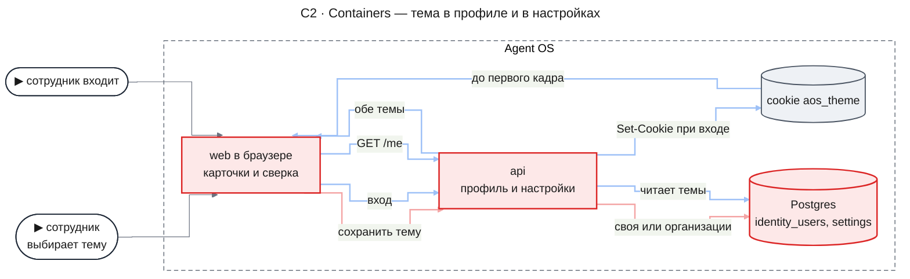
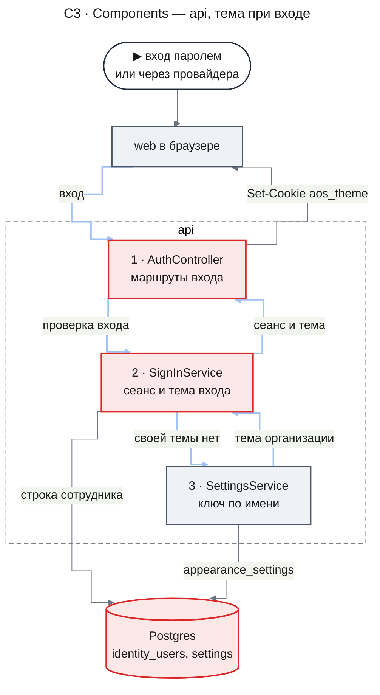
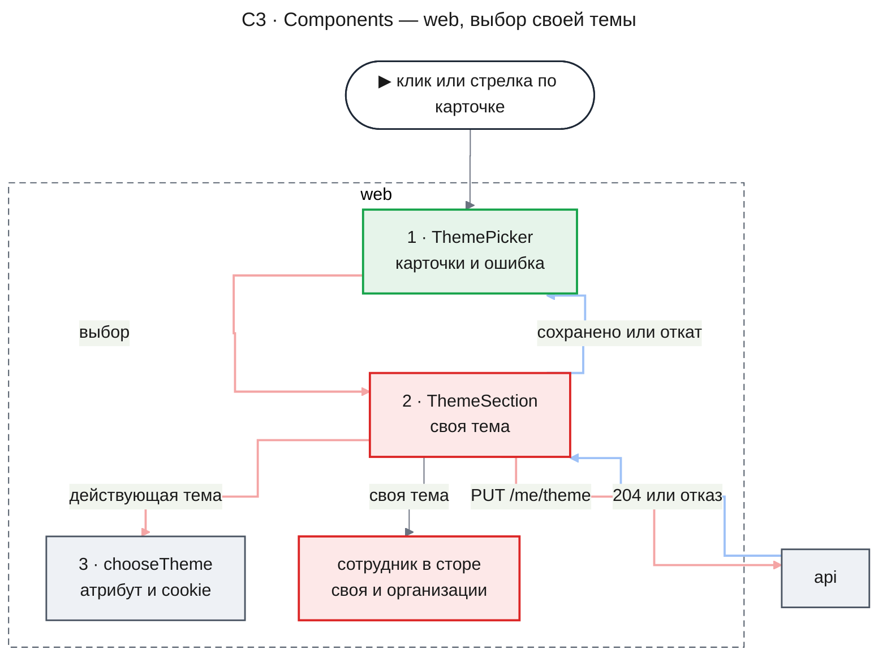
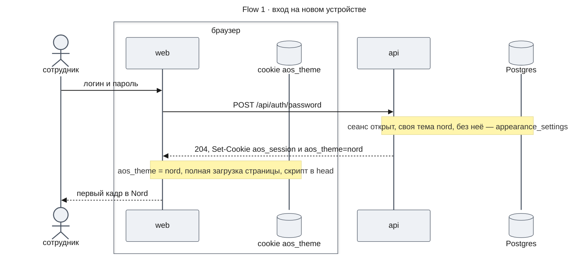
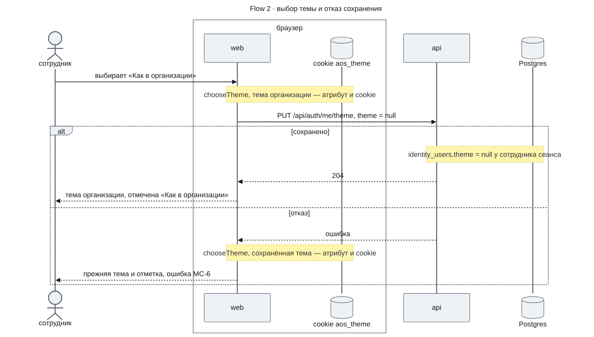
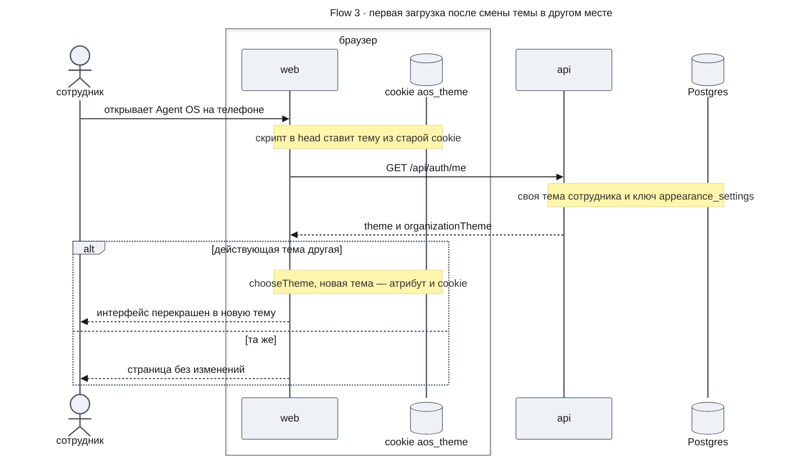
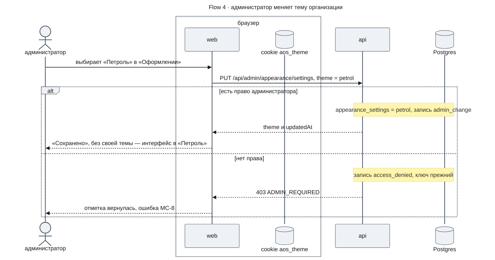

# Темы оформления — Design Document — preference

**Status:** Draft · **Date:** 2026-11-28 · **PRD:** [prd.md](./prd.md) · **UXRD:** [uxrd.md](./uxrd.md) · **Depends on:** [design-engine.md#contract-definitions](./design-engine.md#contract-definitions)

## Snapshot

**Overview.** Часть `engine` хранит выбор темы только в cookie браузера, поэтому на другом устройстве его нет, а администратор не может задать тему для всех. Эта часть кладёт тему сотрудника в его профиль рядом с языком интерфейса, а тему организации — в таблицу настроек, где её меняет новый раздел панели «Оформление». При входе API ставит cookie темы: свою, а без своего выбора — тему организации, и первая страница на новом устройстве уже в нужной теме. Ответ о текущем сотруднике несёт обе темы, и веб на первом чтении применяет новую, если её сменили на другом устройстве или в организации. Выбор карточки сразу перекрашивает интерфейс и сохраняется в профиль в фоне, а при отказе сохранения интерфейс возвращается к сохранённой теме и показывает ошибку.

- **Не меняется**: движок тем — блоки CSS, скрипт в `<head>`, `chooseTheme` и формат cookie `aos_theme`; режим остаётся настройкой устройства.
- **Главный риск**: первая загрузка страницы после смены темы на другом устройстве или в организации начинается в прежней теме и перекрашивается после ответа API (KD-4).
- **Открытые вопросы**: нет.

### Key Decisions

#### KD-1: Своя тема — столбец профиля и маршрут сотрудника над собой, как язык; `null` значит «как в организации»

Язык интерфейса уже хранится так: необязательный столбец `identity_users.language` с CHECK из набора в контрактах и маршрут `PUT /api/auth/me/language`, который меняет только сотрудника сеанса. Тема следует за человеком так же (FR-07), поэтому она получает столбец `identity_users.theme` и маршрут `PUT /api/auth/me/theme` той же формы. Пустое значение — выбор «Как в организации»: копия темы организации в профиле не следовала бы за её сменой (AC-08.3). От языка маршрут отличается двумя вещами: тело принимает `null`, а ответ 204 приходит без cookie (KD-3). Отдельная таблица предпочтений отвергнута: в ней было бы одно поле.

#### KD-2: Тема организации — ключ `appearance_settings` таблицы настроек со строкой «Графит» по умолчанию

Настройку, которую администратор меняет одной формой для всей платформы, проект хранит по образцу [keyed-settings.md](../../code-system/patterns/keyed-settings.md). Образец сразу даёт маршруты под `@AdminOnly()` с отказом сотруднику без права (AC-08.5) и запись аудита `admin_change`. Значение ключа — `{theme}`. Строка по умолчанию с «Графитом» стоит в миграции встроенных строк, поэтому правило «пока администратор не выбирал, тема организации — Графит» (UXRD KD-5) не требует отдельной ветки для пустого значения. Маршруты копируют `AdminSelfLearningSettingsController`.

#### KD-3: Cookie `aos_theme` пишут два места: API при входе и `chooseTheme` веба

Скрипт в `<head>` красит первый кадр раньше любого запроса к API ([design-engine.md](./design-engine.md), KD-3). Поэтому тему для первой страницы на новом устройстве может принести только cookie ответа на вход (AC-07.1). Оба способа входа заканчиваются полной загрузкой страницы: форма пароля уходит через `window.location.assign`, вход через провайдера — ответом 302. Значение cookie при входе — своя тема сотрудника, а без неё — тема организации.

- `GET /api/auth/me` и `PUT /api/auth/me/theme` cookie не пишут, в отличие от языка. Cookie темы без `HttpOnly`, и браузер пишет её сам: `chooseTheme` вызывается при выборе, при откате и при сверке (KD-4), так что запись сервера только повторила бы её.
- API ставит эту cookie без `HttpOnly`, хотя остальные его cookie с ним. Её читает скрипт страницы, а cookie того же имени с `HttpOnly` не дала бы `chooseTheme` записать новое значение.

#### KD-4: Смена темы на другом устройстве или в организации доходит сверкой при первом чтении сотрудника

`GET /api/auth/me` отдаёт свою тему и тему организации. Веб уже читает сотрудника один раз при открытии оболочки, и рядом с `LocaleSync` встаёт такая же сверка темы. Когда сотрудник прочитан, сверка вычисляет действующую тему и, если она отличается от темы страницы, применяет её через `chooseTheme`. Без сверки устройство со старой cookie показывало бы прежнюю тему до следующего входа, потому что `GET /api/auth/me` cookie темы не пишет (KD-3). Сверка перекрашивает страницу на первой же загрузке и через `chooseTheme` обновляет cookie (AC-07.2, AC-08.4). Живой доставки нет: PRD просит новую тему со следующей загрузки страницы.

#### KD-5: Карточки выносятся из секции «Тема» в общий `ThemePicker`; каждый выбор шлёт своё сохранение

Карточки появляются во втором месте — в разделе «Оформление» (UXRD KD-5), и `ThemePicker` берёт их из `ThemeSection` части `engine` вместе с состоянием «Не сохранилось» спецификации [theme-picker](../../design-system/components/theme-picker.md). Каждый выбор сразу уходит своим запросом, а интерфейс показывает последний выбор, как в части `engine`. При отказе отметка и интерфейс возвращаются к теме, которую секция последней знала сохранённой, и под карточками стоит ошибка, как требует UXRD. Порядок запросов не охраняется: в профиле остаётся то, что записал последний пришедший запрос.

#### KD-6: Набор id тем и имя cookie переезжают в `@agent-os/contracts`; тема по умолчанию остаётся в вебе

У набора id появились второй и третий пользователи: CHECK столбца и проверка тел запросов, а у имени cookie — API, которое пишет её при входе. `lib/theme.ts` веба берёт оба значения из контрактов. Тема по умолчанию серверу не нужна, потому что строка организации есть всегда, и она остаётся в вебе.

## Terms

- **Своя тема** — тема, которую сотрудник выбрал сам; пустая, пока он следует организации.
- **Действующая тема** — своя тема, а без неё тема организации; в ней рисуется интерфейс.
- **Сверка темы** — проверка веба при первом чтении сотрудника: совпадает ли действующая тема с темой страницы.

## Part

- **Prerequisite ADRs**: [ADR-0012](../../adr/ADR-0012-closed-api-and-server-issued-employee-id.md) — маршрут сотрудника берёт его id только из сеанса; [ADR-0025](../../adr/ADR-0025-settings-key-table.md) — таблица настроек по ключу; [ADR-0020](../../adr/ADR-0020-next-intl-client-layer.md) — тексты через каталоги next-intl.

**Out of scope**

- Движок тем остаётся как в [design-engine.md](./design-engine.md): блоки CSS, скрипт в `<head>`, `chooseTheme`, строка «Тема: …» в меню. Строка меню читает атрибут страницы и поэтому без правок называет тему организации у сотрудника без своей.
- Открытые вкладки получают новую тему со следующей загрузки, как в части `engine`.
- Выход из Agent OS cookie темы не стирает: следующий вход перезаписывает её, а страница входа показывает последнюю тему этого браузера.
- Страница входа на новом устройстве до входа — в «Графите»: без сеанса тема организации неизвестна, и ни один критерий этого не просит.
- Своя тема в аудит не пишется, как язык: она ничего не разрешает.
- Порядок сохранений не охраняется. При быстром листании стрелками поздний отказ может вернуть интерфейс к теме, с которой сотрудник уже ушёл, а запросы, пришедшие в обратном порядке, — оставить профиль на шаг позади экрана. Оба случая исправляет следующий выбор.

**Constraints**

- Настройки — в базе и в панели, без переменных окружения: тема организации — ключ таблицы настроек (KD-2).
- Изоляция сотрудников: `PUT /api/auth/me/theme` меняет только сотрудника сеанса, это проверяет e2e-тест с двумя сотрудниками.
- PoC без переноса данных: столбец появляется в заново сгенерированной `0000_schema.sql`, строка ключа — в `0001_builtin_rows.sql`, база разработки пересоздаётся.
- Тексты en и ru под одинаковыми ключами: пояснение секции получает первое предложение MC-3, карточка организации — MC-5, ошибка — MC-6, раздел панели — MC-8 и `admin.section.appearance` ([interface-text.md](../../code-system/patterns/interface-text.md)).

## Building-block Inventory

Follows the [code system](../../code-system/README.md). Общий компонент карточек искали в `apps/web/src/components/ui`, `components/account` и `components/admin`: есть только радиогруппа с точкой, а карточки с образцом живут внутри `ThemeSection` части `engine`.

| Building block | Pattern | Status | Note |
|---|---|---|---|
| столбец `identity_users.theme`, `IdentityUsersRepository`, `UsersService` | [repository-over-transaction.md](../../code-system/patterns/repository-over-transaction.md) | extended | запись своей темы, как `setLanguage` и `setOwnLanguage` |
| `AuthController`, `SignInService`, проверка сеанса | [auth-boundary.md](../../code-system/patterns/auth-boundary.md) | extended | маршрут темы, тема в ответе о сотруднике и cookie при входе; колонка темы читается в запросе сеанса рядом с языком |
| ключ `appearance_settings` и маршрут панели | [keyed-settings.md](../../code-system/patterns/keyed-settings.md) | extended | по образцу `AdminSelfLearningSettingsController` |
| cookie `aos_theme` при входе | [pre-paint-preference.md](../../code-system/patterns/pre-paint-preference.md) | extended | API пишет cookie только при входе, сохранение её не пишет (KD-3) |
| раздел панели `appearance` | [shell-route.md](../../code-system/patterns/shell-route.md) | extended | последний id в `ADMIN_SECTION_IDS`, после `instructions` части agent-guidance; без страниц записей, иконка `Palette`, ветка в `AdminScreen` |
| `ThemePicker` | — | new | карточки из `ThemeSection` и состояние «Не сохранилось» (KD-5) |
| сверка темы | — | new | рядом с `LocaleSync`: язык применяется обновлением серверного дерева, тема — атрибутом, поэтому в `LocaleSync` она не встаёт |
| `authApi.saveTheme`, `adminApi.appearance` | [web-api-client.md](../../code-system/patterns/web-api-client.md) | extended | через `apiRequest` |
| каталоги текста | [interface-text.md](../../code-system/patterns/interface-text.md) | extended | MC-3, MC-5, MC-6, MC-8 |

## Acceptance Criteria

KD-n ниже — решения этого документа; решения UXRD цитируются как «UXRD KD-n».

### FR-07: Тема следует за сотрудником

- From the PRD: AC-07.1, AC-07.2.
- Вход паролем и вход через провайдера ставят cookie `aos_theme` с действующей темой сотрудника.
- Сотрудник меняет только свою тему: выбор одного сотрудника не меняет тему другого.

### FR-08: Тема организации

- From the PRD: AC-08.1, AC-08.2, AC-08.3, AC-08.4, AC-08.5.
- Раздел «Оформление», пока администратор не выбирал тему, отмечает «Графит».
- Сотрудник без права администратора получает 403 `ADMIN_REQUIRED` и при чтении, и при изменении темы организации.
- Если сохранение своей темы не удалось, интерфейс и отметка возвращаются к сохранённой теме, а под карточками стоит MC-6.
- Если администратор следует теме организации, его интерфейс после сохранения сразу переходит в новую тему, иначе остаётся в своей.

## Design

### Architecture (C1–C4)

Акторы и внешние системы не меняются, поэтому C1 не нарисован.

#### C2 · Containers

Выбор пишется в профиль или в настройки. При входе API читает темы и ставит cookie, а ответ о сотруднике приносит вебу обе темы.

Запросы `/api` по-прежнему идут через сервер Next, который их только пересылает, поэтому на схеме его нет. Cookie API ставит на том же адресе, что и страница, и скрипт в `<head>` её видит.

#### C3 · Components: api

**api — тема при входе**

- **`SignInService`** уже читает строку сотрудника, чтобы открыть сеанс, и берёт из неё свою тему. Ключ `appearance_settings` он читает, только когда своей темы нет, и отдаёт контроллеру действующую тему вместе с сеансом.
- **`AuthController`** ставит cookie темы рядом с cookie сеанса и языка в обоих маршрутах входа. В ответе `GET /api/auth/me` он читает ключ `appearance_settings` так же, как уже читает `self_learning_settings`, а свою тему берёт из сотрудника сеанса.
- Маршрут `PUT /api/auth/me/theme` устроен как `changeLanguage`, а маршруты панели — как `AdminSelfLearningSettingsController`; оба видны в Runtime Flows.

#### C3 · Components: web

**web — выбор своей темы**

- **`ThemePicker`** рисует карточки по [theme-picker](../../design-system/components/theme-picker.md) в двух вариантах. В варианте «Сотрудник» первая карточка — «Как в организации» с образцом и подписью MC-5 темы организации. Каждый выбор компонент отдаёт владельцу на сохранение, а при отказе возвращает отметку на сохранённую карточку и показывает под карточками текст ошибки, который дал владелец (KD-5).
- **`ThemeSection`** берёт отметку из сотрудника в сторе, а не из атрибута страницы, как в части `engine`: только профиль отличает «Как в организации» от своего выбора той же темы (UXRD KD-4). Выбор сразу применяет действующую тему через `chooseTheme`, после 204 секция записывает свою тему в стор, а при отказе применяет сохранённую тему из стора и передаёт MC-6.
- **Раздел «Оформление»** читает ключ при открытии и показывает загрузку и ошибку, как форма настроек самообучения. Он ставит `ThemePicker` в варианте «Организация» и после ответа показывает «Сохранено». Затем раздел записывает тему организации в стор и, если у администратора нет своей темы, применяет её через `chooseTheme`. При отказе раздел передаёт MC-8 со словами сервера.
- **Сверка темы** стоит в оболочке рядом с `LocaleSync` и срабатывает один раз на открытие оболочки (KD-4).

### Runtime Flows

#### Flow 1: вход на новом устройстве

**Starts when:** сотрудник входит паролем в браузере, где cookie темы нет или она чужая, for AC-07.1, AC-08.1

Вход через провайдера отличается только транспортом: ответ 302 на адрес веба несёт ту же cookie. Без своей темы cookie несёт тему организации, и первая страница сотрудника идёт в «Петроль», если её выбрал администратор (AC-08.1).

#### Flow 2: выбор темы и отказ сохранения

**Starts when:** сотрудник выбирает карточку в секции «Тема», for AC-08.2, AC-08.3

Выбор своей темы идёт тем же путём с id темы в теле. Со своей темой сотрудник не следует организации, и смена темы организации его не трогает (AC-08.2). Каждая следующая карточка шлёт свой запрос, не дожидаясь ответа на предыдущий (KD-5).

#### Flow 3: первая загрузка после смены темы в другом месте

**Starts when:** сотрудник открывает страницу на устройстве, где cookie темы устарела, for AC-07.2, AC-08.4

Режим устройства сверка не трогает, поэтому телефон в светлом режиме показывает новую тему в светлом режиме (AC-07.2). Со следующей загрузки страница уже рисуется в новой теме с первого кадра, потому что `chooseTheme` записал cookie.

#### Flow 4: администратор меняет тему организации

**Starts when:** администратор выбирает карточку в разделе «Оформление», или сотрудник без права шлёт такой же запрос, for AC-08.1, AC-08.4, AC-08.5

Сотрудники без своей темы получают «Петроль» со следующей загрузки страницы через сверку (Flow 3) или при следующем входе (Flow 1). Сотрудник без права раздела не видит, и отказ ловит только запрос в обход панели.

### Contract Definitions

Часть потребляет [контракт `engine`](./design-engine.md#contract-definitions): cookie `aos_theme`, её атрибуты и `chooseTheme`. Ниже — то, что она предлагает вебу.

- **`PUT /api/auth/me/theme`** — сохраняет свою тему сотрудника сеанса. Тело — `theme`: id темы или `null` для «Как в организации». Отвечает 204 без тела и без cookie. Значение вне набора даёт 400 `VALIDATION_FAILED`, и ничего не меняется. Без сеанса — 401 `AUTH_REQUIRED`, с чужим `Origin` — 403 `ORIGIN_REJECTED`, как у любого изменяющего запроса.
- **`GET /api/auth/me`** — прежний ответ `CurrentUser` получает два поля; новых отказов нет.
- **Вход** — `POST /api/auth/password` (204) и `GET /api/auth/oauth/:providerId/callback` (302) вдобавок к cookie сеанса и языка ставят `aos_theme` с действующей темой. Атрибуты — как в контракте `engine`: `Path=/`, срок год, `SameSite=Lax`, без `HttpOnly`, плюс `Secure`, когда веб открыт по `https`, как у остальных cookie API.
- **`GET /api/admin/appearance/settings`** — отдаёт `AppearanceSettings`. Сотруднику без права — 403 `ADMIN_REQUIRED`.
- **`PUT /api/admin/appearance/settings`** — тело `theme`, id темы. Записывает ключ с одной записью `admin_change` и отдаёт `AppearanceSettings` после изменения. Значение вне набора — 400 `VALIDATION_FAILED`, сотруднику без права — 403 `ADMIN_REQUIRED` с записью `access_denied`; в обоих случаях ключ прежний.

**`CurrentUser`, новые поля**

- `theme` — своя тема; `null`, пока сотрудник следует организации.
- `organizationTheme` — тема организации, всегда id темы.

**`AppearanceSettings`**

- `theme` — тема организации.
- `updatedAt` — время последнего изменения; `null`, пока стоит значение по умолчанию.

Набор id тем — `graphite`, `petrol`, `nord` — и имя cookie `aos_theme` лежат в `@agent-os/contracts` (KD-6). `CurrentUser` меняется вместе с API и вебом в одном изменении, как требует пакет контрактов; тестовые данные сотрудника в API и вебе получают оба поля.

### Data Model

- `identity_users.theme` — своя тема, необязательная; CHECK пускает только id из набора контрактов, как у `identity_users.language`. Пустое значение — «Как в организации».
- Строка `appearance_settings` таблицы `settings` со значением `{theme}`; строка по умолчанию — «Графит». Ключ проходит CHECK реестра ключей, а значение разбирает схема ключа при каждом чтении.

## Security Considerations

- **Authentication & Authorization**: `PUT /api/auth/me/theme` стоит под проверкой сеанса и `Origin` и берёт сотрудника только из сеанса (ADR-0012). Маршруты темы организации стоят под `@AdminOnly()` ([auth-boundary.md](../../code-system/patterns/auth-boundary.md)).
- **Input Validation**: тела обоих маршрутов проверяет zod-схема из контрактов, столбец держит CHECK. API пишет в cookie только id из набора, а скрипт страницы кладёт значение в атрибут без разбора разметки (контракт `engine`).
- **Sensitive Data Handling**: тема не секрет. Лог API пишет «theme saved» с id сотрудника, сеанса и темы; маршрут панели логируется, как остальные маршруты настроек, с id администратора и новой темой.

## Test Strategy

- **API, e2e с двумя сотрудниками** — по образцу `apps/api/test/i18n-web.int.e2e-spec.ts`, одна таблица строк. A сохраняет Nord, B этого не видит; запрос без сеанса и значение вне набора ничего не меняют. Вход A ставит `aos_theme=nord` без `HttpOnly`. После того как администратор выбрал «Петроль», вход B ставит «Петроль», а у A остаётся Nord. Выбор A «как в организации» даёт ему «Петроль», а изменение темы организации сотрудником без права получает 403 и не меняет ключ. Covers AC-07.1, AC-08.1, AC-08.2, AC-08.3, AC-08.5.
- **Схема** — строка проверки CHECK столбца темы против набора контрактов в существующей таблице `packages/db/test/migrations.e2e-spec.ts`.
- **Веб** — секция «Тема»: отказ сохранения возвращает тему и отметку к сохранённой и показывает MC-6. Сверка темы: ответ с другой действующей темой ставит её на страницу. Covers AC-07.2, AC-08.4.
- **Проверка в браузере** по навыку `browser-check`: тема, выбранная в одном профиле браузера, видна с первого кадра после входа в другом (AC-07.1).

## Risks and Mitigation

- **Первая загрузка после смены темы в другом месте начинается в прежней теме** — низкое влияние, один раз на смену на каждом устройстве. Сверка перекрашивает страницу после ответа `GET /api/auth/me`, а cookie с новой темой делает следующую загрузку чистой.
- **Администратор, листающий темы стрелками, оставляет запись `admin_change` на каждый шаг** — низкое влияние: каждая запись верна и называет тему, которую он выбрал.

## Update History

| Version | Date | Change |
|---------|------|--------|
| 1.0 | 2026-11-28 | Первая версия |
| 1.1 | 2026-11-28 | Без очереди сохранений: каждый выбор шлёт свой запрос, отказ показывает ошибку без отката темы |
| 1.2 | 2026-11-28 | Отказ сохранения возвращает отметку и интерфейс к сохранённой теме, как в UXRD; очереди по-прежнему нет |
