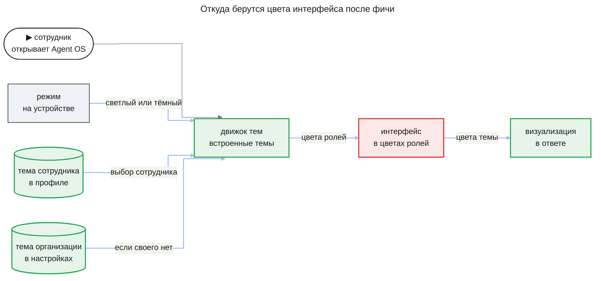
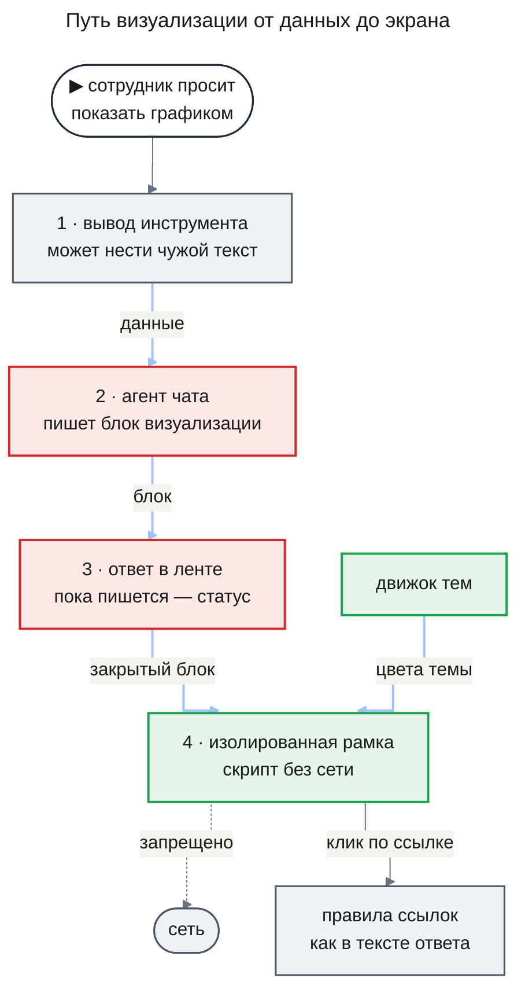
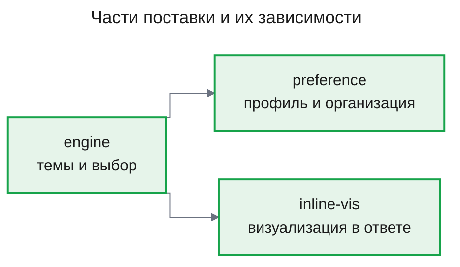

# PRD: Темы оформления и визуализация в ответе (theming)

| Date | Depth |
|---|---|
| 2026-11-28 | full |

## Snapshot

**Overview.** Сегодня у Agent OS одна палитра — тёплый серый с бирюзовым акцентом «Петроль», а сотрудник выбирает только режим: светлый, тёмный или как в системе. Владелец хочет оформление в стиле bb — спокойное, без цветного акцента — и возможность менять палитру. После фичи палитра становится темой: набором цветов для светлого и тёмного режима, который переключается сразу и не утомляет глаза: каждую тему проверяют на пороги комфорта, когда её добавляют, и записывают результат на странице тем. По умолчанию действует тема в стиле bb, «Петроль» и Nord доступны на выбор; выбор хранится в профиле сотрудника, а администратор задаёт тему организации. Вторая половина фичи — агент рисует график или схему прямо в ответе: HTML-страница работает в изолированной рамке без доступа к сети и в цветах текущей темы.

- **Не входит**: импорт тем VS Code и свои темы; вид компонентов bb (плотность, однострочные вызовы инструментов, композер); шрифт и плотность как часть темы.
- **Главный риск**: страницу визуализации пишет модель по выводу инструментов, где может оказаться чужой текст; сотрудника защищает только изоляция рамки, поэтому её правила — требование (FR-10), а не деталь реализации.
- **Открытые вопросы**: решения, принятые по рекомендации аналитика, ждут подтверждения владельца ([Undetermined Items](#undetermined-items)).

## Terms

- **Режим** — светлый, тёмный или «Системная», когда интерфейс следует за ОС. Переключатель режима уже есть (`chat-shell` FR-09).
- **Тема** — набор цветов интерфейса со значениями для светлого и тёмного режима. Тема и режим — две независимые настройки: «Nord, тёмный» и «Nord, светлый» — одна тема.
- **Роль цвета** — место, где используется цвет: фон страницы, основной текст, акцент, статус «ошибка», цвет ряда на графике. Список ролей закрыт и общий для всех тем; его ведёт дизайн-система (`docs/design-system/foundations.md`).
- **Встроенная тема** — тема, которая поставляется в коде приложения.
- **«Графит»** — тема по умолчанию в стиле bb: серая основа без цветного оттенка и без цветного акцента.
- **«Петроль»** — сегодняшняя палитра: тёплый серый и бирюзовый акцент.
- **Тема организации** — тема, которую администратор выбрал для всех. Сотрудник видит её, пока не выбрал свою.
- **Полоса комфорта** — правила дизайн-системы для контраста: текст не бледнее порога доступности, но и не слепит, чистого белого и почти чёрного нет (`foundations.md`, «Полоса комфорта»).
- **Палитра графиков** — цвета рядов данных на графике, свои у каждой темы.
- **Блок визуализации** (inline visualization) — фрагмент ответа агента, в котором модель пишет HTML-страницу: график, схему, раскрашенную таблицу. Сотрудник видит не код, а отрисованную страницу.
- **Изолированная рамка** (sandboxed iframe) — окно внутри страницы Agent OS. Скрипт в нём работает, но не видит страницу Agent OS, её cookies и данные и не может обращаться в сеть.
- **Внедрённый текст** (prompt injection) — текст в выводе инструмента, например в письме или логе, который пытается давать модели команды.

## Background

Режим уже переключается без перезагрузки и без вспышки при загрузке (`chat-shell` FR-09), но палитра у него одна, и её значения записаны прямо в дизайн-системе. Цвета для графиков в приложении определены, но все серые: графиков в интерфейсе пока нет.

Движок тем взят из [bb](https://github.com/get-bb/bb) (лицензия MIT). Хранение bb не подходит: там выбор — одна запись на всё приложение, а темы лежат файлами на диске, а Agent OS — сервер, где работает много сотрудников. Выбор темы хранится так же, как язык интерфейса: в профиле сотрудника (`i18n`).

После фичи цвет на экране зависит от двух настроек — режима и темы:

Режим остаётся настройкой устройства: вечером ноутбук может быть тёмным, а телефон светлым. Тема — выбор человека, поэтому она следует за ним на любое устройство.

Палитра bb по умолчанию нарушает полосу комфорта: у неё чистый белый фон, слабый контраст в тёмном режиме и белый текст на акценте. Поэтому каждое скопированное значение поправляется, и «Графит» похож на bb, но не совпадает с ним.

Визуализация в ответе тоже взята из bb, кроме одного правила: в bb страница ходит в сеть, а у нас — нет.

Модель пишет страницу по выводу инструментов, а в нём может оказаться внедрённый текст. Страница с доступом к сети могла бы отправить на чужой сервер всё, что модель вставила в неё из беседы. По той же причине Agent OS уже сегодня не загружает картинки по адресам из документов, написанных моделью.

**Что меняется в дизайн-системе.** Правки вносит владелец UXRD и дизайн-системы:

- В README, раздел Direction, «тёплая серая основа, один акцент» сменяется ахроматической основой по умолчанию. Направление говорит, чем отмечен выбранный элемент, когда цветного акцента нет.
- В `foundations.md` полоса комфорта и список ролей остаются правилами для каждой темы, а таблицы значений переходят в описание каждой темы.
- Появляется страница тем: источник, лицензия и результаты проверки контраста каждой темы в обоих режимах и в повышенном контрасте.

## Users and Use Cases

### Users

- **Сотрудник** — проводит в Agent OS часы подряд. Ему важно, чтобы глаза не уставали, а данные можно было увидеть картинкой, а не только таблицей.
- **Администратор** — задаёт оформление для всех, кто сам тему не выбирал.
- **Разработчик Agent OS** — добавляет и правит встроенные темы. Ему важно, чтобы тема до выпуска была проверена на полосу комфорта.

### Use Cases

- **UC-1**: Сотрудник выбирает тему → весь интерфейс сразу в её цветах, а на другом устройстве после входа та же тема, чтобы работать в палитре, удобной ему.
- **UC-2**: Администратор выбирает тему организации → сотрудники, которые свою не выбирали, работают в ней, чтобы оформление в компании было одним без действий каждого.
- **UC-3**: Сотрудник просит агента показать данные графиком или схемой → картинка в ответе в цветах его темы, чтобы видеть динамику и сравнение без выгрузки данных в другой инструмент.
- **UC-4**: Разработчик добавляет или правит встроенную тему → проверяет её на пороги комфорта в обоих режимах и в повышенном контрасте и записывает результат на странице тем, чтобы утомляющая тема не дошла до сотрудников.

## Functional Requirements

### Must Have (MVP)

- **FR-01. Тема как данные.** У каждой встроенной темы есть значение каждой роли цвета в светлом и в тёмном режиме.
  - AC-01.1: Given любая встроенная тема в любом режиме, Then у каждой роли из списка дизайн-системы есть значение; это проверяют, когда тему добавляют (FR-04).
- **FR-02. Первый набор тем.** Сотруднику доступны три встроенные темы: «Графит» по умолчанию, «Петроль» и Nord.
  - AC-02.1: Given тему не выбирал ни сотрудник, ни администратор, Then интерфейс в «Графите».
  - AC-02.2: Given выбран «Графит», Then поверхности, текст и акцент без цветного оттенка, сигнальные цвета дизайн-системы — статусы агента, разрушительное действие, графики — остаются цветными, а выбранная беседа, вкладка или строка всё равно отличается от соседних.
  - AC-02.3: Given выбрана «Петроль», Then интерфейс выглядит как сегодня: значения совпадают с нынешней палитрой дизайн-системы.
  - AC-02.4: Given выбрана Nord, Then основа и акцент взяты из палитры Nord и поправлены там, где она выходит из полосы комфорта.
- **FR-03. Переключение без перезагрузки и без вспышки.** Новая тема сразу применяется ко всему интерфейсу, а при загрузке страницы видна с первой отрисовки.
  - AC-03.1: Given открыт «Мой доступ», When сотрудник выбирает там другую тему, Then без перезагрузки страницы перекрашивается весь интерфейс — сайдбар, шапка, карточки, диалоги и меню, — а лента, композер и панель администратора открываются уже в новой теме.
  - AC-03.2: Given тема выбрана, When страница перезагружается, Then первая отрисовка уже в этой теме, и вспышки другой темы нет.
  - AC-03.3: Given любая тема, When сотрудник меняет режим или ОС переключает режим при «Системной», Then тема остаётся прежней и показывается в новом режиме, а смена темы не меняет режим.
- **FR-04. Проверка комфорта при добавлении темы.** Каждая встроенная тема в обоих режимах и в повышенном контрасте укладывается в полосу комфорта и пороги контраста дизайн-системы, и это проверяют, когда тему добавляют или правят.
  - AC-04.1: Given тему добавляют или правят, Then её проверяют на пороги комфорта дизайн-системы в светлом и тёмном режиме и в повышенном контрасте, и результат записывают на странице тем (`docs/design-system/themes.md`).
  - AC-04.2: Given текущий набор тем, Then на странице тем у каждой из трёх тем записано, что она укладывается в пороги в обоих режимах и в повышенном контрасте.
  - AC-04.3: Given в ОС включён повышенный контраст, Then в каждой теме действует режим повышенного контраста дизайн-системы (`foundations.md`, «Повышенный контраст»).
- **FR-05. Палитра графиков у каждой темы.** Каждая тема задаёт свои цвета рядов графика для светлого и тёмного режима.
  - AC-05.1: Given любая тема в любом режиме, включая «Графит», Then ряды графика цветные и различаются между собой и с фоном по порогу дизайн-системы; это подтверждает проверка темы, записанная на странице тем (FR-04).
- **FR-06. Выбор темы.** Сотрудник выбирает тему из списка встроенных тем в своих настройках интерфейса.
  - AC-06.1: Given сотрудник открыл выбор темы, Then видны все встроенные темы, текущая отмечена, и темы отличаются друг от друга ещё до выбора.
  - AC-06.2: Given тема выбрана, When сотрудник закрывает Agent OS и снова открывает его в том же браузере, Then выбранная тема на месте.
- **FR-07. Тема следует за сотрудником.** Выбранная тема хранится в профиле сотрудника и действует на любом устройстве, где он вошёл, а режим остаётся настройкой устройства.
  - AC-07.1: Given сотрудник выбрал Nord на ноутбуке, When он входит в Agent OS на другом компьютере, Then первая страница после входа уже в Nord.
  - AC-07.2: Given на ноутбуке тёмный режим, а на телефоне светлый, When сотрудник меняет тему на ноутбуке, Then при следующем открытии телефон показывает новую тему в светлом режиме.
- **FR-08. Тема организации.** Администратор выбирает в панели администратора тему, которую видят сотрудники без своего выбора.
  - AC-08.1: Given администратор выбрал «Петроль», а сотрудник свою тему не выбирал, When сотрудник открывает Agent OS, Then интерфейс в «Петроль».
  - AC-08.2: Given сотрудник выбрал Nord, When администратор меняет тему организации, Then у сотрудника остаётся Nord.
  - AC-08.3: Given у сотрудника своя тема, When он выбирает вариант «как в организации», Then видит тему организации и дальше следует за её сменой.
  - AC-08.4: Given администратор сменил тему организации, Then сотрудники без своего выбора видят новую тему со следующей загрузки страницы.
  - AC-08.5: Given у сотрудника нет доступа к панели администратора, When он пытается изменить тему организации, Then сервер отклоняет изменение, и тема организации остаётся прежней.
- **FR-09. Визуализация в ответе.** Агент вставляет в ответ блок визуализации, и сотрудник видит на его месте отрисованную страницу.
  - AC-09.1: Given в ответе агента законченный блок визуализации, Then на его месте отрисованная страница шириной в колонку ответа и высотой по содержимому в пределах, которые задаёт UXRD, а более высокая страница прокручивается внутри рамки.
  - AC-09.2: Given такой же блок в отчёте агента или в документе блокнота, Then он отрисовывается так же.
  - AC-09.3: Given блок не закрыт, потому что ответ оборвался, или блок пуст, Then он показан как обычный блок кода.
- **FR-10. Изоляция визуализации.** Страница визуализации не может обращаться в сеть, читать страницу Agent OS и действовать от имени сотрудника.
  - AC-10.1: Given страница пытается загрузить скрипт, стиль, картинку или шрифт, отправить запрос или открыть соединение, Then из браузера не уходит ни одного запроса, а остальная страница отрисовывается.
  - AC-10.2: Given скрипт страницы пытается прочитать cookies, хранилище браузера или содержимое страницы Agent OS, Then доступа у него нет.
  - AC-10.3: Given страница пытается открыть новое окно, отправить форму или увести вкладку Agent OS на другой адрес, Then ничего из этого не происходит.
  - AC-10.4: Given сотрудник кликает ссылку внутри визуализации, Then ссылка подчиняется тем же правилам, что ссылка в тексте ответа, и открывается только по клику сотрудника.
- **FR-11. Состояния блока визуализации.** Сотрудник видит, пишется блок, готов или сломан, и может посмотреть его исходный код.
  - AC-11.1: Given агент ещё пишет блок, Then вместо недописанной страницы видна строка статуса, а страница появляется, когда блок закрыт.
  - AC-11.2: Given скрипт страницы упал с ошибкой, Then сотрудник видит, что визуализация не отрисовалась, и может открыть исходный код блока.
  - AC-11.3: Given визуализация отрисована, Then сотрудник может показать и скрыть её исходный код и скопировать его.
  - AC-11.4: Given сотрудник работает со скринридером, Then рамка объявляется по названию, которое агент дал блоку, а без названия — общим названием из UXRD.
- **FR-12. Визуализация в цветах темы.** Страница визуализации получает цвета текущей темы и режима, включая палитру графиков, и следует за их сменой.
  - AC-12.1: Given страница использует цвета темы, Then её фон совпадает с фоном ответа, а текст и ряды графика окрашены цветами текущей темы и режима.
  - AC-12.2: Given визуализация на экране, When сотрудник меняет тему или режим, Then она перекрашивается без перезапуска страницы и сохраняет состояние — например, открытую вкладку внутри неё.
- **FR-13. Агент чата знает, когда рисовать.** Инструкция агента чата говорит, когда отвечать визуализацией и как её писать.
  - AC-13.1: Given у агента чата есть данные с динамикой или сравнением, When сотрудник просит показать их наглядно, Then агент отвечает блоком визуализации, нарисованным встроенным SVG или скриптом страницы, в цветах темы и без внешних библиотек.
  - AC-13.2: Given на вопрос достаточно ответить текстом, Then агент отвечает текстом без визуализации.

### Won't Have

- Импорт цветовой темы VS Code и свои темы сотрудников или администратора — не эта фича. Из примерно 800 ключей темы VS Code к нашим ролям подходят около 20, один файл описывает один режим, а большинство популярных тем выходят из полосы комфорта и после поправки перестают походить на оригинал. Кроме того, понадобились бы хранение тем в базе и редактор тем в панели. От VS Code движок берёт только принцип, по которому названы роли.
- Остальные темы bb — Solarized, Gruvbox, Catppuccin, Dracula — позже: каждая требует проверки лицензии и поправки под полосу комфорта, а движок проверяют три темы.
- Вид компонентов bb — плотность, однострочные вызовы инструментов, композер, пузырь сообщения сотрудника — отдельная следующая фича: он меняет спецификации компонентов и шкалу типографики, а не цвета.
- Шрифт, размер текста и плотность как часть темы — не эта фича: текст сообщений одинаков во всех темах (`foundations.md`, Typography).
- Встроенная библиотека графиков — не в этой фиче: модель пишет графики встроенным SVG или простым скриптом. Библиотеку добавляют, только если живая проверка (Success Criteria) покажет, что агент на модели класса Haiku рисует графики плохо.
- Визуализация, которая загружает что-либо из сети, в том числе библиотеку с публичного CDN, — никогда (FR-10).
- Визуализация из файла, как директива `::inline-vis{file=…}` в bb, — не эта фича: блок в тексте ответа покрывает графики и схемы, а файл потребовал бы ещё и раздачи файлов браузеру.

## Non-Functional Requirements

### Performance

- **NFR-01**: Смена режима в открытой беседе из 50 сообщений перекрашивает её не дольше чем за 100 мс.
- **NFR-02**: Беседа с десятью визуализациями восстанавливается в пределах проектного бюджета отрисовки восстановленной беседы (project-context, Performance Requirements).

### Accessibility and responsiveness

- **NFR-03**: Каждая встроенная тема в обоих режимах соответствует WCAG 2.1 AA и полосе комфорта — так же, как сегодня единственная палитра.
- **NFR-04**: Визуализация пригодна для работы от ширины 360 px: рамка не шире колонки ответа, горизонтальной прокрутки страницы нет.

## Delivery Parts

| Part | Covers | Cut along | Depends on | Rationale |
|------|--------|-----------|------------|-----------|
| `engine` | FR-01, FR-02, FR-03, FR-04, FR-05, FR-06 | frontend | — | Движок, темы и выбор целиком во фронтенде, чтобы строить его параллельно с серверными фичами; до части `preference` выбор хранится в браузере (AC-06.2). |
| `preference` | FR-07, FR-08 | backend | `engine` | Хранение выбора в профиле, тема организации в настройках и поле в панели — своя забота о данных и правах доступа; часть берёт список тем у `engine`. |
| `inline-vis` | FR-09, FR-10, FR-11, FR-12, FR-13 | frontend | `engine` | Изолированная рамка, её состояния и строка в инструкции агента чата — своя забота о безопасности; цвета рамка берёт у `engine`. |

### Part Dependency Diagram

Стрелка идёт от части к той, что строится на её утверждённом дизайне.

## Success Criteria

- Живая проверка визуализации: на пяти запросах вида «покажи … графиком» по данным fixture MCP агент чата хотя бы в четырёх даёт читаемую визуализацию в цветах темы. Проверяет владелец вручную после части `inline-vis`; меньший результат — сигнал добавить библиотеку графиков (Won't Have).
- Каждая встроенная тема в обоих режимах и в повышенном контрасте укладывается в пороги комфорта дизайн-системы, и результат её проверки записан на странице тем (`docs/design-system/themes.md`).

## Constraints and Risks

### Constraints

- Код и токены bb распространяются по лицензии MIT и копируются с указанием источника.
- У палитр тем свои лицензии (Nord — MIT, проект nordtheme): лицензию каждой палитры проверяют до копирования и записывают на странице тем дизайн-системы.
- Встроенные темы — часть кода приложения; в базе данных темы не хранятся.
- Полоса комфорта действует для каждой темы: скопированное значение, которое из неё выходит, поправляется, даже если тема после этого не совпадает с оригиналом.
- Визуализация никогда не получает доступа к сети, в том числе к публичному CDN.

### Assumptions and Risks

- Агент на модели класса Haiku может писать графики, которые не рисуются или плохо читаются. Это покажет живая проверка (Success Criteria), а ответом станет библиотека графиков.
- Внедрённый текст может заставить модель нарисовать обманчивую страницу, например с поддельной кнопкой или ссылкой на чужой сайт. Увести данные такая страница не может, потому что сети нет, а ссылка подчиняется тем же правилам, что ссылки в тексте ответа сегодня.
- Скрипт с бесконечным циклом может подвесить вкладку, если браузер запускает изолированную рамку в одном процессе с Agent OS. Предполагаем, что для PoC это допустимо; поведение Chrome проверяет дизайн части `inline-vis`.
- В «Графите» у выбранного элемента нет цветного признака. Если метка выбранного окажется слабой, сотрудник теряет из виду текущую беседу, поэтому признак задаёт дизайн-система и его проверяют на живом экране.

## Undetermined Items

Решения ниже приняты по рекомендации аналитика и действуют, пока владелец их не изменит.

- Где хранится выбор темы — в профиле сотрудника с темой организации по умолчанию, а режим на устройстве. Другой вариант — только в браузере, без синхронизации и без темы организации; тогда части `preference` нет. Блокирует дизайн части `preference`; решает владелец.
- Импорт тем VS Code и свои темы отнесены к Won't Have. Обратное решение добавит хранение тем в базе и редактор в панели. Блокирует границы части `engine`; решает владелец.
- Графики пишет модель встроенным SVG или скриптом, без библиотеки, пока живая проверка не покажет обратного. Блокирует дизайн части `inline-vis`; решает владелец.
- Вид компонентов bb вынесен в отдельную фичу. Блокирует границы этой фичи; решает владелец.

## Update History

| Version | Date | Change |
|---------|------|--------|
| 1.0 | 2026-11-28 | Первая версия |
| 1.1 | 2026-11-28 | Проверка комфорта — при добавлении темы с записью на странице тем, а не в каждом прогоне; тема по умолчанию названа «Графит»; тема выбирается на «Мой доступ»; NFR-01 — о смене режима в беседе |
