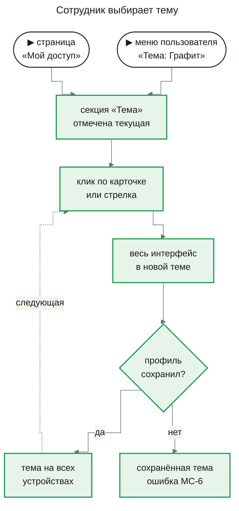
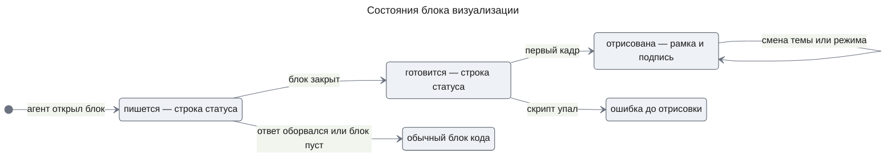

# UXRD: Темы оформления и визуализация в ответе (theming)

| Date | PRD |
|---|---|
| 2026-11-28 | [prd.md](./prd.md) |

## Snapshot

**Overview.** Сотрудник выбирает тему в новой секции «Тема» на странице «Мой доступ»: темы стоят карточками, и на каждой видна маленькая схема интерфейса в этой теме сразу в светлом и тёмном режиме. Выбор перекрашивает весь интерфейс в том же кадре, поэтому сравнивать темы можно вживую, листая карточки стрелками. Светлый или тёмный режим по-прежнему переключается в меню пользователя, а в меню появляется строка с текущей темой, которая ведёт к секции. Администратор задаёт тему организации в новом разделе панели «Оформление». Вторая половина — блок визуализации: график или схема, которую агент нарисовал в ответе, отчёте или документе блокнота, видна прямо в тексте, а её код открывается по кнопке.

- **Не меняется**: раскладка экранов, типографика и плотность — одни во всех темах; «Петроль» выглядит как сегодня.
- **Главный UX-риск**: в «Графите» нет цветного акцента, и выбранная беседа может потеряться среди соседних. Метку выбора держат форма, начертание и контраст ([README → Direction](../../design-system/README.md#direction); [foundations → Color](../../design-system/foundations.md#color), «Акцент»), и её проверяют на живом экране.

### Key Decisions

| ID | Решение | Почему |
|---|---|---|
| KD-1 | Тема выбирается в секции «Тема» на «Мой доступ», над секцией «Язык». В меню пользователя остаётся только режим, его группа называется «Режим», а под ней стоит строка «Тема: {название}», ведущая к секции | Образцу темы нужно место, которого в выпадающем меню нет; так устроены Slack (Preferences → Themes) и GitHub (Settings → Appearance). Тема следует за человеком, как язык, и стоит рядом с ним. Режим меняют по освещению по нескольку раз в день, поэтому он остаётся в одном клике. Слово «тема» теперь значит палитру, и группа режима не может называться так же |
| KD-2 | Карточка темы показывает схему оболочки в цветах самой темы, разделённую на светлую и тёмную половины, независимо от текущих темы и режима ([theme-picker](../../design-system/components/theme-picker.md)) | Темы отличаются друг от друга ещё до выбора (AC-06.1), и человек видит тему в обоих режимах, не переключая режим |
| KD-3 | Выбор применяется сразу ко всему интерфейсу, стрелки листают темы вживую, сохранение идёт в фоне. Если сохранить не удалось, интерфейс возвращается к сохранённой теме и показывает ошибку | Лучший образец темы — весь интерфейс с открытой беседой; так тему выбирают в VS Code. Кнопка «Применить» лишь удлинила бы сравнение |
| KD-4 | Первая карточка — «Как в организации»: её образец и подпись «Сейчас: {тема}» показывают тему организации. Она отмечена, пока у сотрудника нет своей темы; карточка той же темы рядом — уже свой выбор, который не следует за организацией | Сотрудник видит, что значит «следовать за организацией» и во что это его перекрасит (AC-08.3), и отличает это от собственного выбора той же темы (AC-08.2) |
| KD-5 | Тема организации задаётся в новом разделе панели «Оформление» теми же карточками, без «Как в организации». Пока администратор не выбрал тему, темой организации считается «Графит» | Ни один из разделов панели — сотрудники, роли, авторизация, серверы, модели, агенты — не про внешний вид. Одинаковые карточки у сотрудника и администратора не требуют учить второй элемент |
| KD-6 | Тема по умолчанию называется «Графит» (Graphite) | «Петроль» и Nord — имена, и тема по умолчанию тоже получает имя, а не описание. «Нейтральная» намекала бы, что остальные темы беспокойные; «графит» говорит то, что есть: серый без оттенка |
| KD-7 | Блок визуализации стоит в тексте без обводки и подложки, под ним строка с названием и всегда видимой кнопкой «Показать код»; пока агент пишет блок, на его месте строка статуса; высота — по странице, от 80 px до меньшего из 640 px и 70 % окна ([inline-visualization](../../design-system/components/inline-visualization.md)) | Картинка читается как часть ответа, как в bb. Кнопка, видимая всегда, работает с клавиатуры и на телефоне, где наведения нет. Предел высоты оставляет на экране текст ответа вокруг картинки даже на 360 px |

## Terms

- **Образец** — маленькая схема интерфейса на карточке темы: сайдбар, строка текста, кнопка и точки графика в цветах этой темы.
- **Строка подписи** — строка под блоком визуализации с его названием и кнопкой «Показать код».

## Design System

Фича следует [дизайн-системе](../../design-system/README.md) и меняет её основы:

- Направление стало ахроматическим по умолчанию: выбор и фокус видны без оттенка, а цвет остаётся у статусов, разрушительного действия и графиков ([README → Direction](../../design-system/README.md#direction); AC-02.2).
- Раздел Color в основах держит список ролей и правила для каждой темы — полосу комфорта, повышенный контраст, акцент, статусы, новую палитру графиков и пары с порогами, по которым тему проверяют, когда её добавляют ([foundations → Color](../../design-system/foundations.md#color); AC-01.1, AC-04.1, AC-04.3, AC-05.1).
- Значения ролей переехали на новую страницу [тем](../../design-system/themes.md): «Графит», «Петроль» и Nord с источником, лицензией, поправками под полосу комфорта и записанными результатами этой проверки в обоих режимах (AC-02.2, AC-02.3, AC-02.4, AC-04.2, AC-05.1).
- Ссылка в тексте подчёркнута в каждой теме, потому что в «Графите» её цвет почти совпадает с текстом.

### Component Inventory

| Компонент | Спецификация | Статус | Примечание |
|---|---|---|---|
| Выбор темы | [theme-picker.md](../../design-system/components/theme-picker.md) | new | Радиогруппа «Сохранение на месте» из [формы настроек](../../design-system/components/settings-form.md) блокирует выбор до ответа сервера, а темы надо листать вживую; карточек с образцом в системе нет |
| Блок визуализации | [inline-visualization.md](../../design-system/components/inline-visualization.md) | new | Блок кода ответа показывает только текст, отчёт агента и вызов инструмента — не страницу; изолированной рамки в системе нет |
| Форма настроек | [settings-form.md](../../design-system/components/settings-form.md) | reused | Раскладка секции и раздела панели, уведомление «Сохранено» |
| Отчёт агента | [agent-report.md](../../design-system/components/agent-report.md) | reused | Блок визуализации в тексте отчёта и документа блокнота |
| Меню пользователя | chat-shell UXRD, SB-11 | reused | Группа режима переименована, добавлена строка темы (TP-02) |
| Выпадающее меню, радиопункты | shadcn `dropdown-menu` | reused | — |

## User Flows

### Primary User Flow

**Implements:** UC-1; AC-03.1, AC-03.2, AC-03.3, AC-06.1, AC-06.2, AC-07.1, AC-07.2



- Перекрашивание не трогает беседу: текст в композере и место прокрутки остаются (AC-03.1).
- Тема не меняет режим, а режим — тему: «Nord, тёмный» после переключения режима становится «Nord, светлый» (AC-03.3).
- После перезагрузки и на другом устройстве первый кадр уже в выбранной теме и в режиме этого устройства (AC-03.2, AC-07.1, AC-07.2). Другие открытые вкладки получают тему при следующей загрузке страницы.

### Alternative Flows

- **Следовать за организацией** (UC-2; AC-08.3). Сотрудник выбирает карточку «Как в организации»: интерфейс сразу переходит в тему организации, и дальше смена темы организации доходит до него со следующей загрузки страницы.
- **Администратор задаёт тему организации** (UC-2; AC-08.1, AC-08.2, AC-08.4). Он выбирает карточку в разделе «Оформление» (TP-03); выбор сохраняется сразу и заканчивается уведомлением «Сохранено». Сотрудники без своей темы видят новую тему со следующей загрузки страницы, сотрудники со своей — остаются в ней. Интерфейс самого администратора перекрашивается сразу, только если он следует теме организации.
- **Визуализация в ответе** (UC-3; AC-09.1, AC-09.2, AC-11.1, AC-11.3, AC-12.1, AC-12.2). Агент чата отвечает блоком, когда его просят показать данные наглядно, и текстом, когда хватает текста (AC-13.1, AC-13.2); страница рисует цветами, которые перечисляет спецификация блока. Состояния блока показывает схема ниже; одинаково в ответе ленты, в отчёте агента и в документе блокнота.



«Показать код» доступна и у отрисованного блока, и у сломанного; код открывается под строкой подписи, а рамка продолжает работать.

### Error Flows

- **Тема не сохранилась** (TP-01; с части `preference`). Интерфейс возвращается к сохранённой теме, отметка — на её карточку, под карточками ошибка MC-6; новый выбор повторяет сохранение.
- **Тема организации не сохранилась** (TP-03). Отметка возвращается, под карточками — ошибка MC-8 со словами сервера. Сотрудник без права администратора раздела не видит, а сервер отклоняет его изменение (AC-08.5).
- **Визуализация не отрисовалась** (VB-01; AC-11.2). Скрипт упал до первого кадра — на месте рамки блок с MC-12 и текстом ошибки; упал позже — рамка остаётся, а под ней строка MC-12. В обоих случаях «Показать код» открывает код.
- **Страница пытается выйти за рамку** (VB-01; AC-10.1, AC-10.2, AC-10.3). Запрос в сеть, чтение данных Agent OS, новое окно, отправка формы и переход вкладки не происходят, и сотрудник ничего об этом не видит: страница рисует то, что может нарисовать без них.
- **Ссылка внутри визуализации** (AC-10.4). Открывается только по клику сотрудника и так же, как такая же ссылка в тексте ответа.

## Screens

### Screen 1: Мой доступ — секция «Тема» (TP-01)

Секция стоит на «Мой доступ» (enterprise-access UXRD, Screen 3) над секцией «Язык» (i18n UXRD, LN-01).

```
┌─────────────────────┬────────────────────────────────────────────────────────┐
│ (сайдбар оболочки)  │ ◧  Мой доступ                                          │
│                     │────────────────────────────────────────────────────────│
│                     │  …                                                     │
│                     │  Пароль                                         MA-03  │
│                     │  …                                                     │
│                     │  Тема                                           TP-01  │
│                     │  ┌────────────┐ ┌────────────┐ ┌────────────┐ ┌──────┐ │
│                     │  │▐ свет ▌▐тёмн▌│ │▐ свет ▌▐тёмн▌│ │▐ свет ▌▐тёмн▌│ │▐ … ▌│ │
│                     │  │Как в орг. ✓│ │Графит      │ │Петроль     │ │Nord  │ │
│                     │  │Сейчас:     │ │            │ │            │ │      │ │
│                     │  │Графит      │ │            │ │            │ │      │ │
│                     │  └────────────┘ └────────────┘ └────────────┘ └──────┘ │
│                     │  Тема действует на всех ваших устройствах. Светлый    │
│                     │  или тёмный режим — в меню пользователя.               │
│                     │                                                        │
│                     │  Язык                                           LN-01  │
│                     │  ( ) English     (•) Русский                           │
└─────────────────────┴────────────────────────────────────────────────────────┘
```

**Layout**:

- Заголовок секции — Heading, как у соседних секций; карточки — сеткой [выбора темы](../../design-system/components/theme-picker.md), вариант «Сотрудник», в порядке «Как в организации», «Графит», «Петроль», Nord.
- Пояснение MC-3 — Caption `--muted-foreground` под сеткой; ошибка MC-6 — Caption `--destructive` на месте пояснения. Первое предложение MC-3 о всех устройствах появляется с частью `preference`; в части `engine` выбор хранится в браузере (PRD AC-06.2), и пояснение — только второе предложение.
- Переход по строке «Тема: …» из меню (TP-02) прокручивает страницу к секции и ставит фокус на отмеченную карточку.

**Screen states**:

| State | What shows | AC |
|---|---|---|
| Своей темы нет | Отмечена «Как в организации» с подписью «Сейчас: {тема организации}» | AC-02.1, AC-08.1 |
| Своя тема | Отмечена карточка этой темы | AC-06.1, AC-08.2 |
| Выбрана новая | Новая карточка отмечена, интерфейс уже в её теме, объявление MC-7 | AC-03.1 |
| Не сохранилось | Отметка и интерфейс вернулись к сохранённой теме, ошибка MC-6. Состояние появляется с частью `preference`: в части `engine` выбор сохраняется в браузере без запроса к серверу | — |

Секция не показывает загрузку: текущая тема и тема организации известны странице с первой отрисовки (AC-03.2). Тема организации нужна карточке «Как в организации» и тогда, когда у сотрудника своя тема (KD-4).

### Screen 2: Меню пользователя — режим и строка темы (TP-02)

```
┌──────────────────────────────┐
│ Мария Иванова                │
│ maria@company.ru             │
│──────────────────────────────│
│ ⚿ Мой доступ                 │
│──────────────────────────────│
│ Режим                        │
│ ☀ Светлый                    │
│ ☾ Тёмный                     │
│ ▭ Системный               ✓  │
│ ◐ Тема: Графит            ›  │
│──────────────────────────────│
│ ↦ Выйти                      │
└──────────────────────────────┘
```

**Layout**:

- Группа «Режим» — те же три радиопункта, что сегодня (chat-shell UXRD, SB-11, TM-01), с подписями MC-1; выбор режима применяется сразу и закрывает меню.
- Под ними — обычный пункт меню с иконкой `Palette` и подписью MC-2: он закрывает меню и открывает «Мой доступ» на секции «Тема». У сотрудника без своей темы пункт называет тему организации.
- Остальное меню не меняется.

### Screen 3: Панель — «Оформление» (TP-03)

Новый раздел в конце списка разделов панели (enterprise-access UXRD, AD-01), с иконкой `Palette`.

```
┌─────────────────────┬────────────────────────────────────────────────────────┐
│ ← К чату            │ ◧  Оформление                                          │
│ Панель              │────────────────────────────────────────────────────────│
│  Сотрудники         │  Тема организации                                      │
│  Роли               │  ┌────────────┐ ┌────────────┐ ┌────────────┐          │
│  Авторизация        │  │▐ свет ▌▐тёмн▌│ │▐ свет ▌▐тёмн▌│ │▐ свет ▌▐тёмн▌│          │
│  MCP-серверы        │  │Графит     ✓│ │Петроль     │ │Nord        │          │
│  Модели             │  └────────────┘ └────────────┘ └────────────┘          │
│  Агенты и глубокие… │  Её видят сотрудники, которые не выбрали свою тему, —  │
│ ▌Оформление         │  со следующей загрузки страницы.                       │
└─────────────────────┴────────────────────────────────────────────────────────┘
```

**Layout**:

- Раздел устроен как формы панели: компактная плотность, форма не шире 640 px ([settings-form](../../design-system/components/settings-form.md)). Карточки — [выбор темы](../../design-system/components/theme-picker.md), вариант «Организация».
- Пояснение MC-8 под сеткой; сохранение заканчивается уведомлением «Сохранено», отказ — ошибкой MC-8 под сеткой.
- Основной кнопки в шапке у раздела нет.

**Screen states**:

| State | What shows | AC |
|---|---|---|
| Тема не выбиралась | Отмечен «Графит» | AC-02.1 |
| Выбрана | Отмечена тема организации | AC-08.1 |
| Сохранено | Уведомление «Сохранено» | AC-08.4 |
| Не сохранилось | Отметка вернулась, ошибка MC-8 | AC-08.5 |

### Screen 4: Блок визуализации в тексте (VB-01)

Блок стоит там, где агент поставил его в тексте: в ответе ленты, в отчёте агента и в документе блокнота в отчёте и в панели ([agent-report](../../design-system/components/agent-report.md)). Внутри колонки он занимает всю её ширину, как код и таблицы, а не только ширину прозы.

```
┌──────────────────────────────── колонка ленты ─────────────────────────────────┐
│ Ошибок больше всего в среду — вот распределение по дням:                       │
│                                                                                │
│       ▇▇                                                                       │
│       ▇▇  ▇▇      ▇▇                                                           │
│       ▇▇  ▇▇  ▇▇  ▇▇  ▇▇           ■ ошибки   ■ предупреждения                 │
│       пн  вт  ср  чт  пт                                                       │
│ Ошибки по дням недели                                       ‹/› Показать код   │
│                                                                                │
│ Пик в среду совпадает с выкладкой 12 нояб.                                     │
└────────────────────────────────────────────────────────────────────────────────┘

Пока агент пишет блок:
│ ◌ Рисуем визуализацию…                                                         │
```

**Layout**:

- Анатомия, высота, состояния и цвета страницы — [inline-visualization](../../design-system/components/inline-visualization.md); подписи — MC-9 … MC-12.
- Отступ над блоком и под ним — как у блока кода в ответе.
- Кнопка «Копировать» всего ответа копирует его текст вместе с кодом блока, как с любым блоком кода.

**Screen states**:

| State | What shows | AC |
|---|---|---|
| Пишется | Строка статуса MC-9 | AC-11.1 |
| Отрисована | Рамка и строка подписи | AC-09.1, AC-09.2, AC-12.1 |
| Код показан | Код под строкой подписи, кнопка «Скрыть код» | AC-11.3 |
| Ошибка | Блок или строка MC-12, «Показать код» | AC-11.2 |
| Не закрыт или пуст | Обычный блок кода | AC-09.3 |

Беседа с несколькими блоками восстанавливается так же, как любая: каждый блок проходит «готовится» и «отрисована» без строки «пишется» (NFR-02).

## Accessibility

- **Фокус между экранами**: строка «Тема: …» в меню ставит фокус на отмеченную карточку секции «Тема». Смена темы или режима фокус не трогает.
- **Объявления**: после применения темы программа чтения с экрана слышит MC-7; блок визуализации объявляет строку статуса один раз, ошибку до отрисовки — первой строкой MC-12, ошибку после отрисовки — второй. Готовая визуализация не объявляется: рамку находят по имени MC-10 (AC-11.4).
- **Тема и доступность**: каждая тема в обоих режимах держит WCAG 2.1 AA и полосу комфорта, а при повышенном контрасте в ОС действует повышенный контраст темы ([themes.md](../../design-system/themes.md#проверка-контраста); NFR-03, AC-04.3).
- **Reduced motion**: смена темы и так мгновенна; внутри блока визуализации страница не анимируется ([inline-visualization](../../design-system/components/inline-visualization.md), Content Rules).

## Responsive Behavior

| Экран | ≥ 768 px | 360 px |
|---|---|---|
| TP-01 «Тема» | Карточки в ряд, сколько помещается — обычно четыре | Две карточки в ряд, «Как в организации» и «Графит» первыми; при грубом указателе карточка — цель касания не меньше 44×44 |
| TP-02 Меню | Как сегодня | Как сегодня, в мобильной шторке |
| TP-03 «Оформление» | Три карточки в ряд | Две в ряд, третья — во втором ряду |
| VB-01 Блок | Ширина колонки ответа | Ширина колонки с полями 16 px; страница шире прокручивается внутри рамки, а не вся страница (NFR-04); высота — не больше 70 % окна; название в строке подписи усекается, кнопка остаётся целой |

## Content and Microcopy

| ID | Where (screen / component / state) | Русский | English |
|---|---|---|---|
| MC-1 | TP-02 — группа и пункты режима | «Режим»; «Светлый», «Тёмный», «Системный» | “Mode”; “Light”, “Dark”, “System” |
| MC-2 | TP-02 — строка темы | «Тема: {тема}» | “Theme: {theme}” |
| MC-3 | TP-01 — заголовок и пояснение (первое предложение — с части `preference`) | «Тема»; «Тема действует на всех ваших устройствах. Светлый или тёмный режим — в меню пользователя.» | “Theme”; “Your theme applies on all your devices. Light or dark mode is in the user menu.” |
| MC-4 | TP-01, TP-03 — названия тем | «Графит», «Петроль», «Nord» | “Graphite”, “Petrol”, “Nord” |
| MC-5 | TP-01 — карточка организации | «Как в организации»; «Сейчас: {тема}» | “Same as organization”; “Now: {theme}” |
| MC-6 | TP-01 — ошибка сохранения | «Не удалось сохранить тему: попробуйте ещё раз.» | “Couldn't save the theme: try again.” |
| MC-7 | TP-01 — объявление после выбора | «Тема: {тема}» | “Theme: {theme}” |
| MC-8 | TP-03 — раздел, заголовок, пояснение, ошибка | «Оформление»; «Тема организации»; «Её видят сотрудники, которые не выбрали свою тему, — со следующей загрузки страницы.»; «Не удалось сохранить: {причина}» | “Appearance”; “Organization theme”; “Employees who haven't chosen their own theme see it from their next page load.”; “Couldn't save: {reason}” |
| MC-9 | VB-01 — строка статуса | «Рисуем визуализацию…» | “Drawing a visualization…” |
| MC-10 | VB-01 — название и имя рамки | Без названия — «Визуализация»; имя рамки — «Визуализация: {название}» | “Visualization”; “Visualization: {title}” |
| MC-11 | VB-01 — кнопка кода | «Показать код» / «Скрыть код» | “Show code” / “Hide code” |
| MC-12 | VB-01 — ошибка | «Визуализация не отрисовалась»; строка после отрисовки — «В визуализации ошибка: {текст}» | “The visualization didn't render”; “The visualization hit an error: {text}” |

## Update History

| Version | Date | Change |
|---------|------|--------|
| 1.0 | 2026-11-28 | Первая версия |
| 1.1 | 2026-11-28 | Проверка темы — при её добавлении, результаты на странице тем; первое предложение MC-3 и состояние «Не сохранилось» — с части `preference` |
