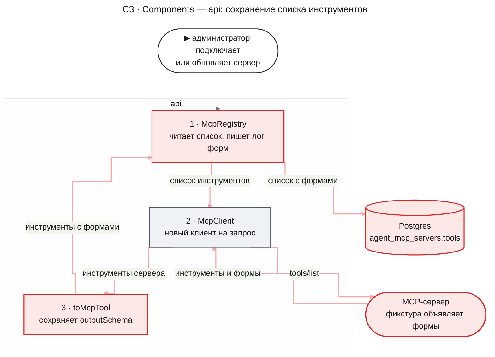
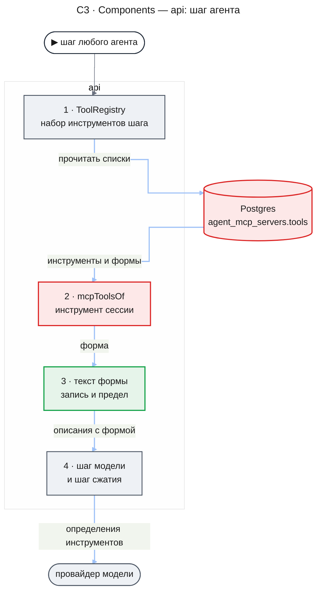
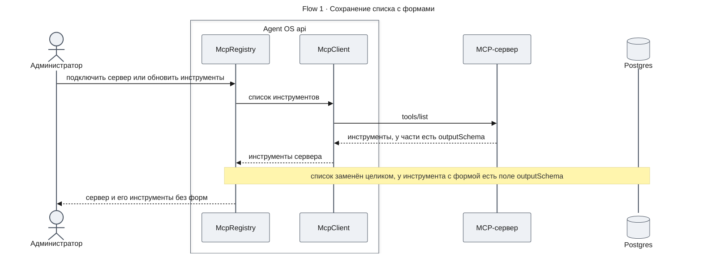
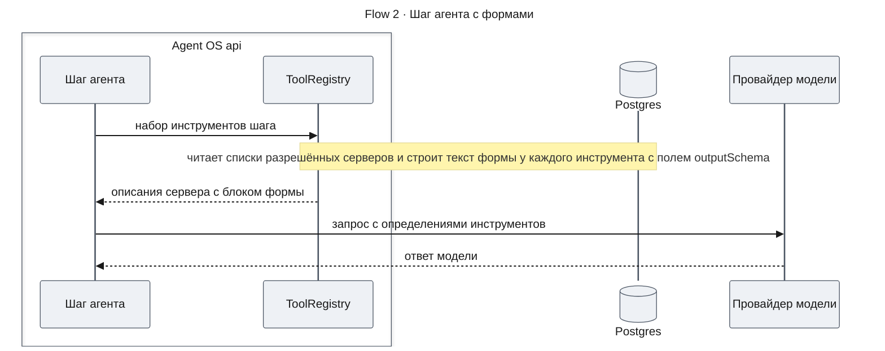
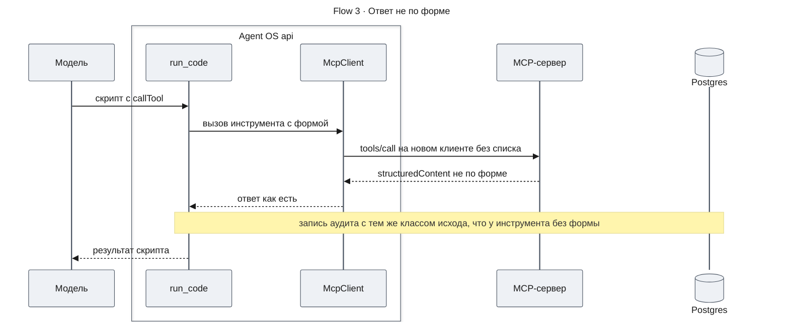

# Форма результата MCP-инструментов — Design Document — core

**Status:** Approved · **Date:** 2026-11-21 · **PRD:** [prd.md](./prd.md) · **UXRD:** нет · **Depends on:** ничего — единственная часть

## Snapshot

**Overview.** Модель видит у MCP-инструмента имя, описание и аргументы, но не видит, что он вернёт, поэтому тратит запуски скриптов на разведку. Сервер может объявить форму результата в списке инструментов. Платформа сохраняет её в той же записи инструмента, что и описание, и на каждом шаге агента дописывает к описанию для модели короткий текст формы в нотации типов TypeScript, не длиннее 1 500 символов. Текст строит одна чистая функция из сохранённой формы, а описание инструмента в панели администратора и записи аудита не меняются. Ответы по форме не проверяются, а тестовый MCP-сервер объявляет формы у четырёх инструментов.

- **Форма не касается**: инструментов без формы, вызова MCP-инструмента и его исхода в аудите, вида инструментов в панели администратора.
- **Главный риск**: будущая правка клиента MCP передаст SDK сохранённую форму, и ответ не по форме станет сбоем транспорта (KD-5); его ловит интеграционный тест.
- **Открытые вопросы**: нет.

### Key Decisions

#### KD-1: Форма хранится как объявлена — необязательным полем `outputSchema` у инструмента в сохранённом списке `agent_mcp_servers.tools`; текст для модели строится при каждом чтении

Форма — свойство инструмента с тем же жизненным циклом, что у описания и схемы аргументов: она приходит в том же ответе `tools/list` и заменяется вместе со всем списком при обновлении ([design-mcp-connect.md](../enterprise-access/design-mcp-connect.md), KD-2). Поэтому её место — в той же записи `McpTool`, а `toMcpTool` копирует её из ответа сервера, если она есть. Поле необязательное: элемент списка без него читается как инструмент без формы (AC-03.2), а `storedMcpTools`, который разбирает список строго, его принимает. Хранится объявленная форма, а не готовый текст, поэтому смена нотации или предела в коде действует со следующего шага без обновления серверов.

Не взяты: готовый текст в записи — предел и нотация привязались бы к моменту обновления сервера. Отдельная таблица форм — второе место для данных одного ответа `tools/list`.

#### KD-2: Текст формы присоединяется к описанию только в `mcpToolsOf` реестра инструментов — в `SessionTool.description`, а `McpTool.description` остаётся описанием сервера

`mcpToolsOf` — единственное место, где сохранённый инструмент становится инструментом сессии. Через него идут набор шага (`toolsFor`) для любого агента — корня, агента, которого запустил другой агент, глубокого агента и его субагентов, — набор проверки вызовов и набор `run_code`. Поэтому все агенты видят одну форму (AC-01.2) без отдельной проводки. Шаг модели и шаг сжатия передают провайдеру одни и те же определения, а функция текста детерминирована, поэтому описания совпадают байт в байт и кэш начала запроса не сбрасывается. Вид инструментов в панели (`McpToolView`) и состояние аудита читают `McpTool.description` и форму не получают, как требует Won't Have PRD.

Не взяты: дописывать форму в `McpTool.description` при сохранении — форма попала бы в панель администратора. Дописывать в `descriptionOf` — эта функция строит только встроенные инструменты.

#### KD-3: Текст формы — компактная запись в стиле типов TypeScript из одной чистой функции с пределом 1 500 символов в константе кода; длинная форма обрезается на границе поля с пометкой

Модель лучше всего знает запись типов TypeScript, и она описывает ровно то, что нужно скрипту: имена полей, типы, вложенность, необязательность и `null`. JSON Schema как есть несёт служебные ключи (`$schema`, `additionalProperties`, повтор `required`), которые модель оплачивает токенами на каждом шаге. Функция следует [pure-decision.md](../../code-system/patterns/pure-decision.md): вход — объявленная форма, выход — текст и признак обрезки, без базы и логгера. Предел — константа рядом с функцией, как `CHAT_LISTING_BUDGET` у списка чата ([chat-listing.ts](../../../packages/agents/src/chat-listing.ts)); настройки в базе и переменной окружения нет (PRD, Constraints). Описания полей (`description` в схеме) в текст не входят: AC-01.1 требует имён, типов и вложенности, а длину платит каждый шаг. Правила записи — в [Текст формы](#текст-формы).

Не взяты: сырая JSON Schema — длиннее при том же смысле. Готовый генератор типов из JSON Schema — новая зависимость, которая пишет многострочные объявления с именами типов, а не короткую строку; кода, который переводит JSON Schema в текст, в проекте нет, кроме `argLabelsOf`, который читает только заголовки аргументов.

#### KD-4: Блок формы в описании инструмента только называет себя структурой результата, а связь с `callTool` одним предложением добавляется в описание `run_code`

Форма описывает `structuredContent`, и именно его `callTool` отдаёт скрипту, когда сервер его прислал (`scriptValueOf`, [design-code-execution.md](../code-execution/design-code-execution.md), «API скрипта»). При прямом вызове модель читает текст ответа, а сервер по стандарту кладёт туда тот же JSON. Объяснение про `callTool` в каждом инструменте повторялось бы на каждом шаге столько раз, сколько у агента инструментов с формой. Одно предложение в описании `run_code` говорит это один раз: `callTool` отдаёт `structuredContent` инструмента, структуру которого показывает описание инструмента. Встроенные инструменты своих форм не получают (Won't Have PRD).

#### KD-5: Платформа никогда не передаёт объявленную форму клиенту SDK MCP; ответ не по форме проходит путь ответа без формы

`Client.callTool` в `@modelcontextprotocol/client` 2.4.0 сам проверяет ответ по форме, если у этого экземпляра клиента есть закэшированный ответ `tools/list` этого инструмента. Несовпадение он превращает в `ProtocolError`, а платформа считает такую ошибку сбоем транспорта — это нарушило бы FR-04. На нашем пути проверки нет: `McpClient` создаёт новый клиент на каждый вызов и не запрашивает у него список перед `callTool` (прочитано в исходниках SDK 2.4.0 и в `mcp-client.ts`, не запускалось). Значит, держится правило: клиент не переиспользуется между `tools/list` и `tools/call`, форма не передаётся в параметрах вызова, общего кэша ответов нет. `toOutcome` и `scriptValueOf` форму не читают и не меняются. Правило защищает интеграционный тест с ответом не по форме (UC-4).

Один путь правило не закрывает. На протоколе 2026-07-28 сервер может ответить на `tools/call` ошибкой несовпадения заголовков, если инструмент объявил в схеме аргументов параметры `x-mcp-header`, а новый клиент их не прислал. Тогда SDK сам перечитывает `tools/list` на том же клиенте, повторяет вызов и проверяет ответ по живому списку сервера, хранит платформа форму или нет. Это принятое ограничение ([Risks and Mitigation](#risks-and-mitigation)): ни фикстура, ни подключённые серверы таких параметров не объявляют.

#### KD-6: Формы фикстуры выводятся из zod-схемы результата инструмента, которая же проверяет, что инструмент возвращает

`defineTool` уже строит схему аргументов из zod. Инструмент с формой получает так же zod-схему результата: из неё строится объявленная `outputSchema`, а ответ `run` проходит через неё перед отправкой. Строгая схема отвергает лишнее поле, поэтому форма и настоящий ответ не расходятся (AC-05.1), а расхождение падает при первом вызове в любом интеграционном тесте. Форму объявляют `search_tickets`, `search_orders`, `get_order` и `get_trace`. Остальные инструменты фикстуры (`search_logs`, `aggregate_logs`, `create_incident_note`) остаются без формы для FR-03. Режимы сбоев фикстуры меняют ответ уже после этой проверки и дают ответы не по форме.

Не взяты: форма, написанная рядом с инструментом вручную, — разойдётся с ответом при первой правке инструмента.

## Terms

- **Форма результата (`outputSchema`), структурированный ответ (`structuredContent`), `run_code`, `callTool`, прямой вызов, разведка** — как в [PRD, Terms](./prd.md#terms).
- **Текст формы** — строка, которую платформа строит из формы для модели: компактная запись в стиле типов TypeScript.
- **Блок формы** — то, что дописывается к описанию сервера: строка-заголовок, текст формы и, если форма обрезана, пометка об этом.
- **Предел формы** — наибольшая длина блока формы в символах.

## Part

- **Part**: `core`
- **Covers**: FR-01, FR-02, FR-03, FR-04, FR-05
- **Depends on**: ничего — единственная часть
- **Prerequisite ADRs**: [ADR-0004](../../adr/ADR-0004-agent-framework-packages.md), [ADR-0011](../../adr/ADR-0011-code-runner-quickjs-process.md), [ADR-0014](../../adr/ADR-0014-mcp-registry-owned-by-agents.md)

**Out of scope**

- Вид MCP-инструментов в панели администратора (`McpToolView` в `contracts`) и состояние аудита сервера: формы там нет.
- Вызов MCP-инструмента, классы исхода, аудит вызовов, предел размера результата и хранение больших результатов по ссылке.
- Встроенные инструменты: форм у них нет; о форме говорит одно предложение в описании `run_code` (KD-4).
- Повторный прогон задач 2 и 3 (Success Criteria PRD) — проверка владельца, а не часть кода.

**Constraints**

- Предел формы — константа в коде, без настройки и переменной окружения (PRD, Constraints) — KD-3.
- Платформа показывает только объявленную форму и ничего не достраивает: конструкцию схемы, которую функция не знает, она пишет как `unknown`, а не угадывает — [Текст формы](#текст-формы).
- Лог пишется через логгер `common` с идентификаторами — [Логирование](#логирование).
- Тестов мало и только на критичное — [Test Strategy](#test-strategy).

## Building-block Inventory

Follows the [code system](../../code-system/README.md).

| Building block | Pattern | Status | Note |
|---|---|---|---|
| `McpTool`, `StoredMcpToolSchema`, `toMcpTool` | — | extended | необязательное поле `outputSchema` (KD-1) |
| Функция текста формы и константа предела | [pure-decision.md](../../code-system/patterns/pure-decision.md) | new | искали в коде перевод JSON Schema в текст: есть только `argLabelsOf`; предел по образцу `CHAT_LISTING_BUDGET` (KD-3) |
| `mcpToolsOf` в `createToolRegistry` | — | extended | описание сессии с блоком формы (KD-2) |
| `McpRegistry.listChecked` | [logging.md](../../code-system/patterns/logging.md) | extended | одна запись лога о формах на каждое чтение списка |
| Описание `run_code` | — | extended | одно предложение про `callTool` и форму (KD-4) |
| `McpClient.callTool`, `toOutcome`, `scriptValueOf` | — | reused | не меняются; правило KD-5 |
| `defineTool`, `FixtureTool`, `FixtureServer`, четыре инструмента фикстуры | — | extended | схема результата, `outputSchema` в `tools/list` (KD-6) |
| Список инструментов `agent_mcp_servers.tools` | [repository-over-transaction.md](../../code-system/patterns/repository-over-transaction.md) | reused | тот же столбец, новое поле в элементе списка |

## Acceptance Criteria

### FR-01: Модель видит форму результата

- From the PRD: AC-01.1, AC-01.2
- Блок формы стоит после описания сервера, отделённый пустой строкой; описание сервера в нём не меняется ни на символ (DC-1).
- Шаг модели и шаг сжатия одного шага агента передают провайдеру одинаковые описания, а повторное чтение того же сохранённого списка даёт тот же текст формы (DC-2).

### FR-02: Форма укладывается в предел длины

- From the PRD: AC-02.1, AC-02.2
- Предел формы — 1 500 символов на весь блок формы: заголовок, текст и пометку. Обрезка проходит по границе поля, а не внутри имени или типа (DC-3).

### FR-03: Инструмент без формы работает как сегодня

- From the PRD: AC-03.1, AC-03.2
- Вид инструмента в панели администратора не несёт формы ни у одного инструмента (DC-4).

### FR-04: Форма — подсказка, а не проверка

- From the PRD: AC-04.1

### FR-05: Тестовый MCP-сервер объявляет формы

- From the PRD: AC-05.1

## Design

### Architecture (C1–C4)

Вся работа идёт внутри пакета `agents` в процессе `apps/api` и в процессе фикстуры, поэтому схемы начинаются с уровня C3 — по одной на путь, где форма сохраняется, и путь, где она доходит до модели.

#### C3 · Components: api

**api — сохранение списка инструментов**

`McpRegistry` пишет список одним обновлением строки сервера; `toMcpTool` только переносит форму в запись инструмента. Список читают регистрация сервера, смена общего токена, обновление инструментов администратором и подключение аккаунта администратора к `oauth`-серверу.

**api — шаг агента**

`ToolRegistry` оставляет только инструменты, которые сотруднику разрешены, и ничего не хранит между шагами. Текст формы строится для каждого инструмента в каждом наборе: функция не трогает базу и сеть, поэтому её работа заметна только длиной описаний.

### Runtime Flows

#### Flow 1: Сохранение списка с формами

**Starts when:** администратор подключает сервер или обновляет его инструменты, для AC-01.1, AC-03.2, AC-05.1

Если сервер не ответил, сохранённый список не меняется. Список, сохранённый без форм, читается как инструменты без формы, пока администратор не обновит инструменты сервера (AC-03.2).

#### Flow 2: Шаг агента с формами

**Starts when:** любой агент делает шаг — корень беседы, агент, запущенный другим агентом, глубокий агент или его субагент, для AC-01.1, AC-01.2, AC-02.1, AC-02.2, AC-03.1

Шаг сжатия передаёт провайдеру те же определения, что и шаг модели (DC-2). Инструмент без поля `outputSchema` получает описание сервера без изменений (AC-03.1).

#### Flow 3: Ответ не по форме

**Starts when:** скрипт `run_code` вызывает через `callTool` инструмент с формой, а сервер отвечает не по ней, для AC-04.1

Клиент SDK не видел `tools/list` этого инструмента, поэтому не проверяет ответ (KD-5), и скрипт получает `structuredContent` как есть. Прямой вызов идёт тем же путём без `run_code`: `toOutcome` превращает ответ в исход и текст так же, как у инструмента без формы.

### Contract Definitions

**Инструмент в сохранённом списке (`agent_mcp_servers.tools`)**

- `outputSchema` — объект JSON, который сервер объявил под `outputSchema` в ответе `tools/list`, без изменений. Необязательное поле: его нет у инструмента, для которого сервер формы не объявил. Корень схемы не обязан быть объектом с `type: "object"`: спецификация MCP 2025-06-18 требует такого корня, а более поздние ревизии допускают любую схему.
- В `McpToolView`, в ответах API и в состоянии аудита сервера формы нет (DC-4).

**Описание инструмента для модели**

- Без формы — описание сервера без изменений (AC-03.1).
- С формой — описание сервера целиком, пустая строка и блок формы (DC-1). Блок начинается строкой-заголовком, которая называет следующее структурой результата инструмента (`structuredContent`). За ней идёт текст формы, а у обрезанной формы — пометка, что форма обрезана. Точная формулировка заголовка и пометки остаётся реализации.
- Предел формы — 1 500 символов на блок формы, считая заголовок и пометку; длина считается как длина строки JavaScript. Описание сервера в предел не входит и не режется (AC-02.1).

#### Текст формы

Текст формы — одна строка в стиле типов TypeScript. Сокращённый пример для `get_order`: `{ order: { …, payments: { …, traceId: string }[] } | null, snapshot: string }`. Функция читает схему по таким правилам:

- Объект со свойствами пишется как `{ имя: тип, … }`. Поле, которого нет в `required`, получает `?` после имени. Порядок полей — порядок ключей в сохранённой схеме.
- Объект без свойств, но со схемой в `additionalProperties`, пишется как `Record<string, тип>`; объект без того и другого — как `object`.
- Массив пишется как `тип[]` по схеме `items`; массив без `items` — как `unknown[]`.
- `type` строкой даёт имя типа: `string`, `number`, `integer`, `boolean`, `null`. `type` массивом даёт объединение через `|`, так что поле, которое может быть `null`, читается как `string | null`.
- `enum` даёт объединение значений в записи JSON, `const` — одно значение.
- `anyOf` и `oneOf` дают объединение через `|`, `allOf` — пересечение через `&`.
- `$ref` пишется последней частью ссылки, например `Ticket`. Определения из корневых `$defs` или `definitions`, на которые есть ссылки, дописываются после корня в виде `Ticket = тип`. Так рекурсивная схема не разворачивается бесконечно.
- Конструкция, которой нет в этом списке, и значение, которое не является схемой, пишутся как `unknown`. Служебные и уточняющие ключи (`$schema`, `title`, `description`, `format`, `minimum`, `additionalProperties: false` и подобные) в текст не попадают.
- Когда текст доходит до предела, функция перестаёт читать схему, обрезает текст по концу последнего поля, которое уместилось целиком, и ставит пометку (DC-3).

Одна и та же сохранённая схема всегда даёт один и тот же текст (DC-2). Postgres хранит `jsonb` с собственным порядком ключей, но этот порядок одинаков при каждом чтении одного значения.

**Описание `run_code`**

- Несёт одно предложение: `callTool` отдаёт `structuredContent` инструмента, если сервер его прислал, и структуру этого значения показывает описание инструмента (KD-4).

**Список инструментов фикстуры (`tools/list` серверов `@agent-os/mcp-fixture`)**

- `search_tickets`, `search_orders`, `get_order` и `get_trace` объявляют `outputSchema`, построенную из их схемы результата (KD-6). Поля, которые бывают `null` (`nextCursor`, `order`, `closedAt`), в форме допускают `null`.
- `search_logs`, `aggregate_logs` и `create_incident_note` формы не объявляют.
- Режимы сбоев `unknown_total`, `total_cap` и `contract_violation` возвращают ответ не по форме.

### Data Model

Элемент списка `agent_mcp_servers.tools` (`jsonb`) несёт необязательное поле `outputSchema` (KD-1); своей таблицы и столбца у формы нет. Список получает формы, когда администратор подключает сервер или обновляет его инструменты.

### Логирование

`McpRegistry.listChecked` после успешного чтения списка пишет одну запись уровня info через логгер реестра: сервер, число инструментов, число инструментов с формой, наибольшая длина блока формы и имена инструментов, чья форма обрезана. Блок строится той же функцией, что и на шаге, а предел — константа кода, поэтому запись при чтении списка совпадает с тем, что увидит модель. На шаге агента отдельной записи на инструмент нет: набор строится на каждом шаге, и такие записи заполнили бы лог. Текст формы и сама схема в лог не попадают.

## Test Strategy

- **UC-1: Текст формы и предел** — covers AC-02.1, AC-02.2, AC-03.1, DC-1, DC-2, DC-3
  - Given: формы разного вида — вложенный объект с массивом и полем `string | null`, необязательное поле, `enum`, корень-массив, рекурсивная `$ref`, незнакомое ключевое слово, форма длиннее предела, инструмент без формы
  - When: функция строит описание инструмента
  - Then: текст следует правилам [Текст формы](#текст-формы); длинная форма даёт описание сервера целиком, начало формы и пометку в пределах 1 500 символов; короткая — форму целиком без пометки; без формы описание равно описанию сервера; повторное построение из той же схемы даёт тот же текст. Один табличный тест по [pure-decision.md](../../code-system/patterns/pure-decision.md)
- **UC-2: Сохранённый список без форм** — covers AC-03.2 (до обновления)
  - Given: элемент списка без поля `outputSchema`
  - When: список читается
  - Then: он разбирается без ошибки, и описание инструмента равно описанию сервера. Строка того же табличного теста
- **UC-3: Модель видит формы фикстуры** — covers AC-01.1, AC-03.1, AC-03.2 (после обновления), AC-05.1
  - Given: серверы фикстуры зарегистрированы через реестр, то есть их список прочитан заново
  - When: агент сотрудника с правом на их инструменты делает шаг на тестовой модели
  - Then: в записанном вызове модели описание `search_tickets`, `search_orders`, `get_order` и `get_trace` содержит после описания сервера блок формы с их полями, а описание `search_logs` равно описанию сервера. Описание читается из записанного вызова модели, как в `custom-agents-runtime.int.e2e-spec.ts`
- **UC-4: Ответ не по форме** — covers AC-04.1
  - Given: у `search_tickets` есть форма, а фикстура отвечает режимом `contract_violation`
  - When: инструмент вызван напрямую и через `callTool` в скрипте `run_code`
  - Then: прямой вызов и вызов из скрипта получают исход `success`, скрипт получает ответ сервера как есть, а запись аудита несёт тот же класс исхода, что без формы. Тест держит правило KD-5

Вторая половина DC-2 — одинаковые описания у шага модели и шага сжатия — отдельного теста не получает: оба шага берут описания из одного вызова `toolsFor`, а текст строит чистая функция из UC-1. AC-01.2 отдельного теста не получает: агенты, запущенные другими агентами, и субагенты глубоких агентов строят набор той же функцией `toolsFor`, и это уже проверяет `agent/tool-declaration.spec.ts`. DC-4 держит тест панели MCP-серверов в `apps/api`, который сравнивает вид инструментов целиком. Повторный прогон задач 2 и 3 на Haiku — проверка успеха из PRD, а не тест CI.

## Security Considerations

- **Authentication & Authorization**: новых точек входа нет. Форма попадает только в описание инструмента, который реестр уже оставил по правам сотрудника и его аккаунту на сервере.
- **Input Validation**: форма приходит от сервера, которого подключил администратор, — от того же источника, что и описание инструмента, которое платформа уже передаёт модели как есть. При сохранении проверяется только, что форма — объект JSON. Функция текста читает схему без доверия к ней: незнакомое пишет как `unknown`, `$ref` — по имени, без разворота, и перестаёт читать схему у предела, поэтому глубокая или рекурсивная схема не уводит её в долгую работу или переполнение стека.
- **Sensitive Data Handling**: форма описывает поля, а не значения, и секретов не несёт. В лог идут длины и имена инструментов, но не текст формы.

## Risks and Mitigation

- **Будущая правка передаст форму клиенту SDK** — переиспользование клиента или запрос списка перед вызовом включат проверку SDK, и ответ не по форме станет сбоем транспорта; вероятность низкая. Правило записано в KD-5, а нарушение ловит тест UC-4.
- **SDK проверяет ответ сам после ошибки несовпадения заголовков** — у инструмента с параметрами `x-mcp-header` на протоколе 2026-07-28 ответ не по форме становится сбоем транспорта (KD-5); у фикстуры и подключённых серверов таких параметров нет. Ограничение принято; сервер с такими параметрами потребует отдельного решения.
- **Форма стороннего сервера расходится с ответом** — скрипт, написанный по форме, падает; вероятность средняя для реальных серверов. Платформа ответ не проверяет, и модель повторяет попытку по тексту ошибки ([PRD code-execution](../code-execution/prd.md), FR-10).
- **Описания становятся длиннее** — каждый инструмент с формой добавляет к каждому шагу до 1 500 символов, даже без вызова. Предел ограничивает рост, лог чтения списка показывает длины, а повторный прогон — итог в токенах.
- **Нужная часть формы отрезана** — у сервера с большой формой поле вроде `nextCursor` может не уместиться. Лог чтения списка называет обрезанные инструменты; формы фикстуры обрезки не ждут, и это видно в том же логе.
- **Порядок полей в тексте отличается от порядка сервера** — `jsonb` хранит ключи в своём порядке; на смысл формы это не влияет, а текст остаётся одинаковым от шага к шагу.

## Update History

| Version | Date | Change |
|---------|------|--------|
| 1.0 | 2026-11-21 | Первая версия |
| 1.1 | 2026-11-22 | Описывает построенный результат: субагенты глубоких агентов вместо исполнителей workflow, убраны рассказ о переходе и доставка; статус Approved |
