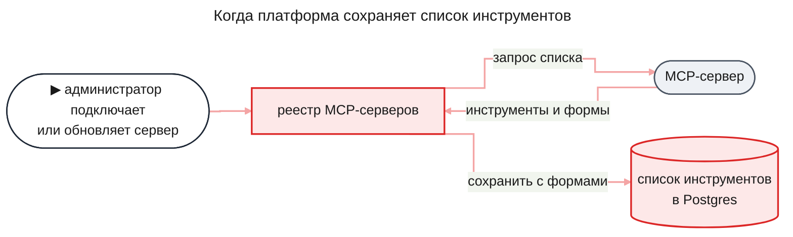

# PRD: Форма результата MCP-инструментов (tool-output-shapes)

| Date | Depth |
|---|---|
| 2026-11-21 | lite |

## Snapshot

**Overview.** Агент на модели класса Haiku видит у MCP-инструмента имя, описание и аргументы, но не видит, что инструмент вернёт. Поэтому модель тратит запуски скриптов и прямые вызовы только на то, чтобы посмотреть на ответ, и лишь потом пишет скрипт, который даёт итог. Стандарт MCP позволяет серверу объявить форму результата инструмента, но платформа сегодня эту форму отбрасывает. После фичи платформа сохраняет форму и дописывает её коротким текстом к описанию инструмента, которое получает модель. Так модель с первого раза пишет верный скрипт для `run_code` или верно выбирает прямой вызов.

- **Не входит**: угадывание формы по прошлым ответам, форма, которую вписывает администратор, проверка ответов по форме. Другие идеи из дайджеста исследований, который стал поводом для фичи, — вне этого запуска, решения по ним нет.
- **Не меняется**: инструменты, у которых сервер не объявил форму; сами ответы инструментов, их аудит и предел размера результата.
- **Части**: одна — `core`.
- **Главный риск**: выигрыш показан только в чужой статье; на нашем стеке его проверит один платный прогон двух задач ([Success Criteria](#success-criteria)).

## Terms

- **MCP-инструмент** — действие внешней системы (поиск тикетов, чтение заказа), которое платформа получает от подключённого MCP-сервера и предлагает агенту.
- **Описание инструмента** — текст, по которому модель решает, вызывать ли инструмент и как. Сегодня в нём имя, описание от сервера и схема аргументов.
- **Форма результата (`outputSchema`)** — объявленное сервером описание того, что возвращает инструмент: какие поля есть в ответе, какого они типа и как вложены. Например, `get_order` возвращает заказ со списком платежей, и у каждого платежа есть `traceId`. Сервер объявляет форму в списке своих инструментов, но не обязан это делать.
- **Структурированный ответ (`structuredContent`)** — ответ инструмента в виде данных, а не текста. Форма результата описывает именно его.
- **`run_code`** — встроенный инструмент агента: модель пишет короткий скрипт, платформа выполняет его в отдельном процессе. Внутри скрипта функция `callTool` вызывает MCP-инструмент и возвращает его структурированный ответ.
- **Прямой вызов** — модель вызывает MCP-инструмент сама, без скрипта, и ответ попадает в её контекст.
- **Разведка** — запуск `run_code` или прямой вызов, который модель делает только чтобы увидеть, как выглядит ответ, а не чтобы получить итог.
- **Модель класса Haiku** — небольшая дешёвая модель, на которой работают агенты платформы.

## Background

Платформа получает список инструментов сервера, когда администратор подключает сервер или обновляет его инструменты в панели администратора, и сохраняет этот список в базе. Форму результата сервер присылает в том же списке: стандарт MCP предусматривает её со спецификации 2025-06-18 ([Tools, Output Schema](https://modelcontextprotocol.io/specification/2025-06-18/server/tools#output-schema)). Сегодня платформа форму не сохраняет. Красным на схемах отмечено то, что меняет фича.

Из сохранённого списка каждый шаг агента собирает инструменты, разрешённые сотруднику, и передаёт модели их описания.

```mermaid
---
title: "Когда агент работает с инструментом"
config:
  theme: base
  look: classic
  themeVariables:
    primaryColor: "#eef1f5"
    primaryBorderColor: "#4b5563"
    primaryTextColor: "#1a1a1a"
    lineColor: "#6b7280"
  flowchart:
    curve: step
  themeCSS: |
    @keyframes litr_tosr{0%,12.86%{stroke:#1d4ed8;stroke-width:6px}14.29%,100%{stroke:#9ec1f7;stroke-width:2px}}
---
flowchart LR
    entry(["▶ сотрудник ставит задачу"])
    set["набор инструментов<br/>шага агента"]
    db[("список инструментов<br/>в Postgres")]
    model(["модель Haiku"])
    rc["run_code<br/>скрипт с callTool"]
    srv(["MCP-сервер"])
    entry e1@--> set
    set e2@-->|"прочитать список"| db
    db e3@-->|"инструменты и формы"| set
    set e4@-->|"описания с формой"| model
    model e5@-->|"скрипт"| rc
    rc e6@-->|"вызов инструмента"| srv
    srv e7@-->|"структурированный ответ"| rc
    classDef entry fill:#ffffff,stroke:#1f2937,stroke-width:1.5px,color:#1a1a1a
    classDef changed fill:#fde8e8,stroke:#dc2626,stroke-width:2px,color:#1a1a1a
    classDef unchanged fill:#eef1f5,stroke:#4b5563,stroke-width:1.5px,color:#1a1a1a
    classDef r1 stroke:#9ec1f7,stroke-width:2px,animation:litr_tosr 8.4s linear 0s infinite
    classDef r2 stroke:#9ec1f7,stroke-width:2px,animation:litr_tosr 8.4s linear 1.2s infinite
    classDef r3 stroke:#9ec1f7,stroke-width:2px,animation:litr_tosr 8.4s linear 2.4s infinite
    classDef r4 stroke:#9ec1f7,stroke-width:2px,animation:litr_tosr 8.4s linear 3.6s infinite
    classDef r5 stroke:#9ec1f7,stroke-width:2px,animation:litr_tosr 8.4s linear 4.8s infinite
    classDef r6 stroke:#9ec1f7,stroke-width:2px,animation:litr_tosr 8.4s linear 6s infinite
    classDef r7 stroke:#9ec1f7,stroke-width:2px,animation:litr_tosr 8.4s linear 7.2s infinite
    class entry entry
    class set,db changed
    class model,rc,srv unchanged
    class e1 r1
    class e2 r2
    class e3 r3
    class e4 r4
    class e5 r5
    class e6 r6
    class e7 r7
```

Прямой вызов идёт тем же путём, только без скрипта. `callTool` уже сейчас возвращает структурированный ответ, если сервер его прислал, поэтому форма описывает ровно то значение, с которым работает скрипт.

Цену незнания формы показал ручной прогон четырёх задач на Haiku ([ac-01-4-haiku-run.md](../code-execution/ac-01-4-haiku-run.md)). В задаче 3 модель сопоставляла заказы и трассы: первые два скрипта и один прямой вызов `get_trace` ушли на то, чтобы увидеть, где лежит `traceId` и как устроена трасса. Итог дал только третий скрипт, а на задачу ушло 94 371 токен входа. В задаче 2 модель считала среднее время закрытия тикетов: сначала она сделала четыре прямых вызова `search_tickets`, каждый вернул обрезанную первую страницу, и только потом написала скрипт с проходом по страницам. Это самая дорогая задача прогона — 152 745 токенов входа, хотя обе задачи решены верно.

Поводом стал дайджест «Agent OS Research Brief №23» от 21.11.2026, пункт «Beyond Plain MCP» ([arXiv 2611.19123](https://arxiv.org/abs/2611.19123)). По данным статьи, описание формы возвращаемых данных в интерфейсе инструмента меняло долю успешных решений слабых моделей до 39,5 пункта. Эта цифра принадлежит статье и на нашем стеке не проверена.

## Users and Use Cases

### Users

- **Сотрудник** — ставит агенту задачи по данным внешних систем. Ему важны верный ответ, время и стоимость задачи; что агент знает о формах, он не видит.
- **Администратор** — подключает MCP-серверы и обновляет их инструменты. Ему важно, чтобы формы начинали работать без отдельной настройки.
- **Владелец платформы** — повторным прогоном задач на Haiku проверяет, окупилась ли фича.

### Use Cases

- **UC-1**: сотрудник ставит задачу, для которой агенту нужен скрипт над ответами MCP-инструментов → агент пишет рабочий скрипт без запусков-разведки, так что ответ приходит быстрее и дешевле.
- **UC-2**: сотрудник ставит задачу над постраничным результатом → агент заранее видит, что ответ разбит на страницы, и сразу пишет скрипт вместо прямых вызовов, чьи обрезанные ответы заполняют контекст.
- **UC-3**: администратор подключает сервер, который объявляет формы, или обновляет его инструменты → агенты всех сотрудников с правом на эти инструменты видят формы без дополнительной настройки.
- **UC-4**: администратор подключает сервер без форм → агенты работают с его инструментами так же, как сегодня.

## Functional Requirements

### Must Have (MVP)

- **FR-01. Модель видит форму результата.** Если сервер объявил форму результата инструмента, платформа сохраняет её вместе со списком инструментов и дописывает к описанию инструмента после описания от сервера. Модель видит эту форму у каждого агента, которому предложен инструмент, и пользуется ею и при прямом вызове, и в скрипте с `callTool`.
  - AC-01.1: Given сервер объявил форму у инструмента, а администратор подключил сервер или обновил его инструменты, when агент сотрудника с правом на этот инструмент делает шаг, then описание инструмента, которое получает модель, содержит после описания от сервера форму результата: имена полей ответа, их типы и вложенность.
  - AC-01.2: Given тот же инструмент предложен агенту, которого запустил другой агент, when этот агент делает шаг, then его модель видит у инструмента ту же форму.
- **FR-02. Форма укладывается в предел длины.** Текст одной формы в описании не длиннее предела около 1 500 символов; точное значение задаёт Design Doc. Длинная форма обрезается с пометкой, а описание от сервера остаётся целиком.
  - AC-02.1: Given форма, текст которой длиннее предела, when модель получает описание инструмента, then в нём есть описание от сервера целиком, начало формы в пределах лимита и пометка, что форма обрезана.
  - AC-02.2: Given форма, текст которой укладывается в предел, when модель получает описание инструмента, then форма в нём целиком и без пометки.
- **FR-03. Инструмент без формы работает как сегодня.** Если сервер не объявил форму, описание инструмента не меняется. Список инструментов, сохранённый до выхода фичи, получает формы при следующем обновлении инструментов сервера.
  - AC-03.1: Given сервер не объявил форму у инструмента, when модель получает описание этого инструмента, then оно такое же, как до фичи.
  - AC-03.2: Given список инструментов сервера сохранён до выхода фичи, when агент делает шаг, then инструменты этого сервера описаны как инструменты без формы, а после того как администратор обновил инструменты сервера, их формы видны, как в AC-01.1.
- **FR-04. Форма — подсказка, а не проверка.** Платформа не сверяет ответ инструмента с формой. Ответ, который форме не соответствует, доходит до агента так же, как ответ инструмента без формы.
  - AC-04.1: Given инструмент с формой вернул ответ, который ей не соответствует (нет поля, лишнее поле, другой тип или только текст), when инструмент вызван напрямую или через `callTool`, then агент получает этот ответ так же, как от инструмента без формы, а запись аудита несёт тот же класс исхода.
- **FR-05. Тестовый MCP-сервер объявляет формы.** Собственный тестовый MCP-сервер проекта (фикстура) объявляет формы у инструментов, которые нужны задачам 2 и 3 повторного прогона: `search_tickets`, `search_orders`, `get_order`, `get_trace`. Хотя бы один инструмент фикстуры остаётся без формы, чтобы на нём проверялось FR-03.
  - AC-05.1: Given серверы фикстуры подключены и их инструменты обновлены, when агент получает описания инструментов, then у четырёх названных инструментов есть формы, совпадающие с тем, что эти инструменты реально возвращают, а хотя бы у одного инструмента фикстуры формы нет.

### Won't Have

- Угадывание формы по прошлым ответам инструмента — не эта фича: платформа показывает только то, что объявил сервер.
- Форма, которую вписывает или правит администратор, — не эта фича: та же причина.
- Проверка ответов по форме и отказ при несовпадении — не эта фича: форма служит подсказкой (FR-04).
- Показ формы сотруднику или администратору в интерфейсе — не эта фича: форма нужна только модели.
- Формы встроенных инструментов (`run_code`, чтение больших результатов, запуск агентов) — не эта фича: она касается только MCP-инструментов.
- Предел размера результата, хранение больших результатов по ссылке и аудит вызовов из скриптов — уже построены и не меняются.

Остальные идеи дайджеста №23 не отклонены: владелец ещё думает о них. Они вне этого запуска, решения по ним нет, и у каждой есть то, что мешает ей сегодня:

- Выбор следующего действия отдельной моделью-оценщиком (подход Seer из дайджеста) — меняет общий шаг модели для всех агентов, стенда оценки качества нет, а результаты статьи получены на дообученных моделях.
- Выяснение исхода вызова, который оборвался без ответа (исход `unknown` в аудите), — в MCP нет стандартного способа найти запрос по его идентификатору, а реальных изменяющих MCP-серверов не подключено.
- Знания вида «процедура» в самообучении — исключены разделом Won't Have в [PRD self-learning](../self-learning/prd.md), у самообучения ещё нет накопленных прогонов, и идея пересекается с запланированным отдельным прогоном, который сам наполняет базу знаний.
- Поиск и отбор инструментов под задачу — инструментов у агентов сегодня мало.
- Статья «Anatomy of an Agent Harness» — это список проверок для устройства агента, а не то, что строят.

## Delivery Parts

| Part | Covers | Cut along | Depends on | Rationale |
|------|--------|-----------|------------|-----------|
| `core` | FR-01, FR-02, FR-03, FR-04, FR-05 | backend | — | Сохранение формы, её текст в описании и формы фикстуры живут в одном слое и не встречаются на контракте, который стоило бы проектировать отдельно. |

Альтернатива — вынести формы фикстуры в отдельную часть. Её отклонили: между ней и `core` нет своего шва, фикстура лишь даёт данные для проверки успеха, а вторая часть добавила бы Design Doc и план без нового решения.

## Success Criteria

Владелец повторяет задачи 2 и 3 прогона AC-01.4 ([PRD code-execution](../code-execution/prd.md), AC-01.4) на той же модели класса Haiku и с теми же формулировками, а затем сравнивает их с базовым прогоном ([ac-01-4-haiku-run.md](../code-execution/ac-01-4-haiku-run.md)):

- задача 3 — ни одного запуска `run_code` и ни одного прямого вызова ради разведки: итог даёт первый скрипт, ответ верен;
- задача 2 — меньше прямых вызовов `search_tickets` до скрипта, чем в базовом прогоне, ответ верен;
- токенов входа на каждую из двух задач меньше, чем в базовом прогоне.

Числа берутся из журнала вызовов модели и аудита вызовов инструментов и записываются в отчёт рядом с базовым после сборки части `core`. Прогон платный, сумму заранее не согласуют; фактическая стоимость записывается в отчёт.

## Constraints and Risks

### Constraints

- Платформа показывает только форму, которую объявил сервер, и ничего не достраивает.
- Предел длины формы — константа в коде: ни настройки в базе, ни переменной окружения.
- Проект — PoC с одной версией всего: формат сохранённого списка инструментов меняется без миграции записей, а старые списки получают формы при обновлении (AC-03.2).

### Assumptions and Risks

Главный риск — выигрыш не доказан на нашем стеке. Цифра статьи получена на других моделях и задачах, а повторный прогон — это один запуск каждой задачи одной формулировкой, то есть сигнал, а не доказательство. Если показатели из Success Criteria не улучшатся, судьбу фичи решает владелец.

Формы объявляют не все серверы: стандарт этого не требует, и сколько реальных серверов это делает, не проверялось. Польза будет только у серверов с формами, а фикстура объявляет их сама (FR-05). Кроме того, описания становятся длиннее, и модель платит за них токенами на каждом шаге каждого агента, которому предложен инструмент, даже без вызова. Предел длины (FR-02) ограничивает этот рост, а итоговую разницу покажет повторный прогон.

Форма сервера может разойтись с реальным ответом. Тогда скрипт, написанный по форме, упадёт, и модель повторит попытку по тексту ошибки, как уже умеет `run_code` ([PRD code-execution](../code-execution/prd.md), FR-10).
## Update History

| Version | Date | Change |
|---------|------|--------|
| 1.0 | 2026-11-21 | Первая версия |
