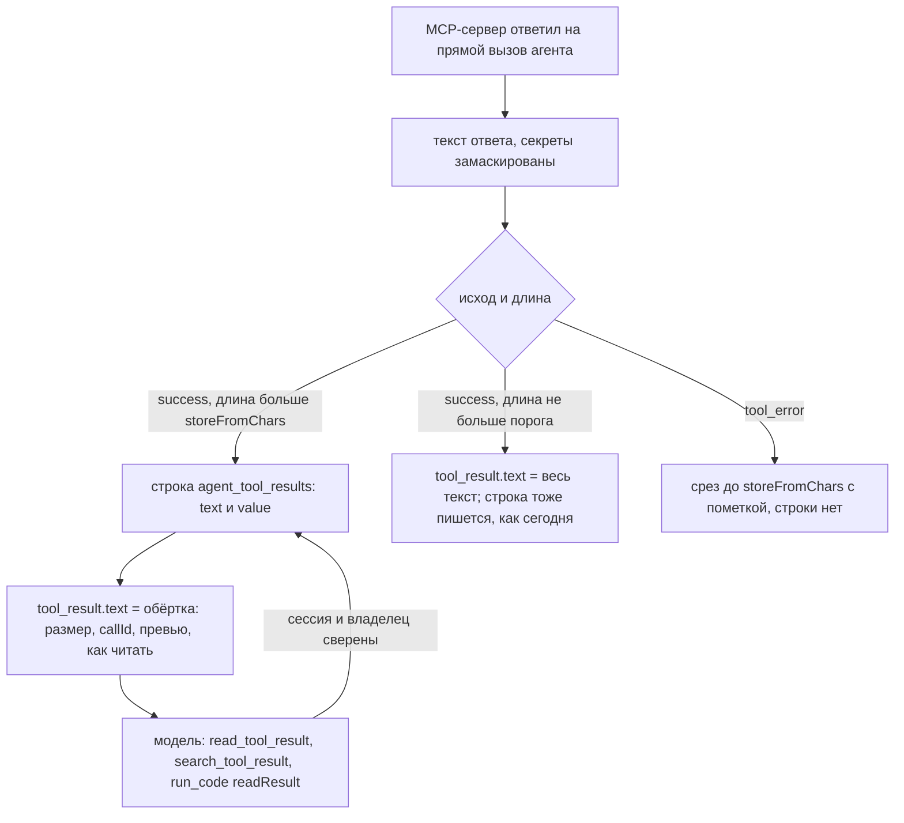

# Work Plan: Чтение больших результатов инструментов — core

## Snapshot

**Overview.** Сегодня результат MCP-инструмента длиннее 16 КиБ молча режется для модели (`truncate` в `packages/agents/src/mcp/mcp-outcome.ts:49-58`), а полный ответ достаётся только скрипту `run_code` через `readResult`. После плана большой результат хранится целиком один раз, модель получает вместо него обёртку со ссылкой и превью, а два встроенных инструмента читают сохранённое по частям и ищут в нём. Порядок: чистые функции (обёртка, превью, строки, страница, поиск) → хранилище и обёртка на прямом MCP-вызове → инструменты чтения и интеграционный тест → настройки в базе и форма в панели, переменная окружения удаляется → один quality gate. Подход — снизу вверх по пакетам (`contracts` → `db` → `agents` → `apps/api` → `apps/web`): каждый пакет компилируется против `dist` нижнего. Правила проекта: тесты пишутся в своих фазах и запускаются один раз в Phase 5; коммитов нет.

**Требования владельца** (единственное их место — этот план):

- **R-1. Ссылка вместо среза.** Успешный результат MCP-вызова длиннее порога хранится целиком в `agent_tool_results`; модель получает обёртку: что вывод слишком велик, его размер, `callId` для чтения, превью начала (срез откатывается к последнему переводу строки, если тот дальше половины превью) и одну строку о том, как читать остальное. Эталон: порог 50 000 символов, превью 2 000 символов.
- **R-2. Два инструмента чтения.** `read_tool_result` — страница сохранённого результата по строкам (`offset`, `limit`), не больше предела на вызов (эталон 25 000 токенов), с баннером «partial view: lines A–B of N, next page at offset X; do not answer from this page alone». `search_tool_result` — строки с подстрокой и их номера, с пределом. Оба сверяют сессию и владельца, как `findForRun`: чужой результат неотличим от несуществующего. Их ответы никогда не сохраняются как большие результаты.
- **R-3. Слова для MCP.** Обёртка говорит модели: для сводки или анализа прочитать всё содержимое последовательными частями, а если не прочитала — сказать, какую часть.
- **R-4. `readResult` остаётся.** `readResult(callId)` в `run_code` отдаёт полное значение без предела из той же таблицы. Поведение то же, что сегодня: строку `agent_tool_results` по-прежнему получает каждый успешный и пустой прямой MCP-вызов (code-execution KD-5), порог решает только, что видит модель.
- **R-5. Настройки в базе.** Порог, размер превью и предел чтения — строка настроек в базе и форма в панели администратора; переменная `AGENT_TOOL_RESULT_MAX_BYTES` удаляется вместе со всеми её местами.

**Решения плана** (бриф оставлял выбор; взяты рекомендованные варианты):

| Вопрос | Решение | Почему |
|---|---|---|
| Какие результаты идут по ссылке и что хранится | Модель получает обёртку только у успешного (`success`) прямого MCP-вызова длиннее порога; `empty` и всё, что не длиннее порога, идёт ей целиком; `tool_error` режется на пороге с пометкой. Строку `agent_tool_results` (`value` и `text`) получает, как сегодня, каждый `success` и `empty` прямой вызов, большой или малый, — поэтому `readResult` и инструменты чтения читают любой прежний прямой результат сессии. Запасного чтения из журнала нет: `value` — это `structuredContent`, а при его отсутствии разобранный JSON или текст (`scriptValueOf`, `mcp-outcome.ts:96-108`), тогда как `text` записи — склеенные блоки `content` (`resultText`, `:28-33`); у сервера, который шлёт и `structuredContent`, и свой текст, значение из текста не восстановить, и `readResult` перестал бы быть прежним | Запрос владельца — про MCP; ошибка не хранится и сегодня (code-execution DC-8, тест `code-execution.int.e2e-spec.ts:1035` ждёт «результат не найден» у вызова с ошибкой) |
| Что остаётся как сегодня | Встроенные инструменты (`list_agents`, `start_agent`, …) и отчёты детей (`child_report`) не режутся ни сегодня, ни после плана. Итог `run_code` больше 16 384 байт — отказ `result_too_large`; лимит становится константой кода `codeRun.resultMaxBytes`, а не переменной | Их тексты делает сама платформа; лимит итога — предел протокола исполнителя (`packages/code-runner/src/protocol.ts:156`), не настройка чтения |
| Единицы | Порог `storeFromChars` и превью `previewChars` — символы JavaScript-строки (`string.length`); предел чтения `readMaxTokens` — токены по оценке `tokensOfBytes(utf8Bytes(text))` из `packages/agents/src/model/token-estimate.ts` | Совпадают с эталоном; новая оценка токенов не нужна |
| Строка страницы | «Строка» — кусок текста до `\n` включительно или до 2 000 символов (`LINE_MAX_CHARS`, константа), что раньше; кусок не рвёт суррогатную пару. Тело страницы — точная подстрока сохранённого текста, поэтому склейка страниц равна тексту | Ответы фикстуры и многих серверов — JSON в одну строку на 120 КБ (`packages/mcp-fixture/src/fixture-server.ts:196-203`): построчная страница без этого не влезла бы в предел |
| Поиск | Подстрока без учёта регистра, не regex; до 100 строк (`SEARCH_MAX_MATCHES`) и не больше `readMaxTokens` | Regex от модели над 100 КБ в процессе API — риск катастрофического возврата |
| Права | Инструменты чтения — встроенные, в каждой сессии, без грантов, как `run_code`: флаг `everySession` у `AgentTool` рядом с `rootOnly` (`tools/tool.ts:118`). Допуск проверяет только, что владелец включён (`admit`, `tool-runner.ts:424-428`) | Они открывают только результаты своей сессии своего владельца |
| Секреты | Каждый текст MCP-ответа, который получает модель, маскируется `createSecretMasker([])` (`packages/common/src/logger.ts:80`): и короткий, и обёртка, и срез ошибки. Сохранённые `text` и `value` тоже замаскированы, поэтому `readResult` теперь отдаёт значение с `[redacted]` на месте известного секрета; `callTool` из скрипта не меняется (значение как есть, code-execution KD-2) | Сегодня маскируется только `run_code` (`run-code.ts:217-222`), прямой MCP-ответ уходит модели без маски |
| Где настройки и форма | Таблица из одной строки `agent_tool_result_settings` в пакете `agents`, `GET`/`PUT /api/admin/tool-results/settings`, форма под списком в разделе «MCP-серверы» — небольшая веб-часть в Phase 4 | «Настройки — в базе и в панели, без env» (CLAUDE.md, память владельца); константы без формы требование не закрывают. Образец целиком есть: `agent_knowledge_settings` |

- **Не меняется**: формат журнала `agent_messages` и запись `tool_result` (обёртка — просто её `text`); построитель входа модели `packages/agents/src/model/provider-messages.ts` (`toolResultOf`, `:43-56`, кладёт `text` в конверт данных — правок нет); вид истории для API и веба (`operations/agent-sessions.ts:585-589` отдаёт `text` записи, то есть обёртку; полное значение из `agent_tool_results` читают только `run_code` и инструменты чтения и наружу оно не уходит); вход извлечения знаний (`knowledge/extraction-input.ts:19-20, 242` режет `text` до 2 000 байт — теперь это начало обёртки с превью, этого достаточно); путь вызова из кода `callFromCode`; права на MCP-инструменты.
- **Biggest risk**: модель отвечает по превью или по одной странице и не читает остальное — Phase 2 (слова обёртки) и Phase 3 (баннер); проверяет только прогон владельца на реальной модели (Owner Checklist).
- **Open questions**: блокирующих нет.
- **Design items no phase covers**: нет Design Doc. Прежние документы `agent-platform/design-agents.md` и `code-execution/design-code-execution.md` называют `AGENT_TOOL_RESULT_MAX_BYTES` — не правятся (правило «no doc churn»).

**Не входит** (владелец не просил): общий предел на результаты одного ответа модели; очистка старых результатов из запроса без сжатия; чтение беседы из скрипта; объектное хранилище; хранение по ссылке результатов встроенных инструментов, итога `run_code`, отчётов детей и `tool_error`; regex-поиск; чтение ребёнком-форком сохранённых результатов родителя (форк видит обёртку родителя, но его `callId` для ребёнка — чужая сессия, ответ «не найден», как у `readResult` сегодня).

## Implementation Phases

Фазы идут по номерам: каждая следующая читает код предыдущей. Переделка журнала закоммичена (`0af498b`); `0000_baseline.sql` перегенерируется в Phase 2 поверх её схемы.

### Phase 1: Сверка с журналом, чистые функции, контракт настроек
**Purpose**: Сверить план с кодом после переделки журнала и построить всё, что решается без базы: обёртку, превью, строки, страницу, поиск, срез ошибки, маску значения — одной таблицей unit-теста; объявить контракт строки настроек.

#### Target Files
- `packages/agents/src/tools/large-result.ts` (новый)
- `packages/agents/src/tools/large-result.spec.ts` (новый)
- `packages/contracts/src/tool-results.ts` (новый)
- `packages/contracts/src/index.ts`

#### Investigation Targets
- `packages/agents/src/history/history.ts` (`HistoryContentSchemas`, `CALL_RECORD_KINDS`), `packages/agents/src/history/call-state.ts`
- `packages/agents/src/store/call-records.repository.ts` (`callRecords.close`, `resultEntry`)
- `packages/agents/src/step/tool-step.ts:203-228` (`closeExecuted`, запись `agent_tool_results`)
- `packages/db/src/schema.ts:440-451` (`agentToolResults`), `packages/db/migrations/0000_baseline.sql`
- `packages/contracts/src/knowledge.ts:11-13, 162-180` — образец констант и схем строки настроек
- `packages/agents/src/model/token-estimate.ts`, `packages/agents/src/mcp/mcp-outcome.ts:36-58`

#### Patterns
- `docs/code-system/patterns/pure-decision.md` — `large-result.ts`
- `docs/code-system/patterns/settings-row.md` — контракт строки

#### Work Items
- [x] 1. **Сверить план с кодом после завершения переделки журнала.** Только чтение; итог — в Investigation Notes этой фазы, расхождение с планом — правка плана до Phase 2. Проверить: (а) виды записей вызова — `tool_confirmation`, `tool_decision`, `tool_sent`, `run_attempt`, `tool_result` (`history/history.ts`), и что `tool_result.content.text` по-прежнему строка, которую видят модель и вид истории; (б) функции записей вызова — `callRecords.close / closeOpen / markSent / startAttempt` (`store/call-records.repository.ts`) и что `tool_result` пишет только `close` через `resultEntry`; (в) что `agent_tool_results` пишет только `closeExecuted` в `step/tool-step.ts` (сейчас `:220-226`, по `execution.fullResult`), а читает только `answerRead` в `tools/builtin/run-code.ts` через `toolResults.findForRun`; (г) что FK `agent_tool_results.task_id` смотрит на `agent_sessions(task_id)` и таблицы `agent_tool_calls` больше нет ни в схеме, ни в коде; (д) пять ручных строк сидов в конце `0000_baseline.sql` и две в начале (`vector`, `CREATE SCHEMA`); (е) что `ToolExecution`, `callMcp` и `toOutcome` в `tools/tool-runner.ts` и `mcp/mcp-outcome.ts` стоят, как цитирует план. — covers сверку брифа
- [x] 2. **`large-result.ts` — чистые функции** (без базы и логгера), константы `LINE_MAX_CHARS = 2_000`, `SEARCH_MAX_MATCHES = 100`, общий текст `RESULT_NOT_FOUND = 'результат не найден'` (его же возьмёт `run_code` в Phase 3 вместо своего `resultNotFound`, `run-code.ts:58`):
  - `previewOf(text, previewChars)` — первые `previewChars` символов без разрыва суррогатной пары; если последний `\n` в них дальше половины `previewChars`, превью кончается перед ним.
  - `wrapperText({ callId, text, previewChars })` — обёртка по шаблону из Notes («Тексты для модели»), с размером `text.length` и `readResult("<callId>")` в строке чтения (регулярка `readResultIdIn` в `code-execution.int.e2e-spec.ts:115-124` продолжает её находить).
  - `cutText(text, maxChars)` — срез ошибки: начало без разрыва пары и пометка `результат обрезан на <n> символов`.
  - `linesOf(text)` — куски по правилу «до `\n` включительно или до `LINE_MAX_CHARS`», без разрыва пары; склейка кусков равна `text`.
  - `pageOf(text, { offset, limit?, maxTokens })` — `{ kind: 'page', text }` с баннером первой строкой и телом — точной подстрокой строк `offset…B`; строки добавляются, пока `limit` не исчерпан и `tokensOfBytes(utf8Bytes(тело))` не больше `maxTokens`, но хотя бы одна; или `{ kind: 'past_end', total }`, когда `offset > N`.
  - `searchOf(text, pattern, { maxTokens })` — строки с подстрокой без учёта регистра, в виде `<номер>: <кусок без конечного \n>`, до `SEARCH_MAX_MATCHES` и `maxTokens`, с заголовком; `{ kind: 'none' }` без совпадений.
  - `maskValue(value, mask)` — копия JSON-значения, где каждая строка прошла `mask`; ключи не меняются.
  — covers R-1, R-2, R-3, риск «страница рвёт символ или длинную строку»
- [x] 3. **Unit-таблица `large-result.spec.ts`** (test-first к пункту 2): строки — превью с `\n` дальше половины и без него; суррогатная пара на границе превью и куска; JSON в одну строку на 4 500 символов → куски 2 000/2 000/500; обёртка — один ряд с полным ожидаемым литералом (размер, `callId`, превью, строка чтения, фраза MCP); страница посередине (баннер «partial view … next page at offset X … do not answer»), последняя страница, страница, укороченная пределом токенов, одна строка больше предела, `offset` за концом; поиск без учёта регистра с номерами, обрезка на пределе с «refine the pattern», без совпадений; срез ошибки. Ожидаемые значения — литералы, посчитанные вручную. — covers R-1, R-2, R-3
- [x] 4. **Контракт настроек `packages/contracts/src/tool-results.ts`** по образцу `knowledge.ts:162-180`: константы `TOOL_RESULT_STORE_FROM_CHARS_{MIN,MAX,DEFAULT}` = 1 000 / 1 000 000 / 50 000, `TOOL_RESULT_PREVIEW_CHARS_{MIN,MAX,DEFAULT}` = 200 / 20 000 / 2 000, `TOOL_RESULT_READ_MAX_TOKENS_{MIN,MAX,DEFAULT}` = 2 000 / 100 000 / 25 000 (минимум чтения не меньше токенов одной строки в 2 000 символов); `UpdateToolResultSettingsBodySchema` (`strictObject` из `storeFromChars`, `previewChars`, `readMaxTokens`, целые в границах, и `refine`: `previewChars < storeFromChars`); `ToolResultSettingsSchema` (те же поля и `updatedAt: iso | null`); экспорт из `index.ts`. — covers R-5

#### Proof Obligations
- R-1, R-3 → `new: large-result.spec.ts — «a stored result is replaced by the wrapper …»` (ряд обёртки) — красный, если пропадут `callId`, превью, строка чтения или фраза MCP.
- R-2 (арифметика страниц и поиска), риск разрыва символа и длинной строки → `new: large-result.spec.ts` (ряды страниц, кусков, поиска) — красный при сдвиге баннера на единицу, при потерянной или повторённой строке на стыке страниц, при разорванной паре.

#### Investigation Notes
- **Сверка с журналом (`0af498b`) — расхождений, меняющих фазы 2–5, нет.** (а) виды записей вызова — ровно `tool_confirmation`, `tool_decision`, `tool_sent`, `run_attempt`, `tool_result` (`history/history.ts:51-88`); `tool_result.content.text` — `z.string().nullable()`. (б) `callRecords.close / closeOpen / markSent / startAttempt`; `tool_result` строит только `resultEntry` (`call-records.repository.ts:54`), пишет только `close` (`closeOpen` идёт через `close`). (в) `agent_tool_results` пишет только `closeExecuted` (`step/tool-step.ts:203-228`, вставка `:220-226` по `execution.fullResult`), читает только `answerRead` (`run-code.ts:292-305`) через `toolResults.findForRun`, который сейчас отдаёт само значение, а не `{ value }`. (г) FK `agent_tool_results.task_id → agent_sessions(task_id)` (`schema.ts:443-445`, `0000_baseline.sql:542`); `agent_tool_calls` нет ни в схеме, ни в коде. (д) в `0000_baseline.sql` две ручные строки в начале (`vector`, `CREATE SCHEMA`) и пять сидов в конце (`:595-599`). (е) `ToolExecution` (`tool-runner.ts:79`, дока `fullResult` `:88-92`), опция `toolResultMaxBytes` (`:166`), `withoutServerText` (`:361-378`), `callMcp` (`:455-481`), `execute` (`:489`), `callFromCode` с `Number.POSITIVE_INFINITY` (`:579`), `toOutcome(response, maxBytes, call)` (`mcp-outcome.ts:69`) — как в плане. Сдвиг строк без последствий: `resultText` — `mcp-outcome.ts:26-31`, `scriptValueOf` — `:90-100`, `cutNote`+`truncate` — `:37-58`.
- **Что дала фаза (`packages/agents/src/tools/large-result.ts`, импорт `../tools/large-result.js` / `./large-result.js`):**
  - константы `LINE_MAX_CHARS = 2_000`, `SEARCH_MAX_MATCHES = 100`, `RESULT_NOT_FOUND = 'результат не найден'`;
  - `previewOf(text: string, previewChars: number): string` — `previewOf('line one
line two
line three', 20)` → `'line one
line two'`; текст не длиннее `previewChars` возвращается целиком;
  - `wrapperText({ callId, text, previewChars }): string` — для `'first line
second line
third line'`, 25 → `[stored result] Output too large: 33 characters. The full output is stored under callId "call-7".` / `Preview (first 22 characters):` / превью / `[end of preview]` / строка чтения с `readResult("call-7")` / фраза MCP;
  - `cutText(text: string, maxChars: number): string` — `cutText('abcdefghij', 4)` → `'abcd
результат обрезан на 6 символов'`; не длиннее — как есть;
  - `linesOf(text: string): string[]` — JSON в одну строку на 4 500 → длины 2 000/2 000/500; `''` → `[]`;
  - `pageOf(text, { offset, limit?, maxTokens }): StoredPage` — `{ kind: 'page', text, lastLine, totalLines } | { kind: 'past_end', total }` (поля `lastLine`, `totalLines` добавлены сверх плана — для лога `stored result read` в Phase 3); `pageOf('a
b
c
d
', { offset: 2, limit: 2, maxTokens: 100 })` → `text: '[partial view: lines 2-3 of 4; next page at offset 4. Do not answer from this page alone.]
b
c
'`, `lastLine: 3`, `totalLines: 4`; последняя — `[lines 3-4 of 4: end of the stored result.]
c
d
`. `offset` < 1 функция не проверяет — это делает схема аргументов инструмента (Phase 3);
  - `searchOf(text, pattern, { maxTokens }): StoredSearch` — `{ kind: 'found', text, total, shown } | { kind: 'none' }`; `searchOf('Billing ok
auth failed
BILLING failed
billing retry
', 'billing', { maxTokens: 100 }).text` → `'[3 of 3 matching lines]
1: Billing ok
3: BILLING failed
4: billing retry'`; совпадение, которое попало на стык кусков по 2 000 символов, не находится;
  - `maskValue(value: unknown, mask: (text: string) => string): unknown` — `maskValue({ k: ['s'] }, m)` → `{ k: [m('s')] }`, ключи не меняются; тест не написан (план его не перечисляет), секрет в `value` проверяет INT-1 Phase 3.
- **Для Phase 3:** у пустого сохранённого результата (`empty`, `text = ''`) строк 0, и `pageOf(…, { offset: 1 })` даёт `past_end` с `total: 0` — `read_tool_result` ответит «offset 1 is past the last line 0»; принято, особый случай не нужен.
- **Контракт** `packages/contracts/src/tool-results.ts` (экспорт из `index.ts`): `TOOL_RESULT_{STORE_FROM_CHARS,PREVIEW_CHARS,READ_MAX_TOKENS}_{MIN,MAX,DEFAULT}`, `UpdateToolResultSettingsBodySchema` (`strictObject` + `refine` `previewChars < storeFromChars`, ошибка на пути `previewChars`) / `UpdateToolResultSettingsBody`, `ToolResultSettingsSchema` / `ToolResultSettings`. Typecheck `contracts` и `agents` — без ошибок; тесты не запускались (Phase 5).

### Phase 2: Хранилище и ссылка вместо среза
**Purpose**: Добавить столбец полного текста и строку настроек в базу, перегенерировать единую миграцию и заменить срез прямого MCP-вызова обёрткой с записью полного результата в коммите шага.
**Depends on**: Phase 1 — `large-result.ts`, `packages/contracts/src/tool-results.ts`

#### Target Files
- `packages/db/src/schema.ts`
- `packages/db/migrations/0000_baseline.sql`, `packages/db/migrations/meta/0000_snapshot.json`, `packages/db/migrations/meta/_journal.json`
- `packages/db/test/migrations.e2e-spec.ts`
- `packages/agents/src/store/tool-results.repository.ts`
- `packages/agents/src/mcp/mcp-outcome.ts`, `packages/agents/src/mcp/mcp-outcome.spec.ts`
- `packages/agents/src/tools/tool-runner.ts`
- `packages/agents/src/step/tool-step.ts`
- `packages/agents/src/create-agents.ts`
- `packages/agents/src/tools/builtin/run-code.ts`
- `packages/agents/src/access-gate.spec.ts`, `packages/agents/src/tools/tool-gate.spec.ts` (только литерал опций `createToolRunner`: `:184`, `:151`)
- `packages/agents/test/code-execution.int.e2e-spec.ts` (INT-1)

#### Investigation Targets
- `packages/db/src/schema.ts:1211-1228` — образец строки настроек `agentKnowledgeSettings`
- `packages/agents/src/knowledge/knowledge.repository.ts:200-220` — чтение и запись строки настроек
- `packages/agents/src/tools/builtin/run-code.ts:216-222, 282-305` — маска итога, `answerCall`, `answerRead`
- `packages/agents/src/tools/tool-runner.ts:353-378` (`withoutServerText`), `:455-481` (`callMcp`), `:489` (`execute`), `:579` (`callFromCode` с бесконечным пределом)

#### Patterns
- `docs/code-system/patterns/settings-row.md` — таблица `agent_tool_result_settings`, чтение каждый раз без кэша
- `docs/code-system/patterns/repository-over-transaction.md` — `toolResults`
- `docs/code-system/patterns/logging.md` — записи о сохранении

#### Contracts
- `packages/contracts/src/tool-results.ts` (Phase 1) — reproduce exactly: имена полей, границы и значения по умолчанию в `DEFAULT` и CHECK столбцов

#### Work Items
- [x] 1. **Схема.** `agentToolResults` получает `text: text('text').notNull()` — полный замаскированный текст, который читают инструменты чтения; `value` остаётся значением для скрипта. Новая таблица `agentToolResultSettings` (`agent_tool_result_settings`) по образцу `agentKnowledgeSettings`: `id boolean pk default true` с CHECK одной строки, `store_from_chars`, `preview_chars`, `read_max_tokens` — `integer not null default <DEFAULT>` с CHECK границ (`isWithin`), `updated_at` пуст, пока стоят умолчания. — covers R-1, R-5
- [x] 2. **Единая миграция.** Удалить `0000_baseline.sql` и `meta/*`, выполнить `pnpm --filter @agent-os/db db:generate --name baseline` (с пустой папки drizzle-kit ничего не спрашивает), вернуть ручные строки: в начало `CREATE EXTENSION IF NOT EXISTS vector;` и `CREATE SCHEMA IF NOT EXISTS "app";`, в конец пять прежних сидов и шестой — `INSERT INTO "app"."agent_tool_result_settings" ("id") VALUES (true);`. В `migrations.e2e-spec.ts` добавить `agent_tool_result_settings` в `APP_TABLES` (`:56-91`) на место, в котором его вернёт запрос спеки (порядок `relname`; проверить сортировку `_` против `s` рядом с `agent_tool_results`). Миграцию к базе разработчика не применять — только в Phase 5. — covers R-5
- [x] 3. **Репозиторий `tool-results.repository.ts`.** `insert(tx, { taskId, callId, value, text })`; `findForRun` возвращает `{ value, text } | undefined` с той же проверкой сессии и владельца (`:33-47`); `readSettings(reader)` — строка настроек (`storeFromChars`, `previewChars`, `readMaxTokens`, `updatedAt`). Запись настроек — в Phase 4. — covers R-1, R-4, R-5
- [x] 4. **`mcp-outcome.ts` без среза.** `toOutcome` возвращает исход и полный текст; `truncate` и `cutNote` (`:36-58`) удаляются, `callId` из аргументов уходит (он был нужен только пометке). В `mcp-outcome.spec.ts` удалить три ряда среза (`:54-75`): правило теперь в `large-result.spec.ts`. — covers R-1
- [x] 5. **Обёртка в `tool-runner.ts`.** Опции `createToolRunner`: вместо `toolResultMaxBytes` — `resultSettings: () => Promise<ToolResultSettingsRow>` и `maskSecrets: (text) => string`. `callMcp` получает режим `direct | code`. Режим `direct` (из `execute`): читает настройки, маскирует текст; у `success` и `empty` — новое поле `ToolExecution.stored = { value: maskValue(scriptValueOf(result), mask), text: замаскированный текст }` (строка, как сегодня, у каждого такого вызова); `success` длиннее `storeFromChars` → модели `text = wrapperText(...)` и запись лога `tool result wrapped` с `callId`, `server`, `tool`, `chars`, `previewChars` (без содержимого), иначе — замаскированный текст целиком; `tool_error` → `cutText(замаскированный, storeFromChars)`, без `stored`. Режим `code` (из `callFromCode`) — как сегодня: настройки не читает, `fullResult: { value }` у `success`/`empty`, текст скрыт `withoutServerText`. Поле `fullResult` больше не ставит прямой вызов; его доку (`:88-92`) переписать. — covers R-1, R-3, секреты
- [x] 6. **Запись в коммите шага `tool-step.ts`.** `closeExecuted` (`:203-228`) пишет строку по `execution.stored` (`{ taskId, callId, value, text }`) в той же транзакции, что `tool_result`; комментарий над ним — «каждый успешный и пустой прямой MCP-результат, как сегодня; обёртку модель получает только у длинного». — covers R-1
- [x] 7. **Сборка `create-agents.ts`.** Один `const maskSecrets = createSecretMasker([])` для раннера и `run_code` (сейчас создаётся в `:196`); раннеру — `resultSettings: () => toolResults.readSettings(database)` и `maskSecrets`; `toolResultMaxBytes` раннеру больше не передаётся (у `run_code` остаётся до Phase 4). В `access-gate.spec.ts:184` и `tool-gate.spec.ts:151` литерал опций — заглушка настроек с эталонными значениями и `maskSecrets: (text) => text`. — covers R-1
- [x] 8. **`run_code` читает новое поле.** `answerRead` (`run-code.ts:292-305`) отдаёт скрипту `found.value`. — covers R-4
- [x] 9. **Тест code-execution под новую форму.** В `code-execution.int.e2e-spec.ts`: удалить `CUT_BYTES` (`:102`) и поправить комментарий `:101`; утверждение среза (`:228-232`) заменить на обёртку: модель видит начало обёртки с размером и `readResult(&quot;<callId>&quot;)`, а в тексте нет хвоста ответа за превью. `readResultIdIn` (`:115-124`) не меняется. Тест пишется, не запускается. — covers R-1, R-4

#### Proof Obligations
- R-1, R-4 (существующий тест) → `existing, updated: code-execution.int.e2e-spec.ts — INT-1 main path` — красный, если модель снова получит срез вместо обёртки или `readResult` вернёт не полный результат.
- Остальное этой фазы доказывает интеграционный тест Phase 3 (он проходит через этот код), unit-ряды — Phase 1.

#### Operational Verification
- `pnpm turbo build --filter=@agent-os/agents...` и `pnpm --filter @agent-os/agents typecheck` без ошибок; `grep -n "toolResultMaxBytes" packages/agents/src/tools/tool-runner.ts` — пусто.
- В `0000_baseline.sql` есть `"text" text NOT NULL` у `agent_tool_results`, таблица `agent_tool_result_settings` с CHECK и шесть строк `INSERT INTO`.

#### Investigation Notes
- **База.** `agent_tool_results.text text NOT NULL` (полный замаскированный текст); `value` — замаскированное значение для скрипта. Новая таблица `agent_tool_result_settings` (`agentToolResultSettings` в `@agent-os/db`): `id boolean pk default true` + CHECK одной строки, `store_from_chars` / `preview_chars` / `read_max_tokens` — `integer not null default 50000 / 2000 / 25000` с CHECK `between` по константам контракта, `updated_at timestamptz` пуст. `0000_baseline.sql` перегенерирован с пустой папки (`db:generate --name baseline`; пустую `meta/` пришлось удалить, иначе drizzle-kit падает на отсутствующем `_journal.json`), сгенерированный `CREATE SCHEMA "app";` заменён прежними ручными строками (`vector`, `CREATE SCHEMA IF NOT EXISTS`), в конце пять прежних сидов и шестой `agent_tool_result_settings`. Дифф с прежним файлом — только новая таблица, столбец `text` и шестой сид; одна запись журнала (новый `when`). `db:generate` — «No schema changes», `drizzle-kit check` — «Everything's fine». В базу не применялось (Phase 5). В `migrations.e2e-spec.ts` `agent_tool_result_settings` стоит перед `agent_tool_results` (`name` сортируется побайтно: `_` < `s`).
- **Чтение сохранённого (для Phase 3):** `toolResults.findForRun(reader, { callId, taskId, ownerId })` → `StoredToolResult | undefined`, где `StoredToolResult = { value: unknown; text: string }` (`store/tool-results.repository.ts`); чужая сессия или владелец — `undefined`, как у несуществующего. Настройки: `toolResults.readSettings(reader)` → `ToolResultSettingsRow { storeFromChars, previewChars, readMaxTokens, updatedAt: Date | null }`, без кэша; строки нет — исключение. `writeSettings` нет (Phase 4).
- **Раннер.** Опции `createToolRunner`: `resultSettings: () => Promise<ToolResultSettingsRow>` и `maskSecrets`; в `create-agents.ts` — `() => toolResults.readSettings(database)` и один `createSecretMasker([])`, общий с `run_code`. `callMcp(call, signal, finish)`: прямой вызов (`execute`) идёт через `directExecution`, вызов из кода — через `codeExecution` (как раньше: полный текст, `fullResult: { value }` без маски, ошибка скрыта `withoutServerText`). `ToolExecution` получил `stored?: StoredToolResult` — его ставит только прямой MCP-путь (`success`/`empty`), `tool-step.ts` пишет строку по нему; `fullResult` теперь только у вызова из кода. `toOutcome(response, server)` отдаёт полный текст сервера.
- **Что получает модель:** `success` ≤ `storeFromChars` — замаскированный текст целиком (строка пишется); `success` > порога — `wrapperText` + лог `tool result wrapped` (`callId`, `server`, `tool`, `chars`, `previewChars`), строка пишется; `empty` — `''`, строка пишется; `tool_error` — `cutText(замаскированный, storeFromChars)`, строки нет; `transport_failure` и `auth_required` — как раньше. Настройки читаются один раз на прямой MCP-вызов с исходом `success` или `tool_error`; `empty`, отказы, сбои, вызовы из кода и встроенные инструменты их не читают.
- **Тесты (написаны, не запускались — Phase 5):** `mcp-outcome.spec.ts` — три ряда среза удалены, вызов `toOutcome(response, SERVER)`; `access-gate.spec.ts`, `tool-gate.spec.ts` — заглушка настроек 50 000 / 2 000 / 25 000 и `maskSecrets: (text) => text`; `code-execution.int.e2e-spec.ts` INT-1 row A — `CUT_BYTES` удалён, модель видит начало обёртки (`[stored result] Output too large: `, `callId &quot;…&quot;`, `readResult(&quot;…&quot;)`) и не видит `totalMatched` (последний ключ канонического JSON, за превью); `migrations.e2e-spec.ts` — `APP_TABLES`. Цитаты AC-04.1/04.2 о «срезе» в комментариях `code-execution.int` не правились (тексты AC).
- **Ещё для Phase 4:** `AGENT_TOOL_RESULT_MAX_BYTES` осталась только у `run_code` (`toolResultMaxBytes` в `create-agents.ts`, `run-code.ts`, `config.ts`, `code-run.verify.ts`).

### Phase 3: Инструменты чтения и интеграционный тест
**Purpose**: Дать модели `read_tool_result` и `search_tool_result` в каждой сессии и написать один интеграционный файл, который проходит весь путь: большой ответ → обёртка → страницы → поиск → `readResult` → изоляция.
**Depends on**: Phase 2 — `toolResults.findForRun` с `text`, `readSettings`, обёртка в `tool-runner.ts`

#### Target Files
- `packages/agents/src/tools/tool.ts`
- `packages/agents/src/tools/tool-registry.ts`
- `packages/agents/src/tools/builtin/tool-result-tools.ts` (новый)
- `packages/agents/src/tools/builtin/index.ts`
- `packages/agents/src/tools/builtin/run-code.ts`
- `packages/agents/test/tool-result-reading.int.e2e-spec.ts` (новый)
- `packages/agents/test/agent-platform-agents.int.e2e-spec.ts`, `packages/agents/test/enterprise-access-mcp-connect.int.e2e-spec.ts`, `packages/agents/test/custom-agents-runtime.int.e2e-spec.ts` (точные списки `toolNames`)

#### Investigation Targets
- `packages/agents/src/tools/builtin/list-agents.ts` — образец встроенного `outside`-инструмента
- `packages/agents/src/tools/tool-registry.ts:212-220` (`agentTools`), `:274` (`toolNames`)
- `packages/agents/src/tools/tool-runner.ts:552-553` — `not_callable_from_code` по `agentToolNames`
- `packages/agents/test/code-execution.int.e2e-spec.ts:98-190` — сценарий фейк-провайдера, `WINDOW`, `runCode`, `readResultIdIn`
- `packages/agents/test/support/agentsHarness.ts`, `support/mcp-servers.ts`, `support/new-user.ts`, `support/fake-provider.ts`
- `packages/common/src/logger.ts:71` (`rememberSecret`)

#### Patterns
- `docs/code-system/patterns/logging.md` — записи чтения и поиска

#### Work Items
- [x] 1. **Флаг `everySession`.** В `AgentToolBase` (`tool.ts`, рядом с `rootOnly`, `:118`) — `everySession?: boolean`: инструмент есть в каждой сессии и не называется определением. `agentTools` в `tool-registry.ts` добавляет такие инструменты после названных и корневых, перед `run_code`. Они в `toolNames()`, поэтому скрипт получает отказ `not_callable_from_code` (`tool-runner.ts:552`). `RecordToolSchema` (`packages/contracts/src/library.ts:82`) их не содержит, и определение их назвать не может. — covers R-2
- [x] 2. **`tool-result-tools.ts`** — `createToolResultTools({ database })` возвращает два `OutsideAgentTool` с `everySession: true`; оба ищут текст через `toolResults.findForRun(database, { callId, taskId: caller.agentId, ownerId: caller.ownerId })` и читают настройки `toolResults.readSettings` на каждом вызове.
  - `read_tool_result`: `title` «Прочитать сохранённый результат», `argLabels` `callId` «Вызов», `offset` «С строки», `limit` «Строк»; аргументы `callId: string`, `offset: int ≥ 1` (по умолчанию 1), `limit?: int ≥ 1`. Нет строки → `tool_error` с `RESULT_NOT_FOUND`; `past_end` → `tool_error` «offset X is past the last line N»; иначе `success` с текстом `pageOf`.
  - `search_tool_result`: `title` «Найти в сохранённом результате», `argLabels` `callId` «Вызов», `pattern` «Что найти»; `pattern: string` 1–200 символов. Нет строки → `tool_error` с `RESULT_NOT_FOUND`; нет совпадений → `empty` с текстом `no line matches "<pattern>"`; иначе `success`.
  - Описания для модели — в Notes («Тексты для модели»). Ответы этих инструментов в хранилище не попадают: `stored` ставит только MCP-путь раннера. Лог: `stored result read` (`callId`, `found`, `offset`, `lastLine`, `totalLines`, `durationMs`) и `stored result searched` (`callId`, `found`, `matches`, `shown`, `durationMs`), без текста.
  — covers R-2
- [x] 3. **Регистрация.** `createBuiltinTools` (`builtin/index.ts`) добавляет оба инструмента; комментарий над функцией перечисляет их. — covers R-2
- [x] 3a. **Точные списки инструментов в тестах.** Модель теперь видит оба инструмента в каждой сессии, поэтому ожидаемые `toolNames` получают `read_tool_result`, `search_tool_result` в порядке `agentTools` — после названных и корневых, перед `run_code`: `agent-platform-agents.int.e2e-spec.ts:1384-1389, 1406`; `enterprise-access-mcp-connect.int.e2e-spec.ts:335-336, 347-348, 369, 395, 403, 429, 437, 469, 501, 510, 699`; `custom-agents-runtime.int.e2e-spec.ts:273-275, 296, 314, 452-453, 464-465`. `apps/api/test/enterprise-access-access.int.e2e-spec.ts:272` фильтрует имена и правки не требует. Тесты пишутся, не запускаются. — covers R-2
- [x] 4. **Тексты `run_code`.** `DESCRIPTION` (`run-code.ts:154-155`): `readResult(callId)` — «полный результат прежнего прямого вызова, который пришёл вам сохранённым (обёртка называет его `callId`)»; `runTexts.resultNotFound` берёт `RESULT_NOT_FOUND` из `large-result.ts`. — covers R-4
- [x] 5. **Интеграционный файл `tool-result-reading.int.e2e-spec.ts`** в стиле `code-execution.int.e2e-spec.ts` (харнесс, фикстура, фейк-провайдер с ходами по сценарию; общий помощник, который уже есть в `code-execution.int`, выносится в `test/support/`, а не копируется). В `beforeAll` тест читает строку настроек и проверяет предусловие: ответ `search_logs` на `WINDOW` длиннее `storeFromChars`, ответ с `pageSize: 1` короче; строку не меняет. Секрет — строка не короче 8 символов из ответа на `WINDOW` (например `traceId` первой записи), её запоминает `rememberSecret`. Два случая:
  - **INT-1 «большой результат: обёртка, страницы, поиск, readResult, маска»** — ход 1: два вызова в одном ответе — `search_logs` на `WINDOW` и на `pageSize: 1`. Затем: следующий вход модели держит у большого вызова обёртку (размер, `callId`, превью — начало сохранённого `text`), у малого — весь текст; в `agent_tool_results` строки у обоих, и `text` малого равен тексту, который видела модель; `read_tool_result` малого с `offset: 1` отдаёт его одной последней страницей. Ходы `read_tool_result` с `offset` из баннера до последней страницы: тела страниц (без первой строки-баннера) склеиваются ровно в сохранённый `text`, у непоследних страниц в баннере «do not answer from this page alone». `search_tool_result` с именем сервиса из ответа: каждая строка — `<номер>: …` и содержит образец без учёта регистра. `run_code` с `readResult(<callId>)` возвращает число записей, равное числу записей ответа фикстуры. Секрет: нет в обёртке, на страницах, в сохранённых `text` и `value`; вместо него `[redacted]`.
  - **INT-2 «чужой callId читается как несуществующий»** — сотрудник B и вторая сессия сотрудника A зовут `read_tool_result` и `search_tool_result` с `callId` большого вызова сессии A: ответ тот же, что у выдуманного `callId` (`tool_error`, `RESULT_NOT_FOUND`). `readResult` чужой сессии уже доказан (`code-execution.int.e2e-spec.ts:1035`) и здесь не повторяется.
  Тесты пишутся, не запускаются (Phase 5). — covers R-1…R-4, секреты, изоляция

#### Proof Obligations
- R-1, R-4 (обёртка вместо тела; малый — целиком и тоже читается) → `new: tool-result-reading.int — INT-1` — красный, если тело попадёт в вход модели, если малый результат придёт обёрткой или его строка пропадёт.
- R-2 (страницы и поиск) → `new: INT-1` — красный, если склейка страниц не равна сохранённому тексту (потеря или повтор на стыке), если поиск теряет номера.
- R-2 (изоляция) → `new: INT-2` — красный, если чужой результат читается или ответ отличается от несуществующего.
- R-4 → `new: INT-1` (шаг `readResult`) — красный, если скрипт получит не полное значение.
- Секреты → `new: INT-1` — красный, если известный секрет дойдёт до модели, страницы или хранилища.

#### Operational Verification
- `pnpm --filter @agent-os/agents typecheck` без ошибок; `tool-registry.spec.ts` регистрирует заглушки и правок не требует.
- `grep -rn "toolNames).toEqual\|toolNames: \[" packages/agents/test packages/workflows/test apps/api/test` — каждое утверждение точного списка либо содержит оба новых имени, либо не идёт через `createAgents`; найденное вне трёх файлов — правка в эту фазу и запись в Investigation Notes.

#### Investigation Notes
- **Инструменты** (`packages/agents/src/tools/builtin/tool-result-tools.ts`, `createToolResultTools({ database })` → `[read, search]`, оба `OutsideAgentTool` с `everySession: true`; регистрируются в `createBuiltinTools` (`builtin/index.ts`) — `create-agents.ts` не менялся). Оба читают только `toolResults.findForRun(database, { callId, taskId: caller.agentId, ownerId: caller.ownerId })`, настройки — `toolResults.readSettings` на каждом вызове (только когда строка найдена).
  - `read_tool_result` — `{ callId: string ≥ 1 символа, offset: int ≥ 1 (по умолчанию 1), limit?: int ≥ 1 }`. Нет строки → `tool_error` «результат не найден» (`RESULT_NOT_FOUND`); `past_end` → `tool_error` `offset X is past the last line N`; иначе `success` с текстом `pageOf` (баннер, `
`, тело).
  - `search_tool_result` — `{ callId: string ≥ 1, pattern: string 1–200 }`. Нет строки → `tool_error` «результат не найден»; нет совпадений → `empty` `no line matches "<pattern>"`; иначе `success` с текстом `searchOf`. `loggedArgs` → `{ callId }`: образец не попадает в запись раннера `tool call finished`.
  - Логи: `stored result read` (`callId` — сохранённого результата, `readerCallId` — вызова чтения, `found`, `offset`, `lastLine`, `totalLines`, `durationMs`) и `stored result searched` (`callId`, `readerCallId`, `found`, `matches`, `shown`, `durationMs`); `readerCallId` добавлен сверх плана, чтобы два `callId` не путались.
  - Неверные аргументы отклоняет `ToolRunner.check` по схеме: модель получает только `[refused: invalid_arguments]` (так у всех встроенных инструментов, текст ошибки zod не передаётся); границы видит в JSON-схеме инструмента — `.describe()` у каждого поля называет их.
  - Описания для модели — тексты Notes с добавленной фразой «когда звать» (Notes обновлены).
- **Флаг `everySession`** (`tools/tool.ts`): `agentTools` (`tool-registry.ts`) ставит такие инструменты после названных и корневых, перед `run_code`, в каждой сессии — корень, ребёнок, форк, исполнитель воркфлоу; они в `toolNames()`, поэтому из скрипта — `not_callable_from_code`. Обёртку ставит только `directExecution` раннера (путь `tool.kind === 'mcp'`), `stored` — только у него, поэтому ответы инструментов чтения не хранятся и не оборачиваются (INT-1 проверяет, что строк две).
- **`run_code`**: строка `readResult` в `DESCRIPTION` — «результат прежнего прямого вызова, пришедший сохранённым, по `callId`, который он называет»; `runTexts.resultNotFound` = `RESULT_NOT_FOUND`. Текст `result_too_large` по-прежнему от `toolResultMaxBytes` (Phase 4).
- **Списки инструментов в тестах.** Grep операционной проверки находит только `agent-platform-agents` (`:1384`, `:1406`) и `enterprise-access-mcp-connect` (`:335…701`, константа `SESSION_TOOLS` в начале файла); `custom-agents-runtime` (`lineOf` склеивает имена: `:273-275, 296, 314, 452-453, 464-465`) поправлен по списку плана. В `packages/workflows/test` и `apps/api/test` точных списков нет (`enterprise-access-access.int:272` фильтрует). `tool-registry.spec.ts` не менялся.
- **Помощник вынесен**: `packages/agents/test/support/logs-reader.ts` — `SEARCH_LOGS`, `WINDOW`, `ONE_RECORD`, `runCode`, `toolCallIdOf`; `code-execution.int.e2e-spec.ts` (вне Target Files, тот же каталог `test/`, экспортов не меняет) импортирует их оттуда вместо своих копий.
- **`tool-result-reading.int.e2e-spec.ts`** (не запускался). `beforeAll` читает строку настроек, поднимает отдельный процесс фикстуры и зовёт `search_logs` напрямую `McpClient` (`../src/mcp/mcp-client.js`) — ожидаемые тексты, число записей, секрет (`traceId` первой записи, `rememberSecret`) и предусловия: большой длиннее `storeFromChars` и больше `readMaxTokens` токенов (≥ 2 страницы), секрет внутри превью, малый ≤ `min(storeFromChars, 2 000)`, оба — JSON в одну строку. INT-1 ведёт модель одной функцией `thereafter` (страницы по баннеру до конца, поиск `Payment-API`, `run_code`), `maxTurns: 60`. INT-2 — сотрудники A и B, одна обвязка.
- **Что подтвердит только прогон (Phase 5):** (1) `rememberSecret` из теста и маска раннера — один экземпляр `@agent-os/common` в процессе vitest; (2) данные фикстуры — ASCII без `
`, превью ровно `previewChars` символов, а последние 200 символов ответа в нём не встречаются; (3) Mastra переводит схемы с `.default`/`.describe`/`int` в JSON-схему без ошибок (двойник модели её не проверяет); (4) прямой `McpClient` к фикстуре с общим токеном отвечает так же, как в раннере; (5) порядок записей лога `stored result read`: малый, затем страницы большого; (6) строка `Payment-API` (с этим регистром) нигде в логах, кроме образца, не встречается; (7) история отдаёт текст `tool_result` без изменений; (8) число ходов (страницы + 4) укладывается в `maxTurns: 60` при любом `readMaxTokens` ≥ 2 000.

### Phase 4: Настройки в панели, удаление переменной
**Purpose**: Открыть строку настроек администратору (маршруты с аудитом и форма) и удалить `AGENT_TOOL_RESULT_MAX_BYTES` со всеми её местами.
**Depends on**: Phase 2 — `toolResults.readSettings`; Phase 1 — контракт; Phase 3 — `run-code.ts` и `create-agents.ts` (общие файлы)

#### Target Files
- `packages/agents/src/store/tool-results.repository.ts`
- `packages/agents/src/tools/tool-result-settings.ts` (новый)
- `packages/agents/src/create-agents.ts`, `packages/agents/src/index.ts`
- `packages/agents/src/config.ts`, `packages/agents/src/config.spec.ts`
- `packages/agents/src/tools/builtin/run-code.ts`, `packages/agents/src/tools/builtin/run-code.spec.ts`
- `packages/agents/test/verify/code-run.verify.ts`, `packages/agents/test/agent-platform-agents.int.e2e-spec.ts` (комментарий `:56`)
- `apps/api/src/agents/agents-settings.ts`, `apps/api/.env.example`
- `apps/api/src/agents/admin-tool-results.controller.ts` (новый), `apps/api/src/agents/agents.module.ts`
- `apps/web/src/lib/admin/admin-api.ts`, `apps/web/src/lib/admin/form-rules.ts`
- `apps/web/src/components/admin/servers/tool-result-settings-form.tsx` (новый), `apps/web/src/components/admin/servers/server-list.tsx`
- `apps/web/src/test/msw-server.ts`, `apps/web/src/test/fixtures.ts`

#### Investigation Targets
- `packages/agents/src/knowledge/knowledge.ts:67-94, 205-235` — `settings` / `updateSettings` и вид строки
- `apps/api/src/knowledge/admin-knowledge-settings.controller.ts` — образец маршрутов и аудита; `loggedRoute` из `knowledge.controller.ts:40`
- `apps/web/src/components/admin/library/knowledge-settings-form.tsx`, `apps/web/src/lib/admin/admin-api.ts:223-226`, `form-rules.ts:180`
- `packages/code-runner/src/protocol.ts:33, 156` — `resultMaxBytes` исполнителя

#### Patterns
- `docs/code-system/patterns/settings-row.md` — маршруты `GET`/`PUT`, аудит после записи пакета
- `docs/code-system/patterns/auth-boundary.md` — `@AdminOnly()`
- `docs/code-system/patterns/web-api-client.md` — `adminApi`
- `docs/code-system/patterns/composition-root.md` — `createAgents`

#### Contracts
- `packages/contracts/src/tool-results.ts` (Phase 1) — consumes `ToolResultSettingsSchema`, `UpdateToolResultSettingsBodySchema`; reproduce exactly: границы в правилах формы

#### Work Items
- [x] 1. **Запись строки.** `toolResults.writeSettings(tx, values)` — `SELECT … FOR UPDATE`, `UPDATE` с `updated_at = now()`, возврат `{ before, after }`, как `writeKnowledgeSettings` (`knowledge.repository.ts:207-220`). — covers R-5
- [x] 2. **`Agents.toolResults`.** `tool-result-settings.ts`: `createAgentsToolResults({ database, logger })` → `settings()` (вид `ToolResultSettings`, `updatedAt` строкой ISO) и `updateSettings({ actorId, storeFromChars, previewChars, readMaxTokens })` → `{ before, after }` в транзакции, запись лога `tool result settings changed` с «было/стало» и `actorId`. Поле `toolResults` в `Agents` (`create-agents.ts`) с комментарием «единственный вход `apps/api` к `agent_tool_result_settings`»; типы — экспорт из `index.ts`. — covers R-5
- [x] 3. **Маршруты `apps/api`.** `AdminToolResultsController` (`@Controller('admin/tool-results')`, `@AdminOnly()`): `GET settings` и `PUT settings` с `ZodValidationPipe(UpdateToolResultSettingsBodySchema)` (вне границ или превью не меньше порога — 400 `VALIDATION_FAILED`, ничего не меняется); после записи — `admin_change` с `objectType: 'tool_result_settings'`, «было» и «стало» тремя числами; `loggedRoute` из `knowledge.controller.ts`. Регистрация в `agents.module.ts` рядом с `AdminMcpServersController`. — covers R-5
- [x] 4. **Удаление переменной.** `config.ts`: убрать `AGENT_TOOL_RESULT_MAX_BYTES` из схемы (`:16`), поле `toolResultMaxBytes` (`:33-34`, `:70`) и упоминание в доке `codeRun` (`:41`); `CodeRunConfig` получает `resultMaxBytes` — константу `CODE_RUN_RESULT_MAX_BYTES = 16_384` (не переменная), доку поля — «предел итога запуска; протокол исполнителя, не настройка». `config.spec.ts:21` — ожидание без `toolResultMaxBytes`, с `codeRun.resultMaxBytes`. `run-code.ts`: `RunTextSettings` без отдельного `resultMaxBytes` (берётся из `codeRun`), `RunCodeDeps.toolResultMaxBytes` (`:137-138`) удалить, `:213` и `:324` читают `deps.codeRun.resultMaxBytes`; `run-code.spec.ts:9` — литерал настроек; `create-agents.ts:194` — без `toolResultMaxBytes`. `code-run.verify.ts:152` — `defaults.codeRun.resultMaxBytes`. `apps/api/src/agents/agents-settings.ts:7` — убрать имя; `apps/api/.env.example:54` — удалить строку, `:61` — «A run's result is limited to 16 384 bytes». Комментарий `agent-platform-agents.int.e2e-spec.ts:56` — без имени переменной. — covers R-5
- [x] 5. **Веб.** `adminApi.toolResults.settings()` и `saveSettings(body)` по `apiPath('tool-results', 'settings')`; `toolResultSettingsRules` в `form-rules.ts` — целые в границах контракта и «превью меньше порога»; `ToolResultSettingsForm` по образцу `knowledge-settings-form.tsx`: заголовок «Большие результаты инструментов», поля «Сохранять целиком от, символов» (подсказка: «Ответ MCP-инструмента длиннее этого модель получает ссылкой и началом; остальное читает по частям»), «Начало в ссылке, символов», «Одна страница чтения, токенов», кнопка «Сохранить», уведомление «Настройки результатов сохранены», ошибка «Не удалось загрузить настройки». Форма стоит под списком на странице списка (`server-list.tsx`). В `msw-server.ts` — обработчик по умолчанию `GET /api/admin/tool-results/settings`, в `fixtures.ts` — `toolResultSettings()` через `ToolResultSettingsSchema.parse`. — covers R-5

#### Proof Obligations
- R-5: новых тестов нет — чтение строки на каждом вызове проходит INT-1 (Phase 3), маршрут и форма повторяют образец, который уже проверен (`settings-row.md`); тест на значения констант или на сохранение формы был бы проверкой библиотеки или тавтологией.

#### Operational Verification
- `pnpm turbo typecheck` без ошибок по `agents`, `api`, `web`.
- `grep -rn "AGENT_TOOL_RESULT_MAX_BYTES\|toolResultMaxBytes" packages apps --include=*.ts --include=*.tsx --include=.env*` (без `node_modules`, `dist`) — пусто.
- Маршрут и форма на живом стенде — Owner Checklist, пункт 2.

#### Investigation Notes
- **Пакет `agents`.** `toolResults.writeSettings(tx, { storeFromChars, previewChars, readMaxTokens })` → `{ before, after }` (`ToolResultSettingsRowChange`), `SELECT … FOR UPDATE` + `UPDATE … updated_at = now()`. `packages/agents/src/tools/tool-result-settings.ts`: `createAgentsToolResults({ database, logger })` → `AgentsToolResults { settings(), updateSettings({ actorId, storeFromChars, previewChars, readMaxTokens }) }`, вид `ToolResultSettings` (`updatedAt` ISO), запись лога `tool result settings changed` (`actorId`, `before`/`after` тремя числами, `durationMs`; сервис `agents.tool-results`). Поле `Agents.toolResults` в `create-agents.ts`; типы `AgentsToolResults`, `ToolResultSettingsChange`, `ToolResultSettingsUpdate` — из `index.ts`. Чтение на каждом вызове подтверждено: раннер зовёт `resultSettings()` на каждом прямом MCP-вызове с исходом `success`/`tool_error` (`tool-runner.ts:515`), инструменты чтения — `readSettings` на каждом вызове; кэша нет, правка действует со следующего вызова без рестарта.
- **Маршруты** (`apps/api/src/agents/admin-tool-results.controller.ts`, зарегистрирован в `agents.module.ts` после `AdminMcpServersController`): `@Controller('admin/tool-results')` + `@AdminOnly()` на классе — не-админ получает тот же отказ, что на `admin/knowledge/settings`. `GET /api/admin/tool-results/settings` → `ToolResultSettings`. `PUT /api/admin/tool-results/settings` — тело через `ZodValidationPipe(UpdateToolResultSettingsBodySchema)`: вне границ, не целое, лишний ключ или `previewChars >= storeFromChars` → 400 `VALIDATION_FAILED`, строка не меняется; после записи — `admin_change`, `objectType: 'tool_result_settings'`, `before`/`after` = `{ storeFromChars, previewChars, readMaxTokens }`; ответ — `ToolResultSettings` после правки. Лог маршрута — `loggedRoute` из `knowledge.controller.ts` (сервис `tool-results.routes`; текст записи у него общий «knowledge route answered/refused», как у образца).
- **Переменная удалена.** `config.ts`: имени в схеме env и поля `toolResultMaxBytes` нет; `CodeRunConfig.resultMaxBytes` = константа модуля `CODE_RUN_RESULT_MAX_BYTES = 16_384` (не экспортируется). `run-code.ts`: `RunTextSettings = Omit<CodeRunConfig, 'maxConcurrent'>`, `RunCodeDeps.toolResultMaxBytes` удалён, лимит и текст `result_too_large` берутся из `deps.codeRun.resultMaxBytes` (текст «итог больше предела (16384 байт)» не изменился). Также `create-agents.ts`, `config.spec.ts` (ожидание с `codeRun.resultMaxBytes: 16_384`), `code-run.verify.ts`, `apps/api/src/agents/agents-settings.ts`, `apps/api/.env.example` (строка удалена, «A run's result is limited to 16 384 bytes.»), комментарий `agent-platform-agents.int.e2e-spec.ts:56`. `run-code.spec.ts` не менялся: его литерал `runTexts({ …, resultMaxBytes: 16384 })` уже совпадает с новым типом. В CI, README и `apps/web/.env.example` переменной не было. Grep операционной проверки (`packages apps .github`, `.ts/.tsx/.env*/.md/.yml/.json`, без `node_modules`/`dist`) — пусто; `git grep` находит имя только в `docs/` (старые Design Doc и PRD `agent-platform`/`code-execution` — Owner Checklist 5 — и этот план).
- **Веб.** `adminApi.toolResults.settings()` / `saveSettings(body)` по `/api/admin/tool-results/settings`. `form-rules.ts`: `ToolResultSettingsValues`, `toolResultSettingsBodyOf(values)` (текст → число, не число → `NaN`) и `toolResultSettingsRules(values)` — правило решает сама `UpdateToolResultSettingsBodySchema.safeParse` (границы и `refine` контракта, без литералов): ошибка границы поля — `ADMIN_TEXT.toolResult{StoreFromChars,PreviewChars,ReadMaxTokens}` = «Нужно целое число от MIN до MAX» из констант контракта; `refine` (код `custom`) — `ADMIN_TEXT.toolResultPreviewBelowThreshold` «Начало должно быть меньше длины, с которой ответ заменяется ссылкой» у поля начала (zod проверяет `refine` только когда границы прошли). Тексты ошибок — в `admin-texts.ts` (вне Target Files: тот же каталог, что `form-rules.ts`, добавлены только ключи `ADMIN_TEXT`, как у всех правил панели).
- **Форма** `apps/web/src/components/admin/servers/tool-result-settings-form.tsx` (`ToolResultSettingsForm`) — под таблицей на странице списка «MCP-серверы» (`server-list.tsx`, общий столбец `max-w-240`, `gap-8`). `section` с `h2` «Большие результаты инструментов» (имя секции). Поля (подпись = доступное имя; подсказка — описание поля):
  - «Заменять ответ ссылкой, если он длиннее, символов» — «Ответ MCP-инструмента длиннее этого агент получает ссылкой с началом ответа, а остальное дочитывает по частям.»
  - «Начало ответа в ссылке, символов» — «Сколько первых символов ответа агент видит сразу. Меньше длины, с которой ответ заменяется ссылкой.»
  - «Агент дочитывает за раз, токенов» — «Сколько агент получает за одно чтение или один поиск по сохранённому ответу.»
  Состояния как у `knowledge-settings-form.tsx`: загрузка и «Не удалось загрузить настройки» с повтором — `DataTable` с подписью «Большие результаты инструментов»; одна «Сохранить», доступна только при изменении; уведомление «Настройки результатов сохранены»; после сохранения — перечтение и перемонтирование по новому `updatedAt`; отказ сервера 400 — ошибка формы, введённое остаётся. Тело `PUT` — `{ storeFromChars, previewChars, readMaxTokens }` числами. Лог формы — `admin: tool result settings`. Подписи сформулированы по смыслу (что делает настройка), а не дословно из Work Item 5 — по брифу оркестратора; единицы — в подписи, как у «Место для знаний в запуске, токенов».
- **Тесты.** Фикстура `toolResultSettings(overrides)` в `apps/web/src/test/fixtures.ts` (через `ToolResultSettingsSchema.parse`, значения `TOOL_RESULT_*_DEFAULT`, `updatedAt: null`); обработчик по умолчанию `GET /api/admin/tool-results/settings` в `shellDefaults` `msw-server.ts`. Существующие тесты, которые рендерят список «MCP-серверы» и теперь читают настройки: только `apps/web/src/components/shell/enterprise-access-admin.int.test.tsx` — INT-3 (`open('/admin/servers', …)` в `:1475`, `:1534`, `:1751`); их запросы `table` «MCP-серверы» и ссылка «Зарегистрировать сервер» с формой не пересекаются (у загрузки формы своя подпись таблицы, «Сохранить» на странице списка эти шаги не нажимают). `custom-agents-web.int` и `model-providers-web.int` читают `/api/admin/mcp-servers` из других экранов — список не рендерят. Новых тестов нет (Proof Obligations); адаптированы, не запускались: `config.spec.ts` (ожидание конфигурации), комментарий `agent-platform-agents.int.e2e-spec.ts`. Ряды `toolResultSettingsRules` в `form-rules.test.ts` план не просил — не добавлены; правило кросс-поля — единственная новая ветвящаяся логика веба, решение о ряде — аудит Phase 5.
- **Проверка.** `pnpm turbo build --filter=@agent-os/agents...`; typecheck `@agent-os/contracts`, `@agent-os/agents` (с `test/`), `api`, `web` — без ошибок. Lint и knip не запускались (Phase 5): новые экспорты — `ToolResultSettingsRowChange` (тип возврата `writeSettings`), `toolResultSettingsBodyOf`, `toolResultSettings` — у всех есть потребители.

### Phase 5: Quality Assurance
**Purpose**: Пересоздать базу разработчика под новую единую миграцию и пройти один quality gate части: сборка, статика, unit, все Postgres-наборы в порядке CI, веб.
**Depends on**: Phases 1–4

#### Target Files
- нет новых; правки, которые потребует gate, — в файлы фаз 1–4 (с записью в Investigation Notes)

#### Work Items
- [ ] 1. **Пересоздать базу разработчика** (`infra-postgres-1`, порт 5433, `DATABASE_URL` из `apps/api/.env`). Дамп не нужен (решение владельца): `DROP SCHEMA app CASCADE; DROP SCHEMA drizzle CASCADE;` и `pnpm --filter api db:migrate`; проверить, что в `app.agent_tool_result_settings` одна строка с 50 000 / 2 000 / 25 000. Если переделка журнала уже пересоздала базу на своей миграции, этот шаг всё равно нужен: перегенерированный baseline с новым `when` поверх старого журнала не применяется. До этого шага ни одна фаза не запускает e2e и `db:migrate` (они пишут в эту базу). — covers R-5
- [ ] 2. **Статика.** `pnpm turbo build`, `pnpm typecheck`, `pnpm lint`, `pnpm knip` — без ошибок (новые экспорты `large-result.ts`, контракта и `toolResults` к этому моменту имеют потребителей).
- [ ] 3. **Unit.** `pnpm test` (turbo: все пакеты и приложения, `apps/web` включительно).
- [ ] 4. **Postgres-наборы в порядке CI** (`.github/workflows/ci.yml`, job `e2e-runtime`, около 7 минут): `pnpm turbo build --filter=api...`, `pnpm --filter @agent-os/code-runner test:e2e`, `pnpm --filter @agent-os/db test:e2e`, `pnpm --filter @agent-os/runtime test:e2e`, `pnpm --filter @agent-os/agents test:e2e`, `pnpm --filter @agent-os/workflows test:e2e`, `pnpm --filter api test:e2e`. Длительности — в Progress Tracking.
- [ ] 5. **Аудит тестов части** (одна проверка на часть): `large-result.spec.ts`, `tool-result-reading.int.e2e-spec.ts` и правки `code-execution.int` / `mcp-outcome.spec` — нет дубля одного дефекта на двух уровнях.

#### Proof Obligations
- Все тесты фаз 1–4 зелёные в одном прогоне; ни один не пропущен и не ослаблен.

#### Operational Verification
- Ряд Progress Tracking заполнен фактами: пересоздание базы, длительности наборов.

## Risks

| Риск | Чем гасится | Где впервые |
|---|---|---|
| Модель отвечает по превью или по одной странице | Фраза MCP в каждой обёртке (R-3), баннер «do not answer from this page alone» на каждой непоследней странице, превью отрезано по строке. Остаток проверяет только реальная модель | Phase 2, Phase 3; Owner Checklist 1 |
| Страница рвёт символ или очень длинную строку | Работа идёт по строкам JavaScript (UTF-16), а не по байтам UTF-8; куски по 2 000 символов не рвут суррогатную пару; тело страницы — точная подстрока; ряды unit-таблицы и склейка страниц в INT-1 на JSON в одну строку 120 КБ | Phase 1, Phase 3 |
| Обёртка ломает тех, кто разбирает текст результата | Проверено: `packages/workflows/src/runs.ts:117-130` читает только `args` у `start_agent`; веб (`tool-fallback.aui.tsx:249-257`) пробует `JSON.parse` и при неудаче показывает текст — так же, как со срезом сегодня; `code-execution.int` ждёт старую пометку — правка в Phase 2, а `readResult("<callId>")` в обёртке сохраняет регулярку `readResultIdIn` | Phase 2 |
| Вход извлечения знаний | `extraction-input.ts` режет `text` записи до 2 000 байт: туда попадают заголовок обёртки и начало превью. Знания из большого ответа — только из его начала; принято, правок нет | — |
| Маска меняет то, что получает скрипт через `readResult` | Известный секрет в сохранённом значении заменён `[redacted]`; `callTool` отдаёт значение как есть. Принято как часть R-5/секретов | Phase 2 |
| Пересоздание базы разработчика теряет её данные | Принято владельцем, дамп не делается; провайдеров и реестр MCP владелец вводит заново | Phase 5 |
| Лишний `SELECT` настроек на каждом прямом MCP-вызове | Одна строка по первичному ключу; кэш запрещён образцом (правка действует со следующего вызова) | Phase 2 |

## Notes

**Тексты для модели** (этот план — их единственное место; английский, как у описаний инструментов):

- Обёртка (`wrapperText`), строки через `\n`:
  `[stored result] Output too large: <size> characters. The full output is stored under callId "<callId>".`
  `Preview (first <previewLength> characters):`
  `<preview>`
  `[end of preview]`
  `Read the rest with read_tool_result (callId "<callId>", offset = first line, from 1) or search it with search_tool_result (callId, pattern); in run_code: readResult("<callId>").`
  `This is an MCP result: for a summary or an analysis, read the whole content in sequential parts; if you did not, say which part you read.`
- Баннер страницы: непоследняя — `[partial view: lines <A>-<B> of <N>; next page at offset <B+1>. Do not answer from this page alone.]`; последняя — `[lines <A>-<N> of <N>: end of the stored result.]`. Текст ответа — баннер, `\n`, тело.
- Заголовок поиска: `[<shown> of <total> matching lines]`, при `shown < total` — `[<shown> of <total> matching lines; refine the pattern to see the rest]`.
- Описание `read_tool_result`: `Reads a part of a stored tool result by its callId: lines from offset (1 = first), at most limit lines and at most one page of a bounded size. The answer starts with a line that says which lines you got and where the next page starts. Use it when a tool result came to you as a stored result; for a summary or an analysis read every page, or say which lines you read.` (описание статично: настройки в нём не называются).
- Описание `search_tool_result`: `Finds the lines of a stored tool result that contain a text (case-insensitive) and returns them with their line numbers; read around a line with read_tool_result. Use it when a tool result came to you as a stored result.`

**Порядок пакетов.** `agents` компилируется против `dist` пакетов `contracts` и `db`: перед проверкой типов `agents` собирать нижние (`pnpm turbo build --filter=@agent-os/agents^...`).

**Логи.** Через логгер шага (`ctx.logger` / `input.logger`) с `callId`, `server`, `tool`, счётчиками и длительностью; ни текста результата, ни превью, ни образца поиска в полях нет.

**Поиск кода при планировании.** Места символов найдены текстовым поиском и прочитаны: LSP для TypeScript в этом репозитории отдаёт ссылки только внутри файла.

## Progress Tracking

| Фаза | Статус | Факты |
|---|---|---|
| Phase 1 | done | итог сверки с журналом: расхождений, меняющих фазы 2–5, нет (Investigation Notes Phase 1) |
| Phase 2 | done | baseline перегенерирован (новая таблица, столбец `text`, шестой сид); `db:generate` без изменений, `drizzle-kit check` ок; typecheck `db`, `agents` чистый; тесты не запускались |
| Phase 3 | done | `read_tool_result`, `search_tool_result` (`everySession`), списки инструментов в трёх спеках, `tool-result-reading.int` (INT-1, INT-2) написан; typecheck `agents` чистый; тесты не запускались |
| Phase 4 | done | `Agents.toolResults`, `GET`/`PUT /api/admin/tool-results/settings` (admin, аудит `tool_result_settings`), форма под списком «MCP-серверы»; `AGENT_TOOL_RESULT_MAX_BYTES` удалена (grep по коду пуст), лимит `run_code` — константа; typecheck `contracts`, `agents`, `api`, `web` чистый; тесты не запускались |
| Phase 5 | — | база пересоздана: ; строка настроек: ; длительности наборов: |

## Owner Checklist (только человек)

1. Прогон на реальной модели (Haiku) с большим MCP-ответом и вопросом «сведи ошибки по сервисам»: модель читает страницы или прямо говорит, какую часть прочитала (главный риск). Платный прогон — только из оркестратора, с фактической стоимостью.
2. Панель администратора → «MCP-серверы»: форма видна, сохраняет, отказ на превью не меньше порога; после порога 1 000 следующий ответ MCP в чате приходит обёрткой.
3. Карточка вызова в чате с обёрткой и со страницей `read_tool_result` читается без усталости глаз (длинный текст в раскрытом результате).
4. После пересоздания базы разработчика вернуть провайдеров моделей и серверы MCP вручную.
5. Согласие: старые Design Doc `agent-platform` и `code-execution` по-прежнему называют `AGENT_TOOL_RESULT_MAX_BYTES` (правило no doc churn: документы не правятся).

## Update History

- 2026-11-20: `readResult` не сужается — строка `agent_tool_results` у каждого `success`/`empty` прямого MCP-вызова, как сегодня, порог решает только, что видит модель; инструменты чтения читают и малые результаты; правка INT-3 row C снята; в Phase 5 нет `pg_dump`.
