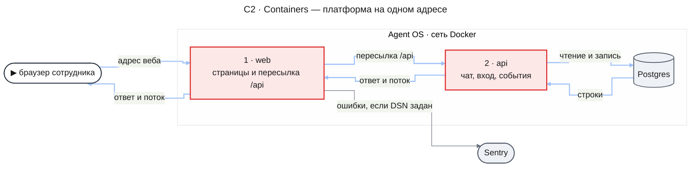
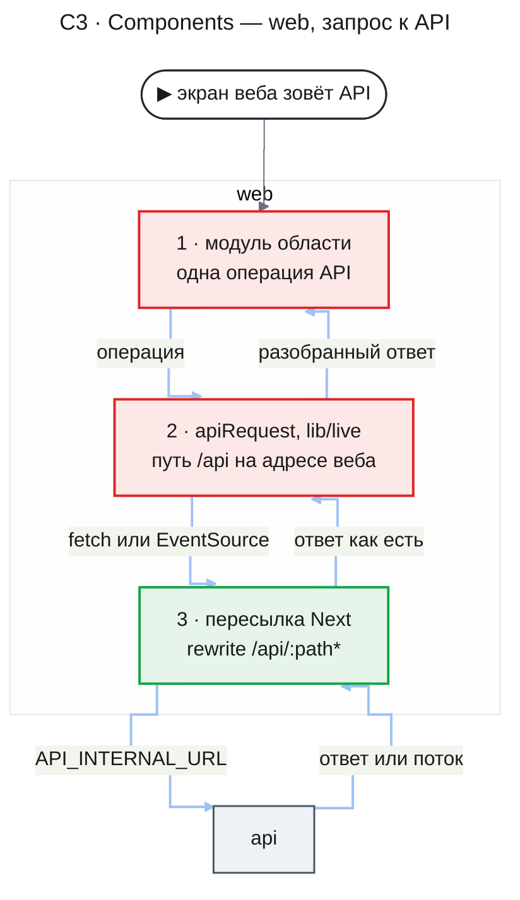
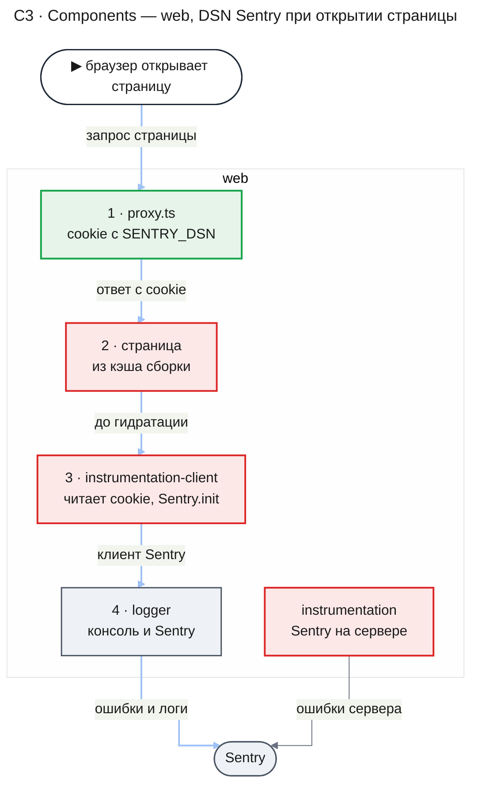
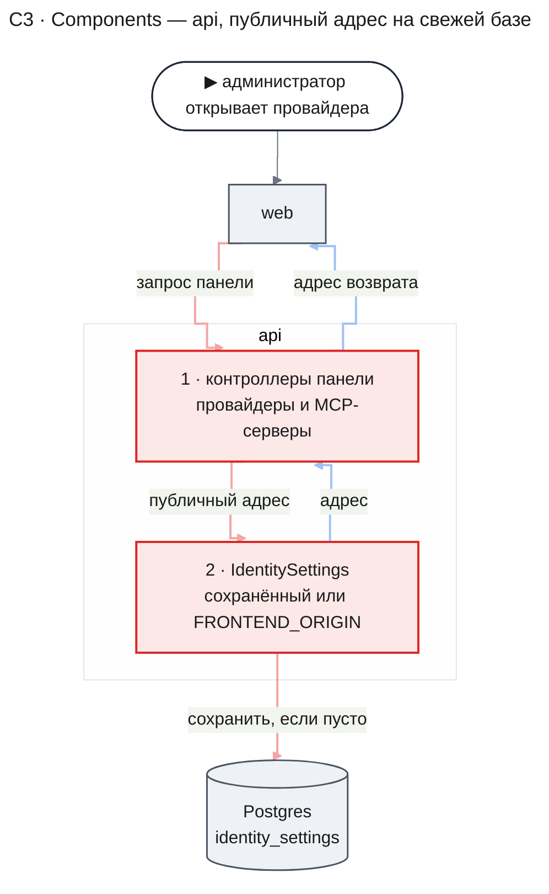
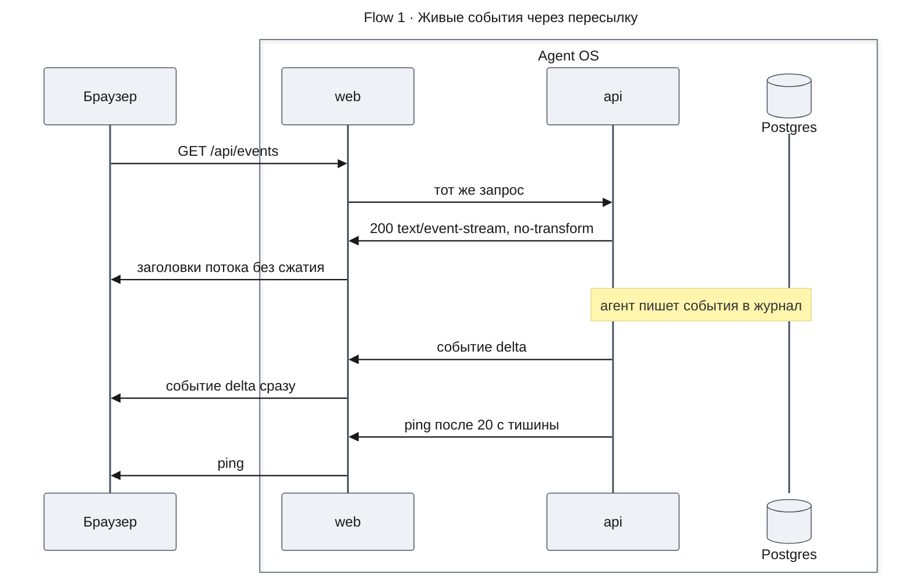
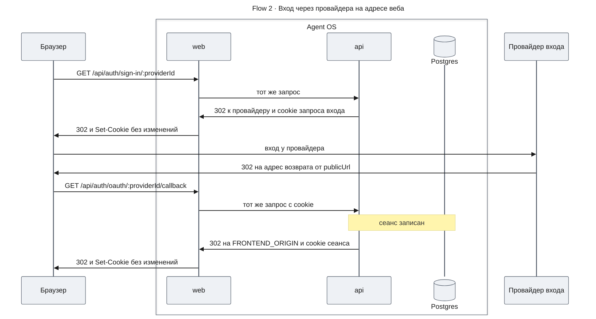
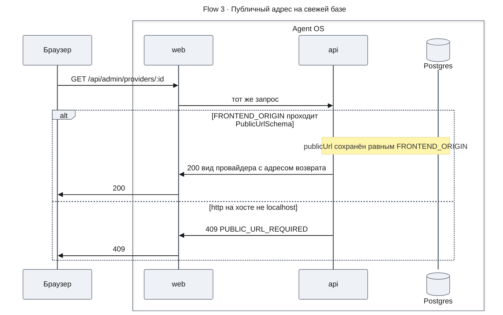
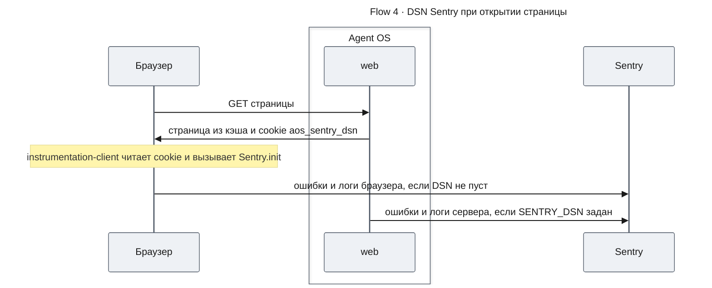

# Отдельный контейнер для веба — Design Document — web-image

**Status:** Draft · **Date:** 2026-11-21 · **PRD:** [prd.md](./prd.md) · **UXRD:** нет — интерфейс не меняется · **Depends on:** ничего — единственная часть

## Snapshot

**Overview.** Сегодня браузер ходит в API напрямую по второму адресу, этот адрес вшит в сборку веба, а веб запускается только из исходников. После этой части у веба есть свой образ, а браузер ходит только на адрес веба: всё, что начинается с `/api`, сервер Next пересылает в контейнер API по внутренней сети Docker. Пересылка не ставит своего лимита времени и не сжимает поток живых событий, поэтому события чата приходят по одному, как сейчас. Адрес Sentry веб читает из окружения при каждом ответе страницы, а не при сборке. Один compose-файл поднимает Postgres, миграции, API и веб из образов с тегом `latest`, которые публикует CI.

- **Не меняется**: что сотрудник видит и делает в вебе; образ API и его job в CI; правила входа, сеанса и проверки `Origin` в API.
- **Главный риск**: пересылка Next 16.4.6 оборвёт поток или соберёт события пачкой. Запуск на этой версии Next показал обратное ([Проверка пересылки запуском](#проверка-пересылки-запуском)); первый шаг плана повторяет проверку на настоящем стеке.
- **Открытые вопросы**: один — вход через провайдера на `http` с хостом не `localhost` ([Open Questions](#open-questions)).

### Key Decisions

#### KD-1: Пересылка — `rewrites` в `next.config` с `/api/:path*` на `{API_INTERNAL_URL}/api/:path*`; адрес API читается при сборке; лимит времени — наибольшее значение таймера Node; сжатие остаётся включённым

Все маршруты API, включая проверку здоровья и оба адреса возврата OAuth, уже живут под `/api`, а у веба нет своей папки `app/api`. Поэтому одно правило пересылки покрывает весь API, и ни один путь не меняется. Адрес API Next читает из `API_INTERNAL_URL` при сборке и пишет в манифест маршрутов. Префикса `NEXT_PUBLIC_` у имени нет намеренно: переменные с ним Next отдаёт браузерному коду, а этот адрес внутренний и нужен только серверной части веба. Без переменной адрес равен `http://localhost:4000`, и запуск из исходников работает без настройки (FR-08). Dockerfile задаёт аргумент сборки `API_INTERNAL_URL` со значением `http://api:4000`, поэтому образ из CI ходит в сервис `api` своей сети, и при запуске адрес никто не задаёт (AC-03.2). Задача `build` в `turbo.json` объявляет `API_INTERNAL_URL`, чтобы turbo не отрезал переменную и учитывал её в ключе кэша.

Пересылка Next держит свой таймаут тишины: если по соединению с API нет данных дольше `experimental.proxyTimeout`, Next рвёт соединение. Значение по умолчанию — 30 секунд. Значение `0` Next молча заменяет теми же 30 секундами, а `null` запрещает схема конфигурации. Поэтому лимит задаётся числом `2147483647` (около 24,8 суток) — наибольшим, что принимает таймер сокета Node; ни один запрос до него не доживает, и своего лимита у пересылки фактически нет (FR-04). Сжатие ответов Next остаётся включённым: поток событий оно не трогает, потому что Nest отдаёт его с `Cache-Control: … no-transform`, а `compression` такие ответы пропускает. Всё это проверено запуском: поток с паузой 45 секунд и запрос на 40 секунд прошли, а со значением `0` оба оборвались на 30-й секунде.

Не взяты: nginx — владелец выбрал compose без него. Свой обработчик `app/api/[...path]/route.ts` поверх `fetch` — у undici свой таймаут тела 300 секунд, и код пересылки пришлось бы писать и сопровождать. Свой сервер Next с `http-proxy` — больше кода, и теряется готовый `server.js` сборки standalone. `compress: false` — страницы и скрипты пошли бы без сжатия ради свойства, которое поток уже имеет.

#### KD-2: Веб обращается к API относительными путями `/api/...` на своём адресе; `lib/config.ts` и `NEXT_PUBLIC_API_URL` удаляются

Ядро `apiRequest`, поток событий `lib/live`, три перехода вкладки (вход через провайдера, подключение MCP из меню и из панели) берут путь без адреса. Браузер подставляет адрес страницы сам, поэтому запросы идут на адрес веба, и кросс-доменных запросов больше нет (AC-03.1). Строка `preconnect` в корневом макете удаляется: соединение со своим адресом уже открыто. Это меняет паттерн [web-api-client.md](../../code-system/patterns/web-api-client.md): ядро больше не знает адреса API. Вызывающие код не меняют: модули областей передают ядру тот же путь, что и раньше.

Не взяты: оставить `apiBaseUrl` пустой строкой — значение, которое никто не задаёт, и второй способ задать адрес. `NEXT_PUBLIC_API_URL` как необязательная переменная — тот же второй способ, который PRD запрещает.

#### KD-3: Публичный адрес без сохранённого значения API берёт из `FRONTEND_ORIGIN`, а не из адреса запроса; CORS удаляется

Через пересылку API видит в `Host` свой внутренний адрес (`api:4000`), а не адрес браузера. Значит, адрес из запроса на свежей базе даёт `http://api:4000`, схема публичного адреса его отвергает, и панель отвечает `409 PUBLIC_URL_REQUIRED`. Но адрес, на котором браузер открывает платформу, API уже знает: это `FRONTEND_ORIGIN`, с которым он сверяет `Origin` каждого изменяющего запроса. Поэтому `IdentitySettings.publicUrlFor` без сохранённого адреса берёт `FRONTEND_ORIGIN` и сохраняет его, если тот проходит `PublicUrlSchema`. Функция `publicUrlOf` и её тест удаляются. Вход и подключение MCP из меню сотрудника по-прежнему читают только сохранённый адрес.

Форма настроек входа до сохранения предлагала адрес API из `apiBaseUrl`. Теперь она предлагает адрес, на котором администратор открыл веб (DC-2): это тот же адрес, по которому браузер достаёт API. Вызов `enableCors` удаляется, потому что браузер больше не обращается к API с чужого адреса, а CLI-клиентам CORS не нужен. `FRONTEND_ORIGIN` остаётся единственной настройкой адреса: по нему API проверяет `Origin`, ставит флаг Secure у cookie и строит возвраты в веб. Пересылка передаёт `Origin`, `Cookie`, `Set-Cookie` и `Location` без изменений, поэтому эти правила работают как раньше.

Не взяты: доверять `x-forwarded-host` — Next не шлёт схему (`x-forwarded-proto`), а при запуске из исходников API открыт напрямую, и заголовок подделывается. Требовать от администратора ввести адрес вручную — свежий стек отвечал бы 409 до первой правки. Расширить `PublicUrlSchema` до `http` на любом хосте — вопрос владельцу ([Open Questions](#open-questions)).

#### KD-4: DSN Sentry веба — переменная `SENTRY_DSN` контейнера; сервер читает её при старте, а браузер получает её из cookie `aos_sentry_dsn`, которую ставит `proxy.ts` на каждом ответе страницы

На сервере `instrumentation.ts` передаёт `process.env.SENTRY_DSN` в `Sentry.init`: переменная без префикса `NEXT_PUBLIC_` в сборку не вшивается и читается при старте. Браузеру DSN нужен до гидратации, в `instrumentation-client.ts`, иначе ошибки гидратации и первые записи лога не дойдут до Sentry. Корневой макет статический (`cacheComponents`), и всё, что он отрисует, попадает в HTML при сборке образа. Поэтому DSN приносит cookie: `proxy.ts` выполняется на каждом запросе страницы, даже отданной из кэша сборки, и ставит в ответ `aos_sentry_dsn` со значением `SENTRY_DSN` или пустым. `instrumentation-client.ts` читает cookie синхронно и вызывает `Sentry.init`; пустое значение оставляет логи только в консоли (AC-07.3). Запуск показал, что страница остаётся статической, а `instrumentation-client` видит значение времени запуска, а не сборки.

Цена: `proxy.ts` выполняется на каждом запросе страницы, кроме `/api/` и `/_next/`, и браузер шлёт короткую cookie с каждым запросом. Статическая оболочка не меняется. DSN не секрет: он и сегодня уходит в браузер в составе сборки.

Не взяты: `next/script` со стратегией `beforeInteractive` и маршрут, отдающий DSN, — запуск показал, что такой скрипт выполняется после `instrumentation-client`. Скрипт с DSN прямо в макете — его значение вшилось бы при сборке, а чтение окружения во время запроса сделало бы корень динамическим. Запрос DSN из `instrumentation-client` с поздним `Sentry.init` — ошибки гидратации и первые записи лога терялись бы. Замена заглушки в собранных файлах при старте — правка бандлов в контейнере. Туннель Sentry через веб — больше кода, и браузер слал бы события даже без DSN.

#### KD-5: Образ веба — сборка standalone с корнем трассировки в корне репозитория, двухэтапный Dockerfile по образцу API и свой файл исключений `apps/web/Dockerfile.dockerignore`

Сборка standalone (`output: 'standalone'`) кладёт в `.next/standalone` готовый `server.js` и только те файлы `node_modules`, которые нужны серверу. Корень трассировки (`outputFileTracingRoot`) — корень репозитория, иначе пакеты workspace и хранилище pnpm не попадут в выборку. Dockerfile повторяет образ API: `node:26-bookworm-slim`, `pnpm@10.9.0`, установка только для `web` и его зависимостей, сборка, затем чистый второй этап с `tini`, `NODE_ENV=production`, `HOSTNAME=0.0.0.0`, портом 3000 и пользователем `node`. Каталог приложения принадлежит `node`, потому что Next пишет кэш в `.next/cache`. Статические файлы (`.next/static`, `public`) копируются рядом с `server.js`, так как standalone их сам не переносит.

Корневой `.dockerignore` прячет `apps/web` из контекста ради образа API. BuildKit берёт файл `<Dockerfile>.dockerignore` рядом с Dockerfile вместо корневого ([Docker docs, .dockerignore files](https://docs.docker.com/build/concepts/context/#dockerignore-files)). Поэтому у веба свой `apps/web/Dockerfile.dockerignore`: тот же список, но прячет исходники API, а не веба, и оставляет манифест `apps/api/package.json` для lockfile. Корневой файл и образ API не меняются. Job `web-image` в `docker.yml` — копия `api-image` с именем образа `-web`, своим Dockerfile и кэшем `type=gha,scope=web`; кэш API остаётся в области по умолчанию, и две сборки не затирают друг другу кэш.

Не взяты: `next start` с полным `node_modules` во втором этапе — образ больше, и нужна установка зависимостей при сборке второго этапа. Правка корневого `.dockerignore` — меняет контекст сборки API, что PRD исключает. Общая область кэша — два job перезаписывают кэш друг друга.

#### KD-6: Compose — один файл `infra/docker-compose.yml` с сервисами `postgres`, `migrate`, `api`, `web`; наружу открыт только порт веба; порт Postgres для запуска из исходников открывает файл `infra/docker-compose.dev.yml`

Все сервисы живут в сети compose по умолчанию и видят друг друга по именам. `migrate` — разовый запуск образа API с командой миграций; он ждёт здоровый Postgres, а `api` стартует только после его успешного завершения, потому что сервер отказывается работать с непримененными миграциями. Так `docker compose up` поднимает стек одной командой (AC-06.1). Первую учётную запись владелец создаёт один раз разовым запуском образа API с существующим `super-admin-cli`, пароль идёт на стандартный ввод; команду даёт README. Наружу публикуется только `3000` веба.

`api` получает `DATABASE_URL` сервиса `postgres`, `FRONTEND_ORIGIN` и `SENTRY_DSN`, `web` получает `SENTRY_DSN`; оба значения compose берёт из окружения или из незакоммиченного `infra/.env`, по умолчанию `FRONTEND_ORIGIN` равен `http://localhost:3000`, а `SENTRY_DSN` пуст. Оба образа указаны с постоянным тегом `latest` — `ghcr.io/{owner}/{repo}-api:latest` и `ghcr.io/{owner}/{repo}-web:latest`, — и параметра для тега у compose нет. Чтобы поднять стек на сборке одного коммита (UC-2), владелец скачивает оба образа с тегом `sha-{short sha}` и командой `docker tag` ставит им локально тег `latest`. Так же пробуется образ, собранный на машине до публикации: `docker build` сразу с тегом `ghcr.io/{owner}/{repo}-web:latest`, затем `docker compose up`. Compose скачивает образ, только когда его нет на машине, поэтому берёт локальный. `pnpm db:up` поднимает только `postgres` с наложенным `docker-compose.dev.yml`, который добавляет публикацию `${POSTGRES_PORT:-5432}`; запуск из исходников остаётся прежним.

Не взяты: Postgres, открытый на `127.0.0.1` в самом стеке, — порт открыт, а AC-03.1 требует только порт веба. Миграции при старте API — сервер по замыслу их только проверяет, и отдельная команда уже есть. Второй compose-файл со своим Postgres для разработки — два описания одной базы.

## Terms

- **Пересылка (rewrite)** — правило `rewrites` в `next.config`: сервер Next принимает запрос к `/api/...`, сам отправляет его в API и возвращает ответ браузеру.
- **Таймаут тишины** — сколько соединение может молчать, прежде чем его закроют; пока данные идут, он не срабатывает.
- **Статическая оболочка** — HTML страницы, который Next строит при сборке и отдаёт из кэша без отрисовки на запросе.
- **Standalone** — режим сборки Next, при котором рядом со сборкой лежат минимальный `server.js` и только нужные ему файлы зависимостей.
- **`proxy.ts`** — файл Next 16 (прежнее имя — middleware), который выполняется на сервере перед ответом на каждый подходящий запрос.
- **Наложение compose** — второй compose-файл, который добавляет поля к сервисам первого при запуске с обоими файлами.

## Part

- **Prerequisite ADRs**: [ADR-0012](../../adr/ADR-0012-closed-api-and-server-issued-employee-id.md) — API закрыт сеансом; пересылка передаёт cookie сеанса и ничего не открывает без него.

**Out of scope**

- Образ API, его Dockerfile, корневой `.dockerignore` и job `api-image` остаются как есть.
- Экраны, тексты и поведение веба не меняются; меняется только адрес, по которому веб достаёт API.
- Правила сеанса, проверка `Origin`, адреса возврата в веб и схема публичного адреса `PublicUrlSchema` остаются прежними.
- TLS, публичный домен, nginx и оркестраторы не входят (PRD, Won't Have).
- Документы других фич, где упомянуты `NEXT_PUBLIC_API_URL` или nginx, не правятся: они описывают своё время.

**Constraints**

- Новых переменных платформы две, как разрешает PRD: `API_INTERNAL_URL` при сборке веба и `SENTRY_DSN` контейнера веба. `FRONTEND_ORIGIN` и `SENTRY_DSN` API уже существуют. Тег образов в compose постоянный (`latest`), своей переменной у него нет (KD-6).
- Один способ: `NEXT_PUBLIC_API_URL`, `NEXT_PUBLIC_SENTRY_DSN`, `lib/config.ts`, `publicUrlOf`, вызов `enableCors` и `infra/nginx.conf` удаляются вместе с текстами о них ([Удаляется и меняется вместе с кодом](#удаляется-и-меняется-вместе-с-кодом)).
- Секреты не попадают в образ и репозиторий: файл исключений веба, как и корневой, не пускает `.env` в контекст сборки, а `SENTRY_DSN` compose берёт из незакоммиченного `infra/.env`. Пароль Postgres остаётся прежним локальным значением из репозитория — в стеке Postgres виден только сервисам `migrate` и `api`.
- NFR-01 (время до первого токена): пересылка — один переход внутри машины или сети Docker, и события идут через неё без буферизации; запуск показал интервалы между событиями такими же, как у источника, с точностью 0,1 с.
- Логирование: новый код веба пишет через `src/lib/logger.ts`. Сбой самой пересылки Next пишет в консоль сам, мимо логгера ([Risks and Mitigation](#risks-and-mitigation)).

## Building-block Inventory

Follows the [code system](../../code-system/README.md). Поиск перед «new»: `apps/web` (`next.config.ts`, `src/lib`, `src/app`), `apps/api/src/identity`, `infra/`, `.github/workflows/`, `docs/code-system/` — пересылки, чтения окружения на запросе страницы и образа веба нет; паттерна для сборки образов в каталоге нет, а образ API — единственный образец.

| Building block | Pattern | Status | Note |
|---|---|---|---|
| Ядро `apiRequest`, поток `lib/live`, переходы в `lib/auth`, `lib/mcp`, `lib/admin` | [web-api-client.md](../../code-system/patterns/web-api-client.md) | extended | путь `/api` без адреса (KD-2) |
| Пересылка `/api` в `next.config.ts` | — | new | правило `rewrites` и `proxyTimeout` (KD-1) |
| `proxy.ts` с cookie `aos_sentry_dsn` | [logging.md](../../code-system/patterns/logging.md) | new | приносит DSN браузерному приёмнику Sentry (KD-4) |
| `instrumentation.ts`, `instrumentation-client.ts` | [logging.md](../../code-system/patterns/logging.md) | extended | DSN из `SENTRY_DSN` и из cookie (KD-4) |
| `IdentitySettings.publicUrlFor` | — | extended | запасной адрес — `FRONTEND_ORIGIN` (KD-3) |
| Форма `SignInSettingsForm` | [read-on-open.md](../../code-system/patterns/read-on-open.md) | extended | подсказка адреса — адрес страницы (DC-2) |
| `apps/web/Dockerfile`, `apps/web/Dockerfile.dockerignore` | — | new | по образцу `apps/api/Dockerfile` (KD-5) |
| Job `web-image` в `docker.yml` | — | new | копия `api-image` со своей областью кэша (KD-5) |
| `infra/docker-compose.yml`, `infra/docker-compose.dev.yml` | — | extended / new | стек из образов и наложение для разработки (KD-6) |

## Acceptance Criteria

### FR-01: Образ веба публикуется в CI

- From the PRD: AC-01.1, AC-01.2

### FR-02: Образ веба запускается сам по себе

- From the PRD: AC-02.1, AC-02.2

### FR-03: Один адрес для браузера

- From the PRD: AC-03.1, AC-03.2
- Когда контейнер API недоступен, запрос к `/api` получает `500` без тела ошибки API, веб показывает для этого запроса своё общее сообщение об ошибке, а поток событий продолжает переподключаться (DC-3).

### FR-04: Пересылка не ограничивает время запроса

- From the PRD: AC-04.1, AC-04.2

### FR-05: Вход через адрес веба

- From the PRD: AC-05.1
- На свежей базе первый просмотр, создание или изменение провайдера входа, регистрация MCP-сервера или его подключение из панели сохраняет `FRONTEND_ORIGIN` публичным адресом, и адрес возврата строится от него (DC-1).
- Пока адрес не сохранён, форма настроек входа предлагает адрес, на котором администратор открыл веб (DC-2).
- Вход через провайдера и подключение MCP по OAuth на `http` с хостом не `localhost` зависят от [Open Questions](#open-questions).

### FR-06: Вся платформа из образов одной командой

- From the PRD: AC-06.1

### FR-07: Sentry веба задаётся при запуске

- From the PRD: AC-07.1, AC-07.2, AC-07.3

### FR-08: Запуск из исходников продолжает работать

- From the PRD: AC-08.1

## Design

### Architecture (C1–C4)

#### C2 · Containers

> **Why** — в стеке compose наружу открыт только порт веба; API и Postgres видны лишь внутри сети Docker. При запуске из исходников та же схема работает на `localhost`: веб на порту 3000 пересылает в API на порту 4000.

В API меняются две вещи: запасной публичный адрес (KD-3) и удалённый CORS. Остальное в API и в Postgres не меняется.

#### C3 · Components: web

**web — запрос к API**

Модули областей меняются только там, где строят адрес перехода вкладки: вход через провайдера в `lib/auth` и подключение MCP в `lib/mcp` и `lib/admin`. Остальные операции уже передают ядру путь, и ядро само перестаёт приклеивать к нему адрес. Пересылка живёт на сервере Next, ответ она отдаёт браузеру без разбора, поэтому ошибки API доходят до ядра в прежнем виде.

**web — DSN Sentry при открытии страницы**

`proxy.ts` пропускает `/api/` и `/_next/`, поэтому пересылка и статические файлы его не задевают. Страница меняется только тем, что из корневого макета уходит `preconnect`. Логгер `src/lib/logger.ts` не меняется: его приёмник Sentry работает, как только `Sentry.init` получил DSN, и молчит, если DSN пуст.

#### C3 · Components: api

**api — публичный адрес на свежей базе**

Контроллеры перестают передавать запрос в `IdentitySettings.publicUrlFor`: адрес запроса больше не участвует. Для провайдеров вызов идёт через `ProvidersService`, для MCP-серверов — напрямую из контроллера. Удаление CORS касается только общей настройки HTTP в `configureApp` и на этой схеме не видно.

### Runtime Flows

#### Flow 1: Живые события через пересылку

**Starts when:** экран беседы открывает поток событий, for AC-04.1, AC-04.2, AC-03.1

Пересылка держит соединение, пока его держит API: своего таймаута тишины у неё фактически нет (KD-1). Если веб или API перезапустится, `EventSource` переподключится, как при перезапуске API сегодня.

#### Flow 2: Вход через провайдера на адресе веба

**Starts when:** сотрудник выбирает провайдера на странице входа, for AC-05.1

Адрес возврата строится от сохранённого `publicUrl`, который в стеке равен адресу веба (DC-1), поэтому провайдер возвращает браузер на веб, а веб пересылает возврат в API. Cookie ставится на адрес веба, и после перезагрузки страницы браузер шлёт её с каждым запросом к `/api`.

#### Flow 3: Публичный адрес на свежей базе

**Starts when:** администратор открывает или меняет провайдера входа, регистрирует MCP-сервер или подключает его из панели, а публичный адрес ещё не сохранён, for DC-1

Сохраняется адрес один раз: если его уже записал другой запрос, API берёт сохранённый. Ветка 409 — тот же ответ, что и сегодня; администратор не может сохранить такой адрес и вручную, пока не решён [открытый вопрос](#open-questions).

#### Flow 4: DSN Sentry при открытии страницы

**Starts when:** браузер загружает любую страницу веба, for AC-07.1, AC-07.2, AC-07.3

Новый DSN действует после перезапуска контейнера: сервер читает его при старте, а браузер получает его со следующей загрузкой страницы. Переходы внутри веба новых документов не загружают, поэтому вкладка, открытая до перезапуска, шлёт в прежний проект, пока её не перезагрузят.

### Проверка пересылки запуском

Проверка шла на установленном Next 16.4.6 (`apps/web/node_modules`) в отдельном минимальном приложении вне репозитория: то же правило `rewrites`, `cacheComponents`, `next build --webpack` и `next start`. Вместо API работала заглушка на Node, которая отдаёт поток с заголовками `@Sse` Nest. Один сервер Next шёл с `proxyTimeout` 2147483647, второй, контрольный, — с `0`. Клиент на `node:http` с `Accept-Encoding: gzip, deflate, br` записывал время прихода каждого куска ответа.

Таблица сравнивает, что увидел клиент через два сервера.

| Что проверялось | `proxyTimeout` 2147483647 | `proxyTimeout` 0 |
|---|---|---|
| Пять событий с шагом 0,3 с | пришли по одному на 0,0–1,2 с, без сжатия | так же |
| Шестое событие после 45 с тишины | пришло на 46,2 с, поток закрылся штатно | поток закрылся на 31,3 с без события |
| Ответ, который API держит 40 с | `200` на 40,0 с | `500 Internal Server Error` текстом на 30,0 с |
| Поток без `no-transform` | все пять событий одним сжатым куском в конце, на 1,6 с | — |

Заголовки, которые видел API: `Host` — внутренний адрес, `Origin` и `Cookie` — как у браузера, `x-forwarded-host` — адрес веба, `x-forwarded-proto` и `x-forwarded-for` нет. Ответ `302` с `Location` и `Set-Cookie` дошёл до клиента без изменений, и Next не пошёл по перенаправлению. Обычный JSON-ответ пришёл сжатым gzip.

Вторая проверка касалась DSN. Скрипт `next/script` с `beforeInteractive` выполнился после `instrumentation-client`: тот не увидел значения. Cookie от `proxy.ts` сработала: страница отдана из кэша (`x-nextjs-cache: HIT`), а `instrumentation-client` в headless Chrome прочитал значение, заданное при запуске (`project-B`), а не при сборке. Ответы `/api` cookie не получили.

Не проверялось: настоящие API и Postgres, `next dev`, `server.js` сборки standalone, сборка Turbopack и образ Docker. Это первая проверка плана ([L1-сценарии](#l1-сценарии)).

### Contract Definitions

#### Пересылка `/api` на адресе веба

- **Любой метод на `/api/{path}`** — веб передаёт запрос в `{API_INTERNAL_URL}/api/{path}` с тем же методом, путём, строкой запроса, телом, `Cookie` и `Origin`. `Host` становится внутренним адресом API, добавляется `x-forwarded-host` с адресом веба. Возвращает статус, заголовки (включая `Set-Cookie` и `Location`) и тело API без изменений; перенаправлениям не следует. Своего лимита времени нет: соединение живёт, пока его держат API и браузер. Ответ без `no-transform` в `Cache-Control` Next сжимает, если браузер это принимает. Сбой: API недоступен или соединение с ним оборвалось до ответа — `500` с телом `Internal Server Error` простым текстом, без тела `ApiError`; веб обрабатывает его как ошибку вида `http` со статусом 500 и без `code` (DC-3).
- **Правило для API**: потоковый ответ несёт `Cache-Control: no-transform`, иначе сжатие веба собирает его в один кусок. `@Sse` Nest ставит этот заголовок сам; новый потоковый маршрут строится на нём же.

#### Cookie `aos_sentry_dsn`

- Веб ставит её в каждый ответ на запрос, путь которого не начинается с `/api/` и `/_next/`. Значение — `SENTRY_DSN` контейнера веба или пустая строка. `Path=/`, `SameSite=Lax`, без `HttpOnly`, потому что её читает скрипт страницы. Браузер шлёт её и в `/api`; API её не читает.

#### Публичный адрес в API

- **`IdentitySettings.publicUrlFor`** (просмотр, создание и изменение провайдера входа; регистрация MCP-сервера и его подключение из панели) — возвращает сохранённый адрес. Без него берёт `FRONTEND_ORIGIN` и сохраняет его, если тот проходит `PublicUrlSchema`; иначе `409 PUBLIC_URL_REQUIRED`, как сегодня. Вход и подключение MCP из меню сотрудника читают только сохранённый адрес.
- **CORS** — API не отвечает заголовками `Access-Control-*`. Браузерные запросы к API с чужого адреса не поддерживаются; CLI-клиенты не меняются.

#### Образ веба

- `ghcr.io/{owner}/{repo}-web` с тегами `latest` и `sha-{short sha}`, как у образа API. Слушает порт 3000, процесс работает от пользователя `node`. API ищет по адресу из аргумента сборки `API_INTERNAL_URL`, по умолчанию `http://api:4000`, — контейнер API должен быть доступен по этому имени в той же сети.

**Runtime settings**

- `API_INTERNAL_URL` — аргумент сборки веба, не переменная запуска. По умолчанию `http://localhost:4000` при сборке и `next dev` из исходников, `http://api:4000` в Dockerfile. Задаёт, куда пересылается `/api`.
- `SENTRY_DSN` (контейнер веба) — по умолчанию пусто. Задаёт проект Sentry для сервера и браузера веба; пусто — логи только в консоли.
- `FRONTEND_ORIGIN` (контейнер API, уже есть) — по умолчанию `http://localhost:3000`. Адрес, на котором браузер открывает веб; теперь ещё и запасной публичный адрес (KD-3).
- Параметры compose: `FRONTEND_ORIGIN` и `SENTRY_DSN` передаются в контейнеры; `POSTGRES_PORT` (по умолчанию 5432) — только в наложении для разработки.

### Удаляется и меняется вместе с кодом

Код и настройки, которые удаляются:

- `apps/web/src/lib/config.ts` и `config.test.ts`, строка `preconnect` в `app/layout.tsx`;
- `NEXT_PUBLIC_API_URL` и `NEXT_PUBLIC_SENTRY_DSN` — в коде, `vitest.config.ts`, комментариях интеграционных тестов, `apps/web/.env.example` и `ci.yml`;
- `publicUrlOf`, тип `AddressedRequest` и `public-url.spec.ts` в `apps/api`; вызов `enableCors` в `configureApp`;
- `infra/nginx.conf`.

Тексты, которые иначе стали бы ложными, меняются в той же работе:

- `README.md`: строка «Инфра» таблицы решений без nginx; дерево без `nginx.conf`; блок переменных веба; шаг 5 — стек compose, разовые миграции и первая учётная запись вместо файла только с Postgres, без ссылки на nginx и блока `proxy_*`; команда шага 3 переключения базы — через `pnpm db:up`.
- `apps/web/README.md`: шаги 1–2 — без фразы о CORS, `.env.local` только с необязательными `SENTRY_DSN` и `API_INTERNAL_URL`.
- `apps/api/README.md`, раздел Docker: `FRONTEND_ORIGIN` — адрес веба, ссылка на запуск стека compose.
- `apps/api/.env.example` и `apps/web/.env.example` — по тем же правилам.
- Каталог кода: [web-api-client.md](../../code-system/patterns/web-api-client.md) (ядро и путь без адреса, образец) и строка «клиент API в `apps/web`» в [README.md](../../code-system/README.md) — правятся вместе с этим документом.

## Test Strategy

Пересылка — поведение Next с одним значением конфигурации, поэтому отдельного автоматического теста на неё нет: её доказывают запуск выше и L1-сценарии на настоящем стеке. Автоматические тесты меняются так:

- e2e-строка «публичный адрес на свежей базе» в `enterprise-access-identity.int.e2e-spec.ts` ждёт `FRONTEND_ORIGIN` вместо адреса запроса (DC-1) — это единственная автоматическая проверка нового поведения;
- тесты веба с MSW (`msw-server.ts`, `user-menu.test.tsx`, `live-store.test.ts`) ставят обработчики на относительные пути `/api/...`; MSW 2.15 разрешает относительный адрес `fetch` от `location` jsdom;
- `config.test.ts` и `public-url.spec.ts` удаляются вместе со своим кодом.

Сценарии ниже проверяются в настоящем браузере и в Docker.

- **UC-1: Стек из образов** — covers AC-02.1, AC-02.2, AC-03.1, AC-03.2, AC-06.1
  - Given: машина с Docker, compose-файл и `infra/.env` по README, первая учётная запись создана
  - When: владелец выполняет `docker compose up`, сотрудник входит, ведёт беседу и открывает панель
  - Then: всё работает; в Network каждый запрос идёт на адрес веба; снаружи открыт только порт 3000; процесс веба работает от `node`; адрес API не задан ни в одной настройке запуска; в `.next/static` образа нет ни `api:4000`, ни `localhost:4000`
- **UC-2: Публикация в CI** — covers AC-01.1, AC-01.2
  - Given: push в `main` или ручной запуск workflow Docker
  - When: workflow завершился
  - Then: в GHCR есть `-web` с `latest` и `sha-{short sha}`, а `-api` этого коммита несёт тот же `sha-{short sha}`
- **UC-3: Живые события через пересылку** — covers AC-04.1, AC-04.2
  - Given: открытая беседа в стеке из образов
  - When: агент отвечает потоком токенов, затем работает молча дольше двух минут
  - Then: текст растёт по мере генерации; поток не переподключался, следующее событие появляется сразу
- **UC-4: Вход через адрес веба** — covers AC-05.1, DC-1, DC-2
  - Given: свежая база, `FRONTEND_ORIGIN` равен `http://localhost:3000`
  - When: администратор открывает провайдера в панели, затем сотрудник входит через провайдера и перезагружает страницу
  - Then: сохранён адрес веба; сотрудник в чате на адресе веба и остаётся вошедшим
- **UC-5: Sentry задаётся при запуске** — covers AC-07.1, AC-07.2, AC-07.3
  - Given: образ веба
  - When: контейнер запущен с DSN проекта A, затем перезапущен с DSN проекта B, затем без DSN; в каждом запуске случаются ошибки в браузере и на сервере
  - Then: ошибки приходят в A, затем в B; без DSN они видны только в консоли, и в Network нет запросов к Sentry
- **UC-6: API недоступен** — covers DC-3
  - Given: стек работает, открыта беседа
  - When: контейнер API остановлен, сотрудник отправляет сообщение
  - Then: веб показывает общее сообщение об ошибке, поток событий переподключается; после старта API работа продолжается
- **UC-7: Запуск из исходников** — covers AC-08.1
  - Given: API и веб запущены из исходников по README без `.env.local` у веба
  - When: разработчик входит, ведёт беседу и открывает панель
  - Then: всё работает, включая живые события; запросы идут на `localhost:3000/api`

### L1-сценарии

Первая проверка плана идёт до остальной работы: она подтверждает запуск выше на настоящем стеке.

| Сценарий | Шаги | Проверяемый сигнал |
|---|---|---|
| Пересылка на настоящем стеке (первая) | Собрать образ веба с тегом `…-web:latest` (KD-6), поднять стек, открыть беседу; запустить агента, который отвечает потоком, затем молчит дольше двух минут | В Network один запрос `GET /api/events` без `content-encoding`, во вкладке EventStream события `delta` приходят по одному, `ping` каждые 20 с, переподключений нет; текст растёт по ходу ответа |
| Запуск из исходников | `pnpm --filter web dev` и `pnpm --filter api start:dev`, те же шаги | Те же сигналы на `localhost:3000` |
| DSN при запуске | Запустить веб с DSN, вызвать ошибку в браузере и на сервере; перезапустить с другим DSN | В cookie `aos_sentry_dsn` текущий DSN; запросы `envelope` уходят в проект текущего DSN |

Если события приходят пачкой или поток рвётся без команды API, работа останавливается, и вопрос возвращается владельцу. Варианты для него: свой сервер Next с `http-proxy` вместо `rewrites` или nginx перед вебом.

## Security Considerations

- **Authentication & Authorization**: правила API не меняются. Пересылка передаёт `Cookie` и `Origin` без изменений, поэтому `SessionGuard` и проверка `Origin === FRONTEND_ORIGIN` работают как раньше. Удаление CORS только сужает доступ: чужой адрес и раньше не проходил. В стеке compose API не опубликован и доступен браузеру только через веб.
- **Input Validation**: пересылка передаёт запрос как есть, и API проверяет вход, как сегодня. Заголовок `x-forwarded-host` API не читает, поэтому подделать через него публичный адрес нельзя (KD-3).
- **Sensitive Data Handling**: DSN Sentry не секрет и уходит в браузер, как и сегодня. Файл исключений веба не пускает `.env` в контекст сборки. `SENTRY_DSN` compose берёт из незакоммиченного `infra/.env`. Пароль Postgres в compose — прежнее локальное значение; в стеке Postgres не опубликован.

## Risks and Mitigation

- **Обновление Next меняет пересылку** — `proxyTimeout` помечен как экспериментальный, его смысл может измениться; вероятность средняя. Запуск выше точно описывает поведение 16.4.6; при обновлении Next первый L1-сценарий повторяется.
- **Новый потоковый маршрут без `no-transform`** — сжатие соберёт события пачкой; вероятность низкая, пока потоки строятся на `@Sse`. Правило записано в контракте пересылки.
- **Сбой пересылки не доходит до Sentry** — Next пишет «Failed to proxy» сам в консоль контейнера веба, мимо логгера и `onRequestError`. Причину показывают логи API или консоль веба; сотрудник видит общее сообщение об ошибке (DC-3).
- **Трассировка standalone пропустит файл в монорепозитории pnpm** — контейнер не стартует; вероятность низкая. UC-1 ловит это при первом запуске образа.
- **Сборка тянет шрифты Google** — `next/font/google` нужна сеть при сборке, как и сегодня; в CI сеть есть.

## Open Questions

- Вход через провайдера и подключение MCP по OAuth на `http` с хостом не `localhost` не работают: `PublicUrlSchema` принимает только `https` или `http://localhost`, а без TLS (PRD, Won't Have) сервер отвечает по `http`. Вход по паролю на таком адресе работает. Рекомендация — схему не расширять: адрес возврата по `http` открывает код авторизации в сети, и провайдеры обычно сами отвергают такой адрес кроме `localhost`; ограничение снимет отдельная задача HTTPS. Вопрос не блокирует эту часть; решает владелец.

## Update History

| Version | Date | Change |
|---------|------|--------|
| 1.0 | 2026-11-21 | Первая версия |
| 1.1 | 2026-11-21 | Решение владельца: у compose нет параметра тега, оба образа берутся с тегом `latest`; сборка коммита и локальная сборка пробуются через `docker tag` (KD-6) |
| 1.2 | 2026-11-21 | Переименование `API_INTERNAL_URL` в `NEXT_PUBLIC_API_URL` рассмотрено и отклонено владельцем: переменные с префиксом `NEXT_PUBLIC_` Next отдаёт браузерному коду, а адрес API внутренний и нужен только серверной части веба (KD-1). В UC-1 добавлена проверка, что в `.next/static` образа нет ни `api:4000`, ни `localhost:4000` |