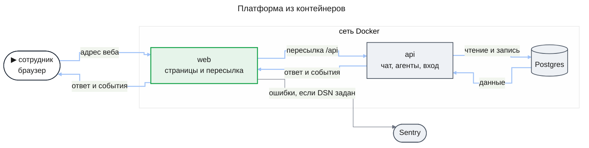

# PRD: Отдельный контейнер для веба (web-image)

| Date | Depth |
|---|---|
| 2026-11-21 | lite |

## Snapshot

**Overview.** Сегодня в контейнере запускается только API: CI собирает его образ и публикует в GHCR. Веб запускается только из исходников, поэтому поднять всю платформу на чистой машине без сборки кода нельзя. После фичи у веба есть свой образ, который CI публикует рядом с образом API, а один compose-файл поднимает Postgres, API и веб из готовых образов. Браузер ходит только на адрес веба: запросы к `/api` веб сам пересылает в контейнер API по внутренней сети Docker.

- **Не входит**: nginx, TLS и публичный домен; изменения в сборке образа API; Kubernetes и другие оркестраторы.
- **Не меняется**: что сотрудник видит и делает в вебе; запуск из исходников для разработки.
- **Части**: одна — `web-image`.
- **Главный риск**: события чата при пересылке через веб могут приходить пачкой, а не по одному ([Assumptions and Risks](#assumptions-and-risks)).
- **Открытые вопросы**: два, оба для Design Doc ([Undetermined Items](#undetermined-items)).

## Terms

- **Образ (image)** — готовый к запуску пакет приложения со всем, что ему нужно. Из одного образа запускают сколько угодно **контейнеров** — работающих копий приложения.
- **GHCR** — GitHub Container Registry, хранилище образов при репозитории на GitHub. Оттуда образы скачивают для запуска.
- **Тег образа** — метка версии: `latest` — последняя сборка из `main`, `sha-<short sha>` — сборка конкретного коммита.
- **Compose-файл** — файл для `docker compose`, который описывает несколько контейнеров и поднимает их одной командой.
- **Сеть Docker** — внутренняя сеть, в которой контейнеры одного compose-файла видят друг друга по именам (`api`, `postgres`). С машины пользователя её адреса недоступны, пока порт контейнера не открыт наружу явно.
- **Пересылка (proxy)** — веб принимает запрос браузера к `/api/...`, передаёт его в API и возвращает браузеру ответ API.
- **Поток живых событий (SSE)** — одно долгое соединение, по которому API шлёт в браузер события чата по мере их появления: токены ответа, вызовы инструментов, статусы. Пока агент молчит, API раз в 20 секунд шлёт в поток служебный `ping`, чтобы промежуточные узлы не закрыли соединение.
- **Sentry DSN** — адрес проекта в Sentry, куда приложение отправляет ошибки и логи.

## Background

Сегодня workflow Docker в CI собирает один образ — образ API. Он делает это на каждый push в `main` и по ручному запуску и публикует образ в GHCR с тегами `latest` и `sha-<short sha>`. Compose-файл в `infra/` поднимает только Postgres. Веб (Next.js) запускается из исходников командами `pnpm --filter web dev` или `pnpm --filter web start`.

Адрес API веб получает при сборке: адрес вшит в код страницы, и браузер обращается к API напрямую, по другому адресу, чем адрес веба. Такие кросс-доменные запросы браузер пропускает, только если сервер их явно разрешил, поэтому API должен быть открыт наружу и настроен на адрес веба. В `infra/` лежит и `nginx.conf` — образец обратного прокси, который отдаёт `/api` напрямую в API, а остальное в веб. Адрес проекта Sentry тоже вшивается при сборке, так что направить готовую сборку в другой проект Sentry нельзя.

Фича нужна, чтобы вся платформа запускалась из контейнеров: скачать образы, выполнить одну команду — и платформа работает. Это внутренняя возможность для развёртывания, рыночного контекста у неё нет. После фичи контейнеры связаны так:

> **Why** — наружу открыт только порт веба: API и Postgres видны лишь внутри сети Docker.

## Users and Use Cases

### Users

- **Владелец развёртывания** — разработчик или администратор, который поднимает платформу на машине или сервере. Ему важно запустить её из готовых образов, не собирая код, и выбрать версию по тегу.
- **Сотрудник** — работает в чате и панели администратора через браузер. Для него меняется одно: вся платформа живёт на одном адресе.
- **Разработчик** — запускает API и веб из исходников, когда работает над кодом.

### Use Cases

- **UC-1**: владелец развёртывания поднимает всю платформу одной командой из опубликованных образов → вход, чат и панель администратора работают, так что развернуть платформу можно без исходников и сборки.
- **UC-2**: после слияния в `main` владелец берёт образы веба и API, собранные из одного коммита, по одному тегу → обновляет или откатывает развёртывание целиком.
- **UC-3**: владелец направляет один и тот же образ веба в свой проект Sentry при запуске или запускает его без Sentry → ошибки веба попадают туда, куда он указал, без пересборки.
- **UC-4**: сотрудник открывает в браузере один адрес — адрес веба — и работает: входит, ведёт беседу и видит ответ агента по мере появления, даже когда агент долго работает молча.
- **UC-5**: разработчик запускает API и веб из исходников → всё работает, как раньше.

## Functional Requirements

### Must Have (MVP)

- **FR-01. Образ веба публикуется в CI.** Workflow, который публикует образ API, так же собирает и публикует образ веба: по тем же поводам, в тот же GHCR, с теми же тегами. Имя образа строится по тому же правилу, с суффиксом `-web` вместо `-api`.
  - AC-01.1: Given push в `main`, when workflow Docker завершился, then в GHCR есть образ веба с тегами `latest` и `sha-<short sha>` этого коммита, а образ API этого коммита несёт тот же тег `sha-<short sha>`.
  - AC-01.2: Given ручной запуск workflow Docker, when он завершился, then образ веба опубликован так же, как в AC-01.1.
- **FR-02. Образ веба запускается сам по себе.** Контейнер из образа отдаёт веб без исходников и без сборки на месте. Процесс внутри контейнера работает не от root.
  - AC-02.1: Given опубликованный образ веба и запущенный API в той же сети Docker, when контейнер веба стартовал, then страница входа открывается на порту веба.
  - AC-02.2: Given запущенный контейнер веба, when владелец смотрит, от какого пользователя работает его процесс, then это не root.
- **FR-03. Один адрес для браузера.** Браузер обращается к API только через адрес веба, по путям `/api`, а веб пересылает эти запросы в контейнер API по сети Docker. Внутренний адрес API вшит в образ веба при сборке, поэтому при запуске его не задают. Наружу открыт только порт веба, и кросс-доменных запросов браузер больше не делает.
  - AC-03.1: Given стек из compose-файла, в котором наружу открыт только порт веба, when сотрудник входит, ведёт беседу и открывает панель администратора, then всё работает, а в инструментах разработчика браузера каждый запрос страницы идёт на адрес веба.
  - AC-03.2: Given опубликованный образ веба, when владелец запускает контейнер, then адрес API он не указывает ни в одной настройке запуска.
- **FR-04. Пересылка не ограничивает время запроса.** Веб не ставит своего лимита времени на пересылаемый запрос. Поток живых событий и долгие запросы остаются открытыми, пока их держит открытыми API, а события приходят в браузер сразу и по одному, а не пачкой.
  - AC-04.1: Given открытая беседа, в которой агент работает молча дольше двух минут, when агент выпускает следующее событие, then поток не переподключался и событие сразу появляется у сотрудника.
  - AC-04.2: Given агент отвечает потоком токенов, when сотрудник смотрит на ответ, then текст появляется по мере генерации, как при запуске из исходников, а не целиком в конце.
- **FR-05. Вход через адрес веба.** Вход, включая возврат после входа через внешнего провайдера, приводит сотрудника в платформу на адресе веба, и сессия сохраняется.
  - AC-05.1: Given стек из compose-файла и способ входа, настроенный в развёртывании, when сотрудник входит, then он оказывается в чате вошедшим на адресе веба, а после перезагрузки страницы остаётся вошедшим.
- **FR-06. Вся платформа из образов одной командой.** Compose-файл в репозитории поднимает Postgres, API и веб из опубликованных образов в одной сети Docker, без nginx. README описывает этот запуск.
  - AC-06.1: Given машина с Docker, compose-файл и настройки по README, when владелец выполняет `docker compose up`, then работают вход, беседа с живыми событиями и панель администратора, а в браузере открыт только порт веба.
- **FR-07. Sentry веба задаётся при запуске.** Адрес проекта Sentry для веба читается из переменной окружения при старте контейнера, а не вшивается при сборке. Если переменная не задана, веб пишет логи только в консоль. В Sentry попадает всё, что попадает сегодня: ошибки и логи из браузера и с серверной части веба.
  - AC-07.1: Given образ, запущенный с DSN проекта A, when ошибка случается в браузере и на серверной части веба, then обе ошибки приходят в проект A.
  - AC-07.2: Given тот же образ, перезапущенный с DSN проекта B, when случается ошибка, then она приходит в проект B без пересборки образа.
  - AC-07.3: Given образ, запущенный без переменной DSN, when случается ошибка, then веб продолжает работать, ошибка видна в консоли, а в Sentry ничего не отправляется.
- **FR-08. Запуск из исходников продолжает работать.** Разработчик запускает API и веб из исходников по README, и платформа работает так же, как из образов. Веб, запущенный из исходников, тоже обращается к API через пересылку `/api`.
  - AC-08.1: Given API и веб, запущенные из исходников по README, when разработчик входит, ведёт беседу и открывает панель администратора, then всё работает, включая живые события.

### Won't Have

- Новый nginx, TLS, публичный домен и сертификаты — не эта фича: владелец выбрал compose без nginx, HTTPS снаружи будет отдельной задачей.
- Смена адреса API без пересборки образа веба — не эта фича: адрес вшивается при сборке, и другой адрес означает другую сборку.
- Изменения в сборке и публикации образа API — не эта фича: job образа API остаётся как есть.
- Kubernetes, Helm и другие оркестраторы — не эта фича: для PoC достаточно compose.
- Переводы интерфейса — отдельная фича `i18n`.

## Non-Functional Requirements

### Performance

- **NFR-01**: пересылка через веб укладывается в бюджет проекта на время до первого токена (`.claude/skills/project-context/SKILL.md`, «Performance Requirements»).

## Delivery Parts

| Part | Covers | Cut along | Depends on | Rationale |
|------|--------|-----------|------------|-----------|
| `web-image` | FR-01, FR-02, FR-03, FR-04, FR-05, FR-06, FR-07, FR-08 | frontend | — | Всё сходится в вебе — его сборка, обращение к API, образ, job CI и compose-файл; правки настроек API под один адрес малы и не образуют отдельного контракта. |

## Success Criteria

- Внутренняя возможность, отдельной метрики нет: успех — владелец на машине без исходников поднимает платформу из образов по README и проходит UC-1, UC-3 и UC-4, а разработчик проходит UC-5.

## Constraints and Risks

### Constraints

- Правило проекта «настройки живут в базе данных, без новых переменных окружения» здесь допускает два исключения: внутренний адрес API, который задаётся при сборке образа веба, и переменную DSN Sentry веба при запуске контейнера. Других новых переменных фича не вводит.
- Проект — PoC с одной версией всего: заменённые настройки удаляются вместе с кодом. `NEXT_PUBLIC_API_URL` и `NEXT_PUBLIC_SENTRY_DSN` исчезают из кода, примеров настроек и README, и второго способа обращения веба к API рядом не остаётся. `infra/nginx.conf` и разделы README про nginx тоже удаляются: `/api` в API пересылает только веб.
- Секреты не попадают ни в образ, ни в репозиторий, ни в логи: compose-файл берёт их из настроек, которые не коммитятся.

### Assumptions and Risks

Главный риск — события чата через встроенную пересылку Next.js 16.4.6. По исходникам этой версии пересылка закрывает соединение, если по нему 30 секунд ничего не идёт, и работает после сжатия ответа. Поток событий этот лимит не задевает, потому что API шлёт `ping` чаще, но долгие обычные запросы он может оборвать. Не проверено, не задерживает ли сжатие или буферизация события пачкой, поэтому FR-04 подтверждается только запуском. Если встроенной пересылкой FR-04 выполнить нельзя, решение возвращается к владельцу.

Второй риск — вход через внешнего провайдера. Адрес возврата после входа API вычисляет из адреса, по которому к нему пришёл запрос, и не принимает `http` ни на каком адресе, кроме `localhost`. Через пересылку веба API видит свой внутренний адрес в сети Docker, а без TLS (FR-06) сервер отвечает по `http`. Адрес возврата, разрешённый адрес и флаг Secure у cookie сессии нужно согласовать с адресом веба, иначе вход сломается (FR-05).

## Undetermined Items

- Как в Next.js 16.4.6 снять лимит времени пересылки и не задерживает ли сжатие или буферизация поток событий — блокирует Design Doc части `web-image` по FR-04; решает Design Doc, доказательство — запуск стека, в котором агент молчит дольше двух минут, и проверка, что токены приходят по одному.
- Какими становятся адрес возврата после входа через провайдера, разрешённый адрес и флаг Secure у cookie сессии, когда всё обслуживается с адреса веба, и откуда API берёт публичный адрес за пересылкой, — блокирует FR-05; решает Design Doc.

## Update History

| Version | Date | Change |
|---------|------|--------|
| 1.0 | 2026-11-21 | Первая версия |
| 1.1 | 2026-11-21 | Вариант сохранить имя `NEXT_PUBLIC_API_URL` для вшитого внутреннего адреса API рассмотрен и отклонён владельцем: префикс `NEXT_PUBLIC_` означает переменную, открытую фронтенду, а этот адрес внутренний и нужен только серверной части веба |
