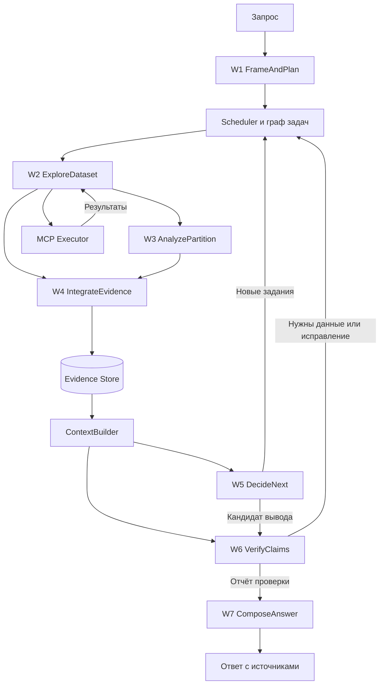

# Workflows исследовательской Agent OS

Спецификация прототипа на Node.js и Mastra

30 октября 2026

## 1 Цель и границы

Прототип принимает исследовательский запрос, выбирает и комбинирует переиспользуемые workflows, получает данные через подключённые MCP и формирует ответ с проверяемыми evidence. Он работает с объёмом данных, превышающим окно контекста модели. Workflows могут исполняться параллельно, публиковать промежуточные результаты, создавать дочерние задачи и запрашивать продолжение работы друг друга.

В этой версии MCP уже подключены. Управление корпоративными ролями и RBAC вынесено за границы документа по запросу пользователя. Генерация новых исполняемых workflows моделью также не требуется: модель выбирает зарегистрированные способности и задаёт параметры их запусков.

Предлагаемые workflows и их контракты — проектное решение для этой платформы. Они объединяют механизмы нескольких исследований. Ни одна из приведённых статей не доказывает эффективность всей предлагаемой комбинации на корпоративных логах и произвольной небольшой модели.

Термин «подагент» означает отдельное исполнение обработчика с собственной задачей и контекстом. Это может быть та же модель с другим входом. Параллельность не требует разных моделей или разных процессов.

## 2 Как проверены научные ссылки

Для каждого источника зафиксирована версия arXiv. Номер страницы ниже — физическая страница PDF, начиная с 1, а не номер страницы конференционного сборника. PDF скачаны и проверены через извлечение текста. Ссылки с `#page=N` открывают соответствующую страницу в поддерживающих это PDF viewers. Раздел, рисунок и алгоритм служат дополнительными устойчивыми ориентирами.

Номера строк алгоритма относятся к PDF указанной версии. В HTML-конверсиях arXiv нумерация может отличаться. Номера строк автоматически извлечённого веб-текста здесь не используются.

### P1 Decomposed Prompting

**Tushar Khot et al. Decomposed Prompting A Modular Approach for Solving Complex Tasks. ICLR 2023. Версия 2210.02406v2.**

- [PDF страница 3](https://arxiv.org/pdf/2210.02406v2#page=3): §3 и §3.1 — постановка декомпозиции и описания обработчиков.
- [PDF страница 4](https://arxiv.org/pdf/2210.02406v2#page=4): §3.2 и Figure 3 — контроллер получает очередной подзапрос, маршрутизирует обработчику и возвращает результат декомпозеру.
- [PDF страница 5](https://arxiv.org/pdf/2210.02406v2#page=5): §3.3, абзац Recursive Decomposition и Figure 5 — возможности композиции и рекурсивное уменьшение входа.

**Поддерживаемый механизм:** библиотека специализированных обработчиков, выбор обработчика для подзадачи, вложенная декомпозиция. **Эмпирическая часть:** §4, в частности §4.2–4.4. **Граница переноса:** асинхронная шина событий, дедупликация задач и наши JSON-контракты не являются алгоритмом этой статьи.

### P2 LLMCompiler

**Sehoon Kim et al. An LLM Compiler for Parallel Function Calling. ICML 2024. Версия 2312.04511v3.**

- [PDF страница 4](https://arxiv.org/pdf/2312.04511v3#page=4): Figure 2, §3.1 Function Calling Planner, §3.2 Task Fetching Unit, §3.3 Executor.
- [PDF страница 5](https://arxiv.org/pdf/2312.04511v3#page=5): продолжение §3.4 Dynamic Replanning; §4.2 Streamed Planner.

**Поддерживаемый механизм:** DAG зависимостей, запуск готовых задач, подстановка результатов зависимостей, асинхронный executor и перепланирование по наблюдениям. В §3.2 прямо указано, что диспетчеризация может работать без отдельной LLM. **Эмпирическая часть:** Table 1, PDF стр. 6; §5.2, стр. 7; §5.3, стр. 8. Например, HotpotQA: accuracy 62.00 против 62.47 у ReAct†, latency 3.95 против 7.12 секунд в указанной GPT-конфигурации. Это свидетельство выигрыша latency в конкретном эксперименте, а не гарантированного улучшения accuracy. **Граница переноса:** постоянное хранилище, доставка событий и восстановление нашего runtime — дополнительные инженерные механизмы.

### P3 IRCoT

**Harsh Trivedi et al. Interleaving Retrieval with Chain of Thought Reasoning for Knowledge Intensive Multi Step Questions. ACL 2023. Версия 2212.10509v2.**

- [PDF страница 3](https://arxiv.org/pdf/2212.10509v2#page=3): §3.1 — начальный retrieval и чередование reason/retrieve.
- [PDF страница 4](https://arxiv.org/pdf/2212.10509v2#page=4): Figure 2 и продолжение §3.1 — новый поиск по последнему промежуточному выводу, накопление результатов, ограничение числа шагов и размера набора.

**Поддерживаемый механизм:** уже найденное влияет на то, что искать дальше. **Эмпирическая часть:** §5; абзац IRCoT is also effective for smaller models, PDF стр. 7. **Граница переноса:** исходный метод генерирует CoT-предложения; наш типизированный запрос недостающих evidence вместо свободного reasoning — адаптация. Результаты QA не доказывают качество root cause analysis логов.

### P4 ReWOO

**Binfeng Xu et al. ReWOO Decoupling Reasoning from Observations for Efficient Augmented Language Models. Версия 2305.18323v1.**

- [PDF страница 3](https://arxiv.org/pdf/2305.18323v1#page=3): Figure 2 и §2.1 Plan Work Solve — Planner, Worker и Solver; ссылки на промежуточные результаты через переменные evidence.
- [PDF страница 4](https://arxiv.org/pdf/2305.18323v1#page=4): §2.2, equations 1 и 2 — анализ повторного включения истории в prompt.
- [PDF страница 8](https://arxiv.org/pdf/2305.18323v1#page=8): §4 Limitations and Future Work — ограничения предварительного планирования при недостаточно известной среде.

**Поддерживаемый механизм:** разделение планирования, получения данных и сборки результата. **Эмпирическая часть:** §3.2 и Table 2. **Граница переноса:** глобальный одноразовый план плохо соответствует неизвестным логам; здесь используем короткие планы с возможностью пересмотра. Ссылки на evidence уменьшают перенос данных между процессами, но перед интерпретацией нужное содержимое всё равно должно попасть в контекст модели.

### P5 MemGPT

**Charles Packer et al. MemGPT Towards LLMs as Operating Systems. Версия 2310.08560v2.**

- [PDF страница 2](https://arxiv.org/pdf/2310.08560v2#page=2): §2.1 Main context и §2.2 Queue Manager — разделение рабочего контекста и внешнего хранения.
- [PDF страница 3](https://arxiv.org/pdf/2310.08560v2#page=3): §2.3 Function executor — перемещение информации через функции памяти.
- [PDF страница 4](https://arxiv.org/pdf/2310.08560v2#page=4): §2.4 Control flow and function chaining — события и продолжение/передача управления.

**Поддерживаемый механизм:** иерархия памяти и подгрузка необходимого содержимого. **Эмпирическая часть:** §3.2 document analysis, PDF стр. 6–7. **Граница переноса:** в оригинале памятью в значительной степени управляет LLM; здесь бюджет и подбор пакета контекста контролирует программный ContextBuilder. Это не lossless «бесконечная память»: потерянный при отборе факт может повлиять на результат.

### P6 GraphRAG

**Darren Edge et al. From Local to Global A GraphRAG Approach to Query Focused Summarization. Версия 2404.16130v2.**

- [PDF страница 4](https://arxiv.org/pdf/2404.16130v2#page=4): §3.1.1 и §3.1.2 — chunks, entities и relationships.
- [PDF страница 5](https://arxiv.org/pdf/2404.16130v2#page=5): §3.1.3 — объединение извлечённых представлений в граф; §3.1.4 — сообщества.
- [PDF страница 6](https://arxiv.org/pdf/2404.16130v2#page=6): §3.1.5 — иерархические summaries; §3.1.6 — подготовка контекста, parallel map и reduce ответа.

**Поддерживаемый механизм:** графовый индекс и иерархическое обобщение корпуса. **Эмпирическая часть:** §5; ограничения — §6.1, PDF стр. 11. **Граница переноса:** исследования посвящены глобальным вопросам по текстовым корпусам, не причинной диагностике логов. Наш инкрементальный evidence graph с типами утверждений, версиями и опровержениями — адаптация, а не точное воспроизведение GraphRAG. Leiden и глобальные summaries для MVP не обязательны.

### P7 CRITIC

**Zhibin Gou et al. CRITIC Large Language Models Can Self Correct with Tool Interactive Critiquing. ICLR 2024. Версия 2305.11738v4.**

- [PDF страница 4](https://arxiv.org/pdf/2305.11738v4#page=4): Algorithm 1. Строка 1 — начальный ответ; строка 3 — проверка через tools; строки 4–5 — ранняя остановка; строка 7 — исправление; строка 9 — возврат после лимита итераций.
- [PDF страница 5](https://arxiv.org/pdf/2305.11738v4#page=5): §3.3 Verification with Tool Interaction и §3.4 Correction with Critiques.

**Поддерживаемый механизм:** проверка через внешнюю обратную связь и ограниченное исправление. **Эмпирическая часть:** §4, включая QA и program synthesis. **Граница переноса:** роль отдельного verifier не гарантирует независимости ошибки. Наши статусы supported/refuted/insufficient и требования к provenance — проектные контракты; статья не доказывает их достаточность для любых логов.

## 3 Архитектурные единицы

Есть семь типов интеллектуальных workflows и три программных сервиса. Не нужно запускать LLM для простой доставки события, чтения записи или проверки schema.

| Единица | Роль | Характер исполнения |
|---|---|---|
| W1 FrameAndPlan | Сформулировать задачу и ближайшие подзадачи | LLM и программная валидация |
| W2 ExploreDataset | Найти и получить нужную область больших данных | Код и при необходимости LLM |
| W3 AnalyzePartition | Разобрать ограниченный фрагмент | Локальный агент или функция |
| W4 IntegrateEvidence | Добавить связи и согласовать утверждения | Детерминированное объединение и LLM для неоднозначностей |
| W5 DecideNext | Выбрать следующее исследовательское действие | LLM из ограниченного пространства решений |
| W6 VerifyClaims | Проверить существенные утверждения | Проверки кодом и обращения к источникам |
| W7 ComposeAnswer | Составить ответ по проверенному материалу | LLM и проверка ссылок |
| Scheduler | Запускать задачи с готовыми зависимостями | Код |
| ContextBuilder | Собирать ограниченный пакет контекста | Код, summary при необходимости |
| ToolExecutor | Валидировать и вызывать MCP, сохранять результаты | Код |

Workflow — зарегистрированная процедура с контрактом. Task — конкретное её исполнение. Один Explore может создать несколько AnalyzePartition; тот же AnalyzePartition может использоваться в другом Explore. Общая процедура не означает общее изменяемое состояние всех её запусков.

## 4 Общий контракт исполнения

Каждая задача имеет taskId, investigationId, workflowType, workflowVersion, inputRefs, expectedOutput, dependsOn, stateVersion, budget, status, outputRefs и checkpoint. У входных ссылок фиксируется версия данных или snapshot.

Ожидаемый результат описывается до старта: например, «найти все группы ошибок в указанном диапазоне» и «выбрать несколько примеров ошибок» — разные задания с разными требованиями к охвату.

Состояния исполнения: queued, running, waiting, succeeded, failed, cancelled. waiting сохраняет явное условие пробуждения. succeeded означает выполненный контракт обработки, а не доказанную истинность гипотезы.

Статусы знания хранятся отдельно: observed, candidate, supported, refuted, unknown, stale. Значение supported всегда имеет область действия, основание и версию evidence. Оно не означает абсолютную истину.

Результат workflow содержит answerOrDelta, evidenceRefs, coverage, missingEvidence, warnings и proposedTasks. Создание proposedTask не запускает её напрямую: scheduler валидирует зависимости и бюджет.

## 5 W1 FrameAndPlan

**Назначение.** Преобразовать запрос в измеримую исследовательскую цель и короткий план. Работает с логами, документами или таблицами через общие capabilities.

**Вход:** запрос пользователя, доступные MCP capabilities, известные параметры данных, ограничения времени и бюджета.

**Алгоритм предлагаемого workflow:**

1. Выделить предмет исследования, временную область, известные сущности и требуемый тип ответа.
2. Описать обязательные условия результата. Для причинного вопроса отдельно указать необходимость цепочки событий и проверки альтернатив.
3. Проверить, есть ли инструменты нужного класса. Если нет — вернуть limitation, не создавать несуществующий tool.
4. Выбрать ближайший набор подзадач из каталога W2–W7. Зафиксировать зависимости и ожидаемые выходы.
5. Проверить ссылки на задачи, schema и отсутствие цикла ожидания.
6. Сохранить planRevision и опубликовать PlanReady.

**Выход:** постановка задачи, критерии готовности, начальные tasks и список неизвестных параметров.

**Остановка:** план валиден; требуется уточнение; либо нет подходящих capabilities. Повторный вызов W1 используется при существенной смене цели, а не после каждой строки логов.

**Взаимодействие:** initial PlanReady запускает scheduler. DecisionProduced с решением replan создаёт новую ревизию плана, сохраняя пригодные результаты.

**Основание:** P1 §3.1–3.2, PDF стр. 3–4; P2 §3.1, стр. 4. Конкретные поля, условия готовности и schema validation — наше решение.

## 6 W2 ExploreDataset

**Назначение.** Обследовать источник, сузить область, получить evidence и управлять охватом большого набора.

**Вход:** вопрос или NeedEvidence, sourceRefs, scope, желаемая полнота и лимиты.

**Алгоритм предлагаемого workflow:**

1. Определить свойства источника: доступные фильтры, поля, агрегации, pagination и ограничения выдачи.
2. Если источник позволяет, зафиксировать snapshot, верхнюю границу времени или стабильный cursor. Иначе явно отметить изменяемость данных.
3. Получить дешёвый обзор инструментами: counts, распределения, категории, временные интервалы. Не передавать все строки модели.
4. Выбрать стратегию: точечный поиск, разбиение по области, агрегации или комбинированное исследование.
5. Для каждой выбранной части сформировать задачу W3 с вопросом и границами. Разделы должны иметь идентификаторы и отражаться в coverage manifest.
6. По мере готовности сохранять результаты и публиковать EvidenceBatchReady. Не ждать всего исследования, если downstream может работать на частичном материале.
7. Обрабатывать NeedEvidence от W5/W6: проверить, нет ли уже подходящего результата, затем создать уточняющую выборку.
8. Завершить текущую выборку, когда выполнен coverage contract, исчерпан источник или достигнут лимит. В последнем случае вернуть неполный охват.

**Выход:** ссылки на сохранённые данные, manifest обработанных областей, totalMatched/returned при доступности, pagination state и явные пробелы.

**Подагенты:** запускаются по сервисам, partitions, документам или независимым подзапросам. Случайная нарезка по токенам — запасной вариант; связи по traceId должны восстанавливаться через отдельные запросы.

**Остановка:** контракт охвата выполнен, источник исчерпан, поиск перестал давать новые данные либо бюджет исчерпан. «Не найдено в выборке» не означает «не существует».

**Взаимодействие:** EvidenceBatchReady запускает W4. NeedsPartitionAnalysis создаёт W3. Запросы уточнения не требуют остановки независимых partitions.

**Основание:** P3 §3.1 и Figure 2, PDF стр. 3–4 — feedback от исследования к retrieval; P1 Recursive Decomposition, стр. 5 — разделение крупного входа. Snapshot, manifest, выбор агрегаций и инкрементальная публикация — адаптация для данных.

## 7 W3 AnalyzePartition

**Назначение.** Выполнить ограниченную исследовательскую подзадачу в небольшом контексте.

**Вход:** partitionRef, узкий вопрос, snapshotRef, связанные сущности и лимит действий.

**Алгоритм предлагаемого workflow:**

1. ContextBuilder получает только нужный фрагмент и задачу. Если фрагмент не помещается, сначала применяются фильтры или детерминированное свёртывание.
2. Извлечь наблюдаемые значения кодом: timestamps, IDs, status codes и счётчики. LLM использовать для интерпретации неструктурированного текста.
3. Сформулировать кандидатов утверждений с точными sourceRefs. Отдельно указать наблюдения и возможные объяснения.
4. Для связи через границу partition вернуть запрос дополнительных данных. Не объявлять отсутствующий соседний кусок подтверждением гипотезы.
5. При действительно большом входе предложить дальнейшее разбиение. Применить лимит глубины и требование уменьшения задачи.
6. Вернуть компактный результат и записать, что именно просмотрено.

**Выход:** candidateFacts, candidateRelations, hypothesisRefs, evidenceRefs, missingEvidence и coverageDelta.

**Остановка:** вопрос обработан в допустимой области, требуется внешняя информация или исчерпан бюджет. Не требуется самостоятельно отвечать на весь пользовательский запрос.

**Взаимодействие:** PartitionAnalyzed поступает в W4. MissingEvidence становится предложением для W2 через scheduler. Две задачи не могут бесконечно ожидать ответов друг от друга: запрос продолжения создаёт следующую ревизию обработки, исходная задача возвращает частичный результат.

**Основание:** P1 §3.2–3.3, PDF стр. 4–5. Контекстный бюджет — адаптация идеи P5, а не гарантированное сохранение всех значимых фактов.

## 8 W4 IntegrateEvidence

**Назначение.** Создать согласованное представление известных сущностей, событий и утверждений без стирания противоречий.

**Вход:** EvidenceBatchReady или PartitionAnalyzed с provenance и областью данных.

**Алгоритм предлагаемого workflow:**

1. Проверить существование sourceRefs, формат полей и snapshot. Некорректные элементы вернуть на исправление.
2. Объединить сущности по точным стабильным идентификаторам. Сопоставление по похожим именам хранить как candidate mapping до подтверждения.
3. Добавить события и типизированные связи: belongsToTrace, precedes, calls, supports, contradicts. Совпадение времени само по себе не создаёт causes.
4. Сохранить утверждения разных обработчиков как отдельные записи с происхождением. Повтор одного исходного события не считать независимым подтверждением.
5. Обнаружить несовместимые значения в одной области и версии. Создать contradiction record с обеими сторонами.
6. При необходимости построить компактное summary затронутой области. Сохранять ссылки на базовые evidence и версию summary.
7. Атомарно сохранить delta, увеличить graphRevision и опубликовать GraphDeltaCommitted с изменёнными IDs.

**Выход:** graphDeltaRef, graphRevision, contradictionRefs и affectedQuestionIds.

**Остановка:** текущая порция добавлена или отклонена с причиной. Workflow не ожидает полного окончания Explore.

**Взаимодействие:** W5 и W6 получают повод пересмотреть затронутый вопрос. Событие не обязано вызывать LLM немедленно: scheduler может объединить несколько изменений.

**Основание:** P6 §3.1.2–3.1.3, PDF стр. 4–5 — извлечение и объединение представлений. Claims, опровержения, инкрементальные версии и правила identity здесь спроектированы дополнительно. Это evidence graph, а не точная реализация pipeline GraphRAG.

## 9 W5 DecideNext

**Назначение.** Выбрать следующий исследовательский шаг на основании текущей цели и доступного evidence.

**Вход:** goalRef, criteria, релевантный подграф, coverage, активные задачи и остаток бюджета.

**Алгоритм предлагаемого workflow:**

1. Сопоставить обязательные вопросы с evidence и отметить пробелы.
2. Определить, не покрывается ли пробел уже запущенной задачей. В этом случае выбрать wait и подписку, а не повторный запуск.
3. Выбрать одно из решений: requestEvidence, requestAnalysis, requestVerification, replan, wait, proposeAnswer или concludeInconclusive.
4. Для нового запроса указать конкретную неизвестную величину, область поиска и результат, который повлияет на решение.
5. Привязать решение к inputRevision и зависимым evidence IDs.
6. Программно проверить допустимость типа решения, доступность capability и бюджет. Сохранить DecisionProduced.

**Выход:** тип решения, краткое основание с evidenceRefs, proposedTasks и условие ожидания либо кандидат вывода.

**Остановка:** одно решение на входную ревизию. Возвращение requestEvidence не блокирует worker до окончания поиска.

**Взаимодействие:** W5 создаёт работу W2/W3/W6 через scheduler. Входящий GraphDeltaCommitted запускает пересмотр только при изменении значимых зависимостей или закрытии ожидаемого пробела.

**Основание:** P2 §3.4, PDF стр. 4–5 — пересмотр плана; P3 §3.1, стр. 3–4 — зависимость следующего поиска от найденного. Ограниченное пространство решений, оценка новизны и version gates — проектная реализация.

## 10 W6 VerifyClaims

**Назначение.** Проверить существенное утверждение или кандидат финального вывода через исходные данные и явно описанные критерии.

**Вход:** claim или candidateAnswer, evidenceRefs, критерии, inputRevision.

**Алгоритм предлагаемого workflow:**

1. Разбить вывод на проверяемые утверждения, сохранив области времени и данных.
2. Проверить кодом IDs, числа, диапазоны, ссылки и согласованность версий.
3. Для существенных выводов запросить через MCP оригинальные записи или независимые наблюдения, а не только summary автора гипотезы.
4. Проверить альтернативное объяснение и противоречащие evidence в заявленной области. Без контрфактических данных не превращать последовательность событий в доказанную причину.
5. Присвоить каждому claim supported, refuted или insufficient; добавить конкретное основание и missingEvidence.
6. При исправимой ошибке вернуть critique в W5. При нехватке данных сформировать NeedEvidence. После исправления создать новую ревизию проверки.
7. Ограничить число циклов проверки. Исчерпание бюджета ведёт к явной неопределённости, а не к автоматическому supported.

**Выход:** VerificationReport с результатами по claims, evidenceRefs, inputRevision и рекомендацией.

**Остановка:** утверждения проверены в заявленной области, получение подтверждений невозможно либо лимит достигнут.

**Взаимодействие:** VerificationProduced направляется в W5; пригодный кандидат поступает в W7. W6 не должен сам запускать неограниченные цепочки самопроверки.

**Основание:** P7 Algorithm 1, PDF стр. 4, строки 3–7; §3.3–3.4, стр. 5. Правила по provenance, альтернативным объяснениям и статус insufficient — дополнительный контракт платформы.

## 11 W7 ComposeAnswer

**Назначение.** Подготовить пользовательский ответ с сохранением границы между установленным, предположенным и неизвестным.

**Вход:** goal, проверенные claims, VerificationReport, coverage и ограничения.

**Алгоритм предлагаемого workflow:**

1. Сформировать короткий вывод и структуру ответа по запросу пользователя.
2. Для большого материала собрать локальные summaries по подзадачам. Включать опровержения и пробелы, а не только поддерживающие фрагменты.
3. Составить итог из summaries и выбранных базовых evidence в пределах токенового бюджета.
4. Привязать существенные утверждения к sourceRefs. Проверить существование ссылок и числовую согласованность.
5. Если при написании появился новый существенный claim, вернуть его в W6; не считать его проверенным автоматически.
6. Сохранить finalAnswerRef и ссылку на использованную ревизию состояния.

**Выход:** ответ, источники, что проверено, что осталось неизвестным, и outcome: answered, partial или inconclusive.

**Остановка:** ответ соответствует критериям представления и не содержит новых непроверенных утверждений. Окончание записи ответа не требует доказанности единственной причины: корректный inconclusive тоже может завершить исследование.

**Взаимодействие:** completion gate runtime закрывает задачу, отменяет больше не нужные работы и сохраняет их частичные результаты. Если ожидаемые значимые задачи ещё не завершены, ответ маркируется preliminary или ждёт их.

**Основание:** P4 §2.1, PDF стр. 3–4 — Solver; P6 §3.1.6, стр. 6 — многоступенчатая сборка ответа. Проверка всех новых claims перед финализацией — наше дополнение.

## 12 ContextBuilder

Это общий сервис, а не восьмой обязательный агент. Его вызывают перед каждым обращением к модели.

Он получает задачу, роль workflow, токеновый бюджет и версию состояния. Пакет включает цель, контракт выхода, значимые факты, открытые вопросы, релевантный фрагмент графа, последние полезные наблюдения и небольшой набор tools.

Пример стартового бюджета для модели с окном 16 000 токенов: 2 000 — инструкции и схемы; 1 000 — задание; 2 000 — рабочий brief; 6 000 — evidence; 3 000 — резерв ответа; 2 000 — запас для сериализации и вариативности tokenizer. Это проектная стартовая настройка, не результат статьи; все входные схемы и технические сообщения также учитываются tokenizer выбранной модели.

Если обязательный evidence не помещается, создаётся более узкая подзадача или выполняется инструментальная агрегация. Summary не имеет права молча подменять требуемую точную запись. Размеры outputs и очередей ограничиваются отдельно.

Связь с P5 приведена в его карточке. Программный бюджет и правила приоритетов — наш механизм.

## 13 Пересечения и взаимодействия workflows

### 13.1 Общая работа

Два Decide могут запросить один trace. Scheduler вычисляет ключ из типа workflow, нормализованных параметров, snapshot и версии обработчика. При совпадении он может добавить второго подписчика к существующей задаче. Разные вопросы анализа одного trace не обязаны быть одной задачей; получение исходных данных и их интерпретация дедуплицируются отдельно.

Дедупликация определяется кодом, не оценкой LLM «кажется, это одно и то же». При изменении snapshot старый результат не считается автоматически актуальным.

### 13.2 Частичные результаты

Explore выпускает evidence порциями. IntegrateEvidence делает commit независимо для каждой порции. Decide может исследовать гипотезу по частичному материалу, но обязан знать coverage. Завершение одной ветки не закрывает незавершённые обязательные ветки всей задачи.

### 13.3 Запрос данных вместо взаимной блокировки

Decide публикует NeedEvidence и завершает текущий вызов. Scheduler создаёт Explore и регистрирует continuation. Когда нужная работа заканчивается, запускается новый Decide с новым контекстом. LLM-вызов и worker не удерживаются на время ожидания.

### 13.4 Граф с циклами и граф ожидания

На уровне типов workflows возможен цикл Explore → Decide → Explore. На уровне конкретных задач каждая итерация имеет новый taskId/revision. Нельзя создавать ситуацию, где задача A ждёт B, а B ждёт завершения A. Scheduler отклоняет такие зависимости либо преобразует взаимодействие в завершение порции и новую итерацию.

### 13.5 Когда нужно запускать Decide

Основания: закрыт обязательный пробел; появилась существенная contradiction; завершена запланированная порция; истёк срок ожидания; достигнут бюджет. Каждая строка логов не должна порождать отдельный LLM-вызов. Batch size и период коалесцирования — параметры прототипа.

### 13.6 Обновления во время решения

Вызов модели работает на фиксированной inputRevision. После его завершения runtime проверяет, изменились ли существенные входы. Если изменились, решение помечается для пересмотра. Нельзя автоматически отвергать каждый результат только потому, что вырос глобальный graphRevision: изменение могло относиться к другой области.

### 13.7 Доставка событий

Commit evidence, новая ревизия и событие outbox сохраняются одной транзакцией PostgreSQL. Worker доставляет события с возможными повторами. Inbox фиксирует обработанные eventId, handlers идемпотентны. Это уменьшает риск потери уведомления после записи данных, но не создаёт exactly once для внешнего MCP-действия.

### 13.8 Ошибки MCP

Отделять protocol/transport failure, tool result с ошибкой и корректный пустой результат. Retry допустим в рамках бюджета; неопределённый исход изменяющей операции требует отдельного разрешения через operationId или проверки результата. Аналитический прототип может ограничиться инструментами чтения, если это соответствует подключённым источникам; любые writes имеют отдельный контракт исполнения.

Эти механизмы координации — инженерная спецификация. LLMCompiler подтверждает dependency scheduling и replanning, но не служит доказательством реализации transactional outbox или семантики повторов.

## 14 События прототипа

| Событие | Производитель | Обработчик | Содержимое |
|---|---|---|---|
| PlanReady | W1 | Scheduler | planRef, planRevision |
| NeedEvidence | W5 или W6 | Scheduler → W2 | вопрос, scope, sourceRefs, purpose |
| PartitionRequested | W2 | Scheduler → W3 | partitionRef, taskQuestion |
| EvidenceBatchReady | W2 | W4 | batchRef, snapshot, coverageDelta |
| PartitionAnalyzed | W3 | W4 | resultRef, sourceRefs |
| GraphDeltaCommitted | W4 | Scheduler | graphRevision, affectedIds |
| DecisionProduced | W5 | Scheduler | решение, inputRevision, proposedTasks |
| VerificationProduced | W6 | W5 или W7 | reportRef, claimStatuses |
| AnswerComposed | W7 | Completion gate | answerRef, outcome |

Общие поля envelope: eventId, investigationId, taskId, causationId, correlationId, schemaVersion, stateRevision, payloadRef, createdAt. Большие тексты не копируются в сообщения. На каждый event type задаются schema и обработчик неизвестной версии.

## 15 Пример полного расследования

Пример полностью условный. Он иллюстрирует механику, а не факты из источников.

Запрос: «Почему после релиза увеличились ошибки платежей?»

1. W1 фиксирует время релиза, область сравнения и необходимость проверки альтернатив; создаёт W2 для baseline и текущего периода.
2. W2 получает агрегаты через MCP. Число timeout выросло; создаёт W3 для payment и provider adapter. Вторая ветка ещё работает.
3. Первый W3 возвращает повторяющиеся requestId. W4 записывает связи и commit revision 12. W5 получает достаточную порцию для следующего решения.
4. W5 формирует гипотезу H1 о задержке внешнего провайдера и NeedEvidence: traces обеих сторон одного вызова. Он завершает свой turn, scheduler запускает уточняющий W2.
5. Параллельный W3 находит преждевременный локальный timeout. W4 фиксирует contradiction с H1 на revision 13.
6. Уточняющий W2 получает timestamps: внешний ответ приходит после локального timeout. Получение trace переиспользуется другими задачами с тем же snapshot.
7. W5 предлагает H2: изменилось локальное ограничение ожидания. W6 запрашивает конфигурацию до/после и проверяет несколько исходных операций.
8. Если конфигурация недоступна, H2 остаётся вероятным объяснением. Если найдены подтверждения и проверены альтернативы в заданной области, формируется scoped supported claim.
9. W7 выдаёт вывод, evidence, ограничения охвата и нерешённые вопросы. Никаких автоматических изменений production-конфигурации этот сценарий не предполагает.

Этот пример показывает раннюю обработку частичных результатов, обратные запросы данных, общий граф и независимую проверку без передачи всем агентам всей истории.

## 16 Реализация на Node.js

**Минимальный стек:** Node.js, TypeScript, Mastra для LLM-обработчиков и локальных flows, MCP client для подключённых источников, PostgreSQL для задач/evidence/outbox, файловое или объектное хранилище для больших outputs, Zod или JSON Schema для контрактов.

**Модули приложения:** workflow catalog, scheduler, context builder, evidence repository, MCP executor и answer renderer. На старте один worker может исполнять несколько независимых tasks с ограничением concurrency; каждый task checkpoint фиксируется явно.

Mastra — выбранный инфраструктурный адаптер, а не научный результат. Соответствие API конкретной установленной версии нужно проверить при реализации. Нельзя считать, что последовательность `.parallel().then()` сама реализует потребление частичных результатов по готовности. Для этого взаимодействия используется уровень tasks/events.

Temporal имеет смысл подключать, если уже на прототипе критичны долговременные ожидания и межпроцессные продолжения. Тогда он становится владельцем scheduling/recovery, а Mastra и MCP вызываются через Activities. Отдельный самодельный durable scheduler параллельно с ним не требуется.

Наличие evidence graph не обязывает использовать Neo4j. Для MVP достаточно таблиц entities, relations, claims, evidence и их ссылок; вопрос хранения определяется объёмом и характером запросов.

## 17 Порядок сборки прототипа

1. Подключить один реальный MCP-источник и унифицировать responses с provenance и truncation metadata.
2. Реализовать контракты task/event/evidence, хранилище и простой scheduler.
3. Собрать цикл W1 → W2 → W5 → W6 → W7 с программным ContextBuilder.
4. Добавить W3 для нескольких partitions с отдельными контекстами.
5. Добавить W4 и передачу graph deltas, чтобы решения использовали связанные факты.
6. Включить пересечения: частичные результаты, подписки на общую задачу и уточняющие NeedEvidence.

Практическая демонстрация готовности: один запрос запускает две ветки исследования, решение появляется до конца всей загрузки, запрашивает дополнительные данные, использует общий trace, проходит verification и завершается с источниками. Это критерий работоспособности прототипа; отдельная benchmark-инфраструктура в документе не предлагается.

## 18 Что научно подтверждено и что предстоит проверить

| Положение | Статус |
|---|---|
| Переиспользуемые subtask handlers и рекурсивная декомпозиция | Показаны в P1 |
| Планирование зависимостей, параллельный executor и replanning | Показаны в P2 |
| Уточнение поиска по промежуточным результатам | Показано в P3 |
| Разделение plan/work/solve и снижение повторов prompt | Показано в P4 |
| Работа с внешней памятью за пределами context window | Показана в P5 |
| Графовый индекс и многоступенчатая сборка ответа | Показаны в P6 |
| Tool-based verification и bounded correction | Показаны в P7 |
| Их совместная работа на наших MCP и логах | Инженерная гипотеза |
| Достаточность выбранной слабой модели | Зависит от модели и сложности контрактов |
| Польза именно графа по сравнению с простыми таблицами | Требует проверки на выбранных задачах |
| Асинхронный протокол событий и общий task cache | Предлагаемая реализация, не вывод одной из статей |

## 19 Диаграмма взаимодействия

Показаны логические связи. Доставка заданий и продолжений проходит через scheduler/events; ссылки между workflows не означают обязательный вложенный синхронный вызов. ContextBuilder также вызывается для W1, W3, W4 и W7, когда им нужна модель; эти связи опущены для читаемости.
